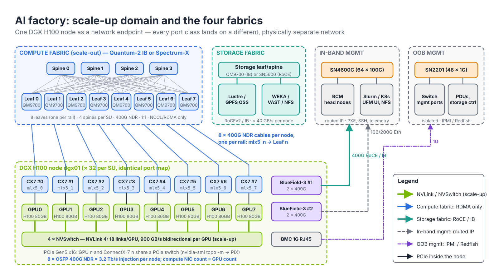
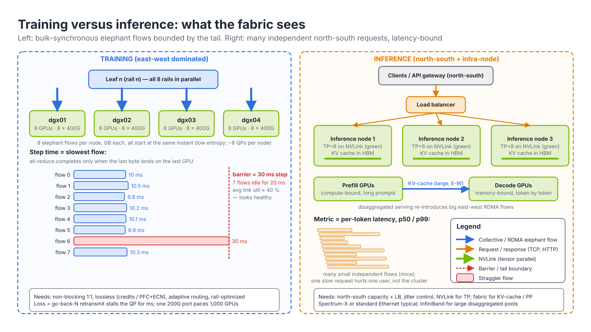
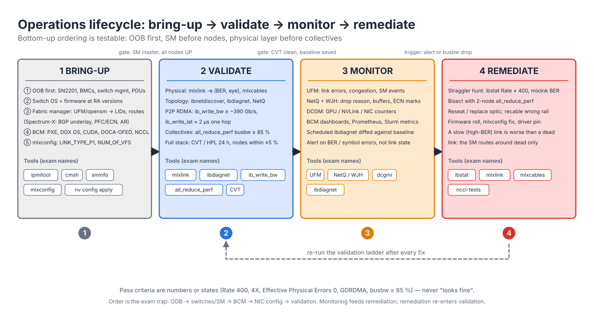

# Module 1.1 — AI Infrastructure and Operations Fundamentals

> **Exam domain:** AI Data Center Design and Optimization (5%)  
> **Source course(s):** AI Infrastructure and Operations Fundamentals (NVIDIA Academy)  
> **Source docs:** NVIDIA DGX SuperPOD Reference Architecture (H100/H200/B200/GB200); NVIDIA Spectrum-X Networking Platform documentation; NVIDIA BlueField DPU documentation  
> **Estimated study time:** 2.5 hours

> **How to study this module:** read §1–§2, work through the §3 walkthrough on real gear or NVIDIA Air, then attempt the §5 hands-on assignment using only the Hint section. Open the Solution guide (last section) only after you have a working attempt. Finish with the Appendix C knowledge check closed-book.

## 1. Learning objectives

By the end of this module you will be able to…

- **Describe** the "AI factory" model and explain how training and inference workloads place different demands on the network. *(Exam objective: AI DC Design — characterize AI workload traffic)*
- **Explain** why AI back-end traffic (elephant flows, low entropy, synchronous collectives, tail-latency sensitivity) breaks the assumptions of classic enterprise/data-center Ethernet designs. *(AI DC Design — contrast AI vs traditional DC networking)*
- **Distinguish** the four fabrics in an NVIDIA reference design — compute, storage, in-band management, out-of-band management — and state what traffic belongs on each. *(AI DC Design — fabric roles)*
- **Differentiate** scale-up (NVLink/NVSwitch) from scale-out (InfiniBand or Spectrum-X Ethernet) communication and identify where each applies. *(AI DC Design — scale-up vs scale-out)*
- **Contrast** east-west and north-south traffic in an AI cluster and explain why AI designs are east-west dominated. *(AI DC Design — traffic patterns)*
- **Summarize** the power, cooling and rack-density constraints that drive AI data-center physical design and cabling choices. *(AI DC Design — physical constraints)*
- **Outline** the operations lifecycle of an AI cluster (bring-up, validation, monitoring) and name the NVIDIA tool used at each stage. *(Troubleshooting Tools — validation tool selection)*
- **Describe** where the BlueField DPU and SuperNIC fit in an AI node and which functions each handles. *(AI DC Design — node components)*

## 2. Key technical concepts

### 2.1 The AI factory

*Analogy:* a refinery, not an office park. Raw material (data) enters, energy is consumed, and one product (intelligence — tokens, trained weights) leaves. Everything in the building is tuned for one production line.

**What it is.** NVIDIA uses the term **AI factory** for a data center whose output is not web pages or transactions but *tokens* and *trained model weights*. Physically it is a small set of repeating blocks — node, Scalable Unit (SU), pod/SuperPOD — connected by four physically separate networks (Figure 1.1-1). The unit of accounting is the GPU-hour: a 1,016-GPU H100 SuperPOD at ~10.2 kW per node burns on the order of 1.3 MW for compute alone, so every percent of GPU idle time has a dollar figure attached.

| Block | What it is | Example |
|---|---|---|
| Node | A server with (typically) 8 GPUs, NVLink-connected, with one compute NIC per GPU | DGX H100, DGX B200, HGX-based OEM server |
| Scalable Unit (SU) | A fixed group of nodes plus their leaf switches, designed once and repeated | 32 DGX nodes in the H100-era SuperPOD (see [Module 1.2](02-dgx-superpod-basepod-reference-architectures.md)) |
| Pod / SuperPOD | Multiple SUs under one spine (and optionally core) layer | 4 SUs ≈ 127 nodes, ~1,016 GPUs |
| Fabrics | Separate physical networks for compute, storage, in-band and OOB management | InfiniBand Quantum-2 or Spectrum-X for compute |


*Figure 1.1-1 — The AI factory from one node's point of view: 8 ConnectX-7 ports to the compute fabric (one per rail); port 1 of each BlueField-3 (`mlx5_8`, `mlx5_10`) to the storage fabric and port 2 of each (`mlx5_9`, `mlx5_11`) to in-band management, so losing one card never cuts the node off from either network; the BMC to OOB; NVLink/NVSwitch never leaves the chassis. Verify device indices on your nodes with `ibdev2netdev -v`.*

**Why it exists.** The whole facility is optimized around a single, tightly coupled workload class instead of thousands of independent tenants. The practical consequence for you as a network engineer is that **GPU utilization is the primary KPI**, and the network is the component most likely to reduce it: a slow link, a lost packet, or a congested spine stalls every GPU in the job, not just the one behind the bad port. Enterprise designs amortize a bad link across thousands of unrelated flows; an AI factory cannot, because the flows are coupled by synchronous collectives (§2.2).

**How it works.** Because the blocks repeat, the design is formulaic: 8 compute ports per node → 8 leaf switches per SU (one per rail) → 32 nodes × 8 = 256 node-to-leaf cables → 256 leaf-to-spine cables → 4 spines of 64 ports. Operations repeat the same way: every node runs the same DGX OS image deployed by **Base Command Manager (BCM)**, every leaf has the same NVUE or MLNX-OS template, and acceptance is done per SU with the same **Cluster Validation Tool (CVT)** run. You observe the structure on the CLI with `ibnetdiscover` (every leaf shows 32 `mlx5_n`-homogeneous downlinks) and `nvidia-smi topo -m` (GPU *n* ↔ `mlx5_n` = `PIX`).

**Why the exam cares:** because the blocks repeat, the exam asks *formula* questions (how many leaf switches for N SUs) rather than one-off trivia. Learn the structure, not the numbers.

### 2.2 Training versus inference traffic

*Analogy:* training is a rowing crew — every oar must hit the water at the same instant, and the boat moves at the speed of the slowest rower. Inference is a taxi rank — many independent short trips, each one judged on how fast it got there.

**What it is.** Two workload classes with opposite network signatures (Figure 1.1-2). **Training** splits a model and/or its data across hundreds to thousands of GPUs and keeps them synchronized with **collective operations** — most commonly an all-reduce of gradients at the end of every iteration. **Inference** serves independent requests: a prompt arrives over the front-end (north-south) network, the model produces tokens, the response leaves.


*Figure 1.1-2 — Training is bounded by the tail of a handful of elephant flows; inference is bounded by per-request latency across many small flows.*

**Why it exists.** The two classes stress different resources, so a design tuned for one is wrong for the other:

- **Training is bulk-synchronous.** All participants wait at a barrier; the iteration finishes when the *slowest* transfer finishes. In Figure 1.1-2 seven flows finish in ~10 ms and one takes 30 ms; the step takes 30 ms and seven GPUs idle for 20 ms — while average link utilization reads a healthy ~40 %.
- **Very large transfers.** For a model with *P* parameters in mixed precision, the gradient buffer is 2 × *P* bytes per data-parallel replica — 140 GB for a 70 B model before sharding, hundreds of MB to tens of GB per GPU per step after it. These are **elephant flows**.
- **Predictable, repetitive patterns.** The same pairs of GPUs exchange the same byte counts in the same order every iteration, which is why a mis-cabled rail shows up as a constant, not a random, slowdown.
- **Long-lived jobs.** Days to weeks, so a rare failure (link flap, silent packet loss, a 10⁻¹² BER optic) *will* be hit.

Inference clusters care about request/response latency and **tail latency (p99) per token**, many concurrent small flows rather than a few giant ones, front-end load balancing and north-south capacity. Two patterns re-introduce east-west bandwidth into inference: tensor parallelism inside the node (NVLink) and **KV-cache transfer** between prefill and decode GPUs in disaggregated serving, which is a large RDMA transfer across the fabric.

| Property | Training | Inference |
|---|---|---|
| Dominant direction | East-west (GPU↔GPU) | North-south + intra-node east-west |
| Flow size | Elephant flows (GB) | Mice to medium |
| Synchronization | Bulk-synchronous collectives | Independent requests |
| Sensitivity | Tail latency of the slowest flow; any packet loss | Per-request latency, jitter |
| Typical fabric | InfiniBand NDR/XDR or Spectrum-X | Spectrum-X / standard Ethernet, NVLink within node |

**How it works.** Figure 1.1-3 numbers the nine things that happen in one training iteration, in time order. Read it as a network engineer: three steps never touch a switch you manage (③ ④ ⑥), one rides NVLink inside the box (④), and the rest each land on exactly one fabric.

- ① **Launch and NCCL bootstrap — in-band, once per job.** Slurm starts one process (rank) per GPU. Before any RDMA can flow, the ranks exchange connection details over ordinary TCP on the in-band network (`NCCL_SOCKET_IFNAME`): queue-pair numbers, GIDs/LIDs and memory keys. Small, once, but if in-band is broken the job never starts.
- ② **Data load — storage fabric → GPU memory, every step.** The next batch of training data is read from the parallel filesystem through a BlueField-3 port; with GPUDirect Storage it lands in GPU HBM without a CPU bounce buffer. Steady read traffic, many clients, tolerant of modest oversubscription.
- ③ **Forward and backward pass — GPU compute, no network.** The forward pass makes a prediction and computes the loss; the backward pass computes one gradient per weight. HBM-bound math; the fabrics are quiet.
- ④ **Tensor-parallel all-reduce — NVLink/NVSwitch only.** Because the model's layers are split across the node's 8 GPUs, they exchange partial results several times per layer — thousands of times per step — at ~900 GB/s per GPU. It never leaves the chassis.
- ⑤ **Data-parallel gradient all-reduce — the compute fabric's moment.** When the backward pass finishes, every GPU *n* averages its gradients with GPU *n* on the peer node. The bytes leave GPU HBM, cross the PCIe switch to ConnectX-7 *n* (GPUDirect RDMA: the NIC reads GPU memory directly, no CPU, no host copy), go up to Leaf *n*, and come straight back down to ConnectX-7 *n* and GPU *n* on the other node — one hop on a rail-optimized fabric, spines idle. It runs **in both directions at once** (a ring all-reduce is a reduce-scatter followed by an all-gather) on **all 8 rails simultaneously**: 8 elephant flows per node starting at the same instant. The step cannot finish until the slowest of them does.
- ⑥ **Optimizer step — local.** Each GPU applies the averaged gradients to its weights. No traffic.
- ⑦ **Checkpoint write — storage fabric, every *N* steps.** Every GPU dumps model and optimizer state at once: a hundreds-of-GB burst out of the BlueField-3 ports. It must never share a switch buffer with the next step's ⑤ — that is why storage is a separate fabric.
- ⑧ **Heartbeats and telemetry — in-band, continuous.** Slurm heartbeats, Prometheus/DCGM scrapes, UFM/NetQ collection, your SSH session.
- ⑨ **Out-of-band — BMC power and console.** Only used when something breaks: BCM power-cycles a hung node over its BMC while the job's fabrics are untouched.

You can watch the pattern on the CLI: `NCCL_DEBUG=INFO` shows `via P2P` for ④ and `via NET/IB/n/GDRDMA` for ⑤, `nvidia-smi dmon -s u` shows utilization dipping briefly at each ⑤, and port counters on the leaf climb in lock-step across all 32 downlinks during ⑤ while the storage leaf climbs during ② and ⑦.


*Figure 1.1-3 — One iteration in time order: ① launch + NCCL bootstrap (in-band), ② data load (storage → GPU HBM), ③ forward/backward compute, ④ TP all-reduce on NVSwitch, ⑤ DP all-reduce GPU → PCIe → CX7 n → Leaf n → CX7 n → GPU on all 8 rails at once (GPUDirect RDMA, one hop, both directions; rail 0 highlighted), ⑥ optimizer step, ⑦ checkpoint (storage), ⑧ heartbeats/telemetry (in-band), ⑨ OOB.*

**Why the exam cares:** scenario questions describe a symptom ("average utilization is low but step time is 3× expected") and expect you to recognize bulk-synchronous behavior.

### 2.3 Why AI networking differs from enterprise networking

If you come from a Cisco/Arista enterprise background, slow down here; this is the conceptual core of the whole exam.

**What it is.** A set of four properties of AI back-end traffic — low entropy, synchronous completion, loss intolerance, and extreme per-server bandwidth — each of which invalidates one assumption that classic data-center Ethernet is built on.

**Why it exists.**

- **Elephant flows and low entropy.** *Analogy:* **ECMP** is a toll plaza that assigns cars to lanes by license plate. With ten thousand cars the lanes fill evenly. With eight trucks, two of them will get the same lane and crawl. Classic DC Ethernet hashes the five-tuple (src/dst IP, protocol, src/dst port) onto equal-cost paths. A DGX node running NCCL typically has only 8–16 RDMA queue pairs active per direction, each moving gigabytes. With *k* flows hashed onto *k* equal-cost uplinks, the probability that *no* two share a path is *k*!/*k*ᵏ — for 4 flows on 4 uplinks only 4!/4⁴ ≈ 9 %; in the other 91 % of iterations at least one uplink carries two elephants at half rate each, and the whole collective waits for it. This is the **low-entropy** problem. NVIDIA's answers are **adaptive routing** (per-packet spraying with reordering handled in the NIC — standard in InfiniBand, added to Ethernet by Spectrum-X with the BlueField-3 **SuperNIC**) and **rail-optimized** topologies that keep same-rail traffic a single hop from the spine entirely.
- **Synchronous collectives and tail latency.** An all-reduce across 1,024 GPUs completes when the last byte arrives at the last GPU. If 1,023 flows finish in 10 ms and one takes 30 ms, the effective collective time is 30 ms and 1,023 GPUs idle for 20 ms. Average throughput is irrelevant; the metric is the **tail**. This is why AI fabrics are built *non-blocking* (1:1 oversubscription) and why congestion control (**ECN**/**PFC**/DCQCN on Ethernet, credit-based flow control on InfiniBand) is not optional.
- **Loss intolerance.** RDMA transports (InfiniBand natively, RoCEv2 on Ethernet) move data from one GPU's memory to another's with no CPU involvement and were designed for a lossless link layer. A single dropped packet forces a go-back-N retransmission: the responder NAKs, the requester replays from the lost PSN, and the queue pair stalls for the retransmission timeout — milliseconds against a collective that should take tens of microseconds. Enterprise Ethernet tolerates loss as a congestion signal (TCP). AI Ethernet must either avoid loss entirely (**PFC** — a per-lane red light, priority-flow-control pause frames on the lossless traffic class) or signal congestion before loss occurs (**ECN** marking at a buffer threshold → CNP back to the sender → DCQCN rate reduction at the NIC). See [`../03-rdma/03-roce-a-to-z.md`](../03-rdma/03-roce-a-to-z.md).
- **Scale of bandwidth.** Each GPU in a DGX H100 has a dedicated 400 Gb/s port (50 GB/s per direction); a node injects 3.2 Tb/s. One SU of 32 nodes is 102.4 Tb/s of injection bandwidth that the fabric must carry without oversubscription. Enterprise designs rarely exceed 25–100 Gb/s per server with 3:1 or higher oversubscription.

| Enterprise/cloud DC assumption | AI back-end reality |
|---|---|
| Many short flows, high entropy | Few elephant flows, low entropy |
| ECMP hashing balances load | Hash collisions stall whole job; need adaptive routing |
| Oversubscription 3:1 or more acceptable | Non-blocking 1:1 fat-tree |
| Loss is a congestion signal | Loss is catastrophic; lossless or near-lossless required |
| Average latency matters | Tail latency (slowest flow) matters |
| Server NIC 25–100G | 400G–800G per GPU, 8 per node |
| CPU handles the transport (TCP) | RDMA; NIC moves data GPU-to-GPU |

**How it works (and how you see it).** On InfiniBand, lossless-ness is credit-based: a port may only transmit when the receiver has advertised buffer credits per virtual lane, so the fabric never drops for congestion; adaptive routing is computed by the Subnet Manager and executed per packet in the Quantum ASIC. On Spectrum-X, the switch marks ECN at a configured buffer threshold (observable with `nv show qos roce` and `nv show interface swp1 counters`), the SuperNIC reacts with DCQCN rate control, and PFC is the backstop on the RoCE priority. A hash collision shows up as one uplink with far higher `tx-bytes` and ECN marks than its siblings; a mis-cabled rail shows up as unexpected spine utilization during an all-reduce that should have stayed on the leaf.

**Why the exam cares:** nearly every design question is a disguised version of one row in this table.

### 2.4 The four fabrics

*Analogy:* a hospital has separate corridors for patients, supplies, staff and emergency services. They never share a hallway because a gurney must never be stuck behind a laundry cart.

**What it is.** NVIDIA reference architectures physically separate traffic into four networks (Figure 1.1-1), each with its own switches, cables, addressing and failure domain.

| Fabric | Purpose | Typical technology (H100-era SuperPOD) | Carries |
|---|---|---|---|
| **Compute** (back-end) | GPU-to-GPU collectives | InfiniBand Quantum-2 NDR 400G, or Spectrum-X Ethernet 400G with BlueField-3 **SuperNIC** | NCCL / RDMA traffic only |
| **Storage** | High-speed access to training data and checkpoints | Ethernet (RoCE) or InfiniBand, via BlueField-3 ports | NFS, Lustre, GPFS/Spectrum Scale, object |
| **In-band management** | Cluster services, OS provisioning, Slurm/Kubernetes control, user SSH, home directories | Ethernet (e.g. SN4600C) | Everything that is not RDMA data or storage |
| **Out-of-band (OOB) management** | BMC/IPMI/Redfish, switch management ports, PDUs | 1G Ethernet (e.g. SN2201) | Lights-out management |

A DGX H100 node's physical ports map as: 8 × ConnectX-7 (OSFP, 400G) for compute; 2 × BlueField-3 (dual-port) for storage and in-band; 1 × 1G BMC port for OOB. Later nodes (B200, GB200) follow the same pattern with ConnectX-8 and higher link rates — verify exact NIC counts and rates in the current RA.

**Why it exists.** Three reasons the exam likes:

1. **Isolation of performance.** A checkpoint write to storage is a synchronized burst from every node — hundreds of GB at > 40 GB/s per node — and must not share a switch buffer with the next all-reduce. On a shared fabric the checkpoint would fill the lossless queue and the PFC/credit back-pressure would stall the collective behind it.
2. **Isolation of failure.** You can lose or reconfigure the in-band network (BGP reconvergence, a switch upgrade) without the running job's compute traffic being affected, and you can power-cycle a hung node over OOB while its neighbors keep computing.
3. **Different protocol requirements.** The compute fabric needs lossless RDMA tuned for low entropy and a flat, unrouted L2/L3 domain; the storage fabric needs RoCE but with many clients and normal flow mixes (modest oversubscription tolerated); management needs ordinary routed IP with DHCP/PXE and reachability to the corporate network.

**How it works.** The separation is enforced at the node by which card the traffic leaves on: NCCL is pinned to the ConnectX-7 rails with `NCCL_IB_HCA` (excluding the BlueField ports), the parallel filesystem client is bound to a BlueField-3 port, the OS default route and PXE interface are on the other BlueField-3 port, and the BMC has its own MAC and IP on the 1G RJ45. On the switch side the four networks have no L3 adjacency; the compute fabric usually has no IP routing to the outside world at all. You verify placement with `ibdev2netdev` (which `mlx5_N` is which netdev), `ip route` (the in-band default route is on a BF3 netdev, never on `ibp*`), `mount | grep -E 'lustre|gpfs'` (storage client bound to the storage interface) and `ipmitool lan print` (BMC on the OOB subnet).

### 2.5 Scale-up versus scale-out

*Analogy:* scale-up is the open-plan office where colleagues shout across desks; scale-out is the phone system that connects offices in different buildings. Shouting is faster, but it only reaches the room.

**What it is.** Two tiers of GPU interconnect with an order-of-magnitude bandwidth gap between them. **Scale-up** is **NVLink**, a proprietary point-to-point interconnect switched by **NVSwitch** so every GPU has full-bandwidth access to every other GPU in the domain — 8 GPUs in a DGX H100, 72 in a GB200 NVL72 rack. Fourth-generation NVLink on H100 provides 18 links per GPU, 900 GB/s bidirectional (450 GB/s each way). **Scale-out** is the compute fabric: ConnectX-7 (InfiniBand) or BlueField-3 SuperNIC (Spectrum-X) at 400 Gb/s = 50 GB/s per direction per GPU.

| | InfiniBand (Quantum-2 / Quantum-X800) | Spectrum-X Ethernet (Spectrum-4 / Spectrum-X800 + BlueField-3 SuperNIC) |
|---|---|---|
| Link rate | NDR 400G (Quantum-2), XDR 800G (Quantum-X800) | 400G (Spectrum-4), 800G (Spectrum-X800) |
| Lossless by design | Yes (credit-based) | Via PFC/ECN + SuperNIC congestion control |
| Adaptive routing | Native | Spectrum-X AR with SuperNIC reordering |
| In-network compute | **SHARP** | SHARP on Spectrum-X (verify current support) |
| Fabric management | Subnet Manager (**UFM** / opensm) | Standard Ethernet control plane (BGP) + NetQ |
| Best fit | Maximum performance, HPC heritage | Ethernet-standard operations, multi-tenant cloud |

**Why it exists.** Physics and cost: NVLink is a short-reach, parallel electrical interconnect on a board or across a rack's copper backplane; it cannot span a data hall. The 900 GB/s versus 50 GB/s ratio (18×) is the reason the most communication-intensive parallelism dimension — tensor parallelism, which all-reduces activations several times *per layer* — must stay inside the NVLink domain, while the less chatty dimensions (data parallelism's once-per-step gradient all-reduce, pipeline parallelism's point-to-point activations) go over the fabric. The NVLink domain is also a shared-memory-like domain: GPUs can load/store into each other's memory, which NCCL exploits as the **P2P** transport.

**How it works.** The hierarchy:

- GPU ↔ NVLink/NVSwitch ↔ 8 GPUs in a node — scale-up, ~900 GB/s per GPU; in GB200 NVL72, the NVLink Switch trays extend this to 72 GPUs in a rack.
- GPU ↔ ConnectX-7 / SuperNIC ↔ leaf ↔ spine ↔ core — scale-out, 400–800 Gb/s per GPU.

NCCL selects the transport automatically at communicator init: NVLink P2P for pairs in the same node, the IB plugin (RDMA) for pairs on different nodes — see [Module 1.3](03-gpu-to-gpu-communication-nccl-gpudirect.md). On the CLI, `nvidia-smi topo -m` prints `NV18` between every GPU pair (18 NVLink links) and `nvidia-smi nvlink -s` shows every one of the 18 links active (it reports ~26.5 GB/s per link); `NCCL_DEBUG=INFO` prints `via P2P/CUMEM` for intra-node channels. If NVLink is degraded you will see `via SHM` and the step time will explode before any switch counter moves.

**Why the exam cares:** "which is faster, NVLink or InfiniBand" and "where does tensor parallelism belong" are recurring question shapes.

### 2.6 East-west versus north-south

**What it is.** In enterprise networks the dominant traffic is **north-south**: clients outside the DC talking to servers inside. In an AI training cluster essentially all traffic is **east-west**: GPU to GPU, node to node, node to storage. North-south is limited to job submission, monitoring, dataset ingest, and (for inference) serving requests.

**Why it exists.** The byte counts are not comparable. One SU's compute fabric moves up to 102.4 Tb/s of all-reduce traffic between nodes; the same SU's north-south need is a few 100G links for ingest and user access. Sizing the border for GPU traffic would be a waste; sizing the back-end for north-south would starve the GPUs.

**How it works.** Design consequences:
- The compute fabric has *no* north-south path at all in most designs; it is an isolated back-end network, often without IP routing to the outside world (an IPoIB or RoCE subnet reachable only from the nodes).
- Border/edge capacity is sized for ingest and serving, not for the GPU traffic; ingest lands on the storage fabric via the in-band edge.
- Security boundaries move: the back-end fabric is trusted and flat; segmentation, if any, is done per tenant with **PKey** partitions (InfiniBand — the SM programs the partition table in every HCA and switch) or VLAN/VXLAN (Ethernet). You see a node's partition membership in `/sys/class/infiniband/mlx5_0/ports/1/pkeys/0` (`0x7fff` is the default full-member key).

### 2.7 Power and cooling basics

**What it is.** The facility constraints that determine how many nodes fit in a rack and therefore how far the compute cables run. A DGX H100 draws up to about 10.2 kW; a DGX B200 about 14.3 kW (verify in the current spec sheet). Four nodes per rack is the common H100 density, giving ~40 kW per rack — already beyond what most enterprise colos (5–10 kW per rack) provide. GB200 NVL72 racks approach 120 kW and are liquid-cooled. **PUE** (power usage effectiveness = total facility power ÷ IT power) is the efficiency metric; AI facilities target ~1.1–1.3.

**Why it exists.** Rack density drives topology. Few nodes per rack means an SU's 32 nodes spread over 8+ racks while its 8 leaf switches sit in a central network rack; node-to-leaf runs are 10–50 m, which is beyond passive copper reach at 400G (DAC is ~2–3 m at NDR) and forces optical transceivers + structured fiber or AOCs. See [Module 1.2](02-dgx-superpod-basepod-reference-architectures.md).

**How it works.** Key points for you:

- **Power sequencing.** Switches and management infrastructure must be on separate PDUs/circuits from the nodes so the fabric and the OOB network stay up when nodes are power-cycled.
- **Cooling for optics.** 400G/800G transceivers run hot (12–17 W each for 800G twin-port OSFP; a fully populated QM9700 carries 32 of them); switch airflow direction (port-side intake vs exhaust, "P2C"/"C2P" SKUs) must match the hot/cold aisle, and `mlxlink -m` reports module temperature so you can alert on it.
- **Liquid cooling.** GB200 and some B200 deployments use direct-to-chip liquid cooling for GPUs; switches (Quantum-X800, Spectrum-X800) also come in liquid-cooled variants.
- **Observe it.** `nvidia-smi -q -d POWER,TEMPERATURE` per GPU, `ipmitool sdr` for node-level power and inlet temperature over OOB, and the switch's `nv show platform environment` (Cumulus) for PSU and fan state.

### 2.8 Operations lifecycle

**What it is.** The four-stage loop of Figure 1.1-4: **bring-up → validate → monitor → remediate**, with a fixed bring-up order and a bottom-up validation ladder. Every stage has an NVIDIA tool whose name the exam uses.


*Figure 1.1-4 — The operations lifecycle. Bring-up is strictly ordered (OOB first); validation climbs from the physical layer to full-stack burn-in; remediation always re-enters validation.*

**Why it exists.** Each stage depends on the one below it: you cannot provision nodes until the Subnet Manager has assigned **LID**s and the in-band network can PXE boot them; you cannot interpret an `all_reduce_perf` number until every link is proven at 400G with zero effective errors; and a monitoring alert without a validation ladder to re-run tells you *that* something is wrong but not *where*. Skipping the order is the classic bring-up failure (§4.3).

**How it works.**

*Bring-up* happens in this order, and the order itself is testable:

1. Physical install: racks, PDUs, cabling per the RA cable schedule; label every cable by rail and port.
2. OOB network first — BMCs, switch management ports, PDUs on the SN2201 — so everything else can be reached (`ipmitool -I lanplus -H <bmc> chassis power status`).
3. Switch OS and firmware (Cumulus Linux / SONiC on Spectrum; MLNX-OS on Quantum) at the RA-specified versions (`nv show system`, `show version`).
4. Fabric manager: for InfiniBand, bring up the Subnet Manager (**UFM** appliance or opensm) so **LID**s are assigned and routing tables are computed (`sminfo` reports one master SM; `ibnetdiscover` lists every switch); for Spectrum-X, configure the BGP underlay, PFC/ECN and adaptive routing.
5. Node provisioning via **Base Command Manager (BCM)**: PXE boot over in-band, DGX OS image, driver stack (CUDA, MOFED/DOCA-OFED, NCCL), Slurm or Kubernetes (`cmsh -c "device status"` → all `UP`).
6. NIC firmware and configuration with **mlxconfig** (`LINK_TYPE_P1` = IB(1) vs ETH(2), `SRIOV_EN`, `NUM_OF_VFS`), then `ibstat` showing every compute port `Active` at `Rate: 400`.

*Validation* proves the fabric before handing it to users, layer by layer from the bottom up. Every rung has a numeric or state-based pass criterion:

| Layer | Tool | What it proves | Pass criterion |
|---|---|---|---|
| Physical | **mlxlink**, **mlxcables**, **iblinkinfo** | Every link up at the expected rate/width, no high BER, correct optics | `Speed: NDR`, `Width: 4x`, Effective Physical Errors = 0, raw BER better than ~1e-12, module PN per cable schedule |
| Fabric topology | **ibnetdiscover**, **ibdiagnet**, NetQ topology | Cabling matches the intended rail-optimized design | `ibdiagnet` 0 errors; every leaf's downlinks are one `mlx5_N` index |
| Point-to-point RDMA | **ib_write_bw**, **ib_write_lat**, **ibping** | Each NIC pair achieves line rate and expected latency | ≥ ~390 Gb/s at ≥ 64 KB messages; one-hop write latency ≈ 2 µs (verify RA figure) |
| Collectives | **nccl-tests** (`all_reduce_perf`) | Full-cluster bus bandwidth close to theoretical | busbw ≥ ~85 % of 8 × 50 GB/s = 400 GB/s per node at 8 GB; every inter-node channel `GDRDMA` |
| Full stack | **Cluster Validation Tool (CVT)**, HPL/NCCL burn-in | Sustained performance under load, no stragglers | 24 h run, no node outside ±5 % of the median, no error-counter increments |

*Monitoring* (day two) requires telemetry at every layer:
- **UFM** for InfiniBand: link errors, congestion counters, topology changes, SM state.
- **NetQ** and **WJH (What Just Happened)** for Spectrum Ethernet: per-packet drop reasons, buffer occupancy, ECN marks.
- **DCGM** (Data Center GPU Manager, `dcgmi dmon`) for GPU health, and its NIC/NVLink counters.
- BCM dashboards and Prometheus/Grafana for node and job-level metrics.
- Regular `ibdiagnet` runs diffed against a baseline to catch degraded links before they cause stragglers.

*Remediation* re-enters validation: find the port with `ibstat` `Rate` ≠ 400 or `mlxlink -e` errors, bisect with 2-node `all_reduce_perf`, reseat/replace, then re-run the ladder from the physical rung up.

The recurring operational theme: **a slow link is worse than a dead link.** A dead link is routed around by the SM within seconds; a link with a high bit-error rate stays in the routing table, retransmits silently, and makes every collective wait for it. This is why BER and symbol-error monitoring is emphasized in the Troubleshooting domain.

### 2.9 Where DPUs fit

*Analogy:* the DPU is the building's facilities manager — it handles plumbing (storage), doors and badges (network isolation, encryption) so the tenants (GPUs and host CPU) never have to.

**What it is.** The **BlueField-3 DPU** is a ConnectX-7-class NIC with 16 embedded Arm A78 cores, its own DDR memory, and a programmable datapath, running the **DOCA** software stack on its own OS. In the DGX reference design, two BlueField-3 cards (dual-port 400G each) serve the storage and in-band management networks (Figure 1.1-1); the compute fabric uses plain ConnectX-7 for minimum latency. In Spectrum-X designs the BlueField-3 **SuperNIC** variant *is* the compute NIC: it is a BlueField-3 tuned for RoCE performance (adaptive-routing packet reordering, DCQCN congestion control, lower power) rather than for general offload.

**Why it exists.** Host CPU cores are expensive and the GPU should never wait on them. Storage initiators (NVMe-oF, RoCE to parallel filesystems), OVS/VXLAN encapsulation, firewalling, IPsec/TLS and telemetry would otherwise consume host cores and expose the host to the tenant network. Because the DPU runs its own OS, cloud/multi-tenant operators can manage the node even if the host is compromised or owned by a tenant — the infrastructure plane is physically separated from the tenant plane. On Spectrum-X specifically, the SuperNIC implements the NIC-side half of the end-to-end congestion control and adaptive-routing scheme (reordering sprayed packets back into order), which a plain NIC cannot do.

**How it works.** Functions a DPU offloads from the host CPU:
- Storage initiator (NVMe-oF, RoCE to parallel filesystems), with GPUDirect Storage landing data directly in GPU memory.
- Networking: OVS/VXLAN, firewalling, telemetry — without consuming host cores or exposing the host to the tenant network.
- Infrastructure isolation: the DPU runs its own OS; the host sees the card as an ordinary NIC (`mlx5_8`–`mlx5_11` on a DGX H100).
- Precision timing, encryption (IPsec/TLS), and in Spectrum-X, the RoCE-side half of the end-to-end congestion control and adaptive routing scheme.

You see the split on the node with `ibdev2netdev -v`: ConnectX-7 devices report PCI device ID `mt4129` and are `mlx5_0`–`mlx5_7`; BlueField-3 devices appear as `mlx5_8`+ with Ethernet link layer when serving storage/in-band. `mlxconfig -d <bf3-device> q | grep INTERNAL_CPU_MODEL` shows whether the card runs in DPU mode (embedded CPU owns the NIC) or NIC mode.

**Why the exam cares:** *compute fabric = ConnectX-7 (IB) or BlueField-3 SuperNIC (Spectrum-X); storage/in-band = BlueField-3 DPU.* Details in [`../05-bluefield-doca/`](../05-bluefield-doca/).

## 3. Live-style walkthrough — one training iteration, hop by hop

Let's follow a single iteration of a data-parallel training job across two DGX H100 nodes (16 GPUs) and watch where the bytes go. Tensor parallelism is set to 8 (inside each node), data parallelism to 2 (across nodes). At the end of the step a checkpoint is written. Every network gets involved at some point — in-band to start the job, storage to feed it, NVLink and the compute fabric to synchronize it, storage again to checkpoint it, and in-band/OOB to watch and rescue it. Figure 1.1-3 numbers every hop ①–⑨; the steps below reference those numbers.


*Figure 1.1-3 (repeated from §2.2 so you can follow along) — One iteration in time order: ① launch + NCCL bootstrap (in-band), ② data load (storage → GPU HBM), ③ forward/backward compute, ④ TP all-reduce on NVSwitch, ⑤ DP all-reduce GPU → PCIe → CX7 n → Leaf n → CX7 n → GPU on all 8 rails at once (GPUDirect RDMA, one hop, both directions; rail 0 highlighted), ⑥ optimizer step, ⑦ checkpoint (storage), ⑧ heartbeats/telemetry (in-band), ⑨ OOB.*

**Step 0 — know your node before the job starts.** Watch how each GPU is paired with its own NIC. This affinity is the whole reason GPUDirect RDMA works at full speed.

```bash
nvidia-smi topo -m            # Print GPU<->GPU and GPU<->NIC affinity matrix.
                              # EXPECT: GPU0..7 to each other = NV18 (NVLink, 18 links on H100).
                              # EXPECT: GPU0<->mlx5_0 = PIX or PXB (same PCIe switch) — one NIC per GPU.
                              # If a GPU/NIC pair shows SYS, traffic crosses the CPU interconnect: slow.
```

Illustrative output (trimmed to the first two GPUs and NICs):

```text
        GPU0   GPU1   ...  NIC0   NIC1   ...  CPU Affinity   NUMA Affinity
GPU0     X     NV18   ...  PIX    NODE   ...  0-55,112-167   0
GPU1    NV18    X     ...  NODE   PIX    ...  0-55,112-167   0
NIC0    PIX    NODE   ...   X     NODE
NIC1    NODE   PIX    ...  NODE    X
Legend: NV# = NVLink, PIX = same PCIe switch, NODE = same NUMA node, SYS = cross-socket
```

"Good" here is the diagonal of `PIX` between GPU *n* and NIC *n*, and `NV18` everywhere between GPUs.

```bash
ibdev2netdev                  # Map each mlx5_X RDMA device to its Linux netdev and link state.
                              # EXPECT: mlx5_0..mlx5_7 (Up) = ConnectX-7 compute ports;
                              #         mlx5_8..mlx5_11 = BlueField-3 ports for storage/in-band.
                              # Later you will exclude the BF3 ports from NCCL with NCCL_IB_HCA.

ibstat | grep -E 'CA |State|Rate'   # For every HCA: port state and negotiated rate.
                              # EXPECT: "State: Active" and "Rate: 400" on all 8 compute ports.
                              # A single "Rate: 200" port is a straggler waiting to happen — see Section 4.

mlxconfig -d /dev/mst/mt4129_pciconf0 q | grep LINK_TYPE   # Query NIC firmware: link type per port.
                              # EXPECT: LINK_TYPE_P1  IB(1) on an InfiniBand compute fabric,
                              #         ETH(2) on a Spectrum-X fabric. mt4129 = ConnectX-7 device ID.
```

**Step 1 — launch and NCCL bootstrap over in-band (Figure 1.1-3, ①).** Slurm starts 16 ranks (8 per node). Before a single RDMA packet can flow, every rank must learn its peers' queue-pair numbers, LIDs/GIDs and memory keys — and that exchange runs over plain TCP on the in-band network:

```bash
export NCCL_SOCKET_IFNAME=<bf3-inband-netdev>   # Pin NCCL's TCP bootstrap to the in-band BF3 port (verify the netdev name with ibdev2netdev).
export NCCL_IB_HCA=mlx5_0,mlx5_1,mlx5_2,mlx5_3,mlx5_4,mlx5_5,mlx5_6,mlx5_7   # RDMA data only on the 8 ConnectX-7 rails, never the BF3 ports.
srun -N2 --ntasks-per-node=8 python train.py    # Slurm control traffic itself is also in-band (SN4600C).
```

```text
dgx01:12345:12345 [0] NCCL INFO Bootstrap : Using enp...:10.10.1.11<0>          # in-band IP of dgx01 — TCP, not RDMA
dgx01:12345:12345 [0] NCCL INFO NET/IB : Using [0]mlx5_0:1/IB ... [7]mlx5_7:1/IB  # data path will use the 8 compute rails
```

Network-engineer view: small, short-lived TCP flows, once per job. If the in-band network or a firewall blocks the bootstrap port range, the job hangs at init with no RDMA traffic at all — a classic "the fabric is fine but the job won't start" ticket.

> ### 📝 Training Notes — Step ① beyond NVIDIA: other launchers, libraries and fabrics
>
> Step ① has two layers: **who launches the job** and **which communication library sets up the GPU-to-GPU connections**. NVIDIA's stack uses Slurm and NCCL, but each layer has alternatives. From the network side the pattern is the same everywhere: a small TCP rendezvous over the management/in-band network, then the heavy data path over RDMA or a high-speed fabric.
>
> #### 1. Job launch / scheduling
>
> | Option | Where it's common | How ranks find each other |
> |---|---|---|
> | **Slurm** (`srun`, `sbatch`) | HPC and DGX SuperPOD with Base Command Manager | Slurm's PMI/PMIx hands each process its rank and peer list |
> | **Kubernetes** + Kubeflow Training Operator, Volcano, Kueue, or Run:ai | Cloud-native and multi-tenant AI clusters | Pod DNS/service names, plus env vars like `MASTER_ADDR` injected by the operator |
> | **MPI launchers** (`mpirun` from Open MPI, MPICH, Intel MPI) | Traditional HPC, nccl-tests | MPI's own bootstrap over SSH or PMIx |
> | **`torchrun`** (PyTorch elastic) | PyTorch training anywhere | A rendezvous server (TCPStore or etcd) at a master address |
> | **Ray** | Reinforcement learning and some LLM training/serving | Ray's head node coordinates the workers |
> | **LSF / PBS Pro** | Enterprise and national-lab HPC | PMI-style, like Slurm |
>
> #### 2. Collective communication library (NCCL's role)
>
> | Library | Vendor / hardware | Notes |
> |---|---|---|
> | **NCCL** | NVIDIA GPUs | The default for NVIDIA. Talks to InfiniBand/RoCE via verbs, and to other fabrics through net plugins |
> | **RCCL** | AMD Instinct GPUs (MI300 etc.) | AMD's port of NCCL, with nearly the same API and env vars (`NCCL_*` mostly still apply) |
> | **oneCCL** | Intel (Gaudi, Xeon, Intel GPUs) | Gaudi also uses **HCCL**, and Gaudi's NICs are built into the accelerator (RoCE) |
> | **MSCCL / MSCCL++** | Microsoft (runs on NVIDIA and AMD) | Custom collective algorithms on top of NCCL/RCCL |
> | **Gloo** | Meta / PyTorch | CPU and TCP based. Used for control-plane collectives and small jobs, not GPU-scale training |
> | **MPI** (CUDA-aware MPI, e.g. Open MPI + UCX) | Vendor-neutral HPC | Can move GPU memory directly over UCX/RDMA |
> | **TPU ICI / XLA collectives** | Google TPUs | No NCCL at all. TPUs talk over their own inter-chip interconnect |
>
> #### 3. Data-path fabric after bootstrap (what Step ⑤ rides on)
>
> | Fabric / transport | Who uses it |
> |---|---|
> | **InfiniBand** (verbs) | NVIDIA DGX SuperPOD, most HPC |
> | **RoCEv2 on Ethernet** (Spectrum-X, Arista, Cisco, Juniper) | Enterprise AI clusters, many clouds |
> | **AWS EFA** (SRD protocol) | AWS, through the `aws-ofi-nccl` plugin |
> | **Google GPUDirect-TCPX / TCPXO** | Google Cloud A3 GPU instances: GPU-direct over TCP rather than RDMA |
> | **Ultra Ethernet (UEC)** | Emerging industry standard, aiming to replace RoCE for AI |
>
> #### How the bootstrap itself works, regardless of stack
>
> 1. **Rendezvous:** one process (rank 0, or a TCPStore/etcd/PMIx server) listens on a known IP and port. Every other rank connects over TCP and registers itself.
> 2. **Exchange:** ranks share connection details through that rendezvous: queue-pair numbers and GIDs for RDMA, EFA addresses on AWS, and so on. NCCL packs this into its "unique ID".
> 3. **Connect:** each pair of ranks then opens its direct high-speed connections (RDMA queue pairs, EFA endpoints), and the rendezvous goes quiet.
>
> #### What this means for a network engineer
>
> - **There's always a TCP rendezvous first**, normally on the in-band/front-end network. It needs IP reachability and open ports between every node (NCCL uses ephemeral ports; PyTorch defaults to port 29500 for `MASTER_PORT`).
> - **The interface choice matters.** Pin it explicitly (`NCCL_SOCKET_IFNAME`, `GLOO_SOCKET_IFNAME`, or `MASTER_ADDR` on the right subnet). Otherwise libraries may pick a Docker bridge or the wrong NIC and hang at start-up.
> - **Firewalls and ACLs between nodes** are the most common cause of "job hangs at init." Security groups on AWS, NetworkPolicies on Kubernetes and host firewalls all apply.
> - **On Kubernetes, the secondary RDMA network is separate from the pod network.** Bootstrap rides the default CNI (pod IPs). The data path rides the secondary interface attached by Multus and the NVIDIA Network Operator — see [Module 7.1](../07-kubernetes/01-network-operator-rdma-infiniband.md).


**Step 2 — data load from the storage fabric (Figure 1.1-3, ②).** Each step begins by pulling the next batch of training samples from the parallel filesystem through a BlueField-3 port. With **GPUDirect Storage** (GDS) the data lands directly in GPU HBM:

```bash
mount | grep -E 'lustre|gpfs|nfs'           # The dataset lives on the parallel filesystem, reached via BF3 (storage fabric).
/usr/local/cuda/gds/tools/gdscheck -p       # Is GPUDirect Storage enabled and supported on this node? (path varies by CUDA version — verify)
ethtool -S <bf3-storage-netdev> | grep -E 'rx_bytes|rx_vport_rdma'   # Storage-port counters rise steadily during ② (and spike during ⑦).
```

Network-engineer view: a steady stream of reads from many clients — the storage fabric can tolerate modest oversubscription. If ② is slow, GPUs idle *before* compute starts; it looks like a slow job but the compute fabric counters will be quiet.

**Step 3 — forward/backward pass and tensor-parallel all-reduce on NVLink (Figure 1.1-3, ③ and ④).** ③ is pure GPU math: the forward pass predicts and computes the loss, the backward pass computes one gradient per weight — no network traffic. But each layer of the model is split across the 8 GPUs of the node, so several times per layer (④) the GPUs all-reduce partial activations. These are latency-critical and happen thousands of times per step. Watch the NCCL log confirm they never leave the node:

```bash
NCCL_DEBUG=INFO python train.py 2>&1 | grep -E 'via P2P|via NET'   # Show every channel's chosen transport.
```

```text
dgx01:12345:12401 [0] NCCL INFO Channel 00/0 : 0[0] -> 1[1] via P2P/CUMEM      # intra-node: NVLink peer memory
dgx01:12345:12401 [0] NCCL INFO Channel 01/0 : 0[0] -> 1[1] via P2P/CUMEM      # "good" = P2P, never SHM
```

Not one byte of this touches a switch you manage. Per-GPU bandwidth here is ~900 GB/s. If you ever see `via SHM` between GPUs in the same DGX, NVLink or PCIe P2P is broken and the step time will explode before any network problem shows up.

**Step 4 — gradient all-reduce: data-parallel across the compute fabric (Figure 1.1-3, ⑤).** When the backward pass finishes, each GPU holds gradients for its shard. GPU *n* on dgx01 must average them with GPU *n* on dgx02. This is the elephant flow — gigabytes per GPU, eight flows per node, all starting at the same instant. Follow one byte hop by hop along ⑤:

1. **GPU0 HBM → PCIe switch → ConnectX-7 `mlx5_0`.** GPU0 and NIC0 share a PCIe Gen5 switch (`PIX` in Step 0), so the NIC DMA-reads gradients straight out of GPU memory — **GPUDirect RDMA**. No CPU, no copy into host RAM.
2. **ConnectX-7 → Leaf 0.** One 400G NDR link; the NIC segments the buffer into RDMA WRITEs on a reliable-connected queue pair.
3. **Leaf 0 → ConnectX-7 `mlx5_0` on dgx02.** Same leaf, because both NIC 0s are on rail 0. The spines never see it.
4. **ConnectX-7 → PCIe switch → GPU0 HBM on dgx02.** DMA-written directly into the peer GPU's memory.
5. **Simultaneously in the other direction**, and on all 8 rails at once. A ring all-reduce runs as a reduce-scatter then an all-gather, so every link carries traffic both ways for the whole phase.

```text
dgx01:12345:12401 [0] NCCL INFO NET/IB : Using [0]mlx5_0:1/IB [1]mlx5_1:1/IB ... [7]mlx5_7:1/IB   # all 8 rails
dgx01:12345:12401 [0] NCCL INFO Channel 00/0 : 0[0] -> 8[0] via NET/IB/0/GDRDMA   # rank 0 -> rank 8 on NIC 0, GPUDirect
dgx01:12345:12402 [3] NCCL INFO Channel 03/0 : 3[3] -> 11[3] via NET/IB/3/GDRDMA  # rank 3 -> rank 11 on NIC 3
```

Read those lines slowly: rank 0 (GPU 0, dgx01) sends to rank 8 (GPU 0, dgx02) via `NET/IB/0` — NIC index 0 — with `GDRDMA`, meaning the NIC pulls directly from GPU memory. On a **rail-optimized** fabric both NIC 0s are on leaf 0, so this is a one-hop path. The spine is idle for same-rail traffic. The collective completes when the slowest of these 8 flows completes — that is the tail-latency rule in action.

```bash
# While the job runs, look at the fabric side from a UFM host or any node with IB tools.
iblinkinfo | grep -i dgx01    # List every link involving dgx01 with width, speed and state.
                              # EXPECT: 8 lines "4X 100.0 Gbps ... Active/LinkUp" (NDR = 4 lanes × 100G).
                              # Each line's far end should be a different leaf (Leaf 0..7) — one per rail.
```

**Step 5 — checkpoint: storage fabric (Figure 1.1-3, ⑦; the optimizer step ⑥ in between generates no traffic).** Every N steps, all 16 GPUs write their optimizer state at once — a several-hundred-GB burst. It leaves through the BlueField-3 ports, *not* the ConnectX-7s:

```bash
ibdev2netdev | grep -E 'mlx5_(8|9|10|11)'   # The BF3 netdevs; expect Up on the storage/in-band ports.
mount | grep -E 'lustre|gpfs|nfs'           # Confirm the checkpoint path is on the parallel filesystem.
cat /proc/fs/lustre/llite/*/stats | head    # Lustre client counters climb during the checkpoint (verify path).
```

Because the storage fabric is physically separate, this burst never shares a buffer with the next all-reduce. If someone had put storage on the compute NICs, step N+1's all-reduce would queue behind the checkpoint and the whole job would stall.

**Step 6 — management (Figure 1.1-3, ⑧ and ⑨).** Slurm's heartbeat, Prometheus/DCGM scrapes, UFM/NetQ collection and your SSH session ride in-band on a BF3 port to the SN4600C. If dgx02 hangs, BCM power-cycles it over the BMC on the SN2201 — the OOB network — and the compute fabric never notices.

**What "good" looks like for the whole iteration:** NCCL bootstrap on the in-band IP, steady storage-port reads during ②, `P2P` for every intra-node channel, `NET/IB/n/GDRDMA` with matching NIC index on both ends for inter-node, all 8 ports at 400G on every node, and `nvidia-smi` showing GPU utilization near 100 % with only short dips at the all-reduce. If you can read those four signals, you can diagnose most of what Section 4 covers.

## 4. Troubleshooting / common gotchas

### 4.1 "Average spine utilization is 60 % but the job runs 3× slower than expected"

**Symptom.** NetQ or UFM shows no link above 60–70 %, yet `all_reduce_perf` busbw is a third of what the SU achieved at acceptance.

**Why it happens.** Two or more elephant flows have landed on the same uplink (ECMP hash collision on Ethernet without adaptive routing, or a mis-cabled rail forcing cross-rail traffic through spines). Averages hide it; the collective waits for the one congested path.

**How to debug.**
```bash
NCCL_DEBUG=INFO NCCL_DEBUG_SUBSYS=GRAPH,NET ./all_reduce_perf -b 1G -e 8G -f 2 -g 1 2>&1 \
  | grep -E 'via NET'              # Check NIC index matches on both ends of each channel (rail alignment).
iblinkinfo -S <leaf-GUID>          # On InfiniBand: every port on one leaf should land on the SAME mlx5_N index.
nv show interface swp1-32 counters # On Spectrum-X: look for one uplink with far higher tx bytes/ECN marks.
```

**Fix.** On Spectrum-X, confirm adaptive routing is enabled on the RoCE traffic class; on either fabric, recable any NIC that landed on the wrong leaf. Do not "fix" it by adding spine bandwidth — the fabric is already non-blocking.

### 4.2 "One node's `ibstat` shows a port at 200 Gb/s"

**Symptom.** Everything is `Active`, nothing alarms, but every collective across the SU is slow. `nccl-tests` on any 2-node pair including dgx07 is slow; pairs excluding it are fine.

**Why it happens.** One optic or cable negotiated down (NDR200 instead of NDR), or a transceiver is marginal and the link trained at reduced width. Because the collective is bulk-synchronous, that single 200G path sets the pace for all 256 GPUs.

**How to debug.**
```bash
ibstat | grep -E 'CA |Rate'            # Find the port whose Rate is 200 instead of 400.
mlxlink -d mlx5_4 -m -e                # Module info (vendor, PN, temperature) and eye/BER for that port.
                                       # Look for "Effective Physical Errors" > 0 or raw BER worse than ~1e-12.
mlxcables                              # Confirm the cable PN and length match the RA cable schedule.
```

**Fix.** Reseat or replace the transceiver/cable; re-run `mlxlink` to confirm `Speed: NDR`, width `4x`, and zero effective errors. Add a BER alert in UFM/NetQ so the next one is caught before users notice.

### 4.3 "Bring-up stalled: switches reachable, nodes won't PXE"

**Symptom.** BCM shows nodes stuck in "installing" or never appearing; BMCs respond to ping but switches cannot be managed consistently.

**Why it happens.** The bring-up order was skipped: in-band and compute switches were powered and configured before the OOB network (SN2201, BMCs, switch mgmt ports) was fully in place, so BCM has no reliable console/power path and switch configs are inconsistent.

**How to debug.**
```bash
ipmitool -I lanplus -H <bmc-ip> -U <user> -P <pass> chassis power status   # Can BCM reach the BMC over OOB?
cmsh -c "device list"                  # Which nodes BCM sees and their state.
cmsh -c "device status"                # Per-node UP/DOWN and installer stage.
nv show interface --view=brief         # On each Spectrum switch: mgmt port up, expected VLANs/IPs.
```

**Fix.** Complete the OOB layer first (every BMC, every switch mgmt port, every PDU on SN2201), then re-apply switch configs from the RA templates, then restart node provisioning. The exam phrasing: *OOB → switches/SM → BCM → NIC config → validation.*

## 5. Hands-on assignment — traffic placement and bring-up runbook for a 16-node cluster

**Scenario.** Your company has bought a 16-node DGX H100 cluster (128 GPUs) for a training team. The compute fabric is InfiniBand Quantum-2; storage is a Lustre filesystem reachable over RoCE. You are the network engineer responsible for producing the design and bring-up package before the hardware arrives.

**Requirements.**
1. Produce a **traffic placement table**: for each of the following traffic types, state the fabric it rides on and the node-side NIC/port it uses — NCCL all-reduce, Lustre checkpoint writes, PXE boot/BCM image deploy, Slurm control traffic, user SSH, BMC/Redfish power control, switch management, Prometheus scrapes, dataset ingest from the corporate network.
2. Produce a **port-count table** for one node and for all 16 nodes: compute ports, storage/in-band ports, OOB ports, and the total cable count per fabric.
3. Write a **bring-up runbook** with the stages in correct order; each stage must name at least one verification command and the expected "good" output.
4. Write a **validation ladder** that goes from physical layer to full stack, naming the tool at each rung and the pass criterion (a number or a state, not "looks fine").
5. Write a **straggler-hunting procedure**: given that `all_reduce_perf` across all 16 nodes is 40 % slow, list the ordered checks that isolate a single bad port, cable or node, with the command for each.

**Deliverables.** One Markdown document containing the five items above, plus a one-paragraph justification of why storage and compute are on separate fabrics in your design.

**Acceptance criteria.**
- Every traffic type in Requirement 1 is placed on exactly one of the four fabrics, and NCCL traffic appears only on the compute fabric.
- Port counts in Requirement 2 total 128 compute ports and are internally consistent (per-node × 16).
- The runbook's first stage is OOB, and the Subnet Manager is up before any node is provisioned.
- Each validation rung names an exam-listed tool (**mlxlink**, **ibdiagnet**, **ib_write_bw**, **nccl-tests**, **CVT**) and a numeric or state-based pass criterion.
- The straggler procedure contains at least one step that would catch a port negotiated at 200 Gb/s and at least one that would catch high BER on an `Active` link.

### Hint
- Start from the node port map in Section 2.4 — every traffic type belongs to exactly one of the network steps ①, ②, ⑤, ⑦, ⑧ or ⑨ in Figure 1.1-3.
- The bring-up order in Section 2.8 is already numbered; your job is to attach a command and an expected output to each number.
- For the validation ladder, the table in Section 2.8 lists the rungs; the pass criteria come from the "what good looks like" notes in Section 3 (rate 400, `GDRDMA`, zero effective errors).
- For straggler hunting, think bisection: a 2-node test that includes the suspect node vs. one that does not.
- Section 4.2 shows exactly how a 200G port and a high-BER port each reveal themselves.

## Appendix A — Quick command / config reference

```bash
# Node-side first look at the fabric NICs
ibstat                        # IB port state, rate, LID, GUID for each HCA
ibdev2netdev                  # map mlx5_X devices to netdev names and link state
mlxconfig -d /dev/mst/mt4129_pciconf0 q | grep LINK_TYPE   # IB (1) vs ETH (2) per port
nvidia-smi topo -m            # GPU <-> NIC affinity matrix (NVLink, PIX, NODE, SYS)

# Fabric topology and health (InfiniBand)
ibnetdiscover                 # dump discovered topology
iblinkinfo                    # every link with width/speed/state
ibdiagnet                     # full fabric diagnostics report in /var/tmp/ibdiagnet2

# Point-to-point RDMA test (server then client)
ib_write_bw -d mlx5_0 -a --report_gbits
ib_write_bw -d mlx5_0 -a --report_gbits <server-ip>

# Collective validation (one process per GPU, 2 nodes)
mpirun -np 16 -H nodeA:8,nodeB:8 -x NCCL_DEBUG=INFO ./build/all_reduce_perf -b 8 -e 8G -f 2 -g 1

# Spectrum (Cumulus, NVUE) quick checks
nv show interface --view=brief
nv show interface swp1 counters
nv show qos roce
```

| Fabric | Node port | H100 RA switch | Traffic |
|---|---|---|---|
| Compute | 8 × ConnectX-7 400G (OSFP) | QM9700 (IB) or SN5600 (Spectrum-X) | NCCL / RDMA only |
| Storage | BlueField-3 port(s) | QM9700 or SN4600/SN5600 | Lustre, GPFS, NFS-RDMA, GDS |
| In-band | BlueField-3 port(s) | SN4600C | BCM, Slurm/K8s, SSH, monitoring |
| OOB | BMC 1G RJ45 | SN2201 | IPMI/Redfish, switch mgmt, PDUs |

## Appendix B — Exam traps & key takeaways

- An AI factory's KPI is GPU utilization; any network stall is lost production.
- Training traffic = few elephant flows, bulk-synchronous collectives, tail-latency bound, loss-intolerant. Inference = many smaller latency-sensitive flows, north-south heavy, intra-node tensor parallelism.
- ECMP hashing does **not** solve low-entropy elephant flows; the answer the exam wants is **adaptive routing** and/or **rail-optimized** design.
- Do not confuse the SuperNIC with the DPU. Both are BlueField-3 silicon; the SuperNIC is the Spectrum-X compute NIC, the DPU serves storage/in-band and offload.
- Oversubscription is never acceptable on the compute fabric (non-blocking 1:1); the *storage* fabric may be modestly oversubscribed (H100 RA cites roughly 4:3 on the DGX side).
- NVLink (scale-up) per-GPU bandwidth is an order of magnitude above the per-GPU network port. The network is never faster than NVLink.
- Tail latency is not a nice-to-have: in bulk-synchronous training the slowest flow sets job speed.
- RoCE does not tolerate loss "a little"; any loss stalls the queue pair. Design goal: loss-free (PFC) or loss-avoiding (ECN).
- North-south capacity matters for inference serving and ingest, not for the back-end training fabric.
- Four fabrics: compute (IB/Spectrum-X), storage (RoCE/IB via BlueField), in-band management, OOB management. DGX H100: 8 × ConnectX-7 400G compute, 2 × BlueField-3 storage/in-band, 1 BMC OOB.
- Bring-up order: OOB → switches/SM → BCM provisioning → NIC config → validation (mlxlink → ibdiagnet → perftest → nccl-tests → CVT). OOB comes first; forgetting it is a classic trap.
- A slow (high-BER) link is worse than a dead one; monitor error counters, not just link state.

## Appendix C — Knowledge check

1. A 512-GPU training job shows average link utilization of only 60% on the spine, yet the all-reduce step time is 3× the expected value. Which explanation is most consistent with AI fabric behavior?  
   A. The job is CPU-bound, not network-bound.  
   B. Two or more elephant flows collided on one uplink; the collective waits for the slowest flow.  
   C. The spine switches need more buffer memory for TCP.  
   D. The job is using NVLink instead of InfiniBand.

2. Which traffic belongs on the in-band management network in an NVIDIA reference design?  
   A. NCCL all-reduce traffic  
   B. BMC/IPMI and switch console access  
   C. Slurm control, user SSH, and OS provisioning  
   D. Lustre/GPFS checkpoint writes

3. A customer insists that a 3:1 oversubscribed leaf-spine, as used in their web tier, is adequate for the GPU compute fabric. What is the correct response?  
   A. Agree; GPUs rarely saturate the network.  
   B. Explain that bulk-synchronous collectives make the fabric throughput equal to the slowest path, so the RA specifies a non-blocking fat-tree.  
   C. Suggest 2:1 as a compromise.  
   D. Recommend TCP tuning on the nodes instead.

4. Which component is used as the compute-fabric NIC in a Spectrum-X design?  
   A. ConnectX-7 configured for InfiniBand  
   B. BlueField-3 DPU in storage mode  
   C. BlueField-3 SuperNIC  
   D. Spectrum-4 switch ASIC

5. In which order should a new SuperPOD be brought up?  
   A. Nodes → compute switches → OOB → validation  
   B. OOB network → switch OS/SM → BCM node provisioning → validation  
   C. Compute switches → nodes → storage → OOB  
   D. BCM → nodes → OOB → switches

6. Why is a link with a high bit-error rate considered more dangerous than a failed link in a training cluster?  
   A. Failed links cannot be detected by UFM.  
   B. The SM re-routes around a failed link, but a degraded link silently retransmits and makes every collective wait on it.  
   C. High BER only affects storage traffic.  
   D. Degraded links consume more power.

7. Which statement about scale-up vs scale-out is correct?  
   A. InfiniBand provides higher per-GPU bandwidth than NVLink.  
   B. NVLink/NVSwitch connects GPUs within a node or NVL rack; InfiniBand or Spectrum-X connects GPUs across nodes.  
   C. NVSwitch is a Spectrum Ethernet switch variant.  
   D. Scale-out traffic never uses RDMA.

8. During a training step, `NCCL_DEBUG=INFO` shows intra-node channels `via SHM` instead of `via P2P`. Which fabric or component is implicated?  
   A. The compute fabric spine  
   B. The storage fabric  
   C. NVLink/PCIe peer-to-peer inside the node  
   D. The OOB network

### Answer key
1. B — Low-entropy elephant flows can collide on one path; a synchronous collective completes only when the slowest flow does, so average utilization is misleading.
2. C — In-band carries cluster services and user access; A is compute, B is OOB, D is storage.
3. B — Synchronous collectives are bounded by the slowest path, which is why the compute fabric is designed non-blocking.
4. C — The BlueField-3 SuperNIC is the RoCE-optimized compute NIC for Spectrum-X; ConnectX-7 is used for InfiniBand compute.
5. B — OOB first for reachability, then switches and fabric manager, then node provisioning via BCM, then validation.
6. B — A dead link is routed around automatically; a degraded link is still used and retransmissions stall the collective.
7. B — NVLink is scale-up (intra-node/rack), IB or Spectrum-X is scale-out (inter-node); NVLink bandwidth exceeds the network port bandwidth.
8. C — SHM means NCCL could not use NVLink or PCIe P2P between GPUs in the same node; the scale-up domain, not any switch fabric, is the problem.

## References
- NVIDIA Academy course: *AI Infrastructure and Operations Fundamentals*
- NVIDIA DGX SuperPOD Reference Architecture: Scalable Infrastructure with DGX H100 — https://docs.nvidia.com/dgx-superpod/reference-architecture-scalable-infrastructure-h100/latest/
- NVIDIA DGX SuperPOD Reference Architecture with DGX H200 / B200 / GB200 — https://docs.nvidia.com/dgx-superpod/
- NVIDIA Spectrum-X Networking Platform — https://www.nvidia.com/en-us/networking/spectrumx/
- NVIDIA BlueField-3 DPU and SuperNIC documentation — https://docs.nvidia.com/networking/
- NVIDIA DGX H100/B200 System User Guides (power and network port specifications) — https://docs.nvidia.com/dgx/
- Related modules: [1.2 DGX SuperPOD/BasePOD RA](02-dgx-superpod-basepod-reference-architectures.md), [1.3 NCCL and GPUDirect](03-gpu-to-gpu-communication-nccl-gpudirect.md), [RoCE A-to-Z](../03-rdma/03-roce-a-to-z.md)

---
## Solution guide — Hands-on assignment

This is one correct solution; yours may differ in wording, but every acceptance criterion below must be met the same way.

### Requirement 1 — Traffic placement table

| Traffic | Fabric | Node-side port |
|---|---|---|
| NCCL all-reduce (gradients) | Compute (InfiniBand Quantum-2) | ConnectX-7, `mlx5_0`–`mlx5_7`, 8 × 400G |
| Lustre checkpoint writes (RoCE) | Storage | BlueField-3 port(s), e.g. `mlx5_8`/`mlx5_10` (verify index on your nodes) |
| PXE boot / BCM image deploy | In-band management | BlueField-3 port (or host 1/10G NIC in BasePOD) |
| Slurm control traffic | In-band management | BlueField-3 port |
| User SSH | In-band management | BlueField-3 port |
| BMC / Redfish power control | OOB management | BMC 1G RJ45 |
| Switch management | OOB management | Switch mgmt port → SN2201 |
| Prometheus scrapes | In-band management | BlueField-3 port |
| Dataset ingest from corporate network | In-band management (north-south edge), landing on storage | Enters via in-band border; data lands on Lustre over the storage fabric |

*Verification of criterion 1:* scan the "Fabric" column — NCCL appears once, on Compute; every row has exactly one fabric. Dataset ingest is the only row that legitimately touches two networks (north-south entry, then storage); it is still placed on one fabric for its node-side path.

### Requirement 2 — Port and cable counts

| Fabric | Per node | 16 nodes | Cable type |
|---|---|---|---|
| Compute | 8 × 400G ConnectX-7 | 128 ports / 128 node→leaf cables | Optical (transceiver + MMF or AOC); DAC too short for rail-optimized runs |
| Storage + in-band | 2 × BlueField-3 dual-port = up to 4 ports; typically 2 used (1 storage, 1 in-band — verify in RA) | 32 ports / 32 cables | 200/400G optical or DAC if in-rack |
| OOB | 1 × BMC 1G | 16 cables | Cat6 RJ45 |

Consistency check: 8 × 16 = 128 compute ports (criterion 2 met). With 16 nodes you have half an H100 SU; the RA guidance is still to deploy all 8 leaf switches (one per rail) with 16 of 32 downlinks populated, so expansion to 32 nodes needs no recabling of the spine.

### Requirement 3 — Bring-up runbook

```bash
# Stage 1 — OOB first. Every BMC, switch mgmt port and PDU on the SN2201.
ipmitool -I lanplus -H 10.0.0.101 -U admin -P '***' chassis power status   # EXPECT: "Chassis Power is on/off" (reachable)
nv show interface --view=brief            # On SN2201: all 48 1G ports toward BMCs/switch mgmt "up"

# Stage 2 — Switch OS / firmware at RA versions.
nv show system                            # Cumulus: version string matches RA for SN4600C/SN2201
show version                              # MLNX-OS on QM9700: firmware matches RA (syntax verify per NOS)

# Stage 3 — Subnet Manager up (UFM appliance) BEFORE any node is provisioned.
sminfo                                    # From any IB-attached host: EXPECT one master SM, state "SMINFO_MASTER"
ibnetdiscover | head                      # EXPECT: all 8 leaves and spines discovered, no "unknown" nodes

# Stage 4 — BCM provisioning (PXE over in-band).
cmsh -c "device list"                     # EXPECT: dgx01..dgx16 listed, category "dgx-h100"
cmsh -c "device status"                   # EXPECT: all "UP" after image deploy

# Stage 5 — NIC firmware configuration.
mlxconfig -d /dev/mst/mt4129_pciconf0 q | grep LINK_TYPE   # EXPECT: IB(1) on compute ports; ETH(2) on BF3 storage ports
ibstat | grep -E 'State|Rate'             # EXPECT: 8 × "Active", "Rate: 400"

# Stage 6 — Validation ladder (Requirement 4).
```

*Verification of criterion 3:* Stage 1 is OOB; Stage 3 (SM) precedes Stage 4 (node provisioning).

### Requirement 4 — Validation ladder

| Rung | Tool | Command | Pass criterion |
|---|---|---|---|
| Physical | **mlxlink** / **mlxcables** | `mlxlink -d mlx5_N -m -e` on every port | Speed NDR, width 4x, Effective Physical Errors = 0, module temp within spec |
| Topology | **ibdiagnet** / **iblinkinfo** | `ibdiagnet` then inspect `/var/tmp/ibdiagnet2/ibdiagnet2.log` | 0 link errors, 0 duplicate GUIDs; `iblinkinfo -S <leaf-GUID>` shows one mlx5 index per leaf (rail check) |
| Point-to-point RDMA | **ib_write_bw** / **ib_write_lat** | `ib_write_bw -d mlx5_3 -a --report_gbits <peer>` for every same-rail pair | ≥ ~390 Gb/s at large messages; `ib_write_lat` ~2 µs (verify RA figure) |
| Collectives | **nccl-tests** | `mpirun -np 128 -H dgx01:8,...,dgx16:8 -x NCCL_DEBUG=INFO ./build/all_reduce_perf -b 1G -e 8G -f 2 -g 1` | busbw in the high 300s GB/s at 8 GB; all inter-node channels `NET/IB/n/GDRDMA` |
| Full stack | **CVT** / HPL burn-in | Run CVT per RA guide for 24 h | No node outside ±5 % of median; no link error counter increments |

*Verification of criterion 4:* each row names an exam tool and a number or state.

### Requirement 5 — Straggler-hunting procedure

```bash
# 1. Confirm the slowdown is network, not GPU: DCGM clocks/thermals on all nodes.
dcgmi dmon -e 150,155 -c 5                 # GPU temp and power; a throttled GPU is a non-network straggler.

# 2. Catch a port negotiated at 200G (acceptance criterion: 200G detection).
pdsh -w dgx[01-16] "ibstat | grep Rate" | grep -v 400   # Any line that is not "Rate: 400" is your suspect.

# 3. Catch high BER on an Active link (acceptance criterion: BER detection).
pdsh -w dgx[01-16] "for d in mlx5_{0..7}; do mlxlink -d \$d -e | grep -E 'Effective Physical Errors|Raw Physical BER'; done"
                                           # Non-zero effective errors or BER worse than ~1e-12 on an Active port.

# 4. Check rail alignment — a mis-cabled rail forces spine traffic.
iblinkinfo -S <leaf3-GUID>                 # Every remote port should be mlx5_3 on a different node.

# 5. Bisect with 2-node collectives.
mpirun -np 16 -H dgx01:8,dgx02:8 ./build/all_reduce_perf -b 1G -e 8G -f 2 -g 1   # good pair baseline
mpirun -np 16 -H dgx01:8,dgx07:8 ./build/all_reduce_perf -b 1G -e 8G -f 2 -g 1   # include suspect node
                                           # If only pairs containing dgx07 are slow, the fault is on dgx07's links.

# 6. Isolate the rail on the bad node with perftest.
for n in 0 1 2 3 4 5 6 7; do ib_write_bw -d mlx5_$n -a --report_gbits dgx01-ib$n; done   # Run on dgx07; one slow rail = bad cable/optic.

# 7. Fix: reseat/replace, re-run mlxlink, then re-run the 16-node all_reduce_perf.
```

*Verification of criterion 5:* step 2 catches the 200G negotiation; step 3 catches BER on an `Active` link.

### Justification paragraph (model answer)

Checkpoints are written by all nodes at the same moment and are hundreds of GB; if they shared NICs or switch buffers with the compute fabric, the next iteration's all-reduce would queue behind the storage burst and every GPU in the job would idle. Separating the fabrics isolates performance (no shared buffers), isolates failure (a storage outage does not break a running collective), and lets each fabric be tuned for its own traffic shape — low-entropy lossless RDMA on compute, many-client RoCE on storage.
