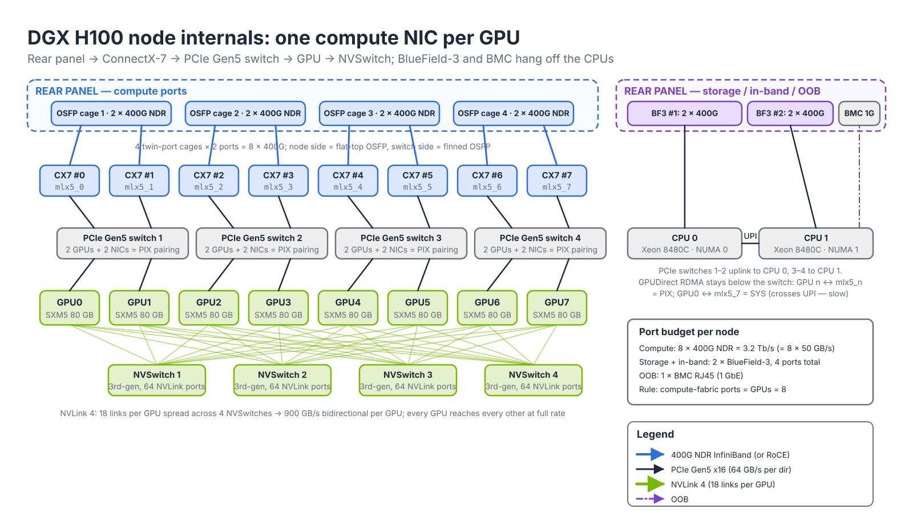
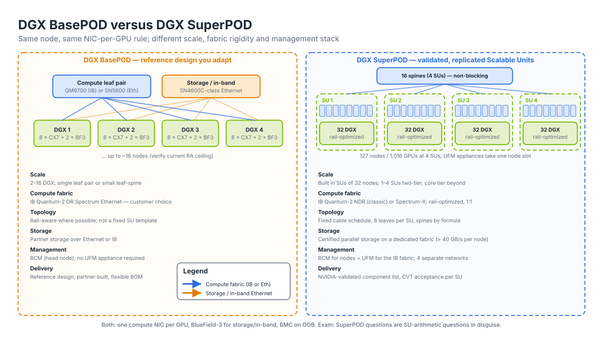
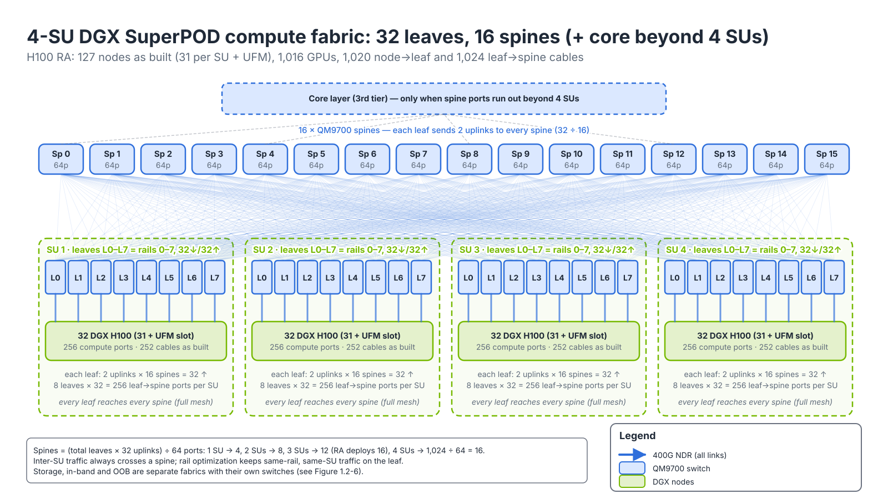
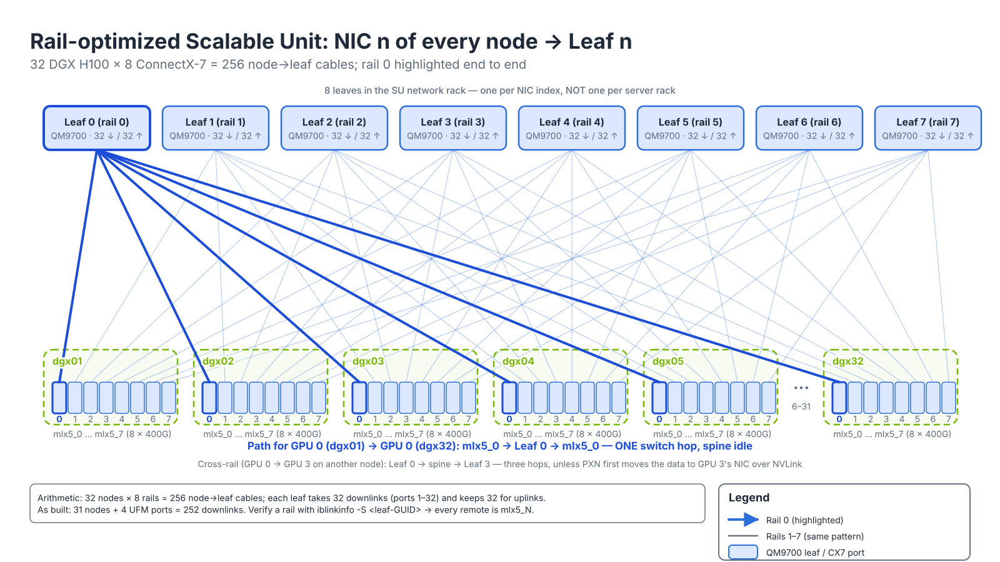
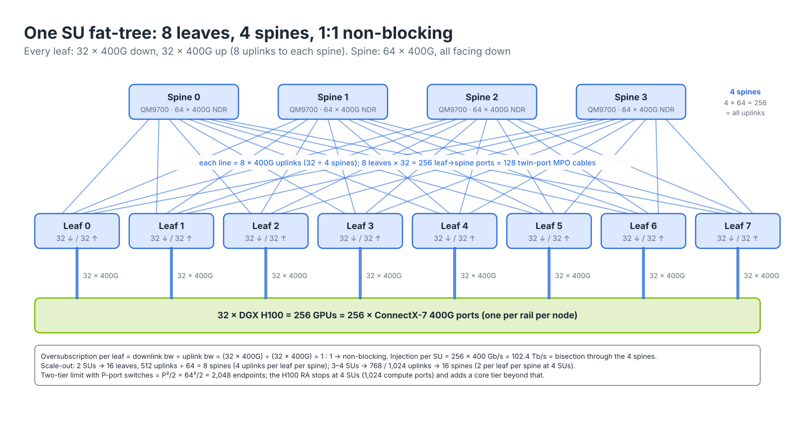
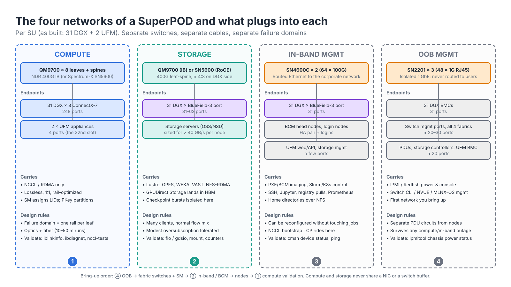

# Module 1.2 — DGX SuperPOD and BasePOD Reference Architectures

> **Exam domain:** AI Data Center Design and Optimization (5%)  
> **Source course(s):** AI Infrastructure and Operations Fundamentals; InfiniBand Professional (topology sections)  
> **Source docs:** NVIDIA DGX SuperPOD Reference Architecture — Scalable Infrastructure with DGX H100 / H200 / B200 / GB200; NVIDIA DGX BasePOD Reference Architecture; NVIDIA Base Command Manager documentation  
> **Estimated study time:** 3 hours

> **How to study this module:** read §1–§2, work through the §3 walkthrough on real gear or NVIDIA Air, then attempt the §5 hands-on assignment using only the Hint section. Open the Solution guide (last section) only after you have a working attempt. Finish with the Appendix C knowledge check closed-book.

## 1. Learning objectives

By the end of this module you will be able to…

- **Describe** the network layout of a DGX H100/H200/B200 node: which NIC serves which fabric and how many ports face each network. *(Exam objective: AI DC Design — node network components)*
- **Distinguish** a DGX BasePOD from a DGX SuperPOD in scale, fabric choice, and management. *(AI DC Design — reference architectures)*
- **Explain** the Scalable Unit (SU) concept and derive leaf, spine, and cable counts for a given number of SUs. *(AI DC Design — topology sizing)*
- **Draw** and explain a **rail-optimized** topology and state why it gives one-hop GPU-to-GPU paths on the same rail. *(AI DC Design / InfiniBand — rail-optimized design)*
- **Calculate** oversubscription for a leaf-spine (Clos/fat-tree) fabric and recognize a non-blocking design. *(AI DC Design — fat-tree math)*
- **Compare** the InfiniBand Quantum-2 and Spectrum-X compute-fabric options and the storage/management fabric choices. *(AI DC Design / Spectrum — fabric selection)*
- **Identify** cable and transceiver types (OSFP, twin-port, DAC, AOC) used in the RA and the distance constraints that drive them. *(Troubleshooting Tools — mlxcables/mlxlink context)*
- **Describe** the role of **Base Command Manager (BCM)** in a SuperPOD and separate it from **UFM**. *(AI DC Design — management roles)*

## 2. Key technical concepts

### 2.1 The DGX node as a network endpoint

*Analogy:* think of the node as an apartment building with eight tenants (GPUs). Each tenant gets a private front door to the street (a compute NIC); the building shares two service entrances (BlueField-3 for storage and in-band) and one caretaker's phone line (the BMC).

**What it is.** Every reference architecture starts from the node. Learn the H100 layout cold (Figure 1.2-1); later generations follow the same pattern.

**DGX H100 / H200**

| Component | Count | Fabric | Port type |
|---|---|---|---|
| H100/H200 GPU | 8 | NVLink/NVSwitch (internal) | — |
| **ConnectX-7** HCA, 400G NDR (compute) | 8 (one per GPU) | Compute fabric | 4 × OSFP twin-port cages on the rear (each cage carries 2 × 400G ports) |
| **BlueField-3** DPU, dual-port 400G | 2 | Storage + in-band management | 2 × 400G per card (typically one port each for storage, in-band — verify in RA) |
| BMC | 1 | OOB management | 1G RJ45 |
| Optional 1G/10G host NICs | 1–2 | In-band (alternative) | RJ45 |


*Figure 1.2-1 — Inside a DGX H100: each PCIe Gen5 switch hosts two GPUs and their two ConnectX-7s (PIX pairing); NVLink 4 ties all eight GPUs through four NVSwitches; BlueField-3 and the BMC hang off the CPUs.*

**Why it exists.** The key design intent is **one compute NIC per GPU, physically adjacent on the PCIe topology**, so GPUDirect RDMA traffic never crosses a CPU socket or an extra PCIe hop. A PCIe Gen5 x16 link carries ~64 GB/s per direction — comfortably above the 50 GB/s a 400G port needs — but only if the GPU and NIC are below the same PCIe switch; traffic that has to go up through the root complex and across the UPI interconnect between sockets competes with everything else on the host and typically halves achievable bandwidth. The 8-GPU/8-NIC symmetry is also what makes the **rail-optimized** topology (§2.5) possible: NIC *n* always belongs to GPU *n*.

**How it works.** Four PCIe Gen5 switches each connect two H100s and two ConnectX-7s; two switches uplink to each CPU socket. The eight NDR ports exit through four twin-port OSFP cages (flat-top, "riding heatsink" modules on the node side). `nvidia-smi topo -m` shows the pairing as `PIX` (same PCIe switch) between GPU *n* and `mlx5_n`, `NODE` for a NIC on the same socket but a different switch, and `SYS` for a NIC on the other socket; `ibdev2netdev -v` adds the PCI bus address so you can map a `mlx5_N` to a physical cage before you plug a cable.

**DGX B200 and GB200**
- **DGX B200**: same 8-GPU air-cooled form factor; 8 × ConnectX-7 400G compute NICs and 2 × BlueField-3 for storage/in-band in the first B200 SuperPOD RA (verify — later revisions move to ConnectX-8).
- **DGX GB200 NVL72**: a liquid-cooled rack of 18 compute trays (each 2 Grace CPUs + 4 Blackwell GPUs), all 72 GPUs in one NVLink domain via NVLink Switch trays. Each compute tray has 4 × **ConnectX-7** or **ConnectX-8** compute ports (one per GPU) and BlueField-3 for storage/in-band. The *rack* becomes the scale-up domain, and the compute fabric (Quantum-X800 XDR 800G or Spectrum-X800) connects racks. Verify exact per-tray NIC model and rate in the current GB200 RA.

Whatever the generation, the invariant for you is: **number of compute fabric ports = number of GPUs**, and the fabric is designed around that count.

**Why the exam cares:** "which component carries storage traffic" and "how many compute ports per node" are direct questions.

### 2.2 BasePOD versus SuperPOD

*Analogy:* BasePOD is a house plan you adapt to your lot; SuperPOD is a prefabricated module you replicate exactly.

**What it is.** Two NVIDIA reference architectures built from the same node (Figure 1.2-2).

| | DGX BasePOD | DGX SuperPOD |
|---|---|---|
| Positioning | Enterprise entry/mid-scale AI infrastructure | Turnkey, validated supercomputer-class AI factory |
| Scale | Typically 2–16 DGX nodes (verify current RA ceiling) | Built in Scalable Units; H100 RA scales 1–4 SUs (up to 127 nodes / 1,016 GPUs); larger with core layer |
| Compute fabric | InfiniBand (Quantum-2) *or* Ethernet (Spectrum) — customer choice | InfiniBand Quantum-2 NDR (classic) or Spectrum-X (Ethernet variant) |
| Storage | Partner storage over Ethernet or IB | Certified high-performance parallel storage; dedicated storage fabric |
| Management | BCM | BCM; UFM for IB fabrics |
| Delivery | Reference design, partner-built | NVIDIA-validated design with strict component list and cabling plan |


*Figure 1.2-2 — BasePOD is a flexible small design; SuperPOD is a fixed, validated template replicated per SU with UFM and a dedicated storage fabric.*

**Why it exists.** Below ~16 nodes a single leaf pair (64 ports each) can absorb all compute ports (16 × 8 = 128) without a spine, so there is nothing to template and the customer can choose Ethernet to stay on familiar tooling. Above that, the port arithmetic, cable schedule and validation effort grow with the square of the node count, and the only way to deliver predictable collective performance at 1,000 GPUs is to freeze the design into an SU and replicate it.

**How it works.** A BasePOD is cabled like a conventional leaf-spine (rail-aware where the leaf count allows), managed by BCM alone, and validated with nccl-tests. A SuperPOD is built SU by SU: the RA fixes the switch models, port map, cable lengths and part numbers; UFM runs the subnet; CVT is run per SU and then across SUs; BCM provisions all 127 nodes from one image.

**Why the exam cares:** many SuperPOD questions are really SU-arithmetic questions in disguise.

### 2.3 The Scalable Unit (SU)

**What it is.** A **Scalable Unit** is the smallest repeatable block: a fixed number of nodes, their leaf switches, and the cabling between them. In the H100 SuperPOD RA, **an SU is 32 DGX H100 nodes (256 GPUs)**. The RA notes that in practice one node slot per SU is given up to connect the UFM appliances, so the tables show 31 nodes per SU (248 GPUs) and 127 nodes for 4 SUs. If an exam question says "32-node SU", that is the design figure; "31 nodes" is the as-built figure after UFM.

**Why it exists.** Why build by SU?
- The leaf layer is fully populated and symmetric, so adaptive routing and the SM's routing algorithms produce balanced paths — every leaf sees every spine with the same number of uplinks.
- Cable schedules, rack elevations, and switch configurations are templated and reused.
- Validation (CVT, nccl-tests) is done per SU, then across SUs.
- NVIDIA guidance: build the fabric for a complete SU even if you deploy fewer nodes initially; adding nodes later then needs no re-cabling of the spine.

**How it works.** The H100 SuperPOD compute fabric scales as follows (from the RA; Figure 1.2-3 shows the 4-SU case):

| SUs | Nodes (as built) | GPUs | Leaf switches | Spine switches | Node→leaf cables (incl. UFM) | Leaf→spine cables |
|---|---|---|---|---|---|---|
| 1 | 31 | 248 | 8 | 4 | 252 | 256 |
| 2 | 63 | 504 | 16 | 8 | 508 | 512 |
| 3 | 95 | 760 | 24 | 16 | 764 | 768 |
| 4 | 127 | 1,016 | 32 | 16 | 1,020 | 1,024 |


*Figure 1.2-3 — A 4-SU H100 SuperPOD: every leaf sends 2 uplinks to each of the 16 spines (32 ÷ 16); a core tier is added only beyond 4 SUs.*

Observe the formulas behind the table rather than memorizing it:

- **Leaf switches per SU = 8** (one per GPU rail).
- **Node→leaf cables per SU = nodes × 8** (plus 4 for UFM in the as-built design: 31 × 8 + 4 = 252).
- **Leaf→spine cables per SU = leaf count × uplinks per leaf = 8 × 32 = 256**.
- Spine count grows to keep the fabric non-blocking: each spine must have enough ports to take uplinks from every leaf. With 32 leaves at 4 SUs and 64 ports per spine, 16 spines × 64 ports = 1,024 = the 1,024 leaf→spine cables, i.e. each leaf has 32 ÷ 16 = 2 uplinks to every spine. At 3 SUs the RA already deploys 16 spines (768 uplinks → 48 of 64 ports used on each), so the fourth SU is added without touching the spine layer.

You observe an SU from any IB-attached host with `ibnetdiscover` (8 leaf nodes and the spines, each leaf with 32 HCA neighbors) and `iblinkinfo -S <leaf-GUID>` (32 downlinks that all read `mlx5_N` for the same *N*).

### 2.4 The switches

**What it is.** The H100-era compute fabric uses the **NVIDIA Quantum-2 QM9700** (managed, runs MLNX-OS and can host the SM) or QM9790 (unmanaged, externally managed) switch:
- 64 × NDR 400G ports delivered through **32 OSFP cages**, each cage carrying a **twin-port** transceiver (2 × 400G).
- 51.2 Tb/s aggregate (verify), SHARPv3 in-network computing, adaptive routing, 1U.
- Also configurable as 128 × 200G (NDR200) by splitting each 400G port — common for connecting ConnectX-7 at 200G in BasePOD or storage designs.

**Spectrum-X alternative.** A Spectrum-X SuperPOD replaces Quantum-2 with **Spectrum-4 SN5600** (64 × 800G OSFP, or 128 × 400G after breakout; 51.2 Tb/s) leaf/spine switches running Cumulus Linux or SONiC, and ConnectX-7 with **BlueField-3 SuperNICs** in the nodes.

**Why it exists.** A 64-port radix is what sets the SU size: 32 ports down per leaf = 32 nodes per rail, 32 ports up = non-blocking, and 64 ports per spine = 1,024 ÷ 64 = 16 spines at 4 SUs. The twin-port OSFP packaging halves the cage count (and the front-panel space and power) but is the single most common BOM mistake (§4.2). Spectrum-X exists for operators who want the same topology with Ethernet operations: the topology math is identical; the difference is the control plane (BGP EVPN/VXLAN or plain L3 underlay), congestion control (RoCE with **PFC**/**ECN** + SuperNIC-side DCQCN) and **adaptive routing** done by the Spectrum-4 ASIC with reordering in the SuperNIC. See [`../04-spectrum-ethernet/01-spectrum-x.md`](../04-spectrum-ethernet/01-spectrum-x.md).

**How it works.** In an SU, each leaf QM9700 uses **32 ports down** (one per node on its rail) and **32 ports up** to spines — a 1:1 split, hence non-blocking (Figure 1.2-5, §2.6). A 400G NDR port is 4 lanes × 100 Gb/s PAM4 (`iblinkinfo` prints `4X 100.0 Gbps`); a twin-port module exposes two such ports from one cage with one 8-fiber MPO per port (or a 2-way breakout to two single-port node modules). On the switch you check port state and rate with `show interfaces ib status` (MLNX-OS) or, on Spectrum-X, `nv show interface --view=brief` and `nv show interface swp1 link` (speed, breakout).

**Storage, in-band, OOB switches**

| Fabric | H100 RA switch | Notes |
|---|---|---|
| Storage | **QM9700 (MQM9700-NS2F)** InfiniBand in the classic H100 RA; Spectrum SN4600/SN5600 Ethernet (RoCE) in Ethernet-storage variants | Per-node storage I/O target > 40 GB/s; storage side 1:1, DGX side approximately 4:3 oversubscribed per the RA |
| In-band management | **Spectrum SN4600C** (64 × 100G) | Cluster services, home directories, Slurm/K8s, BCM |
| OOB management | **Spectrum SN2201** (48 × 1G RJ45 + 4 × 100G) | BMCs, switch mgmt ports, PDUs, storage controllers |

### 2.5 Rail-optimized topology

*Analogy:* in a conventional ToR design, a leaf is the mail room for one floor of the building (one rack). In a rail-optimized design, a leaf is the mail room for *everyone named "tenant 3"* across every building in the city — so tenant 3 writing to tenant 3 next door never has to go through the central post office (the spine).

This is the single most-asked design concept in the domain. Read it twice.

**What it is.** In a conventional leaf-spine, every NIC in a *rack* connects to the rack's leaf (top-of-rack). In a **rail-optimized** design, every NIC of the *same index* across all nodes in the SU connects to the *same* leaf (Figure 1.2-4). GPU 0 of every node → leaf 0; GPU 1 of every node → leaf 1; … GPU 7 → leaf 7. Each such set is a **rail**.


*Figure 1.2-4 — Rail optimization: Leaf 0 knows only the `mlx5_0` ports of all 32 nodes. GPU 0 → GPU 0 on any other node is one switch hop; the spines carry only cross-rail traffic.*

**Why it exists.**
- **Same-rail traffic is one hop.** GPU 3 on node 5 talking to GPU 3 on node 20 enters Leaf 3 and exits Leaf 3 — never touches a spine. With 32 nodes per SU, each GPU can reach the same-rank GPU on 31 other nodes in one switch hop (~2 µs write latency instead of ~3 hops' worth), and the flow never competes for a spine uplink with anyone.
- **NCCL exploits it.** NCCL's ring and tree algorithms, combined with **PXN** (PCI × NVLink), arrange that inter-node traffic is sent from GPU *n* to GPU *n* on the peer node — same rail. Traffic that must change rail is first moved over NVLink inside the node (to the GPU that owns the correct rail), then sent. Spine traffic is thereby minimized. See [Module 1.3](03-gpu-to-gpu-communication-nccl-gpudirect.md).
- **Spine bandwidth is still full.** The design remains a non-blocking fat-tree, so cross-rail traffic (which does traverse spines) is not penalized; rail optimization is an optimization *on top of* non-blocking, not a substitute for it.
- **Failure domains line up with rails.** Losing Leaf 2 removes rail 2 from the whole SU, which NCCL can route around via NVLink to other rails, rather than removing all 8 NICs of four racks of nodes.

**How it works.** The cable schedule is the mechanism: node *k*'s `mlx5_n` goes to Leaf *n*, port *k*. Physical consequence: because every node has a cable to each of eight leaves, nodes and leaves cannot be in the same rack in a neat ToR fashion; leaf switches sit in a central network rack per SU and the node→leaf cables are 10–50 m. That is why the RA specifies **active optical cables or transceivers + fiber**, not DAC (passive copper reaches only ~2–3 m at NDR), for compute links. You prove a rail from any IB host: `iblinkinfo -S <leaf-n-GUID>` must show 32 downlinks whose remote description is `dgxNN mlx5_n` — one foreign index means a swapped cable (§4.1). Path-tracing questions ("GPU 5 on node 12 to GPU 5 on node 27 — which switches?") resolve to "Leaf 5 only"; `ibtracert <src-lid> <dst-lid>` prints exactly that hop list.

**Why the exam cares:** expect a path-tracing question and a trap about rail optimization "saving spines" (it does not).

### 2.6 Fat-tree / Clos math

**What it is.** A **fat-tree** (folded Clos) is non-blocking when, at every switch, the bandwidth facing down equals the bandwidth facing up (Figure 1.2-5).

```text
Oversubscription ratio = (total downlink bandwidth) / (total uplink bandwidth)
                       = (downlink ports × rate) / (uplink ports × rate)
```


*Figure 1.2-5 — The SU fat-tree with port counts: 8 × 32 = 256 uplinks ÷ 64 ports = 4 spines; each leaf sends 8 uplinks to each spine; 32 × 400G down ÷ 32 × 400G up = 1:1.*

| Design | Down | Up | Ratio |
|---|---|---|---|
| SuperPOD compute leaf (QM9700) | 32 × 400G | 32 × 400G | 1:1 (non-blocking) |
| Hypothetical cost-reduced leaf | 48 × 400G | 16 × 400G | 3:1 |
| H100 RA storage, DGX side | per RA | per RA | ≈ 4:3 |

**Why it exists.** Collectives are bulk-synchronous (Module 1.1 §2.3): at 2:1 oversubscription every cross-rail or inter-SU flow gets at most half rate under load, and the whole job slows to that flow's pace regardless of how well the same-rail flows did. The storage fabric can tolerate ≈ 4:3 on the DGX side because storage I/O is many-client and not barrier-synchronized in the same way.

**How it works.** Two-tier (leaf-spine) limit with *P*-port switches: maximum non-blocking endpoints = *P*²/2. For QM9700 (*P* = 64): 64²/2 = 2,048 endpoints, i.e. 256 nodes × 8 GPUs = 8 SUs, with 32 spines… but the H100 RA stops at 4 SUs / 16 spines at two tiers and adds a **core** layer (three-tier fat-tree) for larger builds. Verify the exact tier breakpoints in the RA for the generation you are studying; the exam is more likely to test the *principle* (adding a tier when spine ports run out) than the exact number.

Three-tier rule of thumb: leaf↔spine inside a pod/SU-group stays as designed; each spine then splits its uplinks to core switches, and the number of core switches = (spine uplinks per spine × number of spines) / ports per core. Bisection check for one SU: 256 × 400 Gb/s = 102.4 Tb/s of injection must be matched by 256 × 400 Gb/s of leaf→spine capacity — it is, exactly, which is what "1:1" means in bandwidth rather than port terms.

### 2.7 Compute fabric choice: InfiniBand versus Spectrum-X

**What it is.** Two compute-fabric options that share the topology and node port count but differ in loss model, control plane and tooling.

| Criterion | Quantum-2 InfiniBand | Spectrum-X Ethernet |
|---|---|---|
| Loss model | Lossless by credit-based flow control at L2 | Lossless via PFC + ECN/DCQCN, tuned end-to-end with the SuperNIC |
| Load balancing | Adaptive routing in switch; SM-computed routes | Spectrum-4 adaptive routing with SuperNIC reordering (RoCE AR) |
| In-network compute | **SHARP** (reductions in switch) | SHARP support on Spectrum-X announced; verify current status |
| Fabric control | Subnet Manager (**UFM** appliance in SuperPOD) assigns **LID**s, computes routing | Distributed: BGP underlay, EVPN optional; NetQ for visibility |
| Multi-tenancy | **PKey** partitions | VLAN/VXLAN, VRFs |
| Tooling | ibdiagnet, UFM, mlxlink | NVUE, NetQ, WJH, mlxlink |
| When chosen | Highest performance, HPC-style single-tenant | Operators standardized on Ethernet, cloud/multi-tenant, convergence with existing NOS skills |

**Why it exists.** InfiniBand is lossless by construction (a port transmits only against receiver credits per virtual lane) and centrally routed, which gives the best and most predictable collective performance; Spectrum-X exists so that Ethernet shops can get close to that behaviour with standard protocols — PFC for the backstop, ECN at a buffer threshold with the SuperNIC's DCQCN for rate control, and per-packet adaptive routing with reordering in the SuperNIC to defeat the low-entropy ECMP problem.

**How it works.** Both fabrics use the same topology (rail-optimized, non-blocking fat-tree) and the same port count per node; the choice does not change the cable math. What changes is the node-side configuration — `mlxconfig LINK_TYPE_P1` = IB(1) or ETH(2), NCCL `NCCL_IB_GID_INDEX`/`NCCL_IB_TC` for RoCE — and the verification tooling: `ibdiagnet`/`iblinkinfo` and UFM on InfiniBand; `nv show interface`, `nv show qos roce`, NetQ and WJH on Spectrum-X.

### 2.8 Storage fabric

**What it is.** A separate, conventional (not rail-optimized) leaf-spine network connecting every node's **BlueField-3** storage port(s) to parallel or scale-out filesystems — **Lustre**, **IBM Storage Scale (GPFS)**, **WEKA**, **VAST**, **DDN**, NFS-over-RDMA for home directories — over RDMA (**RoCEv2** on Ethernet or native InfiniBand). The RA sets a per-node target of **> 40 GB/s** for the H100 SuperPOD.

**Why it exists.** Training nodes read datasets and write checkpoints. Checkpoints of large models are hundreds of GB and are written by every node near-simultaneously, so storage I/O is bursty and high-bandwidth: 127 nodes × 40 GB/s ≈ 5 TB/s of aggregate demand during a checkpoint storm. A checkpoint storm must not share buffers with an all-reduce, so it gets its own switches and its own NIC ports.

**How it works.** Node side: ports on the two **BlueField-3** cards; GPUDirect Storage (GDS, `cuFile` + `nvidia-fs`) lets the filesystem client DMA directly into GPU memory. Fabric: a separate leaf-spine; storage-side 1:1, compute-side modest oversubscription (≈ 4:3) acceptable because storage I/O is not bulk-synchronous in the same way as collectives. You verify placement with `mount | grep -E 'lustre|gpfs|nfs'` and `ibdev2netdev` (the mount's interface must be a BlueField netdev), and throughput with `gdsio` or `fio` against the mounted filesystem.

### 2.9 Management networks

**What it is.** Two more networks (Figure 1.2-6):

- **In-band**: Ethernet on the BlueField-3 (or host 1/10/25G NIC in BasePOD) to **SN4600C** switches. Carries BCM provisioning (PXE, image deploy), Slurm/Kubernetes control, monitoring, user SSH/Jupyter, container registry pulls, NCCL's bootstrap TCP channel. Routed to the corporate network.
- **OOB**: 1G Ethernet from every BMC, switch management port, PDU, storage controller to **SN2201** switches. Isolated; used by BCM for power control (IPMI/Redfish) and console.
- **UFM appliances** attach to the compute IB fabric (hence the "31 of 32" node slot) and to in-band Ethernet for their web UI/API.


*Figure 1.2-6 — What plugs into each network for one as-built SU: 248 ConnectX-7 ports plus UFM on compute; BlueField-3 ports and storage servers on storage; BlueField-3, head nodes and UFM on in-band; BMCs, switch management ports and PDUs on OOB.*

**Why it exists.** The in-band network can be reconfigured, upgraded or even lost without affecting a running collective, and OOB survives any failure of the other three — it is the first network you bring up and the one you use to recover everything else.

**How it works.** Port arithmetic for one as-built SU: 31 BMCs + 8 leaf + 4 spine + storage and in-band switch management ports + PDUs ≈ 60–70 OOB ports → two SN2201s (48 × 1G each) per SU with headroom; 31 BlueField-3 in-band ports + head nodes + UFM + logins on a pair of SN4600Cs. You verify in-band reachability with `cmsh -c "device status"` (BCM sees every node) and OOB with `ipmitool -I lanplus -H <bmc> chassis power status` for every node and `ping` to every switch management IP.

### 2.10 Cabling

**What it is.** The media and optics the RA specifies per link class.

| Item | Detail |
|---|---|
| **OSFP** | The form factor for 400G NDR / 800G ports. Switch side uses finned (top) OSFP; NIC side uses flat (riding heatsink) OSFP. They are not interchangeable — verify part numbers. |
| **Twin-port transceiver** | A single OSFP module carrying 2 × 400G NDR lanes. On the QM9700 one cage = 2 ports. A twin-port switch transceiver connects to *two* ConnectX-7 single-port transceivers via a 2-way breakout fiber (MPO-12/APC). |
| **DAC** (direct attach copper) | Passive copper, up to ~2–3 m at NDR; used only for very short in-rack links (e.g. leaf↔spine in adjacent racks is usually too far). Lowest power and latency. |
| **ACC** (active copper) | Active copper, extends copper to ~3–5 m. |
| **AOC** (active optical cable) | Transceivers permanently attached to fiber; typical for node→leaf at 10–30 m in BasePOD. |
| **Transceiver + MMF/SMF fiber** | Separate transceivers and structured fiber; the SuperPOD default because it allows patching and long runs (up to 50 m MMF, 500 m+ SMF). |
| Cable count formula | node→leaf = GPUs (8 × nodes); leaf→spine = leaves × 32; storage and in-band per node = BlueField-3 ports used. |

**Why it exists.** Reach and power: at 100 Gb/s per lane PAM4, passive copper loses too much signal beyond ~3 m, and rail-optimized cabling (§2.5) makes almost every compute cable longer than that. Optics cost power (12–17 W per twin-port module) and need airflow, which feeds back into the switch SKU (port-side intake vs exhaust).

**How it works.** For one SU: 256 node→leaf ports = 128 twin-port switch modules + 256 single-port node modules + 128 breakout fibers; 256 leaf→spine ports = 128 twin-port-to-twin-port cables with 256 twin-port modules. Cabling validation with **mlxcables** (read transceiver EEPROM: vendor, PN, SN, length, type) and **mlxlink** (link state, speed/width, BER, eye margins, module temperature and optical power) is covered in the Troubleshooting modules; a cable negotiated at `4X 50.0 Gbps` (HDR) instead of `4X 100.0 Gbps` (NDR) or showing non-zero `Effective Physical Errors` is replaced, not tuned.

### 2.11 Base Command Manager

**What it is.** **NVIDIA Base Command Manager (BCM)** is the cluster management software for BasePOD and SuperPOD (derived from Bright Cluster Manager). It runs on a highly available pair of head nodes on the in-band network and exposes the `cmsh` CLI and the Base View GUI.

**Why it exists.** 127 nodes must be bit-for-bit identical in OS, driver stack (DGX OS, CUDA, MOFED/DOCA-OFED, NCCL) and scheduler configuration, and must be re-imageable and power-controllable without touching a console. BCM is *not* the InfiniBand fabric manager — that is **UFM** (or opensm), which assigns LIDs, computes routing and runs SHARP's aggregation manager. **Why the exam cares:** it likes to separate these two roles.

**How it works.**
- Bare-metal provisioning: DHCP/PXE over in-band, node images with DGX OS, drivers, MOFED/DOCA-OFED, CUDA, NCCL.
- Node categories and software images so all 127 nodes are identical (`cmsh -c "category list"`, `cmsh -c "device list"`).
- Integration with Slurm and/or Kubernetes (deploys the control plane and GPU/Network Operators).
- Monitoring and health checks; power control via the OOB network (IPMI/Redfish through the BMC).
- `cmsh -c "device status"` shows per-node `UP`/`DOWN` and installer stage; a node stuck in `installing` usually means the in-band PXE path or the OOB power path is broken (Module 1.1 §4.3).

## 3. Live-style walkthrough — building a 32-node SU rail by rail

Let's build one H100 Scalable Unit on paper and count every port and cable as we go. Follow the arithmetic with a pencil; the exam asks exactly these numbers.

**Step 1 — inventory the nodes.** 32 DGX H100 nodes, 8 GPUs each → 256 GPUs → **256 compute ports** (one ConnectX-7 per GPU). On the rear of each node those 8 ports come out of 4 twin-port OSFP cages, so physically you will see 4 cages per node, but you cable 8 logical 400G ports.

**Step 2 — place the leaves, one per rail (Figure 1.2-4).** We need 8 leaves because there are 8 NIC indices (rails). Each leaf is a QM9700: 64 × 400G ports in 32 OSFP cages.

Figure 1.2-4 is the picture to keep in front of you for Steps 2–4: eight leaves across the top, every node's NIC *n* landing on Leaf *n*.

**Step 3 — cable rail 0.** Take NIC 0 (`mlx5_0`) of node 01 and run it to Leaf 0 port 1. NIC 0 of node 02 → Leaf 0 port 2. Continue to node 32 → Leaf 0 port 32. That is **32 node→leaf cables for rail 0**, consuming 32 of Leaf 0's 64 ports. Notice what we did *not* do: we did not connect any other NIC of node 01 to Leaf 0. Leaf 0 knows only about NIC 0s.

Now repeat for rails 1–7. **Total node→leaf cables = 32 nodes × 8 rails = 256.** Each leaf has exactly 32 downlinks populated.

```bash
# After cabling rail 3, verify it from any IB-attached host. Every remote port on Leaf 3
# must be an mlx5_3 (the HCA whose port GUID matches GPU 3's NIC) on a DIFFERENT node.
iblinkinfo -S 0x1070fd0300a1b2c3        # -S = show links of one switch by its node GUID (Leaf 3's GUID).
                                        # EXPECT: 32 lines "... Active/LinkUp ... 4X 100.0 Gbps ..." (NDR)
                                        # EXPECT: remote descriptions like "dgx01 mlx5_3", "dgx02 mlx5_3", ...
                                        # A line reading "dgx09 mlx5_5" means a NIC landed on the wrong rail.
```

Illustrative output for a correctly cabled Leaf 3:

```text
Switch 0x1070fd0300a1b2c3 "MF0;leaf03:MQM9700/U1":
   7   1[  ]  ==( 4X 100.0 Gbps Active/ LinkUp)==>   21    1[  ] "dgx01 mlx5_3" ( )
   7   2[  ]  ==( 4X 100.0 Gbps Active/ LinkUp)==>   29    1[  ] "dgx02 mlx5_3" ( )
   7   3[  ]  ==( 4X 100.0 Gbps Active/ LinkUp)==>   37    1[  ] "dgx03 mlx5_3" ( )
   ...
   7  32[  ]  ==( 4X 100.0 Gbps Active/ LinkUp)==>  269    1[  ] "dgx32 mlx5_3" ( )
   7  33[  ]  ==( 4X 100.0 Gbps Active/ LinkUp)==>    3    1[  ] "spine01:MQM9700/U1" ( )
   ...
```

Watch two things. First, `4X 100.0 Gbps` — NDR is 4 lanes at 100 Gb/s each; `4X 50.0 Gbps` would be a link that trained at HDR, i.e. a bad optic. Second, every remote on ports 1–32 is `mlx5_3`. That column is your rail check. The second number on each line is the far-end **LID**, assigned by the SM; it changes if the SM restarts, so never key your cable plan to LIDs — key it to port GUIDs.

**Step 4 — the UFM slot.** The RA gives up one node slot for the two UFM appliances. In the as-built table that becomes 31 nodes and 31 × 8 + 4 = 252 node→leaf cables. Design figure 32/256; as-built 31/252. Both can appear in a question.

**Step 5 — size the spines (Figure 1.2-5).** Each leaf has 32 ports left for uplinks → **8 leaves × 32 = 256 leaf→spine cables.** A spine is also a 64-port QM9700, so 256 / 64 = **4 spines** for one SU. Each leaf sends 8 uplinks to each of the 4 spines (32 ÷ 4 = 8), so every leaf sees every spine with equal bandwidth — that symmetry is what lets adaptive routing spray evenly.

Figure 1.2-5 shows the result: four spines across the top, each with all 64 ports facing down, and each leaf's 32 uplinks spread 8-8-8-8 across them.

Oversubscription check for a leaf: 32 × 400G down ÷ 32 × 400G up = 1:1. Non-blocking. Good.

**Step 6 — count cages and transceivers, not just ports.** Here is where learners get tripped up. The 256 node→leaf *ports* on the leaf side are 128 twin-port OSFP *cages*. Each twin-port switch transceiver fans out over a 2-way breakout fiber to two single-port transceivers on two different nodes. So for one SU, node→leaf optics = 128 twin-port (switch) + 256 single-port (node), plus 128 breakout fiber assemblies (verify LinkX part numbers). The leaf→spine side is twin-port to twin-port: 256 ports = 128 cables, 256 twin-port transceivers.

```bash
# Verify the optic on a leaf port is the twin-port finned OSFP the RA calls for, and on a node port the flat OSFP.
mlxcables                               # Enumerate every cable the MST tool can see: vendor, PN, SN, length, type.
                                        # EXPECT: PN prefixed MMA4Z00-NS (twin-port NDR) on switch cages,
                                        #         MMA4Z00-NS400 (single-port) on node cages — verify current PNs.
mlxlink -d mlx5_3 -m -e                 # -m module info (vendor, PN, temp, rx/tx power), -e eye/BER on this HCA.
                                        # EXPECT: "Speed: NDR", "Width: 4x", Effective Physical Errors: 0.
```

**Step 7 — scale to 2 SUs and watch what changes (Figure 1.2-3 shows the 4-SU end state).** Double everything at the leaf layer: 16 leaves, 512 node→leaf cables (508 as built), 512 leaf→spine cables. Spines: 512 / 64 = **8 spines**. Now each leaf's 32 uplinks spread over 8 spines → 4 per spine. At 3 and 4 SUs the RA jumps to 16 spines (768 and 1,024 uplinks respectively; 1,024 / 64 = 16 exactly at 4 SUs, with 3 SUs under-filling them). Beyond 4 SUs, spine ports run out at two tiers and the RA adds a core layer.

**Step 8 — the other three fabrics, briefly (Figure 1.2-6).** Storage: BlueField-3 port per node → storage leaf (QM9700 or SN5600), conventional leaf-spine, ≈4:3 on the DGX side. In-band: BlueField-3 port → SN4600C. OOB: BMC → SN2201 (48 ports, so one SN2201 per ~40 devices once you add switch mgmt ports and PDUs).

```bash
# Confirm the node side matches the plan before you plug a single compute cable.
ibdev2netdev -v                         # -v adds PCI address: mlx5_0..7 = ConnectX-7 (mt4129), mlx5_8+ = BlueField-3.
nvidia-smi topo -m                      # GPU n <-> mlx5_n must be PIX/PXB; if GPU3 pairs with mlx5_5 your rail plan is off by node.
```

What "good" looks like at the end: 8 leaves each with 32 `mlx5_n`-homogeneous downlinks, 4 spines each with 64 uplinks from 8 leaves, every link `4X 100.0 Gbps Active`, `ibdiagnet` clean, and `ibnetdiscover` output matching the RA topology file.

## 4. Troubleshooting / common gotchas

### 4.1 "Leaf 5 shows a mix of mlx5_5 and mlx5_2 remotes"

**Symptom.** `iblinkinfo -S <leaf5-GUID>` shows 30 remotes named `mlx5_5` and 2 named `mlx5_2`. Links are all `Active`. NCCL busbw is below acceptance and spine utilization is higher than the baseline SU.

**Why it happens.** Two node→leaf cables were swapped during install (node 17's NIC 2 and NIC 5 cables crossed). Same-rail traffic that should be one hop now crosses a spine for those nodes, and **PXN** on the peer nodes assumes the rail is where the RA says it is.

**How to debug.**
```bash
iblinkinfo -S <leaf5-GUID> | grep -v mlx5_5          # Any line that is not mlx5_5 is a wrong-rail cable.
ssh dgx17 "ibdev2netdev -v"                           # Confirm mlx5_2 and mlx5_5 PCI addresses to identify the physical cages.
ibdiagnet --topo_file su01.topo                        # Compare live topology to the RA reference (verify flag name).
```

**Fix.** Swap the two cables at the node end (the node's cage-to-NIC mapping is fixed by PCIe; the cable goes to the wrong leaf). Re-run `iblinkinfo -S` for both Leaf 2 and Leaf 5 and confirm homogeneous remotes.

### 4.2 "I ordered 64 transceivers for a leaf and have 32 empty cages"

**Symptom.** The BOM for a QM9700 leaf listed 64 ports and 64 transceivers; on install, half the cages have no module to accept, and the fiber plant does not match.

**Why it happens.** Ports and cages were conflated. A QM9700 has 64 ports in **32 cages**; each cage takes one **twin-port** OSFP that carries two 400G ports. On the node side each ConnectX-7 port is a single-port OSFP. The leaf-side optic count is 32 twin-port, not 64 single-port, and the node→leaf fiber is a 2-way breakout.

**How to debug.**
```bash
mlxcables                                             # On a populated cage: PN shows a twin-port NDR module; one SN serves two ports.
mlxlink -d <leaf-port> -m                             # Module info reports both lanes groups for a twin-port device.
```

**Fix.** Re-issue the BOM in cages for switch ends (32 twin-port per QM9700) and ports for node ends (8 single-port per node), with breakout fibers equal to the twin-port count. The Appendix A formulas give the counts.

### 4.3 "Spine count came out as 32 for 4 SUs"

**Symptom.** A design proposal shows 32 spines for a 4-SU H100 SuperPOD; the RA says 16.

**Why it happens.** The designer counted leaves (32) and assumed one spine per leaf, or used 32-port switches in the formula. Spines are sized by *uplink ports / spine port count*, not by leaf count.

**How to debug.** Do the arithmetic aloud: 32 leaves × 32 uplinks = 1,024 uplinks; 1,024 / 64 ports per QM9700 = 16 spines.

**Fix.** Use `spines_needed = (total_leaves × uplinks_per_leaf) / ports_per_spine`. Check against the RA table: 4, 8, 16, 16 for 1–4 SUs.

### 4.4 "DAC cables arrived for node→leaf links; nothing trains"

**Symptom.** Compute links show `Polling` or `Down` in `ibstat`; the cables are 400G DAC, 3 m, but the run from the node rack to the SU network rack is 15 m.

**Why it happens.** Rail-optimized cabling means every node reaches eight leaves in a central rack; runs of 10–50 m exceed passive copper reach (~2–3 m at NDR). Someone applied ToR assumptions to a rail design.

**How to debug.**
```bash
ibstat | grep -E 'State|Physical'                     # "Polling" with Physical state "Disabled" or "PortConfigurationTraining".
mlxcables                                             # Cable type "Passive copper"; length 3 m; identifies the wrong media.
```

**Fix.** Replace with transceivers + structured MMF (SuperPOD default) or AOC; keep DAC only for in-rack leaf↔spine if those are adjacent and within reach.

## 5. Hands-on assignment — network BOM for a 2-SU SuperPOD with a Spectrum-X alternative

**Scenario.** A customer has approved a 2-SU DGX H100 SuperPOD (64 nodes design, 63 as built with UFM) with an InfiniBand Quantum-2 compute fabric. Their procurement team wants a complete network BOM. Separately, their networking lead wants to see what a Spectrum-X alternative would look like if they accepted a 2:1 oversubscribed spine to reduce cost, and what they would give up.

**Requirements.**
1. Produce the **InfiniBand compute fabric BOM**: leaf count, spine count, node→leaf cable count (design and as-built), leaf→spine cable count, and a transceiver list broken into switch-side twin-port, node-side single-port, and breakout fiber assemblies.
2. Produce a **port map** for one leaf (Leaf 4 of SU-01): which node and which `mlx5_N` lands on each of ports 1–32, and how the 32 uplinks are distributed across the 8 spines.
3. Produce the **Spectrum-X alternative** using SN5600 (64 × 800G, breakout to 128 × 400G) leaves with a **2:1 oversubscribed** spine: leaf count, spine count, leaf→spine cable count, and the resulting per-leaf down/up port split.
4. Write a **half-page technical assessment** of the 2:1 alternative: which traffic patterns are unaffected, which are degraded, and what the RA position is.
5. List the **storage, in-band and OOB** switch counts and node-side cable counts for the 63 nodes, using the RA switch models.

**Deliverables.** One Markdown document with the five items above, including a cable list table with columns: From, To, Media, Count.

**Acceptance criteria.**
- Compute leaf count = 16, spine count = 8, leaf→spine cables = 512, node→leaf cables = 512 (design) / 508 (as built).
- Transceiver counts are in cages for switch ends and ports for node ends, and the breakout-fiber count equals the switch-side twin-port count on the node→leaf side.
- The Leaf 4 port map shows only `mlx5_4` on ports 1–32 and exactly 4 uplinks to each of 8 spines.
- The Spectrum-X alternative's leaf split is derivable from 2:1 and uses real SN5600 port counts; the spine count follows from the formula in Appendix A.
- The assessment states that same-rail traffic is unaffected, cross-rail/all-to-all/multi-SU traffic is degraded, and that the RA specifies non-blocking for compute.
- Storage fabric is shown as a separate conventional leaf-spine (not rail-optimized) using BlueField-3 ports; OOB uses SN2201 and accounts for BMCs plus switch management ports.

### Hint
- Section 2.3's table gives you the 2-SU row directly; your job is to show the formulas that produce it.
- For transceivers, re-read Step 6 of the walkthrough: switch cages take twin-port modules (2 ports each); node ports take single-port modules; one breakout fiber per switch twin-port.
- For the Leaf 4 port map, Step 3 of the walkthrough and Figure 1.2-4 show the pattern; for uplinks, divide 32 by the spine count (Figure 1.2-5).
- For the Spectrum-X 2:1 design, start with 128 × 400G per SN5600 (after breakout) and decide how many face down vs. up so that down/up = 2.
- Section 2.5 "Spine bandwidth is still full" and Appendix B's trap about "rail optimization saving spines" are the core of your assessment.

## Appendix A — Quick command / config reference

```bash
# Verify the node's compute NICs and their GPU affinity before cabling to rails
ibdev2netdev -v                      # mlx5_X <-> netdev, PCI address, link state
nvidia-smi topo -m                   # GPU0 <-> mlx5_0 should show PIX/PXB

# Confirm a leaf really is one rail: every neighbor port on the leaf should be the
# same HCA index (mlx5_N) on different nodes
iblinkinfo -S <leaf-switch-GUID>     # list links on one switch with remote node names

# Dump topology and compare against the RA cable plan
ibnetdiscover > topo.txt
ibdiagnet --topo_file ra_topology.topo   # check cabling against a reference topology (verify flag)

# Check cable/transceiver inventory
mlxcables                            # per-cable vendor, PN, length, type
mlxlink -d mlx5_0 -m -e              # module info + eye/BER on a given HCA port

# Spectrum-X leaf: ports and breakout (NVUE)
nv set interface swp1-32 link speed 400G
nv set interface swp1 link breakout 2x400G   # verify syntax for 800G OSFP breakout on SN5600
nv config apply

# BCM: list nodes and categories
cmsh -c "device list"
cmsh -c "category list"
```

Design formulas (memorize these, not the table):

```text
leaves_per_SU         = GPUs_per_node                     (8)
node_to_leaf_cables   = nodes × GPUs_per_node             (per SU: 32 × 8 = 256)
leaf_to_spine_cables  = leaves × uplinks_per_leaf         (per SU: 8 × 32 = 256)
spines_needed         = (total_leaves × uplinks_per_leaf) / ports_per_spine
oversubscription      = downlink_bw / uplink_bw           (1:1 = non-blocking)
max 2-tier endpoints  = P² / 2   for P-port switches
switch_cages          = switch_ports / 2                  (twin-port OSFP)
```

## Appendix B — Exam traps & key takeaways

- DGX H100: 8 GPUs, 8 × ConnectX-7 400G compute (4 twin-port OSFP cages), 2 × BlueField-3 for storage/in-band, 1 BMC. Compute and storage do **not** share the BlueField-3.
- SU (H100 RA) = 32 nodes design / 31 as built (one slot reserved for UFM connectivity), 8 leaf switches, 256 node→leaf and 256 leaf→spine cables.
- Spines: 4 (1 SU), 8 (2 SUs), 16 (3–4 SUs) with QM9700 64-port switches.
- Rail-optimized = GPU *n* of every node → leaf *n*; same-rail inter-node traffic is one hop. Do not confuse with rack-based ToR, where a leaf serves all NICs of one rack.
- Rail optimization reduces spine *traffic* (and latency), not spine *count*. The fabric stays non-blocking 1:1 (32 down / 32 up per leaf).
- Oversubscription = downlink bandwidth / uplink bandwidth; 1:1 is non-blocking. The RA tolerates ≈4:3 on the storage fabric DGX side but never on compute.
- Twin-port OSFP: one switch cage = two 400G ports. A 64-port QM9700 has 32 cages. "Ports" and "cages" are different questions.
- DAC at 400G NDR reaches only a few meters; rail-optimized cabling distances require optics.
- Spectrum-X uses the same topology with SN5600 + BlueField-3 SuperNIC, RoCE, PFC/ECN, AR. Fabric choice does not change the cable math.
- Storage fabric is separate (RoCE or IB via BlueField-3), > 40 GB/s per node target; in-band = SN4600C class; OOB = SN2201 1G for BMC/switch mgmt/PDU.
- BCM provisions and manages nodes and software; UFM manages the IB fabric (SM, telemetry). Not the same product.
- GB200 shift: the NVLink domain becomes the rack (72 GPUs), so the scale-out fabric connects racks — still one compute port per GPU.

## Appendix C — Knowledge check

1. A customer is building a 2-SU DGX H100 SuperPOD. How many compute leaf switches and how many leaf→spine cables are required?  
   A. 8 leaves, 256 cables  
   B. 16 leaves, 512 cables  
   C. 16 leaves, 256 cables  
   D. 32 leaves, 1,024 cables

2. In a rail-optimized SU, GPU 5 on node 12 sends data to GPU 5 on node 27. What path does the traffic take?  
   A. Leaf 12 → spine → leaf 27  
   B. Leaf 5 only (one hop)  
   C. NVLink to GPU 0, then leaf 0 → spine → leaf 0  
   D. Any leaf via adaptive routing

3. A leaf switch has 48 × 400G ports connected to servers and 16 × 400G ports to spines. What is its oversubscription ratio?  
   A. 1:1  
   B. 2:1  
   C. 3:1  
   D. 4:1

4. Which node component carries storage traffic in the DGX H100 SuperPOD RA?  
   A. ConnectX-7 compute HCAs  
   B. BlueField-3 DPU ports  
   C. The BMC port  
   D. NVSwitch

5. Why does the H100 RA list 31 nodes per SU in its tables when the SU is defined as 32 nodes?  
   A. One node is a hot spare.  
   B. One node slot's leaf ports are used to connect the UFM appliances.  
   C. The 32nd node is the BCM head node.  
   D. Leaf switches only have 31 downlink ports.

6. What does a twin-port OSFP transceiver on a QM9700 provide?  
   A. One 800G port  
   B. Two independent 400G NDR ports from a single cage  
   C. Redundant 400G links to the same destination  
   D. A 400G port with a backup lane

7. Which statement correctly separates BCM and UFM?  
   A. BCM manages the IB subnet; UFM provisions nodes.  
   B. BCM provisions and manages nodes and software; UFM runs the Subnet Manager and fabric telemetry.  
   C. They are the same product under different names.  
   D. UFM is only used in Spectrum-X designs.

8. A design team proposes a rail-optimized leaf layer but a 2:1 oversubscribed spine to save cost, arguing that rail optimization keeps most traffic off the spines. What is the best technical response?  
   A. Accept; NCCL guarantees no cross-rail traffic.  
   B. Reject; rail optimization reduces spine traffic for same-rail patterns, but cross-rail, all-to-all, and multi-SU traffic still require a non-blocking spine for predictable collective performance.  
   C. Accept only if SHARP is enabled.  
   D. Reject; rail-optimized designs do not use spines.

### Answer key
1. B — 8 leaves per SU × 2 = 16 leaves; each leaf has 32 uplinks → 512 cables.
2. B — Same NIC index on every node lands on the same leaf; same-rail traffic never leaves the leaf.
3. C — 48 × 400 / 16 × 400 = 3:1.
4. B — BlueField-3 cards serve storage and in-band; ConnectX-7 is compute only.
5. B — The RA footnote states one DGX slot is removed to accommodate UFM connectivity.
6. B — Twin-port OSFP carries two 400G NDR ports; 32 cages give 64 ports.
7. B — BCM is node/cluster management; UFM is the InfiniBand fabric manager.
8. B — Rail optimization is an optimization on top of a non-blocking fabric; cross-rail and all-to-all traffic still crosses spines.

## References
- NVIDIA DGX SuperPOD Reference Architecture: Scalable Infrastructure with DGX H100 — Network Fabrics — https://docs.nvidia.com/dgx-superpod/reference-architecture-scalable-infrastructure-h100/latest/network-fabrics.html
- NVIDIA DGX SuperPOD RA — Key Components — https://docs.nvidia.com/dgx-superpod/reference-architecture-scalable-infrastructure-h100/latest/dgx-superpod-components.html
- NVIDIA DGX SuperPOD RA with DGX H200 / DGX B200 / DGX GB200 — https://docs.nvidia.com/dgx-superpod/
- NVIDIA DGX BasePOD Reference Architecture — https://docs.nvidia.com/dgx-basepod/reference-architecture-infrastructure-foundation-enterprise-ai/latest/
- NVIDIA Quantum-2 QM9700/QM9790 Switch User Manual — https://docs.nvidia.com/networking/
- NVIDIA Spectrum SN5600 / SN4600C / SN2201 product briefs — https://www.nvidia.com/en-us/networking/ethernet-switching/
- NVIDIA Base Command Manager documentation — https://docs.nvidia.com/base-command-manager/
- NVIDIA LinkX cables and transceivers (OSFP, twin-port) — https://docs.nvidia.com/networking/display/linkx
- Related modules: [1.1 AI Infrastructure Fundamentals](01-ai-infrastructure-and-operations-fundamentals.md), [1.3 NCCL and GPUDirect](03-gpu-to-gpu-communication-nccl-gpudirect.md), [InfiniBand administration](../02-infiniband/), [Spectrum-X](../04-spectrum-ethernet/)

---
## Solution guide — Hands-on assignment

### Requirement 1 — InfiniBand compute fabric BOM (2 SUs)

```text
# Apply the formulas from Appendix A with nodes = 64 (design) / 63 (as built), GPUs_per_node = 8.
leaves            = 8 per SU × 2 SUs                      = 16 × QM9700
node_to_leaf      = 64 × 8                                = 512 cables (design)
                  = 63 × 8 + 4 (UFM)                      = 508 cables (as built)
leaf_to_spine     = 16 leaves × 32 uplinks                = 512 cables
spines            = 512 / 64 ports per QM9700             = 8 × QM9700
leaf down/up      = 32 / 32                               = 1:1 non-blocking
```

Transceiver list (verify exact LinkX part numbers in the current RA):

| Item | Where | Count | Derivation |
|---|---|---|---|
| Twin-port NDR OSFP (finned) | Leaf downlink cages | 256 | 512 node→leaf ports ÷ 2 ports per cage |
| Single-port NDR OSFP (flat) | Node ConnectX-7 ports | 512 (508 populated + UFM ports) | one per compute port |
| 2-way breakout fiber (MPO-12/APC) | Leaf twin-port → 2 nodes | 256 | one per leaf downlink twin-port |
| Twin-port NDR OSFP | Leaf uplink cages | 256 | 512 leaf→spine ports ÷ 2 |
| Twin-port NDR OSFP | Spine cages | 256 | 8 spines × 32 cages |
| Straight MPO fiber (twin-port to twin-port) | Leaf ↔ spine | 256 | 512 ports ÷ 2 per cable |

*Criterion check:* 16 leaves, 8 spines, 512 leaf→spine, 512/508 node→leaf. Switch ends in cages (256 + 256 + 256), node ends in ports (512), breakout fibers (256) = leaf downlink twin-ports (256).

### Requirement 2 — Leaf 4 (SU-01) port map

```text
# Downlinks: ports 1–32, one node each, always mlx5_4 (GPU 4's HCA).
Port  1  ← dgx01 mlx5_4        Port 17 ← dgx17 mlx5_4
Port  2  ← dgx02 mlx5_4        Port 18 ← dgx18 mlx5_4
...                            ...
Port 16  ← dgx16 mlx5_4        Port 31 ← dgx31 mlx5_4
                               Port 32 ← UFM-01 (the reserved node slot; UFM uses 4 ports across 4 leaves — verify which leaves)

# Uplinks: ports 33–64, 32 uplinks spread over 8 spines = 4 per spine.
Ports 33–36 → Spine 1          Ports 49–52 → Spine 5
Ports 37–40 → Spine 2          Ports 53–56 → Spine 6
Ports 41–44 → Spine 3          Ports 57–60 → Spine 7
Ports 45–48 → Spine 4          Ports 61–64 → Spine 8
```

Verification command once built:

```bash
iblinkinfo -S <leaf4-GUID> | awk 'NR<=33' | grep -vc 'mlx5_4'   # EXPECT: 0 (or 1 if the UFM port lands here) — no foreign rails.
iblinkinfo -S <leaf4-GUID> | grep -c 'spine'                     # EXPECT: 32 uplinks.
```

*Criterion check:* only `mlx5_4` on downlinks, exactly 4 uplinks to each of 8 spines.

### Requirement 3 — Spectrum-X alternative with a 2:1 spine

Start from the SN5600: 64 × 800G OSFP, broken out to **128 × 400G** logical ports. Keep rail-optimization (16 leaves, one per rail per SU) so the node side is unchanged: 32 downlinks per leaf per SU at 400G to BlueField-3 SuperNICs.

```text
# Per leaf, 2:1 means down/up = 2. With 32 × 400G downlinks:
uplinks_per_leaf  = 32 / 2                                = 16 × 400G (8 × 800G twin ports after breakout)
leaf_to_spine     = 16 leaves × 16 uplinks                = 256 × 400G links
spines            = 256 / 128 (400G ports per SN5600)     = 2 × SN5600
                    (use 4 spines at half-populated if you want N+1 fault tolerance — state the trade-off)
leaf ports used   = 32 down + 16 up = 48 of 128           → the leaf is heavily under-utilized; a 2:1 design
                                                             would normally pack 2 rails per leaf (64 down / 32 up)
                                                             and halve the leaf count to 8. Either answer is acceptable
                                                             if the ratio and arithmetic are shown.
```

NVUE sketch for one leaf (verify breakout syntax on your Cumulus release):

```bash
nv set interface swp1-16 link breakout 2x400G     # 16 cages → 32 × 400G downlinks for the rail
nv set interface swp17-24 link breakout 2x400G    # 8 cages → 16 × 400G uplinks
nv set qos roce enable on                         # lossless RoCE: PFC + ECN per the Spectrum-X profile
nv config apply
```

*Criterion check:* split derived from 2:1 (32/16), real SN5600 port counts (128 × 400G), spine count from `uplinks / ports_per_spine`.

### Requirement 4 — Technical assessment (model answer)

Rail optimization guarantees that same-rail traffic — GPU *n* to GPU *n* on another node in the same SU — never leaves the leaf. With **PXN**, NCCL routes most ring and tree traffic onto the destination rail, so a 2:1 spine leaves same-rail, single-SU collectives unaffected. What degrades: (1) cross-rail traffic when a rail or NVLink path is unavailable, (2) **AllToAll** patterns from expert parallelism, which are inherently many-to-many and not rail-friendly, and (3) all inter-SU traffic, which always crosses spines. Under 2:1 these paths get half the bandwidth and, because collectives are bulk-synchronous, the entire job slows to that path's pace regardless of how well the same-rail flows did. The RA position is unambiguous: the compute fabric is a non-blocking fat-tree; rail optimization reduces spine *traffic*, not spine *count*. Modest oversubscription (≈4:3) is tolerated only on the storage fabric's DGX side. Recommend 1:1 on compute; if cost is binding, reduce SU count rather than oversubscribe the spine.

*Criterion check:* same-rail unaffected, cross-rail/all-to-all/multi-SU degraded, RA says non-blocking.

### Requirement 5 — Storage, in-band, OOB for 63 nodes

| Fabric | Node-side cables | Switches | Notes |
|---|---|---|---|
| Storage (RoCE or IB via BlueField-3) | 63 (1 BF3 port per node; 126 if both ports — verify RA) | Conventional leaf-spine, e.g. 2–4 × QM9700 or SN5600 leaves + spines sized for storage targets | Not rail-optimized; ≈4:3 on DGX side acceptable; must also carry storage-controller ports |
| In-band (SN4600C, 64 × 100G) | 63 (1 BF3 port per node) + head nodes, UFM, storage mgmt | 2 × SN4600C (HA pair) | Routed to corporate network |
| OOB (SN2201, 48 × 1G) | 63 BMCs + 16 leaf + 8 spine + storage/in-band switch mgmt ports + PDUs ≈ 110+ | 3 × SN2201 (verify count against your PDU and storage-controller totals) | Isolated management network |

Cable list (compute summary rows; extend for the other fabrics):

| From | To | Media | Count |
|---|---|---|---|
| DGX ConnectX-7 (single-port OSFP) | Leaf twin-port OSFP | 2-way breakout MMF | 256 breakouts (512 node ends) |
| Leaf twin-port OSFP | Spine twin-port OSFP | MPO MMF | 256 |
| DGX BlueField-3 | Storage leaf | 400G optical or DAC if in-rack | 63 |
| DGX BlueField-3 | SN4600C | 100/200G optical or DAC | 63 |
| DGX BMC | SN2201 | Cat6 RJ45 | 63 |
| Switch mgmt ports (compute, storage, in-band) | SN2201 | Cat6 RJ45 | ~30 |

*Criterion check:* storage is a separate conventional leaf-spine on BlueField-3; OOB on SN2201 counts BMCs plus switch management ports.
