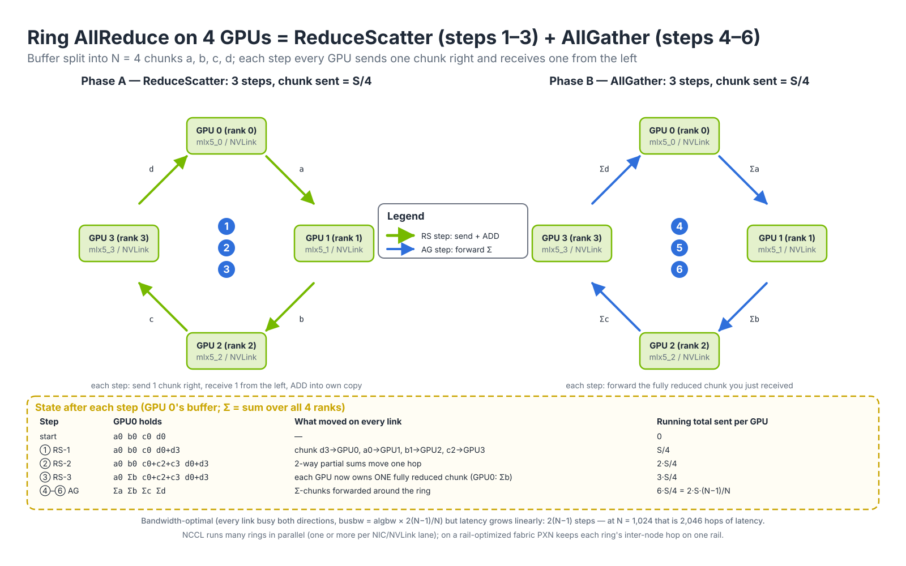
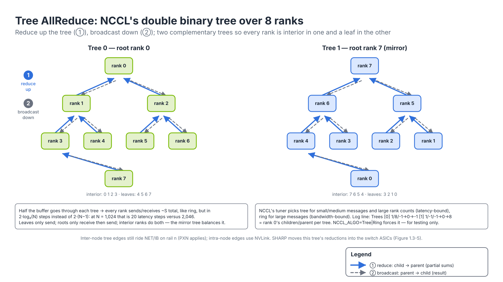
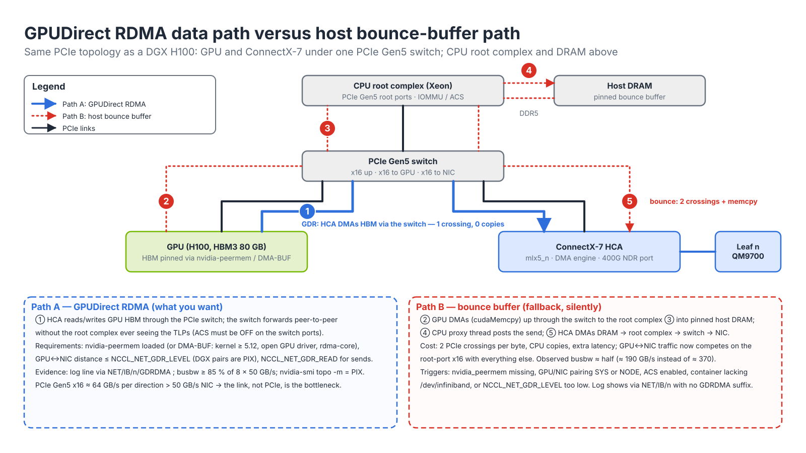
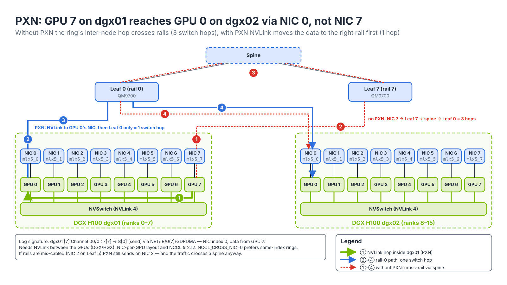

# Module 1.3 — GPU-to-GPU Communication: NCCL and GPUDirect

> **Exam domain:** AI Data Center Design and Optimization (5%) — also underpins Troubleshooting Tools (20%) and InfiniBand Networking (30%)  
> **Source course(s):** AI Infrastructure and Operations Fundamentals; InfiniBand Professional (SHARP section)  
> **Source docs:** NVIDIA NCCL User Guide (Environment Variables, Troubleshooting); NCCL Tests README; GPUDirect RDMA documentation; GPUDirect Storage documentation; NVIDIA SHARP documentation  
> **Estimated study time:** 3 hours

> **How to study this module:** read §1–§2, work through the §3 walkthrough on real gear or NVIDIA Air, then attempt the §5 hands-on assignment using only the Hint section. Open the Solution guide (last section) only after you have a working attempt. Finish with the Appendix C knowledge check closed-book.

## 1. Learning objectives

By the end of this module you will be able to…

- **Describe** the main collective operations (all-reduce, all-gather, reduce-scatter, broadcast, all-to-all) and map each to the parallelism strategy that generates it. *(Exam objective: AI DC Design — workload communication patterns)*
- **Explain** the difference between NCCL ring and tree algorithms and when each is selected. *(AI DC Design — collective algorithms)*
- **Describe** how NCCL chooses a transport (NVLink → PCIe/SHM → network) and which environment variables influence NIC selection and GPUDirect RDMA. *(Troubleshooting Tools — NCCL configuration)*
- **Run** **nccl-tests** (`all_reduce_perf`) and interpret bus bandwidth versus algorithm bandwidth. *(Troubleshooting Tools — performance validation)*
- **Explain** GPUDirect RDMA (nvidia-peermem / DMA-BUF) and GPUDirect Storage and **verify** they are active. *(AI DC Design / Troubleshooting — GPUDirect)*
- **Describe** **SHARP** in-network reductions and enable them for NCCL. *(InfiniBand Networking — SHARP)*
- **Explain** **PXN** and how NCCL exploits a **rail-optimized** topology. *(AI DC Design — rail-optimized traffic)*
- **Troubleshoot** NCCL hangs and poor performance using `NCCL_DEBUG`, topology dumps, and HCA-selection checks. *(Troubleshooting Tools — NCCL diagnostics)*

## 2. Key technical concepts

### 2.1 Collective operations

*Analogy:* a collective is a group chat where nobody can leave until everyone has read the message. All-reduce is "everyone totals the bill and everyone gets the total"; all-gather is "everyone shares their receipt and everyone ends up with the whole stack."

**What it is.** A **collective** is a communication operation that every rank (one process per GPU) in a *communicator* calls together, with a defined result on every rank. The **NVIDIA Collective Communications Library (NCCL, pronounced "nickel")** implements them for GPUs over NVLink, PCIe, InfiniBand and RoCE. In the table, N is the number of ranks and S is each rank's buffer size in bytes.

| Collective | Semantics (N ranks, each with buffer of size S) | Data moved per rank (ring) | Typical use |
|---|---|---|---|
| **AllReduce** | Every rank ends with the element-wise sum (or max/min/avg) of all ranks' buffers | 2 × S × (N−1)/N | Gradient averaging in data parallelism; activation reductions in tensor parallelism |
| **ReduceScatter** | Reduce across ranks, each rank keeps 1/N of the result | S × (N−1)/N | First half of AllReduce; ZeRO/FSDP gradient sharding |
| **AllGather** | Every rank collects every other rank's buffer (result N × S) | S × (N−1)/N | Second half of AllReduce; FSDP parameter gathering; tensor-parallel outputs |
| **Broadcast** | One root sends its buffer to all | S | Initial weight distribution, checkpoint load |
| **Reduce** | All ranks reduce into one root | S | Loss aggregation, metrics |
| **AllToAll** | Every rank sends a distinct slice to every other rank | S × (N−1)/N but N−1 distinct destinations | Expert parallelism (MoE token routing), sequence parallelism |
| Send/Recv (point-to-point) | Explicit pair transfer | S | Pipeline parallelism activations/gradients between stages |

Note that AllReduce = ReduceScatter + AllGather; NCCL's ring AllReduce literally runs these two phases back-to-back, which is why its data volume is 2 × S × (N−1)/N.

**Why it exists.** Distributed training is a bulk-synchronous loop (Module 1.1): every GPU computes on its shard, then they must agree on a shared result before the next step. If each GPU sent its gradients to a central parameter server, that server's single link would carry N × S per step and become the bottleneck at any scale. Collectives spread the work so every link carries roughly the same amount, and the per-rank traffic stays close to 2S *regardless of N*. The cost is coupling: the step finishes only when the slowest rank's slowest link finishes, so one degraded port slows every GPU.

**How it works.** The application (PyTorch `torch.distributed`, JAX, NeMo) calls, for example, `ncclAllReduce(sendbuf, recvbuf, count, ncclFloat, ncclSum, comm, stream)`. The call is asynchronous: NCCL enqueues a CUDA kernel on the given stream; that kernel moves data between GPUs (directly over NVLink, or through proxy threads that drive the NIC) and performs the reduction arithmetic on the GPU's SMs. Which parallelism you choose decides which collective dominates and over which links it runs:

| Parallelism | What is split | Dominant collective | Where it should run |
|---|---|---|---|
| **Data parallel (DP / DDP)** | The batch | AllReduce of gradients every step (or ReduceScatter + AllGather with ZeRO/FSDP) | Across nodes — fabric |
| **Tensor parallel (TP)** | Individual layers' matrices | AllReduce / AllGather / ReduceScatter *inside every layer*, several times per forward and backward pass | NVLink domain only (intra-node, or NVL72 rack) |
| **Pipeline parallel (PP)** | Layers into stages | Point-to-point Send/Recv of activations between stages | Across nodes, light bandwidth |
| **Expert parallel (EP, MoE)** | Experts across GPUs | AllToAll to route tokens to experts and back | Across nodes — stresses the fabric with many-to-many traffic, highest entropy |
| **Sequence/context parallel** | Long sequences | AllToAll or ring Send/Recv | Mixed |

The bandwidth gap explains the placement rule. An H100 has 18 NVLink 4 links at 25 GB/s per direction = 450 GB/s per direction (900 GB/s bidirectional) to the NVSwitch fabric, but only one 400 Gb/s NDR NIC = 50 GB/s per direction to the scale-out fabric. That is a 9:1 ratio. TP, which communicates inside every layer, would run 9× slower over the fabric, so it stays on NVLink.

**Why the exam cares:** *the most communication-intensive dimension (TP) stays inside NVLink; DP and PP cross the scale-out fabric; EP's AllToAll is the hardest pattern for the fabric because it is not rail-friendly.*

### 2.2 Ring versus tree algorithms

*Analogy:* a ring is a bucket brigade: every person is busy all the time, but the water takes N steps to get across. A tree is a phone tree: the message reaches everyone in log₂(N) calls, but some people sit idle.

**What it is.** The *algorithm* is the communication pattern NCCL uses to implement a collective: which rank sends which chunk to which peer, in what order. NCCL's main algorithms are **Ring**, **Tree** (double binary tree), **CollNet** (in-network reduction with SHARP, §2.6; variants `CollnetDirect` and `CollnetChain`) and **NVLS** (NVLink SHARP, reduction inside the NVSwitch on Hopper/Blackwell). Each algorithm runs with one of three *protocols*: **LL**, **LL128** or **Simple** (below).

**Why it exists.** No single pattern is best at every message size. Use the standard α–β cost model: α is the fixed per-step latency (kernel launch, a network round trip, roughly microseconds) and B is the per-link bandwidth.

- Ring AllReduce time ≈ 2(N−1)·α + 2·(N−1)/N · S/B. The bandwidth term is optimal: every rank sends and receives 2(N−1)/N × S, which no algorithm can beat without in-network reduction. The latency term grows *linearly* with N.
- Tree AllReduce time ≈ 2·log₂(N)·α + (about) S/B per tree, with the buffer split over two trees. The latency term grows *logarithmically*.

Worked example at N = 1,024 ranks with α = 5 µs: ring latency ≈ 2 × 1,023 × 5 µs ≈ 10 ms before a single byte of bandwidth term; tree ≈ 2 × 10 × 5 µs = 0.1 ms. For a 4 KB gradient bucket the ring is entirely latency-bound and the tree wins by about 100×. For an 8 GB buffer at 50 GB/s the bandwidth term (≈ 320 ms) dominates and the ring's perfect link utilization wins.

**How it works.**


*Figure 1.3-1 — Ring AllReduce: steps ①–③ (ReduceScatter) leave each GPU owning one fully reduced chunk; steps ④–⑥ (AllGather) circulate those chunks. Each GPU sends 6 × S/4 = 2·S·(N−1)/N.*

**Ring.** Ranks form a logical ring; each rank sends to its right neighbour and receives from its left (Figure 1.3-1). The buffer is split into N chunks. In step ① every rank sends one chunk and adds the chunk it receives into its own copy. After N−1 such steps (①–③) each rank holds one chunk that is fully reduced across all ranks: that is ReduceScatter. N−1 more steps (④–⑥) forward those reduced chunks without arithmetic: that is AllGather. Each step moves S/N per link, so the total is 2(N−1)·S/N.
- Bandwidth-optimal: every link is used in both directions throughout.
- Latency grows linearly with N (2 × (N−1) steps), which hurts small messages at large scale.
- NCCL builds multiple rings (one per NIC/NVLink lane) to use all available links in parallel. Each ring is a **channel** (§2.3).
- In practice NCCL also *pipelines*: chunks are cut into slices (sized by `NCCL_BUFFSIZE`, default 4 MiB per channel) so step k+1 of slice 1 overlaps step k of slice 2.


*Figure 1.3-2 — Double binary tree: ① partial sums flow child → parent to the root, ② the result is broadcast back down. Half the buffer goes through each tree so no rank carries the interior-node load twice.*

**Tree.** NCCL (since 2.4) also builds **double binary trees** (Figure 1.3-2): two complementary trees so that every rank is an interior node in one and a leaf in the other, which balances load. Reduction goes up the tree (①), broadcast comes down (②), and the two phases are pipelined chunk by chunk so the broadcast of chunk 1 overlaps the reduction of chunk 2. Inside a node NCCL chains the 8 GPUs over NVLink; the binary tree is built across nodes, one rank per node per tree.
- Latency grows as log₂(N), which is much better at large N for small and medium messages.
- Peak bandwidth is slightly below the ring on some topologies.
- NCCL auto-selects: tree for latency-bound (small) messages and very large rank counts, ring for bandwidth-bound (large) messages, using an internal cost model tuned per topology. `NCCL_ALGO=Ring|Tree|CollnetDirect|CollnetChain|NVLS` forces a choice for testing; leave it unset in production.

**Protocols.** The protocol decides how a receiver knows data has arrived:
| Protocol | Mechanism | Payload efficiency | Use |
|---|---|---|---|
| **LL** (low latency) | 8-byte stores, each carrying 4 bytes of data + a 4-byte flag; the receiver spins on the flag, no memory fence needed | ~50 % | Smallest messages |
| **LL128** | 128-byte lines with an 8-byte flag; relies on 128-byte store atomicity (NVLink-class paths) | ~94 % | Small–medium, intra-node and some networks |
| **Simple** | Large chunks; a memory fence and a separate flag signal completion | ~100 % | Large messages |

The tuner computes `time = latency(algo, proto) + size / bandwidth(algo, proto)` for every combination and picks the minimum per collective call. `NCCL_PROTO` forces a protocol (testing only).

**NVLS and CollNet.** **NVLS** (NVLink SHARP): on Hopper/Blackwell with NVSwitch, the NVSwitch performs in-switch reductions for intra-node collectives, so each GPU sends its buffer once into the switch. **CollNet / SHARP**: in-network reductions on the InfiniBand fabric (Section 2.6).

**Why the exam cares:** ring = bandwidth-optimal, O(N) latency; tree = O(log N) latency; NCCL picks per message size, and forcing `NCCL_ALGO` is a test tool, not a tuning knob.

### 2.3 NCCL transport selection

*Analogy:* NCCL is a courier choosing the fastest route for every parcel: hand it across the desk (NVLink), walk it down the hall (PCIe), leave it in the mailroom (shared memory), or ship it (network). It never ships what it could hand over.

**What it is.** A **transport** is the mechanism NCCL uses to move bytes between two specific ranks. NCCL has three built-in transports (P2P, SHM, NET) plus the CollNet path through an external plugin (Figure 1.3-3). The choice is made per *peer pair* and per *channel* at communicator creation (`ncclCommInitRank`), not per call.


*Figure 1.3-3 — The NCCL stack: the core picks a transport per peer pair; each transport has its own driver path to hardware. The sidebar maps the environment variables to the layer they control.*

**Why it exists.** The same job contains pairs of ranks connected in very different ways: two GPUs on one NVSwitch (450 GB/s per direction), two GPUs on the same PCIe Gen5 switch without NVLink (~64 GB/s per direction for x16), two GPUs on different CPU sockets (traffic crosses the inter-socket link), and two GPUs on different nodes (50 GB/s per direction per NDR NIC). Using one mechanism for all would either waste NVLink or fail across nodes. NCCL therefore measures the topology and uses the fastest working path for each pair.

**How it works.** The sequence at `ncclCommInitRank`:

1. **Bootstrap.** Rank 0 creates an `ncclUniqueId` that contains its TCP listen address; the framework distributes it out of band (MPI broadcast, the PyTorch rendezvous store). Every rank connects to rank 0 over TCP on the interface chosen by `NCCL_SOCKET_IFNAME`, and the ranks form a bootstrap ring. All later setup data (QP numbers, LIDs/GIDs, memory keys) travels over this TCP channel. A wrong interface here hangs init before any GPU work.
2. **Topology discovery.** Each rank reads the PCI hierarchy from `/sys`, NVLink state from NVML, NUMA affinity, and the NIC list from the network plugin, and builds an XML graph (dump it with `NCCL_TOPO_DUMP_FILE`). It classifies every GPU↔GPU and GPU↔NIC path by type, from closest to farthest: `LOC`, `NVL` (direct NVLink), `NVB` (NVLink through an intermediate GPU), `PIX` (same PCIe switch), `PXB` (several PCIe switches, no root complex), `PXN` (through an NVLink peer to its NIC, §2.7), `PHB` (through the CPU root complex), `SYS` (across the inter-socket link).
3. **Graph search.** NCCL searches for ring, tree, CollNet and NVLS graphs that maximize per-channel bandwidth over those paths, decides the number of channels, and assigns a NIC to each inter-node hop (preferring the NIC closest to the GPU).
4. **Transport per pair, in fixed preference order:**
   1. **P2P over NVLink** — same node, GPUs connected by NVLink/NVSwitch. Highest bandwidth. Logged as `P2P/CUMEM` (CUDA VMM handles) or `P2P/IPC` (CUDA IPC handles); used if the path type is within `NCCL_P2P_LEVEL`.
   2. **P2P over PCIe** — same node, no NVLink path (or NVLink disabled). Falls back to PCIe peer-to-peer if the IOMMU/ACS allow it.
   3. **SHM (shared memory)** — same node, when P2P is not possible (e.g. across sockets with ACS enabled); data is staged through host memory. Disable with `NCCL_SHM_DISABLE=1` for diagnosis.
   4. **NET** — different nodes, via a network plugin:
      - The built-in **IB plugin** (`NCCL_NET=IB`) uses ibverbs and handles both InfiniBand and RoCE.
      - The **Socket** plugin (`NCCL_NET=Socket`) uses TCP; dramatically slower, used only when no RDMA device is usable. Seeing `NET/Socket` in `NCCL_DEBUG=INFO` output on an RDMA cluster is a red flag.
      - External plugins (e.g. `libnccl-net.so` for SHARP/CollNet, AWS EFA, etc.).
5. **Connection setup.** For NET/IB, each channel to each peer gets its own **RC queue pair** (or several, with `NCCL_IB_QPS_PER_CONNECTION`). Data moves as RDMA writes into the peer's pre-registered receive buffers, with a small write-with-immediate or flag to signal completion. The QP timeout is 4.096 µs × 2^`NCCL_IB_TIMEOUT`; at the value 18 that is about 1.07 s per retry, and `NCCL_IB_RETRY_CNT` (maximum 7) retries are allowed before the QP errors with "transport retry counter exceeded" (§4.4).

Over the NET transport, NCCL further decides whether to use **GPUDirect RDMA** (the NIC DMAs straight to/from GPU memory) or to bounce through host memory. That is controlled by `NCCL_NET_GDR_LEVEL` and the PCIe distance between GPU and NIC (§2.5).

**Channels.** A **channel** is one instance of the chosen ring or tree, with its own buffers, its own CUDA thread block (so it uses SMs) and its own connections. NCCL splits each collective's buffer across channels so they run in parallel over different links: on a DGX H100 you typically see 16 or more channels, two per NIC, spread across all 8 rails. More channels give more parallelism but take SMs away from compute; `NCCL_MIN_NCHANNELS`/`NCCL_MAX_NCHANNELS` bound the count. A **proxy thread** on the CPU of each rank drives the network side of each channel: it posts the RDMA work requests and polls the completion queues on behalf of the GPU kernel.

**Key environment variables**

| Variable | Purpose | Notes |
|---|---|---|
| `NCCL_DEBUG=INFO` | Verbose log: transports chosen, rings/trees built, NICs used, GDR status, errors | `WARN` is the default; `TRACE` is extremely verbose. First thing to set when debugging. |
| `NCCL_DEBUG_SUBSYS=INIT,NET,GRAPH,TUNING` | Filter INFO output by subsystem | `ALL` or a comma list; prefix with `^` to exclude |
| `NCCL_DEBUG_FILE=/tmp/nccl.%h.%p.log` | Write debug output per host/PID instead of stderr | Essential on large jobs |
| `NCCL_TOPO_DUMP_FILE=/tmp/topo.xml` | Dump the topology graph NCCL discovered | Compare across nodes to find a node with a missing NIC or wrong PCIe affinity |
| `NCCL_TOPO_FILE=` | Load a hand-written topology (for VMs, or to override) | Rarely needed on bare-metal DGX |
| `NCCL_SOCKET_IFNAME=eth0` / `^docker,lo` | Interface(s) for the bootstrap/out-of-band TCP channel and for Socket transport | Must be an interface reachable between all nodes; wrong value is a classic cause of init hangs |
| `NCCL_IB_HCA=mlx5_0,mlx5_1` / `=^mlx5_8` / `=mlx5_0:1` | Restrict which HCAs (and ports) NCCL uses for the IB transport | Prefix `^` excludes; `=mlx5_` prefix match vs exact match — check the NCCL doc for the `=`-prefix exact-match syntax. Use to keep storage BlueField-3 ports out of NCCL. |
| `NCCL_IB_GID_INDEX=3` | GID index for RoCE (selects IPv4/IPv6 and RoCE v1/v2 GID) | Typically 3 for RoCEv2 IPv4 on MOFED; verify with `show_gids` |
| `NCCL_IB_TC=106` | Traffic class (DSCP ×4) for RoCE packets | Must match the DSCP the switches mark/queue for lossless RoCE (e.g. DSCP 26 → TC 104; verify your fabric's QoS plan) |
| `NCCL_IB_SL=0` | InfiniBand service level | Match the SM's QoS/SL config if used |
| `NCCL_IB_TIMEOUT=18`, `NCCL_IB_RETRY_CNT=7` | QP timeout exponent and retry count | Raise timeout for large fabrics with adaptive routing or when seeing "transport retry counter exceeded" |
| `NCCL_IB_QPS_PER_CONNECTION=1` | QPs per connection; >1 increases entropy for ECMP-based Ethernet fabrics | Spectrum-X with AR usually does not need it; verify guidance |
| `NCCL_IB_SPLIT_DATA_ON_QPS` | Split data across multiple QPs | Pairs with the above |
| `NCCL_IB_DISABLE=1` | Force Socket transport | Diagnostic only |
| `NCCL_NET_GDR_LEVEL=PIX|PXB|PHB|SYS` (or `LOC`) | Maximum GPU↔NIC PCIe distance at which GPUDirect RDMA is used | Default is `PXB` in current releases (verify); on DGX each GPU/NIC pair is PIX/PXB so GDR is on by default |
| `NCCL_NET_GDR_READ=1` | Also use GDR for sends (reads from GPU memory) | Default on for recent GPUs |
| `NCCL_P2P_LEVEL`, `NCCL_P2P_DISABLE=1` | Maximum path type for intra-node P2P / disable P2P entirely | Diagnostic; forcing P2P off on a DGX pushes traffic to SHM |
| `NCCL_CROSS_NIC=0|1|2` | Whether rings may use different NICs on sender and receiver (i.e. cross rails) | 0 = keep same NIC (rail-aligned) when possible; 1 = allow; 2 = auto (default) |
| `NCCL_PXN_DISABLE=1` | Disable PXN | Diagnostic only |
| `NCCL_COLLNET_ENABLE=1` | Enable the CollNet (SHARP) plugin | Requires the SHARP net plugin and AM — Section 2.6 |
| `NCCL_ALGO`, `NCCL_PROTO=LL,LL128,Simple` | Force algorithm / protocol | Testing only |
| `NCCL_MIN_NCHANNELS`, `NCCL_MAX_NCHANNELS` | Channels (parallel rings) | Tuning |
| `NCCL_BUFFSIZE` | Per-channel buffer size (default 4 MiB) | Rarely changed; shows as `buffSize 4194304` in the log |
| `NCCL_NET_PLUGIN=` | Pick a specific `libnccl-net-<name>.so` | e.g. `sharp` |

**Why the exam cares:** the two variables it tests most are `NCCL_SOCKET_IFNAME` (bootstrap path) and `NCCL_IB_HCA` (RDMA path); setting only one does not fix the other. Know the transport order (P2P → SHM → NET) and that `NET/Socket` on an RDMA cluster always means "no usable RDMA device".

### 2.4 nccl-tests and reading the output

**What it is.** **nccl-tests** (github.com/NVIDIA/nccl-tests) is the standard benchmark and acceptance test: one binary per collective (`all_reduce_perf`, `all_gather_perf`, `reduce_scatter_perf`, `alltoall_perf`, `sendrecv_perf`, …) that sweeps message sizes and prints time, **algorithm bandwidth** and **bus bandwidth** per size. Build with `make MPI=1 MPI_HOME=/path/to/mpi CUDA_HOME=/usr/local/cuda` to get the MPI launcher.

**Why it exists.** Application throughput mixes compute and communication, so it cannot tell you whether the fabric is healthy. nccl-tests isolates the communication library on the real topology, and its **busbw** figure is normalized so you can compare it directly with hardware link rates at any rank count. That is what makes it an acceptance criterion: "busbw within X % of injection bandwidth on every SU".

**How it works.** Launch one process per GPU (`-g 1`) with MPI or Slurm, or one process driving several GPUs (`-g 8`) on a single node:

```bash
# Single node, 8 GPUs, AllReduce from 8 B to 8 GB, doubling
./build/all_reduce_perf -b 8 -e 8G -f 2 -g 8

# Two nodes, one process per GPU, with MPI
mpirun -np 16 -H dgx01:8,dgx02:8 \
  -x NCCL_DEBUG=INFO -x NCCL_IB_HCA=mlx5_0,mlx5_1,mlx5_2,mlx5_3,mlx5_4,mlx5_5,mlx5_6,mlx5_7 \
  -x NCCL_SOCKET_IFNAME=enp225s0np0 \
  ./build/all_reduce_perf -b 8 -e 8G -f 2 -g 1

# Under Slurm
srun -N 16 --ntasks-per-node=8 --gpus-per-node=8 ./build/all_reduce_perf -b 1G -e 8G -f 2 -g 1
```

Common flags: `-b` begin size, `-e` end size, `-f` size multiplication factor, `-g` GPUs per process, `-n` iterations, `-w` warm-up iterations, `-c 1` check correctness, `-o sum`, `-d float`.

```text
#       size   count    type  redop  root   time  algbw  busbw #wrong   time  algbw  busbw #wrong
#        (B)  (elements)                   (us)  (GB/s) (GB/s)         (us)  (GB/s) (GB/s)
  8589934592  2147483648  float   sum    -1  46213  185.9  348.5      0  46180  186.0  348.8      0
# Avg bus bandwidth    : 344.05
```

The first block of columns is *out-of-place* (separate send and receive buffers), the second *in-place* (the same buffer). The two formulas:

- **algbw (algorithm bandwidth)** = S / t, where S is the buffer size in the `size` column and t the measured time. It is what the application perceives: "an 8 GB all-reduce took 46 ms, so 186 GB/s."
- **busbw (bus bandwidth)** = algbw × a fixed correction factor that reflects the data each rank's links actually carried. For AllReduce the factor is 2 × (N−1)/N; for AllGather/ReduceScatter it is (N−1)/N; for AllToAll (N−1)/N; for Broadcast/Reduce/SendRecv it is 1. busbw is therefore comparable to hardware link bandwidth regardless of rank count and is the number you compare against NVLink or NIC line rate.

Worked check for the row above with N = 16 ranks: 8,589,934,592 B ÷ 46,213 µs = 185.9 GB/s; × 2 × 15/16 = 348.5 GB/s. The factor assumes a ring-style data volume. With SHARP or NVLS the switch performs the reduction and each rank really moves only about S, so busbw computed with the ring factor can legitimately *exceed* link rate. That is not an error: it is the in-network reduction showing up in the number.

Rules of thumb for acceptance (verify against your RA's validated figures):
- Intra-node H100 (NVLink 4 + NVSwitch): AllReduce busbw ~ 350–480 GB/s at large sizes.
- Inter-node over 8 × NDR 400G: each node injects 8 × 50 GB/s = 400 GB/s; expect busbw in the high 300s GB/s for large messages across a full SU, with a modest drop with more nodes.
- A single node far below its peers → check `nvidia-smi topo -m`, `ibstat` rates, and the NCCL log for `NET/Socket` or `GDR disabled`.

**Why the exam cares:** compare busbw, not algbw, with link capacity; algbw for AllReduce is roughly half of busbw at large N.

### 2.5 GPUDirect

*Analogy:* without GPUDirect RDMA, every parcel from the GPU goes to the CPU's loading dock before the truck (NIC) picks it up. With it, the truck backs up to the GPU's own door.

**What it is.** **GPUDirect** is a family of technologies that let devices other than the CPU read and write GPU memory directly:

- **GPUDirect RDMA** — a NIC (ConnectX, BlueField) DMAs directly to and from GPU HBM over PCIe. This is the one that matters for the compute fabric.
- **GPUDirect Storage (GDS)** — the same idea for storage traffic (`cuFile` API, `nvidia-fs` module).
- **GPUDirect P2P** — GPU-to-GPU memory access inside a node over NVLink or PCIe; the mechanism behind NCCL's P2P transport. Not to be confused with GPUDirect RDMA (NIC↔GPU).


*Figure 1.3-4 — Path A (blue, ①): the HCA DMAs HBM through the PCIe switch, one crossing and no copies. Path B (red, ②–⑤): GPU → root complex → pinned host DRAM, CPU posts the send, HCA reads DRAM back down: two crossings plus a copy.*

**Why it exists.** Without GPUDirect RDMA a NIC can only DMA to host memory. Sending GPU data then requires a `cudaMemcpy` to a host bounce buffer (Figure 1.3-4, steps ②–③), the CPU proxy posts the send (④), and the NIC reads the bounce buffer back down (⑤). Every byte crosses the PCIe hierarchy twice and the CPU root port once in each direction, and it competes with everything else on that root port. Typical effect on a DGX: inter-node busbw roughly halves (≈ 190 GB/s instead of ≈ 370 GB/s) and small-message latency grows by several microseconds. With GPUDirect RDMA (step ①) the PCIe switch forwards the NIC's DMA transactions straight to the GPU. A PCIe Gen5 x16 link carries ≈ 64 GB/s per direction, more than the 50 GB/s a 400G port needs, so the network link, not PCIe, becomes the bottleneck. That is the goal.

**How it works.** Step by step for NCCL's IB transport:

1. **Allocate.** NCCL allocates its receive and send buffers in GPU memory (`cudaMalloc` or CUDA VMM).
2. **Register.** NCCL calls `ibv_reg_mr()` (or `ibv_reg_dmabuf_mr()`) on the GPU virtual address. The RDMA core in the kernel must turn that address into bus addresses the NIC can DMA to. It cannot use the normal page-pinning path, because the memory is not host RAM, so one of two mechanisms steps in:
   - **Peer memory (`nvidia-peermem`)** — a kernel module shipped with the NVIDIA driver (successor to `nv_peer_mem`) that registers as a *peer-memory client* of the MOFED/DOCA-OFED `ib_core`. When `ib_core` sees an address it does not own, it asks the peer clients. nvidia-peermem claims it, pins the GPU pages with `nvidia_p2p_get_pages()`, and returns their physical addresses. `lsmod | grep nvidia_peermem` must show it loaded on MOFED/DOCA-OFED systems.
   - **DMA-BUF** — the upstream Linux mechanism (RDMA support in kernel 5.12+, the NVIDIA *open* kernel driver, recent rdma-core). CUDA exports the allocation as a dma-buf file descriptor, and the RDMA stack imports it with `ibv_reg_dmabuf_mr()`. No out-of-tree module is needed. NCCL uses it automatically when available; `NCCL_DEBUG=INFO` prints `GDRDMA ... dmabuf` or `peermem`.
3. **Map through BAR1.** The addresses returned point into the GPU's **BAR1** aperture, the PCIe window through which outside devices see GPU memory. Data-center GPUs expose a BAR1 large enough to map their HBM. Consumer GPUs often expose only 256 MB, which caps how much memory can be registered for GDR. Check with `nvidia-smi -q | grep -A3 BAR1`.
4. **Program the NIC.** The bus addresses go into the NIC's memory translation table (MTT) under the memory region's key (`lkey`/`rkey`). The remote side learns the `rkey` and address during NCCL connection setup over the bootstrap channel.
5. **DMA peer-to-peer.** When a remote RDMA write arrives, the ConnectX turns it into PCIe memory-write TLPs addressed to the GPU's BAR1. The PCIe switch routes them directly to the GPU's downstream port (Figure 1.3-4, path A). For sends (`NCCL_NET_GDR_READ=1`) the NIC issues PCIe reads to BAR1 instead.

Requirements and pitfalls:

- GPU and NIC under the same PCIe root complex or close enough (`NCCL_NET_GDR_LEVEL`). DGX places each NIC next to its GPU for this reason: `nvidia-smi topo -m` shows `PIX` for GPU *n* ↔ `mlx5_n`. A `PHB`/`SYS` pair exceeds the default level and GDR is silently skipped.
- A kernel mechanism to pin GPU memory and expose it to the NIC driver: nvidia-peermem or DMA-BUF, as above.
- `NCCL_NET_GDR_LEVEL` permitting the GPU↔NIC distance; `NCCL_NET_GDR_READ` for the send side.
- **ACS (Access Control Services).** With PCIe ACS enabled on switches/root ports, *Request Redirect* forces every peer-to-peer TLP up to the root complex for an IOMMU check, so P2P can be forced through the root complex and GDR may fail or crawl. DGX OS disables ACS, and the Troubleshooting modules show `setpci` checks.
- **IOMMU.** With the IOMMU translating DMA addresses, peer addresses must be mapped as well; bare-metal GPU nodes run with the IOMMU off or in passthrough (`iommu=pt`). Inside VMs the hypervisor must support P2P (ATS/ACS configuration). Verify for your platform.
- In containers the pod must see the RDMA device (`/dev/infiniband/*`) and the host must have nvidia-peermem or DMA-BUF support. That is why Kubernetes needs both the GPU Operator and the Network Operator ([Module 7.1](../07-kubernetes/01-network-operator-rdma-infiniband.md)).

Verification:
```bash
lsmod | grep -E 'nvidia_peermem|ib_core'
NCCL_DEBUG=INFO ./all_reduce_perf ... 2>&1 | grep -iE 'GDRDMA|GDR'
# expected: "... via NET/IB/0/GDRDMA" on each inter-node channel
ib_write_bw -d mlx5_0 --use_cuda=0 -a   # perftest built with CUDA: GPU-memory RDMA test (verify flag)
```

**GPUDirect Storage (GDS).** Extends the same idea to storage: the NVMe or NIC (for NFS-over-RDMA, Lustre, GPFS, WEKA) DMAs file data straight into GPU memory via the `cuFile` API and the `nvidia-fs` kernel module. Benefits: lower CPU use and higher throughput for dataset loading and checkpoints. Check with `gdscheck -p` (part of the CUDA toolkit's GDS package). GDS traffic rides the *storage* fabric on the BlueField-3 ports, not the compute fabric.

**GPUDirect P2P.** Intra-node GPU-to-GPU memory access over NVLink or PCIe; the mechanism behind NCCL's P2P transport (`P2P/CUMEM`, `P2P/IPC` in the log).

**Why the exam cares:** GDR needs *both* a pinning mechanism (nvidia-peermem or DMA-BUF) *and* a short GPU↔NIC PCIe path. If either is missing, NCCL falls back silently, and the only symptoms are a missing `GDRDMA` suffix and half the bandwidth.

### 2.6 SHARP: in-network reductions

*Analogy:* instead of every student passing their exam score around the room to compute the class average, the teacher at the front (the switch) collects them all, adds them up once, and announces the result.

**What it is.** **SHARP (Scalable Hierarchical Aggregation and Reduction Protocol)** moves the reduction step of AllReduce from the GPUs into the InfiniBand switch ASICs (Quantum/Quantum-2/Quantum-X800). Each switch contains **aggregation nodes (ANs)**: ALU and buffer resources that can sum data arriving on several ports and forward one result. A job's ranks are mapped onto a **SHARP tree**, a spanning tree over the fabric's switches (leaves at the bottom, a spine as the root). NCCL reaches SHARP through its **CollNet** algorithm.

Components:
- **SHARP Aggregation Manager (AM)** — runs with the Subnet Manager (on the UFM appliance or the opensm host, `sharp_am` service) and allocates aggregation trees and switch resources.
- **SHARP daemon (`sharpd`)** on each compute node — brokers job requests to the AM.
- **libsharp / libsharp_coll** — user-space library.
- **NCCL SHARP (CollNet) plugin** — `nccl-rdma-sharp-plugins` provides `libnccl-net.so`; NCCL loads it and exposes the CollNet algorithm.

**Why it exists.** A ring AllReduce makes every NIC send and receive 2(N−1)/N × S, nearly 2S, and its step count grows with N. With in-network reduction every host sends its buffer *once* (S) up to the leaf and receives the result *once* (S): the data crossing each host link drops from ~2× to ~1× the buffer size, and the number of steps is fixed by the tree depth (2–3 switch levels), not by N. For latency-bound small messages at thousands of ranks that is the dominant gain. For large messages it raises achievable algbw toward line rate. The trade-off is that switch resources are finite: the number of concurrent trees and outstanding operations per AN are limited, so only one or a few jobs can hold SHARP resources on a given tree (verify the limits per switch generation). SHARP helps reductions only: it does nothing for AllToAll.

**How it works.** Figure 1.3-5 shows the order of events.


*Figure 1.3-5 — SHARP control setup (①–⑤, once per communicator) and data path (⑥–⑨, every AllReduce). Each rank's link carries S up and S down.*

Setup, once per communicator:
1. At `ncclCommInitRank`, NCCL finds the SHARP net plugin and enables CollNet (`NCCL_COLLNET_ENABLE=1`) (①).
2. The plugin calls `sharp_coll_init` with the job's ranks and PKey; libsharp contacts the local `sharpd` (②).
3. `sharpd` asks `sharp_am` for an aggregation tree (③). The AM checks that the job's partition (**PKey**) is allowed and that resources are free.
4. The AM programs the leaf and spine ANs with management datagrams (④) and returns a tree handle and resource quota, such as outstanding operations and buffers (⑤).

Data path, every AllReduce:
1. Inside each node NCCL first reduces over NVLink (or NVLS), so each NIC carries one stream for its rail.
2. Each rank sends its buffer once to its leaf AN with RDMA (⑥).
3. The leaf reduces its inputs and forwards one partial result up the tree (⑦); the root reduces the partials.
4. The result is multicast back down (⑧) and every rank receives the final sum (⑨).

Small messages use the low-latency path; large buffers use **Streaming Aggregation (SAT)**, which pipelines the payload through the tree at line rate on Quantum-2 and later.

Enable in NCCL:
```bash
export NCCL_COLLNET_ENABLE=1         # turn on CollNet (SHARP) algorithm
export NCCL_ALGO=CollnetDirect       # optional, force for testing; default lets the tuner choose
export NCCL_SHARP_GROUP_SIZE_THRESH=2  # verify name/default; minimum ranks per node group to use SHARP
export SHARP_COLL_ENABLE_SAT=1       # streaming aggregation (large messages) on Quantum-2 — verify
export SHARP_COLL_LOG_LEVEL=3
```
Check with `NCCL_DEBUG=INFO` for lines mentioning `SHARP` / `CollNet` and with `sharp_hello` / `sharp_benchmark.sh` from the SHARP package. SHARP needs the AM reachable, the switches licensed/enabled for SHARP, and the job's partition (**PKey**) allowed in the AM configuration. Only one or a few SHARP jobs can hold switch aggregation resources concurrently per tree; verify limits per switch generation. Module [`../02-infiniband/03-infiniband-qos-adaptive-routing-sharp.md`](../02-infiniband/03-infiniband-qos-adaptive-routing-sharp.md) covers the fabric side.

**Why the exam cares:** SHARP helps AllReduce-style collectives on InfiniBand, does nothing for AllToAll, and requires four pieces: AM, `sharpd`, the CollNet plugin, and `NCCL_COLLNET_ENABLE=1`.

### 2.7 PXN and rail-optimized topologies

*Analogy:* you need to post a letter to apartment 3 in the next building. Rather than walking to the central post office, you hand it to your neighbor in apartment 3 (over NVLink), who drops it in the apartment-3 mailbox that goes straight next door.

**What it is.** **PXN (PCI × NVLink)**, introduced in NCCL 2.12, lets a GPU send data to a *different* GPU's NIC in the same node over NVLink first, then out that NIC. It appears in the topology as the `PXN` path type and in the log as `NET/IB/<nic>(<origin-gpu>)`.

**Why it exists.** On a rail-optimized fabric ([Module 1.2](02-dgx-superpod-basepod-reference-architectures.md)), GPU *n* of every node sits on leaf *n*. Any inter-node hop between *different* GPU indices is a cross-rail hop. If NCCL's ring on node A exits via NIC 7 but the next ring position on node B is GPU 0 (NIC 0), the packet must cross a spine: leaf 7 → spine → leaf 0, three switch hops instead of one (Figure 1.3-6, red path ①–④). Do that for every ring and the spine load returns, along with the extra latency and congestion exposure the rail design was meant to remove. AllToAll makes it worse: every GPU talks to every GPU index on every other node.

**How it works.**


*Figure 1.3-6 — With PXN (green ① then blue ②–④), GPU 7's data crosses NVLink to GPU 0's memory and leaves on rail 0: one switch hop. Without PXN (red ①–④) it leaves on NIC 7 and crosses a spine.*

1. NCCL decides that the destination (GPU 0 on dgx02) is on rail 0.
2. GPU 7 writes the data over NVLink into a buffer in GPU 0's memory on its own node (Figure 1.3-6, green ①).
3. The proxy thread responsible for NIC 0 posts the RDMA write from that buffer using GPUDirect RDMA (blue ②).
4. The packet crosses Leaf 0 only (③) and lands in GPU 0 on dgx02 (④).

So GPU 7 on node A, needing to reach GPU 0 on node B, always sends through NIC 0 → leaf 0 → NIC 0 on node B, one hop, even if the ring logically runs through other GPUs. NCCL also aggregates messages for the same destination rail on the NVLink side, which reduces the number of network messages. Effects:
- Inter-node traffic stays on its rail; spine utilization drops.
- Fewer, larger network sends; better small-message and AllToAll performance.
- Requires NVLink between the GPUs in the node (true on DGX/HGX) and the NIC-per-GPU layout.

`NCCL_CROSS_NIC=0` further tells NCCL to prefer rings whose endpoints use the same NIC index on both ends. On a rail-optimized fabric, `NCCL_DEBUG=INFO` with `NCCL_DEBUG_SUBSYS=GRAPH` shows rings with matching NIC indices and `PXN` in the channel description.

**Why this matters for you.** If PXN is off (older NCCL, NVLink down, `NCCL_PXN_DISABLE=1`) or rails are mis-cabled (NIC 2 of one node landing on leaf 5), you will see unexpected spine traffic and lower busbw even though every link is up. A topology check that cabling matches the rail plan (`iblinkinfo` per leaf, or NetQ topology) is a prerequisite before blaming NCCL.

**Why the exam cares:** PXN = NVLink first, then the destination rail's NIC; it is what makes a rail-optimized fabric one hop for any GPU pair, and it depends on healthy NVLink.

## 3. Live-style walkthrough — all_reduce_perf with NCCL_DEBUG=INFO, line by line

Let's run a two-node, 16-GPU all-reduce on an InfiniBand SU and read the log the way an instructor would at the whiteboard. Every block of output below is annotated: what the line means, and what "good" looks like. Keep the §2 figures open: the log walks top to bottom through Figure 1.3-3 (bootstrap → topology → transports), then shows the rings and trees of Figures 1.3-1 and 1.3-2, the GPUDirect path of Figure 1.3-4 and the PXN hop of Figure 1.3-6.

**Step 1 — pre-flight on both nodes.** Never launch NCCL before you know what the hardware looks like.

```bash
pdsh -w dgx01,dgx02 "ibstat | grep -E 'CA |State|Rate'"    # Run on both nodes: every compute HCA Active at 400.
                                                           # EXPECT per node: 8 × "State: Active", 8 × "Rate: 400".
                                                           # BlueField-3 ports (mlx5_8+) may show Ethernet link layer — that is fine.
pdsh -w dgx01,dgx02 "lsmod | grep nvidia_peermem"          # GPUDirect RDMA kernel path present?
                                                           # EXPECT: "nvidia_peermem   16384  0" on both. Missing = GDR silently off.
pdsh -w dgx01,dgx02 "nvidia-smi topo -m | grep -E '^GPU[0-7]' | awk '{print \$1, \$10}'"
                                                           # Crude check that GPU n <-> NIC n column is PIX/PXB (column index varies; eyeball the full matrix on first run).
```

**Step 2 — set the environment and launch.** We log to a per-host file so 16 ranks do not interleave on one terminal.

```bash
export NCCL_DEBUG=INFO                        # Turn on verbose init/transport logging. WARN is default; INFO is what we read below.
export NCCL_DEBUG_SUBSYS=INIT,NET,GRAPH       # Limit noise to initialization, network plugin, and ring/tree graph construction.
export NCCL_DEBUG_FILE=/var/log/nccl/%h.%p.log  # %h = hostname, %p = PID: one file per rank; grep across them later.
export NCCL_SOCKET_IFNAME=enp225s0np0         # Bootstrap TCP channel over the in-band interface. Must exist and route on BOTH nodes.
export NCCL_IB_HCA=^mlx5_8,mlx5_9             # Exclude BlueField-3 storage/in-band HCAs so NCCL uses only the 8 compute rails.
export NCCL_NET_GDR_LEVEL=PXB                 # Allow GPUDirect RDMA when GPU and NIC share a PCIe switch (the DGX layout). Default anyway; explicit for clarity.

mpirun -np 16 -H dgx01:8,dgx02:8 --bind-to none \         # 16 ranks: 8 per node, one process per GPU (-g 1 below).
  -x NCCL_DEBUG -x NCCL_DEBUG_SUBSYS -x NCCL_DEBUG_FILE \  # Forward the env vars to every rank.
  -x NCCL_SOCKET_IFNAME -x NCCL_IB_HCA -x NCCL_NET_GDR_LEVEL \
  ./build/all_reduce_perf -b 1G -e 8G -f 2 -g 1 -n 20 -w 5   # 1 GB to 8 GB doubling; 1 GPU per process; 20 timed, 5 warm-up iterations.
```

**Step 3 — read the init block.** Open `/var/log/nccl/dgx01.<pid-of-rank0>.log`.

```text
dgx01:21034:21034 [0] NCCL INFO Bootstrap : Using enp225s0np0:10.10.1.11<0>
```
*Instructor note:* this is the bootstrap box at the top of Figure 1.3-3 (§2.3, step 1). NCCL picked the bootstrap interface you named and shows its IP. If this line shows `docker0` or `lo`, `NCCL_SOCKET_IFNAME` is wrong and the job will hang at init — the single most common NCCL failure.

```text
dgx01:21034:21034 [0] NCCL INFO NET/Plugin : No plugin found (libnccl-net.so), using internal implementation
dgx01:21034:21034 [0] NCCL INFO cudaDriverVersion 12040
dgx01:21034:21034 [0] NCCL INFO NCCL version 2.21.5+cuda12.4
```
*Note:* no external plugin loaded. That is expected here; on a SHARP-enabled run you would instead see `NET/Plugin: Loaded net plugin SHARP`, which is step ① of Figure 1.3-5, followed by the CollNet setup ②–⑤.

```text
dgx01:21034:21034 [0] NCCL INFO NET/IB : Using [0]mlx5_0:1/IB [1]mlx5_1:1/IB [2]mlx5_2:1/IB [3]mlx5_3:1/IB [4]mlx5_4:1/IB [5]mlx5_5:1/IB [6]mlx5_6:1/IB [7]mlx5_7:1/IB [RO]; OOB enp225s0np0:10.10.1.11<0>
dgx01:21034:21034 [0] NCCL INFO Using non-device net plugin version 0
dgx01:21034:21034 [0] NCCL INFO Using network IB
```
*Watch this line.* This is NCCL choosing the NET / IB plugin column of Figure 1.3-3. Eight HCAs, indices 0–7, all `/IB` (link layer InfiniBand; on Spectrum-X they would read `/RoCE`). The `^mlx5_8,mlx5_9` exclusion worked: no BlueField ports listed. `[RO]` indicates PCIe relaxed ordering enabled. **If this line said `NET/Socket`**, NCCL found no usable RDMA device — stop and check `/dev/infiniband`, drivers, or your `NCCL_IB_HCA` string.

**Step 4 — the topology and graph block.** This is where NCCL tells you which transport it chose for every pair.

```text
dgx01:21034:21101 [0] NCCL INFO comm 0x55d1c8f0 rank 0 nranks 16 cudaDev 0 nvmlDev 0 busId 1b000 commId 0x4f3a... - Init START
dgx01:21034:21101 [0] NCCL INFO NCCL_TOPO_DUMP_FILE not set
dgx01:21034:21101 [0] NCCL INFO Setting affinity for GPU 0 to 0-55,112-167
dgx01:21034:21101 [0] NCCL INFO NVLS multicast support is available on dev 0
dgx01:21034:21101 [0] NCCL INFO comm 0x55d1c8f0 rank 0 nRanks 16 nNodes 2 localRanks 8 localRank 0 MNNVL 0
```
*Note:* this is the topology-discovery step (§2.3, step 2). `nNodes 2 localRanks 8` confirms the launcher placed 8 ranks per node. `NVLS multicast support is available` means NVSwitch in-switch reduction is on for the intra-node phase. `MNNVL 0` = no multi-node NVLink (that would be GB200 NVL72).

```text
dgx01:21034:21101 [0] NCCL INFO Channel 00/16 :    0   1   2   3   4   5   6   7   8   9  10  11  12  13  14  15
dgx01:21034:21101 [0] NCCL INFO Channel 01/16 :    0   7   6   5   4   3   2   1   8  15  14  13  12  11  10   9
...
dgx01:21034:21101 [0] NCCL INFO Trees [0] 1/8/-1->0->-1 [1] 1/-1/-1->0->8 ...
```
*Instructor note:* 16 channels (rings), each one a copy of the ring in Figure 1.3-1 running on its own slice of the buffer. Channel 00 runs 0→1→…→7 inside dgx01, then crosses to 8 (dgx02 GPU 0) and continues. Watch the inter-node hop: rank 7 → rank 8. Without PXN, GPU 7 would send on NIC 7 to GPU 0's NIC 0 on dgx02 — a cross-rail spine hop. The `Trees` line shows the double binary tree of Figure 1.3-2, in the format `children->rank->parent`: in tree 0 rank 0 has children 1 and 8 and parent −1 (it is the root); in tree 1 its child is 1 and its parent is 8.

```text
dgx01:21034:21101 [0] NCCL INFO Channel 00/0 : 0[0] -> 1[1] via P2P/CUMEM
dgx01:21034:21101 [0] NCCL INFO Channel 01/0 : 0[0] -> 7[7] via P2P/CUMEM
```
*Good.* Intra-node pairs use `P2P/CUMEM`, the P2P column of Figure 1.3-3: NVLink with CUDA VMM memory. `P2P/IPC` on older stacks is also fine. `SHM` here would mean NVLink or PCIe P2P is broken (ACS, IOMMU, or a failed NVLink).

```text
dgx02:18877:18940 [0] NCCL INFO Channel 00/0 : 7[7] -> 8[0] [receive] via NET/IB/0/GDRDMA
dgx01:21034:21108 [7] NCCL INFO Channel 00/0 : 7[7] -> 8[0] [send] via NET/IB/0(7)/GDRDMA
```
*This is the line the whole module is about.* Rank 7 (GPU 7 on dgx01) sends to rank 8 (GPU 0 on dgx02) via `NET/IB/0(7)` — NIC index **0**, but the `(7)` tells you the data originates on GPU 7. That is **PXN**, exactly Figure 1.3-6: GPU 7 moved the data over NVLink to GPU 0 (green ①), NIC 0 sends it (blue ②) across Leaf 0 only (③) into GPU 0 on dgx02 (④). It leaves on rail 0 and arrives on rail 0, a one-hop path on a rail-optimized fabric. On the receive side dgx02 shows `NET/IB/0/GDRDMA`: NIC 0 is DMA-ing directly into GPU 0's memory, path A (①) of Figure 1.3-4. Both sides say `GDRDMA`. If either said just `NET/IB/0` with no `GDRDMA`, GPUDirect is off on that side and traffic is taking the bounce path ②–⑤ of Figure 1.3-4 — check `nvidia_peermem` and `NCCL_NET_GDR_LEVEL`.

```text
dgx01:21034:21101 [0] NCCL INFO Connected all rings
dgx01:21034:21101 [0] NCCL INFO Connected all trees
dgx01:21034:21101 [0] NCCL INFO NVLS comm 0x55d1c8f0 headRank 0 nHeads 8 buffSize 4194304 memSize 2097152 nvlsPerRankSize 201326592 nvlsTotalSize 1610612736
dgx01:21034:21101 [0] NCCL INFO threadThresholds 8/8/64 | 128/8/64 | 512 | 512
dgx01:21034:21101 [0] NCCL INFO 16 coll channels, 16 collnet channels, 0 nvls channels, 16 p2p channels, 16 p2p channels per peer
dgx01:21034:21101 [0] NCCL INFO comm 0x55d1c8f0 rank 0 nranks 16 ... - Init COMPLETE
```
*Note:* `Init COMPLETE` on all 16 ranks is the end of the dangerous part. Init hangs happen before this; performance problems happen after.

**Step 5 — read the benchmark table.**

```text
#       size   count    type  redop  root   time  algbw  busbw #wrong   time  algbw  busbw #wrong
#        (B)  (elements)                   (us)  (GB/s) (GB/s)         (us)  (GB/s) (GB/s)
  1073741824   268435456  float   sum    -1   5978  179.6  336.8      0   5961  180.1  337.7      0
  2147483648   536870912  float   sum    -1  11712  183.4  343.8      0  11690  183.7  344.5      0
  4294967296  1073741824  float   sum    -1  23201  185.1  347.1      0  23160  185.5  347.8      0
  8589934592  2147483648  float   sum    -1  46213  185.9  348.5      0  46180  186.0  348.8      0
# Out of bounds values : 0 OK
# Avg bus bandwidth    : 344.05
```
*Instructor note:* take the 8 GB row. algbw = 8,589,934,592 B ÷ 46,213 µs = 185.9 GB/s, what the application feels. busbw = algbw × 2(N−1)/N = 185.9 × 2 × 15/16 = 348.5, exactly what the tool prints: nccl-tests applies the fixed per-collective factor from §2.4 and does not model NVLS or the intra/inter-node split. Compare busbw to the per-node injection ceiling: 8 × 50 GB/s = 400 GB/s. 348.5 GB/s is 87 %, above the 85 % acceptance line — "good" for 2 nodes, and every row climbs toward it as messages grow, which is the ring's bandwidth term taking over from its latency term (§2.2). `#wrong 0` means `-c` correctness passed. If busbw were ~190, suspect GDR off (host bounce buffers halve it). If it were ~40, you are on `NET/Socket`.

**Step 6 — prove rail alignment from the log alone.**

```bash
grep -h 'via NET/IB' /var/log/nccl/dgx0*.log | sed -E 's/.*via NET\/IB\/([0-9]+).*/\1/' | sort | uniq -c
# EXPECT: roughly equal counts for NIC indices 0..7 — all eight rails carry traffic.
grep -h '\[send\] via NET/IB' /var/log/nccl/dgx01.*.log | grep -oE 'NET/IB/[0-9]+\([0-9]+\)' | sort | uniq -c
# The (n) suffix differing from the NIC index is PXN in action: GPU n sending through a different GPU's NIC.
grep -h 'GDRDMA' /var/log/nccl/dgx0*.log | wc -l ; grep -h 'via NET/IB' /var/log/nccl/dgx0*.log | wc -l
# EXPECT: the two counts are equal — every network channel is GPUDirect.
```

That is the complete read: bootstrap interface, 8 IB HCAs, `P2P` intra-node, `NET/IB/n/GDRDMA` inter-node with PXN rail alignment, `Init COMPLETE`, busbw within ~15 % of injection bandwidth. Mapped to the figures: Figure 1.3-3 top to bottom for init, Figures 1.3-1/1.3-2 for the channel and tree lines, Figure 1.3-4 path A and Figure 1.3-6 steps ①–④ for every inter-node channel.

## 4. Troubleshooting / common gotchas

### 4.1 Job hangs at init; log stops after "Bootstrap : Using"

**Symptom.** All ranks print the bootstrap line and nothing else; PyTorch raises a NCCL watchdog timeout after 10–30 min.

**Why it happens.** `NCCL_SOCKET_IFNAME` names an interface that exists on rank 0's node but is not routable to the others (wrong name on one node, firewall, or a container interface), so ranks cannot exchange their connection info.

**How to debug.**
```bash
pdsh -w dgx01,dgx02 "ip -br addr show enp225s0np0"     # Same interface name and subnet on every node?
pdsh -w dgx02 "ping -c1 10.10.1.11"                     # Can node 2 reach rank 0's bootstrap IP?
grep Bootstrap /var/log/nccl/*.log                      # Did a rank pick a different interface (docker0, lo)?
```

**Fix.** Set `NCCL_SOCKET_IFNAME` to an interface present and routable everywhere (or exclude bad ones: `^docker,lo,virbr`). Open the ephemeral TCP ports between nodes.

### 4.2 Init completes but inter-node channels show `NET/Socket`

**Symptom.** `Using network Socket` in the log; busbw ~20–40 GB/s instead of ~370.

**Why it happens.** The IB plugin found no usable device: the RDMA stack is not loaded, `/dev/infiniband` is not visible (containers), or `NCCL_IB_HCA` excluded every HCA (for example `^mlx5` instead of `^mlx5_8`).

**How to debug.**
```bash
ls /dev/infiniband/                        # uverbs0..N and rdma_cm must be present (in the container, not just the host).
ibv_devinfo | grep -E 'hca_id|state'       # Devices visible to libibverbs and PORT_ACTIVE?
echo "$NCCL_IB_HCA"                        # Does the exclusion pattern accidentally match the compute HCAs?
grep 'NET/IB : Using' /var/log/nccl/*.log  # Absent entirely = plugin never initialized.
```

**Fix.** Mount `/dev/infiniband` (or request the RDMA resource in Kubernetes — see [Module 7.1](../07-kubernetes/01-network-operator-rdma-infiniband.md)), load `mlx5_ib`, and correct the `NCCL_IB_HCA` list. Never work around with `NCCL_IB_DISABLE=1`.

### 4.3 Channels show `NET/IB/n` without `GDRDMA`; busbw roughly half of peers

**Symptom.** Inter-node lines read `via NET/IB/3` only; `nccl-tests` busbw ~190 GB/s on a fabric that should do ~370.

**Why it happens.** GPUDirect RDMA is not available: `nvidia_peermem` is not loaded (or DMA-BUF unsupported by the driver combination), or the GPU↔NIC PCIe distance exceeds `NCCL_NET_GDR_LEVEL` (a GPU paired with the wrong NIC, or ACS forcing traffic through the root complex).

**How to debug.**
```bash
lsmod | grep nvidia_peermem                        # Empty = module missing; GDR falls back to host bounce buffers silently.
nvidia-smi topo -m                                 # GPU n <-> NIC n should be PIX/PXB; SYS or NODE exceeds the default PXB level.
grep -iE 'GDR|GDRDMA' /var/log/nccl/*.log          # Look for "GDR disabled" or distance warnings.
sudo setpci -s <pcie-switch-bdf> ECAP_ACS+6.w      # Non-zero ACS control bits on a PCIe switch port block P2P (verify BDF).
```

**Fix.** `modprobe nvidia_peermem` (and ensure the GPU driver was built against the installed OFED); fix GPU/NIC pairing or set `NCCL_IB_HCA` so each GPU's nearest NIC is used; disable ACS per NVIDIA guidance.

### 4.4 Intermittent "transport retry counter exceeded" on one node

**Symptom.** `NET/IB : Got completion with error 12, opcode ..., transport retry counter exceeded` appears in one node's log; job aborts or stalls mid-run.

**Why it happens.** A link on that node's path is dropping or corrupting packets — a marginal optic, high BER, or (on RoCE) missing PFC/ECN causing real loss. The QP retried and gave up.

**How to debug.**
```bash
ibstat | grep -E 'Rate|State'                      # Any port negotiated down (200) or flapping?
mlxlink -d mlx5_4 -e                               # Effective Physical Errors > 0 or raw BER worse than ~1e-12 on the suspect port.
ibdiagnet                                          # Then: grep -iE 'symbol|error' /var/tmp/ibdiagnet2/ibdiagnet2.log
nv show interface swp7 counters                    # RoCE: PFC pause and ECN counters on the switch port (Spectrum).
```

**Fix.** Replace the cable/optic or fix the lossless config. Raising `NCCL_IB_TIMEOUT`/`NCCL_IB_RETRY_CNT` is a temporary mitigation that hides a lossy link, not a fix.

## 5. Hands-on assignment — NCCL launch script and GDR proof for a 4-node job

**Scenario.** You are handing a 4-node DGX H100 partition (dgx11–dgx14, 32 GPUs) to a research team. The compute fabric is InfiniBand; in-band is `enp225s0np0` on every node; the two BlueField-3 cards appear as `mlx5_8`–`mlx5_11` and must never carry NCCL traffic. The team wants a reusable launch script and a checklist they can run themselves to prove GPUDirect RDMA and rail alignment are active before they open a ticket.

**Requirements.**
1. Write a Bash script `nccl_env.sh` that exports a complete NCCL environment for this partition: debug logging to per-host files, the bootstrap interface, HCA selection that pins NCCL to the 8 ConnectX-7 rails and excludes the BlueField-3 ports, GPUDirect RDMA level, rail-aligned NIC preference, and a topology dump path. Every line commented.
2. Write a launch script `run_allreduce.sh` that sources `nccl_env.sh` and runs `all_reduce_perf` across all 4 nodes with one process per GPU, 1 GB to 8 GB, 20 timed iterations and 5 warm-up, with correctness checking enabled.
3. Write a `verify_gdr.sh` checklist script that parses the NCCL logs and prints PASS/FAIL for: (a) 8 HCAs in use and none of them BlueField, (b) every inter-node channel is `GDRDMA`, (c) no `NET/Socket`, (d) all intra-node channels are `P2P`, (e) traffic is spread across all 8 NIC indices, (f) busbw at 8 GB is at least 85 % of the per-node injection bandwidth.
4. Write a short "how to read a failure" note for the team: for each FAIL in Requirement 3, the one command they should run next.

**Deliverables.** The three scripts plus the note, in one Markdown document or a tarball with a README.

**Acceptance criteria.**
- `nccl_env.sh` sets `NCCL_DEBUG`, `NCCL_DEBUG_FILE` with `%h`, `NCCL_SOCKET_IFNAME`, `NCCL_IB_HCA` (excluding `mlx5_8`–`mlx5_11` or listing only `mlx5_0`–`mlx5_7`), `NCCL_NET_GDR_LEVEL`, `NCCL_CROSS_NIC=0`, and `NCCL_TOPO_DUMP_FILE`; every variable has a comment.
- `run_allreduce.sh` launches 32 ranks (`-np 32`, `-g 1`) with the env forwarded, and uses `-b 1G -e 8G -f 2 -n 20 -w 5 -c 1`.
- `verify_gdr.sh` implements all six checks using only `grep`/`awk`/`sed` on the log files and the benchmark output; each check prints PASS or FAIL with the evidence line.
- Check (f) computes the threshold from 8 × 50 GB/s = 400 GB/s (so ≥ 340 GB/s).
- The failure note maps every FAIL to a next command from Section 4 of this module.

### Hint
- The environment block in Appendix A is 80 % of `nccl_env.sh`; the walkthrough's Step 2 shows which variables to forward with `-x`.
- For the HCA exclusion, decide between `^mlx5_8,mlx5_9,mlx5_10,mlx5_11` and an explicit allow list; either meets the criterion, but think about which survives a node where the BlueField indices differ.
- Step 6 of the walkthrough already contains the grep patterns for checks (b), (c) and (e).
- For check (f), the busbw column is the 9th field of the data rows in the nccl-tests table; the 8 GB row has size `8589934592`.
- Section 4 maps each failure signature (`Bootstrap` only, `NET/Socket`, missing `GDRDMA`, retry counter) to its diagnostic command.

## Appendix A — Quick command / config reference

```bash
# Minimal diagnostic environment for a 2-node run
export NCCL_DEBUG=INFO
export NCCL_DEBUG_SUBSYS=INIT,NET,GRAPH
export NCCL_DEBUG_FILE=/var/log/nccl/%h.%p.log
export NCCL_TOPO_DUMP_FILE=/var/log/nccl/topo.%h.xml   # verify %h support; else use a per-node path
export NCCL_SOCKET_IFNAME=enp225s0np0        # in-band interface
export NCCL_IB_HCA=^mlx5_8,mlx5_9            # exclude BlueField-3 storage ports (example indices)
export NCCL_NET_GDR_LEVEL=PXB
export NCCL_IB_GID_INDEX=3                   # RoCE only
export NCCL_IB_TC=106                        # RoCE only; match fabric DSCP plan
export NCCL_COLLNET_ENABLE=1                 # IB with SHARP only

# Host-side checks before running NCCL
nvidia-smi topo -m                    # GPU<->NIC affinity; want PIX/PXB per pair
ibdev2netdev                          # HCA <-> netdev, Up/Down
ibstat | grep -E 'CA |State|Rate'     # all ports Active, same Rate
lsmod | grep nvidia_peermem           # GPUDirect RDMA module (or dmabuf support in log)
show_gids                             # RoCE GID table (MOFED utility)
cat /sys/class/infiniband/mlx5_0/ports/1/pkeys/0   # PKey membership

# Point-to-point baseline on the same rail (node A then node B)
ib_write_bw -d mlx5_3 -a --report_gbits
ib_write_bw -d mlx5_3 -a --report_gbits dgx01-ib3

# Collective test
mpirun -np 16 -H dgx01:8,dgx02:8 --bind-to none -x NCCL_DEBUG -x NCCL_IB_HCA \
  ./build/all_reduce_perf -b 1G -e 8G -f 2 -g 1 -n 20 -w 5
```

| Log signature | Meaning |
|---|---|
| `Bootstrap : Using <if>:<ip>` | Bootstrap interface chosen; wrong interface = init hang |
| `NET/IB : Using [0]mlx5_0:1/IB ...` | HCAs selected for RDMA; `/RoCE` on Ethernet |
| `Using network Socket` | No usable RDMA device — red flag |
| `via P2P/CUMEM` or `P2P/IPC` | Intra-node NVLink/PCIe peer-to-peer (good) |
| `via SHM` | Intra-node fallback through host memory (bad on DGX) |
| `via NET/IB/n/GDRDMA` | Inter-node RDMA with GPUDirect (good) |
| `via NET/IB/n(m)` | PXN: GPU m sending through NIC n |
| `transport retry counter exceeded` | Loss or bad link on the path |

## Appendix B — Exam traps & key takeaways

- AllReduce = ReduceScatter + AllGather; DP uses AllReduce, TP uses AllReduce/AllGather inside layers, PP uses Send/Recv, EP uses AllToAll. Tensor parallelism across nodes over the fabric is a design error; keep TP in the NVLink domain.
- Ring is bandwidth-optimal with O(N) latency; tree is latency-optimal O(log N). NCCL auto-selects; forcing `NCCL_ALGO` in production is usually wrong.
- Transport order: NVLink P2P → PCIe P2P → SHM → NET (IB/RoCE via the IB plugin, Socket as fallback).
- `NCCL_DEBUG=INFO`, `NCCL_DEBUG_FILE`, `NCCL_TOPO_DUMP_FILE` are the first three debugging tools.
- `NCCL_SOCKET_IFNAME` is the bootstrap/TCP path; `NCCL_IB_HCA` is the RDMA path. Setting only one does not fix the other. `NCCL_IB_GID_INDEX`/`NCCL_IB_TC` matter for RoCE only.
- `NET/Socket` on an RDMA cluster means NCCL found no usable IB device — driver, container `/dev/infiniband`, or `NCCL_IB_HCA` exclusion.
- GPUDirect RDMA needs nvidia-peermem (or DMA-BUF) *and* acceptable PCIe distance (`NCCL_NET_GDR_LEVEL`); a missing module silently halves inter-node bandwidth.
- busbw vs algbw: busbw is the link-comparable figure (= algbw × 2(N−1)/N for AllReduce); algbw is what the application sees.
- SHARP offloads reductions to Quantum switches; needs AM, `sharpd`, the CollNet plugin, and `NCCL_COLLNET_ENABLE=1`. It helps AllReduce, does nothing for AllToAll.
- PXN sends via the NIC on the destination's rail using NVLink first, keeping inter-node traffic one hop on a rail-optimized fabric. PXN relies on NVLink; NVLink errors show up as extra spine load.
- Raising `NCCL_IB_TIMEOUT` hides a lossy link; it is a mitigation, not a fix.
- Rank count math: a 2-node, 8-GPU-per-node MPI job is `-np 16 -g 1`, not `-np 2 -g 8`.
- Straggler hunting: one slow link/port/GPU bounds the whole collective; diff topology dumps and `ibstat` across nodes.

## Appendix C — Knowledge check

1. A 16-node data-parallel job runs `all_reduce_perf` and reports algbw of 190 GB/s and busbw of 378 GB/s at 8 GB. Which value should be compared with the nodes' 8 × 400G NIC capacity?  
   A. algbw, because it is what the application sees  
   B. busbw, because it is normalized to the data each link actually carries  
   C. Neither; only latency matters  
   D. The sum of both

2. `NCCL_DEBUG=INFO` shows `NET/Socket` for inter-node channels on a DGX cluster with InfiniBand. What is the most likely cause?  
   A. SHARP is disabled  
   B. NCCL cannot see or open the IB devices (driver, container `/dev/infiniband`, or `NCCL_IB_HCA` exclusion)  
   C. NVLink is down  
   D. The job uses tree instead of ring

3. Which parallelism strategy generates the AllToAll pattern that is hardest for a rail-optimized fabric?  
   A. Data parallelism  
   B. Tensor parallelism  
   C. Pipeline parallelism  
   D. Expert parallelism (MoE)

4. Which combination is required for GPUDirect RDMA to be used by NCCL?  
   A. nvidia-peermem or DMA-BUF support, and GPU–NIC PCIe distance within `NCCL_NET_GDR_LEVEL`  
   B. SHARP and UFM  
   C. `NCCL_SOCKET_IFNAME` set to the IB interface  
   D. Tree algorithm forced with `NCCL_ALGO=Tree`

5. What does PXN do?  
   A. Replaces InfiniBand with NVLink between nodes  
   B. Lets a GPU send through another GPU's NIC in the same node via NVLink so inter-node traffic stays on the destination's rail  
   C. Disables cross-rail communication entirely  
   D. Performs reductions in the switch

6. A job intermittently fails with "transport retry counter exceeded" on one node. What is the best first action?  
   A. Increase `NCCL_IB_TIMEOUT` and `NCCL_IB_RETRY_CNT` permanently  
   B. Check that node's links with `mlxlink`/`ibdiagnet` error counters for a degraded path  
   C. Switch NCCL to Socket transport  
   D. Reduce the batch size

7. Which components must be running for NCCL to use SHARP on a Quantum-2 fabric?  
   A. Only `NCCL_COLLNET_ENABLE=1`  
   B. SHARP Aggregation Manager with the SM, `sharpd` on nodes, the NCCL SHARP (CollNet) plugin, and `NCCL_COLLNET_ENABLE=1`  
   C. NetQ and WJH  
   D. BCM and Slurm

8. Two nodes differ: `ibstat` on node 7 shows `mlx5_4` at 200 Gb/s while all other ports are 400 Gb/s. What is the expected effect on an all-reduce across the SU?  
   A. None; NCCL avoids that port automatically  
   B. Only node 7 slows down  
   C. The whole collective slows to the rate of the slowest participant path  
   D. SHARP compensates

### Answer key
1. B — busbw applies the 2(N−1)/N factor so it reflects per-link traffic and is comparable with hardware bandwidth.
2. B — Socket transport is the fallback when the IB plugin finds no usable RDMA device.
3. D — MoE expert parallelism routes tokens many-to-many with AllToAll, which is not rail-friendly.
4. A — GDR needs the kernel peer-memory path and a close enough GPU/NIC; the other options are unrelated.
5. B — PXN uses NVLink to reach the NIC on the correct rail, keeping inter-node traffic one hop.
6. B — Retry exhaustion indicates loss or a bad link; find the degraded path rather than hiding it with longer timeouts.
7. B — SHARP requires AM, sharpd, the CollNet plugin, and the NCCL enable flag.
8. C — Collectives are bulk-synchronous; the slowest link bounds the step time for all ranks.

## References
- NCCL User Guide — Environment Variables — https://docs.nvidia.com/deeplearning/nccl/user-guide/docs/env.html
- NCCL User Guide — Troubleshooting — https://docs.nvidia.com/deeplearning/nccl/user-guide/docs/troubleshooting.html
- NCCL Tests README (bus bandwidth definition) — https://github.com/NVIDIA/nccl-tests
- NVIDIA GPUDirect RDMA documentation — https://docs.nvidia.com/cuda/gpudirect-rdma/
- NVIDIA GPUDirect Storage documentation — https://docs.nvidia.com/gpudirect-storage/
- NVIDIA SHARP documentation — https://docs.nvidia.com/networking/display/sharpv300
- NVIDIA Developer Blog: "Doubling all2all Performance with NVIDIA Collective Communication Library 2.12" (PXN) — https://developer.nvidia.com/blog/
- nccl-rdma-sharp-plugins — https://github.com/Mellanox/nccl-rdma-sharp-plugins
- Related modules: [1.2 SuperPOD RA (rail-optimized)](02-dgx-superpod-basepod-reference-architectures.md), [IB QoS/AR/SHARP](../02-infiniband/03-infiniband-qos-adaptive-routing-sharp.md), [RDMA fundamentals](../03-rdma/), [IB diag and perftest](../08-troubleshooting/), [7.1 Network Operator](../07-kubernetes/01-network-operator-rdma-infiniband.md)

---
## Solution guide — Hands-on assignment

### Requirement 1 — `nccl_env.sh`

```bash
#!/usr/bin/env bash
# nccl_env.sh — NCCL environment for the dgx11-14 InfiniBand partition. Source this; do not execute.

mkdir -p /var/log/nccl                                 # Log directory must exist on every node (shared FS or pdsh mkdir).

export NCCL_DEBUG=INFO                                 # Verbose init/transport logging; WARN is default and too quiet to verify GDR.
export NCCL_DEBUG_SUBSYS=INIT,NET,GRAPH                # Keep the log readable: init, network plugin, ring/tree graph only.
export NCCL_DEBUG_FILE=/var/log/nccl/%h.%p.log         # One file per host (%h) and PID (%p) so 32 ranks do not interleave.
export NCCL_TOPO_DUMP_FILE=/var/log/nccl/topo.%h.xml   # Dump discovered PCIe/NVLink topology per node; diff later to find a bad node. (verify %h support)

export NCCL_SOCKET_IFNAME=enp225s0np0                  # Bootstrap TCP over in-band; same name and subnet on all 4 nodes.

export NCCL_IB_HCA=^mlx5_8,mlx5_9,mlx5_10,mlx5_11      # Exclude both BlueField-3 cards (4 ports). Leaves mlx5_0..7 = the 8 ConnectX-7 rails.
                                                       # Alternative allow list: mlx5_0,mlx5_1,mlx5_2,mlx5_3,mlx5_4,mlx5_5,mlx5_6,mlx5_7

export NCCL_NET_GDR_LEVEL=PXB                          # Use GPUDirect RDMA when GPU and NIC share a PCIe switch — the DGX H100 layout.
export NCCL_NET_GDR_READ=1                             # Also DMA directly from GPU memory on the send side (default on Hopper; explicit).

export NCCL_CROSS_NIC=0                                # Prefer rings whose two ends use the same NIC index — keeps traffic on one rail.
                                                       # PXN is on by default (NCCL >= 2.12); do NOT set NCCL_PXN_DISABLE.

export NCCL_IB_TIMEOUT=18                              # Default-ish QP timeout exponent; raise only as a temporary mitigation (see 4.4).
```

*Criterion check:* all seven required variables present and commented; BlueField indices excluded.

### Requirement 2 — `run_allreduce.sh`

```bash
#!/usr/bin/env bash
# run_allreduce.sh — 4-node, 32-GPU all-reduce acceptance run.
set -euo pipefail
source "$(dirname "$0")/nccl_env.sh"                   # Pull in the environment above.

HOSTS="dgx11:8,dgx12:8,dgx13:8,dgx14:8"                # 8 slots per node = one process per GPU.
NCCL_TESTS=${NCCL_TESTS:-/opt/nccl-tests/build}        # Path to nccl-tests build; override with env if different.

mpirun -np 32 -H "$HOSTS" --bind-to none \             # 32 ranks total; let the OS place threads (NCCL sets its own CPU affinity).
  -x NCCL_DEBUG -x NCCL_DEBUG_SUBSYS -x NCCL_DEBUG_FILE -x NCCL_TOPO_DUMP_FILE \   # Forward every NCCL variable to all ranks.
  -x NCCL_SOCKET_IFNAME -x NCCL_IB_HCA -x NCCL_NET_GDR_LEVEL -x NCCL_NET_GDR_READ \
  -x NCCL_CROSS_NIC -x NCCL_IB_TIMEOUT \
  "$NCCL_TESTS/all_reduce_perf" -b 1G -e 8G -f 2 -g 1 -n 20 -w 5 -c 1 \   # 1 GB..8 GB doubling, 1 GPU/process, 20 timed + 5 warm-up, verify results.
  | tee /var/log/nccl/allreduce_$(date +%Y%m%d_%H%M%S).out              # Keep the benchmark table for verify_gdr.sh.
```

*Criterion check:* `-np 32 -g 1`, env forwarded, `-b 1G -e 8G -f 2 -n 20 -w 5 -c 1`.

### Requirement 3 — `verify_gdr.sh`

```bash
#!/usr/bin/env bash
# verify_gdr.sh — parse NCCL logs + benchmark output and print PASS/FAIL per check.
LOGDIR=/var/log/nccl
OUT=$(ls -t $LOGDIR/allreduce_*.out | head -1)         # Most recent benchmark table.
pass() { echo "PASS  $1"; }
fail() { echo "FAIL  $1"; }

# (a) 8 HCAs in use, none BlueField.
HCALINE=$(grep -h 'NET/IB : Using' $LOGDIR/dgx1*.log | head -1)
NHCA=$(echo "$HCALINE" | grep -oE '\[[0-9]+\]mlx5_[0-9]+' | wc -l)
if [ "$NHCA" -eq 8 ] && ! echo "$HCALINE" | grep -qE 'mlx5_(8|9|10|11):'; then
  pass "(a) 8 compute HCAs, no BlueField: $HCALINE"
else
  fail "(a) HCA selection: $HCALINE"
fi

# (b) every inter-node channel is GDRDMA.
NNET=$(grep -h 'via NET/IB' $LOGDIR/dgx1*.log | wc -l)
NGDR=$(grep -h 'via NET/IB' $LOGDIR/dgx1*.log | grep -c GDRDMA)
[ "$NNET" -gt 0 ] && [ "$NNET" -eq "$NGDR" ] && pass "(b) $NGDR/$NNET NET channels use GDRDMA" || fail "(b) only $NGDR of $NNET NET channels are GDRDMA"

# (c) no Socket transport.
grep -qh 'Using network Socket\|via NET/Socket' $LOGDIR/dgx1*.log && fail "(c) NET/Socket present" || pass "(c) no NET/Socket"

# (d) all intra-node channels are P2P.
NSHM=$(grep -h 'via SHM' $LOGDIR/dgx1*.log | wc -l)
[ "$NSHM" -eq 0 ] && pass "(d) no SHM channels; intra-node is P2P" || fail "(d) $NSHM SHM channels found"

# (e) traffic spread across all 8 NIC indices.
NIDX=$(grep -h 'via NET/IB' $LOGDIR/dgx1*.log | sed -E 's/.*via NET\/IB\/([0-9]+).*/\1/' | sort -u | wc -l)
[ "$NIDX" -eq 8 ] && pass "(e) all 8 rails carry traffic" || fail "(e) only $NIDX NIC indices seen"

# (f) busbw at 8 GB >= 85 % of 8 x 50 GB/s = 340 GB/s. busbw (out-of-place) is field 8 of the data row.
BUSBW=$(awk '$1=="8589934592"{print $8}' "$OUT")
awk -v b="$BUSBW" 'BEGIN{exit !(b>=340)}' && pass "(f) busbw ${BUSBW} GB/s >= 340" || fail "(f) busbw ${BUSBW} GB/s < 340 (85% of 400)"
```

Expected output on a healthy partition:

```text
PASS  (a) 8 compute HCAs, no BlueField: dgx11:... NET/IB : Using [0]mlx5_0:1/IB ... [7]mlx5_7:1/IB [RO]; OOB enp225s0np0:10.10.1.21<0>
PASS  (b) 448/448 NET channels use GDRDMA
PASS  (c) no NET/Socket
PASS  (d) no SHM channels; intra-node is P2P
PASS  (e) all 8 rails carry traffic
PASS  (f) busbw 362.4 GB/s >= 340
```

*Criterion check:* six checks, grep/awk/sed only, PASS/FAIL with evidence, threshold derived from 400 GB/s. (Field position of busbw: the data row has size, count, type, redop, root, time, algbw, busbw — busbw is `$8`; adjust if your nccl-tests version prints extra columns.)

### Requirement 4 — "How to read a failure" note

| FAIL | Next command | Why |
|---|---|---|
| (a) fewer than 8 HCAs or BlueField present | `ibstat \| grep -E 'CA \|State'` on every node; `echo $NCCL_IB_HCA` | A down port or a wrong exclusion pattern (Section 4.2) |
| (b) channels without GDRDMA | `lsmod \| grep nvidia_peermem`; `nvidia-smi topo -m` | Peermem missing or GPU/NIC distance beyond PXB (Section 4.3) |
| (c) NET/Socket | `ls /dev/infiniband`; `ibv_devinfo \| grep state` | No usable RDMA device (Section 4.2) |
| (d) SHM channels | `nvidia-smi topo -m`; `nvidia-smi nvlink -s` | NVLink down or ACS blocking PCIe P2P |
| (e) fewer than 8 NIC indices | `iblinkinfo -S <leaf-GUID>` for the missing rail; `ibstat` on each node | A rail is down or mis-cabled ([Module 1.2](02-dgx-superpod-basepod-reference-architectures.md) Section 4.1) |
| (f) busbw below 340 | `ibstat \| grep Rate` (look for 200); `mlxlink -d mlx5_N -e` (BER); bisect with 2-node runs | A slow or lossy link bounds the collective (Section 4.4) |
| Job never completes init | `grep Bootstrap /var/log/nccl/*.log`; `ip -br addr show enp225s0np0` on all nodes | Bootstrap interface not routable (Section 4.1) |
