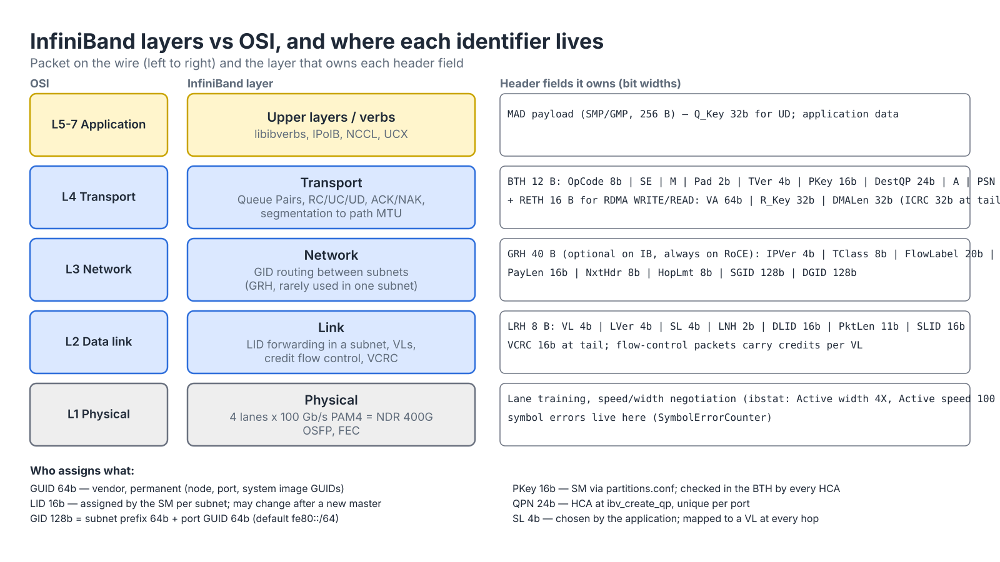
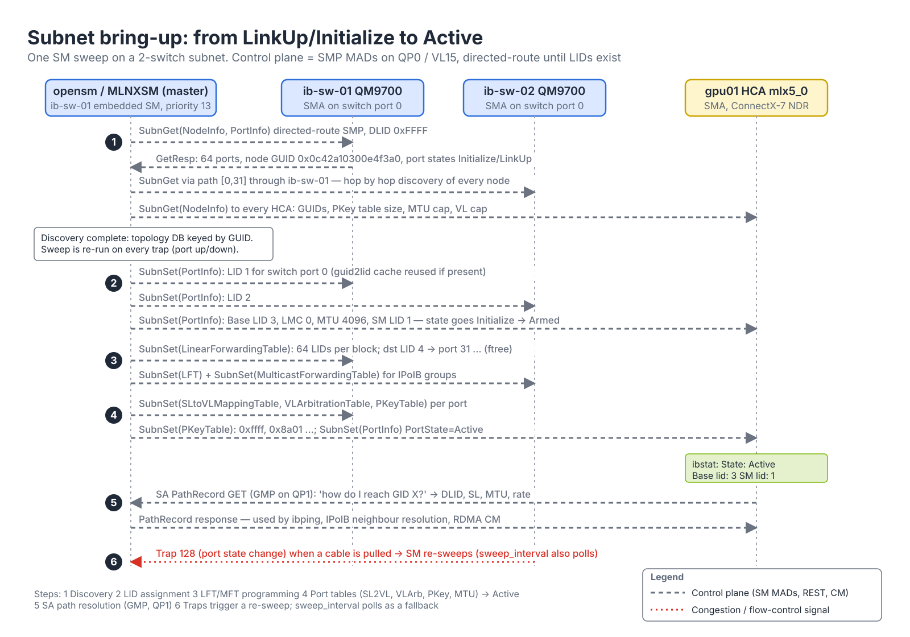
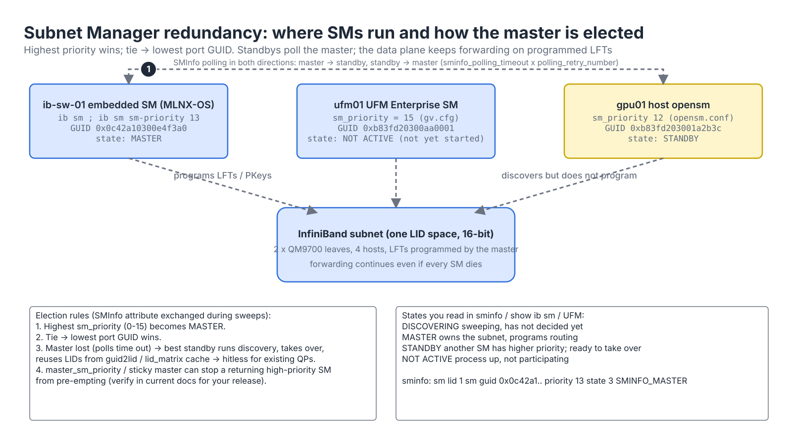
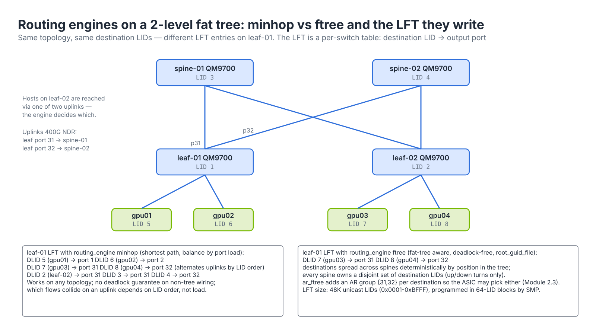
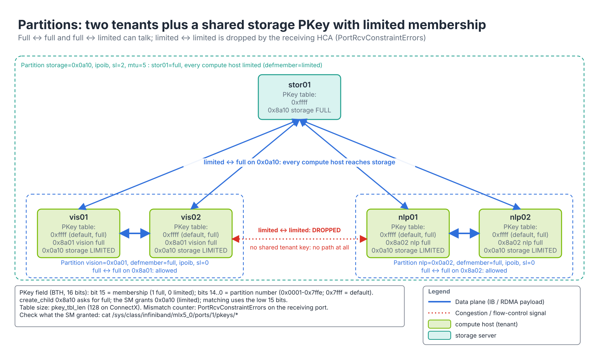
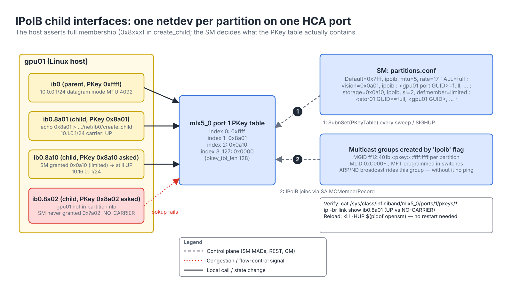
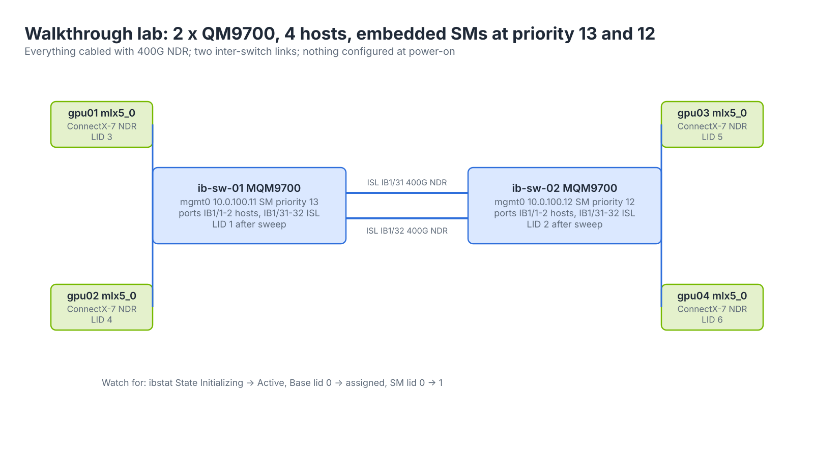

# Module 2.1 — InfiniBand Network Administration

> **Exam domain:** NVIDIA InfiniBand Networking (30%)  
> **Source course(s):** InfiniBand Essentials; InfiniBand Network Administration  
> **Source docs:** NVIDIA MLNX-OS User Manual; MLNX_OFED / DOCA-OFED User Manual; OpenSM / MLNXSM Release Notes; NVIDIA Quantum-2 and Quantum-X800 product briefs  
> **Estimated study time:** 6–8 hours

> **How to study this module:** read §1–§2, work through the §3 walkthrough on real gear or NVIDIA Air, then attempt the §5 hands-on assignment using only the Hint section. Open the Solution guide (last section) only after you have a working attempt. Finish with the Appendix C knowledge check closed-book.

## 1. Learning objectives

By the end of this module you will be able to…

- **Describe** the InfiniBand layered architecture and contrast it with the Ethernet/IP model you already know. *(IB Networking: architecture and components)*
- **Identify** IB link generations SDR→XDR, lane counts and per-port bandwidth, and map them to Quantum switch families. *(IB Networking: hardware and link speeds)*
- **Explain** the roles of **GUID**, **LID**, **GID**, **PKey** and QPN, who assigns each, and at which layer it lives. *(IB Networking: addressing)*
- **Describe** what the **SM** does, where it runs, how master/standby election works, and **verify** its state with `sminfo` and `show ib sm`. *(IB Networking: Subnet Manager operation)*
- **Select** a routing engine (minhop, updn, ftree, dor, AR-capable) for a given topology and justify the choice. *(IB Networking: routing)*
- **Configure** partitions in `partitions.conf` with full vs. limited membership and bring up IPoIB child interfaces per partition. *(IB Networking: partitioning / multi-tenancy)*
- **Provision** an MLNX-OS managed switch from the console, enable the embedded SM, and **verify** port states. *(IB Networking: switch administration)*
- **Troubleshoot** a port stuck in `Initializing`, a PKey mismatch, and an SM election surprise using **ibstat**, `sminfo`, **ibnodes** and **mlxconfig**. *(Troubleshooting Tools)*

## 2. Key technical concepts

### 2.1 Why InfiniBand exists, and how it is layered

**Analogy:** Ethernet is a city where every intersection (switch) decides for itself which way to send traffic. InfiniBand is an airport: one air-traffic controller (the **SM**) assigns every aircraft a gate number (**LID**) and tells every taxiway junction (switch) exactly where each gate is. Nothing moves until the controller has spoken.

**What it is.** InfiniBand (IB) is a switched, lossless, centrally managed interconnect defined by the InfiniBand Trade Association specification. It was designed from the start as an RDMA-native fabric for clustered computing: the network adapter (the **HCA**, Host Channel Adapter) moves data directly between application memory on two hosts without the host CPU or kernel touching the payload. Where Ethernet grew RDMA later (RoCE, see [Module 3.3](../03-rdma/03-roce-a-to-z.md)), IB's link, network and transport layers were built around that assumption. The specification defines a five-layer model that maps loosely onto OSI; Figure 2.1-1 shows the layers next to the headers each one owns.


*Figure 2.1-1 — IB layers vs OSI, the header each layer adds, and which identifier lives where.*

| IB layer | What it does | Rough OSI analogue | Key identifiers |
|---|---|---|---|
| Physical | Lanes (1x/4x/12x), encoding, signalling rate, cables/transceivers | L1 | — |
| Link | Local Route Header (LRH), **LID**-based forwarding inside a subnet, Virtual Lanes, credit-based flow control, link-level CRC | L2 | LID, SL, VL |
| Network | Global Route Header (GRH), **GID**-based routing between subnets (rarely used in practice; also carried for RoCE) | L3 | GID |
| Transport | Queue Pairs, reliable/unreliable service, segmentation to MTU, end-to-end ACK/retry, RDMA operations | L4 | QPN, PKey (checked here) |
| Upper layers / verbs | The `libibverbs` API, ULPs such as IPoIB, SRP, NFSoRDMA, and the libraries AI uses (NCCL, UCX, NVSHMEM) | L5–7 | — |

The headers themselves are small and fixed-size, which is part of why switch latency is ~100 ns:

| Header | Size | Fields you should recognise |
|---|---|---|
| **LRH** (Local Route Header) | 8 bytes | VL (4 bits), LVer (4), **SL** (4), LNH (2: "is a GRH next?"), **DLID** (16), PktLen (11, in 4-byte words), **SLID** (16) |
| **GRH** (Global Route Header) | 40 bytes | IPVer (4), TClass (8), FlowLabel (20), PayLen (16), NxtHdr (8), HopLmt (8), **SGID** (128), **DGID** (128) — deliberately IPv6-shaped |
| **BTH** (Base Transport Header) | 12 bytes | OpCode (8), SE, M, PadCnt (2), TVer (4), **PKey** (16), **DestQP** (24), AckReq, **PSN** (24) |
| RETH (RDMA Extended TH) | 16 bytes | Virtual address (64), **R_Key** (32), DMA length (32) — present on RDMA WRITE/READ |
| AETH | 4 bytes | Syndrome (8: ACK, RNR NAK, NAK codes), MSN (24) |
| ICRC / VCRC | 4 / 2 bytes | End-to-end invariant CRC over the transport part; link-level variant CRC recomputed per hop |

**Why it exists.** Two architectural choices separate IB from the Ethernet/IP world you know, and both exist because the design target was a *single administrative domain* running tightly coupled workloads:

1. **IB is centrally managed.** There is no spanning tree, no distributed routing protocol, no ARP-style learning. One entity, the **Subnet Manager**, discovers the whole subnet and programs every switch's forwarding table. Centralisation buys deterministic, globally consistent, deadlock-free routes (a Clos computed as one problem rather than converged by 1,000 independent switches), and it removes per-switch control-plane state. The cost is that if the SM is absent, links come up physically but nothing is forwarded and no host can talk.
2. **IB is lossless by design.** Credit-based flow control at the link layer means a transmitter only sends when the receiver has advertised buffer space — like a parking garage that only lets a car through the gate when a space has actually freed up. There is no PFC to tune, no ECN to turn on; this is the fundamental contrast with RoCE. The quantitative reason: an RDMA transport that retransmits go-back-N loses an order of magnitude of throughput at 0.1 % packet loss, so the link layer must be loss-free, and granting credit *before* sending is the only way to guarantee that without headroom math.

**How it works.** An IB *subnet* is the set of switches and end-ports under one SM, addressed by 16-bit LIDs. A packet entering a switch is forwarded by a single lookup of its DLID in the **Linear Forwarding Table (LFT)** — no learning, no longest-prefix match, no hashing of headers (adaptive routing in Module 2.3 adds a second, per-destination *group* lookup). The GRH is optional inside a subnet and is only required when a packet crosses an IB router (GID-based) or when the application asks for it. Almost every real-world fabric, including multi-thousand-GPU SuperPODs, is a single subnet: 48 K unicast LIDs (0x0001–0xBFFF) is plenty. Routers exist (for connecting subnets via GIDs) but are a niche topic for the exam; know that they exist and that GIDs are what cross them.

**Why the exam cares:** at least one question will describe a host whose link is physically up but which cannot communicate. If you have internalised "no SM, no forwarding", you answer in five seconds.

### 2.2 Link speeds and the Quantum family

**What it is.** Each generation names the *per-lane* signalling rate; a standard port is 4 lanes (4x). The exam expects you to know the table below, and especially the Quantum-2 and Quantum-X800 numbers.

| Generation | Per-lane rate | 4x port (nominal) | Encoding | Typical switch ASIC |
|---|---|---|---|---|
| SDR | 2.5 Gb/s | 10 Gb/s | 8b/10b | — |
| DDR | 5 Gb/s | 20 Gb/s | 8b/10b | — |
| QDR | 10 Gb/s | 40 Gb/s | 8b/10b | — |
| FDR | 14 Gb/s | 56 Gb/s | 64b/66b | SwitchX |
| EDR | 25 Gb/s | 100 Gb/s | 64b/66b | Switch-IB / Switch-IB 2 |
| HDR | 50 Gb/s | 200 Gb/s | 64b/66b, PAM4 | Quantum (QM8700, 40 ports) |
| NDR | 100 Gb/s | 400 Gb/s | PAM4 | **Quantum-2** (QM9700/QM9790, **64 × 400G ports**, 32 OSFP cages, 51.2 Tb/s) |
| XDR | 200 Gb/s | 800 Gb/s | PAM4 | **Quantum-X800** (Q3400 series, **144 × 800G ports**, 115 Tb/s) |

**Why it exists.** Bandwidth per GPU is the sizing unit of an AI fabric: a DGX H100 has eight ConnectX-7 NDR HCAs, one per GPU, so one server injects 8 × 400 = 3.2 Tb/s and a 1,024-GPU SuperPOD needs ~400 Tb/s of non-blocking bisection. A 64-port NDR leaf serves 32 servers' worth of one rail (32 down, 32 up) at full bisection — the numbers in the table are what let you check whether a proposed design is oversubscribed. Each generation doubled the per-lane rate while keeping 4 lanes, which is why cables and connectors (QSFP → OSFP at NDR) change rather than lane counts.

**How it works.** Link width and speed are negotiated at link training (the physical layer), *before* the SM is involved. The physical layer trains lanes, applies FEC and the negotiated encoding, and reports the result; **ibstat** shows it as `Rate: 400` with `Active width: 4X` and `Active speed: 100 Gbps` (per lane). On the switch, `show interfaces ib status` shows `Speed NDR`, `Width 4X`, `Current line rate 400 Gbps`. Note that a port can be physically `LinkUp` at full rate and still logically `Initialize`: training is layer 1, configuration is the SM.

Notes that come up as exam distractors:

- Quantum-2 physically has 32 OSFP cages; each cage carries two 400G NDR ports, giving 64 ports. Splitting an NDR port further (NDR200, 2x) is possible with breakout cables, which is how 128 × 200G HDR-speed connections to older HCAs are achieved.
- "HDR100" is a 2-lane HDR port running at 100 Gb/s — same wire rate as EDR but a different protocol generation. Likewise "NDR200" is 2-lane NDR.
- Quantum-X800 pairs with the ConnectX-8 **SuperNIC** and Spectrum-X800 on the Ethernet side; it is the first IB generation to integrate SHARPv4 at 800G (see [Module 2.3](03-infiniband-qos-adaptive-routing-sharp.md)).
- If you see `Rate: 200` on an NDR cable, a lane or speed negotiation problem exists (a dead lane drops the port to 2X, or the partner only supports HDR); this is a classic troubleshooting scenario covered with **mlxlink** in Module 8. `SymbolErrorCounter` and `LinkErrorRecoveryCounter` rising on a port are the physical-layer evidence that goes with it.

**Why the exam cares:** port counts vs cage counts, the speed ladder, and "which ASIC goes with which generation" are straightforward recall questions that cost you nothing if you have the table.

### 2.3 Addressing: GUID, LID, GID, PKey, QPN

**Analogy:** your GUID is your passport number (permanent, issued by the vendor). Your LID is your gate number for today (assigned by the controller, may change tomorrow). Your GID is your passport number prefixed with your country code (globally meaningful). Your PKey is the access badge that opens certain doors. Your QPN is the specific mailbox you are using for one conversation.

**What it is.** Five identifiers, each owned by a different layer and assigned by a different party (Figure 2.1-1 shows where each one sits in the packet):

| Identifier | Size | Scope | Assigned by | Analogy |
|---|---|---|---|---|
| **GUID** (Globally Unique ID) | 64-bit | Permanent; burned in | Vendor (EUI-64) | MAC address / passport number |
| **LID** (Local ID) | 16-bit | One subnet; assigned at discovery, can change | **SM** | Gate number — a dynamically assigned L2 address used for switching |
| **GID** (Global ID) | 128-bit | Global; `subnet prefix (64) + port GUID (64)` | Derived (default prefix `fe80::/64`) | IPv6 link-local address |
| **PKey** (Partition Key) | 16-bit | Subnet; membership enforced at HCA/switch | SM via partitions.conf | VLAN tag / access badge |
| **QPN** (Queue Pair Number) | 24-bit | Per HCA port | HCA at QP creation | TCP/UDP port number / mailbox |

**Why it exists.** Separating a *permanent* identity (GUID) from a *routable* address (LID) is what lets the SM renumber the fabric freely — LIDs are allocated densely so the LFT can be a flat array indexed by LID (48 K entries, no hashing), while GUIDs stay stable for inventory, partitions and scripts. The GID exists so the same end-port can be addressed from outside the subnet (and, on RoCE, because Ethernet has no LIDs at all — the GID is the only address). The PKey exists because the transport, not the link, is the layer that can enforce "who may talk to whom" cheaply on every packet. The QPN exists because one port multiplexes hundreds of thousands of connections.

**How it works.**

- Every HCA has a **node GUID**, each **port** has its own **port GUID**, and the system has a **system image GUID**. Switches also have node and port GUIDs (a switch's external ports share the node GUID; the management port 0 has the port GUID). Tools such as **ibnodes**, **iblinkinfo** and **ibdiagnet** key everything on GUIDs because LIDs can change between SM runs.
- LIDs range 1–0xBFFF for unicast; 0xC000–0xFFFE are multicast LIDs. LID 0 is reserved and 0xFFFF is the permissive LID used by SM/SMA traffic before LIDs exist. The SM may assign a *range* of 2^LMC consecutive LIDs to a port (LMC, LID Mask Control, 0–7) to enable multiple paths through the LFT; `ibstat` shows `LMC: 0` in most installs. LIDs are written into the port's `PortInfo` attribute by the SM and read back by `ibstat` (`Base lid`, `SM lid`).
- The GID table of a port is small (`ibv_devinfo -v` shows `gid_tbl_len`); entry 0 is always `subnet_prefix:port_GUID`. The subnet prefix is set in `opensm.conf` (`subnet_prefix 0xfe80000000000000`); changing it breaks every cached path record, so leave it alone.
- A packet carries LRH (with source/destination LID) always, and GRH (with GIDs) only when it leaves the subnet or when the application chose to include it. RoCE always uses the GRH since there are no LIDs on Ethernet; this is why `show_gids` matters so much in Module 3.3.
- The PKey is in the Base Transport Header and is validated on every packet by the receiving HCA (and optionally by switch ports, if the SM enables switch-port PKey enforcement) against the port's PKey table. A mismatch is dropped silently and counted in `PortRcvConstraintErrors`. The table has `pkey_tbl_len` entries (128 on ConnectX, visible in `ibv_devinfo -v`); QPs reference it by *index* (`pkey_index` in Module 3.2), not by value.
- The QPN is allocated by the HCA at `ibv_create_qp`; QP0 and QP1 are reserved on every port for subnet management (SMPs on VL15) and general services (SA queries, CM), respectively — which is why those two never need an SM to exist.

Observe it: `ibstat` (GUIDs, LID, SM LID, LMC), `ibv_devinfo -v` (GID table, `pkey_tbl_len`), `cat /sys/class/infiniband/mlx5_0/ports/1/pkeys/*` (programmed PKeys), `cat /sys/class/infiniband/mlx5_0/ports/1/gids/0` (GID 0), `perfquery -x <lid> <port>` (`PortRcvConstraintErrors`).

**Why the exam cares:** "which identifier is permanent" and "which identifier can change after an SM restart" are near-certain questions. Scripts, partitions and topology files key on GUIDs for exactly this reason.

### 2.4 The Subnet Manager

**Analogy:** the SM is the air-traffic controller. It surveys the airfield (discovery), hands out gate numbers (LIDs), writes the taxi instructions for every junction (LFTs), sets the rules for each lane (SL→VL, VL arbitration, PKey tables), and answers pilots' questions about how to reach a gate (SA path records).

**What it is.** The **Subnet Manager** is a software process — `opensm` from the OpenFabrics project, NVIDIA's enhanced build **MLNXSM**, the embedded SM inside MLNX-OS, or the SM inside UFM — that owns one subnet. It talks to every device through that device's **Subnet Management Agent (SMA)** using **Subnet Management Packets (SMPs)**: 256-byte MADs (Management Datagrams) sent on **QP0** over **VL15**, the management virtual lane that is never flow-controlled. The SM also runs the **Subnet Administration (SA)** service, a database that end-nodes query over **QP1** (general services interface, GMPs) for path records, multicast membership and service records.

**Why it exists.** IB switches have no control plane of their own: no MAC learning, no routing protocol, no per-switch QoS configuration. Somebody has to compute LIDs, routes and port tables for the entire subnet consistently, and somebody has to answer "what DLID, SL and MTU do I use to reach GID X?" for applications. Doing it centrally means routes are globally deadlock-free and balanced, every port's QoS tables agree, and a topology change is handled by one re-sweep rather than by convergence. The exam angle: no master SM means every port stops at `Initialize` and the SA never answers.

**How it works.** Figure 2.1-2 is the sequence; the numbered steps below match the circled numbers in the figure.


*Figure 2.1-2 — One SM sweep on the 2-switch lab subnet, from discovery to Active ports and SA path queries.*

1. **Discovery** — the SM walks the fabric using *directed-route* SMPs (addressed hop by hop as a list of output ports, with DLID 0xFFFF, since no LIDs exist yet) and builds a database of all nodes, ports and links: `NodeInfo` (GUIDs, port count), `PortInfo` (state, capabilities, MTU cap, VL cap), `SwitchInfo` (LFT size, port count). A full sweep of a few thousand nodes takes seconds; the sweep is triggered at start-up, on every **trap** (an unsolicited SMP from a switch when a port goes up or down — trap 128 is "port state change"), and periodically if `sweep_interval` is non-zero (default 10 s; 0 disables polling and relies on traps alone).
2. **LID assignment** — gives every end-port and switch a LID (persistent across restarts if `guid2lid` caching is used; MLNX-OS keeps an equivalent `lid_matrix`). The SM writes it into `PortInfo` together with the LMC, the master SM's LID (`SM lid` in `ibstat`), and the port MTU. The port's logical state advances `Initialize → Armed`.
3. **Routing table computation** — runs the selected routing engine (§2.5) and writes a **Linear Forwarding Table (LFT)** into every switch: for each destination LID, which output port to use. The LFT is a flat array of up to 48 K entries (0x0001–0xBFFF), programmed in 64-entry blocks by `SubnSet(LinearForwardingTable)`. Multicast forwarding tables (MFT, one port bitmap per MLID from 0xC000) are also programmed for IPoIB broadcast/multicast groups.
4. **Port configuration** — sets MTU, link operational VLs, **SL→VL mapping** tables, VL arbitration tables and PKey tables on switch/HCA ports (Module 2.3 covers the QoS tables). Only now does the SM set `PortState = Active`; a port that is Active has a LID, a PKey table and a route — everything it needs.
5. **Subnet Administration (SA)** — the SM also runs the SA, a database service hosts query (via QP1 / GSI) to resolve paths: "I want to talk to GID X, give me a path record (DLID, SL, MTU, rate)". **ibping**, IPoIB neighbour resolution and RDMA CM all rely on SA queries. The SA also handles multicast joins (`MCMemberRecord`), which is how IPoIB learns its broadcast group's MLID.
6. **Traps and re-sweeps** — a link flap sends trap 128 to the SM, which re-sweeps, re-routes around the dead link and re-programs the affected LFT blocks. Flows that were using the dead link stall until the new LFT lands (hundreds of ms on big fabrics); SHIELD in Module 2.3 shortens this.

Heavy sweeps are the source of the common complaint "the fabric stalled for a few seconds when a node rebooted"; large fabrics tune sweep behaviour (`sweep_interval`, trap-driven only) and use `ibdiagnet` rather than making the SM poll constantly.

**Where the SM runs** — three options, in order of what you will meet in production (Figure 2.1-3 shows all three attached to one subnet):

| Location | Product | When used |
|---|---|---|
| **Host-based** | `opensm` package from MLNX_OFED / DOCA-OFED, or the enhanced `MLNXSM` | Small fabrics, labs, clusters where a management node exists |
| **Switch-embedded** | MLNX-OS on managed Quantum switches (`ib sm` command) | Up to roughly 2,000 nodes — NVIDIA documents a recommended upper bound; verify the figure for your switch model |
| **UFM** | UFM Enterprise / Cyber-AI appliance or software ([Module 2.2](02-ufm-dc-management.md)) | Large fabrics, SuperPODs; adds telemetry, REST API, HA |


*Figure 2.1-3 — SM redundancy: where SMs can run, how they poll each other, and the master election rules.*

A fabric must have exactly one *master* SM. You may (and should) run several SMs for redundancy; the others sit in standby.

**Priority and master election.** Every SM has a **priority** 0–15 (15 is highest). When multiple SMs are present:

- They discover each other via the `SMInfo` attribute (GUID, priority, state, activity counter) during sweeps.
- The SM with the **highest priority** becomes master. On a tie, the **lowest port GUID** wins.
- The master periodically polls standbys; standbys poll the master (`sminfo_polling_timeout`, default 10,000 ms, × `polling_retry_number`, default 4 — so a dead master is detected in roughly 40 s with defaults; tune both down for faster failover). If the master disappears, the next-best standby runs a discovery and takes over. Because LIDs are cached (`guid2lid` file / `lid_matrix` on MLNX-OS) and the standby reads the LIDs already programmed in the fabric, the takeover is normally hitless for existing connections.
- Some implementations support a *master_sm_priority* behaviour so a recovered high-priority SM does not immediately pre-empt a running master (the "sticky master" or `master_sm_priority` option in opensm.conf; check the current doc).

**SM states** you will read in `show ib sm` on MLNX-OS, in `sminfo` on a host, or in UFM:

| State | Meaning |
|---|---|
| **DISCOVERING** | SM is sweeping; it has not yet decided whether to be master |
| **MASTER** | This SM owns the subnet and programs routing |
| **STANDBY** | Another SM with higher priority is master; this one is ready to take over |
| **NOT ACTIVE** | SM process is up but does not participate (e.g. configured not to run or lost its port) |

Observe it: `sminfo` (master LID, GUID, priority, state), `show ib sm` / `show ib smnodes` / `show ib sm log` on MLNX-OS, `journalctl -u opensm` for `SUBNET UP` (sweep finished) or `Entering STANDBY state`, `ibstat` for `SM lid`. Failure modes: *no SM anywhere* → every port `Initialize`; *two masters* (a split fabric during a cable outage rejoining) → one re-sweeps and yields, briefly renumbering if caches disagree; *SM bound to the wrong port* on a multi-port host (`guid` in opensm.conf) → "No ports available" in the log.

**Why the exam cares:** election rules (highest priority, lowest GUID on tie) and the meaning of `Initializing` are both high-frequency test items.

### 2.5 Routing engines

**Analogy:** the routing engine is the controller's taxi-plan algorithm. `minhop` says "shortest path, spread the load". `ftree` knows the airfield is a tree and plans accordingly so no two aircraft can ever block each other in a loop. The `ar_*` engines allow junctions to pick a less-busy taxiway in real time.

**What it is.** The routing engine is the algorithm inside the SM that turns the discovered topology into one LFT per switch (destination LID → output port). The choice is set with `routing_engine` in `opensm.conf` (comma-separated list; the first one that succeeds is used). Figure 2.1-4 shows the same 2-level fat tree routed by `minhop` and by `ftree`, with the resulting entries on leaf-01.


*Figure 2.1-4 — minhop vs ftree on a 2-level fat tree: same topology, different LFT entries for the same destinations.*

| Engine | How it routes | Use when |
|---|---|---|
| **minhop** | Shortest-path, balances by port load; default fallback | Arbitrary or unknown topology; small fabrics |
| **updn** | Up/down routing: avoids credit loops by forbidding "down then up" turns, needs root GUIDs | Non-pure fat-trees with irregular connectivity where loops would deadlock |
| **ftree** | Fat-tree-aware: detects CBB (constant bisectional bandwidth) trees, spreads destinations across spines deterministically, deadlock-free | **Clos/fat-tree fabrics — the normal choice for every GPU cluster** (SuperPOD, BasePOD). Falls back to minhop if topology is not a valid fat-tree |
| **dor** | Dimension-order routing for meshes/tori/hypercubes | Torus topologies (rare in AI DCs) |
| **torus-2QoS** | Torus with two QoS levels for deadlock avoidance | Large tori (HPC) |
| **sssp / dfsssp** | Single-source shortest path, deadlock-free variant | Irregular HPC topologies |
| **ar_ftree / ar_updn / ar_dor / ar_torus** | Adaptive-routing-capable variants (MLNXSM) | When you want **adaptive routing** on Quantum switches — covered in [Module 2.3](03-infiniband-qos-adaptive-routing-sharp.md) |

**Why it exists.** Two problems have to be solved at once. *Deadlock*: credit-based flow control means a cycle of ports each waiting for credit from the next can freeze forever, so routes on anything with loops (every Clos) must forbid certain turns (`updn`, `ftree`) or use VLs to break cycles (`torus-2QoS`). *Balance*: with one static output port per destination, which destinations share an uplink decides whether two large flows collide. `minhop` balances by counting how many LIDs already use each port; `ftree` exploits the tree structure so each spine owns a disjoint, evenly sized set of destinations and every leaf→spine link carries equal load by construction. Static routing in a Clos still has a known weakness — two flows hashed onto the same spine-bound link collide — which is why `ftree` at least guarantees deterministic, balanced LFTs and deadlock freedom, and adaptive routing is layered on top of it to fix the collision problem at run time.

**How it works.** `ftree` needs to identify the roots (spines); it usually auto-detects them, but a `root_guid_file` is recommended for anything non-trivial and is mandatory for `updn`. It then assigns each destination LID to a spine deterministically (by its position in the tree, optionally ordered by `guid_routing_order_file` so the most important hosts get the first choice) and writes, for every switch, the up-port towards that spine and the down-port towards the leaf. The LFT is programmed in 64-LID blocks; on a 64-port QM9700 the whole table for a 4,000-node fabric is a few hundred SMPs per switch. If `ftree` cannot validate the wiring (a miscabled leaf, a missing spine link, an unequal number of uplinks) it logs `falling back to minhop` and the fabric still works — but with less balanced, possibly non-deadlock-free routes; that log line is the first thing to grep when all-reduce numbers disappoint.

Relevant `opensm.conf` keys (names are stable across OpenSM 3.x/MLNXSM 5.x; always diff against the shipped default file):

```text
# /etc/opensm/opensm.conf (host-based) — key routing parameters
routing_engine ftree,minhop         # try ftree, fall back to minhop
root_guid_file /etc/opensm/root_guids.conf
guid_routing_order_file /etc/opensm/guid_routing_order.conf   # optional, ftree
lmc 0
sm_priority 14
sweep_interval 10                   # seconds; 0 disables periodic sweeps
subnet_prefix 0xfe80000000000000
guid2lid_file /var/cache/opensm/guid2lid
partition_config_file /etc/opensm/partitions.conf
qos TRUE
```

Observe it: `journalctl -u opensm | grep -iE "routing|ftree|fallback"`; `ibroute -L <switch-lid>` dumps a switch's LFT (DLID → port) so you can verify that two destinations on the same leaf really go out different uplinks; `ibtracert <src-lid> <dst-lid>` walks the actual path hop by hop; `ibdiagnet` reports routing and credit-loop checks.

**Why the exam cares:** `ftree` for Clos, `updn` needs root GUIDs, `dor`/torus engines for meshes, `ar_*` only in MLNXSM/UFM — and the fallback-to-minhop behaviour when the wiring is not a valid fat-tree.

### 2.6 Partitions (PKeys) for multi-tenancy

**Analogy:** a PKey is an access badge. A *full-membership* badge opens the door to everyone else holding any badge for that room. A *limited-membership* badge only opens the door to full-membership holders — two limited badges standing face to face cannot see each other.

**What it is.** Partitions are IB's VLAN equivalent, enforced per packet at the transport layer. The 16-bit field is split: the low 15 bits are the partition number, the high bit is the **membership** bit.

| Value | Meaning |
|---|---|
| `0x7fff` | **Default partition** (full-membership form `0xffff`). Every port is a full member unless the SM is told otherwise |
| `0x0001`–`0x7ffe` | Admin-defined partitions (limited membership form) |
| `0x8000 \| key` (high bit set, e.g. `0x8001`) | **Full membership** in that partition |
| high bit clear (e.g. `0x0001`) | **Limited membership** |

Membership rules, which the exam loves (Figure 2.1-5 draws them for the §5 assignment topology):

- **Full ↔ full**: can communicate.
- **Full ↔ limited**: can communicate.
- **Limited ↔ limited**: **cannot** communicate.


*Figure 2.1-5 — Two tenants plus a shared storage partition: full↔full and full↔limited pass, limited↔limited is dropped by the receiving HCA.*

**Why it exists.** A shared cluster needs isolation without N separate fabrics, and it needs it enforced in hardware on every packet rather than by trusting hosts. Putting the key in the transport header means a packet from a non-member is rejected by the *receiving HCA* (or switch port) before any QP sees it; there is nothing to spoof because the SM, not the host, writes the PKey table. Limited membership exists for exactly the storage/shared-service case: put a shared storage server as a *full* member and tenants' compute nodes as *limited* members of the same PKey. Each tenant reaches storage, but tenants cannot see each other — without needing N separate partitions, and without consuming N entries of every storage port's 128-entry table.

**How it works.** The SM reads the partition file at start-up and on `SIGHUP`, computes each port's PKey table (default partition + every partition the port's GUID is listed in, with the membership bit as granted), and writes it with `SubnSet(PKeyTable)` during the sweep. On every received packet the HCA compares the BTH PKey against its table: a full-member entry matches any packet carrying the same low 15 bits; a limited-member entry matches only packets whose sender is a full member (the sender's own PKey has the high bit set). Mismatches are dropped and `PortRcvConstraintErrors` increments. The multicast group that IPoIB needs (flag `ipoib`) is created per partition with an MGID that embeds the PKey, so a partition without the flag has no broadcast domain and ARP never works even if membership is correct.

**partitions.conf syntax.** On a host-based SM the file is `/etc/opensm/partitions.conf` (path set by `partition_config_file`). On MLNX-OS, partitions are configured with `ib partition` CLI commands; on UFM through the web UI/REST, which writes the same file under `/opt/ufm/files/conf/opensm/partitions.conf`.

```text
# name=pkey[,flags...] : port-guid=membership, ... ;
Default=0x7fff, ipoib, mtu=5, rate=7, sl=0, defmember=full : ALL, SELF=full ;

# Tenant A: compute nodes limited, storage full
tenantA=0x0a01, ipoib, defmember=limited :
    0x0c42a10300a1b2c0=full,          # storage HCA port GUID
    0x0c42a10300a1b2c1=full,
    0xb83fd20300112233,               # compute node (inherits defmember=limited)
    0xb83fd20300112244 ;

# Tenant B: everyone full, SL 1 so QoS can isolate it
tenantB=0x0a02, ipoib, sl=1 : 0xb83fd20300556677=full, 0xb83fd20300556688=full ;
```

Flags you should recognise:

- `ipoib` — create the IPoIB broadcast multicast group for this partition (without it, IPoIB will not come up on the child interface).
- `mtu=` and `rate=` — encoded values for the multicast group (mtu 4 = 2048, 5 = 4096; rate 7 = 40G, 16 = 100G, 17 = 200G, etc.; check the table in the opensm man page).
- `sl=` — service level for the group, which ties partitions to QoS (Module 2.3).
- `defmember=full|limited` — default membership for ports listed without an explicit one.
- `ALL`, `ALL_CAS`, `ALL_SWITCHES`, `ALL_ROUTERS`, `SELF` — keywords instead of GUID lists.

A port may be a member of up to the size of its PKey table (typically 128 entries on ConnectX; `ibv_devinfo -v` shows `pkey_tbl_len`). After editing the file, send `SIGHUP` to opensm (`kill -HUP $(pidof opensm)`) or restart it; the SM reprograms PKey tables on the next sweep.

**IPoIB child interfaces.** Each HCA port's IPoIB device (e.g. `ib0`) runs in the default partition. To carry IP traffic in another partition you create a *child* interface whose name is `<parent>.<pkey-hex>` and whose PKey has the full-membership bit set — you write the badge number with the high bit on, because the host asserts "I am a full member", and the SM decides whether to honour that. Figure 2.1-6 shows one port with three children and what the SM actually granted each one.


*Figure 2.1-6 — IPoIB child interfaces per PKey: the host asks with 0x8xxx, the SM grants full or limited, and the `ipoib` multicast group makes ARP possible.*

If the SM did not grant this port membership (or granted only limited and the peer is also limited), the child interface will stay in `NO-CARRIER` or ping will fail with no counter increments on the switch — the classic "PKey mismatch" symptom. A limited grant still brings the interface up: the kernel matches the child's PKey against the table on the low 15 bits, so `ib0.8a10` is `UP` with `0x0a10` in the table.

Observe it: `cat /sys/class/infiniband/mlx5_0/ports/1/pkeys/*` (what the SM granted, index order), `ip -br link show ib0.8a01` (`UP` vs `NO-CARRIER`), `saquery -g` or `saquery MCMR` (multicast groups the SA knows about), `perfquery` for `PortRcvConstraintErrors`, `journalctl -u opensm | grep -i partition` for parser errors.

**Why the exam cares:** limited↔limited never talks; the high bit means full; the host creates children with `0x8xxx`; `ipoib` flag or no ARP; GUIDs in the file are *port* GUIDs.

### 2.7 MLNX-OS managed switches and HA

**What it is.** Managed Quantum switches (QM87xx, QM97xx, Q3400 managed variants) run **MLNX-OS**, a Cisco-flavoured CLI with `enable` / `configure terminal` modes, an out-of-band `mgmt0` port, and the ability to run the embedded SM (`ib sm`). Unmanaged variants (e.g. QM9790) have no CPU running an OS and are fully dependent on an external SM/UFM: they still forward perfectly once programmed, but nothing on the box can be logged into.

Port states to recognise: **Physical** `Polling` (no partner/cable), `Disabled`, `LinkUp`; **Logical** `Down`, `Initialize` (link is up but SM has not yet configured it — a tell-tale sign *there is no master SM*), `Armed` (LID assigned, not yet forwarding), `Active`.

**Why it exists.** A managed switch gives you a place to run an SM without a dedicated host, per-port administrative control (`shutdown`, descriptions, counters), image management and SNMP/syslog — all the things a NOC expects — while unmanaged switches are cheaper and lower-power for the bulk of a large fabric where UFM provides all of that centrally. The "which SM runs where" decision in §2.4 is really a decision about which switches need to be managed.

**How it works.** MLNX-OS images bundle the switch ASIC firmware; a separate firmware step is not normally needed on managed switches. Unmanaged switches get firmware via **mlxfwmanager**/**flint** from a host or via UFM. Switch-to-SM compatibility and "upgrade standbys first, master last" ordering should be checked in the release notes for each hop. The embedded SM is the same MLNXSM code with its configuration exposed as `ib sm ...` commands (`ib sm sm-priority`, `ib sm routing-engines`, `ib partition ...`) and `show ib sm`, `show ib smnodes`, `show ib sm log` for state; `configuration write` persists it.

**What "HA" means in IB management.** Two unrelated things get called HA, and the exam may test that you can tell them apart:

- **SM HA** — simply running **multiple SMs with different priorities** (e.g. two spines with `ib sm` enabled at priorities 13 and 12, or a UFM HA pair). Failover is handled by the master/standby protocol in §2.4 and Figure 2.1-3. There is no shared state beyond the cached LIDs; detection time is `sminfo_polling_timeout × polling_retry_number`.
- **MLNX-OS management HA / UFM HA** — redundancy of the *management application* itself: UFM uses an active/standby pair with replicated storage (see Module 2.2). This protects the management plane, not the data plane; the data plane keeps forwarding on its programmed LFTs even when every SM is down — but no new links or hosts will be configured until an SM returns.

Observe it: `show interfaces ib status` (physical and logical state per port), `show interfaces ib 1/<n> counters`, `show ib sm`, `show ib smnodes`, `show inventory`, `show version`.

**Why the exam cares:** `Initialize`/`LinkUp` = no master SM; managed vs unmanaged = can/cannot run an SM; SM HA ≠ UFM HA.

### 2.8 Host side: OFED, HCA verification, port type

**What it is.** NVIDIA's host driver stack has historically shipped as **MLNX_OFED** (`mlnxofedinstall` script, `.iso`/`.tgz`). Since 2024 the stack is distributed as part of **DOCA** (`doca-ofed` / `doca-all` meta-packages, installed via the distro package manager after adding NVIDIA's repo), and MLNX_OFED standalone is end-of-life as of the 23.10 / 24.x branches. Functionally the same kernel modules (`mlx5_core`, `mlx5_ib`, `ib_ipoib`, `ib_umad`, `rdma_cm`) and user tools arrive either way.

**Why it exists.** Inbox (distro) `rdma-core` works for basic IB, but NVIDIA features such as SHARP, DOCA libraries, and the latest firmware tools need the NVIDIA stack. The **MFT** (Mellanox Firmware Tools: `mst`, **mlxconfig**, **mlxlink**, `flint`, `mlxfwmanager`) comes with it, and the firmware/driver pairing is what NVIDIA tests; `ibv_devinfo` reports `fw_ver`, and the release notes list the minimum firmware for each driver.

**How it works.** `mlx5_core` binds to the PCIe function and loads the firmware's view of the port; `mlx5_ib` exposes it as `mlx5_N` to verbs and to the `ib_*` diagnostics; `ib_umad` provides `/dev/infiniband/umadN` so **ibstat**, `sminfo`, `smpquery` and `perfquery` can send MADs; `ib_ipoib` creates `ibN`. ConnectX VPI adapters can run each port as IB or Ethernet. The setting is in firmware (`LINK_TYPE_P1`, `LINK_TYPE_P2`: 1 = IB, 2 = ETH, 3 = VPI/auto where supported) and takes effect after a reboot/driver reload. On BlueField and some ConnectX-7/8 SKUs the port mode is fixed or set differently; `mlxconfig -d <dev> query` shows what is tunable. **mlxconfig** also controls `NUM_OF_VFS`, `SRIOV_EN`, `ADVANCED_PCI_SETTINGS`, and ATS/relaxed-ordering knobs relevant to GPUDirect.

When UFM is used, do **not** also run `opensm` on hosts — UFM's SM must be the only master.

Observe it: `ibstat` / `ibstatus` (state, rate, LID), `ibv_devinfo -v` (capabilities, `link_layer: InfiniBand` vs `Ethernet`), `ofed_info -s` or `dpkg -l | grep doca` (stack version), `lsmod | grep mlx5`, `mst status` and `mlxconfig -d /dev/mst/<dev> query | grep LINK_TYPE`, `lspci -vv` for PCIe width/speed (a Gen5 x16 NDR card in a Gen4 slot caps at ~250 Gb/s).

**Why the exam cares:** DOCA-OFED supersedes MLNX_OFED with unchanged tool names; `LINK_TYPE_P1=1` is IB and needs a reboot; never run a host `opensm` beside UFM.

### 2.9 IPoIB: datagram vs connected mode

**What it is.** IPoIB (RFC 4391/4392) encapsulates IP in IB packets so legacy TCP/UDP applications (and SSH, NFS, Slurm control traffic) work over the fabric. It is *not* RDMA and is slow relative to verbs, but every cluster uses it for management. The link-layer address of an IPoIB interface is 20 bytes: a 4-byte QPN plus the 16-byte port GID — which is why `ip link` shows a long address and why ARP replies carry the peer's QPN and GID rather than a MAC.

| Mode | Transport | Max MTU | Pros / cons |
|---|---|---|---|
| **Datagram (UD)** | Unreliable Datagram QP, one QP per interface | Limited to IB link MTU minus 4-byte IPoIB header: **2044** at 2K IB MTU, **4092** at 4K IB MTU | Supports multicast (so ARP/ND works natively), lower memory, works with SR-IOV VFs and many offloads; default and recommended on modern stacks |
| **Connected (CM)** | Reliable Connected QP per peer | Up to **65520** | Segmentation done in hardware per connection; good single-stream TCP throughput, but one RC QP per neighbour, no multicast (falls back to UD for broadcast), poor scaling to thousands of peers |

**Why it exists.** Two modes exist because the IB transport types impose different trade-offs: UD is connectionless and supports multicast (so one QP serves the whole subnet and broadcast ARP just works) but is capped at one link MTU per packet; RC gives reliable, large messages with hardware segmentation but costs a QP and its context memory per peer, and cannot multicast. Datagram mode with a 4 K fabric MTU is the standard choice in GPU clusters because the management traffic is small and the multicast group is what makes IP work at all.

**How it works.** The IB link MTU itself (2048 or 4096 bytes, set by the SM as `partition mtu=` and limited by HCA/switch capability) caps datagram IPoIB. On start-up the interface joins the partition's broadcast multicast group (`ff12:401b:<pkey>::ffff:ffff`) via an SA `MCMemberRecord` join; the SM programs the MFT and returns the MLID; ARP requests are sent to that MLID and replies carry `QPN + GID`. Unicast IP then goes as UD SENDs to the neighbour's QPN. In connected mode the first packet to a neighbour triggers an RDMA CM connection (SA path record, CM REQ/REP) and an RC QP per peer; `ip link set ib0 mtu 65520` only works after `echo connected > mode`. RDMA applications negotiate the *path MTU* separately (Module 3.1). Choosing 4096 fabric MTU is standard in GPU clusters.

Observe it: `cat /sys/class/net/ib0/mode`, `ip -d link show ib0` (MTU, the 20-byte address), `ip neigh show dev ib0` (QPN/GID per neighbour), `saquery MCMR` (multicast groups), `ethtool -S ib0`.

**Why the exam cares:** datagram MTU is IB MTU − 4 (2044/4092), connected mode allows 65520 but has no multicast and scales poorly, and the `ipoib` partition flag is what creates the broadcast group.

## 3. Live-style walkthrough: bringing up a 2-switch / 4-host subnet from power-on

Here is the lab. Two managed Quantum-2 switches (`ib-sw-01`, `ib-sw-02`) connected to each other with two inter-switch links, and four hosts (`gpu01`–`gpu04`), two per switch (Figure 2.1-7). Everything is cabled, nothing is configured. Watch what happens to the LID as we go — and keep Figure 2.1-2 open: Steps 4–6 below are the numbered sweep steps ①–⑤ of that figure happening on real hardware.


*Figure 2.1-7 — The walkthrough lab: two MQM9700 switches, two 400G ISLs, four ConnectX-7 hosts, embedded SMs at priority 13 and 12.*

### Step 1 — Power on, look at a host before any SM exists

```bash
gpu01$ ibstat
# Shows every HCA ('CA') and its ports. Watch the two state lines.
CA 'mlx5_0'
    CA type: MT4129
    Number of ports: 1
    Firmware version: 28.41.1000
    Node GUID: 0xb83fd203001a2b3c
    Port 1:
        State: Initializing          # <-- logical state. "Initializing" = link trained, NO SM has configured me
        Physical state: LinkUp       # <-- physical layer is fine: cable, optics, lane training all good
        Rate: 400                    # NDR 4x negotiated at full rate
        Base lid: 0                  # <-- no LID yet. The SM has not handed me a gate number
        LMC: 0
        SM lid: 0                    # <-- and I have never heard from an SM
        Port GUID: 0xb83fd203001a2b3c
        Link layer: InfiniBand       # port is in IB mode (not Ethernet)

gpu01$ sminfo
# Asks the SA "who is the master SM?". Expect a timeout/failure when no SM exists.
ibwarn: [12345] sminfo: query failed
# Good: this confirms the symptom is "no SM", not a cable. Do NOT reach for mlxlink here.
```

### Step 2 — Initial switch provisioning (console, 115200 8N1, admin/admin)

```text
Do you want to use the wizard for initial configuration? yes
Step 1: Hostname? ib-sw-01
Step 2: Use DHCP on mgmt0 interface? no
Step 3: Use zeroconf on mgmt0 interface? no
Step 4: Primary IPv4 address and masklen? 10.0.100.11/24
Step 5: Default gateway? 10.0.100.1
Step 6: Primary DNS server? 10.0.0.53
Step 7: Domain name? dc1.example.net
Step 8: Enable IPv6? no
Step 9: Admin password? ********
```

The same settings by hand (and what you will type on `ib-sw-02` with `.12`):

```text
switch > enable                                        # privileged mode
switch # configure terminal                            # config mode
switch (config) # hostname ib-sw-01                    # prompt changes immediately
ib-sw-01 (config) # interface mgmt0 ip address 10.0.100.11 /24   # out-of-band mgmt IP
ib-sw-01 (config) # ip default-gateway 10.0.100.1
ib-sw-01 (config) # ntp server 10.0.0.123              # SM logs are useless without good time
ib-sw-01 (config) # configuration write                # persist; otherwise lost on reload
```

### Step 3 — Check the switch's view of its ports (still no SM)

```text
ib-sw-01 # show interfaces ib status
Interface   Description   Speed   Width   Current line rate   Logical port state   Physical port state
----------  ------------  ------  ------  ------------------  -------------------  -------------------
IB1/1                     NDR     4X      400 Gbps            Initialize           LinkUp     # gpu01 — same story as the host
IB1/2                     NDR     4X      400 Gbps            Initialize           LinkUp     # gpu02
IB1/3                     --      --      --                  Down                 Polling    # empty port: "Polling" = waiting for a partner
IB1/31                    NDR     4X      400 Gbps            Initialize           LinkUp     # ISL to ib-sw-02
IB1/32                    NDR     4X      400 Gbps            Initialize           LinkUp     # ISL to ib-sw-02
# Every connected port is physically LinkUp and logically Initialize. Textbook "no master SM".
```

### Step 4 — Enable the embedded SM on ib-sw-01 (priority 13) and ib-sw-02 (priority 12)

This is where Figure 2.1-2 starts: the moment `ib sm` is entered, the new SM runs discovery (step ①), assigns LIDs (②), writes LFTs (③) and port tables (④). The election in Figure 2.1-3 happens in parallel as the two SMs see each other's `SMInfo`.

```text
ib-sw-01 (config) # ib sm                              # start the embedded SM on this switch
ib-sw-01 (config) # ib sm sm-priority 13               # 0-15; higher wins election. 13 on the intended master
ib-sw-01 (config) # ib sm routing-engines ftree        # fat-tree engine; falls back to minhop if topology is not a valid tree
ib-sw-01 (config) # configuration write

# On the second switch, same commands but LOWER priority so it becomes standby:
ib-sw-02 (config) # ib sm
ib-sw-02 (config) # ib sm sm-priority 12
ib-sw-02 (config) # ib sm routing-engines ftree
ib-sw-02 (config) # configuration write
```

```text
ib-sw-01 # show ib sm
SM Configuration
  SM enabled:            yes
  SM state:              master          # <-- after a few seconds of "discovering". This is what we want on sw-01
  SM priority:           13
  Routing engine:        ftree
  ...
ib-sw-02 # show ib sm
  SM state:              standby         # <-- lower priority lost the election, ready to take over
ib-sw-01 # show ib smnodes                             # every SM the master knows about and its state
ib-sw-01 # show ib sm log                              # look for the sweep completing: "SUBNET UP"
```

### Step 5 — Watch the host transition Initializing → Active

Steps ② and ④ of Figure 2.1-2 as seen from the HCA: the LID arrives first (`Armed`), the PKey/MTU tables next, then `PortState = Active`.

```bash
gpu01$ watch -n1 'ibstat mlx5_0 | grep -E "State|lid"'
# Within one sweep (seconds) you should see:
        State: Active                # <-- SM programmed the port
        Base lid: 3                  # <-- gate number assigned. Yours will differ; it is SM-chosen, not yours
        SM lid: 1                    # <-- LID of the master SM port (switch port 0 of ib-sw-01)

gpu01$ sminfo
# Now the SA answers. Format: SM LID, GUID, activity count, priority, state.
sminfo: sm lid 1 sm guid 0x0c42a10300e4f3a0, activity count 1421 priority 13 state 3 SMINFO_MASTER
# "priority 13 ... SMINFO_MASTER" — matches ib-sw-01. If this showed a different GUID, someone else won the election.
```

### Step 6 — Discover the fabric from a host

Everything below is step ⑤ of Figure 2.1-2 — queries to the SA over QP1, plus directed-route SMPs that the diagnostics send themselves.

```bash
gpu01$ ibnodes
# Lists every node (switches and CAs) by GUID, LID and description. Expect 2 switches + 4 CAs.
Ca   : 0xb83fd203001a2b3c ports 1 "gpu01 mlx5_0"
Ca   : 0xb83fd203001a2b40 ports 1 "gpu02 mlx5_0"
Ca   : 0xb83fd203001a2b44 ports 1 "gpu03 mlx5_0"
Ca   : 0xb83fd203001a2b48 ports 1 "gpu04 mlx5_0"
Switch : 0x0c42a10300e4f3a0 ports 64 "MF0;ib-sw-01:MQM9700/U1" enhanced port 0 lid 1 lmc 0
Switch : 0x0c42a10300e4f3b0 ports 64 "MF0;ib-sw-02:MQM9700/U1" enhanced port 0 lid 2 lmc 0
# Count the nodes. Fewer than expected = a port that never left Initialize or a PKey/cable problem.

gpu01$ ibswitches ; ibhosts                            # the same list filtered by node type
gpu01$ iblinkinfo | head -20
# Every link with both ends, width and speed. Scan for "2X" or "200" where you expect "4X"/"400":
#   that is a degraded link to hand to mlxlink in Module 8.
gpu01$ ibping -S &                                     # start an ibping responder on gpu01 (uses SA + MADs, not IP)
gpu04$ ibping -c 3 -L 3                                # from gpu04, ping gpu01 by its LID 3. Proves routing tables are programmed
```

### Step 7 — Add a partition on the host-side SM config and reload

The embedded switch SM uses `ib partition` CLI commands; to show the file format (used identically by host-based opensm and by UFM), we switch the lab to a host-based SM on `gpu01` for this step. In production you would do one or the other, never both unless you intend an election.

```bash
gpu01$ sudo opensm --create-config /etc/opensm/opensm.conf    # dump the defaults; edit afterwards
gpu01$ sudo sed -i 's/^sm_priority .*/sm_priority 14/' /etc/opensm/opensm.conf   # 14 > 13 so this SM wins mastership
gpu01$ sudo sed -i 's|^partition_config_file .*|partition_config_file /etc/opensm/partitions.conf|' /etc/opensm/opensm.conf

gpu01$ sudo tee /etc/opensm/partitions.conf <<'EOF'
# Default partition: everyone a full member, IPoIB group with 4K MTU
Default=0x7fff, ipoib, mtu=5, rate=17, sl=0, defmember=full : ALL, SELF=full ;
# Lab partition 0x0002: gpu01 and gpu04 full members
lab=0x0002, ipoib, mtu=5, rate=17, sl=0 : 0xb83fd203001a2b3c=full, 0xb83fd203001a2b48=full ;
EOF
# mtu=5 -> 4096 bytes; rate=17 -> 200G encoding (16 = 100G). These are multicast-group parameters.

gpu01$ sudo systemctl enable --now opensm             # start it; it will win the election at priority 14
gpu01$ sudo journalctl -u opensm -f                   # watch for "SUBNET UP" after the sweep completes
gpu01$ sminfo                                         # priority 14, GUID of gpu01's port: the host SM is now master
# The switch SMs drop to standby. Confirm: ib-sw-01 # show ib sm  -> "standby"

# Later, after editing partitions.conf, you do NOT need a restart:
gpu01$ sudo kill -HUP $(pidof opensm)                 # SIGHUP = re-read partitions and resweep
```

### Step 8 — Create the IPoIB child interface and ping across the partition

Figure 2.1-6 is the picture of this step: the host asks for `0x8002`, the SM has already pushed the PKey table (step ① in that figure), and the `ipoib` flag created the multicast group that ARP needs (step ②).

```bash
gpu01$ echo 0x8002 > /sys/class/net/ib0/create_child # 0x0002 with the full-membership bit (0x8000) set = 0x8002
# The kernel names it <parent>.<pkey-hex-without-0x>:
gpu01$ ip link set ib0.8002 up
gpu01$ ip addr add 10.2.0.1/24 dev ib0.8002
gpu01$ ip -br link show ib0.8002
ib0.8002   UP   80:00:02:...                            # "UP" with carrier. NO-CARRIER here = SM did not grant membership

gpu04$ echo 0x8002 > /sys/class/net/ib0/create_child
gpu04$ ip link set ib0.8002 up && ip addr add 10.2.0.4/24 dev ib0.8002
gpu04$ ping -c 3 10.2.0.1                              # ARP works because the partition has the 'ipoib' flag (multicast group)
64 bytes from 10.2.0.1: icmp_seq=1 ttl=64 time=0.089 ms

gpu02$ echo 0x8002 > /sys/class/net/ib0/create_child   # gpu02 is NOT in the partition...
gpu02$ ip link set ib0.8002 up && ip addr add 10.2.0.2/24 dev ib0.8002
gpu02$ ping -c 3 10.2.0.1                              # ...so this must fail: the SM never put 0x8002 in gpu02's PKey table
# 100% packet loss. That is isolation working, not a bug.
```

### Step 9 — Confirm port type and IPoIB mode while we are here

```bash
gpu01$ sudo mst start                                 # load the MFT access driver
gpu01$ sudo mlxconfig -d /dev/mst/mt4129_pciconf0 query | grep LINK_TYPE
         LINK_TYPE_P1                        IB(1)     # 1 = IB, 2 = ETH. Reboot required after a change
gpu01$ cat /sys/class/net/ib0/mode                    # datagram (default); expect MTU 4092 on a 4K fabric
```

What "good" looks like at the end: `ibstat` → `Active`, `sminfo` → one MASTER at the priority you intended, `ibnodes` → every node present, `ibping` by LID works, the child interface has carrier and pings only between members.

## 4. Troubleshooting / common gotchas

### 4.1 Port stuck in `Initializing` with `LinkUp`

**Symptom:** `ibstat` shows `State: Initializing`, `Physical state: LinkUp`, `Rate: 400`, `Base lid: 0`. The switch shows `Initialize / LinkUp` for that port. The customer says "the cable must be bad".

**Why it happens:** the physical layer is fine. The *logical* state cannot advance past Initialize until a master SM programs the port (LID, MTU, PKey table). Either no SM is enabled anywhere, every SM is in standby/NOT ACTIVE, or the SM is running but bound to a port on a different subnet.

**How to debug:**

```bash
sminfo                                   # fails/times out -> no master reachable from here
ib-sw-01 # show ib sm                    # "SM enabled: no" or "SM state: standby" on every switch?
ib-sw-01 # show ib smnodes               # lists all SMs seen; is any one of them master?
systemctl status opensm                  # host SM: is it running, and which port GUID did it bind ('guid' in opensm.conf)?
journalctl -u opensm | tail              # look for "SUBNET UP" vs errors such as "No ports available"
```

**Fix:** enable an SM (`ib sm` on a managed switch, `systemctl enable --now opensm` on a host, or UFM). Within one sweep the port goes `Active` and gets a LID. Only after `sminfo` succeeds and the port is *still* not Active do you look at cables with **mlxlink**.

### 4.2 Child interface has NO-CARRIER or pings fail inside a partition

**Symptom:** `ib0.8a01` exists but `ip link` shows `NO-CARRIER`, or it is UP yet `ping` gets 100% loss with no error counters moving anywhere.

**Why it happens:** the SM did not place that PKey in the port's PKey table (GUID missing from the partition, typo in the GUID, or the file was edited but never re-read), or both ends are *limited* members, or the partition lacks the `ipoib` flag so there is no broadcast multicast group for ARP.

**How to debug:**

```bash
cat /sys/class/infiniband/mlx5_0/ports/1/pkeys/*  | grep -v 0x0000   # which PKeys did the SM program? Look for 0x8a01 (full) or 0x0a01 (limited)
ibstat mlx5_0 | grep "Port GUID"                   # copy THIS value into partitions.conf, not the node GUID
grep -n tenantA /etc/opensm/partitions.conf        # is the GUID really there? Is 'ipoib' present?
journalctl -u opensm | grep -i -E "partition|pkey"  # parser errors are logged at startup/SIGHUP
perfquery -x <switch-lid> <port>  | grep Constraint # PortRcvConstraintErrors rising = packets arriving with a PKey the port rejects
```

**Fix:** correct the GUID / membership / `ipoib` flag, then `kill -HUP $(pidof opensm)` (or UFM save). Re-check the `pkeys/` sysfs directory; the child interface gains carrier on the next sweep. Remember: limited↔limited never talks — make at least one side full.

### 4.3 "Wrong" SM became master after a reboot

**Symptom:** you intended `ib-sw-01` (priority 13) to be master. After power-cycling the rack, `sminfo` reports a different GUID as master, and LIDs changed, upsetting a hard-coded monitoring script.

**Why it happens:** either another SM has an *equal or higher* priority (a host someone left running `opensm` at the default priority, or UFM at 15), or priorities tied and the **lowest GUID** won. LIDs changed because the new master had no `guid2lid` cache for the fabric.

**How to debug:**

```bash
sminfo                                             # master GUID + priority
ib-sw-01 # show ib smnodes                         # every SM, priority, state — find the interloper
ibnodes | grep -i <master-guid>                    # which node is that GUID? a host? which one?
ssh <host> systemctl status opensm                 # kill the stray if it was not meant to run
```

**Fix:** disable the unintended SM (`no ib sm` / `systemctl disable --now opensm`), set distinct priorities so no tie exists, and enable LID caching (`guid2lid_file` on hosts; MLNX-OS keeps `lid_matrix`) so a legitimate failover does not renumber the fabric. Fix the script to key on GUIDs.

## 5. Hands-on assignment: multi-tenant InfiniBand subnet

**Scenario.** You are the fabric engineer for a shared AI research cluster. Two internal tenants, *Vision* and *NLP*, each have two GPU hosts on a 2-switch Quantum-2 subnet. A single storage server must be reachable by both tenants, but the tenants must never be able to reach each other, and the cluster must survive the loss of one SM without renumbering the fabric.

**Requirements** (numbered, verifiable):

1. Two SMs run in the subnet with distinct priorities; `ib-sw-01` is the intended master. Document which GUID holds mastership.
2. Partition `vision=0x0a01` contains both Vision hosts; partition `nlp=0x0a02` contains both NLP hosts. Hosts within a tenant communicate over IPoIB on their own partition.
3. A third partition `storage=0x0a10` contains the storage server as a **full** member and all four compute hosts as **limited** members. Every compute host can reach storage over IPoIB on that partition.
4. A Vision host and an NLP host cannot ping each other on *any* partition, including `storage`.
5. The storage partition carries SL 2 and a 4096-byte MTU multicast group so it can be given its own QoS class in Module 2.3.
6. Simulate failure of the master SM; the standby takes over and existing LIDs are preserved.

**Deliverables:**

- `partitions.conf` (or the equivalent MLNX-OS `ib partition` commands), fully commented.
- The relevant `opensm.conf` lines (priorities, `guid2lid_file`, `partition_config_file`) or `ib sm` commands for each SM.
- A verification transcript: `sminfo` before/after failover, `cat .../pkeys/*` on one host of each type, and the ping matrix.

**Acceptance criteria:**

- A. `sminfo` shows exactly one MASTER at the intended priority; `show ib smnodes` shows the other SM as STANDBY.
- B. Vision↔Vision and NLP↔NLP pings succeed on `ib0.8a01` / `ib0.8a02`.
- C. Every compute host pings storage on `ib0.<storage-pkey>`; compute↔compute pings on the storage partition fail.
- D. Vision↔NLP pings fail on every child interface.
- E. After the master SM is stopped, `sminfo` reports the standby as MASTER within 60 s and `ibstat` on every host shows the *same* `Base lid` as before.

### Hint

- Re-read §2.6: which membership bit does the *host* set in `create_child`, and which membership does the *SM* grant? They are not the same thing.
- The storage isolation requirement is solved by one partition with mixed membership, not by three partitions. Think about who is full and who is limited.
- For requirement 6, look at `guid2lid_file` (host SM) and what MLNX-OS caches. Test failover with `no ib sm` or `systemctl stop opensm`, then watch `sminfo` and `ibstat`.
- `ibstat` → `Port GUID` is the value that belongs in `partitions.conf`. The node GUID is a distractor.
- For the ping matrix, remember the `ipoib` flag — no multicast group, no ARP, no ping, even if membership is correct.

## Appendix A — Quick command / config reference

| Task | Command |
|---|---|
| Host HCA status | `ibstat`, `ibstatus`, `ibv_devinfo -v`, `ibv_devices` |
| Who is master SM | `sminfo`; MLNX-OS `show ib sm`, `show ib smnodes` |
| Enable SM on MLNX-OS | `ib sm`, `ib sm sm-priority <0-15>`, `ib sm routing-engines ftree` |
| Port status on switch | `show interfaces ib status`, `show interfaces ib 1/<n> counters` |
| Disable a switch port | `interface ib 1/<n> shutdown` |
| Switch image upgrade | `image fetch <url>`, `image install <file>`, `image boot next`, `reload` |
| Start host SM | `systemctl enable --now opensm`; config `/etc/opensm/opensm.conf` |
| Reload partitions | edit `partitions.conf`, `kill -HUP $(pidof opensm)` |
| IPoIB child interface | `echo 0x8<pkey> > /sys/class/net/ib0/create_child` |
| PKeys programmed on a port | `cat /sys/class/infiniband/mlx5_0/ports/1/pkeys/*` |
| Port type IB/ETH | `mlxconfig -d <mst dev> set LINK_TYPE_P1=1` (1=IB, 2=ETH) |
| IPoIB mode | `echo connected\|datagram > /sys/class/net/ib0/mode` |
| Fabric discovery from host | `ibnodes`, `ibswitches`, `ibhosts`, `iblinkinfo`, `ibdiagnet` |
| Reachability by LID | `ibping -S` (responder), `ibping -L <lid>` |

```text
# MLNX-OS: enable/verify embedded SM
ib sm
ib sm sm-priority 13
ib sm routing-engines ftree
show ib sm ; show ib sm log ; show ib smnodes
show ib fabric ; show inventory ; show version
interface ib 1/3 shutdown ; interface ib 1/3 description "to leaf-07 port 33"

# MLNX-OS: image upgrade
image fetch scp://admin@10.0.0.50/images/image-X86_64-3.12.xxxx.img
show images
image install image-X86_64-3.12.xxxx.img
image boot next
configuration write
reload
```

```bash
# DOCA-OFED on Ubuntu (repo set-up omitted; follow the DOCA installation guide)
sudo apt install doca-ofed
sudo /etc/init.d/openibd restart          # or reboot
# Legacy MLNX_OFED
sudo ./mlnxofedinstall --with-nfsrdma --without-fw-update

# Host SM essentials
sudo opensm --create-config /etc/opensm/opensm.conf
sudo systemctl enable --now opensm
sudo journalctl -u opensm -f              # "SUBNET UP"

# IPoIB mode / MTU
cat /sys/class/net/ib0/mode               # datagram | connected
echo connected > /sys/class/net/ib0/mode && ip link set ib0 mtu 65520
echo datagram  > /sys/class/net/ib0/mode && ip link set ib0 mtu 4092
```

Other `opensm.conf` keys to recognise: `guid` (bind SM to a specific port GUID on multi-port hosts), `log_file`, `log_flags`, `sminfo_polling_timeout`, `polling_retry_number` (how fast standby detects master loss), `qos_*` (Module 2.3), `ipoib_mtu`/`max_op_vls`.

## Appendix B — Exam traps & key takeaways

- **Port `Initialize`/`Initializing` with `LinkUp`** = no master SM, not a cable problem. Run `sminfo` before `mlxlink`.
- **GUID vs LID**: GUIDs are permanent and vendor-assigned; LIDs are SM-assigned and can change. Scripts and partitions key on GUIDs.
- **PKey membership**: limited↔limited cannot talk; `0x7fff` is the default partition and `0x8000` is the full-membership bit, so `0xffff` is "default, full". A child interface must be created with the full-membership form (`0x8xxx`) of the key.
- **Highest priority wins**, tie → *lowest* GUID. Priority 15 is maximum.
- **SM states**: DISCOVERING / MASTER / STANDBY / NOT ACTIVE.
- **ftree** is the standard engine for Clos fabrics; `updn` requires root GUIDs and is for irregular trees; `dor`/torus engines are for meshes; `ar_*` variants add adaptive routing (MLNXSM only).
- **Quantum-2 = 64 × NDR 400G in 32 OSFP cages**; **Quantum-X800 = 144 × XDR 800G**. Do not confuse port count with cage count.
- **Speed ladder**: SDR 10 → DDR 20 → QDR 40 → FDR 56 → EDR 100 → HDR 200 → NDR 400 → XDR 800 Gb/s per 4x port.
- **IPoIB MTU**: datagram is capped by IB MTU (2044/4092); connected mode allows 65520 but does not support multicast and scales poorly.
- **Unmanaged switches** (e.g. QM9790) cannot run an SM; they need a host SM or UFM. Managed ones (QM9700) can.
- Running `opensm` on a host *and* UFM/switch SM simultaneously is allowed in principle (election sorts it out) but is a configuration smell; UFM docs tell you to disable every other SM.
- **SM HA** (priorities) ≠ **UFM/management HA** (Pacemaker/DRBD). Data plane keeps forwarding without any SM; nothing *new* gets configured.
- MLNX_OFED is superseded by DOCA-OFED; the tool names are unchanged.
- `mlxconfig LINK_TYPE_P1=1` → IB, `=2` → Ethernet; firmware setting, needs reboot.
- partitions.conf: `name=pkey,ipoib,defmember=... : guid=full, ... ;` — `rate=16` is 100G, `17` is 200G; `mtu=5` is 4096.

## Appendix C — Knowledge check

1. A new node's HCA shows `State: Initializing`, `Physical state: LinkUp`, `Rate: 400` in `ibstat`. What is the most likely cause?
   A. A bad transceiver on the switch side
   B. No master Subnet Manager is active in the subnet
   C. The port is set to Ethernet mode
   D. The PKey table is full

2. Two SMs are running: switch A at priority 10 with port GUID 0x...0010, switch B at priority 10 with port GUID 0x...0002. Which becomes master?
   A. Switch A, because higher GUID wins
   B. Switch B, because lower GUID wins on a priority tie
   C. Whichever booted first
   D. Neither; equal priorities cause both to go NOT ACTIVE

3. Two compute nodes are both *limited* members of PKey 0x0a01, and a storage node is a *full* member. Which statement is true?
   A. All three can communicate
   B. Compute nodes can reach storage but not each other
   C. Compute nodes can reach each other but not storage
   D. No communication is possible until all are full members

4. Which routing engine should you configure for an NDR Quantum-2 fat-tree fabric serving GPU servers, before enabling adaptive routing?
   A. minhop
   B. dor
   C. ftree
   D. torus-2QoS

5. How many 400G ports does a Quantum-2 QM9700 switch provide, and in how many physical cages?
   A. 32 ports in 32 cages
   B. 64 ports in 64 cages
   C. 64 ports in 32 OSFP cages
   D. 128 ports in 64 cages

6. An administrator wants to run IP traffic from `ib0` inside partition 0x0a02 and runs `echo 0x0a02 > /sys/class/net/ib0/create_child`. What is wrong?
   A. Nothing; the interface will work
   B. The PKey must be written with the full-membership bit set (0x8a02)
   C. Child interfaces require connected mode
   D. Partitions can only be created through UFM

7. Which identifier is burned into the HCA by the vendor and never changes?
   A. LID
   B. GID
   C. GUID
   D. QPN

8. A host IPoIB interface is in datagram mode on a 4096-byte MTU fabric. What is the maximum interface MTU?
   A. 1500
   B. 2044
   C. 4092
   D. 65520

### Answer key
1. B — Link is physically up but the port stays in Initialize until an SM programs it; check `sminfo`.
2. B — Equal priority is resolved by the lowest port GUID.
3. B — Full↔limited works; limited↔limited is blocked by design.
4. C — ftree is the deadlock-free, balanced engine for Clos/fat-tree topologies.
5. C — Each OSFP cage carries two NDR 400G ports.
6. B — Child interfaces are created with the 0x8000 full-membership bit set.
7. C — GUIDs are EUI-64 vendor-assigned; LIDs are SM-assigned, GIDs are derived, QPNs are per-connection.
8. C — 4096-byte IB MTU minus the 4-byte IPoIB encapsulation header.

## References
- NVIDIA Academy: *InfiniBand Essentials*; *InfiniBand Network Administration*
- NVIDIA MLNX-OS User Manual (Quantum / Quantum-2 switch systems) — https://docs.nvidia.com/networking/ (MLNX-OS section)
- NVIDIA DOCA-OFED / MLNX_OFED User Manual — InfiniBand Fabric utilities, IPoIB, OpenSM chapters — https://docs.nvidia.com/networking/
- MLNXSM (InfiniBand Subnet Manager) Utility Release Notes — https://docs.nvidia.com/networking/display/mlnxsmrnv5150
- NVIDIA Quantum-2 QM9700/QM9790 and Quantum-X800 Q3400 product briefs — https://www.nvidia.com/en-us/networking/infiniband-switching/
- OpenSM man pages: `opensm(8)`, `partitions.conf` section
- Related modules: [2.2 UFM](02-ufm-dc-management.md), [2.3 QoS/AR/SHARP](03-infiniband-qos-adaptive-routing-sharp.md), [3.1 RDMA fundamentals](../03-rdma/01-rdma-fundamentals.md)

---
## Solution guide — Hands-on assignment

This solution uses a host-based MLNXSM/opensm pair for the two SMs so the full `partitions.conf` syntax is visible; the same partitions can be entered on MLNX-OS with `ib partition` commands and the same priorities with `ib sm sm-priority`. Host GUIDs below are illustrative — substitute the `Port GUID` from `ibstat` on each node.

| Host | Role | Port GUID |
|---|---|---|
| vis01, vis02 | Vision tenant | 0xb83fd203001a2b3c, 0xb83fd203001a2b40 |
| nlp01, nlp02 | NLP tenant | 0xb83fd203001a2b44, 0xb83fd203001a2b48 |
| stor01 | Storage | 0x0c42a10300a1b2c0 |
| sm-a (on ib-sw-01 or mgmt host A) | intended master | — |
| sm-b (on ib-sw-02 or mgmt host B) | standby | — |

### Step 1 — SM configuration (requirements 1 and 6)

```bash
# On sm-a (intended master)
sudo opensm --create-config /etc/opensm/opensm.conf
sudo sed -i -e 's/^sm_priority .*/sm_priority 14/' \
            -e 's|^guid2lid_file .*|guid2lid_file /var/cache/opensm/guid2lid|' \
            -e 's|^partition_config_file .*|partition_config_file /etc/opensm/partitions.conf|' \
            -e 's/^routing_engine .*/routing_engine ftree,minhop/' /etc/opensm/opensm.conf
# sm_priority 14 > standby's 12 -> deterministic master. guid2lid_file persists LID assignments across restarts
# and is also read by the standby on takeover when the cache is shared/copied, which is what keeps LIDs stable.

# On sm-b (standby): identical except priority
sudo sed -i 's/^sm_priority .*/sm_priority 12/' /etc/opensm/opensm.conf
# Copy the SAME partitions.conf to both SMs. A standby with different partitions would re-program PKeys on failover.
```

If the SMs are the switches instead:

```text
ib-sw-01 (config) # ib sm ; ib sm sm-priority 14 ; ib sm routing-engines ftree
ib-sw-02 (config) # ib sm ; ib sm sm-priority 12 ; ib sm routing-engines ftree
# MLNX-OS caches LIDs internally (lid_matrix); no extra setting needed.
```

### Step 2 — partitions.conf (requirements 2–5)

```text
# /etc/opensm/partitions.conf  — identical on both SMs
# Default partition: everyone full, IPoIB group, 4K MTU, NDR-class rate encoding
Default=0x7fff, ipoib, mtu=5, rate=17, sl=0, defmember=full : ALL, SELF=full ;

# Vision tenant: both hosts full members so they can talk to each other
vision=0x0a01, ipoib, mtu=5, rate=17, sl=0, defmember=full :
    0xb83fd203001a2b3c,                 # vis01 (inherits defmember=full)
    0xb83fd203001a2b40 ;                # vis02

# NLP tenant: same pattern
nlp=0x0a02, ipoib, mtu=5, rate=17, sl=0, defmember=full :
    0xb83fd203001a2b44,                 # nlp01
    0xb83fd203001a2b48 ;                # nlp02

# Storage: ONE partition. Storage is FULL, every compute host is LIMITED.
# full<->limited works (compute reaches storage); limited<->limited is blocked (compute cannot reach compute).
# sl=2 gives it its own service level for Module 2.3 QoS; mtu=5 = 4096-byte multicast group.
storage=0x0a10, ipoib, mtu=5, rate=17, sl=2, defmember=limited :
    0x0c42a10300a1b2c0=full,            # stor01 — the only full member
    0xb83fd203001a2b3c,                 # vis01 (limited)
    0xb83fd203001a2b40,                 # vis02 (limited)
    0xb83fd203001a2b44,                 # nlp01 (limited)
    0xb83fd203001a2b48 ;                # nlp02 (limited)
```

```bash
sudo systemctl enable --now opensm        # on sm-a first, then sm-b
sudo kill -HUP $(pidof opensm)            # on any later edit — no restart, no LID churn
journalctl -u opensm | grep -iE "partition|SUBNET UP"   # confirm the parser accepted the file
```

### Step 3 — IPoIB child interfaces on every host

```bash
# Vision hosts: tenant + storage children. Always the 0x8000-bit form in create_child.
for p in 8a01 8a10; do echo 0x$p > /sys/class/net/ib0/create_child; done
ip link set ib0.8a01 up ; ip addr add 10.1.0.X/24 dev ib0.8a01    # X = 1 (vis01), 2 (vis02)
ip link set ib0.8a10 up ; ip addr add 10.16.0.X/24 dev ib0.8a10   # X = 11 (vis01), 12 (vis02), 21 (nlp01), 22 (nlp02)

# NLP hosts
for p in 8a02 8a10; do echo 0x$p > /sys/class/net/ib0/create_child; done
ip link set ib0.8a02 up ; ip addr add 10.2.0.X/24 dev ib0.8a02
ip link set ib0.8a10 up ; ip addr add 10.16.0.X/24 dev ib0.8a10

# Storage
echo 0x8a10 > /sys/class/net/ib0/create_child
ip link set ib0.8a10 up ; ip addr add 10.16.0.100/24 dev ib0.8a10
```

Note: a limited member's child interface is still created with `0x8a10`; the HCA's PKey table will show `0x0a10` (limited) because that is what the SM granted — and the interface still comes up. The kernel matches on the low 15 bits.

### Step 4 — Verification against each acceptance criterion

**A. One MASTER, one STANDBY**

```bash
vis01$ sminfo
sminfo: sm lid 1 sm guid 0x<sm-a-guid>, activity count 2210 priority 14 state 3 SMINFO_MASTER
# On MLNX-OS: show ib smnodes -> sm-a MASTER (14), sm-b STANDBY (12)
```

**B. Intra-tenant pings succeed**

```bash
vis01$ ping -c 2 10.1.0.2        # vis02 over ib0.8a01  -> replies
nlp01$ ping -c 2 10.2.0.2        # nlp02 over ib0.8a02  -> replies
vis01$ cat /sys/class/infiniband/mlx5_0/ports/1/pkeys/* | grep -vE "^0x0000$"
0xffff
0x8a01                           # full member of vision
0x0a10                           # LIMITED member of storage — high bit clear, as designed
```

**C. Compute→storage works; compute↔compute on storage fails**

```bash
vis01$ ping -c 2 10.16.0.100     # stor01 -> replies (full<->limited)
vis01$ ping -c 2 10.16.0.12      # vis02 on the STORAGE partition -> 100% loss (limited<->limited)
stor01$ cat /sys/class/infiniband/mlx5_0/ports/1/pkeys/* | grep 8a10
0x8a10                           # storage is the full member
```

**D. Cross-tenant isolation**

```bash
vis01$ ping -c 2 10.2.0.1        # nlp01 — vis01 has no ib0.8a02 and no 0x?a02 in its PKey table -> no route / loss
vis01$ ping -c 2 10.16.0.21      # nlp01 on storage partition -> loss (both limited)
# Switch side confirmation that nothing leaks: PortRcvConstraintErrors on the leaf ports should stay flat
# (no stray traffic is even being emitted because the IP stack has no path); if someone forged a child
# interface with a PKey they were not granted, that counter would rise on the HCA.
```

**E. SM failover preserves LIDs**

```bash
# Record LIDs before
for h in vis01 vis02 nlp01 nlp02 stor01; do ssh $h "ibstat mlx5_0 | grep 'Base lid'"; done > /tmp/lids.before

sm-a$ sudo systemctl stop opensm              # or: ib-sw-01 (config) # no ib sm
# Watch takeover (polling_retry_number x sminfo_polling_timeout, typically well under 60 s)
vis01$ watch -n2 sminfo                       # state goes ... priority 12 SMINFO_MASTER (sm-b)

for h in vis01 vis02 nlp01 nlp02 stor01; do ssh $h "ibstat mlx5_0 | grep 'Base lid'"; done > /tmp/lids.after
diff /tmp/lids.before /tmp/lids.after && echo "LIDs preserved"
# Expected: no diff. The standby reads the fabric's existing LIDs during discovery (and its guid2lid cache)
# and keeps them rather than renumbering; existing QPs keep working through the transition.

sm-a$ sudo systemctl start opensm             # restore. With priority 14 it reclaims mastership
# (unless master_sm_priority / sticky-master is configured — verify in current docs for your release).
```

Deliverables are the two config files above, the `ib sm` equivalents if switch SMs were used, and the five transcripts. All six requirements and all five acceptance criteria are covered.
