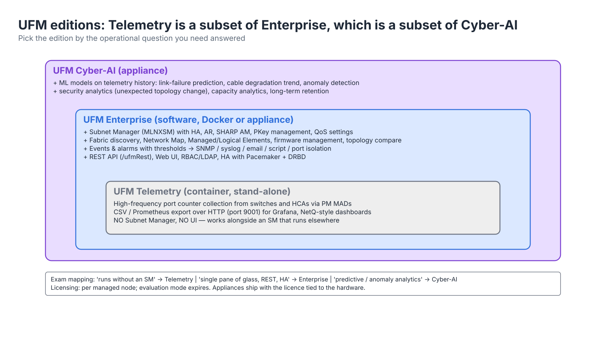
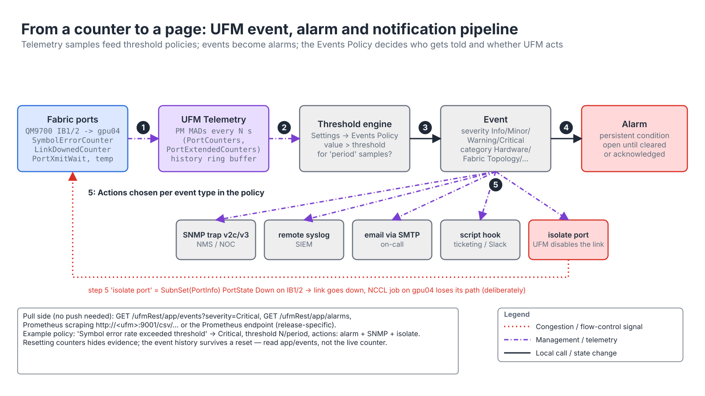

# Module 2.2 — Data Center Management with NVIDIA UFM

> **Exam domain:** NVIDIA InfiniBand Networking (30%)  
> **Source course(s):** DC Management Made Easy with NVIDIA UFM  
> **Source docs:** NVIDIA UFM Enterprise User Manual (6.x); UFM Enterprise REST API Guide; UFM Telemetry User Manual; UFM Cyber-AI User Manual; UFM High Availability User Guide  
> **Estimated study time:** 4–6 hours

> **How to study this module:** read §1–§2, work through the §3 walkthrough on real gear or NVIDIA Air, then attempt the §5 hands-on assignment using only the Hint section. Open the Solution guide (last section) only after you have a working attempt. Finish with the Appendix C knowledge check closed-book.

## 1. Learning objectives

By the end of this module you will be able to…

- **Describe** the three UFM editions (Telemetry, Enterprise, Cyber-AI) and state which one answers a given operational need. *(IB Networking: fabric management)*
- **Describe** the UFM Enterprise architecture — SM, telemetry, REST API, web UI — and how an HA pair is built with Pacemaker/DRBD. *(IB Networking: management HA)*
- **Install** UFM Enterprise (bare metal, Docker or appliance), **configure** `gv.cfg`, and **verify** fabric discovery. *(IB Networking: UFM deployment)*
- **Navigate** the web UI to answer topology, inventory, event and telemetry questions. *(Troubleshooting Tools)*
- **Configure** PKeys through the UI and REST API and **verify** them on hosts. *(IB Networking: partitioning; Automation and Configuration)*
- **Interpret** port counters, `PortXmitWait`, BER, link-flap and temperature data and set threshold-based alerts. *(Troubleshooting Tools)*
- **Write** a REST-driven script that inventories ports, filters on counters and isolates a failing link. *(Automation and Configuration)*
- **Perform** common admin tasks: SM priority change, port disable, firmware update, system dump. *(IB Networking: switch and fabric administration)*

> **Version note.** UFM evolves quickly. Paths, UI labels and REST endpoints below reflect UFM Enterprise 6.x as documented at time of writing; treat specifics as "as of UFM 6.x" and verify in the manual for your release.

## 2. Key technical concepts

### 2.1 What UFM is and why large fabrics need it

**Analogy:** in Module 2.1 the SM was the air-traffic controller. **UFM** is the whole control tower: the controller is still in there, but now with radar screens (telemetry), a logbook and alarm panel (events), an intercom to the airport's other systems (SNMP/syslog/REST), and a second tower ready to take over (HA).

**What it is.** NVIDIA **UFM** (Unified Fabric Manager) is a software platform that runs on one or two Linux servers attached to the InfiniBand fabric. It *contains* a Subnet Manager — the enhanced **MLNXSM** build of `opensm` — and wraps it with five things the bare SM does not have: a fabric model database, a telemetry collector, an event/alarm engine, a web UI and a REST API. Everything from Module 2.1 (LIDs, LFTs, routing engines, PKeys, SL2VL) is still done by that SM; UFM decides *how the SM is configured*, records *what it discovered*, and *watches what the fabric is doing* afterwards.

**Why it exists.** On a 16-node lab the SM on a switch is enough. On a 1,000-GPU SuperPOD (roughly 1,000 HCA ports, 100+ switches and 2,000+ cables) four problems appear that the SM was never designed to solve:

- **Scale and state.** The SM must keep LID assignments stable across restarts (guid2lid), run advanced routing (adaptive routing, SHARP aggregation manager) and survive the loss of its server. A switch-embedded SM has neither the CPU nor the storage for that history.
- **Observability.** At 2,000 links a few cables are *always* degrading. Something has to poll every port's error and congestion counters every few seconds, keep history, and turn "SymbolErrorCounter on IB1/2 went from 0 to 4,000 in an hour" into an alarm. Doing that with per-host `perfquery` scripts floods the fabric with management MADs and gives you no history.
- **Single pane of glass.** Operators need topology maps, inventory (serials, firmware, PSIDs, cable vendors), events and alarms, plus hooks into the data center's existing monitoring (SNMP, syslog, Prometheus).
- **Automation.** Cluster orchestration (Slurm, Kubernetes, BCM) must create partitions, isolate failing links and pull health data without a human clicking.

**How it works.** UFM runs the SM itself (management mode), so its own sweep is the source of truth for topology. Every sweep result lands in the UFM model database; the telemetry collector polls the same ports with Performance Management MADs; the event engine compares samples against thresholds; and both the UI and the REST API read and write the same model. A configuration change made in the UI or by REST is written to the database, UFM regenerates the SM's files, and the SM applies it on its next sweep — the data path never restarts. §2.3 walks through the components; Figure 2.2-2 shows them.

**Why the exam cares:** questions ask which UFM component or edition solves a stated problem, and whether UFM replaces or wraps the SM (it wraps it).

### 2.2 UFM editions

**What it is.** Three products that nest inside each other (Figure 2.2-1):


*Figure 2.2-1 — UFM editions: Telemetry ⊂ Enterprise ⊂ Cyber-AI, and the operational question each one answers.*

| Edition | What it is | Adds |
|---|---|---|
| **UFM Telemetry** | Stand-alone, containerised telemetry collector | High-frequency port/counter collection from IB switches and HCAs, exported over HTTP in CSV/Prometheus formats. No SM, no UI. Used when you already have an SM elsewhere or want to feed Grafana/NetQ-style dashboards |
| **UFM Enterprise** | The full fabric manager (the subject of this module) | Everything in Telemetry **plus** the SM, fabric discovery and topology, web UI, REST API, events/alarms with SNMP/syslog/email forwarding, logical elements, PKey management, firmware/upgrade management, HA, SHARP AM integration |
| **UFM Cyber-AI** | Enterprise **plus** an analytics appliance | AI/ML models trained on telemetry history: anomaly detection, link failure prediction, cable degradation trends, security anomalies (unexpected topology changes), capacity analytics. Sold as an appliance |

**Why it exists.** The three editions answer three different operational questions, and buying (or deploying) more than you need costs licences, servers and attack surface. A site that already runs its SM on managed switches but wants Grafana dashboards needs only a counter collector; a site that wants one tool to own the subnet, tenants and alarms needs Enterprise; a site that wants to replace cables *before* they fail needs months of telemetry history and models trained on it — Cyber-AI.

**How it works.** Telemetry polls counters with PM MADs and exposes them on an HTTP endpoint (port 9001 by default in 6.x) — it never sends an SMP that changes state, so it can coexist with any SM. Enterprise embeds the same collector and adds the SM and everything that writes to the fabric. Cyber-AI keeps long-term telemetry, trains per-port baselines, and raises "this link will fail" or "this topology change was unexpected" events that Enterprise alone never would.

Mental model: Telemetry ⊂ Enterprise ⊂ Cyber-AI. The exam tends to ask "which edition gives predictive/anomaly analytics" (Cyber-AI) and "which can run without an SM" (Telemetry).

### 2.3 UFM Enterprise architecture

**What it is.** A UFM Enterprise server is a Linux host (or VM, or container) with at least one HCA port on the IB fabric plus a management Ethernet interface. Internally it runs several cooperating services; Figure 2.2-2 shows them on both nodes of an HA pair.


*Figure 2.2-2 — UFM Enterprise components and the HA pair: the active node owns the VIP and the master SM; DRBD mirrors `/opt/ufm/files` to the standby.*

| Component | Process / location | Role |
|---|---|---|
| **UFM core** (`ModelMain`) | Python service under `/opt/ufm` | Owns the fabric model (systems, ports, links, logical elements), applies configuration, drives the SM |
| **Model database** | SQLite or MySQL per release, under `/opt/ufm/files` | Inventory, events, PKeys, logical elements, user settings |
| **opensm (MLNXSM)** | started and supervised by UFM | SM + SA: discovery, LIDs, routing (`ar_ftree`, …), PKeys, QoS tables |
| **UFM Telemetry** | embedded collector | Polls PM counters, keeps history, feeds graphs/thresholds and `/monitoring` |
| **Event / alarm engine** | inside UFM core | Turns traps and threshold crossings into events, alarms and actions |
| **Web UI / REST** | HTTPS 443, `/ufm`, `/ufmRest*` | Human and machine front doors to the same model |
| **sharp_am** (optional) | SHARP Aggregation Manager | Builds SHARP trees from the SM's topology (Module 2.3) |

**Why it exists.** Splitting the work this way lets each piece scale and fail independently: the SM keeps the fabric forwarding even if the UI crashes; telemetry can be throttled without touching routing; the event engine can call out to SNMP/syslog without blocking a sweep. Putting *all* state in one directory (`/opt/ufm/files`) is what makes HA simple — replicate one volume and the standby has everything.

**How it works.**

- **SM ownership.** UFM generates `opensm.conf` and `partitions.conf` from its settings and starts its own `opensm`. You do not edit `opensm.conf` by hand in the usual way; UFM generates it from its settings. A host still running a separate `opensm`, or a switch SM at a higher priority, is a conflict: disable every other SM before starting UFM in management mode, because the IB election (highest priority, then lowest GUID — Module 2.1) still applies and UFM's SM will sit in STANDBY discovering nothing.
- **Telemetry path.** An embedded instance of UFM Telemetry polls counters via in-band management datagrams (PM MADs): General Services MADs of the Performance Management class sent to each port's QP1, reading `PortCounters` (legacy 16/32-bit fields) and `PortCountersExtended` (64-bit data/packet counters). It feeds the UI graphs, thresholds and the REST `/monitoring` endpoints. Because the legacy error counters are only 8–16 bits wide (`LinkDownedCounter` is 8-bit, `SymbolErrorCounter` 16-bit) and *saturate* rather than wrap, the collector computes deltas between samples — which is also why resetting counters destroys evidence (§4.3).
- **Modes.** *Management* mode (UFM runs the master SM) is the normal case. *Monitoring* mode lets UFM observe a fabric whose SM runs elsewhere (set `monitoring_mode` in `gv.cfg`) — useful during migrations; it rediscovers on a timer (`mon_mode_discovery_period`, default 60 s) instead of from its own sweeps.
- **SHARP Aggregation Manager** (`sharp_am`) can run on the UFM server, so the same HA pair protects in-network computing (Module 2.3).
- **What talks to the fabric.** Only three things leave the server on the IB port: SMPs from the master SM (QP0, VL15), SA/PM GMPs (QP1) and SHARP AM MADs. Everything else — UI, REST, SNMP, syslog, Prometheus — uses the management Ethernet.

**Why the exam cares:** "which UFM component does X" (telemetry vs SM vs event engine) and "UFM will not discover the fabric — why?" (another master SM) are both recurring question shapes.

### 2.4 High availability

**Analogy:** two control towers, one microphone. The active tower holds the microphone (the virtual IP) and keeps a carbon copy of every page of its logbook flowing to the standby tower (DRBD). If the active tower goes dark, the cluster software (Pacemaker) hands the microphone to the standby, whose logbook is already up to date.

**What it is.** UFM HA is an **active/standby pair** of UFM servers, both connected to the fabric and to each other on a dedicated back-to-back or management link:

- Built with standard Linux clustering: **Pacemaker/Corosync** for resource management and failover, **DRBD** for block-level replication of `/opt/ufm/files` (the configuration and database volume). The `ufm_ha` package installs these and the `ufm_ha_cluster` wrapper command.
- A **virtual IP** floats to the active node, so the UI/REST clients and SNMP consumers keep a single address.
- The SM on the active node is master; the standby's SM is either not started or runs at a lower priority (UFM manages this), so the normal IB SM election is not what drives failover — the cluster does.

**Why it exists.** SM redundancy alone (Module 2.1) protects *routing*, but not the things UFM adds: event history, telemetry history, logical elements, PKey definitions, user accounts, licences. If those lived only on the failed node, the standby would come up with an empty model, re-learn LIDs from scratch (risking renumbering and broken QPs), and lose the audit trail of what happened just before the failure. Replicating the one state directory at block level, synchronously, means the standby's disk is identical to the active's at the moment of failure.

**How it works.** Pacemaker manages an ordered stack of resources on whichever node is active (names per release; the order is the point):

1. **DRBD** resource promoted to *Primary* on the active node (*Secondary* on the standby). DRBD replicates every block write to the peer over the dedicated link before acknowledging it (synchronous replication), so `UpToDate/UpToDate` in `ufm_ha_cluster status` means the two copies are identical.
2. **Filesystem** resource mounts the DRBD device on `/opt/ufm/files`. Only the Primary can mount it, which is the fence that prevents two UFMs writing the same database.
3. **Virtual IP** resource brings up the VIP on the management interface (gratuitous ARP moves clients).
4. **UFM service** starts on that node: ModelMain, opensm, telemetry, web server, optionally sharp_am.

Corosync exchanges heartbeats between the nodes. When the active node stops answering (or you run `ufm_ha_cluster failover`), Pacemaker on the survivor promotes DRBD, mounts, moves the VIP and starts UFM. The new SM reads the replicated `guid2lid` cache and port state, performs a heavy sweep and keeps the existing LIDs — so established QPs keep working. During the gap the data plane is unaffected: switches keep forwarding on the LFTs already programmed; only fabric *changes* (a cable pulled during failover) wait for the new master. Expect failover in the tens-of-seconds-to-minutes range depending on fabric size (verify against the HA guide for your release).

- Commands: `ufm_ha_cluster status`, `ufm_ha_cluster failover` (move mastership away from this node), `ufm_ha_cluster takeover` (claim it), `ufm_ha_cluster start|stop`, `ufm_ha_cluster cleanup`. Configuration is done once with `ufm_ha_cluster config` and its options (local/peer IPs, virtual IP, DRBD device); see the UFM HA guide for the exact flags.
- Split-brain avoidance relies on the dedicated replication link; losing *both* the management network and the DRBD link simultaneously is the scenario to design against. In a split brain each node believes the other is dead, both promote DRBD and both start an SM at priority 15 — two masters fighting over one subnet. Two independent heartbeat paths are the mitigation.

**Failure modes and how to observe them.**

| Symptom | Likely cause | Look at |
|---|---|---|
| `ufm_ha_cluster status` shows DRBD `Inconsistent` or `Outdated` on the standby | replication link down or resync in progress | DRBD state in status output; the back-to-back link |
| Both nodes report master | split brain | `ufm_ha_cluster status` on both; `sminfo` from a host shows the GUID flipping |
| Failover completes but UI unreachable | VIP not moved / ARP cache | `ip addr` on the new active; client ARP table |

Contrast with plain **SM HA** (Module 2.1): two switch SMs with different priorities give SM redundancy only; UFM HA also replicates events, telemetry history, logical elements and PKey definitions.

**Why the exam cares:** "UFM HA uses which technology" (Pacemaker + DRBD + VIP) and "UFM HA vs SM HA" are both regular questions.

### 2.5 Installation options and licensing

**What it is.** Three packagings of the same software:

| Option | Packaging | Notes |
|---|---|---|
| **Bare metal / VM** | `ufm-enterprise-<ver>.tgz` with `install.sh`; requires MLNX_OFED / DOCA-OFED already installed and the HCA port Active | Most common for self-managed clusters; supported on specific RHEL/Rocky and Ubuntu releases — check the matrix |
| **Docker** | `ufm-enterprise` container image, run with `--net=host --privileged` and the `/opt/ufm/files` volume mapped from the host; `ufm-installation` helper container prepares the host | Lets you keep host OS and UFM lifecycles separate; HA is supported with the ufm_ha package on the host |
| **Appliance** | UFM Enterprise Appliance / Cyber-AI appliance: NVIDIA-shipped server with pre-installed OS and UFM, managed via a restricted CLI (`ufm` command tree) | Enterprise and SuperPOD deployments; licence tied to the appliance |

**Why it exists.** Operators differ in what they want to own: some want UFM as one more RPM-style package on a host they patch; some want an immutable container whose upgrade is a tag change; large sites want a supported box with a fixed OS so NVIDIA support can reproduce their environment.

**How it works.** All three need the same two things from the host: a working NVIDIA RDMA stack (so `mlx5_ib` and `ib_umad` give UFM's SM and telemetry access to QP0/QP1 through `/dev/infiniband/umad*`), and an HCA port that is physically up. The Docker flavour needs `--net=host` (UFM binds the HCA and management IP directly) and `--privileged` (raw access to the umad devices). The persistent volume is always `/opt/ufm/files`, which is why backup, HA and container upgrades all revolve around that one path.

UFM is licensed per managed node; the licence file is uploaded in the UI or placed in `/opt/ufm/files/licenses/`. Without a licence UFM runs in evaluation mode for a limited period.

### 2.6 Configuration: gv.cfg and the generated SM files

**What it is.** UFM's main configuration file is **`/opt/ufm/files/conf/gv.cfg`** (older docs show `/opt/ufm/conf/gv.cfg`, which is a symlink into `files/`). It is INI-style:

```ini
[Server]
monitoring_mode = no          # yes = observe a fabric whose SM is elsewhere
ws_protocol = https
ws_port = 443

[SubnetManager]
sm_priority = 15              # UFM's SM should normally be the highest
routing_engine = ar_ftree     # written into the generated opensm.conf
event_plugin_option = ...

[Logging]
level = INFO

[Telemetry]
...
```

**Why it exists.** UFM, not the operator, owns `opensm.conf` — it must, because UFM features (AR, SHARP, QoS, PKeys from the UI) are implemented by rewriting SM parameters. A single higher-level file lets UFM regenerate the SM configuration consistently at every start, and lets HA replicate one source of truth.

**How it works.** Edit, then restart UFM (`systemctl restart ufm-enterprise`). The generated SM configuration lives under `/opt/ufm/files/conf/opensm/opensm.conf`; a monitoring-mode variant `opensm_mon.conf` exists alongside it. UFM rewrites some parameters at start-up, so persistent SM changes should be made through the UI (Settings → Subnet Manager) or in `gv.cfg`, not by editing the generated file. Partitions are kept in `/opt/ufm/files/conf/opensm/partitions.conf` and also regenerated from the UFM database. The flow for a PKey created by REST is exactly Figure 2.2-4 (§2.9): the API writes the database, UFM regenerates `partitions.conf` and signals the SM, the SM pushes `PKeyTable` SMPs on its next sweep. A hand-edit to the generated file therefore survives only until the next regeneration — the classic "my opensm.conf change disappeared after a restart".

**Why the exam cares:** "where do you change UFM's SM priority / routing engine?" — Settings → Subnet Manager or `gv.cfg`, never the generated file.

### 2.7 Web UI areas

**What it is.** The UI is a set of views over the same model. Know what you would open to answer a given operational question.

| Area | What you find there | Typical use |
|---|---|---|
| **Dashboard** | Fabric summary, top congested ports, top alarms, utilisation gauges | Shift hand-over view |
| **Network Map** | Interactive topology: switches, hosts, links, colour-coded by state/alarm; can group by rack/site | "Which leaf is this GPU server on?" |
| **Managed Elements** | Devices (switches, HCAs/hosts, gateways, cables), their ports, firmware, PSIDs, serial numbers; actions such as reboot, upgrade FW, enable/disable port, set SM priority on a switch | Inventory and per-device operations |
| **Logical Elements** | **Environments** (a tenant/business grouping) → **Logical Servers** (groups of compute hosts) → **Networks** (PKey-backed); plus the **PKeys** view | Multi-tenant provisioning, mapping hosts to partitions |
| **Events & Alarms** | Event log with severity, source, time; alarms (persistent events) with acknowledge/clear; filtering by category (Hardware, Fabric Topology, Communication, Security, Gateway) | Incident investigation |
| **Telemetry** | Counter graphs per port/device, history, congestion and BER views; "monitoring sessions" for ad-hoc counter sets | Performance troubleshooting |
| **System Health** | UFM server health, SM status, HA status, licence, Telemetry status, fabric health report run | Confirm UFM itself is OK |
| **Settings** | SM settings (priority, routing engine, AR, SHARP, QoS), event policy & thresholds, SNMP/syslog/email destinations, users & RBAC/LDAP, licence, backups | Configuration |

**Why it exists.** Different roles ask different questions — a NOC operator wants "what is red", a fabric engineer wants "why is this port congested", a tenant admin wants "which hosts are in my partition". Separate views over one model avoid three tools drifting out of sync.

**How it works.** Logical Elements (Environments / Logical Servers / Networks) are an *abstraction* for provisioning; they map onto PKeys underneath: adding a Logical Server to a Network adds its hosts' port GUIDs to that Network's PKey, which follows the same database → `partitions.conf` → SM path as a REST call. Actions in Managed Elements become SMPs (e.g. port disable = `SubnSet(PortInfo)` with PortState Down) for unmanaged switches, or MLNX-OS calls for managed ones.

### 2.8 Monitoring: what UFM collects and what it means

**Analogy:** `PortXmitWait` is the counter on the parking-garage gate that counts how long cars sat waiting because no space was free — it is the credit-based flow control from Module 2.1 made visible. Symbol errors are scratches on the ticket that the reader could not decode.

**What it is.** UFM's telemetry and event engine turn per-port hardware counters into graphs, thresholds, events, alarms and actions — the pipeline in Figure 2.2-3.


*Figure 2.2-3 — From a counter to a page: telemetry samples feed thresholds, events become alarms, and the Events Policy decides the action (including isolating the port).*

| Metric family | Examples | What a bad value means |
|---|---|---|
| **Port traffic counters** | `PortXmitData`, `PortRcvData`, packets/sec, utilisation % | Capacity / hot-spot analysis; a 100 % link under NCCL all-reduce is normal, persistent imbalance across spines suggests routing issue |
| **Error counters** | `SymbolErrorCounter`, `LinkErrorRecoveryCounter`, `LinkDownedCounter`, `PortRcvErrors`, `PortRcvRemotePhysicalErrors`, `PortXmitDiscards`, `PortRcvSwitchRelayErrors`, `ExcessiveBufferOverrunErrors`, `VL15Dropped` | Symbol errors / remote physical errors → bad cable, transceiver or connector; `LinkDowned` → link flaps; `XmitDiscards` → packets dropped due to lifetime/congestion |
| **Congestion** | `PortXmitWait` (cycles the port had data but no credits), congestion-control counters, `XmitWait` normalised to time | High `XmitWait` = downstream receiver not returning credits = congestion; map top offenders on the dashboard |
| **BER / PHY** | Effective and raw BER, FEC corrected/uncorrected blocks, eye margins (from PHY diagnostics, like **mlxlink**) | Raw BER above ~1e-8 on NDR with FEC still correcting is a warning; uncorrectable errors = replace the cable/module |
| **Link flaps** | Count of link up/down transitions per period | Flapping links cause SM re-sweeps and NCCL time-outs; UFM can auto-isolate them |
| **Environment** | Switch and transceiver temperature, PSU/fan status, power | Overheating optics raise BER before they fail |

**Why it exists.** IB is lossless by credit flow control (Module 2.3), so it never *drops* under congestion — it *waits*. That makes congestion invisible to anything that only counts drops; `PortXmitWait` is the only direct evidence. Physical faults, on the other hand, are almost always gradual: a cable's symbol error rate climbs for hours or days before the link flaps, and every flap triggers an SM re-sweep and NCCL `IBV_WC_RETRY_EXC_ERR` time-outs. Catching the trend early — and isolating the link before it flaps during a training run — is the whole value of the pipeline.

**How it works.** Follow the numbered steps in Figure 2.2-3:

1. **Sample.** UFM Telemetry sends PM `Get(PortCounters)` / `Get(PortCountersExtended)` to each port at a configurable period (default a few tens of seconds for the full set, faster for a "low-frequency vs high-frequency" split in newer releases) and stores history in a round-robin fashion; long-term retention is where Cyber-AI or an external Prometheus/Grafana stack comes in. Data counters (`PortXmitData`/`PortRcvData`) count in 4-byte words, so multiply by 4 for bytes; the extended set is 64-bit and effectively never saturates.
2. **Threshold.** The threshold engine compares each delta (value now minus value one period ago) against the policy: "SymbolErrorCounter increased by more than N within period P".
3. **Event.** A crossing raises an **event** with a severity (**Info / Minor / Warning / Critical**) and a category (Hardware, Fabric Topology, Communication, Security, Gateway). Traps from the SM (port state change, Trap 128 in Module 2.1) also become events.
4. **Alarm.** An alarm is a persistent condition derived from events; it stays open until cleared or acknowledged.
5. **Action.** Settings → Events Policy lets you enable/disable each event type, set the threshold value and the evaluation period, and choose the action: log, raise alarm, send **SNMP trap**, **syslog**, **email**, call a script, or (for link errors) **isolate the port**. Isolation is a `SubnSet(PortInfo)` with PortState Down on that port, which takes the link down deliberately — the SM re-routes around it on the next sweep, and any job using that path gets a clean failure instead of a slow death.

Many events are **threshold events** generated by the telemetry engine: e.g. "Symbol error rate exceeded threshold", "Port temperature high", "Link utilisation > 90 %".

**Northbound integration:** SNMP traps (v2c/v3; MIB shipped under `/opt/ufm/files/...`), remote syslog (SIEM), email via SMTP relay, Prometheus scraping of the telemetry endpoint (`http://<ufm>:9001/csv/...` or a Prometheus-format exporter, depending on release), and REST polling of `/ufmRest/app/events` or `/ufmRest/app/alarms`.

**Failure modes.** A counter reset (UI or `reset_ports_counters`) zeroes the evidence but not the event history — read `app/events`, not the live counter (§4.3). A saturated 16-bit legacy counter stops at 65,535 and looks "stable"; trust the delta and the extended counters. Telemetry that stops updating on every port at once usually means the collector lost its HCA (port down on the UFM server), not that the fabric went quiet.

**Why the exam cares:** "high `PortXmitWait`, zero errors" = congestion; "symbol errors + `LinkDownedCounter`" = physical; "what can the Events Policy do?" = alarm, SNMP, syslog, email, script, isolate.

### 2.9 REST API model

**What it is.** All management operations have a REST equivalent at `https://<ufm>/ufmRest/...` (and `/ufmRestV2`, `/ufmRestV3` for newer endpoints). Authentication is HTTP basic with a UFM user, or a token (`/ufmRest/app/tokens`) for scripts. Responses are JSON. Use `-k` only in the lab; production should have a real certificate.

| Resource family | Path | Used for |
|---|---|---|
| Inventory | `resources/systems`, `resources/ports`, `resources/links`, `resources/modules` | What is in the fabric and its state |
| Events / alarms | `app/events`, `app/alarms` | Incident data |
| Partitions | `resources/pkeys`, `resources/pkeys/<key>?guids_data=true`, `resources/pkeys/delete` | Multi-tenancy |
| Actions | `actions` with `disable_port`, `enable_port`, `reset_ports_counters`, `sw_upgrade`, … | Operations on devices/ports |
| Monitoring | `monitoring/...` | Counter snapshots |
| Reports | `reports/Fabric_Health` | Run/fetch the fabric health report |

**Why it exists.** At SuperPOD scale nothing that has to happen per job or per incident can depend on a human in a UI: Slurm prologs create or check partitions, Kubernetes operators request tenant isolation, NOC tooling isolates failing links. The REST API exposes exactly the same model as the UI, so automation and humans can never disagree about state.

**How it works.** Figure 2.2-4 traces a PKey creation end to end; the numbers match the circled steps.


*Figure 2.2-4 — REST integration: from a POST to a PKey programmed in the fabric, with no SM restart.*

1. **Authenticate** — basic auth on every call, or `POST app/tokens` once and reuse the token (header format per the API guide for your release).
2. **POST `resources/pkeys`** with the key (`0x0a02`), membership, IPoIB flag, MTU/rate limits and member GUIDs (hex *without* `0x`). UFM core validates and writes the model database; the HTTP 200/201 is returned as soon as the DB write is accepted — *not* when the fabric is programmed.
3. **Regenerate** — UFM rewrites `partitions.conf` and signals the SM.
4. **Program** — on its next sweep the SM sends `SubnSet(PKeyTable)` to each member port (and `SubnSet(MFT)` for the IPoIB multicast group); tables are live within one sweep, typically seconds. The host then creates `ib0.8a02`.
5. **Read back** with `GET resources/pkeys/0x0a02?guids_data=true`; inventory, links and events are the same pattern on other resources.
6. **Act** — `POST actions` (`disable_port`, …) uses the same path for operations; for an unmanaged switch UFM sends a `PortInfo` MAD in-band, for a managed one it may use MLNX-OS.

Because step 2 returns before step 4 completes, a script that immediately checks the host may see the old table — poll the host's `pkeys` sysfs or `guids_data` instead of assuming. Field names (`guids`, `membership`, `index0`, `ip_over_ib`) are those documented for 6.x; the request format for setting membership per-GUID differs between endpoints, so copy the exact body from the REST API Guide for the version you run.

**Why the exam cares:** it is far more likely to ask *which resource* you would call (ports vs. systems vs. pkeys vs. events) than to test JSON field names.

## 3. Live-style walkthrough: install UFM, walk the UI, then do it all again with curl

Lab: the 2-switch / 4-host subnet from Module 2.1, now with a management host `ufm01` (DOCA-OFED installed, `mlx5_0` cabled to `ib-sw-01`, mgmt IP 10.0.100.50). The switch SMs are still running — watch what that does.

### Step 1 — Prerequisites and the one thing people forget

```bash
ufm01$ ibstat mlx5_0 | grep -E "State|Link layer|SM lid"
        State: Active                       # HCA is up and configured by SOME SM
        SM lid: 1                           # <-- that is ib-sw-01's SM. UFM will fight it unless we fix this
        Link layer: InfiniBand

# Disable the switch-embedded SMs first (or lower them below UFM's 15). UFM management mode must own mastership.
ib-sw-01 (config) # no ib sm
ib-sw-02 (config) # no ib sm
ufm01$ systemctl is-active opensm            # must be "inactive" — no stray host SM either
```

### Step 2 — Install and start

```bash
ufm01$ tar xzf ufm-enterprise-6.x.y-z.tgz && cd ufm-enterprise-6.x.y-z
ufm01$ sudo ./install.sh                     # interactive: pick the SM HCA port (mlx5_0), DB, telemetry
ufm01$ sudo systemctl start ufm-enterprise   # legacy: /etc/init.d/ufmd start
ufm01$ sudo /opt/ufm/scripts/show_ufm_status.sh -e
# Expect every line "running": ModelMain, opensm, UFM Telemetry, web server, ...
# A stuck "opensm: not running" almost always means another master SM still exists.

ufm01$ sminfo
sminfo: sm lid 7 sm guid 0xb83fd20300aa0001, activity count 88 priority 15 state 3 SMINFO_MASTER
# priority 15 and UFM's own port GUID = UFM owns the subnet. If you still see the switch GUID, go back to Step 1.
```

### Step 3 — First login and gv.cfg

```bash
# UI: https://10.0.100.50/ufm   default admin/123456 — change it on first login
ufm01$ sudo grep -nE "monitoring_mode|sm_priority|routing_engine" /opt/ufm/files/conf/gv.cfg
monitoring_mode = no                         # management mode: UFM runs the master SM
sm_priority = 15                             # highest possible; a switch SM can never pre-empt
routing_engine = ar_ftree                    # AR-capable fat-tree (Module 2.3). UFM writes this into opensm.conf
ufm01$ sudo ls /opt/ufm/files/conf/opensm/   # opensm.conf, opensm_mon.conf, partitions.conf — generated, do not hand-edit
```

Network Map should populate within a minute or two: 2 switches, 5 hosts (including `ufm01`). If it is empty, re-check `ibstat` (`SM lid` must be UFM's own LID), `sminfo`, that firewall allows 443 (UI/REST), 8005/8000 internal, SNMP 162 outbound, and the HA ports if clustered.

### Step 4 — Walk the UI as an operator would

1. **Dashboard** — top congested ports (sorted by `PortXmitWait`) and top alarms. Nothing should be red on a quiet lab.
2. **Network Map** — click `ib-sw-01`; the two ISLs to `ib-sw-02` are drawn; hover a host to see its leaf and port. "Which leaf is gpu03 on?" is answered here.
3. **Managed Elements** → `ib-sw-01` → Ports → `IB1/31` — firmware, PSID, serial, per-port counters, and the Actions menu (Disable, Reset counters).
4. **Logical Elements** → **PKeys** → "+" — enter `0x0a01`, leave *index-0* unchecked (whether this key is placed at index 0 of the port's table — usually no), tick IPoIB, MTU 4K, SL 0, add the two GUIDs for the Vision hosts with membership *full*, Save. Watch the SM resweep: no restart.
5. **Events & Alarms** — filter severity *Critical*, category *Hardware* (steps ③–④ of Figure 2.2-3). Acknowledge one to see how alarms differ from events.
6. **Telemetry** — pick `ib-sw-01 IB1/1`, graph `PortXmitWait` and `SymbolErrorCounter` over the last hour.
7. **System Health** — SM `master`, HA `n/a` (single node), licence state, Telemetry `running`; run **Fabric Health** report (ibdiagnet-based plus UFM's own checks: duplicate GUIDs, mixed firmware, degraded width/speed, cable errors).
8. **Settings** → Events Policy — find "Symbol error rate exceeded threshold", note the threshold, period, and the action list including *isolate port* (step ⑤ of Figure 2.2-3).

### Step 5 — The same work via REST with curl

Every call below is one numbered step of Figure 2.2-4: the token (①), the PKey POST (②), UFM regenerating the SM files (③) and the SM programming the tables (④) happen without you touching the SM; the GETs are ⑤ and the `disable_port` action is ⑥.

```bash
UFM=https://10.0.100.50
AUTH="admin:NewPassw0rd"

# --- Inventory: list systems (switches + hosts) with firmware and state
curl -sk -u $AUTH $UFM/ufmRest/resources/systems | jq '.[] | {name, type, fw, state}'
# Expect 2 switch entries and 5 host entries. "fw" differences across switches = upgrade candidates.

# --- Ports: every port that is NOT Link Up (empty ports are fine; a cabled one here is a problem)
curl -sk -u $AUTH $UFM/ufmRest/resources/ports \
  | jq '.[] | select(.physical_state!="Link Up") | {name, node_description, physical_state}'

# --- Links: both ends of every link
curl -sk -u $AUTH $UFM/ufmRest/resources/links | jq length     # 4 host links + 2 ISLs + ufm01 = 7

# --- Create the NLP PKey with two full members (POST or PUT per release — check the API guide)
curl -sk -u $AUTH -X POST $UFM/ufmRest/resources/pkeys \
  -H 'Content-Type: application/json' \
  -d '{
        "pkey": "0x0a02",
        "index0": false,
        "ip_over_ib": true,
        "mtu_limit": 4,
        "service_level": 0,
        "rate_limit": 7,
        "guids": ["b83fd203001a2b44", "b83fd203001a2b48"],
        "membership": "full"
      }'
# mtu_limit 4 = 2048 bytes, rate_limit 7 = 40G encoding (16 = 100G, 17 = 200G) — same encodings as partitions.conf.
# GUIDs are hex WITHOUT 0x in the UFM API.

# --- Read it back, with members
curl -sk -u $AUTH "$UFM/ufmRest/resources/pkeys/0x0a02?guids_data=true" | jq .
# On a host in the partition, the SM has already pushed it:
nlp01$ cat /sys/class/infiniband/mlx5_0/ports/1/pkeys/* | grep -i 8a02   # 0x8a02 = full member, no SM restart needed

# --- Remove a member
curl -sk -u $AUTH -X POST $UFM/ufmRest/resources/pkeys/delete \
  -H 'Content-Type: application/json' \
  -d '{"pkey": "0x0a02", "guids": ["b83fd203001a2b48"]}'

# --- Events: the last 50 Critical ones
curl -sk -u $AUTH "$UFM/ufmRest/app/events?limit=50&severity=Critical" | jq '.[] | {timestamp, severity, description}'
curl -sk -u $AUTH $UFM/ufmRest/app/alarms | jq '.[] | {severity, description, object_name}'

# --- Isolate a flapping port (action name/parameters per release — verify in the REST guide)
curl -sk -u $AUTH -X POST $UFM/ufmRest/actions \
  -H 'Content-Type: application/json' \
  -d '{"action": "disable_port", "object_ids": ["<port_guid>_<port_num>"], "object_type": "System", "identifier": "id", "description": "isolate flapping link"}'

# --- Telemetry snapshot (counter names per release; see the 'Monitoring' section of the API guide)
curl -sk -u $AUTH "$UFM/ufmRest/monitoring/..."
```

### Step 6 — Admin tasks and HA at a glance

```bash
# Service lifecycle
systemctl status ufm-enterprise ; systemctl restart ufm-enterprise
/opt/ufm/scripts/show_ufm_status.sh -e          # core + sub-processes

# HA (only once the ufm_ha package is configured on both nodes) — the pair in Figure 2.2-2
ufm_ha_cluster status                            # which node is master; DRBD "UpToDate/UpToDate" = replication healthy
ufm_ha_cluster failover                          # run on the current master to hand over to the peer
ufm_ha_cluster takeover                          # run on the standby to pull mastership here

# Logs and support bundle
ls /opt/ufm/files/log/                           # ufm.log, event.log, opensm.log, telemetry logs, console.log
/opt/ufm/scripts/ufm_log_collect.sh              # system dump (name as of 6.x; verify) — or System Health -> Dump in the UI
/opt/ufm/scripts/ufm_backup.sh ; /opt/ufm/scripts/ufm_restore.sh -f <backup.tgz>
```

| Task | Where / how |
|---|---|
| Change UFM's SM priority | Settings → Subnet Manager → SM Priority; or `sm_priority` in `gv.cfg`; restart SM from the UI (no full UFM restart needed on newer releases) |
| Change a *switch's* embedded SM priority or disable it | Managed Elements → switch → Actions (MLNX-OS managed switches) or on the switch CLI (`ib sm sm-priority`) |
| Enable/disable a port | Managed Elements → device → Ports → select → Disable/Enable; or REST `actions` with `disable_port`/`enable_port` |
| **Isolate a bad link** | Disable one or both ends; better, enable the event policy "isolate link on excessive errors" so UFM does it automatically and raises an alarm. After replacing the cable, re-enable and clear counters |
| Reset port counters | Telemetry/Managed Elements → Reset counters, or REST action `reset_ports_counters` (name per release) |
| Firmware management | Managed Elements → select devices → Software Update: MLNX-OS image for managed switches, or HCA/unmanaged switch firmware (in-band burning for unmanaged Quantum switches); UFM checks PSID compatibility |
| Topology validation | Upload a reference topology (`.topo`/ibdiagnet format) in Settings and enable "Topology Compare"; mismatches raise events — invaluable after cabling a new SuperPOD |
| User management | Settings → Users: roles (System Admin, Fabric Admin, Monitoring Only…), LDAP/AD/Kerberos integration |
| Backup configuration | Settings → System → Backup, or `ufm_backup.sh` |

## 4. Troubleshooting / common gotchas

### 4.1 Network Map is empty after install

**Symptom:** UFM is running, UI loads, but no switches or hosts appear. `show_ufm_status.sh` may show `opensm` restarting.

**Why it happens:** another SM is still master (a switch at priority 13, a host running `opensm`), so UFM's SM sits in standby and discovers nothing — UFM in management mode only populates its model from *its own* SM's sweep.

**How to debug:**

```bash
ufm01$ ibstat mlx5_0 | grep "SM lid"            # must equal ufm01's own Base lid
ufm01$ sminfo                                   # whose GUID and priority is master?
ib-sw-01 # show ib sm                           # "SM enabled: yes" and "master"? That is the culprit
ufm01$ grep -i "standby\|master" /opt/ufm/files/log/opensm.log | tail
```

**Fix:** `no ib sm` on the switches (or set them below 15) and `systemctl disable --now opensm` on every host; or, if the other SM is intentional, set `monitoring_mode = yes` in `gv.cfg` and restart UFM so it observes rather than manages.

### 4.2 PKey created in UFM, but the host's child interface has no carrier

**Symptom:** the PKey shows the host GUID as a member in Logical Elements → PKeys, yet `ib0.8a02` on the host is `NO-CARRIER`.

**Why it happens:** the GUID entered was the *node* GUID or a GUID with a typo (UFM accepts any hex), or IPoIB was left unticked (no multicast group), or the host created the child with the limited form (`0x0a02`) instead of `0x8a02`.

**How to debug:**

```bash
host$ ibstat mlx5_0 | grep "Port GUID"                     # compare byte-for-byte with the UFM member list
host$ cat /sys/class/infiniband/mlx5_0/ports/1/pkeys/*     # is 0x8a02 (or 0x0a02) present? If not, the SM never programmed it
curl -sk -u $AUTH "$UFM/ufmRest/resources/pkeys/0x0a02?guids_data=true" | jq '.guids, .ip_over_ib'
```

**Fix:** correct the GUID / tick IPoIB in UFM (saves push live to the SM, no restart), recreate the child interface with the `0x8000` bit set.

### 4.3 Symbol errors climbing, counters were reset, problem "went away"

**Symptom:** an alarm for `SymbolErrorCounter` fires on `ib-sw-02 IB1/2`; an operator resets counters and the alarm clears. A day later NCCL jobs on gpu03 stall with `IBV_WC_RETRY_EXC_ERR`.

**Why it happens:** resetting counters hides the evidence; a degrading cable/transceiver keeps corrupting packets. Symbol errors plus `LinkDownedCounter` increments are a physical fault, not noise.

**How to debug:**

```bash
curl -sk -u $AUTH "$UFM/ufmRest/app/events?limit=200" | jq '.[] | select(.description|test("Symbol|Link Down"))'   # history survives a counter reset
# Telemetry -> ib-sw-02 IB1/2 -> SymbolErrorCounter, LinkDownedCounter, PortRcvRemotePhysicalErrors over 24 h
# Managed Elements -> cable: temperature, vendor, length; then on a host:  mlxlink -d <dev> -p <port> -m -e   (Module 8) for BER/eye
```

**Fix:** isolate the port (disable one end via Managed Elements or REST `disable_port`), open a ticket, replace the cable/module, re-enable, *then* reset counters. Turn on the Events Policy auto-isolation for link errors so this happens without a human next time.

## 5. Hands-on assignment: automated bad-link isolation via REST

**Scenario.** Your SuperPOD has 2,000+ links. NOCs miss slow-burning cable failures. Write a tool that uses the UFM REST API to find ports whose error counters exceed a threshold, report them, and — with an explicit flag — isolate them, so it can be run from cron or a Slurm prolog.

**Requirements:**

1. Authenticate to UFM with a user credential or token; never hard-code the password in the script body (environment variable or file).
2. Pull the port inventory from `resources/ports` and the current error counters for every port (telemetry/monitoring endpoint or the counters embedded in the ports resource for your release).
3. Flag any port where `SymbolErrorCounter` **or** `PortRcvRemotePhysicalErrors` exceeds a configurable threshold, or where `LinkDownedCounter` increased since the previous run (persist the previous snapshot to a JSON file).
4. Print a report: system name, port, peer system/port (from `resources/links`), the offending counter and its value.
5. With `--isolate`, disable each flagged port through `/ufmRest/actions` and log the action; without the flag, do nothing destructive.
6. Never isolate a port if doing so would be the second port isolated on the same host within one run (protect against isolating a host's only two links).

**Deliverables:** the script (bash+curl+jq or Python), a sample report run against the lab, and the UFM events list showing the `disable_port` actions it took.

**Acceptance criteria:**

- A. Running without `--isolate` on a clean fabric prints an empty report and exits 0.
- B. After you inject errors (e.g. partially unseat a DAC on `gpu04` for a few seconds, or lower the threshold to 0 for the test), the report lists the port with the correct peer.
- C. With `--isolate`, the port shows `Disabled` in Managed Elements and an event/alarm records it; `iblinkinfo` on a host shows the link down.
- D. Running a second time does not re-isolate or error on the already-disabled port.
- E. The two-ports-per-host guard is demonstrably exercised (unit test or a dry-run log line).

### Hint

- Start with §2.9's resource table: which family gives you ports, which gives you the peer, which performs the action? Three calls, not one.
- `jq` can join `ports` and `links` on the port GUID/port number; build a lookup object first.
- The `actions` body format is release-specific — run the UI "Disable" action once with the browser's dev tools open and copy what the UI sends.
- For "increased since last run", store `{port_id: LinkDownedCounter}` as JSON and diff; do not rely on resetting counters.
- Use `set -euo pipefail` and treat a non-200 from UFM as a hard failure; a half-executed isolation run is worse than none.

## Appendix A — Quick command / config reference

| Item | Value / command |
|---|---|
| Main config | `/opt/ufm/files/conf/gv.cfg` |
| Generated SM config | `/opt/ufm/files/conf/opensm/opensm.conf` (`opensm_mon.conf` for monitoring mode) |
| Partitions | `/opt/ufm/files/conf/opensm/partitions.conf` (managed from UI/REST) |
| Licences | `/opt/ufm/files/licenses/` |
| Logs | `/opt/ufm/files/log/` |
| Service | `systemctl {start\|stop\|restart\|status} ufm-enterprise` |
| Status script | `/opt/ufm/scripts/show_ufm_status.sh [-e]` |
| HA | `ufm_ha_cluster {status\|start\|stop\|failover\|takeover\|cleanup\|config}` |
| Log collection | `/opt/ufm/scripts/ufm_log_collect.sh` (verify name) / UI System Dump |
| Backup / restore | `/opt/ufm/scripts/ufm_backup.sh`, `/opt/ufm/scripts/ufm_restore.sh -f <file>` |
| UI | `https://<ufm>/ufm` (default admin/123456 — change it) |
| REST base | `https://<ufm>/ufmRest/` (`/ufmRestV2`, `/ufmRestV3` where documented); token at `app/tokens` |
| Inventory endpoints | `resources/systems`, `resources/ports`, `resources/links`, `resources/modules` |
| Events / alarms | `app/events`, `app/alarms` |
| PKeys | `resources/pkeys`, `resources/pkeys/<key>?guids_data=true`, `resources/pkeys/delete` |
| Actions | `actions` with `disable_port`, `enable_port`, `reset_ports_counters`, `sw_upgrade`, … |
| Fabric health | UI System Health → Fabric Health → Run; REST `reports/Fabric_Health` (name may vary) |
| Telemetry export | `http://<ufm>:9001/csv/...` or Prometheus endpoint (release-specific) |
| Monitoring-mode discovery interval | `mon_mode_discovery_period` (default 60 s) |

```bash
# Docker flavour (host prepared by the ufm-installation helper container)
docker run -d --name ufm --net=host --privileged -v /opt/ufm/files:/opt/ufm/files ufm-enterprise:<ver>
```

## Appendix B — Exam traps & key takeaways

- **Any other master SM blocks UFM management mode.** Disable switch SMs (`no ib sm`) and host `opensm` before starting UFM, or run UFM in *monitoring* mode deliberately.
- **UFM HA ≠ SM HA.** UFM HA uses Pacemaker/Corosync + DRBD with a virtual IP and replicates the entire UFM state; SM HA is just priority-based election.
- Editions: **Telemetry** (collection only, no SM) ⊂ **Enterprise** (SM + UI + REST + events + HA) ⊂ **Cyber-AI** (adds ML analytics appliance). Predictive analytics = Cyber-AI; runs without SM = Telemetry.
- Edit `gv.cfg` or use the UI for SM settings; hand-edits of the *generated* `opensm.conf` under `/opt/ufm/files/conf/opensm/` can be overwritten.
- UFM's SM priority should be the highest in the fabric (commonly 15) so a switch SM never pre-empts it.
- Disabling a port in UFM is an *administrative* action on one end; to truly isolate a link with a failing cable, disable at least one side and raise a ticket — do not just reset counters.
- PKey changes from the UI/REST are pushed into the SM live; the SM does **not** need a restart, but hosts need the matching IPoIB child interface (`0x8xxx`).
- Logical Elements (Environments / Logical Servers / Networks) are an abstraction over PKeys.
- REST paths and action names change between 6.x releases; questions test *which resource family* (`resources/ports` vs `app/events`), not exact JSON.
- `PortXmitWait` = congestion (data waiting for credits); `SymbolErrorCounter` / `PortRcvRemotePhysicalErrors` = physical layer; `LinkDownedCounter` = flaps.
- Events have severities Info/Minor/Warning/Critical; actions = alarm, SNMP, syslog, email, script, port isolation.
- Licence is per managed node; evaluation mode expires.
- Health tooling: `show_ufm_status.sh`, Fabric Health report, `ufm_log_collect` / System Dump for support.

## Appendix C — Knowledge check

1. A customer wants link-failure prediction based on historical telemetry trends. Which UFM edition provides this?
   A. UFM Telemetry
   B. UFM Enterprise
   C. UFM Cyber-AI
   D. Any edition with the Prometheus exporter enabled

2. UFM Enterprise HA replicates configuration and database between the two nodes using which technology?
   A. rsync on a cron schedule
   B. DRBD block replication managed by Pacemaker
   C. MySQL Galera multi-master
   D. The InfiniBand SM's standby synchronisation

3. After installing UFM Enterprise, the Network Map is empty and `ibstat` on the UFM host shows `SM lid: 1`, which belongs to a Quantum switch. What should you do?
   A. Increase UFM's telemetry interval
   B. Disable the switch's embedded SM (or lower its priority below UFM's) so UFM becomes master
   C. Switch UFM to Docker installation
   D. Add the switch GUID to partitions.conf

4. Which REST resource would an automation script query to find all ports whose physical state is not "Link Up"?
   A. `/ufmRest/app/events`
   B. `/ufmRest/resources/pkeys`
   C. `/ufmRest/resources/ports`
   D. `/ufmRest/actions`

5. A port shows rapidly increasing `SymbolErrorCounter` and several `LinkDownedCounter` increments in the last hour. What is the best immediate UFM action?
   A. Reset the counters and keep watching
   B. Disable (isolate) the port and raise a cable-replacement ticket
   C. Increase the SM sweep interval
   D. Move the port to a different PKey

6. Which UFM web UI area lets you group hosts into tenants and bind them to PKey-backed networks?
   A. Managed Elements
   B. Telemetry
   C. Logical Elements
   D. System Health

7. Which counter most directly indicates congestion (a port had data to send but no credits) on an InfiniBand link?
   A. `PortRcvErrors`
   B. `PortXmitWait`
   C. `SymbolErrorCounter`
   D. `VL15Dropped`

8. Which file holds UFM's primary server settings such as monitoring mode and web port?
   A. `/etc/opensm/opensm.conf`
   B. `/opt/ufm/files/conf/gv.cfg`
   C. `/opt/ufm/files/log/ufm.log`
   D. `/etc/ufm/ufm.yaml`

### Answer key
1. C — Cyber-AI adds the ML analytics layer; Enterprise alerts on thresholds but does not predict.
2. B — UFM HA is built on Pacemaker/Corosync with DRBD-replicated `/opt/ufm/files` and a virtual IP.
3. B — Only one master SM; UFM management mode requires its SM to win (or every other SM to be disabled).
4. C — Port inventory and state live under `resources/ports`.
5. B — Symbol errors plus link flaps indicate a failing cable/module; isolate to protect the fabric, then replace.
6. C — Environments → Logical Servers → Networks are the Logical Elements abstraction over PKeys.
7. B — `PortXmitWait` counts time waiting for credits, the IB congestion signal.
8. B — `gv.cfg` is UFM's main configuration file.

## References
- NVIDIA Academy: *DC Management Made Easy with NVIDIA UFM*
- NVIDIA UFM Enterprise User Manual v6.x — https://docs.nvidia.com/networking/display/ufmenterpriseumv6180 (and later), "Running UFM Server Software", "Troubleshooting" chapters
- NVIDIA UFM Enterprise REST API Guide — https://docs.nvidia.com/networking/ (UFM section)
- NVIDIA UFM High Availability User Guide — https://docs.nvidia.com/networking/
- NVIDIA UFM Telemetry User Manual; UFM Cyber-AI User Manual — https://docs.nvidia.com/networking/
- Related modules: [2.1 IB Administration](01-infiniband-network-administration.md), [2.3 QoS/AR/SHARP](03-infiniband-qos-adaptive-routing-sharp.md), Module 8 IB diagnostics (`../08-troubleshooting/`)

---
## Solution guide — Hands-on assignment

The solution is a bash script around `curl` and `jq`. Endpoint shapes are those documented for UFM 6.x; the counter field names inside the ports/monitoring payload vary by release, so the script takes them as variables and you should confirm them once with a raw `curl ... | jq '.[0]'`.

```bash
#!/usr/bin/env bash
# ufm_badlinks.sh — report (and optionally isolate) IB ports with excessive errors via the UFM REST API
# Usage:  UFM_URL=https://ufm01 UFM_AUTH_FILE=~/.ufm_auth ./ufm_badlinks.sh [--isolate] [--sym-thresh N] [--rpe-thresh N]
set -euo pipefail

UFM_URL="${UFM_URL:-https://10.0.100.50}"
AUTH="$(cat "${UFM_AUTH_FILE:-$HOME/.ufm_auth}")"      # file contains  user:password  — requirement 1: no secret in the script
STATE="${STATE_FILE:-/var/tmp/ufm_badlinks_state.json}" # previous LinkDownedCounter snapshot (requirement 3)
SYM_T=10; RPE_T=10; ISOLATE=0
while [[ $# -gt 0 ]]; do
  case "$1" in
    --isolate) ISOLATE=1 ;;
    --sym-thresh) SYM_T="$2"; shift ;;
    --rpe-thresh) RPE_T="$2"; shift ;;
    *) echo "unknown arg $1" >&2; exit 2 ;;
  esac; shift
done

api() {                                                  # GET helper; any non-2xx is fatal (a half-run is worse than none)
  curl -sk --fail -u "$AUTH" "$UFM_URL/ufmRest/$1"
}

# --- Requirement 2: inventory + counters -----------------------------------------------------
# Field names below (symbol_error_counter, link_downed_counter, port_rcv_remote_physical_errors) are the
# snake_case forms used by the 6.x ports/telemetry payloads; confirm with:  api resources/ports | jq '.[0]'
PORTS=$(api "resources/ports")                                   # name, node_description, physical_state, guid, ...
LINKS=$(api "resources/links")                                   # source_guid/source_port_dname -> destination_*
COUNTERS=$(api "monitoring/..." 2>/dev/null || echo '[]')        # release-specific counter snapshot; fall back to ports payload

# Build a peer lookup: "<guid>_<port>" -> "peer_system peer_port"
PEERS=$(jq -n --argjson l "$LINKS" '
  [ $l[] | {k: (.source_guid + "_" + .source_port), v: (.destination_port_node_description + " " + .destination_port_dname)},
          {k: (.destination_guid + "_" + .destination_port), v: (.source_port_node_description + " " + .source_port_dname)} ]
  | from_entries')

PREV=$( [[ -f "$STATE" ]] && cat "$STATE" || echo '{}' )

# --- Requirement 3: flag ports --------------------------------------------------------------
FLAGGED=$(jq -n --argjson p "$PORTS" --argjson c "$COUNTERS" --argjson prev "$PREV" \
               --argjson peers "$PEERS" --argjson symt "$SYM_T" --argjson rpet "$RPE_T" '
  # merge counters into ports by port id when a separate monitoring payload exists
  ($c | map({key: .port_id, value: .}) | from_entries) as $cm
  | [ $p[]
      | . as $port
      | ($cm[$port.name] // $port) as $cnt
      | {
          id: $port.name,                                # "<guid>_<port>"
          system: $port.node_description,
          port: $port.dname,
          peer: ($peers[$port.name] // "unknown"),
          state: $port.physical_state,
          sym:  (($cnt.symbol_error_counter // 0) | tonumber),
          rpe:  (($cnt.port_rcv_remote_physical_errors // 0) | tonumber),
          ld:   (($cnt.link_downed_counter // 0) | tonumber),
          ld_prev: (($prev[$port.name] // 0) | tonumber)
        }
      | select(.state == "Link Up")                     # ignore empty/unconnected ports
      | select(.sym > $symt or .rpe > $rpet or .ld > .ld_prev)
      | .reason = (if .sym > $symt then "SymbolErrorCounter=\(.sym)"
                   elif .rpe > $rpet then "PortRcvRemotePhysicalErrors=\(.rpe)"
                   else "LinkDownedCounter \(.ld_prev)->\(.ld)" end)
    ]')

# Persist this run's LinkDownedCounter snapshot for next time
jq -n --argjson p "$PORTS" --argjson c "$COUNTERS" '
  ($c | map({key: .port_id, value: .}) | from_entries) as $cm
  | [ $p[] | {key: .name, value: ((($cm[.name] // .).link_downed_counter // 0) | tonumber)} ] | from_entries' > "$STATE"

# --- Requirement 4: report ------------------------------------------------------------------
N=$(jq length <<<"$FLAGGED")
if [[ "$N" -eq 0 ]]; then echo "OK: no ports above threshold"; exit 0; fi   # acceptance A
printf '%-28s %-8s %-36s %s\n' SYSTEM PORT PEER REASON
jq -r '.[] | [.system, .port, .peer, .reason] | @tsv' <<<"$FLAGGED" | column -t -s $'\t'

# --- Requirement 5 & 6: isolate with guard ---------------------------------------------------
[[ "$ISOLATE" -eq 1 ]] || { echo "(dry run — pass --isolate to disable the ports above)"; exit 0; }

declare -A per_host
while IFS=$'\t' read -r id system port; do
  per_host["$system"]=$(( ${per_host["$system"]:-0} + 1 ))
  if (( per_host["$system"] > 1 )); then                    # requirement 6: never a second port on the same host per run
    echo "GUARD: skipping $system $port — already isolated one port on this host this run"
    continue
  fi
  # Already disabled? (acceptance D: idempotent)
  cur=$(jq -r --arg id "$id" '.[] | select(.name==$id) | .enabled // "true"' <<<"$PORTS")
  if [[ "$cur" == "false" ]]; then echo "SKIP: $system $port already disabled"; continue; fi

  echo "ISOLATE: $system $port ($id)"
  curl -sk --fail -u "$AUTH" -X POST "$UFM_URL/ufmRest/actions" \
    -H 'Content-Type: application/json' \
    -d "$(jq -n --arg id "$id" '{action:"disable_port", object_ids:[$id], object_type:"System", identifier:"id",
                                 description:"ufm_badlinks.sh auto-isolation"}')"
  logger -t ufm_badlinks "disabled $system $port ($id)"
done < <(jq -r '.[] | [.id, .system, .port] | @tsv' <<<"$FLAGGED")
```

### Verifying each acceptance criterion

**A. Clean fabric → empty report, exit 0**

```bash
ufm01$ ./ufm_badlinks.sh ; echo "exit=$?"
OK: no ports above threshold
exit=0
```

**B. Injected errors are reported with the correct peer**

```bash
# Option 1: lower thresholds to zero so any historical error shows. Option 2 (realistic): briefly unseat gpu04's DAC.
ufm01$ ./ufm_badlinks.sh --sym-thresh 0
SYSTEM                       PORT     PEER                                 REASON
MF0;ib-sw-02:MQM9700/U1      IB1/2    gpu04 mlx5_0 1                       SymbolErrorCounter=1432
(dry run — pass --isolate to disable the ports above)
# Cross-check the peer in the UI: Network Map -> ib-sw-02 IB1/2 -> gpu04. Matches -> requirement 4 satisfied.
```

**C. `--isolate` disables the port and leaves an audit trail**

```bash
ufm01$ ./ufm_badlinks.sh --sym-thresh 0 --isolate
ISOLATE: MF0;ib-sw-02:MQM9700/U1 IB1/2 (0c42a10300e4f3b0_2)
# UI: Managed Elements -> ib-sw-02 -> Ports -> IB1/2 : "Disabled"
curl -sk -u "$AUTH" "$UFM_URL/ufmRest/app/events?limit=20" | jq '.[] | select(.description|test("disable"))'
gpu01$ iblinkinfo | grep -i gpu04            # link now reported Down / port missing from the active topology
```

**D. Second run is idempotent**

```bash
ufm01$ ./ufm_badlinks.sh --sym-thresh 0 --isolate
SKIP: MF0;ib-sw-02:MQM9700/U1 IB1/2 already disabled
# If your release does not expose "enabled" in the ports payload, read it from Managed Elements via
# resources/ports/<id> or treat physical_state "Disabled" as the already-isolated signal — adjust the jq filter.
```

**E. Two-ports-per-host guard**

```bash
# Dry-run test: feed two flagged ports on the same system through the guard logic by lowering thresholds on a
# host with two cabled ports (dual-port HCA), or temporarily duplicate an entry in FLAGGED while developing:
ufm01$ ./ufm_badlinks.sh --sym-thresh 0 --rpe-thresh 0 --isolate
ISOLATE: gpu02 mlx5_0 1 (b83fd203001a2b40_1)
GUARD: skipping gpu02 mlx5_1 1 — already isolated one port on this host this run
```

**Restore after the exercise:** re-enable via Managed Elements or `actions` with `"action":"enable_port"`, then reset counters — in that order. Schedule the script with `cron` (`*/5 * * * *`) without `--isolate` first; add `--isolate` once a week of reports has shown no false positives.
