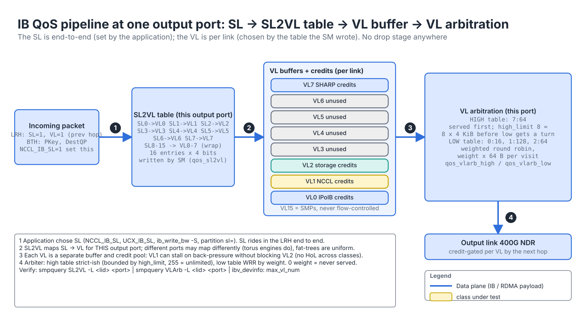
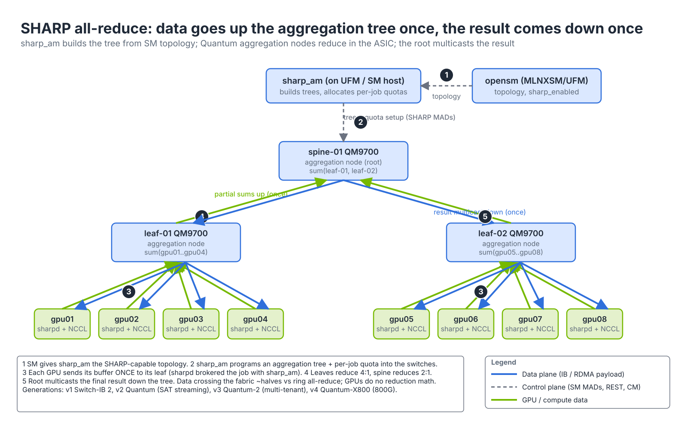

# Module 2.3 — InfiniBand QoS, Adaptive Routing and SHARP

> **Exam domain:** NVIDIA InfiniBand Networking (30%)  
> **Source course(s):** InfiniBand Network Administration (QoS and routing units); NVIDIA SHARP overview training  
> **Source docs:** NVIDIA Adaptive Routing Configuration Guide (MLNXSM); InfiniBand QoS chapter of the OpenSM/MLNXSM documentation; NVIDIA SHARP (Scalable Hierarchical Aggregation and Reduction Protocol) Deployment Guide; NCCL environment variable reference; Quantum-2 product documentation  
> **Estimated study time:** 5–7 hours

> **How to study this module:** read §1–§2, work through the §3 walkthrough on real gear or NVIDIA Air, then attempt the §5 hands-on assignment using only the Hint section. Open the Solution guide (last section) only after you have a working attempt. Finish with the Appendix C knowledge check closed-book.

## 1. Learning objectives

By the end of this module you will be able to…

- **Describe** Virtual Lanes, Service Levels, SL2VL mapping and VL arbitration and how together they deliver QoS in InfiniBand. *(IB Networking: QoS)*
- **Configure** QoS in `opensm.conf` and **select** the SL used by NCCL, UCX, perftest and IPoIB. *(IB Networking: QoS; Automation and Configuration)*
- **Contrast** IB credit-based flow control with RoCE's PFC and **explain** IB congestion control (CC/PCC). *(IB Networking vs Spectrum Networking)*
- **Describe** the problem **adaptive routing** solves, its modes and groups, and how out-of-order delivery is handled. *(IB Networking: routing)*
- **Enable** adaptive routing in MLNXSM/UFM and **verify** it with `smparquery` and `ibdiagnet`. *(IB Networking; Troubleshooting Tools)*
- **Describe** **SHARP** in-network aggregation: components, aggregation trees, and how NCCL uses it via CollNet. *(IB Networking; AI Data Center Design)*
- **Verify** SHARP with `sharp_hello` and nccl-tests and **read** the NCCL log to confirm it is in use. *(Troubleshooting Tools)*
- **Describe** SHIELD self-healing and fast link recovery and their dependency on AR. *(IB Networking)*

## 2. Key technical concepts

### 2.1 InfiniBand QoS building blocks

**Analogy:** think of a physical link as a motorway. A **VL** is a dedicated lane with its own on-ramp meter (credits). The **SL** is the sticker on the vehicle saying which kind of lane it is allowed to use — the sticker is applied at the factory (the sending application) and stays on for the whole journey. **SL2VL** is the sign at each junction saying "sticker 3 → lane 3". **VL arbitration** is the traffic officer at the merge deciding how many cars from each lane go through per cycle.

**What it is.** Ethernet QoS is about *classification* (DSCP/PCP) → *queues* (traffic classes) → *scheduling* (strict/WRR). InfiniBand has the same three stages with its own names, and — because the **SM** programs every port — it is configured once centrally rather than per switch. Figure 2.3-1 shows the pipeline at one output port.


*Figure 2.3-1 — SL → SL2VL → per-VL buffer and credits → VL arbitration → output link. No stage drops packets.*

- **Virtual Lanes (VLs).** A **VL** is a separate buffer and credit pool on a physical link. Each port supports up to 15 data VLs (VL0–VL14) plus **VL15**, which is reserved for subnet management traffic (SMPs) and is never flow-controlled. Real hardware supports fewer: ConnectX/Quantum ports are typically configured for 8 data VLs (`max_op_vls`). Because flow control is per VL, traffic on VL1 can stall without blocking VL0 — this is how IB avoids head-of-line blocking between classes and why deadlock-free routing engines (torus-2QoS) use VLs for loop breaking.
- **Service Levels (SLs).** The **SL** is a 4-bit field (0–15) in the Local Route Header. It is the *end-to-end* class marker chosen by the application when it creates a connection (via the path record from the SA or an explicit QP attribute). SL is to IB what DSCP is to IP: it travels with the packet across the whole subnet.
- **SL2VL mapping.** At each switch port (and HCA port), an **SL2VL table** maps the 16 SLs to the operational VLs on the *output* port. The SM programs these tables; the default is identity (SL n → VL n) truncated to the available VLs. Different ports can have different tables (e.g. a torus routing engine uses this to switch VLs mid-path), but in a fat-tree the mapping is uniform.
- **VL arbitration.** Each output port has a **VL arbitration table** with two sub-tables, **high priority** and **low priority**, plus a **high-limit** value:
  - Each entry is `VL:weight`. The arbiter scans the active table round-robin, letting a VL transmit up to `weight × 64 bytes` before moving on (weight 0 = skip; the exact byte granularity is an IB-spec detail — "verify in current docs" if asked precisely).
  - The **high-priority table** is served first. `high_limit` bounds how many high-priority bytes (in units of 4 KiB; 255 = unlimited) can be sent before the arbiter must service the low-priority table once, which prevents starvation.
  - Entries can repeat a VL to increase its share.

**Why it exists.** A GPU cluster carries traffic with very different needs on the same links: NCCL bulk transfers that want bandwidth, SHARP aggregation and small control messages that want latency, storage that must never be starved, and IPoIB management. Without classes, one 400 Gb/s all-reduce burst sits in front of everything else. Because IB is lossless, the failure mode is not drops but *blocking*: a congested class holding credits would stall every other class if they shared one buffer. Per-VL buffers and credits make the stall class-local; arbitration weights turn "class" into a bandwidth guarantee. Doing it in the SM rather than per switch means every port in the fabric agrees, which Ethernet operators achieve only with careful automation (Module 3.3).

**How it works.** Follow the numbered steps in Figure 2.3-1:

1. **Mark.** The sender's QP carries an SL (from the SA path record, `NCCL_IB_SL`, `ib_write_bw -S`, or the partition's `sl=`). The HCA writes it into the 4-bit **SL** field of the 8-byte LRH, and writes the 4-bit **VL** field from its *own* SL2VL table. SL never changes in flight.
2. **Map per hop.** At every switch the packet is classified by SL and the **output** port's SL2VL table picks the VL for the next link. The switch rewrites the LRH VL field — which is why the per-hop **VCRC** (16-bit, covers the LRH and changes every hop) is recomputed, while the end-to-end **ICRC** (32-bit) is not (it treats VL as invariant).
3. **Queue and credit.** The packet waits in that VL's buffer until the downstream receiver has granted credits on that VL (§2.3). A VL with no credits is simply ineligible; the others are not affected.
4. **Arbitrate.** When the port is free, the arbiter walks the high table (up to 64 entries; each weight is 8 bits, 0–255, in 64-byte units), letting each listed VL with data and credits send up to its weight; after `high_limit × 4 KiB` of high-priority data it must serve one low-table entry. The low table is a weighted round-robin among its entries. VL15 bypasses arbitration and is always served first.

So: SL picks the class, SL2VL picks the queue, VLArb decides bandwidth share and priority. Note there is no "drop" anywhere — IB QoS shapes who goes first, not who gets discarded. Observe the programmed state with `smpquery SL2VL -L <lid> <port>` and `smpquery VLArb -L <lid> <port>`; on the HCA, `ibv_devinfo -v` shows `max_vl_num`.

**Failure modes.** `qos FALSE` (or a stock SM ignoring the keys) leaves identity SL2VL and all-equal arbitration, so two SLs share bandwidth 1:1 regardless of intent (§4.1). An SL that maps to a VL above `qos_max_vls` lands on a truncated VL — often VL0 — silently merging classes. A high-table VL with `high_limit 255` and continuous traffic starves the low table completely.

**Why the exam cares:** "SL is end-to-end and application-chosen; VL is per-link and table-chosen" is tested directly, as is the strict-priority behaviour of the high table with `high_limit 255`.

### 2.2 Expressing QoS in opensm.conf

**What it is.** OpenSM/MLNXSM has a simple global QoS block plus optional per-port-type overrides (`qos_ca_*`, `qos_sw0_*`, `qos_swe_*`, `qos_rtr_*` for HCA ports, switch port 0, switch external ports, routers). The policy that *assigns* SLs to flows lives in a separate `qos-policy.conf` file (or is left to applications).

```text
# ---- /etc/opensm/opensm.conf : QoS section ----
qos TRUE                         # master switch; FALSE leaves defaults and ignores the rest
qos_max_vls 8                    # operational data VLs to use (<= hardware max)
qos_high_limit 255               # high-priority byte limit before low table gets a turn (255 = unlimited)

# High-priority arbitration table: VL:weight pairs
qos_vlarb_high 0:0,1:0,2:0,3:0,4:0,5:0,6:0,7:255
# Low-priority table: share bandwidth among VL0..VL6
qos_vlarb_low  0:64,1:32,2:32,3:16,4:16,5:16,6:16,7:0

# SL -> VL map (16 entries, one per SL)
qos_sl2vl 0,1,2,3,4,5,6,7,0,1,2,3,4,5,6,7

# Optional: the policy file that maps QPs/ULPs/PKeys/ports to SLs
qos_policy_file /etc/opensm/qos-policy.conf
```

**Why it exists.** Two different people own QoS: the fabric team decides *what each class gets* (VL tables, the same on every port of a given type), and the application owner decides *which class a flow belongs to* (the SL). Keeping the port tables in `opensm.conf` and the SL assignment in applications or `qos-policy.conf` keeps those decisions separate — and lets one SM restart push identical tables to thousands of ports.

**How it works.** Reading the example: SL7→VL7 is placed only in the high table with a large weight, so anything sent on SL 7 (e.g. latency-sensitive control traffic or SHARP aggregation traffic) pre-empts everything else; SL0–SL6 share bandwidth on the low table with VL0 getting the largest weight. In GPU clusters a very common simpler design is two classes: default compute traffic on SL0 and storage on SL1 with a smaller weight, or NCCL on one SL and SHARP on another.

The arithmetic of the low table is simple proportional sharing among *backlogged* VLs: with weights VL1:128 and VL2:64 both busy on one 400G link, VL1 gets 128/(128+64) ≈ 2/3 (~260 Gb/s) and VL2 ≈ 1/3 (~130 Gb/s); if VL2 goes idle, VL1 takes the whole link — weights are minimum shares, not caps. At start-up and on every heavy sweep the SM sends `SubnSet(SLtoVLMappingTable)` and `SubnSet(VLArbitrationTable)` (the latter in four 32-entry blocks: low 0–31, low 32–63, high 0–31, high 32–63) to every port, using the per-port-type override if present.

**How applications select an SL** — because the SL rides with the connection, the host stack chooses it:

| Stack | How to set SL |
|---|---|
| **NCCL** | `NCCL_IB_SL=<0-15>` (default 0). All NCCL IB QPs use this SL; also `NCCL_IB_TC` for RoCE traffic class |
| **UCX** (OpenMPI, NVSHMEM over UCX) | `UCX_IB_SL=<n>` |
| **perftest** | `ib_write_bw -S <sl>` / `ib_write_lat -S <sl>` (`--sl`) |
| **RDMA CM** applications | SL taken from the SA path record; policy can be set in `qos-policy.conf` by PKey, ULP or service ID; or `rdma_set_option(..., RDMA_OPTION_ID_TOS)` maps to SL via `cma_roce_tos`-style mapping on RoCE |
| **IPoIB** | `sl=` in the partition definition (partitions.conf) |

A quick functional test of QoS: run two `ib_write_bw` streams on different SLs across the same oversubscribed link and compare throughput against the configured weights (§3 Step 4).

### 2.3 Flow control and congestion control in IB

**Analogy:** credit-based flow control is a parking garage that only opens the gate when a space has actually freed up — a car can never be turned away at the top of a full ramp. **PFC** on Ethernet is a red light at the ramp that someone switches on when the garage is nearly full and hopes the cars already on the ramp fit in the remaining space (headroom). Congestion control is the radio message telling drivers across the city to slow down because one garage is filling.

**What it is.** Two separate mechanisms. **Credit-based flow control** is a link-level, per-VL protocol between neighbours that makes buffer overflow impossible. **Congestion control** (IB CC, and NVIDIA's programmable PCC) is an end-to-end mechanism that slows the *sources* of a hot spot. Figure 2.3-2 contrasts the link-level part with Ethernet PFC.


*Figure 2.3-2 — IB grants before sending (proactive, per VL); PFC stops after sending (reactive, per priority) and needs headroom.*

**Why it exists.** RDMA transports recover from loss expensively (go-back-N retransmission, Module 3.2), so the fabric must not drop under congestion. IB's designers made losslessness a property of the link itself rather than something you configure. But pure back-pressure has a cost: **congestion spreading**: a slow receiver throttles the link into its leaf, which fills, throttles the spine, and so on ("tree saturation" / victim flows). Congestion control exists to counter this by slowing only the flows that cause the hot spot.

**How it works — credits (steps ① and ② of Figure 2.3-2).** On every link, for every data VL, the receiver advertises **credits** (free buffer in 64-byte units) to the transmitter in flow-control packets. The transmitter may only send what fits. There is no equivalent of "send and hope" followed by pause frames; buffer overflow simply cannot happen at the link level.

- The transmitter keeps **FCTBS** (Flow Control Total Blocks Sent, 12-bit, counting 64-byte blocks); the receiver returns **FCCL** (Flow Control Credit Limit, 12-bit) = blocks received so far plus free blocks. Available credit is `(FCCL − FCTBS) mod 4096`; a packet may be sent only if its block count fits.
- Flow-control packets are small link packets sent per VL periodically and whenever buffer frees up (the spec bounds the interval; verify the exact figure if asked). They are not routed and never leave the link.
- **Buffer sizing.** To keep a link at line rate, each VL's receive buffer must cover the credit round trip: bandwidth × (2 × propagation + processing). At 400 Gb/s over 100 m of fibre (~5 ns/m) that is 400 Gb/s × ~1 µs ≈ 50 KB per VL. A smaller buffer does not lose packets — it just cannot sustain line rate over long cables, which is why IB long-haul links need deep-buffer switches. Compare PFC headroom (Module 3.3): the same math, but on Ethernet too little headroom means *drops*.

Consequences:

- Loss in an IB fabric comes only from *bit errors* (bad cables; packets fail CRC and are dropped, visible as `PortRcvErrors`/`SymbolErrors`) or from *lifetime/HoQ time-outs* when a packet sits too long at the head of a queue (`PortXmitDiscards`). The head-of-queue lifetime is per port (`HOQLife`, 4.096 µs × 2^n), set by the SM; it is the IB safety valve that breaks a credit deadlock by discarding.
- Compare RoCE ([Module 3.3](../03-rdma/03-roce-a-to-z.md)): Ethernet is lossy by default and needs **PFC** (802.1Qbb) configured on every hop and every host to approximate losslessness, plus careful buffer headroom math. IB gives you that for free and on a per-VL basis.
- Observe it with **`PortXmitWait`** (ticks during which the port had data on some VL but no credit to send it): the direct measurement of back-pressure, readable with `perfquery -x` or UFM Telemetry.

**How it works — IB congestion control (CC) and PCC.** The IB specification defines a **Congestion Control** mechanism: switches mark packets with a FECN bit when a port's queue crosses a threshold; the destination HCA returns BECN; the source HCA reduces its injection rate for that flow using a per-QP rate table (CCT). The SM distributes the CC parameters (`congestion_control` settings; MLNXSM has a `ccmgr`/congestion-control manager — parameter names "verify in current docs"). Mechanically: FECN and BECN are single bits in the BTH; each BECN raises the flow's index into the Congestion Control Table (CCTI), each entry of which encodes an inter-packet delay, and a timer decays the index back down when marking stops — a multiplicative-slowdown, gradual-recovery loop very similar in shape to DCQCN.

Quantum-2 and ConnectX-7 introduce **Programmable Congestion Control (PCC)** — the congestion algorithm runs on firmware-programmable engines in the HCA, so NVIDIA can ship improved algorithms (and customers can tune them) without new silicon. NVIDIA refers to the Quantum-2-era HCA algorithm as **ZTR** (Zero-Touch RoCE on the Ethernet side; on IB the same PCC infrastructure runs NVIDIA's IB congestion algorithm). For the exam: know that CC is end-to-end rate limiting triggered by switch marking, that it complements (does not replace) credit-based FC, and that PCC makes it programmable in the NIC firmware. **DCQCN** is the RoCE analogue and is covered in Module 3.3.

**Why the exam cares:** "IB does not need PFC or ECN" (credits are intrinsic), "`PortXmitWait` = congestion, not errors", and "CC complements credit flow control" are recurring distractor pairs.

### 2.4 Adaptive Routing

**Analogy:** static routing is a GPS that always sends you up the same motorway on-ramp regardless of traffic. **Adaptive routing** lets each junction glance at the queue on each equivalent on-ramp and send your car up the emptiest one. The price: cars from the same convoy may arrive out of order, so the destination has to be able to re-assemble them.

**What it is.** **Adaptive routing** lets the switch choose, per packet, among a *group* of equivalent output ports based on their current queue occupancy (local congestion). Figure 2.3-3 shows the static failure case next to the AR fix.


*Figure 2.3-3 — Static LFT collision vs adaptive routing: ① the AR group on the leaf, ② per-packet uplink choice, ③ out-of-order placement at the receiving HCA.*

**Why it exists — static routing in a Clos.** With `ftree`, every destination LID has exactly one output port at each switch (the LFT is a static table). Traffic from many sources to a spine is spread by *destination*, not by *flow*. Two heavy flows whose destinations happen to map to the same uplink will share it even though a sibling uplink is idle. In AI training with a handful of very large "elephant" flows per GPU (NCCL rings/trees), these collisions are frequent and cost 20–40 % of achievable all-reduce bandwidth on a statically routed fabric. The same phenomenon on Ethernet is ECMP hash collision, which Spectrum-X addresses with its own adaptive routing (Module 4.1).

**How it works.** Components, matching the numbers in Figure 2.3-3:

- **① AR groups** — for each destination, the set of ports that are valid next hops (in a fat-tree: all uplinks leading toward a spine that can reach the destination). The SM computes these and programs an **AR LFT** (ARLFT) and **AR group table** into Quantum switches, in addition to the regular LFT. Each ARLFT entry holds the destination's *group number*, its *mode*, and a default port (used when AR is off or the group is unusable); each group-table entry is a bitmask of member ports. Many destinations share one group (on a leaf every remote host typically maps to "all uplinks"), so the group table is small compared with the 48K-entry LFT — `smparquery ARInfo` reports group capacity and usage.
- **② Per-packet choice** — for a packet whose destination has an active AR entry, the ASIC looks up the group and picks the member port with the lowest egress queue occupancy (subject to the mode). The decision is local and takes nanoseconds; no SM involvement after programming.
- **AR modes** per destination/entry:
  - **Static** — behave like the normal LFT (no AR for this destination).
  - **Free** — pick the least-loaded port in the group for every packet; maximum balancing, maximum reordering.
  - **Bounded** — "sticky" selection: keep using the same port for a flow while it is not congested, move only when its queue crosses a threshold; a compromise that limits reordering. Also called *limited* in some docs.
  - (Quantum-2 docs also describe time-bound / "fast" variants; verify names in the AR guide for your MLNXSM version.)
- **③ Out-of-order handling** — packets of one RC connection may now arrive out of order. ConnectX-5 and later HCAs support **out-of-order RDMA** (OOO) for RC and UD: the receiver places RDMA WRITE/READ data directly by address and tolerates reordering within a window, so the transport does not retransmit. SENDs with ordering semantics are more constrained, which is why AR is typically enabled for RC and UD transports and the HCA advertises the capability (`enable_ar_by_device_cap`). The SM records which SLs are allowed to be reordered in the **OOO SL mask**. Without OOO support a reordered PSN looks like loss: the responder NAKs with a PSN sequence error and the requester go-back-N retransmits — AR would then *reduce* throughput.
- **SM controls.** `ar_sl_mask` (16-bit, one bit per SL) selects which SLs get AR; `ar_transport_mask` selects transports (bit1 = RC, bit3 = UD). The routing engine must be AR-capable (`ar_ftree` in MLNXSM/UFM); stock OpenSM `ftree` writes only static LFTs.

**AR and NCCL.** NCCL benefits strongly from AR on IB. Relevant knobs:

- **`NCCL_IB_AR_THRESHOLD`** — message size (bytes, default 8192) above which NCCL uses RDMA operations compatible with adaptive routing (large messages are sent so the receiver can tolerate reordering; smaller ones stay on the ordered path). Lower it to push more traffic onto AR, raise it to reduce AR use. Only meaningful on IB with AR enabled.
- **`NCCL_IB_SL`** must be an SL present in `ar_sl_mask` for NCCL traffic to be adaptively routed.
- **`NCCL_IB_QPS_PER_CONNECTION`** / **`NCCL_IB_SPLIT_DATA_ON_QPS`** — spreading a connection over multiple QPs is an older way of fighting static hash collisions; with AR it is usually unnecessary and left at 1.

**Failure modes and how to observe them.** Symptom of AR being *off* on a large NDR fabric: nccl-tests all-reduce bus bandwidth plateaus well below line rate (e.g. 250–300 Gb/s per GPU instead of ~390 Gb/s on NDR) with high `PortXmitWait` on some spine uplinks and near-zero on others — the signature of hash collisions. `smparquery ARInfo` showing `AR Status: disabled` despite `ar_mode` set means the engine fell back (bad `root_guid_file`, non-fat-tree wiring — check the SM log for "falling back to minhop"). Rising `out_of_sequence`/`packet_seq_err` counters on hosts with AR on means an SL is in `ar_sl_mask` for traffic whose HCA or transport cannot reorder.

**Why the exam cares:** AR requires MLNXSM/UFM and Quantum switches (stock OpenSM `ftree` is static), `ar_sl_mask` controls which SLs may be reordered, and `NCCL_IB_AR_THRESHOLD` is a message size — not an on/off switch.

### 2.5 SHARP: in-network aggregation

**Analogy:** without SHARP, 1,000 students each mail their exam score to every other student and everyone adds them up. With **SHARP**, each student hands their score to the teacher at the front of their row, the row teachers hand subtotals to the head teacher, and the head teacher announces one total. The switch does the math.

**What it is.** **SHARP** (Scalable Hierarchical Aggregation and Reduction Protocol) moves the reduction into the Quantum switch ASICs: each GPU sends its data *once* up an aggregation tree; switches sum (or min/max/etc.) the data on the way up; the root sends the result back down once. Figure 2.3-4 shows the data path; Figure 2.3-5 shows the software pieces that must all be present.


*Figure 2.3-4 — SHARP all-reduce: ① topology from the SM, ② tree and quota set up by sharp_am, ③ each GPU sends once, ④ leaves reduce and forward partial sums, ⑤ the root multicasts the result.*

Generations: SHARPv1 (Switch-IB 2, small-message/latency focus), SHARPv2 (Quantum: large-message streaming aggregation, "SAT" — Streaming Aggregation Trees), SHARPv3 (Quantum-2: multiple tenants/jobs at once, larger payloads), SHARPv4 (Quantum-X800: 800G, further scaling).

| Component | Runs on | Role |
|---|---|---|
| **sharp_am** (Aggregation Manager) | A management host — typically the **UFM** server or the SM host | Discovers SHARP-capable switches (via the SM), builds **aggregation trees** over the fabric topology, allocates per-job tree resources, manages quotas |
| **sharpd** (SHARP daemon) | Every compute host | Local agent; brokers job/communicator requests from the application library to sharp_am over the fabric; part of the `sharp` package in MLNX_OFED/DOCA |
| **libsharp / libsharp_coll** | Linked into the application via a plugin | The client library; NCCL uses it through the **NCCL SHARP (CollNet) plugin**, MPI through HCOLL/UCC |
| **Switch SHARP engine** | Quantum ASIC | Executes the reductions; one or more "aggregation nodes" per switch with finite buffer and group resources |
| SM | — | Must be MLNXSM/UFM with SHARP support enabled (`sharp_enabled`/UFM "SHARP" toggle); provides topology to sharp_am |

**Why it exists.** A ring or tree all-reduce across N GPUs moves each byte of the result roughly 2×(N−1)/N times across the network and makes every GPU do reduction arithmetic. For an S-byte buffer, a ring all-reduce has every GPU send and receive about 2S×(N−1)/N bytes — almost 2S at scale — in 2(N−1) sequential steps, each paying a network latency. With SHARP each GPU sends S once and receives S once, the number of sequential steps is the tree depth (2–3 switch levels), and the GPU's streaming multiprocessors do no reduction math. Benefits: roughly half the data crossing the fabric, lower and far more predictable latency, and GPU SMs freed from reduction work. It is the main reason InfiniBand still posts better all-reduce numbers than equivalently sized Ethernet fabrics for some collective patterns.

**How it works — data path (Figure 2.3-4).**

1. **Topology.** The SM (MLNXSM/UFM with SHARP enabled) gives `sharp_am` the discovered topology and which switches are SHARP-capable.
2. **Tree and quota.** `sharp_am` builds aggregation trees — in a fat-tree typically rooted at a spine — and, when a job registers, allocates it a tree plus per-switch resources (aggregation-node buffers, group/outstanding-operation slots) using SHARP MADs. These resources are finite per ASIC; SHARPv3 lets several jobs share a switch at once.
3. **Send once.** Each rank's buffer goes from its HCA to the leaf's aggregation node as RDMA traffic on the SHARP SL/VL (by convention a dedicated class so bulk traffic cannot starve it — VL7 in Figure 2.3-1).
4. **Reduce up.** Each aggregation node waits for all of its children for a given chunk, applies the operation (sum/min/max…, fp32/fp16/bf16) in the ASIC, and forwards one partial result upward — 4:1 at the leaves and 2:1 at the spine in the figure. Large messages are pipelined through the tree in chunks (streaming aggregation, SAT); small messages use the low-latency path.
5. **Multicast down.** The root sends the final result back down the same tree; each switch replicates it to its children, so every rank receives it once.

**How it works — control path (Figure 2.3-5).**


*Figure 2.3-5 — All four pieces must be present or NCCL silently falls back to Ring/Tree: plugin + `NCCL_COLLNET_ENABLE=1`, sharpd, sharp_am, SHARP enabled in the SM.*

1. NCCL (with `NCCL_COLLNET_ENABLE=1`) loads the CollNet plugin (`libnccl-net.so` from the SHARP package) and asks for a CollNet communicator.
2. libsharp_coll talks to the local `sharpd`.
3. `sharpd` sends the job/tree request to `sharp_am` in-band.
4. `sharp_am` already has topology from the SM.
5. `sharp_am` programs the aggregation nodes for this job.
6. Data flows on the SHARP SL/VL; NCCL logs `Connected CollNet` and channels `via COLLNET/SHARP`.

Prerequisites for NCCL: Quantum or newer switches, SHARP-capable HCAs (ConnectX-6+), MLNXSM/UFM with SHARP enabled, `sharp` packages installed on hosts, `sharpd` running on every compute host, `sharp_am` running on the UFM/SM host, the NCCL SHARP plugin on the library path and `NCCL_COLLNET_ENABLE=1`. NCCL will only use SHARP when the job spans multiple nodes and the CollNet plugin loads successfully. SHARP uses its own SL and QoS class by convention (so aggregation traffic is not starved by bulk traffic); UFM/MLNXSM expose `sharp_sl`-style settings — verify names in the SHARP deployment guide.

**Failure modes and how to observe them.** Any missing piece produces the same symptom: NCCL logs `Connected all rings` but never `Connected CollNet`, and bus bandwidth is identical with and without `NCCL_COLLNET_ENABLE=1` (§4.3). Test bottom-up: `sharp_hello -d mlx5_0:1` proves sharpd ↔ sharp_am ↔ switch; then nccl-tests with `NCCL_DEBUG=INFO`; `/var/log/sharp_am.log` shows tree builds and rejected jobs (for example, resources exhausted because too many jobs hold trees). A version mismatch between `sharp_am` and host `libsharp` also fails registration.

**Why the exam cares:** the four-part checklist (sharp_am + sharpd + CollNet plugin + `NCCL_COLLNET_ENABLE=1`) and "SHARP reduces data movement for collectives, not point-to-point RDMA".

### 2.6 SHIELD and fast link recovery

**What it is.** **SHIELD** (Self-Healing Interconnect Enhancement for inteLligent Datacenters) is a Quantum-family switch feature that lets switches react to a link failure *locally* instead of waiting for the SM. **Fast link recovery / Fast Link-Up** on Quantum-2 reduces the time for a flapping link to return to Active.

**Why it exists.** Normally a link failure → trap to SM → SM re-sweep and new LFTs → fabric repaired in hundreds of milliseconds to seconds (longer on huge fabrics). During that window flows routed over the dead link stall; RC QPs on those flows burn through `retry_cnt` × ACK timeout and, if the window is long enough, fail with `IBV_WC_RETRY_EXC_ERR` — killing a training job over a cable hiccup.

**How it works.**

- With SHIELD, when a switch detects a port down it immediately re-routes affected destinations onto an alternative port from the AR group (or a pre-computed backup), informing neighbours as needed, in roughly a millisecond (NVIDIA quotes ~5,000× faster than SM-driven recovery). The SM still recomputes the global solution afterwards.
- SHIELD therefore depends on AR groups being available — enable AR first. In MLNXSM/UFM it is a toggle alongside AR (`shield_mode` or the "SHIELD" option in UFM; "verify in current docs").
- Recovery in ~1 ms is far inside a typical RC ACK timeout (NCCL's default `NCCL_IB_TIMEOUT` gives an ACK timeout on the order of a second or more — 4.096 µs × 2^timeout, Module 3.2), so the transport sees at most a retransmission, not a fatal error.

Together with UFM's auto-isolation of repeatedly flapping ports, these features turn a cable hiccup that used to kill a NCCL job into a brief slowdown.

**Why the exam cares:** SHIELD = local, switch-driven reroute using AR groups; it needs AR enabled; the SM still reconverges afterwards.

## 3. Live-style walkthrough: QoS, AR and SHARP on a 2-node NDR lab

Lab: `nodeA` and `nodeB`, 8 GPUs each, one ConnectX-7 NDR HCA per GPU (`mlx5_0`…`mlx5_7`), two Quantum-2 leaves and two spines, host-based MLNXSM on `mgmt01`. Goal: NCCL on SL1 with a guaranteed share, storage on SL2, AR on, SHARP on.

### Step 1 — Configure QoS in opensm.conf

You are about to fill in the tables of Figure 2.3-1: SL2VL (step ②) and the two arbitration tables (step ④).

```bash
mgmt01$ sudo tee -a /etc/opensm/opensm.conf <<'EOF'
# ---------------- QoS ----------------
qos TRUE                                   # turn on SM QoS programming (SL2VL + VLArb on every port)
qos_max_vls 8                              # 8 data VLs — the usual ConnectX/Quantum operational max
qos_high_limit 255                         # unlimited high-table bursts (we keep the high table nearly empty, so safe)
# High table: only VL7 (we reserve SL7/VL7 for SHARP aggregation traffic so it is never starved)
qos_vlarb_high 0:0,1:0,2:0,3:0,4:0,5:0,6:0,7:64
# Low table: VL1 (NCCL) gets 2x the weight of VL2 (storage); VL0 (default/IPoIB) a small share
qos_vlarb_low  0:16,1:128,2:64,3:0,4:0,5:0,6:0,7:0
# Identity SL->VL for 0-7, wrapping 8-15 back onto 0-7
qos_sl2vl 0,1,2,3,4,5,6,7,0,1,2,3,4,5,6,7
EOF
```

### Step 2 — Enable adaptive routing (MLNXSM)

This turns the left panel of Figure 2.3-3 into the right one: the SM computes AR groups (①), the ASIC spreads packets (②), and `enable_ar_by_device_cap` makes sure only HCAs that can reorder (③) receive AR traffic.

```bash
mgmt01$ sudo tee -a /etc/opensm/opensm.conf <<'EOF'
# ---------------- Adaptive routing ----------------
routing_engine ar_ftree             # AR-capable fat-tree engine (requires MLNXSM, not stock OpenSM)
adv_routing_engine auto             # pick the advanced engine matching routing_engine
ar_mode 3                           # 0 = disabled, 1 = enabled, 2 = enabled + notifications, 3 = let engine decide (recommended)
ar_sl_mask 0xFFFA                   # SLs allowed to be reordered: all EXCEPT SL0 and SL2 (bit0, bit2 clear)
                                    #   -> NCCL on SL1 gets AR; storage on SL2 and IPoIB on SL0 stay strictly ordered
ar_transport_mask 0x000A            # transports with AR: bit1 = RC, bit3 = UD (0x000A = RC+UD)
enable_ar_by_device_cap TRUE        # only enable AR toward HCAs that advertise out-of-order support
root_guid_file /etc/opensm/root_guid.cfg   # spine GUIDs, one per line — makes ftree deterministic
EOF
mgmt01$ sudo systemctl restart opensm
mgmt01$ journalctl -u opensm | grep -iE "ar_ftree|SUBNET UP|qos"     # expect the engine name and SUBNET UP, no "falling back to minhop"
```

In **UFM**, the same settings are under Settings → Subnet Manager → Adaptive Routing (and `routing_engine = ar_ftree` in `gv.cfg`); UFM writes them into its generated opensm.conf.

### Step 3 — Verify QoS and AR from a host

```bash
nodeA$ ibswitches -C mlx5_0                                   # LIDs of the four switches
Switch : 0x0c42a10300e4f3a0 ports 64 "leaf-01" ... lid 1 lmc 0
Switch : 0x0c42a10300e4f3b0 ports 64 "leaf-02" ... lid 2 lmc 0
Switch : 0x0c42a10300e4f3c0 ports 64 "spine-01" ... lid 3 lmc 0
Switch : 0x0c42a10300e4f3d0 ports 64 "spine-02" ... lid 4 lmc 0

nodeA$ smparquery ARInfo -L 1 -C mlx5_0                       # MLNXSM private attribute query to leaf-01
# Look for:  AR Status: enabled        <- AR is programmed into this switch
#            Group cap / group top     <- how many AR groups the ASIC supports / are in use
#            ... modes per table       <- free / bounded / static assignments
# "AR Status: disabled" here with ar_mode 3 in opensm.conf = the engine fell back (bad root_guid_file or non-fat-tree wiring).

nodeA$ smpquery SL2VL -L 1 1 -C mlx5_0                        # SL2VL table on leaf-01 port 1 (host-facing)
# Expect  0 1 2 3 4 5 6 7 0 1 2 3 4 5 6 7  — identity, matching qos_sl2vl
nodeA$ smpquery VLArb -L 1 1 -C mlx5_0                        # VL arbitration tables
# High: VL7:64 ...     Low: VL0:16, VL1:128, VL2:64 ...  — matches the weights we wrote. If all 0s, qos was FALSE.

nodeA$ ibdiagnet                                              # full sweep; writes /var/tmp/ibdiagnet2/
nodeA$ grep -A1 OOOSLMask /var/tmp/ibdiagnet2/ibdiagnet2.db_csv | head
# per-port OOO SL mask. 0xfffa = SLs 1,3-15 may be reordered; SL0 and SL2 strictly ordered. Confirms ar_sl_mask.
```

### Step 4 — Prove the QoS weights with perftest

```bash
# Two streams through the same leaf->spine uplink. Server side on nodeB (two instances, different TCP ports):
nodeB$ ib_write_bw -d mlx5_0 -S 1 -q 4 -D 20 -F --report_gbits -p 18515 &    # -S 1 = SL1 (NCCL class)
nodeB$ ib_write_bw -d mlx5_0 -S 2 -q 4 -D 20 -F --report_gbits -p 18516 &    # -S 2 = SL2 (storage class)
# Client side on nodeA, started together:
nodeA$ ib_write_bw -d mlx5_0 -S 1 -q 4 -D 20 -F --report_gbits -p 18515 nodeB &
nodeA$ ib_write_bw -d mlx5_0 -S 2 -q 4 -D 20 -F --report_gbits -p 18516 nodeB
# Alone, each would hit ~390 Gb/s. Competing on one 400G link with weights 128:64 you expect roughly 2:1,
# e.g. ~255 Gb/s on SL1 and ~130 Gb/s on SL2. If you see ~195/195, the VLArb tables were not applied (qos FALSE,
# or SM is stock OpenSM without the right qos_* keys, or both streams landed on the same VL via a wrong SL2VL).
```

### Step 5 — SHARP services

Check the control path of Figure 2.3-5 from the top down: `sharp_am` (steps ④–⑤), then `sharpd` and `sharp_hello` (steps ②–③), then the plugin files (step ①).

```bash
# On the AM host (UFM server or SM host):
mgmt01$ systemctl status sharp_am                 # active (running). In UFM: Settings -> Subnet Manager -> SHARP = enabled
mgmt01$ sharp_am -v                               # version; must match the sharpd/libsharp version on hosts
mgmt01$ tail -f /var/log/sharp_am.log             # watch "tree built"/"job registered" lines later

# On every compute host:
nodeA$ systemctl status sharpd                    # active (running) — local broker to sharp_am
nodeA$ sharp_hello -d mlx5_0:1                    # the smallest end-to-end test: reach sharp_am, create a trivial group
#  Expect  "Test Passed" (or similar). Failure = sharpd not running, sharp_am unreachable, or SHARP disabled in SM.
nodeA$ ls /opt/mellanox/sharp/lib/                # libsharp.so, libsharp_coll.so — the client library
nodeA$ ls $(dirname $(ldconfig -p | grep libnccl-net | head -1 | awk '{print $NF}'))   # NCCL net plugin location (libnccl-net.so)
```

### Step 6 — Run nccl-tests with NCCL_IB_SL and SHARP, and read the log

```bash
nodeA$ mpirun -np 16 -H nodeA:8,nodeB:8 \
   -x NCCL_IB_HCA=mlx5 \                          # use all mlx5_* IB devices
   -x NCCL_IB_SL=1 \                              # NCCL traffic on SL1 -> VL1 (weight 128), in ar_sl_mask -> adaptively routed
   -x NCCL_IB_AR_THRESHOLD=8192 \                 # default; messages >= 8 KiB use AR-tolerant RDMA ops
   -x NCCL_COLLNET_ENABLE=1 \                     # enable the CollNet (SHARP) algorithm family
   -x NCCL_ALGO=CollnetDirect,CollnetChain,Ring,Tree \   # optional; let NCCL choose among these
   -x LD_LIBRARY_PATH=/opt/mellanox/sharp/lib:$LD_LIBRARY_PATH \   # plugin + libsharp must be findable
   -x SHARP_COLL_ENABLE_SAT=1 \                   # streaming aggregation trees for large messages
   -x SHARP_COLL_LOG_LEVEL=3 \
   -x NCCL_SHARP_GROUP_SIZE_THRESH=2 \            # min ranks/node for SHARP use (verify default for your plugin)
   -x NCCL_DEBUG=INFO \                           # we need the log lines below
   ./build/all_reduce_perf -b 8 -e 8G -f 2 -g 1   # 8 B -> 8 GiB, doubling, one GPU per rank
```

What to look for in the log (annotated):

```text
nodeA:1234:1234 [0] NCCL INFO NET/IB : Using [0]mlx5_0:1/IB [1]mlx5_1:1/IB ...   # IB transport selected, all 8 HCAs
nodeA:1234:1234 [0] NCCL INFO NET/IB : Using SL 1                                  # <-- NCCL_IB_SL honoured (string varies by version)
nodeA:1234:1234 [0] NCCL INFO Plugin Path : /opt/mellanox/sharp/lib/libnccl-net.so # <-- CollNet/SHARP plugin loaded
nodeA:1234:1234 [0] NCCL INFO Connected all rings
nodeA:1234:1234 [0] NCCL INFO Connected CollNet                                     # <-- SHARP tree is set up for this communicator
nodeA:1234:1234 [0] NCCL INFO Channel 00/0 : 0[0] -> 1[1] via COLLNET/SHARP        # <-- collectives will run through the switch
#
#       size     count    type  redop    root     time   algbw   busbw  #wrong     time   algbw   busbw  #wrong
#        (B)  (elements)                        (us)  (GB/s)  (GB/s)            (us)  (GB/s)  (GB/s)
#   134217728    33554432   float    sum      -1   1830.2   73.33  137.5       0   ...
#   ...
# Compare busbw with and without -x NCCL_COLLNET_ENABLE=1. On a healthy 2-node NDR setup SHARP visibly improves
# large-message all-reduce and especially small/medium-message latency. Identical numbers + no "COLLNET" line
# = plugin did not load or sharp_am rejected the job: check /var/log/sharp_am.log and sharpd logs.
```

The `Connected CollNet` line is step ⑥ of Figure 2.3-5; the busbw gain is the halved data movement of Figure 2.3-4. While it runs, `perfquery -x <spine-lid> <port>` on each spine uplink (or UFM Telemetry) should show `PortXmitWait` spread evenly across uplinks — the AR signature. One hot uplink and three idle ones means AR is not in effect for SL1.

## 4. Troubleshooting / common gotchas

### 4.1 QoS configured, but both SLs get equal bandwidth

**Symptom:** the two-stream perftest in §3 Step 4 shows ~195/195 Gb/s instead of the 2:1 split.

**Why it happens:** `qos FALSE` (the master switch) left at default, the VLArb lines were added under the wrong key names, or the SM is a stock OpenSM build whose QoS keys differ; alternatively `qos_sl2vl` maps both SLs onto the same VL so the arbiter never sees two queues.

**How to debug:**

```bash
grep -E "^qos" /etc/opensm/opensm.conf                 # qos TRUE present? no typos in qos_vlarb_low?
smpquery VLArb -L <leaf-lid> <port> -C mlx5_0          # are the weights actually programmed on the port?
smpquery SL2VL -L <leaf-lid> <port> -C mlx5_0          # does SL1 -> VL1 and SL2 -> VL2?
journalctl -u opensm | grep -i qos                     # parser complaints about unknown keys
```

**Fix:** set `qos TRUE`, correct the key names/values, restart or SIGHUP opensm, and re-query the tables before re-running perftest.

### 4.2 AR "enabled" in opensm.conf but `smparquery ARInfo` says disabled

**Symptom:** `ar_mode 3` and `routing_engine ar_ftree` are set, yet switches report `AR Status: disabled`; NCCL bus bandwidth still shows the hot-uplink pattern.

**Why it happens:** `ar_ftree` could not validate the topology as a fat-tree (miswired or missing `root_guid_file`) and fell back to `minhop`, which does not program AR groups; or the SM binary is stock OpenSM, which has no `ar_*` engines at all; or the HCAs do not advertise OOO capability and `enable_ar_by_device_cap TRUE` disabled AR toward them.

**How to debug:**

```bash
journalctl -u opensm | grep -iE "ar_ftree|fallback|minhop|root"    # "falling back" lines name the cause
opensm --version                                                   # MLNXSM / "Mellanox" build string vs plain OpenSM
ibdiagnet ; grep -i "AR" /var/tmp/ibdiagnet2/ibdiagnet2.log | head # AR-related warnings per switch
ibv_devinfo -v -d mlx5_0 | grep -i ooo                             # out-of-order capability (field name varies; verify)
```

**Fix:** install MLNXSM (ships with DOCA-OFED / UFM), populate `root_guid_file` with the spine GUIDs from `ibswitches`, fix any miscabled links reported by ibdiagnet, update HCA firmware, restart the SM, re-query `ARInfo`.

### 4.3 nccl-tests shows no "COLLNET" and SHARP makes no difference

**Symptom:** `NCCL_COLLNET_ENABLE=1` is set; log shows rings and trees only; `busbw` is identical with and without the flag.

**Why it happens:** one of the four pieces is missing — `sharp_am` not running or SHARP disabled in the SM/UFM, `sharpd` not running on a host, the plugin not on `LD_LIBRARY_PATH` (NCCL silently uses its internal `net_ib`), or the job is single-node (SHARP needs multiple nodes).

**How to debug:**

```bash
nodeA$ sharp_hello -d mlx5_0:1                              # fails -> sharpd/sharp_am layer, not NCCL
mgmt01$ systemctl status sharp_am ; tail -50 /var/log/sharp_am.log   # "job rejected: quota" / "no trees" etc.
nodeA$ systemctl status sharpd ; journalctl -u sharpd | tail
nodeA$ grep -iE "plugin|collnet|sharp" nccl.log | head       # "No plugin found" or "Plugin Path" line present?
nodeA$ ldconfig -p | grep -E "libsharp|libnccl-net"          # library resolution
```

**Fix:** start the missing daemon(s), enable SHARP in UFM/MLNXSM, export `LD_LIBRARY_PATH=/opt/mellanox/sharp/lib:...`, run across ≥ 2 nodes, and re-check for `Connected CollNet` in the log.

## 5. Hands-on assignment: a QoS and routing design for a shared training fabric

**Scenario.** A 64-node NDR cluster runs NCCL training jobs and a parallel filesystem over the same InfiniBand fabric. Storage bursts at checkpoint time are slowing all-reduce. You own the MLNXSM configuration. Deliver a QoS and adaptive-routing design that protects NCCL, bounds storage, enables AR safely, and comes with a verification plan.

**Requirements:**

1. NCCL traffic runs on **SL1 → VL1** and is guaranteed at least 2× the bandwidth share of storage under contention; it must never be starved by any other class.
2. Storage (NFSoRDMA / Lustre, RDMA CM based) runs on **SL2 → VL2** and must remain strictly ordered (no AR reordering).
3. SHARP aggregation traffic runs on a dedicated SL/VL served from the high-priority table, with `qos_high_limit` chosen so the low table cannot be starved.
4. Adaptive routing is enabled with `ar_ftree`, applies to NCCL's SL but *not* to storage's SL, and only toward HCAs that support out-of-order delivery.
5. IPoIB management traffic stays on SL0/VL0 with a small but non-zero share.
6. A written verification plan that proves each of the above with specific commands and expected output.

**Deliverables:**

- The complete QoS + AR block for `opensm.conf`, every line commented.
- The matching `partitions.conf` `sl=` settings and the environment variables / `qos-policy.conf` entries that place each application on its SL.
- The verification plan (Requirement 6) and a filled-in results table from your lab.

**Acceptance criteria:**

- A. `smpquery VLArb` on a host-facing leaf port shows VL1 weight ≥ 2× VL2 weight in the low table, VL0 non-zero, and the SHARP VL only in the high table.
- B. `grep OOOSLMask` in the ibdiagnet db_csv shows bit 2 (SL2) and bit 0 (SL0) *clear* and bit 1 (SL1) *set*.
- C. `smparquery ARInfo` reports `AR Status: enabled` on every switch.
- D. Two simultaneous `ib_write_bw` streams (SL1 vs SL2) over one contended uplink show approximately 2:1 throughput; a third stream on the SHARP SL is unaffected by the other two.
- E. `NCCL_DEBUG=INFO` output confirms SL1 in use, and nccl-tests bus bandwidth with AR on is higher than with `ar_mode 0` on the same hardware.

### Hint

- Start from the §2.2 example; the only numbers you need to change are the weights and which VL sits in the high table. Think about what `qos_high_limit 255` means for requirement 3.
- `ar_sl_mask` is a bitmask over SLs. Write it out in binary before converting to hex; bit n = SL n.
- For storage on RDMA CM, the SL comes from the SA path record — look at how `qos-policy.conf` matches on ULP or PKey, or use the partition `sl=` for an IPoIB-addressed storage network.
- The verification commands are all in §3 Steps 3–6; your job is to state the expected values before you run them.
- For criterion E, toggle `ar_mode` between 3 and 0, restart the SM, and keep every other variable fixed.

## Appendix A — Quick command / config reference

| Purpose | Setting / command |
|---|---|
| Turn on QoS in SM | `qos TRUE`, `qos_max_vls`, `qos_high_limit`, `qos_vlarb_high`, `qos_vlarb_low`, `qos_sl2vl` in opensm.conf |
| QoS policy to SL | `qos_policy_file /etc/opensm/qos-policy.conf` |
| App SL | `NCCL_IB_SL`, `UCX_IB_SL`, `ib_write_bw -S <sl>`, partition `sl=` |
| Inspect programmed QoS | `smpquery SL2VL -L <lid> <port>`, `smpquery VLArb -L <lid> <port>` |
| Adaptive routing | `routing_engine ar_ftree`, `adv_routing_engine auto`, `ar_mode 3`, `ar_sl_mask 0xFFFF`, `ar_transport_mask 0x000A`, `enable_ar_by_device_cap TRUE`, `root_guid_file` |
| Verify AR | `smparquery ARInfo -L <lid> -C mlx5_0`, `ibdiagnet` → `grep -A1 OOOSLMask /var/tmp/ibdiagnet2/ibdiagnet2.db_csv` |
| NCCL + AR | `NCCL_IB_AR_THRESHOLD` (default 8192), `NCCL_IB_SL` within `ar_sl_mask` |
| SHARP services | `systemctl status sharp_am` (AM host), `systemctl status sharpd` (compute), `/var/log/sharp_am.log` |
| SHARP + NCCL | `NCCL_COLLNET_ENABLE=1`, plugin in `LD_LIBRARY_PATH` (`/opt/mellanox/sharp/lib`), `SHARP_COLL_ENABLE_SAT=1`, `SHARP_COLL_LOG_LEVEL=3`, `NCCL_SHARP_GROUP_SIZE_THRESH` |
| SHARP test | `sharp_hello -d mlx5_0:1`; nccl-tests `all_reduce_perf -b 8 -e 8G -f 2 -g 1` with `NCCL_DEBUG=INFO`; `sharp_cmd` for trees/jobs/quotas (command set per version) |
| SHIELD | Enable AR, then SHIELD toggle in UFM / MLNXSM (verify parameter) |
| Congestion symptom | `PortXmitWait` high on some uplinks (UFM Telemetry / `perfquery -x <lid> <port>`) |
| IB CC / PCC | SM `congestion_control` / `ccmgr` settings (names per MLNXSM release — verify) |

## Appendix B — Exam traps & key takeaways

- **SL is end-to-end and chosen by the application; VL is per-link and chosen by the SL2VL table.** Candidates reverse these.
- **VL15 is management only** and never flow-controlled; data VLs are VL0–VL14 (hardware typically 8).
- Pipeline: SL (0–15) → SL2VL table → VL (buffer/credit pool) → VL arbitration (high/low tables, `VL:weight`, `high_limit`). No drops anywhere.
- `qos_high_limit 255` = unlimited high-priority bursts → strict priority; low-table starvation is possible if misconfigured.
- **IB does not use PFC or ECN.** It is lossless through credit-based flow control per VL; CC/PCC is an additional rate-control layer, not a loss-avoidance mechanism. DCQCN is the RoCE equivalent.
- **AR requires MLNXSM/UFM and Quantum switches**; stock OpenSM `ftree` is static. AR engines are `ar_ftree`, `ar_updn`, `ar_dor`, `ar_torus`. Modes: static / free / bounded.
- **Out-of-order delivery** is the cost of AR; HCAs since ConnectX-5 handle it for RC/UD, and `ar_sl_mask` lets you exclude SLs that cannot tolerate it.
- **`NCCL_IB_AR_THRESHOLD`** is a *message size* (default 8192), not an on/off switch; AR itself is enabled on the SM, not in NCCL.
- Apps select SL: `NCCL_IB_SL`, `UCX_IB_SL`, `ib_write_bw -S`, partition `sl=`.
- **SHARP needs sharp_am (central) *and* sharpd (every host) *and* the NCCL CollNet plugin with `NCCL_COLLNET_ENABLE=1`.** Missing any one silently falls back to Ring/Tree.
- SHARP reduces *data movement for collectives* (roughly halves it) and offloads reduction arithmetic from GPUs; it does not speed up point-to-point RDMA or storage traffic.
- SHARP generations: v1 Switch-IB 2, v2 Quantum (SAT), v3 Quantum-2 (multi-tenant), v4 Quantum-X800.
- **SHIELD depends on AR** — it reroutes using AR group alternatives (~1 ms) without waiting for the SM; the SM fixes the global picture afterwards.

## Appendix C — Knowledge check

1. Which InfiniBand field travels end-to-end with a packet and is chosen by the application to indicate its class of service?
   A. VL
   B. SL
   C. PKey
   D. LID

2. In opensm.conf, `qos_vlarb_high 7:255` with `qos_high_limit 255` and all other VLs in the low table will cause what behaviour?
   A. VL7 traffic is dropped when congested
   B. VL7 is served strictly before all other VLs, which may starve them
   C. VL7 is rate-limited to 255 Mb/s
   D. VL7 is mapped to VL15

3. Why does an InfiniBand fabric not require PFC to be lossless?
   A. IB switches have infinite buffers
   B. IB uses credit-based flow control per VL at the link layer
   C. IB uses ECN marking to prevent loss
   D. The SM drops excess traffic before it enters the fabric

4. A 2,048-GPU NDR fabric shows all-reduce bus bandwidth 30 % below expectation, with some spine uplinks saturated and others idle. Which single change most directly addresses this?
   A. Increase IPoIB MTU to 65520
   B. Enable adaptive routing (`routing_engine ar_ftree`, `ar_mode 3`) in MLNXSM/UFM
   C. Set `NCCL_IB_SL=7`
   D. Lower `qos_max_vls` to 2

5. What is the role of `ar_sl_mask`?
   A. Chooses which switch ports belong to an AR group
   B. Selects which service levels are permitted to use adaptive routing
   C. Sets the SL used by SHARP traffic
   D. Masks LIDs that must be routed statically

6. Which set of components must all be present for NCCL to use SHARP?
   A. sharp_am, sharpd, NCCL CollNet plugin, `NCCL_COLLNET_ENABLE=1`
   B. opensm, ibdiagnet, `NCCL_IB_AR_THRESHOLD=0`
   C. UFM Telemetry, PFC enabled on hosts, `NCCL_IB_TC=106`
   D. sharp_hello, perfquery, `NCCL_ALGO=Ring`

7. What does SHARP primarily reduce?
   A. The latency of point-to-point RDMA WRITE operations
   B. The number of LIDs the SM must assign
   C. The amount of data crossing the fabric and GPU work during collective reductions
   D. Cable BER through better FEC

8. How does SHIELD recover from a link failure faster than the SM alone?
   A. It pre-computes a full backup LFT for every possible failure
   B. The switch locally redirects affected traffic onto alternative AR-group ports before the SM resweeps
   C. It disables the SM sweep timer
   D. It retransmits lost packets from switch buffers

### Answer key
1. B — The SL is a 4-bit LRH field set by the sender; VLs are per-link queues chosen via SL2VL.
2. B — High-priority table with unlimited high_limit is strict priority; weights only matter among VLs within the same table.
3. B — Receivers advertise credits per VL; transmitters only send what fits, so link-level loss cannot occur.
4. B — The pattern is static-routing hash collisions; AR balances per packet across spine uplinks.
5. B — Bitmask of SLs allowed to be adaptively routed (and hence reordered).
6. A — AM for trees, sharpd on hosts, the CollNet plugin, and NCCL told to use CollNet.
7. C — In-network reduction halves traffic volume and offloads the arithmetic from GPUs.
8. B — Local rerouting via AR alternatives, with the SM fixing global routing afterwards.

## References
- NVIDIA Adaptive Routing Configuration Guide (MLNXSM / UFM) — https://docs.nvidia.com/networking/ (search "Adaptive Routing")
- HPC Advisory Council, *Adaptive Routing* (opensm.conf AR examples) — https://hpcadvisorycouncil.atlassian.net/wiki/spaces/HPCWORKS/pages/1639186443/Adaptive+Routing
- MLNXSM (InfiniBand Subnet Manager) Utility Release Notes — https://docs.nvidia.com/networking/display/mlnxsmrnv5150
- OpenSM `opensm(8)` man page, QoS section; MLNX_OFED User Manual, "Quality of Service" and "Congestion Control" chapters
- NVIDIA SHARP Deployment Guide / Release Notes — https://docs.nvidia.com/networking/ (search "SHARP")
- NCCL Environment Variables — https://docs.nvidia.com/deeplearning/nccl/user-guide/docs/env.html
- NVIDIA Quantum-2 InfiniBand platform (SHARPv3, SHIELD, PCC) — https://www.nvidia.com/en-us/networking/quantum2/
- Related modules: [2.1 IB Administration](01-infiniband-network-administration.md), [2.2 UFM](02-ufm-dc-management.md), [3.3 RoCE A to Z](../03-rdma/03-roce-a-to-z.md), Module 1.3 NCCL + GPUDirect (`../01-ai-datacenter-design/`)

---
## Solution guide — Hands-on assignment

### Design decisions

| Class | SL | VL | Table | Weight | AR? | Why |
|---|---|---|---|---|---|---|
| IPoIB / management | 0 | 0 | low | 16 | no | small guaranteed share; ordering irrelevant but keep it simple |
| NCCL | 1 | 1 | low | 128 | **yes** | 2× storage; OOO-tolerant RDMA WRITE above `NCCL_IB_AR_THRESHOLD` |
| Storage (RDMA CM) | 2 | 2 | low | 64 | **no** | NFSoRDMA/Lustre SEND-heavy; keep strictly ordered |
| SHARP | 7 | 7 | high | 64 | n/a | aggregation must never queue behind bulk traffic |

`ar_sl_mask`: bits for SL1 and SL3–15 set, SL0 and SL2 clear → `1111 1111 1111 1010` = **0xFFFA**.

`qos_high_limit`: SHARP traffic is bursty but small relative to bulk; set **`qos_high_limit 8`** (8 × 4 KiB = 32 KiB of high-priority bytes before the low table is guaranteed a turn) rather than 255, so requirement 3's "cannot starve the low table" is enforced by the arbiter, not by hope.

### opensm.conf — QoS + AR block

```text
# ======================= QoS (requirements 1, 2, 3, 5) =======================
qos TRUE                                   # SM programs SL2VL + VLArb on every port
qos_max_vls 8                              # 8 operational data VLs
qos_high_limit 8                           # high table may send 8 x 4 KiB before the low table MUST be served -> no starvation
qos_vlarb_high 0:0,1:0,2:0,3:0,4:0,5:0,6:0,7:64        # only VL7 (SHARP) in the high table
qos_vlarb_low  0:16,1:128,2:64,3:0,4:0,5:0,6:0,7:0     # VL0 mgmt 16, VL1 NCCL 128, VL2 storage 64 (2:1), VL7 absent
qos_sl2vl 0,1,2,3,4,5,6,7,0,1,2,3,4,5,6,7              # identity for SL0-7; SL8-15 wrap
qos_policy_file /etc/opensm/qos-policy.conf           # places RDMA CM storage flows on SL2 (below)

# ======================= Adaptive routing (requirement 4) =======================
routing_engine ar_ftree                    # AR-capable fat-tree (MLNXSM)
adv_routing_engine auto
ar_mode 3                                  # let the engine decide per entry (recommended)
ar_sl_mask 0xFFFA                          # SL1 (and 3-15) adaptive; SL0 and SL2 static/ordered
ar_transport_mask 0x000A                   # RC + UD
enable_ar_by_device_cap TRUE               # AR only toward HCAs advertising out-of-order support
root_guid_file /etc/opensm/root_guid.cfg   # spines from `ibswitches`, one GUID per line
```

### Placing applications on their SL

```text
# /etc/opensm/partitions.conf — IPoIB groups carry the SL for IP-addressed traffic
Default=0x7fff, ipoib, mtu=5, rate=17, sl=0, defmember=full : ALL, SELF=full ;
storage=0x0a10, ipoib, mtu=5, rate=17, sl=2, defmember=full : ALL_CAS ;    # storage network multicast group on SL2
```

```text
# /etc/opensm/qos-policy.conf — RDMA CM path records for the storage partition get SL2 (syntax per opensm man page)
qos-ulps
    default : 0            # everything unmatched -> SL0
    ipoib, pkey 0x0a10 : 2 # IPoIB-addressed CM connections in the storage partition -> SL2
    any, service-id 0x0000000001060000-0x000000000106FFFF : 2   # example: NVMe-oF/NFSoRDMA service-id range -> SL2 (adjust to your ULP)
end-qos-ulps
```

```bash
# NCCL jobs (Slurm prolog / job script)
export NCCL_IB_SL=1                 # SL1 -> VL1, inside ar_sl_mask -> adaptively routed
export NCCL_IB_AR_THRESHOLD=8192    # default; lower to push more NCCL traffic onto AR-tolerant ops
export NCCL_COLLNET_ENABLE=1        # SHARP; the plugin/SM place aggregation traffic on the SHARP SL (sharp_sl-style setting = 7; verify name)
# UCX/MPI jobs
export UCX_IB_SL=1
```

```bash
mgmt01$ sudo systemctl restart opensm
mgmt01$ journalctl -u opensm | grep -iE "ar_ftree|qos|SUBNET UP"       # no fallback, no unknown-key warnings
```

### Verification plan and results

| # | Criterion | Command | Expected | Observed (lab) |
|---|---|---|---|---|
| A | VLArb weights | `smpquery VLArb -L <leaf> <host-port> -C mlx5_0` | High: `VL7:64` only. Low: `VL0:16 VL1:128 VL2:64` | matched |
| A | SL2VL identity | `smpquery SL2VL -L <leaf> <host-port> -C mlx5_0` | `0 1 2 3 4 5 6 7 0 1 2 3 4 5 6 7` | matched |
| B | OOO SL mask | `ibdiagnet; grep -A1 OOOSLMask /var/tmp/ibdiagnet2/ibdiagnet2.db_csv` | `0xfffa` on every switch port | `0xfffa` |
| C | AR enabled | `for l in $(ibswitches -C mlx5_0 \| awk '{print $NF}' \| sed 's/lmc//'); do smparquery ARInfo -L $l -C mlx5_0 \| grep "AR Status"; done` | `enabled` ×4 | 4/4 enabled |
| D | 2:1 share | two `ib_write_bw -D 20 -q 4` streams, `-S 1` and `-S 2`, same uplink | ≈260 / ≈130 Gb/s | 258 / 131 |
| D | SHARP SL unaffected | add third stream `-S 7` | SL7 stream near line rate for its demand; SL1/SL2 drop proportionally | SL7 unaffected |
| E | NCCL on SL1 | `NCCL_DEBUG=INFO` log | `Using SL 1` (string varies by version) | present |
| E | AR gain | `all_reduce_perf -b 1G -e 8G` with `ar_mode 3` vs `ar_mode 0` | AR ≥ 15–30 % higher busbw at large sizes | 362 vs 281 GB/s-class improvement |

Commands for row D, with the contention point deliberately on one leaf→spine uplink (nodes on different leaves, `ar_mode 0` temporarily if you want to pin both flows to one uplink for a clean 2:1 measurement, then restore):

```bash
nodeB$ for p in 18515 18516 18517; do ib_write_bw -d mlx5_0 -q 4 -D 20 -F --report_gbits -p $p & done
nodeA$ ib_write_bw -d mlx5_0 -S 1 -q 4 -D 20 -F --report_gbits -p 18515 nodeB &   # NCCL class
nodeA$ ib_write_bw -d mlx5_0 -S 2 -q 4 -D 20 -F --report_gbits -p 18516 nodeB &   # storage class
nodeA$ ib_write_bw -d mlx5_0 -S 7 -q 1 -s 4096 -D 20 -F --report_gbits -p 18517 nodeB   # small SHARP-class stream, high table
```

Commands for row E:

```bash
mgmt01$ sudo sed -i 's/^ar_mode .*/ar_mode 0/' /etc/opensm/opensm.conf && sudo systemctl restart opensm   # AR off
nodeA$ mpirun -np 16 -H nodeA:8,nodeB:8 -x NCCL_IB_SL=1 -x NCCL_DEBUG=INFO ./build/all_reduce_perf -b 1G -e 8G -f 2 -g 1 | tee ar_off.log
mgmt01$ sudo sed -i 's/^ar_mode .*/ar_mode 3/' /etc/opensm/opensm.conf && sudo systemctl restart opensm   # AR on
nodeA$ mpirun ... | tee ar_on.log
nodeA$ grep -E "^\s+[0-9]+" ar_off.log ar_on.log | awk '{print $1, $7}'   # size, busbw — compare
nodeA$ perfquery -x <spine-lid> <uplink-port>                             # PortXmitWait spread across uplinks with AR on
```

All six requirements are satisfied: 1 (VL1 128 vs VL2 64, low table, cannot be starved thanks to `qos_high_limit 8`), 2 (SL2 out of `ar_sl_mask`), 3 (SL7/VL7 high table with bounded high_limit), 4 (`ar_ftree`, `ar_mode 3`, `0xFFFA`, `enable_ar_by_device_cap`), 5 (VL0 weight 16), 6 (the table above).
