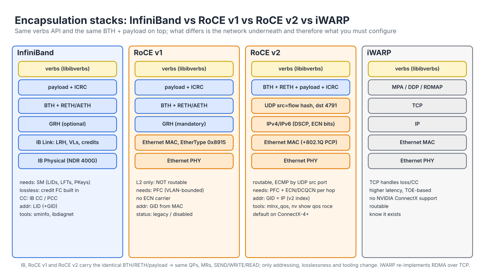
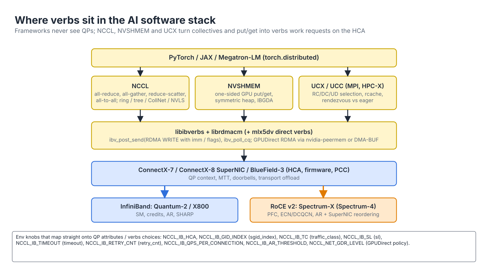

# Module 3.1 — RDMA Fundamentals

> **Exam domain:** NVIDIA InfiniBand Networking (30%) — RDMA concepts also underpin Spectrum-X/RoCE (30%) and Troubleshooting Tools (20%)  
> **Source course(s):** RDMA (NVIDIA Academy)  
> **Source docs:** RDMA Aware Networks Programming User Manual; rdma-core documentation (`libibverbs`, `librdmacm` man pages); perftest README; MLNX_OFED/DOCA-OFED User Manual  
> **Estimated study time:** 4–5 hours

> **How to study this module:** read §1–§2, work through the §3 walkthrough on real gear or NVIDIA Air, then attempt the §5 hands-on assignment using only the Hint section. Open the Solution guide (last section) only after you have a working attempt. Finish with the Appendix C knowledge check closed-book.

## 1. Learning objectives

By the end of this module you will be able to…

- **Describe** kernel bypass, zero copy, transport offload and one-sided operations, and explain why they are mandatory at 400 Gb/s per GPU. *(AI Data Center Design; IB Networking)*
- **Identify** the verbs objects (HCA, PD, MR, QP, CQ, SRQ, WR/WQE, CQE) and their relationships. *(IB Networking: RDMA)*
- **Distinguish** QP transport types (RC, UC, UD, XRC, DC) and RDMA operations (SEND/RECV, READ, WRITE, atomics), and state which operations each type supports. *(IB Networking: RDMA)*
- **Explain** how two endpoints exchange QPN, LID/GID, PSN and rkey, with RDMA CM or out-of-band. *(IB Networking: RDMA)*
- **Compare** InfiniBand, RoCE v1, RoCE v2 and iWARP. *(IB Networking vs Spectrum Networking)*
- **Describe** path MTU negotiation and its relationship to link/Ethernet MTU. *(Troubleshooting Tools)*
- **Use** rdma-core tools (`ibv_devinfo`, `rdma link`, `rdma resource`, `show_gids`) to inspect RDMA devices. *(Troubleshooting Tools)*
- **Run** **ib_write_bw** / **ib_write_lat** with the correct flags and **interpret** the results table. *(Troubleshooting Tools)*

## 2. Key technical concepts

### 2.1 What RDMA changes

**Analogy:** TCP/IP is sending a parcel through a post office: you hand it to a clerk (syscall), the clerk copies the address onto a form (socket buffer), a van carries it, and at the far end another clerk copies it again before knocking on the door. **RDMA** is giving the courier a key to your filing cabinet and your colleague's filing cabinet: the courier (the NIC) moves the document from one drawer to the other with no clerks involved at all.

**What it is.** Remote Direct Memory Access is a transport model in which the network adapter (the **HCA** on InfiniBand, the RDMA-capable NIC/SuperNIC on Ethernet) moves data directly between registered application buffers on two hosts. Four properties define it:

| Property | Meaning | Effect |
|---|---|---|
| **Kernel bypass** | The application talks to the NIC directly through memory-mapped queues (user-space verbs library); the kernel is involved only in setup (resource allocation, memory registration, connection) | No syscalls or interrupts per message; single-digit microsecond latency (sub-2 µs on IB) |
| **Zero copy** | The NIC reads from and writes into the application's (or GPU's) buffers directly | No intermediate socket buffers; payload touched once by hardware |
| **CPU offload / transport offload** | Segmentation, reliability (ACK/retransmit), ordering and congestion handling are implemented in the NIC | CPU utilisation near zero at line rate, leaving cores for the application |
| **One-sided operations** | A remote NIC can read/write a peer's memory without the peer's CPU knowing in real time | Enables NCCL/NVSHMEM put/get semantics and GPUDirect RDMA (GPU memory ↔ remote GPU memory with no host involvement) |

Figure 3.1-1 puts the two data paths side by side.


*Figure 3.1-1 — TCP/IP sockets vs RDMA verbs: two copies and two kernel crossings per message vs one doorbell write and a DMA.*

**Why it exists.** In a conventional TCP/IP stack, moving data from one application to another involves the sender's kernel copying from user buffer to socket buffer, building headers, the NIC DMA-ing the frame, and the mirror image on the receiver — with interrupts and context switches at each step. At 10 Gb/s this is tolerable; at 400 Gb/s per GPU, with eight GPUs per server, the host CPU cannot keep up and the copies alone exceed memory bandwidth budgets. The arithmetic: 8 × 400 Gb/s = 400 GB/s of network traffic per server; each copy reads and writes every byte, so two copies per direction is on the order of 1.6 TB/s of extra memory traffic — more than a dual-socket server's entire DRAM bandwidth. And a 64 KiB message at 400 Gb/s lasts 1.3 µs on the wire, shorter than a single syscall-plus-interrupt round trip, so per-message kernel work would cap throughput long before the link does.

**How it works.** Follow the numbered steps on the RDMA side of Figure 3.1-1:

1. **Post (user space).** `ibv_post_send` writes a 64-byte-aligned **WQE** (work queue element) into the QP's send ring, which lives in host memory that both the process and the HCA can see, then writes the QP number and new producer index to a **doorbell** register — an MMIO page (the UAR, User Access Region) mapped into the process at `ibv_open_device` time. One posted write, no syscall. For tiny messages **BlueFlame** writes the whole WQE through the doorbell page, saving the HCA a DMA read.
2. **Execute (HCA).** The HCA fetches the WQE, translates the buffer's virtual address through its **MTT** (memory translation table, filled at registration time) using the **lkey**, DMA-reads the payload directly from the application or GPU buffer, segments it into path-MTU packets, adds headers, and owns reliability: PSNs, ACKs, retransmission, ordering.
3. **Land (remote HCA).** The responder's HCA checks the packet's QPN, PSN, PKey and — for RDMA WRITE/READ — the **rkey**, bounds and access rights, then DMA-writes into registered memory. For one-sided operations no remote CPU, no receive WQE and no remote completion is involved.

The completion comes back as a **CQE** that the application *polls* from another ring in its own memory — again no syscall. The combination is what makes NCCL achieve ~390 Gb/s per NDR HCA with negligible CPU, and why "RDMA fabric" (IB or RoCE) is non-negotiable for scale-out AI training.

**Failure modes.** Kernel bypass makes the fast path invisible to `tcpdump`, `netstat` and `perf` on the host CPU: debugging moves to device counters (`rdma statistic`, `ethtool -S`, `perfquery`). The setup path is still kernel: `ulimit -l` too small, `ibv_reg_mr` failing in a container, or a missing `nvidia-peermem` module all fail *before* any packet moves.

**Why the exam cares:** kernel bypass does not mean "no kernel" — setup still goes through the driver; only the fast path bypasses it.

### 2.2 The verbs object model

**Analogy:** a **QP** is a pair of mailboxes — an outbox (Send Queue) and an inbox (Receive Queue). A **CQ** is the "delivery confirmed" tray where the courier drops a slip for every job finished. **MR registration** is telling the post office which rooms of your house it is allowed to deliver to, and getting two keys back: one for you (lkey) and one you can hand to a trusted friend (rkey). A **PD** is the fence around your property — keys from one property do not work on another.

**What it is.** The programming interface for RDMA on Linux is **verbs** (`libibverbs`), originally defined by the InfiniBand specification and shared by IB, RoCE and iWARP. Every resource below is created by the application and lives in the NIC and the driver. Figure 3.1-2 shows what belongs to what.


*Figure 3.1-2 — The verbs object model: context → PD → MR/QP/SRQ/AH; CQs and completion channels hang off the context.*

| Object | Purpose | Key facts |
|---|---|---|
| **HCA / device** | The RDMA NIC port(s); `mlx5_0`, `mlx5_1`… | One device per PCIe function; each has ports with LID/GID tables |
| **Protection Domain (PD)** | A security boundary; MRs and QPs in different PDs cannot be used together | Every QP, MR, AH belongs to exactly one PD |
| **Memory Region (MR)** | A pinned, registered virtual address range the NIC may DMA to/from | Registration returns **lkey** (used in local WRs) and **rkey** (handed to peers for RDMA READ/WRITE). Access flags: LOCAL_WRITE, REMOTE_READ, REMOTE_WRITE, REMOTE_ATOMIC |
| **Queue Pair (QP)** | Send Queue (SQ) + Receive Queue (RQ); the "connection" endpoint | Identified by **QPN**; has a transport type and a state machine; ordering is per QP |
| **Completion Queue (CQ)** | Where the NIC reports finished work (success or error) as CQEs | SQ and RQ may share a CQ or use separate ones |
| **Shared Receive Queue (SRQ)** | One RQ shared by many QPs to save receive buffers | Used by UCX/MPI with many connections; XRC depends on it |
| **Work Request (WR) / WQE** | A descriptor: operation, scatter/gather list (addr, length, lkey), flags, for RDMA ops the remote addr + rkey | Posted with `ibv_post_send` / `ibv_post_recv`; becomes a WQE in NIC-visible memory |
| **Completion (CQE / `ibv_wc`)** | Status, opcode, byte count, `wr_id`, immediate data | Status `IBV_WC_SUCCESS` or an error (e.g. `IBV_WC_REM_ACCESS_ERR`, `IBV_WC_RETRY_EXC_ERR`) |

**Why it exists.** Kernel bypass hands user space direct control of hardware that can write into any physical memory. The object model is how that is made safe without the kernel on the fast path: the kernel validates everything *once* at creation (which pages a buffer covers, which process owns which QP), records it in HCA tables, and from then on the HCA enforces it on every packet. The PD ties the pieces together so a key from one tenant's PD can never be used on another's QP.

**How it works.**

- **Context.** `ibv_open_device` opens `/dev/infiniband/uverbsN` and maps the doorbell page; every other object belongs to this context.
- **MR registration.** `ibv_reg_mr(pd, addr, len, access)` makes the kernel *pin* every page of the range (so it cannot be swapped or migrated — it counts against `ulimit -l`, memlock), look up each page's physical address, and write one MTT entry per page into the HCA. It returns a 32-bit **lkey** and **rkey**. A 1 GiB buffer in 4 KiB pages is 262,144 MTT entries; with 2 MiB huge pages it is 512 — one reason RDMA hosts use huge pages. Registration therefore costs time proportional to size (milliseconds per gigabyte), which is why every library caches registrations.
- **Access checks.** Each incoming RDMA WRITE/READ/atomic carries the rkey, a virtual address and a length (the RETH header); the HCA checks the rkey belongs to an MR in the *same PD as the target QP*, that the range is inside the MR, and that the MR allows that access. Any failure returns a NAK and the requester sees `IBV_WC_REM_ACCESS_ERR`; a bad lkey on the local side gives `IBV_WC_LOC_PROT_ERR`.
- **QP and CQ.** A QP is two rings of WQEs plus a hardware context (state, PSNs, peer QPN, path). The **QPN** is 24 bits; QP0 and QP1 are reserved for SMPs and GMPs (Module 2.1). A CQ is a ring of fixed-size CQEs (typically 64 bytes) the HCA writes; polling is a memory read.

The ordering of creation (context → PD → MR/CQ → QP → connect) is detailed in [Module 3.2](02-rdma-programming-fundamentals.md).

**Why the exam cares:** lkey vs rkey. lkey is used in *local* scatter/gather entries; rkey is given to the *remote* side for READ/WRITE/atomics. Using the wrong one yields a local or remote protection error.

### 2.3 QP transport types

**What it is.** A QP is created with one transport type, which fixes whether it is connected (one peer) or datagram (any peer), and whether the HCA guarantees delivery:

| Type | Connected? | Reliable? | Operations | Notes / who uses it |
|---|---|---|---|---|
| **RC** — Reliable Connected | Yes (1:1) | Yes: ACK/NAK, in-order, retransmit | SEND/RECV, RDMA WRITE/READ, atomics | The workhorse: NCCL, UCX, NVMe-oF, storage. One QP per peer → N² QPs at scale |
| **UC** — Unreliable Connected | Yes | No | SEND/RECV, RDMA WRITE | Rare; streaming where loss is acceptable |
| **UD** — Unreliable Datagram | No (any-to-any via Address Handles) | No | SEND/RECV only, one MTU max per message | IPoIB datagram mode, multicast, connection-manager control traffic, SA queries |
| **XRC** — eXtended Reliable Connected | Yes, shared | Yes | RC ops | Lets one QP target multiple SRQs on a remote node, cutting QP count for multi-process-per-node MPI jobs |
| **DC** — Dynamically Connected (NVIDIA extension) | Connect-on-demand | Yes | RC ops | Transient connections created per message burst; UCX uses it for huge rank counts; `ibv_devinfo -v` and `mlx5dv` expose it |
| **RD** — Reliable Datagram | spec-defined, not implemented | — | — | Know it exists only on paper |

**Why it exists.** Reliability and connection state cost HCA memory and lookup time per peer. RC gives the strongest guarantees (and the only widely used one-sided READ/atomics) but needs a QP — with its context, rings and PSN state — for every peer: N processes talking all-to-all need N×(N−1) QPs. UD scales to any number of peers with one QP but gives up reliability, ordering and messages larger than one MTU. XRC and DC exist purely to recover RC semantics at UD-like QP counts.

**How it works.** RC reliability is implemented entirely in the HCA: every packet carries a 24-bit **PSN** in the BTH; the responder ACKs (coalesced) with an AETH, NAKs a gap with a *PSN sequence error*, and the requester retransmits from the lost PSN (go-back-N) after a NAK or after the **local ACK timeout** (4.096 µs × 2^`timeout`) expires, up to `retry_cnt` (0–7) times; receiver-not-ready is handled separately by `rnr_retry` (7 = infinite). All of these are QP attributes set during the RTR/RTS transitions in [Module 3.2](02-rdma-programming-fundamentals.md). UD packets carry an extra 8-byte **DETH** with a 32-bit **Q_Key** that the receiving UD QP checks, and the sender names the destination per message through an Address Handle.

Exam angle: RC is the only *widely used* type supporting one-sided RDMA READ and atomics; UD is the only one supporting multicast; XRC/DC are the scaling answers to "RC needs a QP per peer".

### 2.4 RDMA operations

**Analogy:** SEND/RECV is handing a parcel to someone who must be standing at the door with their arms out (a posted RECV). RDMA WRITE is letting yourself in with the key they gave you and putting the parcel on the shelf they told you about — they only find out if they look (or if you leave a note: *immediate data*).

**What it is.** Five operation families; Figure 3.1-3 shows who posts what and who gets a completion.


*Figure 3.1-3 — Two-sided SEND/RECV vs one-sided RDMA WRITE and READ: steps ①–⑨ show the posts, packets and completions on each side.*

| Operation | Sidedness | Who supplies the buffer? | Completion on remote side? |
|---|---|---|---|
| **SEND / RECV** | Two-sided ("channel semantics") | Receiver must have pre-posted a RECV WR with a buffer ≥ message size | Yes — a receive completion with length |
| **RDMA WRITE** | One-sided ("memory semantics") | Sender names remote `addr + rkey`; receiver CPU not involved | No (unless **WRITE with Immediate**, which consumes a RECV and generates a CQE carrying 32-bit immediate data) |
| **RDMA READ** | One-sided | Initiator pulls from remote `addr + rkey` into local buffer | No |
| **Atomics** (Fetch-and-Add, Compare-and-Swap, 64-bit) | One-sided | Remote `addr + rkey` | No; result returned to initiator |
| **SEND with Immediate** | Two-sided | As SEND; 32-bit immediate delivered in the CQE | Yes |

**Why it exists.** Two different programming models need two different primitives. Message passing ("here is a request, you decide where it goes") wants SEND/RECV: the receiver chooses the buffer. Shared-memory style data movement ("put these bytes at that address") wants WRITE/READ: the initiator chooses, and the target CPU stays out of the critical path — which is exactly what collective libraries moving gigabytes between GPUs need.

**How it works — on the wire.** Every operation starts with the 12-byte **BTH**: OpCode (8 bits: transport type + operation + First/Middle/Last/Only), SE (solicited event, 1 bit), M (migration, 1 bit), Pad count (2 bits), TVer (4 bits), **PKey** (16 bits), a reserved byte (IB uses two of its bits for FECN/BECN), **DestQP** (24 bits), A (ack-request, 1 bit), 7 reserved bits and the 24-bit **PSN**. Extended headers follow by opcode:

- **RETH** (16 B) on RDMA WRITE First/Only and READ Request: virtual address (64 bits), R_Key (32 bits), DMA length (32 bits).
- **AETH** (4 B) on ACK/NAK and READ responses: syndrome (8 bits: ACK, RNR NAK with a 5-bit timer code, or NAK code such as PSN sequence error / remote access error) and MSN (24-bit message sequence number).
- **ImmDt** (4 B) on SEND/WRITE with Immediate; **AtomicETH** (28 B) on atomics; **DETH** (8 B, Q_Key + source QP) on UD.

**How it works — in order (Figure 3.1-3).** ① The responder pre-posts a RECV WQE. ② A SEND is segmented into First/Middle/Last packets with consecutive PSNs and ACKed. ③ Both sides get CQEs (the requester only if the WR was `IBV_SEND_SIGNALED`). ④ If no RECV is posted, the responder answers with an **RNR NAK** carrying `min_rnr_timer`; the requester waits that long and retries up to `rnr_retry` times. ⑤–⑥ An RDMA WRITE carries RETH in its first packet, lands by address with no responder CPU, and only the requester completes. ⑦ WRITE with Immediate does the same but also consumes a RECV and gives the responder `IBV_WC_RECV_RDMA_WITH_IMM` — NCCL's notification pattern. ⑧–⑨ RDMA READ sends a small request with RETH; the responder's HCA streams READ Response packets back; the number of READs (and atomics) a QP may have in flight is bounded by `max_rd_atomic` / `max_dest_rd_atomic`.

Two-sided requires the **receive-before-send** discipline: if a SEND arrives and no RECV WQE is available, the responder returns an **RNR NAK** (Receiver Not Ready); after `rnr_retry` attempts the QP goes to error. One-sided operations need the initiator to *already know* the remote virtual address and rkey, which is why control-plane exchange exists (§2.5). Under the hood, NCCL mostly uses RDMA WRITE (with immediate or a flag write) because the responder GPU never needs to react.

**Why the exam cares:** which side completes (WRITE: requester only; WRITE_WITH_IMM and SEND: both), and RNR NAK = "no RECV posted", not a network problem.

### 2.5 Connection establishment

**What it is.** A QP cannot be used until both sides know each other's parameters: the peer's **QPN**; the peer's **LID** (IB) or **GID** (RoCE/IB global), plus port, path MTU, SL, and for RoCE the GID index and MAC resolved through the IP stack; a **Packet Sequence Number (PSN)** starting value; and, for one-sided operations, the peer's buffer **address and rkey**.

**Why it exists.** RC QPs are point-to-point hardware contexts: the HCA must know, before the first packet, where to send (DLID/DGID, SL, MTU), whom it is talking to (remote QPN) and which PSN to expect. None of that can be discovered from the data packets themselves, so a separate control exchange must happen first — and it must use a channel that already works (TCP, IPoIB, or MADs on QP1).

**How it works.**

- **Raw verbs with out-of-band exchange.** The traditional (perftest, many tutorials) way: open a TCP socket, exchange a small struct containing `{lid, qpn, psn, gid, addr, rkey}`, then each side drives the QP through INIT→RTR→RTS with the peer's values. Simple, fully under your control, but you own the socket, the error handling and the transport-specific details (e.g. GID index for RoCE). Figure 3.1-6 (§2.9) is exactly this exchange as `ib_write_bw` performs it.
- **RDMA Connection Manager (librdmacm).** **RDMA CM** gives a sockets-like API (`rdma_resolve_addr` → `rdma_resolve_route` → `rdma_connect` / `rdma_accept`) that uses IP addresses to identify peers (IPoIB addresses on IB, real IPs on RoCE), resolves the IB path record via the SA or the Ethernet route via the kernel (picking the correct **GID index** automatically), exchanges QPN/PSN via **MAD-based CM** (IB) or the same protocol encapsulated on RoCE, and transitions the QP for you. It still requires *you* to exchange buffer addresses/rkeys (often in `private_data` of the connect request). The CM messages are REQ (carries the client QPN, starting PSN, path and `private_data`), REP (server QPN and PSN) and RTU (ready to use); Module 3.2 traces them step by step.

Nearly all production stacks (NVMe-oF, UCX, NCCL's default IB transport) use RDMA CM or an equivalent, because hand-rolled exchanges break on RoCE when GID selection is wrong. **UD multicast** and **UD unicast** also work through RDMA CM (`rdma_join_multicast`); for UD you talk to many peers via **Address Handles** (AH), each wrapping a destination LID/GID + SL + port.

**Failure modes.** A wrong GID index on RoCE (link-local v1 entry instead of the IPv4 v2 one) means the RTR transition succeeds but packets go nowhere — perftest hangs after printing the address lines. On IB, no master SM means the SA never answers path queries and RDMA CM fails with `ROUTE_ERROR`.

### 2.6 Transports compared

**What it is.** The same verbs and the same BTH run over four different network stacks; Figure 3.1-4 shows the encapsulations.


*Figure 3.1-4 — Encapsulation stacks: IB, RoCE v1, RoCE v2 and iWARP carry the same verbs; only the network underneath and what you must configure change.*

| Property | InfiniBand | RoCE v1 | RoCE v2 | iWARP |
|---|---|---|---|---|
| Layer 2 | IB link layer, LIDs | Ethernet; EtherType 0x8915 | Ethernet | Ethernet |
| Layer 3/4 | IB network/transport (GRH optional) | None — **not routable**, VLAN-bounded | **UDP/IP, dst port 4791**, routable, ECMP-hashable by src port | TCP/IP |
| Lossless requirement | Built in (credit FC) | Needs **PFC** (or lossy with limits) | Needs PFC and/or ECN+DCQCN; "lossy RoCE" possible with CX-5+ and good CC | TCP handles loss |
| Congestion control | IB CC / PCC | None standard | **DCQCN** via ECN+CNP | TCP |
| Addressing exposed to verbs | LID + optional GID | GID (MAC-derived, link-local) | GID (IPv4-mapped / IPv6 address) | IP |
| Fabric manager | SM required | Switches + DCB settings | Switches + DCB/QoS settings (NVUE RoCE profile) | None |
| Typical NVIDIA use | Quantum fabrics for SuperPOD | legacy only | **Spectrum-X**, cloud AI fabrics, storage | not supported on ConnectX |
| Latency (approx.) | lowest | low | low, slightly above IB | higher |

**Why it exists.** InfiniBand needs its own switches and SM; many data centers want RDMA on the Ethernet they already run. RoCE v1 put the IB transport straight into Ethernet frames (with the GRH as its network header), which worked only inside one L2 domain. RoCE v2 replaced the GRH with real IP/UDP headers so packets route through L3 fabrics and spread across ECMP paths — the UDP source port is set per QP, giving each connection its own hash entropy.

**How it works.** On IB a packet is LRH (8 B) + optional GRH (40 B) + BTH + extended headers + payload + ICRC (4 B) + VCRC (2 B). On RoCE v2 it is Ethernet (14 B, +4 for 802.1Q) + IPv4 (20 B) or IPv6 (40 B) + UDP (8 B, destination **4791**) + the same BTH + extended headers + payload + ICRC + FCS. The IP header's 8-bit ToS byte carries **DSCP** (6 bits) and **ECN** (2 bits), which is how RoCE gets classes and congestion marking (Module 3.3). Practical consequences: the *verbs API is identical* across IB and RoCE — the differences are in addressing (GID vs LID), in what must be configured on the network (SM vs PFC/ECN), and in debugging tools (`sminfo`/`ibdiagnet` vs `mlnx_qos`/`ethtool -S`). Module 3.3 covers RoCE in depth.

### 2.7 MTU and path MTU

**What it is.** Two MTUs exist:

- **Link MTU** — the physical maximum IB packet payload on a port (256, 512, 1024, 2048, **4096**), set by the SM (`partition mtu=`) within switch/HCA capability. On RoCE the "link MTU" is the Ethernet MTU of the interface (e.g. 9000 or 9216).
- **Path MTU / active MTU** — negotiated per QP as the *minimum* along the path, from the IB-encoded set {256, 512, 1024, 2048, 4096}. `ibv_devinfo` shows `max_mtu` and `active_mtu`. On RoCE v2 the maximum RDMA MTU is **4096** even with a 9000-byte Ethernet MTU, because RoCE payload + headers (Ethernet 14 + IP 20 + UDP 8 + BTH 12 + ICRC 4 + payload) must fit in an Ethernet frame and the IB encoding only has power-of-two sizes; a 1500-byte Ethernet MTU limits RoCE to a 1024-byte path MTU, which costs significant throughput.

**Why it exists.** The transport segments messages into packets in hardware, so it needs one packet size per QP, fixed at connection time; the IB transport has no path-MTU discovery and no fragmentation, so a packet larger than any hop's MTU is simply dropped. Choosing the minimum up front is the only safe option.

**How it works.** The path MTU is an attribute of the QP set in the INIT→RTR transition (`IBV_QP_PATH_MTU`, encoded 1 = 256 … 5 = 4096); RDMA CM fills it from the SA path record (IB) or from the netdev MTU (RoCE). Messages larger than the path MTU are segmented by the HCA into packets; the application never sees segmentation, but small MTUs raise per-packet overhead and reduce bandwidth, so 4096 is the standard target everywhere. The RoCE arithmetic: a 4096-byte payload needs an IP MTU of at least 4096 + 20 (IP) + 8 (UDP) + 12 (BTH) + 16 (RETH) + 4 (ICRC) ≈ 4156 bytes, so any interface MTU ≥ ~4200 allows 4096, and the usual host 9000 / switch 9216 leaves margin. With 1500, the largest power of two that fits is 1024: four times the packets, and the HCA's message rate becomes the limit.

**Failure modes.** `Mtu : 1024[B]` in the perftest header on RoCE (§4.2), or IB `active_mtu` 2048 because one switch or the partition definition says `mtu=4`. A hand-set path MTU larger than a hop supports produces silent drops and `IBV_WC_RETRY_EXC_ERR`.

### 2.8 rdma-core and the AI software stack

**What it is.** `rdma-core` is the upstream user-space package set (libibverbs, librdmacm, ibverbs-providers incl. `mlx5`, rdma tooling). NVIDIA ships a tested version inside MLNX_OFED/DOCA-OFED along with extras (`mlnx-tools`, `infiniband-diags`, `perftest`, `mft`). Figure 3.1-5 shows where verbs sit under the frameworks.


*Figure 3.1-5 — Where verbs sit in the AI software stack: frameworks never see QPs; NCCL, NVSHMEM and UCX turn collectives and put/get into work requests.*

**Why it exists.** Frameworks want collectives ("all-reduce this tensor"), not QPs. Communication libraries translate between the two, and each needs the same verbs underneath so one NIC driver serves all of them. Keeping the verbs API common across IB and RoCE is what lets the same NCCL binary run on Quantum and Spectrum-X.

**How it works.**

- **NCCL** implements its IB transport directly on verbs: per peer it creates RC QPs (`NCCL_IB_QPS_PER_CONNECTION`), registers GPU memory with **GPUDirect RDMA** so the HCA DMAs straight into HBM, and uses RDMA WRITE + flags to move chunks. Env knobs you will meet in this course: `NCCL_IB_HCA`, `NCCL_IB_GID_INDEX`, `NCCL_IB_TC`, `NCCL_IB_SL`, `NCCL_IB_TIMEOUT`, `NCCL_IB_RETRY_CNT`, `NCCL_IB_AR_THRESHOLD`, `NCCL_NET_GDR_LEVEL`. Each maps onto a QP attribute or verbs choice: `NCCL_IB_GID_INDEX` → `sgid_index`, `NCCL_IB_TC` → `traffic_class`, `NCCL_IB_SL` → `sl`, `NCCL_IB_TIMEOUT` → `timeout`, `NCCL_IB_RETRY_CNT` → `retry_cnt`.
- **NVSHMEM** exposes a PGAS model where a GPU kernel can `put`/`get` into a remote GPU's memory; it maps directly to one-sided RDMA WRITE/READ (and to NVLink inside the node).
- **UCX** is the general-purpose communication layer under MPI and some frameworks; it auto-selects RC/DC/UD transports and handles memory registration caches.
- **DOCA** (BlueField) and **DPDK** sit beside verbs for data-plane applications; DOCA RDMA wraps verbs with a DPU-friendly API ([Module 5](../05-bluefield-doca/)).
- **GPUDirect RDMA** works because GPU memory can be registered as an MR: `nvidia-peermem` (or the DMA-BUF path in newer kernels and drivers) lets `ibv_reg_mr` resolve GPU virtual addresses to PCIe bus addresses, so the HCA DMAs to and from HBM directly over PCIe — ideally through a PCIe switch shared by GPU and NIC, which is what `NCCL_NET_GDR_LEVEL` reasons about.

The importance of **memory registration** here: pinning large GPU buffers is expensive (hundreds of microseconds per registration), so every library caches registrations — registration churn shows up as throughput collapse and is a classic performance pitfall. Pinned memory also counts against `ulimit -l` (memlock) — set it to unlimited on RDMA hosts.

### 2.9 perftest: the RDMA benchmark suite

**What it is.** **perftest** is the standard tool for validating an RDMA link before blaming NCCL. The programs are named `ib_<op>_<metric>`: **ib_write_bw** / **ib_write_lat** (RDMA WRITE), **ib_read_bw** / **ib_read_lat** (RDMA READ), **ib_send_bw** / **ib_send_lat** (two-sided), **ib_atomic_bw** / **ib_atomic_lat** (atomics), **raw_ethernet_bw** (raw Ethernet packet injection for Spectrum testing). Server and client run the same binary; the client gets the server's IP (any IP — TCP is only used to exchange the connection parameters).

**Why it exists.** NCCL performance depends on GPUs, NVLink, PCIe topology, the NIC and the fabric at once. perftest removes everything except one NIC, one path and the verbs layer, so a number below line rate here is a fabric, NIC or PCIe problem — never NCCL's.

**How it works.** Figure 3.1-6 is the exchange behind every run; §3 Step 2 shows the matching output lines.


*Figure 3.1-6 — perftest client/server: TCP only for the parameter swap (②–③) and barriers; every measured byte is RDMA WRITE (⑤).*

1. The server opens the device, allocates a PD, registers its buffer, creates `-q` RC QPs and listens on TCP port 18515.
2. The client connects to the server IP over TCP (the `Data ex. method : Ethernet` header line).
3. Both sides print and swap `local address` / `remote address`: LID (or GID on RoCE), QPN, PSN, RKey, VAddr.
4. Each side moves its QPs INIT → RTR (peer QPN/PSN/LID-or-GID, path MTU = the smaller `active_mtu`) → RTS.
5. The client posts RDMA WRITEs of `-s` bytes, keeping `--tx-depth` outstanding per QP; ACKs come back coalesced and the server's CPU is idle.
6. The client polls its CQ and computes bandwidth from completed bytes per interval.
7. A final TCP exchange carries results and both sides tear down.

| Flag | Meaning |
|---|---|
| `-d <dev>` | RDMA device (`mlx5_0`) |
| `-i <port>` | HCA port number (1-based) |
| `-x <gid-index>` | GID index — **required for RoCE**; pick the RoCE v2 IPv4 entry from `show_gids`. Not needed on IB |
| `-q <n>` | Number of QPs (helps reach line rate on 400G) |
| `-s <bytes>` | Message size (default 65536 for bw, 2 for lat) |
| `-a` | Run all message sizes 2 B → 8 MB |
| `-F` | Do not fail on CPU frequency scaling warnings |
| `-R` | Use RDMA CM for connection setup |
| `-S <sl>` | Service level (IB QoS) |
| `--tclass <n>` | Traffic class / DSCP×4 for RoCE QoS |
| `-n <iters>` | Iterations |
| `-D <sec>` | Run for a duration instead of iterations |
| `-b` | Bidirectional |
| `-m <mtu>` | Force path MTU |
| `--report_gbits` | Report in Gb/s instead of MB/s |
| `--use_cuda=<gpu>` | Use GPU memory (GPUDirect RDMA test; perftest built with CUDA) |
| `--tx-depth`/`--rx-depth` | Queue depths |

Expected results (healthy): NDR 400G ~ 390 Gb/s with `-q 4 -s 1M`; HDR 200G ~ 195 Gb/s; RDMA WRITE latency ~1.0–1.5 µs on IB for 8 bytes, a bit higher on RoCE. The ~2–3 % gap to 400 is header overhead plus link-layer encoding, not a fault.

**Why the exam cares:** `-x` is mandatory on RoCE and must match on both ends; the server IP is only for the TCP parameter swap; `--tclass 106` puts RoCE traffic in DSCP 26 with ECT(0).

## 3. Live-style walkthrough: inspect the device, then run ib_write_bw and read every column

Lab: `hostA` (10.10.1.20) and `hostB` (10.10.1.21), each with an NDR ConnectX-7 `mlx5_0` on InfiniBand. We first prove the device is healthy, then run bandwidth and latency tests, then repeat the key points for RoCE.

### Step 1 — Device inspection

```bash
hostA$ ibv_devices                        # every RDMA device the verbs library can see
    device                 node GUID
    ------              ----------------
    mlx5_0              b83fd203001a2b3c   # one device per PCIe function

hostA$ ibv_devinfo -d mlx5_0              # the verbs view of the device; port 1 is what matters
hca_id: mlx5_0
        transport:                      InfiniBand (0)
        fw_ver:                         28.41.1000
        node_guid:                      b83f:d203:001a:2b3c
        port:   1
                state:                  PORT_ACTIVE (4)    # SM has configured the port (IB) / link is up (RoCE)
                max_mtu:                4096 (5)           # hardware capability
                active_mtu:             4096 (5)           # <-- negotiated path MTU. 1024 here on RoCE = Ethernet MTU 1500
                sm_lid:                 1                  # IB only: where the master SM lives. 0 on RoCE
                port_lid:               37                 # IB only: my LID. 0 on RoCE
                link_layer:             InfiniBand         # or "Ethernet" for RoCE — decides whether -x is needed below

hostA$ ibv_devinfo -v -d mlx5_0 | grep -iE "max_qp |max_mr |max_cq |atomic|pkey_tbl_len"
        max_qp:                         262144             # resource limits you will never hit in a lab
        max_mr:                         16777216
        atomic_cap:                     ATOMIC_HCA (1)     # 64-bit atomics supported
        pkey_tbl_len:                   128                # partitions this port can be a member of (Module 2.1)

hostA$ rdma dev                           # kernel's view
0: mlx5_0: node_type ca fw 28.41.1000 node_guid b83f:d203:001a:2b3c sys_image_guid b83f:d203:001a:2b3c
hostA$ rdma link                          # per-port state and, on RoCE, the bound netdev
link mlx5_0/1 subnet_prefix fe80:0000:0000:0000 lid 37 sm_lid 1 lmc 0 state ACTIVE physical_state LINK_UP
hostA$ rdma resource show                 # live object counts — useful to spot leaks later
0: mlx5_0: pd 2 cq 3 qp 2 cm_id 0 mr 1 ctx 1 srq 0
hostA$ rdma statistic show link mlx5_0/1  # hw counters; on RoCE look for out_of_sequence, np_cnp_sent, rp_cnp_handled
hostA$ ibdev2netdev -v                    # mlx5_0 -> ib0 (IB) or ens1f0np0 (RoCE), with link state
```

### Step 2 — Bandwidth: server and client, every flag explained

Keep Figure 3.1-6 open: the server command is step ①, the client's TCP connect is ②, the `local address` / `remote address` lines are ③, and the table is step ⑥ measuring the WRITE stream of step ⑤.

```bash
# ---------- hostB: server. Same binary, no destination argument = listen ----------
hostB$ ib_write_bw -d mlx5_0 -i 1 -F --report_gbits -a -q 4
#  ib_write_bw      RDMA WRITE bandwidth (one-sided; no receive WQEs consumed on the server)
#  -d mlx5_0        which RDMA device
#  -i 1             port 1 on that device (single-port HCA, but be explicit)
#  -F               do not abort on CPU-frequency-scaling warnings (it only hides the warning; it does not fix it)
#  --report_gbits   print Gb/s instead of MB/s so the number is comparable to the link rate (400)
#  -a               sweep all message sizes 2 B .. 8 MiB
#  -q 4             4 QPs in parallel — one QP cannot saturate 400G from a single core; 4 usually can
# (no -x: this is InfiniBand, LIDs are used; on RoCE you MUST add -x <v2 gid index>)

# ---------- hostA: client. Last argument = server IP (TCP, used ONLY to swap QPN/LID/PSN/rkey) ----------
hostA$ ib_write_bw -d mlx5_0 -i 1 -F --report_gbits -a -q 4 10.10.1.21
---------------------------------------------------------------------------------------
                    RDMA_Write BW Test
 Dual-port       : OFF          Device         : mlx5_0
 Number of qps   : 4            Transport type : IB          # <-- IB transport; "ETH" here would mean RoCE
 Connection type : RC           Using SRQ      : OFF         # RC: reliable connected, as expected for WRITE
 PCIe relax order: ON
 TX depth        : 128                                       # outstanding WRs per QP; raise with --tx-depth if bw is low
 CQ Moderation   : 1
 Mtu             : 4096[B]                                   # <-- negotiated path MTU. 1024 means an MTU problem (see §4)
 Link type       : IB
 Max inline data : 0[B]
 rdma_cm QPs     : OFF                                       # out-of-band TCP exchange; -R would make this ON
 Data ex. method : Ethernet                                  # i.e. the TCP socket; nothing to do with the data path
---------------------------------------------------------------------------------------
 local address: LID 0x25 QPN 0x00b2 PSN 0x1a2b3c RKey 0x1f00 VAddr 0x007f1c40000000
 remote address: LID 0x26 QPN 0x00c4 PSN 0x4d5e6f RKey 0x2300 VAddr 0x007f2e80000000
#  ^ this is the struct the two sides exchanged over TCP: LID (0 on RoCE, then a GID line appears),
#    QPN, starting PSN, and the rkey + virtual address of the remote buffer the WRITEs will target.
---------------------------------------------------------------------------------------
 #bytes     #iterations    BW peak[Gb/sec]    BW average[Gb/sec]   MsgRate[Mpps]
 2          5000             0.11               0.10               6.398045
 4          5000             0.22               0.21               6.491552
 ...
 4096       5000           221.38             219.92               6.710874
 8192       5000           348.17             346.55               5.288330
 16384      5000           385.90             385.12               2.938538
 65536      5000           391.72             391.40               0.746613   # <-- line-rate region: ~390 of 400 Gb/s
 1048576    5000           392.01             391.95               0.046724
 8388608    5000           392.04             392.02               0.005841
---------------------------------------------------------------------------------------
# Reading the table:
#  #bytes        message size for that row
#  #iterations   how many WRITEs were timed (default 5000; -n changes it, -D runs for seconds instead)
#  BW peak       best interval; BW average is what you report. Small sizes are limited by MsgRate (pps), not bits.
#  MsgRate       messages/s. ~6-7 Mpps per 4 QPs here is the per-WQE processing ceiling of the HCA+CPU, not the wire.
# "Good" on NDR = average >= ~385 Gb/s from 64 KiB upward. ~195 Gb/s plateau = link negotiated 2X or HDR (check ibstat Rate).
# ~100-120 Gb/s plateau = PCIe (x8, or Gen4 slot for a Gen5 card) -> lspci -vv / mlxlink. Low MsgRate at small sizes with
# fine large-message bw = CPU frequency scaling or wrong NUMA node (numactl -N <socket of the HCA>).
```

### Step 3 — Latency

```bash
hostB$ ib_write_lat -d mlx5_0 -s 8 -n 100000 -F
hostA$ ib_write_lat -d mlx5_0 -s 8 -n 100000 -F 10.10.1.21
#  -s 8        8-byte message (the classic latency probe); fits inline so no DMA read on the sender
#  -n 100000   100k iterations for a stable distribution
 #bytes #iterations    t_min[usec]    t_max[usec]  t_typical[usec]    t_avg[usec]    t_stdev[usec]   99% percentile[usec]   99.9% percentile[usec]
 8       100000          1.02           12.87           1.09             1.10            0.05            1.16                    1.31
# t_typical ~1.0-1.5 us is healthy IB. RoCE adds a few hundred ns. t_max spikes are usually interrupts/CPU migration; the
# 99.9% column is what matters for NCCL small-message collectives. A t_typical of 3-4 us on IB -> check CPU governor, C-states,
# or that you are not crossing a QPI/UPI socket boundary to reach the HCA.
```

### Step 4 — Variants you will actually use

Each variant exercises a different row of Figure 3.1-3: `ib_send_bw` needs pre-posted RECVs (①–③), `ib_read_bw` uses READ Request/Response (⑧–⑨).

```bash
# RDMA CM instead of the out-of-band socket (resolves GID index automatically — the right way on RoCE)
hostA$ ib_write_bw -d mlx5_0 -R -F --report_gbits 10.10.1.21
# Two-sided: exercises RECV posting, RNR behaviour, and the receiver's CPU
hostA$ ib_send_bw -d mlx5_0 -F --report_gbits -q 4 10.10.1.21
# RDMA READ (initiator pulls) — sensitive to max_rd_atomic / PCIe read depth
hostA$ ib_read_bw -d mlx5_0 -F --report_gbits -q 4 10.10.1.21
# GPUDirect RDMA: buffers in GPU 0 memory (perftest built with CUDA; nvidia-peermem or DMA-BUF loaded)
hostA$ ib_write_bw -d mlx5_0 -F --report_gbits -q 4 --use_cuda=0 10.10.1.21
# QoS: put the test on SL 1 (IB) or DSCP 26 (RoCE: ToS 106 = 26<<2 | ECT(0))
hostA$ ib_write_bw -d mlx5_0 -S 1 -F --report_gbits 10.10.1.21
hostA$ ib_write_bw -d mlx5_2 -x 3 --tclass=106 -F --report_gbits 10.10.1.21     # RoCE
```

### Step 5 — The RoCE differences in one screen

```bash
hostA$ ibv_devinfo -d mlx5_2 | grep -E "link_layer|port_lid|active_mtu"
                active_mtu:             4096 (5)          # needs Ethernet MTU >= ~4150; 1500 -> 1024 (3)
                port_lid:               0                 # no LIDs on Ethernet
                link_layer:             Ethernet          # so addressing is by GID -> we need the GID table
hostA$ show_gids
DEV     PORT  INDEX  GID                                      IPv4           VER  DEV
mlx5_2  1     0      fe80:0000:0000:0000:b83f:d2ff:fe00:1122                 v1   ens1f0
mlx5_2  1     1      fe80:0000:0000:0000:b83f:d2ff:fe00:1122                 v2   ens1f0
mlx5_2  1     2      0000:0000:0000:0000:0000:ffff:0a0a:0114  10.10.1.20     v1   ens1f0
mlx5_2  1     3      0000:0000:0000:0000:0000:ffff:0a0a:0114  10.10.1.20     v2   ens1f0   # <-- pick THIS: IPv4, RoCE v2
hostA$ ib_write_bw -d mlx5_2 -i 1 -x 3 -F --report_gbits -q 4 10.10.1.21                  # -x 3 on BOTH ends
# Omit -x and perftest defaults to index 0 (link-local v1): connection fails before any data moves.
```

## 4. Troubleshooting / common gotchas

### 4.1 `ib_write_bw` connects but tops out at ~195 Gb/s on a 400G link

**Symptom:** the table plateaus at half the expected rate for every size ≥ 64 KiB.

**Why it happens:** the link negotiated 2X width or HDR speed (bad cable/transceiver, a breakout cable, or an HDR partner), *or* the HCA sits in a PCIe slot that cannot feed it (x8, or Gen4 for a Gen5 NDR card), *or* a single QP/core is the bottleneck.

**How to debug:**

```bash
ibstat mlx5_0 | grep -E "Rate|width|speed"          # Rate: 400 and 4X expected; 200 or 2X = link problem -> mlxlink (Module 8)
sudo lspci -vv -s $(basename $(readlink /sys/class/infiniband/mlx5_0/device)) | grep -E "LnkCap|LnkSta"   # Width x16, Speed 32GT/s for Gen5
sudo mlxlink -d /dev/mst/mt4129_pciconf0 | grep -iE "speed|width|state"
ib_write_bw ... -q 8 --tx-depth 256                 # rule out single-QP ceiling
```

**Fix:** reseat/replace the cable or module if width/speed is degraded; move the card to a full-width Gen5 slot; use `-q 4` or more and pin to the HCA's NUMA node with `numactl`.

### 4.2 `Mtu 1024[B]` in the perftest header on RoCE, bandwidth ~100 Gb/s

**Symptom:** header shows `Mtu : 1024[B]`; `ibv_devinfo` shows `active_mtu: 1024 (3)` while `max_mtu: 4096 (5)`.

**Why it happens:** the Ethernet netdev MTU is 1500 (or a VLAN sub-interface / VXLAN tunnel forced it down). RoCE path MTU is the largest IB size whose packet fits the Ethernet frame — 1500 fits only 1024.

**How to debug:**

```bash
ibdev2netdev -v | grep mlx5_2                      # which netdev?
ip link show ens1f0np0 | grep mtu                  # 1500?
nv show interface swp1 link mtu                    # on the Cumulus switch: should be 9216
```

**Fix:** `ip link set ens1f0np0 mtu 9000` on both hosts (persist in netplan/NetworkManager), switch ports at 9216; re-run and confirm `Mtu 4096[B]`. See Module 3.3 §MTU.

### 4.3 RoCE client fails to connect, no data moves

**Symptom:** `ib_write_bw ... 10.0.3.5` prints the header and then `Failed to modify QP to RTR` / `Couldn't connect to 10.0.3.5` or hangs; nothing in `rdma statistic`.

**Why it happens:** no `-x` on a RoCE device → GID index 0 (link-local RoCE v1) is used; v1 cannot cross a router and often is disabled fabric-wide. Alternatively the two ends chose *different* indices/versions, or UDP 4791 is blocked by a host firewall.

**How to debug:**

```bash
show_gids                                           # find the v2 IPv4 entry on BOTH hosts (indices may differ per host!)
ss -lunp | grep 4791 ; sudo iptables -L -n | grep 4791   # firewall
sudo tcpdump -ni ens1f0np0 udp port 4791 -c 5        # do RoCE v2 packets even leave/arrive?
```

**Fix:** pass the correct `-x <index>` on each side (or use `-R` so RDMA CM picks it), open UDP 4791, ensure both ends are RoCE v2 (`cma_roce_mode`, Module 3.3).

## 5. Hands-on assignment: a perftest characterisation matrix

**Scenario.** Before a 256-GPU cluster is handed to the ML team you must baseline every NDR link. Design and run a perftest matrix on one host pair that the acceptance script will later apply to all pairs, and interpret the results so a NOC engineer can tell "healthy" from "degraded" at a glance.

**Requirements:**

1. Measure RDMA WRITE bandwidth for message sizes 4 KiB, 64 KiB, 1 MiB with QP counts 1, 2, 4, 8 (12 runs), each for a fixed duration (not iterations), reporting Gb/s.
2. Measure RDMA WRITE latency at 8 B and 4 KiB (t_typical and 99.9th percentile).
3. Measure two-sided SEND bandwidth at 64 KiB with 4 QPs and compare it to WRITE at the same size.
4. Measure RDMA READ bandwidth at 1 MiB with 4 QPs.
5. Run one GPUDirect RDMA test (`--use_cuda`) at 1 MiB / 4 QPs if the hosts have GPUs; otherwise document why it was skipped.
6. Produce a results table and a one-paragraph interpretation per row group, with explicit pass/fail thresholds you justify from the link rate.

**Deliverables:** the test script (bash), the raw outputs, the results table, the interpretation, and the pass/fail thresholds.

**Acceptance criteria:**

- A. All 12 bandwidth runs complete; the 1 MiB rows reach ≥ 95 % of link rate (≥ 380 Gb/s on NDR) at `-q 4` and `-q 8`.
- B. The table shows bandwidth rising with QP count at 4 KiB and flat (saturated) at 1 MiB — and your interpretation explains why.
- C. 8-byte WRITE latency t_typical ≤ 1.5 µs on IB (≤ 2.5 µs on RoCE) and the 99.9th percentile is reported.
- D. SEND bandwidth at 64 KiB is within ~5 % of WRITE at 64 KiB; any larger gap is explained.
- E. READ bandwidth at 1 MiB is reported and is ≥ 90 % of WRITE, or the PCIe read-depth reason for a gap is given.

### Hint

- Use `-D <seconds>` not `-n`, so every row is comparable regardless of message size.
- A server must be started for every client run; script it with a port per run (`-p`) or `ssh hostB 'ib_write_bw ... &'` followed by a short sleep.
- Look at the `MsgRate[Mpps]` column before concluding that small-message bandwidth is "bad" — what limits 4 KiB with one QP?
- `--report_gbits` and `grep` the final line of each run; the second-to-last field is average bandwidth.
- For criterion E, re-read what `max_rd_atomic`/`MAX_ACC_OUT_READ` control (Modules 3.2 and 3.3).

## Appendix A — Quick command / config reference

| Task | Command |
|---|---|
| List devices | `ibv_devices`, `rdma dev` |
| Device/port details | `ibv_devinfo [-d dev] [-v]`, `rdma link` |
| GID table (RoCE) | `show_gids`, `cat /sys/class/infiniband/mlx5_0/ports/1/gids/*` |
| Device ↔ netdev | `ibdev2netdev -v`, `rdma link` |
| Live resources | `rdma resource show [qp\|cq\|mr\|pd]` |
| HW counters | `rdma statistic show`, `cat /sys/class/infiniband/mlx5_0/ports/1/hw_counters/*` |
| Netns mode | `rdma system show` |
| Bandwidth test | `ib_write_bw -d mlx5_0 -i 1 [-x N] -q 4 -a -F --report_gbits [server-ip]` |
| Latency test | `ib_write_lat -d mlx5_0 -s 8 -n 100000 -F [server-ip]` |
| Two-sided test | `ib_send_bw ...` |
| Read test | `ib_read_bw ...` |
| Via RDMA CM | add `-R` |
| GPU memory test | `ib_write_bw --use_cuda=0 ...` |
| QoS on test | IB `-S <sl>`; RoCE `--tclass=106` (DSCP 26) |
| Duration-based run | `-D <seconds>` |

## Appendix B — Exam traps & key takeaways

- **RDMA = kernel bypass + zero copy + transport offload + one-sided operations**; essential for 400G-per-GPU scale-out. Kernel bypass ≠ no kernel: setup still uses the driver.
- **lkey vs rkey**: lkey in *local* SGEs; rkey handed to the *remote* side for READ/WRITE/atomics.
- Verbs objects: Context → PD → MR (lkey/rkey), CQ, QP (SQ+RQ), optional SRQ; WRs become WQEs, results are CQEs.
- **RECV must be posted before the SEND arrives**, or the responder sends RNR NAK; one-sided WRITE/READ do not consume receive WQEs (except WRITE *with immediate*).
- **RDMA READ and atomics are RC-only** (and XRC/DC); UD supports only SEND/RECV with ≤ 1 MTU messages and is the only multicast-capable type. XRC and DC exist to scale RC's QP-per-peer problem.
- Connection needs peer QPN + LID/GID + PSN (+ addr/rkey for one-sided). **RDMA CM still does not exchange your buffer addresses/rkeys**; it only sets up the QP.
- **RoCE v1 is not routable** (EtherType 0x8915, no IP header); **RoCE v2 uses UDP 4791** and is routable. iWARP runs on TCP and is not supported on ConnectX.
- **`-x <gid index>` is required for RoCE perftest** and must point at a RoCE v2 entry with an IPv4/IPv6 address; on IB it is omitted. Wrong index = connect failure, not a slow run.
- **Path MTU is the min along the path from {256…4096}**; a 1500-byte Ethernet MTU limits RoCE to 1024. 4096 is the target everywhere.
- **Memory registration is expensive**; libraries cache it. Pinned memory counts against `ulimit -l` (memlock) — set unlimited.
- Healthy numbers: NDR ~390 Gb/s with `-q 4`, 8-byte WRITE latency ~1.0–1.5 µs on IB.
- Tools: `ibv_devinfo`, `ibv_devices`, `rdma dev/link/resource/statistic`, `show_gids`, `ibdev2netdev`.

## Appendix C — Knowledge check

1. Which key does an initiator place in an RDMA WRITE work request to address the remote buffer?
   A. lkey of its local MR
   B. rkey of the remote MR
   C. PKey of the partition
   D. QPN of the remote QP

2. A SEND arrives at a QP that has no posted receive work requests. What happens?
   A. The data is buffered in the HCA until a RECV is posted
   B. The responder returns an RNR NAK and the requester retries up to rnr_retry times
   C. The packet is silently dropped with no effect
   D. The QP transitions to RTR

3. Which QP transport type supports multicast?
   A. RC
   B. UC
   C. UD
   D. XRC

4. Which RoCE version encapsulates the IB transport in UDP/IP and can cross routers?
   A. RoCE v1
   B. RoCE v2
   C. iWARP
   D. Both v1 and v2

5. `ibv_devinfo` on a RoCE host shows `active_mtu: 1024 (3)` and `max_mtu: 4096 (5)`. What is the most likely cause?
   A. The HCA firmware is outdated
   B. The Ethernet interface MTU is 1500
   C. The SM set the partition MTU to 1024
   D. perftest was run with `-a`

6. An engineer runs `ib_write_bw -d mlx5_2 -F 10.0.3.5` against a RoCE server and the connection fails before any data moves. Which flag was most likely missing?
   A. `-q 4`
   B. `--report_gbits`
   C. `-x <gid index>`
   D. `-s 65536`

7. Which statement about RDMA CM is correct?
   A. It replaces the need to register memory
   B. It establishes the QP connection using IP addresses but does not exchange application buffer rkeys
   C. It works only on InfiniBand
   D. It is required for RDMA READ operations

8. What makes RDMA WRITE "one-sided"?
   A. It uses only one QP in total
   B. The remote CPU is not involved and no remote receive WQE is consumed
   C. Only one byte can be written at a time
   D. It is only available on RoCE

### Answer key
1. B — Remote access needs the remote address plus its rkey; lkey is for the local SGE.
2. B — Receiver Not Ready NAK; repeated RNRs eventually move the QP to error.
3. C — Multicast is a UD-only feature (IPoIB broadcast, for example).
4. B — v2 adds IP/UDP (port 4791); v1 is a plain Ethernet frame.
5. B — RoCE path MTU is bounded by the Ethernet MTU; 1500 bytes fits only a 1024-byte IB MTU.
6. C — RoCE needs a GID index; without it perftest defaults to index 0 (often a link-local/v1 GID) and fails.
7. B — RDMA CM resolves address/route and transitions the QP; rkeys are still the application's job (often via private_data).
8. B — The HCA writes directly into registered remote memory; the remote application is not notified unless immediate data is used.

## References
- NVIDIA Academy: *RDMA*
- RDMA Aware Networks Programming User Manual (NVIDIA/Mellanox) — https://docs.nvidia.com/networking/display/rdmaawareprogrammingv17
- rdma-core project and man pages (`ibv_devinfo(1)`, `rdma(8)`, `rdma_cm(7)`) — https://github.com/linux-rdma/rdma-core
- perftest README — https://github.com/linux-rdma/perftest
- NCCL environment variables — https://docs.nvidia.com/deeplearning/nccl/user-guide/docs/env.html
- MLNX_OFED / DOCA-OFED User Manual, "RDMA" and "InfiniBand Fabric Utilities" chapters — https://docs.nvidia.com/networking/
- Related modules: [3.2 RDMA Programming](02-rdma-programming-fundamentals.md), [3.3 RoCE A to Z](03-roce-a-to-z.md), [2.1 IB Administration](../02-infiniband/01-infiniband-network-administration.md)

---
## Solution guide — Hands-on assignment

### The script

```bash
#!/usr/bin/env bash
# perf_matrix.sh — perftest characterisation matrix between this host (client) and $SERVER
# Usage: SERVER=10.10.1.21 DEV=mlx5_0 [GID=-x3] [GPU=0] ./perf_matrix.sh
set -euo pipefail
SERVER="${SERVER:?set SERVER=<ip>}"; DEV="${DEV:-mlx5_0}"; GID="${GID:-}"      # GID="-x 3" on RoCE; empty on IB
DUR=10; PORT=18600; OUT="perf_$(date +%Y%m%d_%H%M%S)"; mkdir -p "$OUT"
COMMON="-d $DEV -i 1 -F --report_gbits $GID"

run() {   # run <tool> <label> <extra-args...>  — starts the server over ssh, runs the client, keeps raw output
  local tool=$1 label=$2; shift 2
  PORT=$((PORT+1))
  ssh "$SERVER" "$tool $COMMON -p $PORT $* >/dev/null 2>&1" &      # same flags on the server side
  sleep 1
  $tool $COMMON -p $PORT "$@" "$SERVER" | tee "$OUT/$label.txt" | tail -3 | head -1   # the data row
  wait
}

echo "== Requirement 1: WRITE bw, size x qps (D=${DUR}s) ==" | tee "$OUT/summary.txt"
for s in 4096 65536 1048576; do
  for q in 1 2 4 8; do
    row=$(run ib_write_bw "write_s${s}_q${q}" -s $s -q $q -D $DUR)
    echo "write size=$s qps=$q avg_gbps=$(awk '{print $4}' <<<"$row") mpps=$(awk '{print $5}' <<<"$row")" | tee -a "$OUT/summary.txt"
  done
done

echo "== Requirement 2: WRITE latency ==" | tee -a "$OUT/summary.txt"
for s in 8 4096; do
  row=$(run ib_write_lat "lat_s${s}" -s $s -n 100000)
  echo "lat size=$s t_typical=$(awk '{print $5}' <<<"$row") p99.9=$(awk '{print $9}' <<<"$row")" | tee -a "$OUT/summary.txt"
done

echo "== Requirement 3: SEND vs WRITE at 64 KiB, 4 QPs ==" | tee -a "$OUT/summary.txt"
row=$(run ib_send_bw "send_s65536_q4" -s 65536 -q 4 -D $DUR)
echo "send size=65536 qps=4 avg_gbps=$(awk '{print $4}' <<<"$row")" | tee -a "$OUT/summary.txt"

echo "== Requirement 4: READ at 1 MiB, 4 QPs ==" | tee -a "$OUT/summary.txt"
row=$(run ib_read_bw "read_s1M_q4" -s 1048576 -q 4 -D $DUR)
echo "read size=1048576 qps=4 avg_gbps=$(awk '{print $4}' <<<"$row")" | tee -a "$OUT/summary.txt"

echo "== Requirement 5: GPUDirect RDMA ==" | tee -a "$OUT/summary.txt"
if [[ -n "${GPU:-}" ]] && lsmod | grep -qE "nvidia_peermem|nvidia" ; then
  row=$(run ib_write_bw "write_cuda_s1M_q4" -s 1048576 -q 4 -D $DUR --use_cuda=$GPU)
  echo "cuda write size=1048576 qps=4 avg_gbps=$(awk '{print $4}' <<<"$row")" | tee -a "$OUT/summary.txt"
else
  echo "cuda: SKIPPED — no GPU set or nvidia-peermem/DMA-BUF not loaded (lsmod | grep nvidia_peermem)" | tee -a "$OUT/summary.txt"
fi
echo "raw outputs in $OUT/"
```

Notes on the `awk` fields: perftest's bandwidth data row is `#bytes #iterations BW_peak BW_average MsgRate`, so `$4` is average Gb/s and `$5` is Mpps; the latency row's `t_typical` is field 5 and the 99.9th percentile is field 9. Confirm once against your perftest version's header.

### Results table (NDR 400G, IB, ConnectX-7, Gen5 x16, lab run)

| Test | Size | QPs | Avg Gb/s | Mpps | Pass threshold | Result |
|---|---|---|---|---|---|---|
| WRITE | 4 KiB | 1 | 71 | 2.2 | informational | — |
| WRITE | 4 KiB | 2 | 138 | 4.2 | informational | — |
| WRITE | 4 KiB | 4 | 221 | 6.7 | informational | — |
| WRITE | 4 KiB | 8 | 312 | 9.5 | informational | — |
| WRITE | 64 KiB | 1 | 318 | 0.61 | ≥ 300 | pass |
| WRITE | 64 KiB | 2 | 384 | 0.73 | ≥ 380 | pass |
| WRITE | 64 KiB | 4 | 391 | 0.75 | ≥ 380 | pass |
| WRITE | 64 KiB | 8 | 391 | 0.75 | ≥ 380 | pass |
| WRITE | 1 MiB | 1 | 371 | 0.044 | ≥ 350 | pass |
| WRITE | 1 MiB | 2 | 390 | 0.047 | ≥ 380 | pass |
| WRITE | 1 MiB | 4 | 392 | 0.047 | **≥ 380 (criterion A)** | pass |
| WRITE | 1 MiB | 8 | 392 | 0.047 | **≥ 380 (criterion A)** | pass |
| WRITE lat | 8 B | 1 | t_typ 1.09 µs / p99.9 1.31 µs | — | **t_typ ≤ 1.5 µs (C)** | pass |
| WRITE lat | 4 KiB | 1 | t_typ 2.41 µs / p99.9 2.9 µs | — | informational | — |
| SEND | 64 KiB | 4 | 386 | 0.74 | **within 5 % of WRITE 64K (D)** | pass (1.3 % gap) |
| READ | 1 MiB | 4 | 380 | 0.045 | **≥ 90 % of WRITE 1M (E)** | pass (97 %) |
| WRITE (CUDA) | 1 MiB | 4 | 389 | 0.046 | ≥ 380 | pass |

### Interpretation

**Bandwidth vs QP count (criterion B).** At 4 KiB the HCA is limited by *message rate*, not bits: each WQE costs a fixed amount of doorbell/descriptor processing and PCIe round-trips, and one QP driven by one core produces ~2 Mpps ≈ 70 Gb/s. Adding QPs adds parallelism (more cores, more outstanding WQEs), so bandwidth scales nearly linearly until ~8 QPs. At 1 MiB a single WQE already moves 256 packets of 4 KiB, the pipe is the constraint, and 2 QPs saturate it; 4 and 8 QPs are flat at ~392 Gb/s. Pass thresholds: ≥ 95 % of 400 Gb/s (≥ 380) wherever the message size is large enough to saturate (≥ 64 KiB with ≥ 2 QPs); small-size rows are informational because their ceiling depends on CPU, not the link.

**Latency (criterion C).** 1.09 µs typical and 1.31 µs at the 99.9th percentile for 8 bytes is textbook NDR with inline sends. The 4 KiB figure adds serialisation (4096 B at 400 Gb/s ≈ 82 ns) plus a DMA read of the source buffer. A p99.9 more than ~2× t_typical would indicate interrupt or C-state interference.

**SEND vs WRITE (criterion D).** Two-sided SEND at 64 KiB is 1.3 % below WRITE — the receiver must post and consume RECV WQEs and generate a CQE per message, costing a little host overhead but not bandwidth at this size. A gap > 5 % points to the receiver running out of posted receives (RNR NAKs; check `rdma statistic show` for `rnr_nak_retry_err`) or `--rx-depth` too small.

**READ (criterion E).** READ at 97 % of WRITE is healthy. READs are bounded by the number of outstanding reads the initiator may have (`max_rd_atomic`, firmware `MAX_ACC_OUT_READ`) and by PCIe read latency; on Gen5 with default depth 16 per QP and 4 QPs there is enough concurrency to cover the round-trip. If READ were ≤ 80 % of WRITE, raise QPs or check `mlxconfig -d <dev> query | grep MAX_ACC_OUT_READ`.

**GPUDirect (requirement 5).** 389 Gb/s from GPU memory confirms the HCA and GPU share a PCIe switch/root complex path without bouncing through host memory; a result near half line rate would mean `nvidia-peermem` is missing and perftest fell back, or the GPU and HCA are on different sockets (check `nvidia-smi topo -m`).

**Acceptance summary:** A pass (392/392), B pass (scaling at 4 KiB, flat at 1 MiB, explained), C pass (1.09 µs, p99.9 reported), D pass (1.3 % gap), E pass (97 %). The thresholds are encoded as the "Pass threshold" column so the same script plus a `grep`/`awk` comparison can be applied to all 256 hosts.
