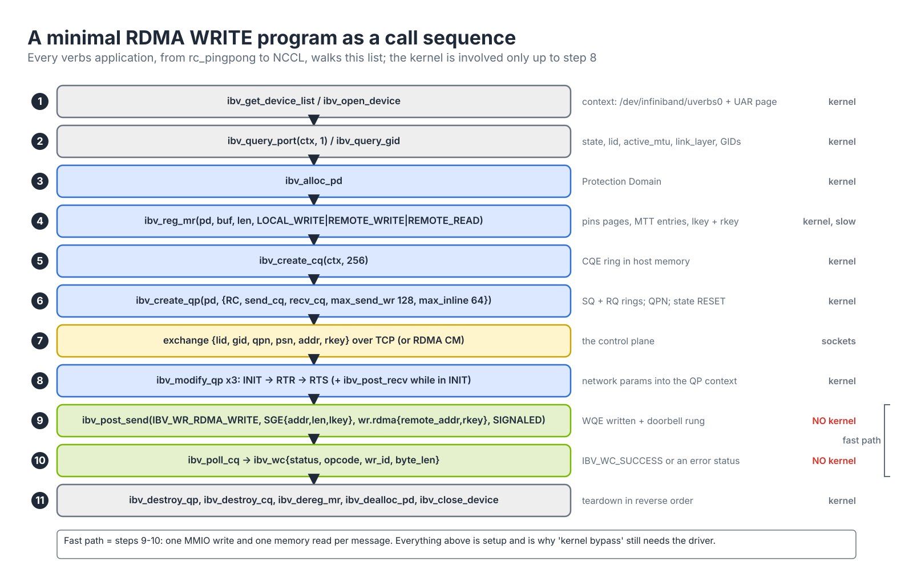
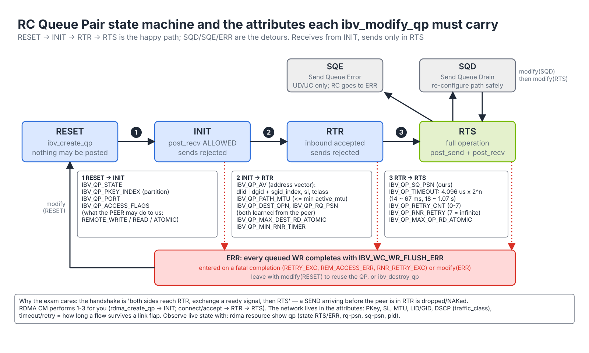

# Module 3.2 — RDMA Programming Fundamentals

> **Exam domain:** NVIDIA InfiniBand Networking (30%) — concepts reused in Troubleshooting Tools (20%)  
> **Source course(s):** Fundamentals of RDMA Programming (NVIDIA Academy)  
> **Source docs:** RDMA Aware Networks Programming User Manual; `libibverbs` and `librdmacm` man pages (`ibv_create_qp(3)`, `ibv_modify_qp(3)`, `ibv_post_send(3)`, `rdma_cm(7)`); rdma-core `examples/` (rping, rc_pingpong)  
> **Estimated study time:** 5–6 hours

> **How to study this module:** read §1–§2, work through the §3 walkthrough on real gear or NVIDIA Air, then attempt the §5 hands-on assignment using only the Hint section. Open the Solution guide (last section) only after you have a working attempt. Finish with the Appendix C knowledge check closed-book.

## 1. Learning objectives

By the end of this module you will be able to…

- **Describe** the sequence of libibverbs calls needed to move data between two hosts and what each call allocates. *(IB Networking: RDMA)*
- **Describe** the QP state machine (RESET → INIT → RTR → RTS, plus SQD/SQE/ERR) and the attributes required for each transition. *(IB Networking: RDMA)*
- **Explain** work request flags (signaled, inline, fence, solicited), inline data and immediate data. *(IB Networking: RDMA)*
- **Use** librdmacm to establish connections and **relate** its event sequence (and error events) to the raw verbs flow and to fabric causes. *(Troubleshooting Tools)*
- **Explain** memory registration cost, pinning, memlock and why registration caches exist. *(AI Data Center Design)*
- **Select** the correct GID index for RoCE connections. *(Spectrum Networking)*
- **Diagnose** common verbs programming bugs from their completion error codes. *(Troubleshooting Tools)*
- **Describe** how DOCA, NVSHMEM, UCX and NCCL layer on top of verbs. *(AI Data Center Design)*

> This module is not about becoming an RDMA developer. The exam targets network engineers; what it tests is whether you can read an application's behaviour (and its errors) and map them to fabric causes. Code is shown to make the concepts concrete.

## 2. Key technical concepts

### 2.1 The verbs object sequence

**Analogy (carried over from Module 3.1):** a **QP** is a pair of mailboxes (outbox = Send Queue, inbox = Receive Queue). **Registering an MR** is telling the post office which rooms it may deliver to — you get a key for yourself (lkey) and one to hand to a friend (rkey). A **CQ** is the tray where the courier drops a "done" slip. A **PD** is the fence around your property.

**What it is.** Every verbs program, from `rc_pingpong` to NCCL, performs the same sequence: open a device → allocate a PD → register memory → create a CQ → create a QP → exchange connection parameters → drive the QP to RTS → post work → poll completions → tear down in reverse. Figure 3.2-1 is that sequence as eleven calls; each call allocates a specific resource:


*Figure 3.2-1 — A minimal RDMA WRITE program as a call sequence: steps 1–8 and 11 go through the kernel; steps 9–10 are the fast path.*

| Call | Allocates / does | Kernel involved? |
|---|---|---|
| `ibv_get_device_list` / `ibv_open_device` | Device context: opens `/dev/infiniband/uverbsN`, maps the doorbell page (UAR) | Yes (setup) |
| `ibv_query_port` / `ibv_query_gid` | Reads LID, state, `active_mtu`, link layer; reads a GID table entry | Yes |
| `ibv_alloc_pd` | Protection Domain | Yes |
| `ibv_reg_mr` | Pins pages, builds the HCA's address translation (MTT), returns lkey/rkey | Yes — expensive |
| `ibv_create_cq` | Completion Queue ring in host memory the HCA writes to | Yes |
| `ibv_create_qp` | SQ + RQ rings; QP starts in **RESET** | Yes |
| `ibv_modify_qp` ×3 | RESET→INIT→RTR→RTS, carrying all the *network* parameters | Yes |
| `ibv_post_send` / `ibv_post_recv` | Writes a WQE and rings the doorbell — a single memory write | **No** |
| `ibv_poll_cq` | Reads CQEs from the ring | **No** |
| `ibv_req_notify_cq` + `ibv_get_cq_event` | Blocking wait on a completion-channel fd | Yes (the syscall is the point) |

**Why it exists.** The split between an expensive, kernel-mediated setup phase and a syscall-free data phase *is* RDMA's performance model. Everything that needs privilege or validation — opening hardware, pinning memory, assigning a QPN, binding a QP to a port and partition — is done once, up front; after that the HCA trusts the tables the kernel wrote and the process talks to it with plain memory writes. A program that registers memory or creates QPs inside its hot loop loses the benefit entirely.

**How it works.** Each setup call is an `ioctl`/`write` on the uverbs device: the kernel driver (`mlx5_ib`) allocates the object in HCA memory or host memory and returns a handle. `ibv_create_qp` sizes the rings from `max_send_wr`/`max_recv_wr` (rounded up to powers of two) and `max_inline_data` (which grows each WQE), and returns a 24-bit QPN; `ibv_create_cq` allocates `cqe` entries (also rounded up). After step 8 the kernel is out of the picture: step 9 writes a WQE and the doorbell, step 10 reads a CQE. Observe the objects live with `rdma resource show` (counts per type) and `rdma resource show qp` (state, PSNs, owning PID).

Network-engineer reading: `ibv_open_device` is where the kernel is involved; on the data path later it is not involved at all. `pattr.lid` is the LID the SM assigned; on RoCE it is 0 and `pattr.link_layer == IBV_LINK_LAYER_ETHERNET`.

### 2.2 The QP state machine

**Analogy:** a QP is a phone line being provisioned. RESET: the handset exists. INIT: it has a number and knows which exchange (port/PKey) it belongs to — you may already put the handset to your ear (post receives). RTR: it knows the other party's number (dest QPN, PSN, address) — incoming calls are accepted. RTS: you may dial out.

**What it is.** A QP's hardware context moves through a fixed set of states; each `ibv_modify_qp` call names the target state and a bit-mask of the attributes it carries. Figure 3.2-2 shows the states and the attribute set each RC transition must carry.


*Figure 3.2-2 — RC QP state machine and the attributes each transition carries; any fatal completion drops the QP to ERR.*

| State | Can post recv? | Can post send? | Notes |
|---|---|---|---|
| **RESET** | No | No | Fresh QP; also the state to return to for reuse |
| **INIT** | **Yes** | No | PKey index, port, access flags set. Post receives here so they are ready before the peer reaches RTS |
| **RTR** — Ready to Receive | Yes | No | Destination QPN/PSN/path set; inbound packets accepted |
| **RTS** — Ready to Send | Yes | **Yes** | Full operation |
| **SQD** — Send Queue Drain | Yes | Posting allowed but not processed until back to RTS | Used for path migration / changing attributes safely |
| **SQE** — Send Queue Error | Yes | No | Only for UD/UC (unreliable types); RC skips to ERR |
| **ERR** | Flushes | Flushes | Every outstanding WR completes with `IBV_WC_WR_FLUSH_ERR`; application must reset or destroy the QP |

**Why it exists.** An RC connection is a pair of hardware contexts that must agree on addresses and sequence numbers before the first packet. Staging the setup lets each side become *able to receive* (RTR) before anyone *sends* (RTS), so the first packet never hits a QP that does not yet know its peer — a packet arriving at a QP not in RTR/RTS is silently dropped, and the sender then times out. ERR exists because after a transport failure the PSN state is no longer trustworthy; the only safe recovery is to flush everything and rebuild.

**How it works — attributes per transition (RC, the mask bits from `ibv_modify_qp(3)`).**

1. **RESET → INIT:** `IBV_QP_STATE | IBV_QP_PKEY_INDEX | IBV_QP_PORT | IBV_QP_ACCESS_FLAGS`. The PKey *index* selects an entry of the port's PKey table (index 0 is normally the default partition, 0x7fff limited / 0xffff full); the access flags are what the *peer* may do to us through this QP (REMOTE_WRITE/READ/ATOMIC).
2. **INIT → RTR:** `IBV_QP_STATE | IBV_QP_AV | IBV_QP_PATH_MTU | IBV_QP_DEST_QPN | IBV_QP_RQ_PSN | IBV_QP_MAX_DEST_RD_ATOMIC | IBV_QP_MIN_RNR_TIMER`. The address vector holds DLID + SL + port (IB), or `is_global` with DGID + `sgid_index` + `hop_limit` + `traffic_class` (RoCE, and IB across routers). `rq_psn` is the first PSN we expect; `max_dest_rd_atomic` bounds inbound READs/atomics we will service concurrently; `min_rnr_timer` is the back-off we tell senders to use when our RQ is empty.
3. **RTR → RTS:** `IBV_QP_STATE | IBV_QP_SQ_PSN | IBV_QP_TIMEOUT | IBV_QP_RETRY_CNT | IBV_QP_RNR_RETRY | IBV_QP_MAX_QP_RD_ATOMIC`. These are the *sender's* reliability knobs.

Notice how much of the *network* is in the transition attributes: PKey index (partition), SL (QoS), path MTU, LID or GID (addressing), traffic class (RoCE DSCP), timeout/retry (how long a flow survives a link flap — NCCL exposes exactly these as `NCCL_IB_TIMEOUT` and `NCCL_IB_RETRY_CNT`).

**How it works — the reliability timers.** Figure 3.2-3 shows both retry paths on a timeline.


*Figure 3.2-3 — RNR NAK vs ACK timeout: two independent retry counters, two different error completions.*

- **Local ACK timeout** = 4.096 µs × 2^`timeout` (5-bit field; 0 means wait forever). `timeout 14` ≈ 67 ms; 18 ≈ 1.07 s. If no ACK covers an outstanding PSN within that time, the requester retransmits from the oldest unacknowledged PSN (go-back-N) and decrements its retry budget.
- **`retry_cnt`** (3 bits, 0–7) — transport retries after timeouts or PSN-sequence NAKs. When exhausted, the WR completes with **`IBV_WC_RETRY_EXC_ERR`** and the QP goes to ERR. Worst-case time to detect a dead path ≈ (`retry_cnt` + 1) × timeout: with 7 and 18 that is about 8.6 s, which is why NCCL jobs survive a brief link flap but hang for seconds on a dead one.
- **RNR NAK** — an inbound SEND or WRITE_WITH_IMM found no RECV WQE. The responder returns an AETH whose syndrome carries a 5-bit **RNR timer code** (its `min_rnr_timer`; code 12 = 0.64 ms, code 0 = the maximum, 655.36 ms). The requester waits that long and resends the *same* PSN; the packet was not stored.
- **`rnr_retry`** (3 bits) — how many RNR retries before **`IBV_WC_RNR_RETRY_EXC_ERR`**; **7 means infinite**. RNR is application pacing, not a network fault.
- The responder's counters make the two cases distinguishable from the CLI: `rdma statistic show link` exposes `rnr_nak_retry_err`, `local_ack_timeout_err`, `packet_seq_err`, `out_of_sequence` and `duplicate_request`.

**Why the exam cares:** "the peer sends before this side is in RTR" → packets dropped/NAKed, so the standard handshake is *both sides reach RTR, then exchange a ready signal, then RTS*; RDMA CM sequences this for you. "A connection with retry_cnt exhausted" → `IBV_WC_RETRY_EXC_ERR` and QP in ERR; on the fabric that usually means a dead link, wrong LID/GID, or no route.

### 2.3 Work request flags, inline and immediate data

**What it is.** A work request is a small descriptor (`struct ibv_send_wr` / `ibv_recv_wr`) the library turns into a WQE. Its opcode, scatter/gather list and flags decide what the HCA does and whether a completion is generated:

| Flag / feature | Meaning | Why you care |
|---|---|---|
| **`IBV_SEND_SIGNALED`** | Generate a CQE for this WR (when `sq_sig_all=0`) | Every N WRs must be signaled so the SQ can be reclaimed; see §4.1 |
| **`IBV_SEND_INLINE`** | Copy the payload into the WQE itself (≤ `max_inline_data`, typically ≤ 256–1024 bytes) instead of DMA-ing from the buffer | Lower latency for small messages; the buffer can be reused immediately after `post_send` returns and needs no lkey; this is why `ib_write_lat` small-message numbers are ~1 µs |
| **`IBV_SEND_FENCE`** | Wait for prior RDMA READs/atomics on this QP to complete before executing this WR | Ordering of a SEND that depends on READ results |
| **`IBV_SEND_SOLICITED`** | Set the solicited-event bit so a receiver waiting with `ibv_req_notify_cq(cq, 1)` is woken | Event-driven receivers |
| **Immediate data** (`IBV_WR_SEND_WITH_IMM`, `IBV_WR_RDMA_WRITE_WITH_IMM`, `.imm_data`) | 32 bits carried in the packet header and delivered in the receiver's CQE (`wc.imm_data`), consuming a receive WQE | Lets a one-sided WRITE also notify the receiver ("data landed, here is a tag") — NCCL and NVSHMEM-style signalling patterns |
| `wr_id` | Opaque 64-bit cookie returned in the CQE | Correlate completions with buffers |

Opcode cheat-sheet: `IBV_WR_SEND`, `IBV_WR_SEND_WITH_IMM`, `IBV_WR_RDMA_WRITE`, `IBV_WR_RDMA_WRITE_WITH_IMM`, `IBV_WR_RDMA_READ`, `IBV_WR_ATOMIC_CMP_AND_SWP`, `IBV_WR_ATOMIC_FETCH_AND_ADD`. Completion opcodes mirror them (`IBV_WC_RDMA_WRITE`, `IBV_WC_RECV`, `IBV_WC_RECV_RDMA_WITH_IMM`).

**Why it exists.** Every completion costs the HCA a 64-byte CQE write and the application a poll; at millions of messages per second that matters, so verbs lets you ask for completions selectively. Every DMA read of a small payload costs a PCIe round trip (hundreds of nanoseconds), so inline lets the CPU push tiny payloads with the WQE. Immediate data exists so one-sided WRITEs — which by design tell the target nothing — can carry a 4-byte notification at the cost of one RECV.

**How it works.** Figure 3.2-4 follows one signaled RDMA WRITE through the hardware.


*Figure 3.2-4 — post_send → WQE → doorbell → HCA → wire → remote HCA → ACK → CQE → poll; none of it is a syscall.*

1. `ibv_post_send` writes the WQE (opcode, flags, SGEs with lkeys, `remote_addr`/`rkey`, `wr_id`) into the next SQ slot. Unsignaled WQEs still occupy their slot.
2. The library rings the doorbell — one MMIO write to the UAR page (or, with BlueFlame, the whole WQE written through it).
3. The HCA fetches the WQE by DMA, translates the SGE through the MTT using the lkey, DMA-reads the payload (skipped for inline), and segments it into path-MTU packets: WRITE First (with RETH), Middle…, Last.
4. Packets go out with consecutive PSNs.
5. The responder checks PKey, QPN, PSN order, rkey/PD/access/range, DMA-writes the data and returns a (coalesced) ACK.
6. When the ACK covers this WR's last PSN, the HCA writes a CQE — only if the WR was signaled — and retires this slot *and all earlier unsignaled slots*.
7. The application's `ibv_poll_cq` reads the CQE; the SQ slots are free again.

Step 6 is why a QP with `sq_sig_all = 0` that never signals eventually returns `ENOMEM` from `ibv_post_send` (§4.1): no CQE, no slot reclamation. The usual pattern is to signal every N-th WR where N is less than the SQ depth. The same accounting applies to the CQ: if CQEs are produced faster than they are polled and the ring overflows, the CQ goes into error (`IBV_EVENT_CQ_ERR` async event) and every QP using it is affected — size CQs for the worst case of outstanding signaled WRs plus posted RECVs.

### 2.4 librdmacm: connection management done for you

**Analogy:** raw verbs is dialling an international number by hand: country code, area code, exchange, number, and you must know the callee's exact handset ID. **RDMA CM** is a phone book plus an operator: you give it an IP address, it looks up the route, rings the other side, exchanges the handset IDs and connects the line.

**What it is.** **librdmacm** models connections on sockets and hides the LID/GID/QPN/PSN exchange and the state transitions. The key abstraction is the `rdma_cm_id` (like a socket), driven by events from an `rdma_event_channel`: client `rdma_resolve_addr` → `RDMA_CM_EVENT_ADDR_RESOLVED` → `rdma_create_qp` → `rdma_resolve_route` → `ROUTE_RESOLVED` → `rdma_connect` → `ESTABLISHED`; server `rdma_bind_addr` → `rdma_listen` → `CONNECT_REQUEST` → `rdma_create_qp` → post receives → `rdma_accept` → `ESTABLISHED`.

**Why it exists.** Hand-rolled exchanges (§3) work, but every application then re-implements address resolution, GID selection, path lookup and the RTR/RTS barrier — and gets the RoCE GID index wrong. RDMA CM puts all of that in one well-tested library that uses the addresses operators already understand (IPs) and the fabric's own services (the SA on IB, the kernel's ARP/ND and routing table on RoCE).

**How it works.** Figure 3.2-5 traces the events; the numbers match.


*Figure 3.2-5 — RDMA CM: each step has a success event and an error event that names the failing layer.*

1. `rdma_resolve_addr(id, NULL, server_ip, 2000 ms)` maps the destination IP to the local RDMA device, port and source GID index (the netdev that routes to that IP). Event `ADDR_RESOLVED`, or `ADDR_ERROR`.
2. The application allocates PD/CQ/MR and calls `rdma_create_qp`, which creates the QP *and* moves it to INIT.
3. `rdma_resolve_route` — on IB an SA `PathRecord` query over QP1 returns DLID, SL, MTU and rate (so `qos-policy.conf` and partition `sl=` take effect here); on RoCE the kernel route and neighbour (ARP/ND) entry give the next-hop MAC. Event `ROUTE_RESOLVED`, or `ROUTE_ERROR`.
4. `rdma_connect` sends a CM **REQ** (CM MADs on IB; the same protocol carried over RoCE v2 UDP 4791 on Ethernet) with the client QPN, starting PSN, `responder_resources`/`initiator_depth` (→ `max_dest_rd_atomic`/`max_rd_atomic`), `retry_count`, `rnr_retry_count` and up to a few dozen bytes of `private_data` (where applications put their rkey and buffer address).
5. The server sees `CONNECT_REQUEST` on a new per-connection id, creates its QP, posts receives and calls `rdma_accept`, which sends **REP** (server QPN/PSN).
6. The client moves its QP to RTR and RTS and returns **RTU**; the server moves to RTS. Both see `ESTABLISHED`.
7. Data moves with plain verbs.
8. `rdma_disconnect` → DREQ/DREP → `DISCONNECTED`; destroy QP and id.

Why network engineers should know this flow: the *error events* map to fabric problems. `ADDR_ERROR` = the IP does not map to an RDMA device (wrong interface, missing IPoIB address); `ROUTE_ERROR` on IB = SA path query failed (no SM, PKey mismatch); `UNREACHABLE`/`CONNECT_ERROR` on RoCE = GID/MAC resolution or a firewalled UDP 4791; `REJECTED` = the peer is listening on a different port space or refused (e.g. QP attribute mismatch).

**rping** (`rdma-core` examples) is the smallest useful RDMA CM program: server `rping -s -a <ip> -v`, client `rping -c -a <server-ip> -v -C 10`. It performs connect → RDMA WRITE ping → RDMA READ pong, printing each payload. It is the RDMA equivalent of `ping` and the first thing to run when "RDMA doesn't work" — it validates device mapping, GID selection, PKey/route resolution and that READ/WRITE actually pass, independent of NCCL. `udaddy` (UD), `ucmatose` (RC), `rdma_server`/`rdma_client` (the simplified synchronous `rdma_cm` API) are its siblings.

### 2.5 Memory registration cost and pinning

**What it is.** Registration does three expensive things: it faults in and **pins** every page (the kernel marks them unmovable, and they count against `RLIMIT_MEMLOCK`), builds the HCA's address translation (MTT) entries, and writes them to the device. Order of magnitude: tens of microseconds for small buffers, milliseconds for gigabytes. Deregistration is similarly costly.

**Why it exists.** The HCA DMAs by physical (bus) address while the application thinks in virtual addresses, and the kernel is not on the data path to translate or to stop pages moving. So translation must be precomputed into HCA tables and the pages must not move while the HCA might touch them — that is pinning. The cost is proportional to the number of pages: a 4 GiB GPU buffer in 4 KiB host pages would be a million MTT entries (GPU memory is mapped in 64 KiB GPU pages; host buffers benefit from 2 MiB huge pages).

**How it works.** `ibv_reg_mr` → kernel `get_user_pages`-style pinning (or, for GPU memory, `nvidia-peermem`/DMA-BUF supplying the GPU's bus addresses) → DMA mapping through the IOMMU if enabled → MTT entries written to the HCA → lkey/rkey (32-bit) returned. Every subsequent WQE or incoming RETH is translated by the HCA with no CPU involvement. Consequences:

- `ulimit -l unlimited` (memlock) is mandatory on RDMA hosts; a container with a low memlock limit fails with `ibv_reg_mr: Cannot allocate memory`. Kubernetes pods need the `IPC_LOCK` capability or the limit raised (Module 7).
- Libraries keep **registration caches** (UCX `rcache`, NCCL's registered buffer pools) and use large, long-lived buffers. Churn in registration shows up as bandwidth collapse and high CPU in `ibv_reg_mr`.
- **On-Demand Paging (ODP)** (`IBV_ACCESS_ON_DEMAND`) and **implicit ODP** let the HCA page-fault instead of pinning, trading latency spikes for flexibility.
- **GPUDirect RDMA**: registering `cudaMalloc` memory requires the `nvidia-peermem` kernel module (or DMA-BUF on newer kernels/drivers); `NCCL_NET_GDR_LEVEL` controls when NCCL uses it based on PCIe topology. Without it, NCCL bounces through host memory — visible as halved bandwidth and CPU load.
- **Relaxed ordering** (`IBV_ACCESS_RELAXED_ORDERING`) improves PCIe efficiency to GPUs behind switches; firmware `mlxconfig` knobs (`PCI_WR_ORDERING`) interact with it.

**Failure modes.** `Cannot allocate memory` (memlock), `Bad address` (buffer freed or not mapped), silently lower bandwidth with GPU buffers (`nvidia-peermem` not loaded so NCCL falls back to host staging — `NCCL_DEBUG=INFO` shows `GDR 0`).

### 2.6 GID index selection for RoCE

**What it is.** On RoCE there are no LIDs; every connection is addressed by **GID**, and a port's GID *table* contains several entries created automatically by the kernel from the netdev's addresses:

```text
$ show_gids
DEV     PORT  INDEX  GID                                      IPv4           VER  DEV
mlx5_2  1     0      fe80:0000:0000:0000:b83f:d2ff:fe00:1122                 v1   ens1f0
mlx5_2  1     1      fe80:0000:0000:0000:b83f:d2ff:fe00:1122                 v2   ens1f0
mlx5_2  1     2      0000:0000:0000:0000:0000:ffff:0a0a:0114  10.10.1.20     v1   ens1f0
mlx5_2  1     3      0000:0000:0000:0000:0000:ffff:0a0a:0114  10.10.1.20     v2   ens1f0
mlx5_2  1     4      ...  (one pair per VLAN sub-interface or extra IP)
```

Each IP (and link-local) appears twice: once as **RoCE v1** and once as **RoCE v2**. The `sgid_index` you place in the address vector (or `-x` in perftest, `NCCL_IB_GID_INDEX` in NCCL) decides *both* the source IP and the RoCE version of the packets you emit.

**Why it exists.** A GID is 128 bits so it can hold an IPv6 address directly or an IPv4 address in the IPv4-mapped form `::ffff:a.b.c.d` (0a0a:0114 above is 10.10.1.20). Because one netdev can have several IPs, VLANs and both RoCE versions, the table has many entries, and the HCA needs to know per QP which one to put in the packet's source IP and which encapsulation (v1 EtherType 0x8915 or v2 UDP 4791) to use.

**How it works.** Rules:

- Use a **v2** entry with the IPv4/IPv6 address on the interface that routes to the peer (index 3 above). Index 0/1 (link-local) only works on the same L2 segment.
- Entries on VLAN sub-interfaces get their own indices; the VLAN tag is inserted by the HCA.
- RDMA CM selects the index automatically from the IP you connect to — one more reason to prefer it. NCCL ≥ 2.12 also auto-detects when `NCCL_IB_GID_INDEX` is unset (check release notes; older versions default to 0, which breaks routed RoCE).
- `cma_roce_mode -d mlx5_2 -p 1` shows/sets the default RoCE version RDMA CM uses (details in [Module 3.3](03-roce-a-to-z.md)).

The table is visible without tools in sysfs: `/sys/class/infiniband/mlx5_2/ports/1/gids/<n>` and `.../gid_attrs/types/<n>` ("IB/RoCE v1" or "RoCE v2"). The index is *local* — the two ends may use different numbers as long as each picks its own v2 IPv4 entry.

### 2.7 UD and multicast basics

**What it is.** UD QPs have no connection: every `ibv_post_send` carries an **Address Handle** (`ibv_create_ah` from an `ibv_ah_attr` with DLID/GID/SL) plus the destination QPN and **Q_Key** (a 32-bit shared secret that must match on both sides). Messages are limited to one path MTU; each receive buffer must leave **40 bytes** at the front for the GRH, which the HCA deposits even on IB when present.

**Why it exists.** Some traffic is one-to-many or many-to-one with tiny messages — address resolution, SA queries, service discovery, IPoIB broadcast — where a connected QP per peer would be absurd. UD trades reliability and large messages for scale and multicast.

**How it works.** For **multicast**: the application joins a multicast group (MGID) via the SA (`rdma_join_multicast` or `ibv_attach_mcast`), the SM programs the switches' multicast forwarding tables, and a SEND to the MLID/MGID is replicated by the fabric. IPoIB uses exactly this for broadcast/ARP, which is why a missing `ipoib` flag in partitions.conf (no multicast group) breaks IP over a PKey. A UD packet carries a DETH (Q_Key + source QPN) after the BTH; a Q_Key mismatch is dropped silently at the receiver, which is the classic "UD sends complete but nothing arrives" bug.

### 2.8 How DOCA, NVSHMEM, UCX and NCCL build on verbs

**What it is.** Every higher-level communication library on NVIDIA hardware is, at the bottom, a verbs (or `mlx5dv` direct-verbs) user:

| Layer | Relationship to verbs | What it adds |
|---|---|---|
| **UCX** | Thin transport abstraction over `libibverbs`/`mlx5dv`, shared memory, CUDA IPC, TCP | Picks RC/DC/UD per message size and scale, registration cache, rendezvous vs eager protocols, GPU memory awareness. Used by Open MPI/HPC-X, NVSHMEM (optionally), and as the base of UCC collectives |
| **NCCL** | Its `net_ib` plugin calls verbs directly (RC QPs, RDMA WRITE + flags/immediate, registered GPU buffers via GPUDirect RDMA); can be replaced by external *net plugins* (`libnccl-net.so`) such as the SHARP/CollNet plugin or a UCX plugin | Topology-aware collective algorithms (ring, tree, CollNet, NVLS), channel/QP management, `NCCL_IB_*` knobs that map 1:1 to the QP attributes in §3 |
| **NVSHMEM** | One-sided put/get from GPU kernels → RDMA WRITE/READ and atomics through either its own IBRC/IBGDA transport (GPU-initiated verbs via `mlx5dv`, the HCA doorbell rung from the GPU) or UCX | Symmetric heap, GPU-side synchronisation, lowest latency for fine-grained communication |
| **DOCA** (BlueField) | DOCA RDMA and DOCA Comch wrap verbs/`mlx5dv` with a device-model API usable on host or DPU; DOCA also exposes flow steering, DPA (data-path accelerator) programming | Programmable offloads on the DPU; Module 5 |
| **DPDK / mlx5dv direct verbs** | Bypass even libibverbs' generic layer to post WQEs directly | Used by high-performance middleware; not exam-critical beyond knowing it exists |

**Why it exists.** Each library optimises for a different pattern — collectives (NCCL), fine-grained GPU-initiated one-sided access (NVSHMEM), general MPI point-to-point at massive rank counts (UCX), DPU-resident data paths (DOCA) — but none wants to own a NIC driver. Verbs is the common contract.

**How it works.** The mapping is direct enough to debug from the fabric: NCCL's `NCCL_IB_GID_INDEX`, `NCCL_IB_TC`, `NCCL_IB_SL`, `NCCL_IB_TIMEOUT`, `NCCL_IB_RETRY_CNT` are literally `sgid_index`, `traffic_class`, `sl`, `timeout`, `retry_cnt` in the INIT→RTR and RTR→RTS transitions of §2.2; an `IBV_WC_RETRY_EXC_ERR` in an NCCL log is the same completion your own program would get. NVSHMEM's IBGDA goes one step further: the GPU itself writes WQEs and rings the HCA doorbell, removing the CPU proxy thread entirely.

The thread running through all of them: *one-sided RDMA WRITE with registered, pinned GPU memory* is the primitive that lets a GPU in rack 12 land data in a GPU in rack 40 without any CPU on either end — and every one of the fabric properties in this course (losslessness, MTU, QoS, adaptive routing, PFC/ECN) is in service of that primitive.

## 3. Live-style walkthrough: a minimal RDMA WRITE program, every call commented, then rping

Below is a complete two-node RDMA WRITE program (error handling trimmed to `CHECK()` for readability). Both sides run the same binary; they exchange connection data over a plain TCP socket (`exchange()` is a 20-line send/recv of the struct, not shown). Compile with `gcc -O2 -o rdma_write rdma_write.c -libverbs`. The numbered comment blocks follow Figure 3.2-1 (steps 1–11), sections 5a–5c are the three transitions of Figure 3.2-2, and section 6–7 is the WQE life cycle of Figure 3.2-4.

```c
/* rdma_write.c — minimal RC RDMA WRITE between two hosts.  Usage: ./rdma_write [server-ip]  (no arg = server) */
#include <infiniband/verbs.h>
#include <stdio.h>
#include <stdlib.h>
#include <string.h>
#include <stdint.h>
#define CHECK(x) do { if (!(x)) { perror(#x); exit(1); } } while (0)

struct conn_info {                       /* the control plane — everything the peer must know about us */
    uint16_t lid;  uint32_t qpn;  uint32_t psn;
    union ibv_gid gid;  uint64_t addr;  uint32_t rkey;
} local, remote;

int main(int argc, char **argv)
{
    int is_server = (argc == 1);
    int gid_index = 0;                   /* IB: ignored unless GRH used. RoCE: MUST be the v2 IP entry from show_gids (e.g. 3) */

    /* ---- 1. Find and open a device ------------------------------------------------------------ */
    int num;
    struct ibv_device **list = ibv_get_device_list(&num);         /* all RDMA devices (mlx5_0, mlx5_1 ...) */
    CHECK(list && num > 0);
    struct ibv_device  *dev = list[0];                            /* or match ibv_get_device_name(dev) against "mlx5_0" */
    struct ibv_context *ctx = ibv_open_device(dev);               /* opens /dev/infiniband/uverbsN, maps the doorbell page */
    CHECK(ctx);
    ibv_free_device_list(list);

    struct ibv_port_attr pattr;
    CHECK(!ibv_query_port(ctx, 1, &pattr));                       /* port 1: state, lid, active_mtu, link_layer */
    CHECK(pattr.state == IBV_PORT_ACTIVE);                        /* on IB this fails with no SM ("Initializing") */
    /* pattr.lid is the SM-assigned LID; 0 on RoCE where pattr.link_layer == IBV_LINK_LAYER_ETHERNET */

    /* ---- 2. Protection domain and memory registration ------------------------------------------ */
    struct ibv_pd *pd = ibv_alloc_pd(ctx);                        /* the fence: MRs and QPs must share a PD */
    CHECK(pd);

    size_t len = 1 << 20;                                         /* 1 MiB buffer */
    void *buf = aligned_alloc(4096, len);
    CHECK(buf);
    memset(buf, is_server ? 0 : 'A', len);                        /* client writes 'A's, server starts zeroed */
    struct ibv_mr *mr = ibv_reg_mr(pd, buf, len,
            IBV_ACCESS_LOCAL_WRITE | IBV_ACCESS_REMOTE_WRITE | IBV_ACCESS_REMOTE_READ);
    CHECK(mr);
    /* ibv_reg_mr pins the pages (counts against ulimit -l), programs the HCA's translation tables, and returns:
       mr->lkey : the key WE use in our own scatter/gather entries
       mr->rkey : the key we HAND TO THE PEER so it may RDMA WRITE/READ this buffer
       Without IBV_ACCESS_REMOTE_WRITE here, the peer's WRITE fails with IBV_WC_REM_ACCESS_ERR on ITS side. */

    /* ---- 3. Completion queue and queue pair ----------------------------------------------------- */
    struct ibv_cq *cq = ibv_create_cq(ctx, 256, NULL, NULL, 0);  /* 256 CQEs minimum; shared by SQ and RQ here */
    CHECK(cq);

    struct ibv_qp_init_attr qia = {
        .send_cq = cq, .recv_cq = cq,
        .cap = { .max_send_wr = 128, .max_recv_wr = 128,          /* ring depths */
                 .max_send_sge = 1, .max_recv_sge = 1,
                 .max_inline_data = 64 },                         /* bytes we may send INLINE (payload inside the WQE) */
        .qp_type   = IBV_QPT_RC,                                  /* reliable connected: the only type with RDMA READ + atomics */
        .sq_sig_all = 0,                                          /* 0 = only WRs flagged IBV_SEND_SIGNALED produce a CQE (see §4.1) */
    };
    struct ibv_qp *qp = ibv_create_qp(pd, &qia);                  /* QP is born in RESET; qp->qp_num is our QPN */
    CHECK(qp);

    /* ---- 4. Exchange connection parameters out of band ---------------------------------------- */
    local.lid = pattr.lid;
    local.qpn = qp->qp_num;
    local.psn = rand() & 0xffffff;                                /* 24-bit starting packet sequence number */
    CHECK(!ibv_query_gid(ctx, 1, gid_index, &local.gid));         /* on RoCE this picks source IP + RoCE version */
    local.addr = (uintptr_t)buf;
    local.rkey = mr->rkey;
    exchange(is_server, argc > 1 ? argv[1] : NULL, &local, &remote);  /* TCP: send ours, receive theirs */
    /* This struct IS the control plane. RDMA CM replaces the lid/qpn/psn/gid part; addr/rkey always remain ours to exchange. */

    /* ---- 5a. RESET -> INIT : which port/partition, what remote ops we permit ------------------- */
    struct ibv_qp_attr a;
    memset(&a, 0, sizeof a);
    a.qp_state        = IBV_QPS_INIT;
    a.pkey_index      = 0;                                        /* index into the port's PKey table (0 = default 0x7fff/0xffff) */
    a.port_num        = 1;
    a.qp_access_flags = IBV_ACCESS_REMOTE_WRITE | IBV_ACCESS_REMOTE_READ;   /* what the PEER may do to us via this QP */
    CHECK(!ibv_modify_qp(qp, &a, IBV_QP_STATE | IBV_QP_PKEY_INDEX | IBV_QP_PORT | IBV_QP_ACCESS_FLAGS));

    /* Receives may (and should) be posted HERE, before the peer can possibly send. This program uses one-sided
       WRITE so none are strictly needed, but we post one anyway to show the pattern (and for WRITE_WITH_IMM later). */
    struct ibv_sge rsge = { .addr = (uintptr_t)buf, .length = len, .lkey = mr->lkey };
    struct ibv_recv_wr rwr = { .wr_id = 1, .sg_list = &rsge, .num_sge = 1 }, *bad_r;
    CHECK(!ibv_post_recv(qp, &rwr, &bad_r));

    /* ---- 5b. INIT -> RTR : who we receive from --------------------------------------------------- */
    memset(&a, 0, sizeof a);
    a.qp_state           = IBV_QPS_RTR;
    a.path_mtu           = IBV_MTU_4096;                          /* must be <= min(active_mtu) of both ports; too big = hang/RETRY_EXC */
    a.dest_qp_num        = remote.qpn;                            /* the peer's QPN */
    a.rq_psn             = remote.psn;                            /* first PSN we expect from them */
    a.max_dest_rd_atomic = 16;                                    /* inbound READ/atomic concurrency we allow */
    a.min_rnr_timer      = 12;                                    /* RNR NAK back-off, encoded */
    a.ah_attr.dlid       = remote.lid;                            /* IB: destination LID (0 on RoCE) */
    a.ah_attr.sl         = 0;                                     /* service level -> VL via SL2VL (Module 2.3); NCCL_IB_SL */
    a.ah_attr.port_num   = 1;
    a.ah_attr.src_path_bits = 0;
    if (pattr.link_layer == IBV_LINK_LAYER_ETHERNET || 1 /* GRH also fine on IB */) {
        a.ah_attr.is_global         = 1;                          /* include a GRH */
        a.ah_attr.grh.dgid          = remote.gid;                 /* RoCE: destination IP-derived GID */
        a.ah_attr.grh.sgid_index    = gid_index;                  /* RoCE: WHICH local GID -> source IP and v1/v2 */
        a.ah_attr.grh.hop_limit     = 64;                         /* IP TTL on RoCE v2 */
        a.ah_attr.grh.traffic_class = 0;                          /* RoCE: DSCP<<2 | ECN goes here, e.g. 106 for DSCP 26 (NCCL_IB_TC) */
    }
    CHECK(!ibv_modify_qp(qp, &a, IBV_QP_STATE | IBV_QP_AV | IBV_QP_PATH_MTU | IBV_QP_DEST_QPN |
                                 IBV_QP_RQ_PSN | IBV_QP_MAX_DEST_RD_ATOMIC | IBV_QP_MIN_RNR_TIMER));

    /* Both sides must be in RTR before either goes to RTS and sends; a second tiny TCP exchange is the usual barrier. */
    barrier(is_server);

    /* ---- 5c. RTR -> RTS : how we send ------------------------------------------------------------- */
    memset(&a, 0, sizeof a);
    a.qp_state      = IBV_QPS_RTS;
    a.sq_psn        = local.psn;                                  /* our first outgoing PSN (what we told the peer) */
    a.timeout       = 14;                                         /* ACK timeout = 4.096us * 2^14 ~ 67 ms  (NCCL_IB_TIMEOUT, default 18) */
    a.retry_cnt     = 7;                                          /* transport retries before IBV_WC_RETRY_EXC_ERR (NCCL_IB_RETRY_CNT) */
    a.rnr_retry     = 7;                                          /* 7 = retry RNR NAKs forever */
    a.max_rd_atomic = 16;                                         /* outstanding outbound READ/atomic */
    CHECK(!ibv_modify_qp(qp, &a, IBV_QP_STATE | IBV_QP_SQ_PSN | IBV_QP_TIMEOUT | IBV_QP_RETRY_CNT |
                                 IBV_QP_RNR_RETRY | IBV_QP_MAX_QP_RD_ATOMIC));

    /* ---- 6. Client: RDMA WRITE 64 KiB into the server's buffer, signaled ------------------------- */
    if (!is_server) {
        struct ibv_sge ssge = { .addr = (uintptr_t)buf, .length = 65536, .lkey = mr->lkey };   /* LOCAL key for the local SGE */
        struct ibv_send_wr swr = {
            .wr_id      = 42,                                     /* cookie returned in the CQE */
            .sg_list    = &ssge, .num_sge = 1,
            .opcode     = IBV_WR_RDMA_WRITE,                      /* one-sided; server CPU and RQ are not involved */
            .send_flags = IBV_SEND_SIGNALED,                      /* we want a CQE for this one */
            .wr.rdma    = { .remote_addr = remote.addr, .rkey = remote.rkey },   /* REMOTE address + REMOTE key */
        }, *bad_s;
        CHECK(!ibv_post_send(qp, &swr, &bad_s));                  /* writes a WQE into the SQ ring + rings the doorbell: no syscall */

        /* ---- 7. Poll for the completion ---------------------------------------------------------- */
        struct ibv_wc wc;
        int n;
        while ((n = ibv_poll_cq(cq, 1, &wc)) == 0) ;              /* busy poll (a memory read); or ibv_req_notify_cq + ibv_get_cq_event */
        CHECK(n > 0);
        if (wc.status != IBV_WC_SUCCESS)
            fprintf(stderr, "wr %lu failed: %s (vendor 0x%x)\n", wc.wr_id, ibv_wc_status_str(wc.status), wc.vendor_err);
        else
            printf("RDMA WRITE of %u bytes completed (wr_id %lu)\n", 65536u, wc.wr_id);
        /* Typical failures: IBV_WC_REM_ACCESS_ERR (bad rkey/addr/permission), IBV_WC_RETRY_EXC_ERR (peer unreachable, MTU, dead
           link), IBV_WC_LOC_PROT_ERR (bad lkey). The server learns nothing — one-sided — unless we used WRITE_WITH_IMM. */
    } else {
        barrier(0);                                               /* wait for the client to say "done" over TCP */
        printf("server buffer now starts with: %.8s\n", (char *)buf);   /* "AAAAAAAA" — landed with zero server CPU involvement */
    }

    /* ---- 8. Teardown in reverse order ---------------------------------------------------------- */
    ibv_destroy_qp(qp); ibv_destroy_cq(cq); ibv_dereg_mr(mr); ibv_dealloc_pd(pd); ibv_close_device(ctx);
    free(buf);
    return 0;
}
```

What "good" looks like:

```bash
hostB$ ./rdma_write                        # server
server buffer now starts with: AAAAAAAA
hostA$ ./rdma_write 10.10.1.21             # client
RDMA WRITE of 65536 bytes completed (wr_id 42)
hostA$ rdma resource show qp               # while running: one RC QP in state RTS owned by our PID
link mlx5_0/1 lqpn 178 rqpn 196 type RC state RTS rq-psn 0x4d5e6f sq-psn 0x1a2b3c path-mig-state MIGRATED pid 23188 comm rdma_write
```

### The same connection with librdmacm

Read this against Figure 3.2-5: `rdma_resolve_addr` is step ①, `rdma_create_qp` ②, `rdma_resolve_route` ③, `rdma_connect` ④, the server side ⑤, `ESTABLISHED` ⑥.

```c
#include <rdma/rdma_cma.h>
struct rdma_event_channel *ec = rdma_create_event_channel();          /* fd we read CM events from */
struct rdma_cm_id *id;
rdma_create_id(ec, &id, NULL, RDMA_PS_TCP);                           /* RDMA_PS_TCP = reliable connected (RC); RDMA_PS_UDP = UD */

/* ---- client ---- */
rdma_resolve_addr(id, NULL, (struct sockaddr *)&server, 2000);        /* IP -> RDMA device, port, GID (picks the GID index for us!) */
/* wait: RDMA_CM_EVENT_ADDR_RESOLVED  -> id->verbs (context) and id->port_num now known            (ADDR_ERROR = IP not on an RDMA netdev) */
pd = ibv_alloc_pd(id->verbs);  cq = ibv_create_cq(id->verbs, 256, NULL, NULL, 0);  mr = ibv_reg_mr(pd, buf, len, access);
rdma_create_qp(id, pd, &qp_init_attr);                                /* QP created AND moved to INIT for us */
rdma_resolve_route(id, 2000);                                         /* IB: SA path record (SL, MTU, DLID); RoCE: ARP/ND + route   (ROUTE_ERROR = no SM / PKey) */
/* wait: RDMA_CM_EVENT_ROUTE_RESOLVED */
struct rdma_conn_param cp = { .private_data = &my_rkey_and_addr, .private_data_len = 12,     /* rkey/addr still OUR job */
                              .responder_resources = 16, .initiator_depth = 16, .retry_count = 7, .rnr_retry_count = 7 };
rdma_connect(id, &cp);                                                /* sends CM REQ; QP -> RTR -> RTS as the REP arrives */
/* wait: RDMA_CM_EVENT_ESTABLISHED   (REJECTED / UNREACHABLE / CONNECT_ERROR = peer refused / GID-MAC / UDP 4791 blocked) */

/* ---- server ---- */
rdma_bind_addr(listen_id, (struct sockaddr *)&local);  rdma_listen(listen_id, 10);
/* wait: RDMA_CM_EVENT_CONNECT_REQUEST -> event->id is the per-connection id; event->param.conn.private_data has the client's rkey */
rdma_create_qp(event->id, pd, &qp_init_attr);  /* post receives */  rdma_accept(event->id, &cp);
/* wait: RDMA_CM_EVENT_ESTABLISHED */

/* both: rdma_get_cm_event(ec, &event) ... rdma_ack_cm_event(event);  on exit rdma_disconnect -> RDMA_CM_EVENT_DISCONNECTED */
```

### rping: the RDMA "ping"

```bash
hostB$ rping -s -a 10.10.1.21 -v           # -s server, -a bind address, -v print payloads
hostA$ rping -c -a 10.10.1.21 -v -C 10     # -c client, -C 10 iterations
ping data: rdma-ping-0: ABCDEFGHIJKLMNOPQRSTUVWXYZ[\]^_`abcdefghijklmnopqrstuvwxyz   # each line = WRITE ping + READ pong round trip
ping data: rdma-ping-1: BCDEFGHIJKLMNOPQRSTUVWXYZ[\]^_`abcdefghijklmnopqrstuvwxyzA
...
client DISCONNECT EVENT...                 # clean teardown via rdma_disconnect
# Success proves: IP->device mapping, GID/version selection, route/path resolution, QP transitions, RDMA WRITE and READ.
# Run this BEFORE blaming NCCL. If rping fails, NCCL will too, and the CM event in its error message names the layer.
```

## 4. Troubleshooting / common gotchas

### 4.1 `ibv_post_send` returns ENOMEM after a few hundred WRs

**Symptom:** throughput stalls; `ibv_post_send` eventually fails with `ENOMEM`; `rdma resource show qp` shows the QP still in RTS.

**Why it happens:** `sq_sig_all = 0` and no WR carried `IBV_SEND_SIGNALED`. Without completions the HCA never tells the library a WQE slot is free, so the SQ ring fills.

**How to debug:**

```bash
rdma resource show qp | grep <pid>                    # QP healthy in RTS -> not a fabric issue
rdma statistic show link mlx5_0/1                     # no error counters moving -> the data path is idle, not failing
grep -n "sq_sig_all\|SIGNALED" myprog.c               # is anything ever signaled?
```

**Fix:** signal at least every `max_send_wr/2` WRs (or set `sq_sig_all = 1` while debugging) and poll the CQ so slots are reclaimed.

### 4.2 Client completes with `IBV_WC_REM_ACCESS_ERR`, QP goes to ERR

**Symptom:** the first WRITE/READ fails with `remote access error`; all subsequent WRs flush with `IBV_WC_WR_FLUSH_ERR`.

**Why it happens:** the rkey or remote address is wrong (byte-order bug in the exchange, stale rkey from a re-registered MR), or the remote MR was registered without `IBV_ACCESS_REMOTE_WRITE`/`REMOTE_READ`, or the QP's `qp_access_flags` at INIT did not permit the operation.

**How to debug:**

```bash
# Print both sides' exchanged struct: do local.rkey on B == remote.rkey on A (and addr)? Watch for htonl/ntohl mistakes.
rdma statistic show link mlx5_0/1 | tr ' ' '\n' | grep -iE "access|protection"   # responder-side access error counters rising
dmesg | grep -i mlx5 | tail                           # syndrome lines name the failing check
```

**Fix:** register with the needed REMOTE flags, set matching `qp_access_flags`, exchange rkey/addr after the final registration, then reset the QP (modify to RESET, back through INIT/RTR/RTS) or recreate it.

### 4.3 Connect works on the same rack, times out across racks (RoCE)

**Symptom:** `rping` or your program connects when both hosts are on one leaf; across leaves it hangs and fails with `IBV_WC_RETRY_EXC_ERR` or `RDMA_CM_EVENT_UNREACHABLE`; `tcpdump` shows no UDP 4791 arriving.

**Why it happens:** the raw-verbs program hard-coded `gid_index = 0`, the link-local RoCE v1 entry — fine on one L2 segment, impossible across a router. Or one side chose a v1 index and the other v2.

**How to debug:**

```bash
show_gids                                             # which indices are v2 + IPv4 on EACH host (they can differ)
sudo tcpdump -ni ens1f0np0 udp port 4791 -c 5         # v2 packets present? (v1 shows as ethertype 0x8915 instead)
cma_roce_mode -d mlx5_2 -p 1                          # CM default version
```

**Fix:** use the v2 IPv4 index (`-x 3` / `sgid_index = 3` / `NCCL_IB_GID_INDEX=3`) on both ends, or switch to RDMA CM which resolves the index from the destination IP.

### 4.4 `ibv_reg_mr: Cannot allocate memory` inside a container

**Symptom:** the program fails at registration; the same binary works on the bare host.

**Why it happens:** the container's `RLIMIT_MEMLOCK` is low (often 64 KiB), so pinning fails.

**How to debug:** `ulimit -l` inside the container; `docker inspect <id> | grep -i ulimit`; for Kubernetes check `securityContext.capabilities.add: ["IPC_LOCK"]`.

**Fix:** `--ulimit memlock=-1:-1` on Docker, `IPC_LOCK` capability or an unlimited memlock limit on the pod (Module 7); on the host `/etc/security/limits.conf`: `* - memlock unlimited`.

## 5. Hands-on assignment: RDMA WRITE with immediate and RNR handling

**Scenario.** The walkthrough program's server never learns when data has landed — it relies on a TCP barrier. Convert it into a self-notifying transfer the way NCCL does: the client performs **RDMA WRITE with immediate** so the server gets a CQE with a 32-bit tag per chunk, and make the pair robust when the server is slow to post receives.

**Requirements:**

1. Replace `IBV_WR_RDMA_WRITE` with `IBV_WR_RDMA_WRITE_WITH_IMM`; the immediate carries a chunk sequence number. Send 8 chunks of 64 KiB into consecutive offsets of the server buffer.
2. The server posts receive WQEs (a receive is consumed per WRITE_WITH_IMM) and prints, for each completion, the opcode, `wc.imm_data` and the byte count; it must verify the data landed at the expected offset.
3. Deliberately start the server with **only 2** receives posted and `rnr_retry = 7` on the client, and show that the transfer still completes (RNR NAKs are retried) — then set `rnr_retry = 0` and show the client failing with `IBV_WC_RNR_RETRY_EXC_ERR`.
4. Replenish receives correctly: the server posts a new RECV each time it consumes one, so an arbitrarily long stream works.
5. Signal only every 4th client WR (keep `sq_sig_all = 0`) and still reclaim the SQ correctly.
6. Make the program work on RoCE by taking the GID index from an argument.

**Deliverables:** the modified source, a run log for the normal case, the `rnr_retry = 7` slow-server case, and the `rnr_retry = 0` failure case; `rdma statistic show` output captured during the slow-server run.

**Acceptance criteria:**

- A. Server prints 8 lines with opcode `IBV_WC_RECV_RDMA_WITH_IMM`, `imm_data` 0..7 in order, byte count 65536, and the data check passes for each chunk.
- B. With 2 initial receives and `rnr_retry = 7`, all 8 chunks complete; `rdma statistic` shows `rnr_nak_retry_err` (or the equivalent RNR counter on your release) incremented on the client.
- C. With `rnr_retry = 0`, the client reports `IBV_WC_RNR_RETRY_EXC_ERR` and the QP moves to ERR (shown by `rdma resource show qp`).
- D. The client posts 8 WRs with only 2 signaled completions polled, and `ibv_post_send` never returns ENOMEM.
- E. The same binary works on a RoCE pair with the v2 GID index passed as an argument.

### Hint

- Re-read §2.3: which opcode consumes a receive WQE on the responder even though it is "one-sided", and where does the 32-bit value appear on the receiver?
- Think about *when* the server posts receives relative to the state machine (§2.2) and the slow-server test. Where does an RNR NAK originate and who retries?
- `min_rnr_timer` on the server controls how long the client backs off; small values make the test finish faster.
- For requirement 5, remember what `IBV_SEND_SIGNALED` is for — and that unsignaled WRs *are* reclaimed when a later signaled WR completes.
- `ibv_wc_status_str(wc.status)` and `rdma resource show qp` will produce the evidence for criteria C and D.

## Appendix A — Quick command / config reference

| Task | Verbs / tool |
|---|---|
| Enumerate and open | `ibv_get_device_list` → `ibv_open_device` → `ibv_query_port` / `ibv_query_gid` |
| Resources | `ibv_alloc_pd`, `ibv_reg_mr(pd, buf, len, access)`, `ibv_create_cq`, `ibv_create_qp` |
| State transitions | `ibv_modify_qp` with masks `IBV_QP_STATE \| IBV_QP_PKEY_INDEX \| IBV_QP_PORT \| IBV_QP_ACCESS_FLAGS` (INIT); `… \| IBV_QP_AV \| IBV_QP_PATH_MTU \| IBV_QP_DEST_QPN \| IBV_QP_RQ_PSN \| IBV_QP_MAX_DEST_RD_ATOMIC \| IBV_QP_MIN_RNR_TIMER` (RTR); `… \| IBV_QP_SQ_PSN \| IBV_QP_TIMEOUT \| IBV_QP_RETRY_CNT \| IBV_QP_RNR_RETRY \| IBV_QP_MAX_QP_RD_ATOMIC` (RTS) |
| Data path | `ibv_post_recv`, `ibv_post_send`, `ibv_poll_cq`, `ibv_req_notify_cq` + `ibv_get_cq_event` |
| Opcodes | `IBV_WR_SEND[_WITH_IMM]`, `IBV_WR_RDMA_WRITE[_WITH_IMM]`, `IBV_WR_RDMA_READ`, `IBV_WR_ATOMIC_CMP_AND_SWP`, `IBV_WR_ATOMIC_FETCH_AND_ADD` |
| Flags | `IBV_SEND_SIGNALED`, `IBV_SEND_INLINE`, `IBV_SEND_FENCE`, `IBV_SEND_SOLICITED` |
| RDMA CM | `rdma_create_event_channel`, `rdma_create_id`, `rdma_resolve_addr`, `rdma_resolve_route`, `rdma_create_qp`, `rdma_connect` / `rdma_listen` + `rdma_accept`, `rdma_get_cm_event`, `rdma_ack_cm_event`, `rdma_disconnect` |
| Quick connectivity test | `rping -s -a <ip> -v` / `rping -c -a <ip> -v -C 10`; siblings `udaddy`, `ucmatose`, `rdma_server`/`rdma_client` |
| GID table | `show_gids`, `ibv_devinfo -v` (GID[n]), `cma_roce_mode -d <dev> -p <port>` |
| Live QP state | `rdma resource show qp` (state, pid), `rdma statistic show link <dev>/<port>` |
| Memlock | `ulimit -l unlimited`; `/etc/security/limits.conf` `* - memlock unlimited`; Docker `--ulimit memlock=-1:-1`; K8s `IPC_LOCK` |
| Error decode | `ibv_wc_status_str()`, `dmesg \| grep mlx5` |
| Build | `gcc -O2 prog.c -libverbs -lrdmacm` |

## Appendix B — Exam traps & key takeaways

- QP creation order: context → PD → MR/CQ → QP; the QP starts in **RESET**, receives may be posted from **INIT**, sends only in **RTS**.
- INIT needs PKey index/port/access flags; RTR needs the *peer's* QPN, PSN and address (LID or GID) plus path MTU; RTS needs *our* PSN plus timeout/retry counts.
- QP attributes encode the network: `pkey_index`, `sl`, `path_mtu`, `dlid`/`dgid`+`sgid_index`, `traffic_class`, `timeout`, `retry_cnt`, `rnr_retry` — NCCL exposes them as `NCCL_IB_*`.
- `IBV_SEND_SIGNALED` controls completions when `sq_sig_all=0`; forgetting it fills the SQ (`ENOMEM`).
- `IBV_SEND_INLINE` copies data into the WQE (no lkey needed, buffer reusable immediately) and is limited by `max_inline_data`.
- Immediate data is 32 bits, delivered in the receiver's CQE, and **consumes a receive WQE even for RDMA WRITE with immediate**.
- RDMA CM exchanges QPN/PSN/GID and transitions the QP; it does **not** exchange rkeys/addresses (use `private_data`). `rping` is the RDMA "ping".
- CM error → fabric cause: `ADDR_ERROR` (IP not on RDMA netdev), `ROUTE_ERROR` (no SM / PKey), `UNREACHABLE`/`CONNECT_ERROR` (GID/MAC, UDP 4791), `REJECTED` (peer refused).
- On RoCE the **GID index** determines source IP and RoCE version; always use a v2 IP-based entry for routed fabrics.
- Error map: `IBV_WC_REM_ACCESS_ERR` = rkey/permission; `IBV_WC_RETRY_EXC_ERR` = peer unreachable / dead link / MTU; `IBV_WC_RNR_RETRY_EXC_ERR` = no receive buffers; `IBV_WC_LOC_PROT_ERR` = bad lkey; `IBV_WC_WR_FLUSH_ERR` = QP went to ERR, all WRs flushed.
- UD receive buffers need 40 bytes for the GRH; UD messages are ≤ one MTU; Q_Key must match; multicast via SA join and SM-programmed MFTs.
- Memory registration pins pages and needs memlock; libraries cache registrations; GPUDirect RDMA needs `nvidia-peermem`/DMA-BUF.
- UCX, NCCL, NVSHMEM and DOCA all sit on verbs/`mlx5dv`; the common primitive is one-sided RDMA WRITE into pinned GPU memory.

## Appendix C — Knowledge check

1. In which QP state should receive work requests first be posted so they are available before the peer can send?
   A. RESET
   B. INIT
   C. RTS
   D. SQD

2. A developer sets `sq_sig_all = 0` and posts thousands of RDMA WRITEs without `IBV_SEND_SIGNALED`. What happens?
   A. Latency improves indefinitely
   B. `ibv_post_send` eventually fails because the send queue cannot be reclaimed
   C. The QP moves to RTR
   D. The HCA automatically signals every 16th WR

3. A client's RDMA WRITE completes with `IBV_WC_REM_ACCESS_ERR`. Which is the most likely cause?
   A. The remote host has no receive buffers posted
   B. The rkey or address is wrong, or the remote MR lacks `IBV_ACCESS_REMOTE_WRITE`
   C. The path MTU is too large
   D. The GID index is wrong

4. Which attributes are mandatory in the INIT→RTR transition for an RC QP?
   A. Local PSN, timeout, retry count
   B. Destination QPN, remote PSN, path MTU, address vector
   C. PKey index, port, access flags
   D. Q_Key and multicast GID

5. What does `IBV_SEND_INLINE` change?
   A. The payload is copied into the WQE, so no lkey/DMA from the buffer is needed and the buffer may be reused at once
   B. The message bypasses the CQ
   C. The payload is sent uncompressed
   D. The message is sent on VL15

6. On a routed RoCE v2 fabric, perftest fails to connect when started with `-x 0`. `show_gids` shows index 0 as a link-local v1 GID and index 3 as the IPv4 v2 GID. What should be done?
   A. Use `-x 3`
   B. Raise `retry_cnt`
   C. Switch to RoCE v1 on the switch
   D. Disable PFC

7. Which librdmacm call sequence does a client use to connect?
   A. `rdma_bind_addr` → `rdma_listen` → `rdma_accept`
   B. `rdma_resolve_addr` → `rdma_resolve_route` → `rdma_connect`
   C. `ibv_modify_qp` three times
   D. `rdma_join_multicast` → `rdma_connect`

8. A UD application's receive buffers are exactly the message size and the first 40 bytes of every message appear corrupted. Why?
   A. The Q_Key is wrong
   B. The HCA writes the 40-byte GRH at the start of each UD receive buffer
   C. The MTU is too small
   D. The SL is not in the AR mask

### Answer key
1. B — Receives can be posted from INIT; doing so before the peer reaches RTS avoids RNR NAKs.
2. B — Without completions the HCA cannot tell the SQ entries are free; signal periodically.
3. B — Remote access errors are rkey/address/permission failures detected by the responder HCA.
4. B — RTR configures who we receive from: dest QPN, rq_psn, path MTU, AV (plus max_dest_rd_atomic and min_rnr_timer).
5. A — Inline data is embedded in the WQE up to `max_inline_data`; it lowers small-message latency.
6. A — The GID index selects the source IP and RoCE version; link-local v1 cannot cross routers.
7. B — Address, then route, then connect; events report each stage.
8. B — UD receives always reserve 40 bytes for the (possibly absent) GRH.

## References
- NVIDIA Academy: *Fundamentals of RDMA Programming*
- RDMA Aware Networks Programming User Manual — https://docs.nvidia.com/networking/display/rdmaawareprogrammingv17
- rdma-core man pages: `ibv_modify_qp(3)`, `ibv_post_send(3)`, `ibv_reg_mr(3)`, `rdma_cm(7)`, `rping(1)` — https://github.com/linux-rdma/rdma-core
- rdma-core `libibverbs/examples/rc_pingpong.c`, `ud_pingpong.c`; `librdmacm/examples/rping.c`
- NCCL environment variables (`NCCL_IB_GID_INDEX`, `NCCL_IB_TIMEOUT`, `NCCL_IB_RETRY_CNT`, `NCCL_NET_GDR_LEVEL`) — https://docs.nvidia.com/deeplearning/nccl/user-guide/docs/env.html
- NVIDIA GPUDirect RDMA documentation — https://docs.nvidia.com/cuda/gpudirect-rdma/
- UCX documentation — https://openucx.readthedocs.io/ ; NVSHMEM documentation — https://docs.nvidia.com/nvshmem/
- Related modules: [3.1 RDMA Fundamentals](01-rdma-fundamentals.md), [3.3 RoCE A to Z](03-roce-a-to-z.md), [2.3 IB QoS/AR/SHARP](../02-infiniband/03-infiniband-qos-adaptive-routing-sharp.md), Module 5 DOCA (`../05-bluefield-doca/`)

---
## Solution guide — Hands-on assignment

Only the parts that change from the walkthrough program are shown; everything else (device open, PD, MR, CQ, QP creation, INIT/RTR/RTS, teardown) is identical. Build: `gcc -O2 -o rdma_imm rdma_imm.c -libverbs`. Usage: `./rdma_imm <gid-index> [server-ip] [initial-recvs] [rnr-retry]`.

### Changes to the setup (requirements 3, 5, 6)

```c
int gid_index   = atoi(argv[1]);                       /* requirement 6: 0 on IB, the v2 IPv4 index (e.g. 3) on RoCE */
int is_server   = (argc < 3);
int init_recvs  = (argc > 3) ? atoi(argv[3]) : 8;      /* requirement 3: server starts with this many receives (8 normal, 2 for the test) */
int rnr_retry   = (argc > 4) ? atoi(argv[4]) : 7;      /* requirement 3: 7 = infinite RNR retries, 0 = fail on first RNR NAK */
const int CHUNK = 65536, NCHUNK = 8;

/* QP: sq_sig_all stays 0 (requirement 5); make the rings deep enough */
qia.cap.max_send_wr = 64; qia.cap.max_recv_wr = 64;

/* RTR on the SERVER: short RNR back-off so the slow-receiver test completes quickly */
a.min_rnr_timer = 1;                                   /* encoded; 1 ~ 0.01 ms (table in ibv_modify_qp(3)) */

/* RTS on the CLIENT: the knob under test */
a.rnr_retry = rnr_retry;                               /* 7 = retry forever; 0 = IBV_WC_RNR_RETRY_EXC_ERR on the first RNR NAK */
```

### Server side (requirements 2, 4)

```c
/* Post one receive. For WRITE_WITH_IMM the SGE is irrelevant to where data lands (the WRITE names the address),
   but a receive WQE must exist to be consumed and to deliver the immediate in a CQE. We give it a 0-length SGE. */
static void post_one_recv(struct ibv_qp *qp, uint64_t wr_id)
{
    struct ibv_recv_wr rwr = { .wr_id = wr_id, .sg_list = NULL, .num_sge = 0 }, *bad;
    CHECK(!ibv_post_recv(qp, &rwr, &bad));
}

if (is_server) {
    /* Post receives in INIT (before the peer can reach RTS). Only init_recvs of them — the test lever. */
    for (int i = 0; i < init_recvs; i++) post_one_recv(qp, 1000 + i);
    /* ... INIT->RTR->RTS as before, then: */
    int got = 0;
    while (got < NCHUNK) {
        struct ibv_wc wc; int n;
        while ((n = ibv_poll_cq(cq, 1, &wc)) == 0) ;                    /* busy poll */
        CHECK(n > 0);
        if (wc.status != IBV_WC_SUCCESS) { fprintf(stderr, "recv failed: %s\n", ibv_wc_status_str(wc.status)); exit(1); }
        uint32_t seq = ntohl(wc.imm_data);                               /* immediate arrives network byte order */
        /* requirement 2: verify data landed at offset seq*CHUNK */
        char *chunk = (char *)buf + (size_t)seq * CHUNK;
        int ok = (chunk[0] == 'A' + seq) && (chunk[CHUNK - 1] == 'A' + seq);
        printf("CQE opcode=%s imm=%u bytes=%u offset=%zu data=%s\n",
               wc.opcode == IBV_WC_RECV_RDMA_WITH_IMM ? "IBV_WC_RECV_RDMA_WITH_IMM" : "other",
               seq, wc.byte_len, (size_t)seq * CHUNK, ok ? "OK" : "BAD");
        got++;
        post_one_recv(qp, 2000 + got);                                   /* requirement 4: replenish 1:1 as consumed */
    }
}
```

### Client side (requirements 1, 5)

```c
if (!is_server) {
    for (int i = 0; i < NCHUNK; i++) memset((char *)buf + (size_t)i * CHUNK, 'A' + i, CHUNK);   /* chunk i filled with 'A'+i */
    int signaled_outstanding = 0;
    for (int i = 0; i < NCHUNK; i++) {
        struct ibv_sge sge = { .addr = (uintptr_t)buf + (size_t)i * CHUNK, .length = CHUNK, .lkey = mr->lkey };
        struct ibv_send_wr wr = {
            .wr_id      = 100 + i,
            .sg_list    = &sge, .num_sge = 1,
            .opcode     = IBV_WR_RDMA_WRITE_WITH_IMM,                     /* requirement 1: one-sided data + a 32-bit tag that consumes a RECV */
            .imm_data   = htonl(i),                                       /* chunk sequence number */
            .send_flags = ((i % 4) == 3) ? IBV_SEND_SIGNALED : 0,         /* requirement 5: every 4th WR signaled (i = 3, 7) */
            .wr.rdma    = { .remote_addr = remote.addr + (uint64_t)i * CHUNK, .rkey = remote.rkey },
        }, *bad;
        int rc = ibv_post_send(qp, &wr, &bad);
        if (rc) { fprintf(stderr, "post_send[%d] rc=%d (%s)\n", i, rc, strerror(rc)); exit(1); }   /* criterion D: must never be ENOMEM */
        if (wr.send_flags & IBV_SEND_SIGNALED) signaled_outstanding++;
    }
    /* Poll exactly the signaled completions. Each one implicitly retires the 3 unsignaled WRs before it (in-order SQ). */
    while (signaled_outstanding > 0) {
        struct ibv_wc wc; int n;
        while ((n = ibv_poll_cq(cq, 1, &wc)) == 0) ;
        CHECK(n > 0);
        printf("client CQE wr_id=%lu status=%s\n", wc.wr_id, ibv_wc_status_str(wc.status));
        if (wc.status != IBV_WC_SUCCESS) {
            fprintf(stderr, "FAILED: %s (vendor 0x%x) — QP is now in ERR; remaining WRs flush\n",
                    ibv_wc_status_str(wc.status), wc.vendor_err);
            exit(2);                                                      /* criterion C path */
        }
        signaled_outstanding--;
    }
    printf("all %d chunks written and acknowledged\n", NCHUNK);
}
```

### Run logs and verification

**A. Normal case (8 receives, rnr_retry 7) — IB, gid index 0**

```bash
hostB$ ./rdma_imm 0                       # server, 8 initial receives
hostA$ ./rdma_imm 0 10.10.1.21            # client
client CQE wr_id=103 status=success
client CQE wr_id=107 status=success
all 8 chunks written and acknowledged
# server output:
CQE opcode=IBV_WC_RECV_RDMA_WITH_IMM imm=0 bytes=65536 offset=0      data=OK
CQE opcode=IBV_WC_RECV_RDMA_WITH_IMM imm=1 bytes=65536 offset=65536  data=OK
...
CQE opcode=IBV_WC_RECV_RDMA_WITH_IMM imm=7 bytes=65536 offset=458752 data=OK
# Criterion A: 8 lines, opcode RECV_RDMA_WITH_IMM, imm 0..7 in order (RC preserves order), 65536 bytes, data OK.
```

**B. Slow server (2 receives, rnr_retry 7)**

```bash
hostA$ rdma statistic show link mlx5_0/1 | tr ' ' '\n' | grep -i rnr      # baseline, e.g. rnr_nak_retry_err 0
hostB$ ./rdma_imm 0 "" 2                  # server with only 2 receives posted up front (pass empty server-ip)
hostA$ ./rdma_imm 0 10.10.1.21 8 7        # client, rnr_retry 7
all 8 chunks written and acknowledged     # completes; chunks 3.. were RNR-NAKed until the server replenished, then retried
hostA$ rdma statistic show link mlx5_0/1 | tr ' ' '\n' | grep -i rnr
rnr_nak_retry_err 6                       # (counter name varies by release) — the HCA retried after RNR NAKs; criterion B
# Mechanism: WRITE_WITH_IMM #2 arrives with no RECV WQE -> responder sends RNR NAK with min_rnr_timer -> requester waits and
# resends -> by then the server consumed a completion and posted a new RECV. rnr_retry 7 means it never gives up.
```

**C. Slow server with rnr_retry 0**

```bash
hostB$ ./rdma_imm 0 "" 2
hostA$ ./rdma_imm 0 10.10.1.21 8 0
client CQE wr_id=103 status=RNR retry counter exceeded
FAILED: RNR retry counter exceeded (vendor 0x...) — QP is now in ERR; remaining WRs flush
hostA$ rdma resource show qp | grep rdma_imm
link mlx5_0/1 lqpn 211 rqpn 230 type RC state ERR ... comm rdma_imm            # criterion C: QP in ERR
# The server saw chunks 0 and 1 only. Any further poll on the client returns IBV_WC_WR_FLUSH_ERR for the unsignaled WRs
# that were still queued — this is why NCCL keeps NCCL_IB_RETRY_CNT=7 and a generous NCCL_IB_TIMEOUT.
```

**D. Signaling discipline** — the client log in case A shows exactly two completions (wr_id 103 and 107) for eight posted WRs, and no `post_send` error. Because the SQ completes in order, the signaled CQE for WR 103 retires WRs 100–103 and frees their slots. Doubling NCHUNK to 64 with `max_send_wr = 64` still never hits ENOMEM as long as the polling loop runs; removing the `IBV_SEND_SIGNALED` flag entirely reproduces the §4.1 bug.

**E. RoCE** — on the Ethernet pair:

```bash
hostA$ show_gids | grep -E "v2" | grep 10.10.1.             # index 3 on this host
hostB$ ./rdma_imm 3
hostA$ ./rdma_imm 3 10.10.1.21
all 8 chunks written and acknowledged
hostA$ sudo tcpdump -ni ens1f0np0 udp port 4791 -c 3        # RoCE v2 packets with source IP 10.10.1.20 — the GID index chose both
```

The same binary runs on IB with index 0 and on RoCE with the v2 IPv4 index, because `is_global = 1` with a GRH is legal on IB as well. Running it with index 0 on the routed RoCE pair reproduces §4.3 (`RETRY_EXC_ERR`, no UDP 4791 across the router).
