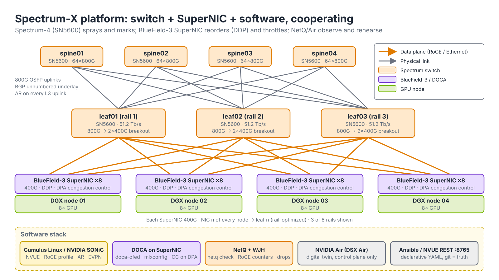
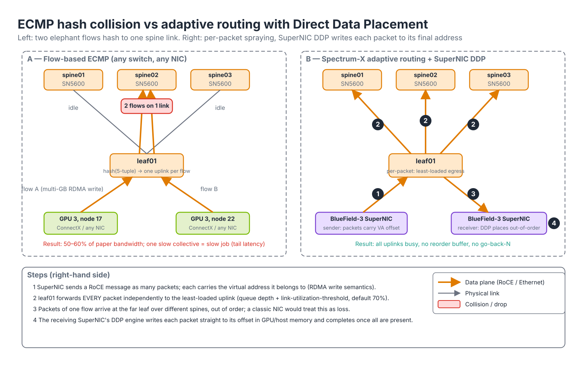
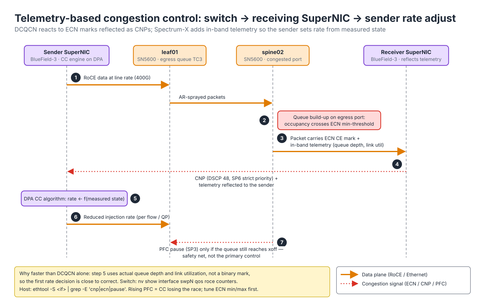
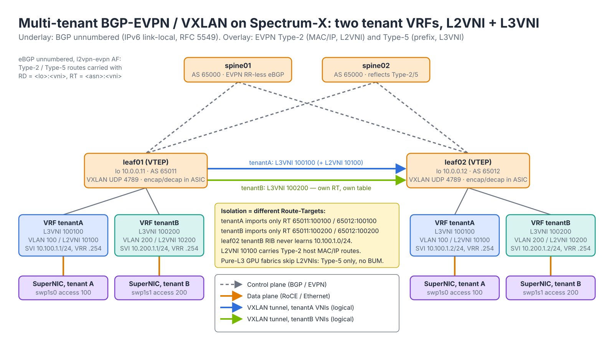
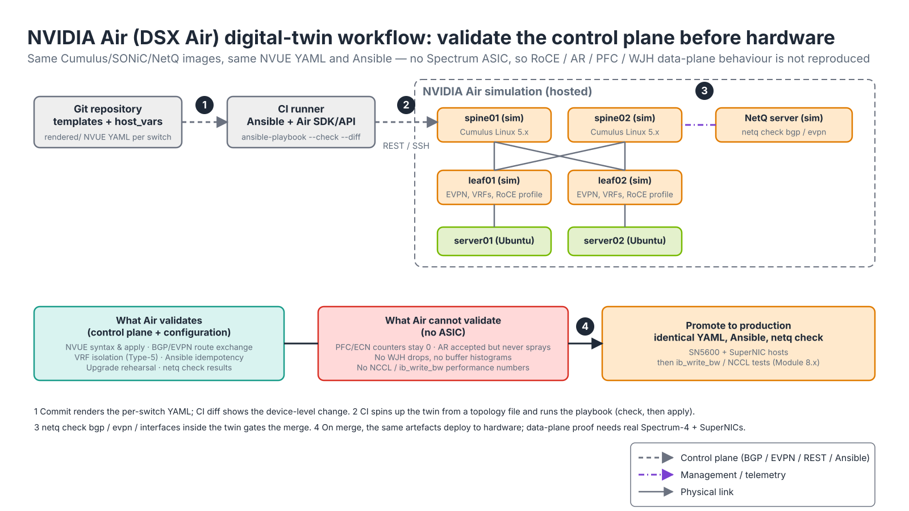
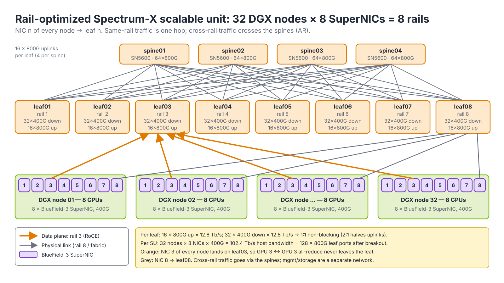
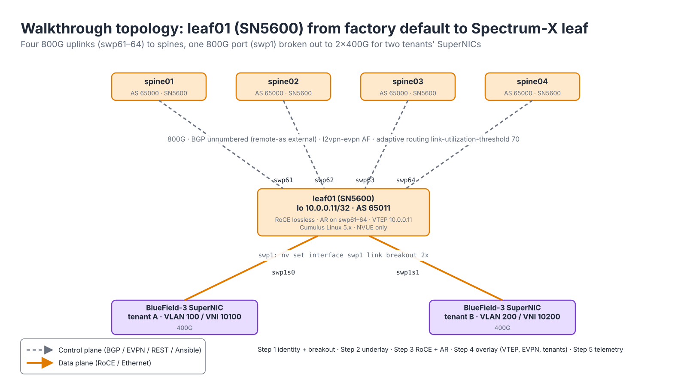

# Module 4.1 — Spectrum-X: AI-Optimized Ethernet

> **Exam domain:** NVIDIA Spectrum Networking (30%)  
> **Source course(s):** Spectrum-X (NVIDIA Academy)  
> **Source docs:** NVIDIA Spectrum-X Networking Platform documentation; Cumulus Linux User Guide — RoCE, Adaptive Routing, EVPN; SN5600/SN5400 datasheets; NVIDIA Air documentation  
> **Estimated study time:** 5–6 hours

> **How to study this module:** read §1–§2, work through the §3 walkthrough on real gear or NVIDIA Air, then attempt the §5 hands-on assignment using only the Hint section. Open the Solution guide (last section) only after you have a working attempt. Finish with the Appendix C knowledge check closed-book.

## 1. Learning objectives

By the end of this module you will be able to…

- **Describe** what differentiates Spectrum-X (Spectrum-4 switch + BlueField-3 SuperNIC + software stack) from "plain" data-center Ethernet. *(Spectrum Networking — platform architecture)*
- **Explain** the four failure modes of Ethernet under AI collective traffic (ECMP hash collisions, elephant flows, incast, tail latency) and the Spectrum-X mechanism for each. *(Spectrum Networking — AI traffic characteristics)*
- **Configure** lossless RoCE, ECN/PFC trust and **adaptive routing** on a Spectrum switch running Cumulus Linux using **NVUE** (`nv set` / `nv show` / `nv config apply`). *(Spectrum Networking — RoCE configuration)*
- **Verify** RoCE and AR state with `nv show qos roce`, per-interface RoCE counters and `nv show router adaptive-routing`. *(Troubleshooting Tools — Ethernet verification)*
- **Configure** a multi-tenant BGP-EVPN/VXLAN fabric with per-tenant VRFs and **explain** how it delivers performance isolation. *(Spectrum Networking — EVPN multi-tenancy)*
- **Describe** NVIDIA Air's role as a digital twin and state what it cannot validate. *(Automation and Configuration — validation)*
- **Sketch** a **rail-optimized** Spectrum-X leaf/spine topology and compare 2:1 oversubscribed vs non-blocking designs. *(AI Data Center Design — reference architectures)*

## 2. Key technical concepts

### 2.1 What Spectrum-X is (and is not)

*Analogy:* a Formula 1 car is not just an engine. Spectrum-X is the engine (Spectrum-4 ASIC), the tyres that keep it on the track (BlueField-3 SuperNIC) and the pit wall watching every lap (NetQ/WJH). Take any one away and you have a fast road car.


*Figure 4.1-1 — The three cooperating halves of Spectrum-X: Spectrum-4 switches, BlueField-3 SuperNICs, and the software (Cumulus/SONiC, DOCA, NetQ/WJH, Air, Ansible) that configures and observes them.*

**What it is.** Spectrum-X is NVIDIA's name for an *end-to-end* Ethernet platform tuned for AI training and inference clusters — not a single product and not a single switch. It is the combination shown in Figure 4.1-1:

| Layer | Component | Role |
|---|---|---|
| Switch | **Spectrum-4** ASIC in the **SN5600** (51.2 Tb/s, 64×800G OSFP) and **SN5400** (25.6 Tb/s, 400G) | Lossless RoCE, **adaptive routing** (packet spraying), telemetry-driven congestion signalling, deep fully-shared buffer |
| Endpoint | **BlueField-3 SuperNIC** (400G) | Reorders sprayed packets in hardware (Direct Data Placement), runs congestion control on its DPA cores, enforces per-tenant rate limits |
| Software | Cumulus Linux or NVIDIA SONiC; **DOCA** on the SuperNIC; **NetQ**/**WJH** telemetry; NVIDIA Air digital twin | Configuration, verification, observability |

The exact stack terms the exam uses: *Spectrum-4 switch + BlueField-3 SuperNIC + NVIDIA networking software (Cumulus/SONiC + DOCA) + NetQ*. A Spectrum switch running standard RoCE with ConnectX-6 hosts is "good Ethernet"; it is not Spectrum-X.

**Why it exists.** Classic data-center Ethernet optimises for many short, uncorrelated flows, where statistical multiplexing hides bad hashing and the occasional drop. AI collectives are the opposite: a handful of very large, perfectly synchronised flows whose job finishes only when the *slowest* one finishes. Measured against InfiniBand, a plain Ethernet fabric running NCCL all-reduce typically delivers around 60 % of its nominal bandwidth on the collective because of ECMP hash collisions and incast; NVIDIA's claim for Spectrum-X is roughly 1.6× that — i.e. back to near-IB effective bandwidth — while keeping Ethernet operations (BGP, EVPN, Ansible, syslog) and true multi-tenancy. The number is marketing; the *reason* (switch and NIC cooperating per packet) is testable. Spectrum-X targets AI clouds; InfiniBand (Module 2.x) remains the reference for the largest single-tenant clusters.

**How it works.** The switch half and the NIC half divide the work:

1. The **switch** forwards RoCE *per packet* across all equal-cost uplinks (§2.3), marks or stamps congestion state as queues build (§2.4) and keeps the RoCE traffic class lossless or ECN-controlled (§2.5) while isolating tenants by VRF and traffic class (§2.6, §2.8). It also exports *why* every drop happened (**WJH**) and buffer-occupancy histograms (§2.7).
2. The **SuperNIC** accepts packets out of order and places each directly at its final memory address (Direct Data Placement), terminates the switch's telemetry and adjusts its injection rate per flow in microseconds on its Data Path Accelerator (DPA), and rate-limits a misbehaving tenant flow instead of the whole port.
3. The **software** turns this into something operable: `nv set qos roce` and `nv set router adaptive-routing` on the switch, `mlxconfig`/`mlnx_qos`/DOCA on the host, `netq check roce` to prove both ends agree, and NVIDIA Air to rehearse the configuration before hardware arrives.

Remove either hardware half and you fall back to classic flow-ECMP + DCQCN behaviour; remove the software and you cannot prove it is working. See [`../05-bluefield-doca/01-bluefield-dpu-administration.md`](../05-bluefield-doca/01-bluefield-dpu-administration.md) for the SuperNIC side.

**Why the exam cares:** a mixed fleet (SN5600 + ConnectX-6 hosts) underperforming on "Spectrum-X features" always means one half of the cooperating pair is missing. Learn to spot which half.

#### Hardware quick reference

| Switch | ASIC | Capacity | Ports | Typical role |
|---|---|---|---|---|
| SN5600 | Spectrum-4 | 51.2 Tb/s | 64 × 800G OSFP (+1 mgmt SFP28); each 800G port breaks out to 2×400G or 4×200G | Spine and leaf in Spectrum-X SuperPOD; 128×400G leaf when broken out |
| SN5400 | Spectrum-4 | 25.6 Tb/s | 64 × 400G QSFP-DD (+ 2 × SFP28) | Leaf, storage, or smaller fabrics |
| SN4600/SN4700 | Spectrum-3 | 12.8 Tb/s | 64 × 200G / 32 × 400G | Prior generation; supports AR but not the full Spectrum-X feature set — verify against the support matrix |

Inside Spectrum-4 the packet pipeline is, in order: parser → tunnel termination (VXLAN decap) → ingress ACL → L2 lookup (FDB) / L3 lookup (host table, then LPM) → next-hop selection (ECMP hash *or* adaptive-routing engine) → ingress buffer admission (shared pool, per-priority-group accounting, PFC xoff watermark) → egress queue per traffic class → WRED/ECN marking → scheduler (strict / DWRR, shaper) → egress ACL and rewrite (DSCP remark, VXLAN encap) → transmit. Every §2 subsection below maps to one or two of these stages; the buffer is a single fully-shared pool (on the order of 100 MB+ on Spectrum-4 — verify the datasheet for the exact figure) rather than per-port slices, which is what lets one port absorb a burst without starving the others. Breakout is standard NVUE (Module 4.2): `nv set interface swp1 link breakout 2x` yields `swp1s0`/`swp1s1` — how 400G SuperNICs attach to an 800G SN5600 leaf port.

### 2.2 The AI Ethernet problem — four failure modes

*Analogy:* four trucks reach a four-lane toll plaza, every driver reads the same sign and picks the same lane; three lanes sit empty while one backs up.

**What it is.** Four distinct ways a non-blocking Ethernet fabric under-delivers for **NCCL** collectives (all-reduce, all-to-all, reduce-scatter): ECMP hash collisions, elephant flows, incast, and tail latency. They are separate mechanisms with separate fixes, and the exam tests that you match each to its mechanism.

**Why it exists.** NCCL traffic is few flows, each huge, all starting at the same microsecond. On a 32-node rail with 8 GPUs per node, a ring all-reduce step is roughly one multi-gigabyte flow per GPU pair; a leaf with 16 uplinks sees perhaps 32 flows at a time. Hash a small number of flows across 16 links and the probability that *some* link carries two while another carries none is high — the birthday problem applied to uplinks. Non-blocking on paper, 50–60 % utilised in practice.

**How each one works.**

- **ECMP hash collisions.** A standard switch chooses one equal-cost next hop per *flow* by hashing the 5-tuple (src/dst IP, protocol, src/dst UDP port — for RoCEv2 the destination port is always 4791, so the entropy is in the source port the NIC picks per QP). The choice is sticky for the life of the flow. With few flows and few uplinks, two elephant flows routinely land on the same spine link while another sits idle (Figure 4.1-2, left). Observe it on the switch: `nv show interface swp61-64 counters` shows one uplink at line rate and its neighbours nearly idle during a collective.
- **Elephant flows.** A multi-gigabyte RDMA write is *one* flow. Flow-level load balancing cannot split it; resilient hashing (keeps flow→member mapping stable when a member fails) and flowlet switching (re-hashes on an idle gap) help marginally but still bind a flow to one path at a time. Only per-packet forwarding spreads it.
- **Incast.** In an all-reduce or all-to-all, many senders target the same receiver inside the same window; its leaf downlink is oversubscribed instantly (N × 400G into one 400G port). Without a lossless mechanism the egress queue tail-drops; RoCE's go-back-N retransmission then re-sends everything after the lost sequence number, collapsing throughput. With **PFC** alone, pause frames propagate upstream hop by hop (leaf → spine → other leaves) and head-of-line block unrelated tenants sharing the same priority. Incast is *not* a path-selection problem: adaptive routing does nothing for it, congestion control and buffering do.
- **Tail latency.** A collective finishes when its *slowest* participant finishes; p99.9 matters more than the mean. A 1 % slow-path event per iteration is a permanent tax on the job because every iteration waits for it. Nothing "fixes" tail latency directly — removing the other three removes most of it.

**Why the exam cares:** match mechanism to problem. AR fixes collisions and elephants. Congestion control plus lossless buffering fixes incast. Tail latency is the symptom, not the cause.

### 2.3 Adaptive routing (packet spraying + DDP)

*Analogy:* adaptive routing is a traffic cop waving each truck — not each convoy — into whichever lane is emptiest right now. The SuperNIC is the receiving warehouse, which does not care in what order pallets arrive because each is labelled with its exact shelf location.


*Figure 4.1-2 — Flow-based ECMP puts two elephant flows on one spine link (left). Spectrum-X adaptive routing forwards every packet to the least-loaded uplink and the SuperNIC's DDP writes each packet straight to its final address (right, steps 1–4).*

**What it is.** **Adaptive routing** (AR) on Spectrum-4 is a per-*packet* next-hop selection mode for an ECMP group: instead of hashing the flow onto one member, the ASIC chooses, for each packet, the member with the lowest current load. It is enabled globally (`nv set router adaptive-routing enable on`) and then per physical L3 interface (`nv set interface swp61-64 router adaptive-routing enable on`; 5.15+ uses `state enabled`). The per-interface knob `link-utilization-threshold` (percent, default 70) defines when a member counts as congested. AR applies to RoCE traffic (UDP destination port 4791 by default); non-RoCE traffic on the same ECMP group keeps flow-based hashing. It is not supported on SVIs, L3 subinterfaces, bonds or bond members — physical L3 uplinks only — and AR and resilient hashing are alternatives, not layers.

**Why it exists.** Per-flow hashing cannot split an elephant and cannot avoid collisions with so few flows (§2.2). Per-packet spraying removes both problems at once: a single flow uses every uplink, and load is balanced on *measured* state rather than on a hash that knows nothing about current occupancy. The cost is reordering: packets of one flow traverse different spines with different queue depths and arrive out of order. On a conventional NIC, RoCE treats out-of-order arrival as loss (PSN gap → NAK → go-back-N), so spraying would make things worse. Spectrum-X pays that cost on the NIC: the BlueField-3 SuperNIC tolerates out-of-order delivery with **Direct Data Placement (DDP)**, so the switch can spray freely. That is the whole reason AR "requires" the SuperNIC. Trade-off: with a ConnectX-6/7 or third-party NIC you must disable AR on the uplinks serving those hosts or accept the retransmission penalty (Gotcha 1).

**How it works** (numbered steps in Figure 4.1-2):

1. The sender's SuperNIC emits an RDMA write as many packets; each RoCE packet carries enough addressing (QP, PSN, and the virtual address/offset semantics of RDMA write) for the receiver to know where its payload belongs.
2. At leaf01 the lookup resolves to an ECMP group of uplinks (swp61–64). The AR engine ranks members by egress queue occupancy and link utilisation. A member whose utilisation exceeds `link-utilization-threshold` (70 %) is treated as congested and de-preferred; below the threshold the engine spreads packets to keep queues even. Default 70 % leaves headroom so a link is never driven into PFC by AR itself; raise it only when you can prove queues stay shallow, lower it on long-cable or oversubscribed uplinks. Spectrum-4 also evaluates **ECMP group member state** continuously, so a link that goes down leaves the group within hardware reaction time rather than waiting for BGP.
3. Packets of the same flow return from different spines to the far leaf out of order. A classic NIC would NAK; a SuperNIC does not.
4. The receiving SuperNIC's DDP engine writes each packet straight into the correct offset in GPU/host memory and raises the completion once the full message is present. No reorder buffer, no retransmit, no CPU involvement.

Observe it: `nv show router adaptive-routing` (global enable), `nv show interface swp61 router adaptive-routing` (per-port enable and threshold), uplink counters evening out across swp61–64 under load, and on the host `ethtool -S <if> | grep out_of_sequence` rising *without* throughput loss on a SuperNIC — or rising *with* loss on anything else. Applying AR restarts `switchd` on Cumulus ≤ 5.12 (data-plane outage); 5.13+ reloads only.

**Why the exam cares:** AR is a pair feature; the threshold semantics ("above this percentage a port counts as congested"); the unsupported interface types; the switchd restart on older releases.

### 2.4 Congestion control (telemetry-based, switch-to-NIC)

*Analogy:* DCQCN is a driver who slows down on seeing brake lights. Spectrum-X CC is a driver with a live traffic feed showing how full each stretch of road is.


*Figure 4.1-3 — The congestion-control loop: the switch marks and stamps queue state (steps 2–3), the receiving SuperNIC reflects it as a CNP plus telemetry (4), the sender's DPA sets a new rate from measured state (5–6); PFC is only the safety net (7).*

**What it is.** Two layered mechanisms. The baseline is **DCQCN** (RoCEv2 congestion control): the switch marks packets with **ECN** Congestion Experienced (IP header ECN bits = 11) when a traffic-class queue exceeds a `min-threshold` (probability ramps linearly to 100 % at `max-threshold`, both in bytes per TC), the receiving NIC (notification point) sends a **CNP** (Congestion Notification Packet, a RoCE packet marked DSCP 48 and carried on switch-priority 6 strict priority so it is never queued behind data) back to the sender (reaction point), and the sender cuts the rate of that QP, then probes back up on timers. Spectrum-X adds **in-band telemetry**: the switch stamps queue depth and link-utilisation information into RoCE packets in flight; the receiving SuperNIC returns it to the sender, whose congestion-control engine runs on the SuperNIC's programmable DPA datapath, not the host CPU, and adjusts injection rate per flow within microseconds.

**Why it exists.** DCQCN reacts late and probes blindly: a mark is one bit of information, it arrives a round trip after congestion started, and the sender has to guess how much to cut. For incast (§2.2) that guesswork costs either drops (too slow) or under-utilisation (too aggressive). A rate set from *measured* fabric state converges in one or two round trips, so queues stay below the PFC xoff watermark and pause frames are rarely triggered. PFC remains configured as a safety net, not the primary mechanism. The trade-off is that the smart endpoint is required: without a SuperNIC you are back to DCQCN, which works, just slower to converge.

**How it works** (Figure 4.1-3):

1. The sender injects at line rate (400G).
2. A spine egress queue in TC 3 crosses the ECN min-threshold. On Cumulus the RoCE profile installs the thresholds for you (`nv set qos roce` → `nv show qos roce` shows ECN min/max and probability per TC; override with `nv set qos congestion-control default-global traffic-class 3 min-threshold <bytes>` / `max-threshold <bytes>` / `probability <%>`). Defaults are platform-specific — verify before quoting a number; the sample `netq show roce-config` in Module 4.5 shows a fabric at 150 000 / 1 500 000 bytes.
3. Packets leave the spine with CE set and, on Spectrum-X, with telemetry carried in band.
4. The receiving SuperNIC sends a CNP (DSCP 48 → SP6, strict priority) and reflects the telemetry to the sender. On Cumulus, SP6 strict priority is part of the RoCE profile; on the NIC the CNP class is set with `mlxconfig -s CNP_DSCP_P1=48 CNP_802P_PRIO_P1=6` (Module 5.2).
5. The sender's DPA congestion-control algorithm computes a new rate for that flow/QP from the measured queue depth and utilisation, not from a binary mark.
6. Injection continues at the reduced rate; the fabric drains; the rate recovers as telemetry reports headroom.
7. Only if a queue still reaches the PFC xoff watermark does the switch send a pause frame for priority 3 upstream — rising PFC counters in a Spectrum-X fabric mean CC is losing the race and the ECN thresholds need attention first.

Observe it: `nv show interface swpN qos roce counters` (ECN-marked packets, PFC rx/tx per priority), `nv action clear interface swpN qos roce counters` before a test, host `ethtool -S <if> | grep -E 'cnp|ecn|pause'` (`np_cnp_sent` on the receiver, `rp_cnp_handled` on the sender). Failure modes: ECN enabled on the switch but not on the NIC (`/sys/class/net/<if>/ecn/roce_np/enable/3` = 0) → marks are ignored and PFC does all the work; CNP class not strict → CNPs queue behind data and the loop reacts late; DSCP mismatch (host TOS 106 ↔ DSCP 26 ↔ switch-priority 3) → RoCE lands in a lossy best-effort queue and nothing above applies.

### 2.5 Lossless vs lossy — the decision

**What it is.** The `mode` argument of the one-line RoCE profile: `nv set qos roce mode lossless|lossy` (plus two tuning variants). The profile installs, in one revision: DSCP 26 → switch-priority 3 (RoCE) and DSCP 48 → SP6 (CNP), trust L3, SP → traffic-class mapping, PFC on SP3 (lossless only), ECN min/max on the RoCE TC, a shared-buffer lossless pool with per-priority-group headroom, an ETS split (RoCE TC gets a guaranteed share), strict priority for CNP, and an LLDP application-priority TLV so DCBX-capable NICs learn the priority.

| Mode | Mechanism | When to use |
|---|---|---|
| `lossless` (default with `nv set qos roce`) | **PFC** on switch-priority 3 (RoCE) + ECN marking; CNP on switch-priority 6 strict-priority | Classic RoCEv2 with any NIC; required when NICs lack advanced congestion control |
| `lossy` | ECN only; no PFC; relies on NIC CC and, for Spectrum-X, telemetry-based CC + DDP tolerance | Spectrum-X with SuperNICs, to avoid PFC head-of-line blocking entirely |
| `lossless-single-ipool` | Lossless with one shared ingress pool | Specific buffer tuning cases — check current docs |
| `lossy-multi-tc` | Lossy with multiple RoCE traffic classes | Multi-queue workloads — check current docs |

**Why it exists.** RoCE's transport assumes no loss. You can satisfy that assumption two ways: never drop (PFC pauses the upstream hop when a lossless priority-group fills — "pause instead of drop") or almost never need to (congestion control keeps queues shallow enough that drops are rare and the NIC recovers from the rest). PFC's cost is head-of-line blocking and pause propagation: one slow receiver can pause a leaf, which pauses a spine, which pauses every other leaf on that priority — a **PFC storm** when a NIC gets stuck asserting pause (the PFC watchdog, `pfcwd`, exists for exactly this; Module 4.4). Lossy's cost is that it only works with endpoints whose CC is good enough, i.e. SuperNICs.

**How it works — the buffer math behind lossless.** PFC is a per-priority XOFF/XON handshake on the link. When a port's lossless priority group (PG) reaches its **xoff** watermark the switch sends a PFC frame for that priority; the sender must stop within a bounded time, but everything already on the wire still arrives, so the switch must reserve **headroom** per lossless PG to absorb it:

> headroom ≈ 2 × (cable propagation delay × line rate) + sender reaction time × line rate + 2 × MTU (one in flight each way) + the switch's own internal latency.

Worked example at 400G over 100 m: propagation ≈ 5 ns/m → 500 ns one way, 1 µs round trip → 400 Gb/s × 1 µs = 400 kb ≈ 50 KB; add two 9 216-byte MTUs (≈ 18 KB) and the IEEE-bounded NIC response time, and you land around 70–100 KB per lossless PG per port. That is why `nv set qos pfc default-global cable-length 100` matters: longer cable → more headroom carved out of the shared pool → less burst absorption left for everyone else. When traffic drains to **xon** the switch stops asserting pause. On Cumulus you see the result in `nv show qos roce` (PFC on priority 3 rx/tx, ECN thresholds, trust L3, DSCP → SP and SP → TC tables); on SONiC the same numbers are the `xon`/`xoff`/`size` fields of a `BUFFER_PROFILE` named for speed and cable length (`pg_lossless_400000_100m_profile`, Module 4.4). Exam framing: lossless = "never drop; pause instead"; lossy = "mark and let the endpoints slow down". Spectrum-X reference designs typically run *lossless* with AR, but NVIDIA's AI-cloud guidance increasingly favours lossy with SuperNIC CC. Read the question for which NICs are present.

### 2.6 Performance isolation (multi-tenancy)

*Analogy:* a **VRF** is a separate building with its own address book. Tenants in different buildings can reuse room numbers, and a fire alarm in one building does not empty the other.

**What it is.** The set of mechanisms that keep one tenant's incast from stretching another tenant's step time: **network segmentation** (BGP-EVPN, one VRF/L3VNI per tenant, §2.8), **per-flow congestion control at the SuperNIC** (rate limits hit the misbehaving flow, not the shared port), the **shared-buffer architecture** of Spectrum-4, and **traffic classes** (RoCE in its own lossless TC, CNP strict priority, management/storage in lossy TCs).

**Why it exists.** In an AI cloud, tenant A's all-to-all and tenant B's all-reduce share spines and sometimes leaves. Flow-level isolation is not enough: a PFC pause is per *priority*, not per tenant, so without separate traffic classes or good CC, tenant A's incast pauses tenant B's packets on the same priority. Per-port buffer slicing would isolate but waste buffer; a fully shared pool with per-PG accounting and dynamic thresholds lets any port absorb a burst while a per-PG cap stops one port from consuming the whole pool.

**How it works.** VRF per tenant gives separate routing tables and route-target-controlled import (§2.8) so tenant prefixes never meet. Traffic classes give separate queues and schedulers: ETS guarantees the RoCE TC a bandwidth share (`nv set qos egress-scheduler default-global traffic-class 3 bw-percent 50`) while CNP in a strict TC is never starved. The shared buffer uses dynamic thresholds (alpha) per PG so a bursting port can take more than its fair share while the pool has slack, but is cut off as the pool fills. Finally, the SuperNIC's CC engine throttles the specific QP/flow that is causing congestion, so a noisy tenant slows itself, not its neighbour. Observe isolation failures with `netq show wjh-drop buffer` (which tenant's 5-tuple is tail-dropping on which TC) and per-TC queue counters.

### 2.7 Telemetry: WJH and NetQ

**What it is.** **WJH** (What Just Happened) is a Spectrum ASIC feature that exports every dropped packet's header plus a *reason code* ("TTL expired", "ingress port ACL", "tail drop on TC3", "PFC watchdog") to the NetQ agent, which streams it to the **NetQ** server (Module 4.5). Histogram telemetry (`nv set system telemetry ...`) samples queue occupancy and latency into buckets at microsecond granularity so you see congestion forming before drops occur.

**Why it exists.** Counters tell you *that* packets were dropped; WJH tells you *which* packets and *why*, without mirroring or guesswork. Buffer histograms show the queue depth distribution between samples, which a once-a-minute counter poll would miss entirely. For an AI fabric, where a 7-second incast is a visible step-time jump, this is the difference between "the job is slow" and "leaf03 swp12 TC3 dropped 1 204 packets from 10.1.3.7 because the PFC watchdog fired".

**How it works.** The ASIC samples dropped packets (aggregated per reason and 5-tuple with counts), the agent enriches them with port/time, NetQ indexes them by category (L1, L2, router, tunnel, ACL, buffer). Buffer histograms are configured per port/TC and exported via the agent or OpenTelemetry. CLI: `nv show system telemetry`, `netq show wjh-drop buffer between now and 10m`, `netq show roce-counters leaf01 swp61`. Object names differ between releases; the exam cares that *Spectrum provides hardware-timestamped histograms and WJH drop reasons*, not the exact NVUE path.

### 2.8 Multi-tenant BGP-EVPN with VRFs

*Analogy:* **EVPN** is a phone directory every switch shares by BGP. Instead of flooding "who has MAC X?", each switch publishes its entries and reads everyone else's.


*Figure 4.1-4 — Multi-tenant EVPN: underlay BGP unnumbered between leaves and spines; overlay VXLAN tunnels between VTEPs; tenantA (L3VNI 100100) and tenantB (L3VNI 100200) isolated by route-targets.*

**What it is.** An AI-cloud fabric is almost always a BGP-unnumbered IPv4 underlay (Module 4.2 §2.8) with an EVPN/VXLAN overlay; each tenant gets a VRF mapped to one **L3VNI**, and optionally L2 VNIs for stretched subnets. The pieces, as the exam names them:

- **VXLAN** — MAC-in-UDP encapsulation, UDP destination port 4789, 8-byte header carrying a 24-bit VNI; total overhead 50 bytes (14 Ethernet + 20 IPv4 + 8 UDP + 8 VXLAN), which is why the switch MTU stays at 9216 while hosts use 9000. The switch is the **VTEP** (NVE), identified by a loopback (`nv set nve vxlan source address 10.0.0.11`); Spectrum-4 does encap/decap, EVPN and RoCE AR in hardware simultaneously — unlike merchant silicon that disables features when VXLAN is active.
- **EVPN** — the BGP L2VPN EVPN address family (AFI 25 / SAFI 70) distributing MAC/IP and prefix reachability as typed routes.
- **VRF per tenant** — subnets live in a VRF mapped to one L3VNI; inter-VTEP traffic within the tenant routes symmetrically via the L3VNI.
- **Multihoming / ESI** — dual-attachment without MLAG; leaves advertise an Ethernet Segment Identifier so remote VTEPs load-balance to both.

**Why it exists.** Flooding-based L2 does not scale across a fabric, and per-tenant physical separation does not scale economically. EVPN moves MAC/IP learning into BGP (no unknown-unicast flooding, ARP suppression from Type-2 routes), VXLAN lets any VLAN or VRF appear on any leaf over a pure L3 underlay, and route-targets give per-tenant import/export control for free. For GPU fabrics the big win is operational: the same BGP unnumbered + EVPN template on every switch, tenants added as VRFs without touching the underlay.

**How it works — what the route types carry.** Every EVPN route has a **Route Distinguisher** (RD, makes the NLRI unique per VTEP — auto-derived as `<router-id>:<VNI or VLAN index>`) and one or more **Route-Target** extended communities (RT, decides who imports — auto-derived as `<ASN>:<VNI>`; Cumulus derives both automatically, which is why tenants with the same VNI on every leaf import each other and tenants with different VNIs do not).

| Type | Name | Key fields | Used for |
|---|---|---|---|
| 1 | Ethernet Auto-Discovery | RD, **ESI** (10-byte Ethernet Segment ID), Ethernet tag | Multihoming: mass withdrawal, aliasing |
| 2 | MAC/IP Advertisement | RD, ESI, Ethernet tag, MAC, optional IP, label 1 = **L2VNI**, label 2 = **L3VNI** (symmetric routing), RT = ASN:L2VNI (+ ASN:L3VNI), Router-MAC ext-community | Host MAC and ARP/ND entries in an L2 VNI; ARP suppression; host /32 routing |
| 3 | Inclusive Multicast Ethernet Tag | RD, Ethernet tag, originating VTEP IP, PMSI tunnel (ingress replication) | BUM flooding: builds the head-end replication list (`Remote-VTEPs` in `nv show evpn vni`) |
| 4 | Ethernet Segment | RD, ESI, originator IP | Designated-forwarder election for a multihomed segment |
| 5 | IP Prefix | RD, ESI = 0, Ethernet tag, prefix/length, gateway IP, label = **L3VNI**, RT = ASN:L3VNI, Router-MAC | Inter-subnet / inter-VTEP routing per VRF; the only type a pure-L3 GPU fabric needs |

Symmetric IRB in practice (Figure 4.1-4): leaf01 redistributes tenantA's connected SVI subnet into the per-VRF BGP instance (`nv set vrf tenantA router bgp address-family ipv4-unicast redistribute connected enable on`); it is advertised as a Type-5 route with label 100100 and RT 65011:100100 (auto-derived from the leaf ASN and L3VNI). leaf02 imports it into VRF tenantA because that VRF's import RT matches on the VNI (Cumulus accepts the auto-derived RT from any ASN on the same VNI), installs it with next hop = leaf01's VTEP address, and forwards traffic encapsulated with VNI 100100 to 10.0.0.11; leaf01 decapsulates into VRF tenantA and routes. tenantB's Type-5 carries VNI 100200 and RT 65011:100200, so it is never imported into tenantA — that is the isolation the assignment makes you prove. GPU SuperNICs single-attach to one rail leaf (§2.10), so ESI/Type-1/Type-4 matter mostly for storage and management leaves.

Pure-L3 GPU fabrics often skip L2 VNIs entirely: each GPU-node interface lands on a /31 or /30 routed port (or the DPU runs HBN and advertises its /32, Module 5.2) in the tenant VRF and only Type-5 routes are exchanged — no BUM, no ARP suppression, and a natural fit for AR, which needs physical L3 uplinks anyway.

Observe it: `nv show evpn vni` (L2 VNIs with remote VTEPs, L3 VNIs with their VRF), `nv show vrf tenantA router bgp address-family l2vpn-evpn route` (route type, RD, VNI), `nv show vrf tenantA router rib ipv4`, `sudo vtysh -c "show bgp l2vpn evpn route type prefix"`. Failure modes: Type-5 present on the remote leaf but not in the VRF RIB → RT/VNI mismatch (different L3VNI on the two leaves); no remote VTEPs → underlay cannot reach the loopback or the EVPN AF is not enabled on the peer-group; hosts cannot ARP → ARP suppression on with no Type-2 routes (L2VNI missing or `nv set evpn enable on` absent).

### 2.9 NVIDIA Air — the digital twin


*Figure 4.1-6 — The Air workflow: CI builds a twin, applies the same YAML and runs `netq check` (steps 1–3), then the identical artefacts go to hardware (4). No ASIC means no RoCE/AR/PFC data-plane proof.*

**What it is.** **NVIDIA Air** (formerly Cumulus in the Cloud; "DSX Air" in some Spectrum-X materials) is a hosted simulation platform running real Cumulus Linux, NVIDIA SONiC, NetQ and Ubuntu host images in a topology you draw or import (DOT/JSON). As a *digital twin* it lets you build the exact leaf/spine/host topology before hardware arrives, validate NVUE configuration, EVPN route exchange, BGP policy and Ansible playbooks (Module 6.1), push the identical YAML to production, and rehearse upgrades and failures safely. It exposes a REST API and SDK so CI can create a twin, run the playbook and `netq check bgp`/`netq check evpn`, and tear it down.

**Why it exists.** Fabric configuration errors are cheapest to find before the switches exist, and a lab of 20 SN5600s is not a realistic staging environment. Because Cumulus is the same software image whether the forwarding plane is a Spectrum ASIC or a virtual switch, the control plane behaves identically in the twin. The limitation is structural, and the exam tests it: there is **no ASIC** in the twin — no real RoCE/AR/PFC data-plane behaviour, no WJH hardware drops, no buffer histograms, no performance numbers. Air validates control plane and configuration only.

**How it works** (Figure 4.1-6): (1) a commit renders per-switch YAML; (2) CI spins up the twin from a topology file and runs `ansible-playbook --check --diff`, then applies; (3) `netq check bgp|evpn|interfaces` inside the twin gates the merge; (4) on merge the same artefacts deploy to hardware, where `ib_write_bw`/NCCL tests (Module 8.x) provide the data-plane proof Air cannot. In Air, `nv set qos roce mode lossless` is accepted and `nv show qos roce` shows the profile, but PFC/ECN counters stay at zero forever and AR is accepted but never sprays. That sentence is the "what Air cannot verify" paragraph in the assignment.

### 2.10 Reference topology: Spectrum-X SuperPOD


*Figure 4.1-5 — A rail-optimized scalable unit: eight SN5600 rail leaves, each receiving NIC n from all 32 nodes over 800G→2×400G breakouts, with 16×800G uplinks per leaf to four spines.*

**What it is.** A Spectrum-X DGX SuperPOD compute fabric is **rail-optimized**: each DGX node has 8 GPUs, each with its own 400G SuperNIC; NIC *n* of every node connects to leaf *n* ("rail *n*"). A scalable unit (SU) is 32 nodes × 8 NICs = 256 × 400G host links = 128 × 800G leaf downlinks after breakout; one SN5600 per rail handles 32 nodes with 32 × 400G downlinks (16 × 800G ports broken out) and 16–32 × 800G uplinks depending on the oversubscription ratio.

**Why it exists.** NCCL's dominant ring/tree all-reduce pattern sends GPU *n* of one node to GPU *n* of the next; with rail-optimized cabling that traffic stays on one leaf — one hop, no spine, no AR needed, and the spine layer is reserved for cross-rail traffic (all-to-all, expert-parallel MoE, PXN). The alternative, "one leaf per node", would push every collective through the spines. The design also decides the oversubscription trade-off:

| Design | Leaf downlink:uplink | Pros | Cons |
|---|---|---|---|
| Non-blocking (1:1) | 12.8T down / 12.8T up on SN5600 (32×400G down, 16×800G up) | Any-to-any full bandwidth; simplest for all-to-all workloads | Twice the spine ports/optics; higher cost |
| 2:1 oversubscribed | 2× more downlink than uplink (8×800G up) | Cheaper; fine when rail-optimized traffic stays local | All-to-all (e.g., MoE expert parallel) suffers; AR becomes essential |

**How it works** (Figure 4.1-5). Each rail leaf consumes 16 of its 64 × 800G ports as broken-out downlinks and 16 as uplinks (4 per spine with 4 spines) in the non-blocking case. Spine count = uplinks per leaf for full ECMP spread; with AR the spines act as one aggregate pool so the fabric behaves close to non-blocking even at 2:1 for typical collectives. Capacity math for the SU: 32 nodes × 8 × 400G = 102.4 Tb/s of host bandwidth; a single 51.2 Tb/s SN5600 per rail carries 12.8 Tb/s of it down and 12.8 Tb/s up, so it is far from saturated and the limit is port count, not ASIC capacity. Management and storage ride a separate conventional Ethernet network (often Spectrum, not Spectrum-X RoCE AR). Full SuperPOD RA: [`../01-ai-datacenter-design/`](../01-ai-datacenter-design/).

**Why the exam cares:** "GPU 3 on node 17 → GPU 3 on node 22" stays on leaf 3; rail-optimized means same GPU index on the same leaf, not one leaf per node; 2:1 is workable *because of* AR.

## 3. Live-style walkthrough — one Spectrum-X leaf from factory default

We take `leaf01`, an SN5600 fresh out of the box on Cumulus Linux 5.x, to a working Spectrum-X leaf: breakout, BGP unnumbered underlay, EVPN tenant VRFs, lossless RoCE, adaptive routing, telemetry. All commands are NVUE; legacy NCLU (`net add ...`) is deprecated on Spectrum-4.


*Figure 4.1-7 — The walkthrough topology. Steps 1–5 below build this leaf from the bottom up; each step ends at a checkpoint you must pass before continuing.*

As you work, keep the mechanism diagrams open: Step 2 builds the underlay sessions of Figure 4.2-4 (BGP unnumbered, steps 1–6 there); Step 3 installs the RoCE profile and AR that drive Figure 4.1-2 (steps 1–4) and Figure 4.1-3 (steps 1–7); Step 4 builds the overlay of Figure 4.1-4.

### Step 1 — Identity and breakout

```bash
nv set system hostname leaf01                 # NetQ and syslog key off this
nv set interface lo ip address 10.0.0.11/32   # becomes BGP router-id AND VTEP source later
nv set interface swp1 link breakout 2x        # 800G OSFP -> two 400G lanes for two SuperNICs; swp1s0/swp1s1 appear, ASIC port map changes (switchd reload on many platforms)
nv config diff                                # review pending vs applied before touching the running system
```

Expected `nv config diff` output (abbreviated):

```text
- set:
    interface:
      lo:
        ip:
          address:
            10.0.0.11/32: {}
      swp1:
        link:
          breakout:
            2x: {}
    system:
      hostname: leaf01
```

```bash
nv config apply -y                 # --assume-yes: no prompt. Breakout may take ~30 s.
nv show interface swp1s0 link      # CHECKPOINT: speed 400G, fec rs. Only swp1 present? breakout failed — journalctl -u switchd
```

### Step 2 — BGP unnumbered underlay

```bash
nv set interface swp61-64 link state up               # four 800G uplinks
nv set interface swp61-64 ip ipv4 forward on          # unnumbered: no IPv4 address; RFC 5549 routes resolve via IPv6 link-local next hops
nv set router bgp autonomous-system 65011             # one ASN per leaf; spines share their own
nv set router bgp router-id 10.0.0.11
nv set vrf default router bgp peer-group underlay remote-as external   # "any ASN that is not mine" — identical on every leaf
nv set vrf default router bgp neighbor swp61 peer-group underlay       # interface neighbors = unnumbered
nv set vrf default router bgp neighbor swp62 peer-group underlay
nv set vrf default router bgp neighbor swp63 peer-group underlay
nv set vrf default router bgp neighbor swp64 peer-group underlay
nv set vrf default router bgp address-family ipv4-unicast network 10.0.0.11/32   # advertise the loopback: remote VTEPs must reach it
nv set vrf default router bgp address-family l2vpn-evpn enable on                # EVPN AF globally...
nv set vrf default router bgp peer-group underlay address-family l2vpn-evpn enable on   # ...and on the peer-group
nv config apply -y
nv show vrf default router bgp neighbor               # CHECKPOINT
```

```text
Neighbor  Remote-AS  State        Uptime    MsgRcvd  MsgSent  PfxRcvd  PfxSent
--------  ---------  -----------  --------  -------  -------  -------  -------
swp61     65000      Established  00:01:12  14       13       4        1
swp62     65000      Established  00:01:10  14       13       4        1
swp63     65000      Established  00:01:11  13       13       4        1
swp64     65000      Established  00:01:09  13       13       4        1
```

Watch the `Remote-AS` column: you never typed 65000; `remote-as external` learned it from the OPEN message (Figure 4.2-4, steps 2–3). A session stuck in `Active` usually means the spine side lacks the interface neighbor or IPv6 RA is disabled (step 1 of that figure never completed).

### Step 3 — RoCE lossless and adaptive routing

```bash
# ONE command installs the whole RoCE QoS profile: DSCP 26 -> switch-priority 3 (RoCE), DSCP 48 -> SP6 (CNP),
# PFC on SP3, ECN min/max on the RoCE TC, shared-buffer lossless pool, ETS split, and an LLDP application TLV
# so DCBX-capable NICs learn the priority.
nv set qos roce mode lossless                  # SuperNIC-only, PFC-free fabric: mode lossy
nv set router adaptive-routing enable on       # AR global enable first...
nv set interface swp61-64 router adaptive-routing enable on    # ...then per physical L3 uplink. NOT bonds/SVIs/subinterfaces.
# 5.15+: per-interface keyword is "state enabled" instead of "enable on"; the NVUE reference lists both forms.
nv set interface swp61-64 router adaptive-routing link-utilization-threshold 70   # above this % a port counts as congested; default 70
nv config diff      # expect qos.roce, router.adaptive-routing and the four interfaces
nv config apply -y  # Cumulus <=5.12: RESTARTS switchd (data-plane outage). 5.13+: reload only. Plan a window on older releases.
```

Checkpoint — verify RoCE and AR:

```bash
nv show qos roce                               # State enabled, Mode lossless, PFC on priority 3 Rx/Tx, ECN min/max + probability on the RoCE TC, Trust L3 (DSCP), DSCP->SP and SP->TC tables
nv show interface swp61 qos roce status        # PFC/ECN per TC on this port
nv show interface swp61 qos roce counters      # PFC pause rx/tx, ECN-marked packets, drops
nv show interface qos-roce-counters            # all ports at once
nv action clear interface swp61 qos roce counters   # zero them before a test
nv show router adaptive-routing                # enable on
nv show interface swp61 router adaptive-routing     # enable on, link-utilization-threshold 70
```

Remember who sends a pause frame: the *receiver* whose ingress buffer can't drain. Rising `pfc rx` on a leaf *downlink*: the host is pausing the switch — the host can't drain fast enough and **is** the congestion point (slow receiver, PCIe or memory pressure). Rising `pfc tx` on a downlink: the switch is pausing the host because that host's traffic is backing up inside the switch on its way to a congested egress — the host is a *sender* caught in the back-pressure, and the real congestion point is downstream. Rising `pfc rx` on an *uplink*: the spine is pausing *you*; look further downstream through the spine. Either way you are watching step 7 of Figure 4.1-3 fire, which in a Spectrum-X fabric means steps 2–6 (ECN marking and SuperNIC rate control) did not keep the queue below xoff — check the ECN-marked counter is climbing before you touch PFC.

To tune beneath the profile (set RoCE first, then override — the profile replaces existing QoS):

```bash
# Move RoCE to switch-priority 2 instead of 3 (must update mapping and egress queue too)
nv set qos pfc default-global switch-priority 2
nv set qos mapping default-global dscp 26 switch-priority 2
nv set qos egress-queue-mapping default-global switch-priority 2 traffic-class 3
# ECN thresholds in bytes; defaults vary by platform — check the doc before quoting a number.
nv set qos congestion-control default-global traffic-class 3 min-threshold 150000
nv set qos congestion-control default-global traffic-class 3 max-threshold 1500000
nv set qos congestion-control default-global traffic-class 3 probability 100
nv set qos pfc default-global cable-length 100                       # longer cable -> more PFC headroom
nv set qos egress-scheduler default-global traffic-class 3 bw-percent 50   # RoCE TC gets half the link under contention
```

Interface-level RoCE (apply only to some ports) exists in newer releases; verify in current docs.

### Step 4 — Overlay: VTEP, EVPN, tenants

```bash
nv set nve vxlan source address 10.0.0.11            # VTEP sources VXLAN from the loopback advertised in Step 2
nv set nve vxlan arp-nd-suppress on                  # answer ARP/ND locally from Type-2 routes instead of flooding
nv set evpn enable on

# --- Tenant A: VRF + L3VNI + one L2 VNI ---
nv set vrf tenantA                                   # the "separate building"
nv set vrf tenantA evpn vni 100100                   # L3VNI: Type-5 routes for this tenant ride here
nv set bridge domain br_default vlan 100 vni 10100   # L2 VNI for VLAN 100 (Type-2 routes)
nv set interface vlan100 ip address 10.100.1.1/24    # SVI = tenant gateway on this leaf
nv set interface vlan100 ip vrf tenantA              # SVI lives in the tenant's building
nv set interface vlan100 ip vrr address 10.100.1.254/24     # anycast gateway (VRR) shared with the other leaves
nv set interface vlan100 ip vrr mac-address 00:00:5e:00:01:01
nv set vrf tenantA router bgp autonomous-system 65011       # per-VRF BGP instance...
nv set vrf tenantA router bgp router-id 10.0.0.11
nv set vrf tenantA router bgp address-family ipv4-unicast redistribute connected enable on   # ...SVI subnet becomes a Type-5 route
nv set vrf tenantA router bgp address-family l2vpn-evpn enable on

# --- Tenant B: identical pattern with vrf tenantB, L3VNI 100200, VLAN 200 / VNI 10200, SVI 10.200.1.1/24 ---
nv set vrf tenantB
nv set vrf tenantB evpn vni 100200
nv set bridge domain br_default vlan 200 vni 10200
nv set interface vlan200 ip address 10.200.1.1/24
nv set interface vlan200 ip vrf tenantB
nv set vrf tenantB router bgp autonomous-system 65011
nv set vrf tenantB router bgp address-family ipv4-unicast redistribute connected enable on
nv set vrf tenantB router bgp address-family l2vpn-evpn enable on

# --- GPU-node downlinks: one SuperNIC per tenant on the broken-out port ---
nv set interface swp1s0 bridge domain br_default access 100
nv set interface swp1s1 bridge domain br_default access 200

nv config apply -y
nv config save          # apply is NOT persistent; save writes startup.yaml
```

```bash
nv show evpn; nv show evpn vni; nv show nve vxlan                # CHECKPOINT: VTEP, VNIs
nv show vrf tenantA router bgp address-family l2vpn-evpn route   # type-2/type-5 routes
nv show vrf tenantA router rib ipv4
```

```text
VNI     Type  VRF      VLAN  Flood-mode  Remote-VTEPs
------  ----  -------  ----  ----------  -------------------------
10100   L2    tenantA  100   head-end    10.0.0.12, 10.0.0.13
10200   L2    tenantB  200   head-end    10.0.0.12
100100  L3    tenantA  -     -           -
100200  L3    tenantB  -     -           -
```

Good: L2 VNIs list remote VTEPs (built from Type-3 routes, §2.8); L3 VNIs present with the right VRF. The tenantA Type-5 route you will see in the next command carries label 100100 and RT 65011:100100 — the two fields that make Figure 4.1-4's isolation work. Underneath it is FRR: `sudo vtysh -c "show bgp l2vpn evpn summary"`.

### Step 5 — Telemetry

```bash
nv set system telemetry export otlp state enabled          # OpenTelemetry export (5.x) — verify
nv set system telemetry histogram ingress-buffer ...        # buffer histograms — see NVUE reference
nv set system telemetry histogram egress-buffer ...
nv config apply -y
nv show system telemetry
sudo netq config add server 10.10.0.100 port 31980 vrf mgmt   # NetQ agent (Module 4.5) — WJH flows once this is set
```

Histograms sample queue depth into buckets at microsecond granularity and feed NetQ's congestion views. Object names differ between releases; the exam cares that *Spectrum provides hardware-timestamped histograms and WJH drop reasons*, not the NVUE path.

## 4. Troubleshooting / common gotchas

### Gotcha 1 — AR enabled, NCCL got slower

**Symptom:** after enabling AR, all-reduce bandwidth drops 30–50%; host `ethtool -S` shows `out_of_sequence` climbing.

**Why it happens:** the hosts have ConnectX-6/7 or third-party NICs, not SuperNICs. Without DDP the NIC treats reordering as loss and triggers go-back-N.

**How to debug:**
```bash
nv show router adaptive-routing                   # confirm AR is on
ibv_devinfo | grep -E 'hca_id|board_id'           # on host: is it a BlueField-3 SuperNIC?
ethtool -S ens3f0np0 | grep out_of_sequence        # rising = reordering penalty
```

**Fix:** `nv unset interface swp61-64 router adaptive-routing` on uplinks serving non-SuperNIC hosts, or replace the NICs. AR is a *pair* feature.

### Gotcha 2 — `nv config apply` for AR fails on a bond

**Symptom:** `nv set interface bond1 router adaptive-routing enable on` → apply error.

**Why it happens:** AR is only supported on physical L3 interfaces — not bonds, bond members, SVIs or subinterfaces.

**How to debug:** `nv config diff` shows the offending path; the apply error names the interface type.

**Fix:** `nv unset interface bond1 router adaptive-routing`; apply AR on the physical uplinks. GPU fabrics use routed physical uplinks, no bonds.

### Gotcha 3 — Custom DSCP map vanished after enabling RoCE

**Symptom:** `nv set qos mapping default-global dscp 46 switch-priority 5` was in place; after `nv set qos roce mode lossless` it is gone.

**Why it happens:** `nv set qos roce` *replaces* the QoS profile.

**How to debug:** `nv show qos mapping default-global` — DSCP 46 missing; `nv config history` shows the RoCE revision.

**Fix:** set RoCE first, then re-apply overrides in the same or a later revision.

## 5. Hands-on assignment — two-tenant Spectrum-X leaf/spine

**Scenario.** Two tenants (`tenantA`, `tenantB`) share a 2-leaf / 2-spine Spectrum-X fabric with full performance isolation. Each leaf has two 400G SuperNIC downlinks (one per tenant) on a broken-out 800G port and two 800G uplinks. Use NVIDIA Air (or real gear).

**Requirements**
1. Hostnames `leaf01`, `leaf02`, `spine01`, `spine02`; loopbacks 10.0.0.11/.12 (leaves), 10.0.0.1/.2 (spines).
2. BGP unnumbered underlay: leaves ASN 65011/65012, spines ASN 65000, peer-groups, EVPN AF everywhere.
3. On each leaf, `swp1` broken out 2x; `swp1s0` → tenantA (VLAN 100 / VNI 10100 / L3VNI 100100), `swp1s1` → tenantB (VLAN 200 / VNI 10200 / L3VNI 100200). VRR anycast gateway on both leaves.
4. Lossless RoCE and AR on every leaf and spine fabric port, threshold 70.
5. Each tenant's prefix appears as a Type-5 route *only* in its own VRF on the remote leaf.
6. Telemetry proof: RoCE counters and AR state captured per leaf; NetQ agent pointed at a server.

**Deliverables**
- Four NVUE YAML files (`nv config show -o yaml`), one per switch.
- A verification log: `nv show vrf default router bgp neighbor`, `nv show evpn vni`, `nv show vrf tenantA router bgp address-family l2vpn-evpn route`, `nv show qos roce`, `nv show router adaptive-routing` from each leaf.
- One paragraph on what you could *not* verify in Air and why.

**Acceptance criteria**
- All 8 underlay sessions Established.
- `nv show evpn vni` on leaf01 lists 10.0.0.12 as a remote VTEP for VNI 10100 and 10200.
- leaf02's `tenantA` RIB contains 10.100.1.0/24 via EVPN; its `tenantB` RIB does *not*.
- `Mode: lossless` and AR enabled with all fabric ports on all four switches.
- Spines carry no VRF/VNI configuration.

### Hint
- Order: underlay → verify → RoCE/AR → verify → overlay → verify. Do not skip a checkpoint.
- Spines need only the EVPN AF on the peer-group; `nv set evpn enable on` makes a VTEP, which they are not.
- The redistribution that turns a tenant SVI subnet into a Type-5 route lives in the *per-VRF* BGP instance.
- A session stuck in `Active`: check IPv6 link-local and the interface neighbor on the *other* end.
- Air has no ASIC: the profile shows, PFC counters stay at zero. That is your paragraph.

## Appendix A — Quick command / config reference

| Task | NVUE |
|---|---|
| RoCE profile lossless / lossy / remove / show | `nv set qos roce mode lossless` / `... lossy` / `nv unset qos roce` / `nv show qos roce` |
| Per-port RoCE status / counters / clear | `nv show interface swpN qos roce status` / `... counters` / `nv action clear interface swpN qos roce counters` |
| AR global / per interface / threshold / show | `nv set router adaptive-routing enable on` / `nv set interface swpN router adaptive-routing enable on` (5.15+: `state enabled`) / `... link-utilization-threshold 70` / `nv show router adaptive-routing` |
| PFC priority | `nv set qos pfc default-global switch-priority 3` |
| ECN thresholds | `nv set qos congestion-control default-global traffic-class 3 min-threshold <bytes>` |
| RoCE TC bandwidth | `nv set qos egress-scheduler default-global traffic-class 3 bw-percent 50` |
| VTEP / EVPN | `nv set nve vxlan source address <lo>` / `nv set evpn enable on` |
| Tenant VRF + L3VNI / L2 VNI | `nv set vrf T` + `nv set vrf T evpn vni <vni>` / `nv set bridge domain br_default vlan 100 vni 10100` |
| BGP unnumbered | `nv set vrf default router bgp neighbor swp61 remote-as external` |
| Breakout 800G→2×400G | `nv set interface swp1 link breakout 2x` |
| Telemetry | `nv set system telemetry export otlp state enabled` (verify) / `nv show system telemetry` |

## Appendix B — Exam traps & key takeaways

- Spectrum-X = Spectrum-4 switch (SN5600: 64×800G OSFP, 51.2T; SN5400: 64×400G + 2×SFP28, 25.6T) + BlueField-3 SuperNIC + Cumulus/SONiC + DOCA + NetQ. A Spectrum switch alone is not Spectrum-X.
- AR with packet spraying on a non-SuperNIC endpoint causes out-of-order RoCE and go-back-N retransmits; DDP on the SuperNIC makes reordering harmless.
- AR spreads load across *paths*; incast is many sources into *one destination port* — only congestion control / lossless buffering addresses it.
- AR is unsupported on bonds, SVIs or subinterfaces. Physical L3 uplinks only. Applying it on Cumulus ≤5.12 restarts `switchd`; 5.13+ reloads.
- `nv set qos roce` *replaces* the QoS profile. Set RoCE first, then override.
- Lossless ≠ "no congestion". Lossless means PFC pause instead of drop; lossy + good CC is NVIDIA's direction with SuperNICs.
- NVIDIA Air validates control plane and config, not RoCE/AR performance — there is no ASIC in the twin.
- Type-2 = MAC/IP (L2 VNI); Type-5 = IP prefix (L3 VNI). A pure-L3 GPU fabric uses only Type-5.
- Rail-optimized means GPU *n* of every node on leaf *n*, not "one leaf per node"; AR makes 2:1 oversubscription workable.
- RoCE counters: PFC *rx* on a downlink = the host is pausing you (host is the congestion point); PFC *tx* on a downlink = you are pausing the host (congestion is downstream of the leaf); PFC *rx* on an uplink = the spine is pausing you. NCLU `net add` is never the answer — NVUE is.

## Appendix C — Knowledge check

1. A customer deploys SN5600 leaves with adaptive routing enabled, but the GPU servers use ConnectX-6 Dx NICs. NCCL all-reduce performance is worse than with AR disabled. Why?
   A. ConnectX-6 Dx does not support RoCEv2.
   B. Packet spraying delivers RoCE packets out of order and the NIC lacks Direct Data Placement, causing go-back-N retransmits.
   C. AR disables ECN marking.
   D. The SN5600 cannot run AR and EVPN simultaneously.

2. Which NVUE command installs PFC on switch-priority 3, ECN thresholds, DSCP trust and the RoCE traffic-class mapping in one step?
   A. `nv set qos pfc enable on`
   B. `nv set qos roce mode lossless`
   C. `nv set qos trust dscp`
   D. `net add roce lossless`

3. You need routed, isolated connectivity for 12 tenants across a Spectrum-X EVPN fabric, with no L2 stretching. Which EVPN route type carries the tenant prefixes between VTEPs?
   A. Type-1
   B. Type-2
   C. Type-3
   D. Type-5

4. An engineer runs `nv set interface bond1 router adaptive-routing enable on` and the apply fails. What is the most likely reason?
   A. AR requires `nv set qos roce` first.
   B. AR is not supported on bonds; it must be applied to physical L3 interfaces.
   C. The bond has no IP address.
   D. The command requires `--assume-yes`.

5. Which statement about NVIDIA Air as a Spectrum-X digital twin is correct?
   A. It reproduces WJH hardware drop events for RoCE traffic.
   B. It can benchmark NCCL all-reduce bandwidth before hardware arrives.
   C. It validates NVUE configuration, BGP/EVPN control plane and Ansible playbooks, but not ASIC data-plane behaviour.
   D. It requires physical SN5600 switches connected via tunnels.

6. In a rail-optimized SuperPOD, GPU 3 on node 17 sends to GPU 3 on node 22. Which path does the traffic take?
   A. leaf → spine → leaf, always
   B. Stays on leaf 3, one hop, because both NICs connect to the same rail leaf
   C. Through the management switch
   D. Through leaf 17 and leaf 22

7. `nv show interface swp61 qos roce counters` shows a rapidly increasing PFC *rx* pause count on a leaf's uplink. What does this indicate?
   A. The directly attached host is congested.
   B. The spine is pausing this leaf; congestion is upstream.
   C. ECN is misconfigured on the host.
   D. The port is in lossy mode.

8. On Cumulus Linux 5.11, which side effect must be planned for when applying adaptive routing?
   A. BGP sessions reset
   B. `switchd` restarts, interrupting forwarding
   C. The RoCE profile is removed
   D. The management VRF is deleted

### Answer key
1. B — AR sprays per packet; without a SuperNIC's DDP the receiving NIC treats reordering as loss.
2. B — `nv set qos roce mode lossless` installs the complete lossless RoCE QoS profile.
3. D — Type-5 EVPN routes advertise IP prefixes per L3VNI/VRF.
4. B — Adaptive routing is unsupported on bonds, bond members, SVIs and subinterfaces.
5. C — Air has no ASIC; it is a control-plane/configuration twin.
6. B — Rail-optimized design puts the same GPU index of every node on the same leaf.
7. B — PFC frames *received* on an uplink come from the spine pausing the leaf.
8. B — Cumulus ≤5.12 restarts `switchd` when AR is applied; 5.13+ only reloads it.

## References
- NVIDIA Spectrum-X Networking Platform — https://www.nvidia.com/en-us/networking/spectrumx/
- Cumulus Linux User Guide: RDMA over Converged Ethernet (RoCE) — https://docs.nvidia.com/networking-ethernet-software/cumulus-linux/Layer-1-and-Switch-Ports/Quality-of-Service/RDMA-over-Converged-Ethernet-RoCE/
- NVUE Command Reference: Adaptive Routing — https://docs.nvidia.com/networking-ethernet-software/nvue-reference/Set-and-Unset-Commands/Adaptive-Routing
- Cumulus Linux User Guide: Ethernet Virtual Private Network (EVPN) — https://docs.nvidia.com/networking-ethernet-software/cumulus-linux/Network-Virtualization/Ethernet-Virtual-Private-Network-EVPN/
- NVIDIA SN5600 / SN5400 datasheets — https://www.nvidia.com/en-us/networking/ethernet-switching/spectrum-sn5000/
- NVIDIA Air — https://air.nvidia.com/ and https://docs.nvidia.com/networking-ethernet-software/nvidia-air/
- NVIDIA DGX SuperPOD Reference Architecture (Spectrum-X) — https://docs.nvidia.com/dgx-superpod/
- NVIDIA Academy course: Spectrum-X
- Related modules: [`../03-rdma/03-roce-a-to-z.md`](../03-rdma/03-roce-a-to-z.md), [`02-cumulus-linux-essentials.md`](02-cumulus-linux-essentials.md), [`05-netq-deployment-and-installation.md`](05-netq-deployment-and-installation.md), [`../05-bluefield-doca/01-bluefield-dpu-administration.md`](../05-bluefield-doca/01-bluefield-dpu-administration.md)

---
## Solution guide — Hands-on assignment

Spines first (simplest), then leaf01, then leaf02 as a near-copy; then verify each acceptance criterion.

### Spine01 (spine02: hostname, loopback 10.0.0.2, router-id)

```bash
nv set system hostname spine01
nv set interface lo ip address 10.0.0.1/32
nv set interface swp1-2 link state up                # swp1 -> leaf01, swp2 -> leaf02
nv set interface swp1-2 ip ipv4 forward on
nv set router bgp autonomous-system 65000            # both spines share ASN 65000
nv set router bgp router-id 10.0.0.1
nv set vrf default router bgp peer-group fabric remote-as external
nv set vrf default router bgp neighbor swp1 peer-group fabric
nv set vrf default router bgp neighbor swp2 peer-group fabric
nv set vrf default router bgp address-family ipv4-unicast network 10.0.0.1/32
nv set vrf default router bgp address-family l2vpn-evpn enable on                      # EVPN AF so Type-2/5 are reflected between leaves
nv set vrf default router bgp peer-group fabric address-family l2vpn-evpn enable on
nv set qos roce mode lossless                        # Requirement 4 on spines too
nv set router adaptive-routing enable on
nv set interface swp1-2 router adaptive-routing enable on
nv set interface swp1-2 router adaptive-routing link-utilization-threshold 70
nv config apply -y
nv config save
# Absent on purpose: nv set evpn enable on, VRFs, VNIs — spines are underlay + EVPN route exchange only (last acceptance criterion)
```

### Leaf01

Run §3 Steps 1–4 with `swp61-62` in place of `swp61-64` (two neighbor lines, two AR lines), applying and hitting each checkpoint. Then give tenantB the same anycast gateway tenantA has:

```bash
nv set interface vlan200 ip vrr address 10.200.1.254/24
nv set interface vlan200 ip vrr mac-address 00:00:5e:00:01:02
nv set vrf tenantB router bgp router-id 10.0.0.11
nv config apply -y
nv config save
```

### Leaf02

Identical to leaf01 with: hostname `leaf02`, loopback/router-id `10.0.0.12`, ASN `65012` (default and per-VRF BGP), SVI addresses `10.100.1.2/24` and `10.200.1.2/24`. VRR addresses and MACs stay *identical* — that is what makes the gateway anycast.

### Verifying each acceptance criterion

**All 8 underlay sessions Established** — `nv show vrf default router bgp neighbor` on each of the four switches shows two Established; 2+2+2+2 = 8.

**Remote VTEP visible** — on leaf01 `nv show evpn vni`: VNI 10100 and 10200 each list `10.0.0.12` under Remote-VTEPs. If empty, check `nv show vrf default router bgp neighbor swp61` for `l2vpn-evpn` prefixes received > 0.

**Per-VRF isolation (Type-5)** — on leaf02:
```bash
nv show vrf tenantA router rib ipv4        # expect 10.100.1.0/24; nothing from tenantB
nv show vrf tenantB router rib ipv4        # expect 10.200.1.0/24; 10.100.1.0/24 must be ABSENT
nv show vrf tenantA router bgp address-family l2vpn-evpn route   # [5]:[0]:[24]:[10.100.1.0], RD from 10.0.0.11, L3VNI 100100
```
The 10.200.x Type-5 carries VNI 100200 and imports only into tenantB because the route-target differs.

**RoCE + AR on all four** — `nv show qos roce` → `Mode: lossless`; `nv show router adaptive-routing` → enabled with the fabric ports. Record both from every switch.

**Spines clean** — `nv show vrf` on a spine lists only `default` and `mgmt`; `nv show evpn` reports not configured.

**Telemetry proof** — on each leaf `nv show interface swp61 qos roce counters` (in Air: zeros, profile present), then `sudo netq config add server 10.10.0.100 port 31980 vrf mgmt && sudo netq config restart agent`.

**The "what Air cannot verify" paragraph:** Air has no Spectrum ASIC, so PFC/ECN counters stay at zero, AR is accepted but never sprays, and there are no WJH drops or buffer histograms. Air proves the control plane (BGP, EVPN Type-2/5 exchange, VRF isolation, syntax) and the automation; lossless behaviour and AR gain need SN5600 hardware, SuperNIC hosts and an `ib_write_bw`/NCCL test (Module 8.x).

**Deliverables:** `nv config show -o yaml > /home/cumulus/$(hostname).yaml` on each switch, plus the show outputs above.
