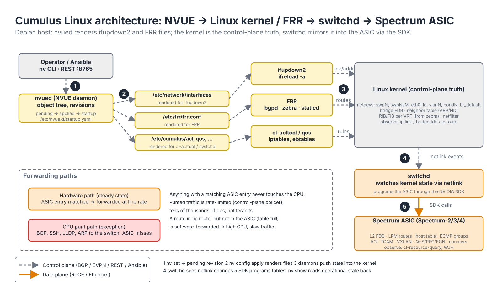
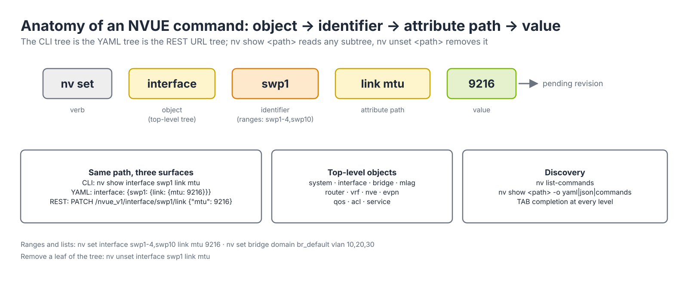
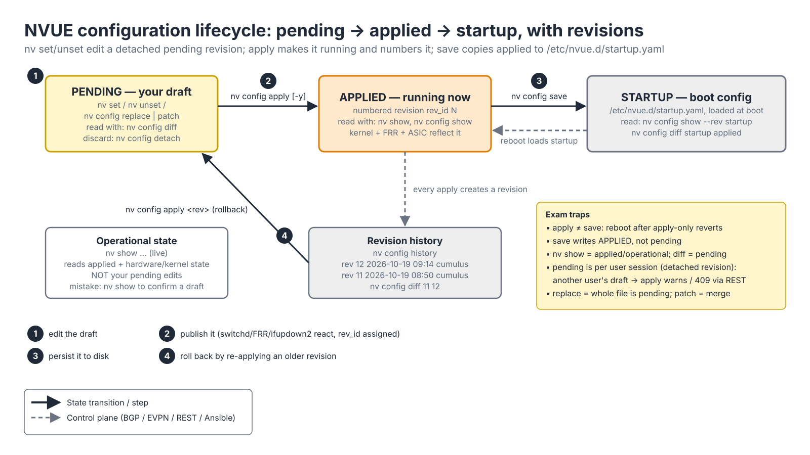
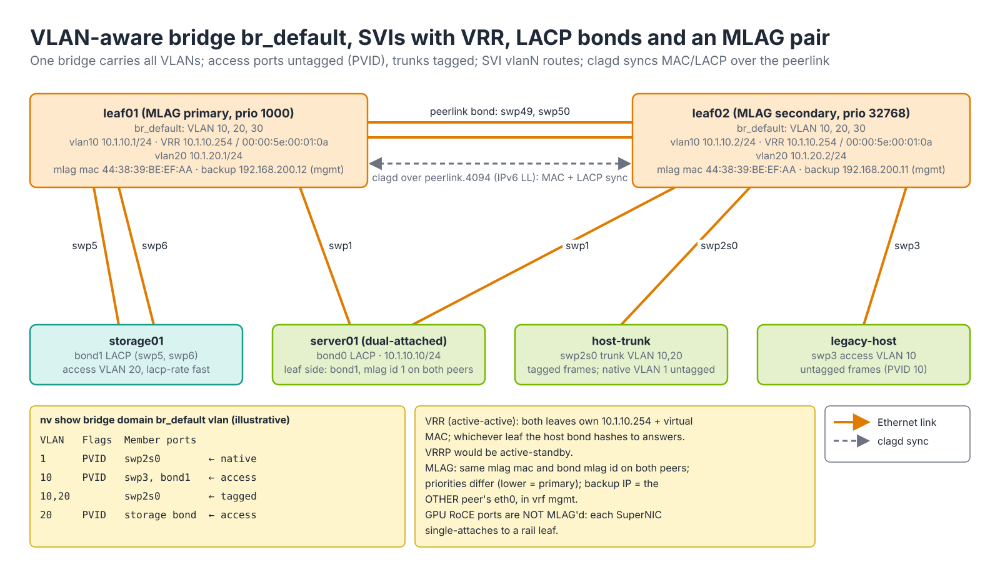
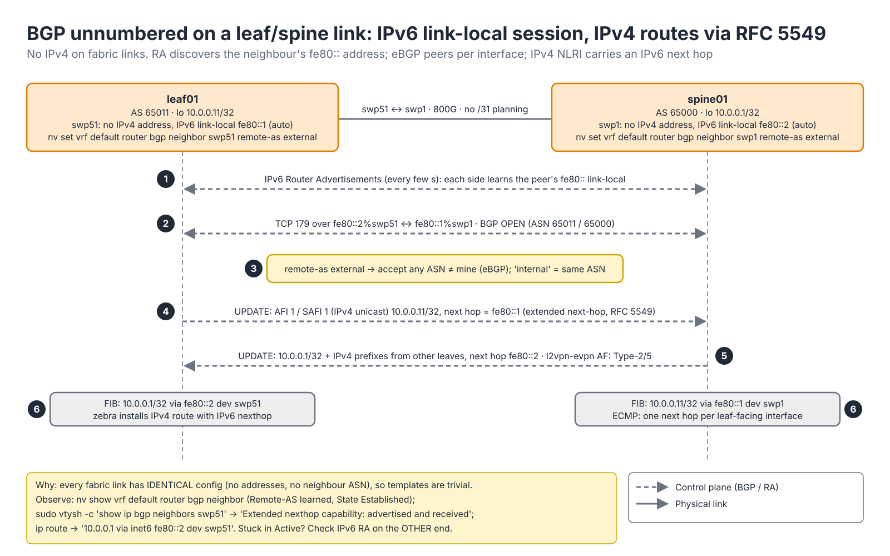
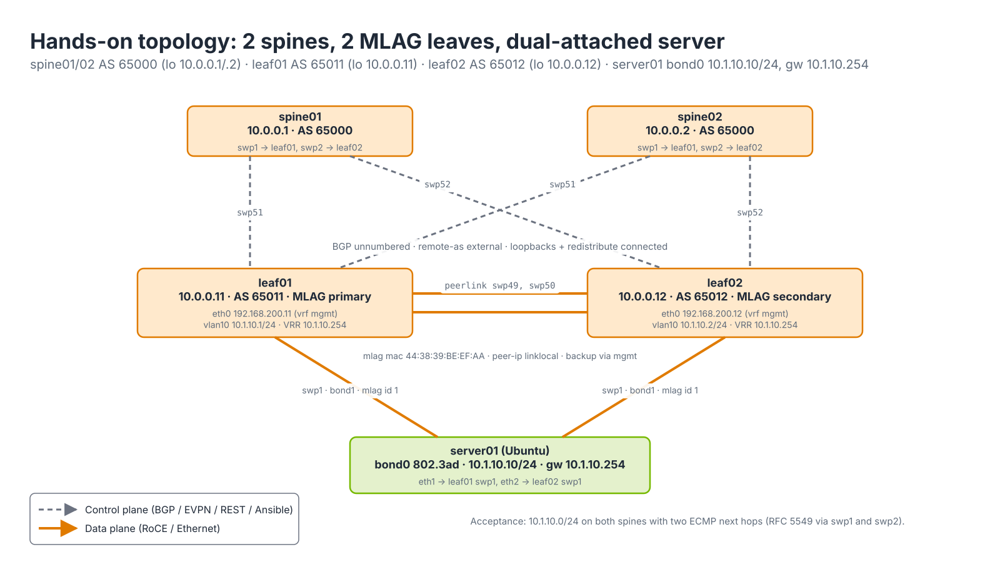

# Module 4.2 — Cumulus Linux Essentials

> **Exam domain:** NVIDIA Spectrum Networking (30%)  
> **Source course(s):** Cumulus Linux Essentials (NVIDIA Academy)  
> **Source docs:** Cumulus Linux User Guide (5.x); NVUE CLI and Command Reference; NVUE Cheat Sheet  
> **Estimated study time:** 5–6 hours

> **How to study this module:** read §1–§2, work through the §3 walkthrough on real gear or NVIDIA Air, then attempt the §5 hands-on assignment using only the Hint section. Open the Solution guide (last section) only after you have a working attempt. Finish with the Appendix C knowledge check closed-book.

## 1. Learning objectives

By the end of this module you will be able to…

- **Describe** the Cumulus Linux architecture: Debian base, `switchd`, the Spectrum SDK, and which traffic is hardware- vs software-forwarded. *(Spectrum Networking — NOS architecture)*
- **Explain** the **NVUE** object model and the lifecycle of a configuration change (pending → applied → startup), including revisions and rollback. *(Spectrum Networking — NVUE; Automation and Configuration)*
- **Configure** interfaces (breakout, speed, MTU, bonds/LACP) with `nv set interface`. *(Spectrum Networking — interface configuration)*
- **Configure** VLAN-aware bridging, access/trunk ports and SVIs using `nv set bridge domain`. *(Spectrum Networking — L2)*
- **Configure** MLAG peers and basic L3 (addresses, static routes, VRFs, BGP unnumbered). *(Spectrum Networking — L2/L3 redundancy and routing)*
- **Verify** state with `nv show` and with the underlying Linux tools (`ip`, `bridge`, `vtysh`). *(Troubleshooting Tools)*
- **Describe** ONIE image installation, licensing and zero-touch provisioning (ZTP) at a conceptual level. *(Spectrum Networking — installation)*

## 2. Key technical concepts

### 2.1 Architecture: Debian + FRR + `switchd`

*Analogy:* the Linux kernel is the architect's drawing of how traffic *should* flow; `switchd` is the construction foreman who makes the ASIC build exactly that, at line rate.


*Figure 4.2-1 — Cumulus Linux: nvued (1–2) renders configuration files; ifupdown2, FRR and cl-acltool (3) push state into the kernel; switchd (4) watches netlink and programs the Spectrum ASIC through the SDK (5). Steady-state traffic never touches the CPU.*

**What it is.** Cumulus Linux is a Debian-based network operating system. Everything you know about a Linux server applies: `apt`, `systemd`, `/etc/network/interfaces`, `ip route`, `tcpdump`. The components, top to bottom in Figure 4.2-1:

| Component | What it does | How you check it |
|---|---|---|
| **`nvued`** | NVUE daemon: owns the configuration object tree and revisions, serves the CLI and the REST API on TCP 8765, renders `/etc/network/interfaces`, `/etc/frr/frr.conf` and the ACL/QoS files on every apply | `systemctl status nvued`, `nv show system`, `nv config history` |
| **`ifupdown2`** | Applies interface configuration from `/etc/network/interfaces` to the kernel (netdevs, bridges, bonds, VLANs, addresses) | `ifquery -a`, `ifreload -a`, `ip -br link` |
| **FRRouting (FRR)** | Routing suite: `bgpd`, `zebra` (RIB → kernel FIB), `staticd`, `ospfd`… | `sudo vtysh -c "show bgp summary"`, `systemctl status frr` |
| Linux kernel | Control-plane source of truth: netdevs `swpN`/`swpNsM`/`eth0`/`lo`/`vlanN`/`bondN`/`br_default`, bridge FDB, neighbour table, per-VRF RIB/FIB, netfilter | `ip link`, `bridge fdb`, `ip route`, `ip neigh` |
| **`switchd`** | The "switch daemon": subscribes to kernel netlink events and programs the Spectrum ASIC through the NVIDIA SDK so the forwarding decision the kernel *would* make is made in hardware | `systemctl status switchd`, `journalctl -u switchd` |
| SDK / ASIC | Spectrum-2/3/4 does all steady-state forwarding: L2 switching, L3 routing, VXLAN, ACLs, QoS, RoCE PFC/ECN, counters | `cl-resource-query` (table occupancy, Module 4.3), WJH |
| `cumulus` user | Default local administrator (default password `cumulus`, forced change on first login); passwordless `sudo`; NVUE commands run as `cumulus` without `sudo`, Linux-level tools (`vtysh`, editing `/etc/...`) need `sudo` | `nv show system aaa user` |

**Why it exists.** Separating "what the forwarding state should be" (kernel) from "where it is executed" (ASIC) is what lets a switch run unmodified Linux tooling and still forward at 51.2 Tb/s. The price is a two-state system: configuration can be perfectly applied in the kernel and still not be in hardware (table full, `switchd` crashed, unsupported combination), and the symptom is "config looks fine, traffic does not flow". Everything in Module 4.3's troubleshooting ladder exists to tell those two states apart.

**How it works** (numbers in Figure 4.2-1). (1) `nv set …` writes into a pending revision; (2) `nv config apply` validates the whole tree, then renders the Linux configuration files; (3) `ifreload -a`, an FRR reload and `cl-acltool` push the result into the kernel; (4) `switchd` sees the netlink changes (new netdev, FDB entry, route, neighbour, ACL) and (5) calls the SDK to install matching ASIC entries. From then on anything with a matching ASIC entry is forwarded in hardware. Traffic *to* the switch (BGP, SSH, LLDP, ARP replies to the switch's own MAC) and anything the ASIC cannot handle (exceptions, control-plane protocols, a prefix that did not fit in the LPM table) is **punted** to the CPU over an internal port, through a control-plane policer — tens of thousands of packets per second, not terabits. If a show command reports a route as `offloaded: false`, that prefix is being software-forwarded, which you diagnose with `cl-resource-query` (Module 4.3). `systemctl status switchd` is the first check when "the config applied but traffic isn't flowing"; every `switchd` restart reprograms the ASIC and costs seconds of forwarding.

**Why the exam cares:** "config applied, traffic not flowing" questions are answered by distinguishing kernel state from ASIC state. `switchd` is the bridge between them.

### 2.2 NVUE — the object model


*Figure 4.2-2 — One NVUE path, three surfaces: the CLI argument list, the YAML tree that `nv config show -o yaml` emits, and the REST URL under `/nvue_v1/`.*

**What it is.** **NVUE** (NVIDIA User Experience) is the supported CLI and REST API. Legacy **NCLU** (`net add`, `net commit`) was removed in Cumulus 5.x; if you see `net` commands in older study material, translate them to `nv`. NVUE presents configuration as a tree of objects whose top level includes `system`, `interface`, `bridge`, `mlag`, `router`, `vrf`, `nve`, `evpn`, `qos`, `acl`, `service`. Every command is a path into that tree plus a value — `nv set interface swp1 link mtu 9216` is verb + object (`interface`) + identifier (`swp1`) + attribute path (`link mtu`) + value (`9216`), as Figure 4.2-2 shows.

**Why it exists.** A single tree means one schema for three surfaces: the CLI, the YAML file (`nv config show -o yaml`) and the REST API (`PATCH /nvue_v1/interface/swp1/link {"mtu": 9216}`, Module 6.1). Automation gets a declarative document instead of a transcript of commands, and the CLI gets completion and validation from the same schema.

**How it works.** Because it is a tree, `nv show <path>` shows the whole subtree at any depth, `nv unset <path>` removes it, and `nv list-commands` prints every valid path. Ranges and lists work on identifiers: `swp1-4,swp10`, `vlan10-20`, `bridge domain br_default vlan 10,20,30`. Output formats are `-o json`, `-o yaml`, `-o commands`. Leaf values that are merely "present" render as empty mappings in YAML (`10.0.0.11/32: {}`), numeric keys are quoted (`'100'`), and enumerations use CLI words (`on`, `external`, `lossless`). The fastest way to learn a schema detail is to configure it once and read `nv config show -o yaml`.

### 2.3 The change lifecycle: pending → applied → startup

*Analogy:* think of a blog post. **Pending** is your draft — only you see it. **Applied** is published — the world sees it now. **Startup** is the copy saved to disk — what survives if the server reboots. Publishing does not save to disk, and saving to disk does not publish your draft.


*Figure 4.2-3 — The three NVUE states and the four verbs that move configuration between them: `nv set` into pending (1), `nv config apply` to applied (2), `nv config save` to startup (3), `nv config apply <rev>` to roll back (4).*

**What it is.** Three named configuration states and the commands that read and move them:

| Name | What it is | Commands |
|---|---|---|
| **Pending** | Edits you have made with `nv set`/`nv unset` (or loaded with `nv config replace`/`patch`) but not applied; a *detached* revision that belongs to your user session | `nv config diff` (pending vs applied), `nv config detach` discards |
| **Applied** | What the switch is running now; every apply gets a numbered **revision** `rev_id N` | `nv config show` (applied, in YAML), `nv config history` |
| **Startup** | What will load at boot: `/etc/nvue.d/startup.yaml` | `nv config save` copies applied → startup; `nv config diff startup applied` shows the gap |

**Why it exists.** A transactional model gives you three things a "type and it is live" CLI cannot: a review step (`nv config diff` shows exactly what will change before anything moves), atomic validation (apply checks the whole tree, so a VLAN referenced by an SVI must exist on the bridge in the same revision), and rollback (every applied revision is numbered and re-applicable). The cost is two classic mistakes the exam loves: reading `nv show` to "confirm" an un-applied draft (it reads applied/operational state, not pending), and rebooting after apply-without-save.

**How it works** (Figure 4.2-3). `nv set` writes into your pending revision (1). `nv config apply` validates it, renders the Linux files (§2.1), triggers the daemons, waits for the kernel to converge and records `applied [rev_id: N]` (2); without `-y` it prompts with the diff first. `nv config save` copies the *applied* tree — not pending — to `/etc/nvue.d/startup.yaml` (3). Reboot loads startup. Rollback is `nv config history` to find the revision, then `nv config apply <rev>` which makes that revision pending and applies it (4) — then `save` again if you want the rollback to persist. Pending changes are per user by default; if another user has unapplied changes, `nv config apply` warns, and via REST a conflicting revision returns `409 Conflict` (Module 6.1). `nv config detach` throws your draft away.

**Why the exam cares:** `nv config apply` does **not** persist. A reboot after apply-without-save reverts to the last saved startup. Conversely, `nv config save` without `apply` saves whatever is *applied*, not pending. `nv show` reflects applied/operational state; `nv config diff` reflects pending.

### 2.4 Revisions, history, replace

**What it is.** Every apply creates a numbered **revision**. `nv config history` lists them; `nv config show --rev <n>` or `nv config diff <rev1> <rev2>` compares; `nv config apply <rev>` rolls back to one. NVUE also supports declarative files, which is the path automation uses:

```bash
nv config show -o commands              # applied config as nv set commands (great for backup)
nv config show -o yaml > backup.yaml    # applied config as YAML
nv config replace /path/new.yaml        # pending := exactly this file (declarative; removes anything not in it)
nv config patch /path/partial.yaml      # merge file into pending (add/override; cannot remove unless it carries '- unset:')
nv config apply -y
```

**Why it exists.** A numbered revision history turns "what changed at 09:14?" into a one-line answer and makes rollback a first-class operation rather than a reverse-engineered script. `replace` makes the YAML file *the* configuration: running it twice with the same file produces an empty diff, which is the idempotency primitive Ansible and git-based pipelines build on (Module 6.1). `patch` exists for feature-scoped files (a RoCE profile, a VLAN) that should not demolish everything else.

**How it works.** The file format is the same YAML `nv config show -o yaml` produces: a list with a top-level `- set:` key (and optionally `- unset:`). `replace` loads it as the entire pending tree; `patch` merges it over the current pending tree. Both are followed by `nv config diff`, `nv config apply -y`, `nv config save`. In automation you may see errors about a locked or conflicting revision when a previous session left a detached draft; `nv config detach` clears your pending set, and REST clients can `force` an apply over other pending sets. The REST API (`https://<switch>:8765/nvue_v1/`) exposes exactly the same tree and revision model — covered in Module 6.1.

### 2.5 Interfaces

**What it is.** Front-panel ports are `swp1`, `swp2`, … (switch port). Breakout sub-ports are `swp1s0`–`swp1s3`. The management port is `eth0` (in the `mgmt` VRF by default). Loopback is `lo`. SVIs are `vlan<N>`. Bonds you name yourself (`bond1`, `uplink`, or `peerlink` for the MLAG link). Per-port link attributes live under `nv set interface swpN link …`: `state up|down`, `speed`, `auto-negotiate`, `fec` (`rs`, `baser`, `auto` — RS-FEC is mandatory at 400G/800G), `mtu`, `breakout`.

**Why it exists.** Naming by physical position (`swp`) rather than lane index (SONiC's `EthernetN`, Module 4.4) keeps cabling documents and CLI aligned. Breakout exists because an 800G OSFP cage can serve two 400G SuperNICs or four 200G NICs; the ASIC port map changes when you break out, so on most platforms it requires a `switchd` reload or restart, and on some older platforms neighbouring ports are disabled (e.g., every other port on an SN2700) — check the platform's port-mapping note.

**How it works.** Default MTU on Cumulus is 9216 on swp ports (verify for your release); a bridge's MTU follows its lowest member. For RoCE you typically want 9000+ end to end with the host at 9000 or 4200, but keep the switch at 9216 to leave room for the 50-byte VXLAN header in EVPN fabrics. **Bonds** (`nv set interface bond1 bond member swp5,swp6`) default to LACP in 5.x (`bond mode lacp|static|lacp-bypass`, `lacp-rate fast` = 1 s LACPDUs); members must have matching speed and must not carry their own IP or bridge configuration — put VLAN/IP config on the bond. `lacp-bypass` lets a single member forward before LACP negotiates (useful for PXE/ZTP of hosts). Observe: `nv show interface swp1 link` (speed, autoneg, FEC, transceiver), `nv show interface swp1 counters`, `nv show interface bond1 bond` (members `up`, LACP partner), `nv show interface --view=lldp`.

### 2.6 The VLAN-aware bridge and SVIs

*Analogy:* one apartment building (`br_default`) with many floors (VLANs). An access port is a resident with a key to one floor; a trunk port is the building manager with keys to several.


*Figure 4.2-4 — One VLAN-aware bridge per switch carrying VLANs 10/20/30; access ports untagged (PVID), trunks tagged; SVIs `vlan10`/`vlan20` with a VRR anycast gateway; a dual-attached server on an MLAG bond; clagd syncing over the peerlink.*

**What it is.** Cumulus uses a single **VLAN-aware bridge** (`br_default`) by default. One Linux bridge carries all VLANs with 802.1Q filtering; ports are access or trunk members of it (`nv set interface swp3 bridge domain br_default access 10` / `… vlan 10,20` / no VLAN list = all bridge VLANs). Traditional per-VLAN bridges exist but are legacy. **SVIs** (routed interfaces per VLAN) are `vlan<N>` interfaces with `ip address`, optionally placed in a VRF (`ip vrf tenantA`). The bridge's native/untagged VLAN on trunks defaults to 1 (`nv set bridge domain br_default untagged 1`).

**Why it exists.** One bridge with VLAN filtering scales to 4 k VLANs with one FDB and one set of ASIC bridge resources, and maps directly onto the Spectrum L2 pipeline (VLAN tag → FID lookup → FDB). Per-VLAN bridges would need one kernel bridge per VLAN and burn ASIC resources. SVIs are where L2 meets L3 on a leaf (tenant gateway); in EVPN fabrics they are also the anchor for the L2VNI/L3VNI mapping (Module 4.1 §2.8).

**How it works.** A frame entering an access port is tagged internally with the PVID; a frame entering a trunk keeps its tag (or gets the native VLAN if untagged). The kernel bridge learns source MACs per VLAN into the FDB; `switchd` mirrors the FDB into the ASIC. `nv show bridge domain br_default vlan` prints membership with a `PVID` flag marking untagged membership — read it as: `PVID` on an access port = its access VLAN; `PVID` on a trunk = its native VLAN. First-hop redundancy on a pair of leaves is **VRR** (Virtual Router Redundancy): both switches own the virtual IP and the virtual MAC and both forward actively (`nv set interface vlan10 ip vrr address 10.1.10.254/24` + `vrr mac-address 00:00:5e:00:01:0a`, identical on both peers; real SVI addresses differ). Standards-based VRRP (active-standby) is also supported; the exam contrasts the two. Observe: `nv show bridge domain br_default mac-table`, `bridge vlan show` and `bridge fdb show br br_default` (kernel view — must agree with `nv show`), `nv show interface vlan10` (SVI state, VRR).

### 2.7 MLAG

*Analogy:* two receptionists sharing one phone number and one appointment book. The caller (host) dials one number and either can answer; the shared book (`clagd` sync over the peerlink) keeps them consistent.

**What it is.** **MLAG** (Multi-Chassis Link Aggregation) lets two Cumulus switches present as one LACP partner to a dual-attached host or downstream switch (Figure 4.2-4). The pieces: a **peerlink** bond between the peers carrying a dedicated peer VLAN (4094 by default, sub-interface `peerlink.4094`); the `clagd` daemon on each peer exchanging MAC tables, LACP state and VLAN/MTU consistency data over it; an identical **system MAC** on both peers (`nv set mlag mac-address 44:38:39:BE:EF:AA`) which becomes the LACP system ID the host sees; a per-bond **`mlag id`** identical on both peers that ties `bond1` on leaf01 to `bond1` on leaf02; `peer-ip linklocal` (IPv6 link-local over the peerlink, no addressing to plan); a **backup IP** over the management network (`nv set mlag backup 192.168.200.12 vrf mgmt`, the *other* peer's eth0) to tell peer death from peerlink failure; and `priority` (lower = primary, default 32768).

**Why it exists.** Hosts and storage want two uplinks for redundancy and bandwidth, and LACP requires both links to terminate on what looks like one switch. Without MLAG you would need STP (one link blocked) or host-side active/backup. The trade-off is operational coupling: two switches must agree on VLANs, MTU, bond membership and the system MAC, and a split brain (peerlink down, both alive) must be arbitrated — that is what the backup IP and the primary/secondary roles do (the secondary shuts its MLAG bonds if it loses both the peerlink and the backup heartbeat says the primary is alive).

**How it works.** When `clagd` establishes the peer session, both switches advertise the shared system MAC in LACPDUs on every bond with an `mlag id`, so the host's LACP state machine sees one partner and brings both members up. MACs learned on one peer's MLAG bond are synced to the other, so the peer forwards locally instead of across the peerlink; the peerlink carries only traffic that must cross (single-attached orphans, BUM, failover). A dual-attached bond that is down on one peer while `nv show mlag` says peer alive almost always means the `mlag id` differs. Design note for AI fabrics: GPU-side RoCE ports are *not* MLAG'd — each SuperNIC single-attaches to a rail leaf (Module 4.1 §2.10). MLAG shows up on management, storage and traditional service leaves, and for EVPN fabrics NVIDIA increasingly recommends EVPN multihoming (ESI, Module 4.1 §2.8) instead. Observe: `nv show mlag` (role, peer-alive, backup-active), `nv show mlag consistency-checker` (per-VLAN/MTU/bond mismatches), `nv show interface bond1 bond`.

### 2.8 Layer 3: VRFs and BGP unnumbered

*Analogy:* a **VRF** is a separate building with its own address book. The `mgmt` VRF (Module 4.3) is the security office's building — `eth0` lives there so fabric routes can never hijack SSH.


*Figure 4.2-5 — BGP unnumbered mechanics: RA discovery (1), TCP/179 over link-local with `remote-as external` (2–3), IPv4 NLRI with an IPv6 next hop via the extended-next-hop capability (4–5), FIB install with `via inet6 fe80::…` (6).*

**What it is.** Each **VRF** is a Linux VRF device with its own routing table (`nv set vrf blue`, `nv set interface swp10 ip vrf blue`); FRR runs a routing instance per VRF (`nv set vrf blue router bgp …`). **BGP unnumbered** is eBGP over interfaces with no IPv4 address: the session uses IPv6 link-local addresses discovered via router advertisements, and IPv4 routes are carried with an IPv6 next hop using the **extended next-hop capability (RFC 5549)**. Configuration is per interface, not per address: `nv set vrf default router bgp neighbor swp51 remote-as external` — `external` means "any ASN that is not mine" (eBGP), `internal` means "my ASN" (iBGP); you never type the neighbour's ASN. Spines typically share one ASN; each leaf (or leaf pair) has its own.

**Why it exists.** A leaf/spine fabric has hundreds of point-to-point links. Numbering each with a /31 means an address plan, per-link neighbour statements with explicit ASNs and addresses, and a different configuration on every switch — every one a chance for a typo. Unnumbered makes every fabric link's configuration *identical* (no address, no neighbour ASN), so templates collapse to a loop over interface names (Module 6.1) and the only per-switch values are hostname, loopback and ASN. That is why it underpins every NVIDIA EVPN and Spectrum-X reference design. The trade-off is that you must understand IPv6 link-local to troubleshoot it, and that a session needs the *other* end configured the same way.

**How it works** (Figure 4.2-5):

1. With `ipv6 ra` on by default for unnumbered interfaces, each side sends Router Advertisements; from them FRR learns the peer's `fe80::` link-local address on that interface (`swp51`) without any configuration.
2. FRR opens TCP 179 to `fe80::2%swp51`; the OPEN messages carry each side's ASN (65011 / 65000).
3. `remote-as external` accepts the OPEN because the peer ASN differs from the local one. (With `internal` it must match.) Capabilities negotiated include *extended next hop* for AFI 1 / SAFI 1.
4. The leaf advertises `10.0.0.11/32` (its loopback, `address-family ipv4-unicast network 10.0.0.11/32`) as IPv4 NLRI whose next hop is its IPv6 link-local address — RFC 5549 encoding.
5. The spine advertises its own loopback and every other leaf's prefixes back; the `l2vpn-evpn` address family rides the same session when enabled on the peer-group (Module 4.1).
6. `zebra` installs the IPv4 route with the IPv6 next hop: `ip route` shows `10.0.0.1 via inet6 fe80::2 dev swp51`. With two uplinks the spine prefix appears with two next hops — ECMP, one per interface — and the `cumulus` kernel resolves the link-local to the peer's MAC via the ND cache.

Observe: `nv show vrf default router bgp neighbor` (Remote-AS *learned*, State Established, PfxRcvd), `sudo vtysh -c "show ip bgp neighbors swp51"` (`Extended nexthop capability: advertised and received`), `ip route show vrf default`. Failure modes: stuck in `Active` → the other end lacks the interface neighbour, IPv6 RA is disabled, or the link is down at L1; `Established` with `PfxRcvd 0` → address family not activated; routes present but not in the FIB → check `ip -6 neigh` for the link-local and `nv show vrf default router rib ipv4`. Peer-groups (`nv set vrf default router bgp peer-group fabric remote-as external` + `neighbor swp51 peer-group fabric`) remove repetition and are where you enable `l2vpn-evpn` once for all fabric links.

### 2.9 Installation, licensing and ZTP

**What it is.** Three lifecycle facts you need before Module 4.3 goes deep:
- **ONIE** (Open Network Install Environment) is the boot loader shipped on every Spectrum switch. `onie-select -i` from a running Cumulus or the ONIE menu lets you (re)install an image by HTTP/TFTP/USB, or via DHCP option 114 pointing to the installer URL. ONIE also handles "uninstall" to wipe the OS.
- **Licensing** — Cumulus Linux historically required a license file (`cl-license -i`) to enable front-panel ports; with NVIDIA Spectrum hardware (Cumulus 5.x on NVIDIA switches) a license is no longer required on NVIDIA-branded switches. Check the current doc for your platform; on older third-party hardware you may still see `cl-license`.
- **ZTP** (Zero Touch Provisioning) — on first boot Cumulus looks for a script: on USB, via DHCP option 239 (URL), or by hostname default. The script (bash or Python) must carry the `# CUMULUS-AUTOPROVISIONING` marker and typically installs an image, sets passwords, pulls an NVUE YAML and runs `nv config replace` + `apply` + `save`, and installs the NetQ agent.

**Why it exists.** ONIE decouples the hardware from the NOS (the same SN5600 runs Cumulus or SONiC); ZTP makes a hundred leaves come up identical from a serial-number-keyed YAML repository without a console cable.

**How it works.** `ztp -s <url>` runs a script manually; `ztp -e` enables and `ztp -d` disables ZTP; `ztp -i` shows status (`nv show system ztp` in newer releases); `/var/log/ztp.log` records what happened. Option 239 is ZTP; option 114 is ONIE — the exam confuses them on purpose. Full detail and the sequence diagram are in Module 4.3 §2.8.

## 3. Live-style walkthrough

We will do two things on `leaf01`: first walk the full NVUE lifecycle on a trivial change so you *see* pending, applied and startup behave differently (Part A follows the four numbered transitions of Figure 4.2-3 in order), then build the VLAN-aware bridge, SVI and LACP bond of Figure 4.2-4 (Part B) and the BGP unnumbered sessions of Figure 4.2-5 (Part C).

### Part A — the NVUE lifecycle on one MTU change

```bash
# Fresh login as cumulus. First, what is swp1's MTU right now (operational/applied)?
nv show interface swp1 link mtu
# -> 9216 (platform default)

# Make a change. This goes ONLY into pending — the "draft".
nv set interface swp1 link mtu 1500

# Prove it: nv show reads applied/operational state, so it still says 9216.
nv show interface swp1 link mtu
# -> 9216          <- classic mistake: reading nv show to "confirm" an unapplied change

# The right tool for pending: diff pending against applied.
nv config diff
```

```text
- set:
    interface:
      swp1:
        link:
          mtu: 1500
```

```bash
# Publish the draft. Without -y you get a confirmation prompt listing the diff.
nv config apply -y
# -> applied [rev_id: 12]

# Now nv show reflects it.
nv show interface swp1 link mtu
# -> 1500

# And the Linux kernel agrees — NVUE rendered /etc/network/interfaces and ifreload'd it.
ip -br link show swp1
# -> swp1  UP  ... mtu 1500

# Still NOT on disk. Prove it: compare startup to applied.
nv config diff startup applied        # shows the mtu line — startup lacks it
# Reboot now and swp1 goes back to 9216.

# Save: copies applied -> /etc/nvue.d/startup.yaml
nv config save
nv config diff startup applied        # empty — in sync

# History: every apply created a revision.
nv config history
```

```text
rev_id  date                 user     message
------  -------------------  -------  ---------
12      2026-10-19 09:14:02  cumulus  nv config apply
11      2026-10-19 08:50:31  cumulus  nv config apply
...
```

```bash
# Rollback: make revision 11 (pre-MTU) pending, review, apply.
nv config apply 11            # pending := rev 11, prompts with the diff; or nv config diff 11 12 first
nv show interface swp1 link mtu
# -> 9216
nv config save                # persist the rollback too

# Housekeeping: if you have a half-finished draft you want to abandon:
nv set interface swp1 link mtu 1400
nv config detach              # throw the draft away; nv config diff is now empty
```

Watch the pattern: `set` → `diff` → `apply` → `save` — transitions 1, 2 and 3 of Figure 4.2-3, with transition 4 (rollback) exercised by `nv config apply 11`. Two of those four are optional in a lab and mandatory in production.

### Part B — VLAN-aware bridge, SVI, LACP bond

```bash
# --- Interfaces ---
# Break out an 800G port to 2x400G — creates swp2s0 and swp2s1. Expect a switchd reload.
nv set interface swp2 link breakout 2x
# Force 100G and disable autoneg on swp3 (DAC to an older NIC).
nv set interface swp3 link speed 100G
nv set interface swp3 link auto-negotiate off
# Jumbo everywhere on the host-facing range. 9216 leaves VXLAN headroom.
nv set interface swp1-32 link mtu 9216
nv set interface swp2s0 link state up

# --- LACP bond to a dual-NIC storage server ---
nv set interface bond1 bond member swp5,swp6        # members: same speed, NO ip/bridge config of their own
nv set interface bond1 bond mode lacp               # default; also static, lacp-bypass
nv set interface bond1 bond lacp-rate fast          # 1 s LACPDUs -> faster failure detection
nv set interface bond1 link mtu 9216

# --- VLAN-aware bridge ---
nv set bridge domain br_default vlan 10,20,30           # VLANs exist on the bridge
nv set interface swp1 bridge domain br_default           # trunk, ALL bridge VLANs
nv set interface swp2s0 bridge domain br_default vlan 10,20   # trunk, limited VLANs
nv set interface swp3 bridge domain br_default access 10      # access port: untagged in VLAN 10
nv set interface bond1 bridge domain br_default access 20     # bond is the bridge member, not swp5/6
nv set bridge domain br_default untagged 1                    # native VLAN on trunks (default 1)

# --- SVIs with VRR anycast gateway ---
nv set interface vlan10 ip address 10.1.10.1/24
nv set interface vlan20 ip address 10.1.20.1/24
nv set interface vlan10 ip vrr address 10.1.10.254/24     # VIP shared with the MLAG peer
nv set interface vlan10 ip vrr mac-address 00:00:5e:00:01:0a

# Review everything before apply.
nv config diff
nv config apply -y
nv config save
```

Checkpoints — what good looks like:

```bash
nv show interface bond1 bond
```
```text
                 operational  applied
---------------  -----------  -------
mode             lacp         lacp
lacp-rate        fast         fast
member
  swp5           up
  swp6           up
```
Both members `up`. If one is `down` with LACP configured, the server side is probably not running LACP — consider `lacp-bypass` for PXE.

```bash
nv show bridge domain br_default vlan
```
```text
VLAN  Flags  Member Ports
----  -----  ------------------------------
1     PVID   swp1, swp2s0
10    PVID   swp3                 <- access
10           swp1, swp2s0
20    PVID   bond1
20           swp1, swp2s0
30           swp1
```
Read the `PVID` flag: it marks untagged membership. `swp3` untagged in 10 = access; `swp1` untagged in 1 = native VLAN.

```bash
nv show bridge domain br_default mac-table      # learned MACs with VLAN and port
nv show interface vlan10                         # SVI up, address, VRR state
bridge vlan show                                 # kernel view — must agree with nv show
```

### Part C — a quick L3 touch

```bash
nv set interface lo ip address 10.0.0.11/32
nv set interface swp51 ip address 192.168.51.1/31
nv set vrf default router static 0.0.0.0/0 via 192.168.51.0
nv set vrf blue                                       # new VRF: its own routing table
nv set interface swp10 ip vrf blue                    # move swp10 into the "blue building"
nv set interface swp10 ip address 172.16.10.1/24
nv set vrf blue router static 172.16.0.0/16 via 172.16.10.254

# BGP unnumbered to two spines — identical lines on every leaf.
nv set router bgp autonomous-system 65011
nv set router bgp router-id 10.0.0.11
nv set vrf default router bgp neighbor swp51 remote-as external     # "external" = any ASN != mine
nv set vrf default router bgp neighbor swp52 remote-as external
nv set vrf default router bgp address-family ipv4-unicast network 10.0.0.11/32
nv set vrf default router bgp address-family ipv4-unicast redistribute connected enable on
nv config apply -y

nv show vrf                              # default, mgmt, blue
nv show vrf blue router rib ipv4         # 172.16.10.0/24 connected, 172.16.0.0/16 static
nv show vrf default router bgp neighbor  # swp51/swp52 Established, Remote-AS learned
sudo vtysh -c "show ip bgp summary"      # same data from FRR
```

What just happened on swp51 is steps 1–6 of Figure 4.2-5: RA discovery, TCP/179 over link-local, `external` accepting any foreign ASN, and the loopback advertised with an IPv6 next hop. Prove the last point with `ip route show vrf default | grep inet6` — every spine prefix says `via inet6 fe80::…`. Peer-groups reduce repetition: `nv set vrf default router bgp peer-group fabric remote-as external` then `nv set vrf default router bgp neighbor swp51 peer-group fabric`.

### Part D — the Linux underneath

Because NVUE generates standard Linux configuration, you can always drop down a level to confirm what was actually programmed:

```bash
ip -br link                       # interface states
ip -br addr
ip route show vrf blue
bridge vlan show                  # VLAN membership per port
bridge fdb show br br_default     # MAC table (kernel view)
sudo vtysh                        # FRR shell: show bgp summary, show ip route, show evpn vni
cat /etc/network/interfaces       # GENERATED by NVUE — do not hand-edit when using NVUE
cat /etc/frr/frr.conf             # also generated
```

The rule: on an NVUE-managed switch, *do not* edit `/etc/network/interfaces` or `/etc/frr/frr.conf` directly — the next `nv config apply` overwrites them. Cumulus does support a "mixed" mode for files NVUE does not manage (`/etc/nvue.d/` snippets) — check current docs if you need it.

## 4. Troubleshooting / common gotchas

### Gotcha 1 — "My change disappeared after reboot"

**Symptom:** MTU/VLAN/BGP change worked yesterday; after a reboot it is gone.

**Why it happens:** `nv config apply` changed running state; `nv config save` was never run, so `/etc/nvue.d/startup.yaml` never got it.

**How to debug:**
```bash
nv config history                     # the apply is there
nv config diff startup applied        # before reboot this would have shown the gap
```

**Fix:** re-apply the revision (`nv config apply <rev>`) and `nv config save`. In automation, every play ends with save.

### Gotcha 2 — "nv show doesn't show my config"

**Symptom:** you typed `nv set ...`, then `nv show ...` and the value is unchanged.

**Why it happens:** `nv show` reads applied/operational state; your edit is pending.

**How to debug:** `nv config diff` — your change is listed there.

**Fix:** `nv config apply -y`. Remember: diff for pending, show for applied.

### Gotcha 3 — Bond stays down

**Symptom:** `nv show interface bond1 bond` shows a member `down`, or the bond never forwards.

**Why it happens:** a member carries its own IP or bridge config (not allowed), the member speeds differ, or the host is not speaking LACP.

**How to debug:**
```bash
nv show interface swp5                    # any ip/bridge config on the member? remove it
nv show interface swp5 link               # speed matches swp6?
nv show interface bond1 bond              # LACP partner info present?
```

**Fix:** move VLAN/IP config onto the bond; match speeds; use `nv set interface bond1 bond mode lacp-bypass` if the host needs to PXE before LACP.

### Gotcha 4 — Edited `/etc/network/interfaces`, change vanished

**Symptom:** a hand-edit to `/etc/network/interfaces` or `/etc/frr/frr.conf` reverts.

**Why it happens:** NVUE regenerates both files on every apply.

**How to debug:** `nv config show -o commands` — your hand edit is not represented.

**Fix:** express the change in NVUE, or use the documented `/etc/nvue.d/` snippet mechanism for unmanaged settings.

## 5. Hands-on assignment — 2-leaf / 2-spine NVIDIA Air topology with MLAG and BGP unnumbered

**Scenario.** Build the management/storage leaf tier for a GPU pod in NVIDIA Air: two leaves in an MLAG pair with a dual-attached server, two spines, BGP unnumbered everywhere.

**Requirements**
1. Hostnames `leaf01`, `leaf02`, `spine01`, `spine02`; loopbacks 10.0.0.11, .12, .1, .2.
2. MLAG between leaf01 and leaf02: peerlink bond on `swp49,swp50`, shared system MAC `44:38:39:BE:EF:AA`, `peer-ip linklocal`, backup IP over the `mgmt` VRF, leaf01 primary (priority 1000).
3. Dual-attached `server01` on `bond1` (leaf01 `swp1`, leaf02 `swp1`), `mlag id 1`, access VLAN 10.
4. VLAN 10 SVI with VRR gateway 10.1.10.254/24 on both leaves (leaf01 10.1.10.1, leaf02 10.1.10.2), VRR MAC `00:00:5e:00:01:0a`.
5. BGP unnumbered: leaves ASN 65011/65012, spines ASN 65000, `remote-as external`, loopbacks advertised, `redistribute connected` on leaves so 10.1.10.0/24 reaches the spines.
6. Everything saved to startup.

**Deliverables**
- `nv config show -o yaml` from all four switches.
- Output of `nv show mlag`, `nv show mlag consistency-checker`, `nv show interface bond1 bond`, `nv show vrf default router bgp neighbor` from both leaves.
- `nv config history` from leaf01 showing at least three revisions.

**Acceptance criteria**
- `nv show mlag` on leaf01: role `primary`, peer alive, backup active; leaf02 `secondary`.
- `nv show interface bond1 bond` on both leaves: swp1 up, LACP partner present.
- `server01` can ping 10.1.10.254 and the spine loopbacks.
- Both spines' `nv show vrf default router rib ipv4` contain 10.1.10.0/24 with two next hops (ECMP to both leaves).
- After `sudo reboot` on leaf02, all configuration persists.

### Hint
- Build the peerlink and MLAG *before* the host bond; `nv show mlag` must say peer alive before bond1 will come up on both.
- `backup` is the *other* peer's eth0 address, and it needs `vrf mgmt`.
- The `mlag id` and the system `mac-address` must be identical on both peers; the `priority` must differ.
- VRR: same virtual IP and MAC on both leaves, different real SVI addresses.
- For requirement 6, `nv config diff startup applied` empty on every switch is your proof.

## Appendix A — Quick command / config reference

```bash
# NVUE lifecycle
nv set ... | nv unset ...
nv config diff
nv config apply [-y]
nv config save
nv config history
nv config show [-o commands|yaml|json] [--rev N]
nv config replace <file.yaml> | nv config patch <file.yaml>
nv config detach

# Interfaces
nv set interface swp1 link breakout 4x
nv set interface swp1 link speed 100G
nv set interface swp1 link auto-negotiate off
nv set interface swp1 link mtu 9216
nv set interface bond1 bond member swp5,swp6
nv set interface bond1 bond mode lacp

# Bridging
nv set bridge domain br_default vlan 10,20
nv set interface swp2 bridge domain br_default access 10
nv set interface swp3 bridge domain br_default vlan 10,20
nv set interface vlan10 ip address 10.1.10.1/24
nv set interface vlan10 ip vrr address 10.1.10.254/24

# MLAG
nv set interface peerlink bond member swp49,swp50
nv set mlag mac-address <sys-mac>
nv set mlag peer-ip linklocal
nv set mlag backup <peer-mgmt-ip> vrf mgmt
nv set mlag priority 1000
nv set interface bond1 bond mlag id 1

# L3
nv set interface lo ip address 10.0.0.11/32
nv set vrf blue
nv set interface swp10 ip vrf blue
nv set vrf default router static 0.0.0.0/0 via <nh>
nv set router bgp autonomous-system 65011
nv set router bgp router-id 10.0.0.11
nv set vrf default router bgp neighbor swp51 remote-as external
nv set vrf default router bgp address-family ipv4-unicast network 10.0.0.11/32
```

| Need | Command |
|---|---|
| Platform, version, uptime | `nv show system` |
| All interfaces, state, speed | `nv show interface` |
| One port's physical link details (speed, autoneg, FEC, transceiver) | `nv show interface swp1 link` |
| Port counters | `nv show interface swp1 counters` |
| Bridge VLAN membership | `nv show bridge domain br_default vlan` |
| MAC table | `nv show bridge domain br_default mac-table` |
| BGP neighbours | `nv show vrf default router bgp neighbor` |
| Routes | `nv show vrf default router rib ipv4` |
| MLAG status | `nv show mlag` / `nv show mlag consistency-checker` |
| Pending vs applied | `nv config diff` |
| Applied config as commands | `nv config show -o commands` |
| LLDP neighbours | `nv show interface --view=lldp` or `nv show interface swp1 lldp` |
| Every valid path | `nv list-commands` |

Output formats: `-o json`, `-o yaml`, `-o commands`.

## Appendix B — Exam traps & key takeaways

- `nv config apply` is not `nv config save`. Apply changes the running system; save writes `/etc/nvue.d/startup.yaml`. Both are needed for a persistent change.
- `nv show` reflects *applied/operational* state; `nv config diff` shows what is pending. Reading `nv show` to confirm an un-applied change is a classic mistake.
- Revisions give rollback: `nv config history`, `nv config apply <rev>`. `nv config replace <yaml>` is the declarative path used by automation.
- Hand-editing `/etc/network/interfaces` or `/etc/frr/frr.conf` on an NVUE switch — overwritten at next apply.
- NCLU `net add` syntax no longer exists in Cumulus 5.x; the exam expects `nv`.
- A bond member cannot carry its own IP or bridge configuration; put VLAN/IP config on the bond.
- Breakout changes may disable adjacent ports or require `switchd` restart depending on platform.
- BGP unnumbered requires IPv6 link-local on the interface (the default) and `remote-as external`, not a literal ASN, in reference designs — identical config on every fabric link.
- VRR is active-active (Cumulus), VRRP is active-standby (standard). NVIDIA uses VRR with MLAG.
- MLAG `mac-address` and the bond `mlag id` must match on both peers; `backup` must point to the *other* peer's management IP; `priority` lower = primary.
- `cumulus` user has passwordless sudo; NVUE itself does not require sudo.
- Cumulus Linux = Debian + FRR + `switchd` syncing kernel state into the Spectrum ASIC. One VLAN-aware bridge `br_default`; `swpN`, `swpNsM`, `eth0`, `vlanN`.

## Appendix C — Knowledge check

1. An engineer runs `nv set interface swp1 link mtu 9216` and `nv config apply -y`, verifies traffic, then reboots the switch. After reboot the MTU is back to its old value. Why?
   A. MTU cannot be set via NVUE.
   B. `nv config save` was never run, so startup.yaml did not include the change.
   C. The change required `sudo`.
   D. `-y` applies the change only temporarily.

2. Which command shows the difference between what you have typed but not applied and what the switch is currently running?
   A. `nv show config`
   B. `nv config history`
   C. `nv config diff`
   D. `nv config show -o commands`

3. You need to roll a switch back to the configuration it had three applies ago. Which sequence is correct?
   A. `nv config history` to find the revision, then `nv config apply <rev>`
   B. `nv config save --rev 3`
   C. `git checkout /etc/network/interfaces`
   D. `nv config detach` three times

4. A dual-attached server's LACP bond stays down on one MLAG peer. Both peers show `nv show mlag` peer alive. What is the most likely configuration error?
   A. Different `bond mlag id` values on the two peers
   B. The peerlink uses VLAN 4094
   C. `mlag priority` is identical on both
   D. VRR is not configured

5. In a BGP unnumbered fabric, what does `remote-as external` mean?
   A. The neighbour must be in ASN 65535.
   B. Accept any neighbour ASN that differs from the local ASN (eBGP).
   C. Peer only over IPv4.
   D. Use the external route-map.

6. Which file does NVUE generate, meaning you should not hand-edit it on an NVUE-managed switch?
   A. `/etc/hostname`
   B. `/etc/network/interfaces`
   C. `/etc/nvue.d/startup.yaml`
   D. `/var/log/syslog`

7. What is the default bridge model in Cumulus Linux 5.x?
   A. One traditional bridge per VLAN
   B. A single VLAN-aware bridge, `br_default`
   C. Open vSwitch
   D. Linux macvlan

8. What is the role of `switchd`?
   A. Runs the BGP protocol
   B. Programs the Spectrum ASIC to mirror the Linux kernel's forwarding state
   C. Serves the NVUE REST API
   D. Handles SSH logins

### Answer key
1. B — Apply changes running state; only `nv config save` persists to startup.yaml.
2. C — `nv config diff` compares pending against applied.
3. A — Revisions are listed by `nv config history` and re-applied with `nv config apply <rev>`.
4. A — The MLAG ID identifies the same logical bond on both peers; a mismatch breaks LACP.
5. B — `external` accepts any non-local ASN, enabling identical config across links.
6. B — `/etc/network/interfaces` (and `/etc/frr/frr.conf`) are rendered by NVUE.
7. B — VLAN-aware bridge `br_default` carries all VLANs by default.
8. B — `switchd` synchronises kernel state into the ASIC via the SDK.

## References
- Cumulus Linux User Guide (5.x) — https://docs.nvidia.com/networking-ethernet-software/cumulus-linux/
- NVUE CLI — https://docs.nvidia.com/networking-ethernet-software/cumulus-linux/System-Configuration/NVIDIA-User-Experience-NVUE/NVUE-CLI/
- NVUE Command Reference — https://docs.nvidia.com/networking-ethernet-software/nvue-reference/
- NVUE Cheat Sheet — https://docs.nvidia.com/networking-ethernet-software/cumulus-linux/System-Configuration/NVIDIA-User-Experience-NVUE/NVUE-Cheat-Sheet/
- Cumulus Linux: Multi-Chassis Link Aggregation (MLAG); Border Gateway Protocol (BGP); Zero Touch Provisioning
- NVIDIA Academy course: Cumulus Linux Essentials
- Related: [`01-spectrum-x.md`](01-spectrum-x.md), [`03-cumulus-linux-administration.md`](03-cumulus-linux-administration.md), [`../06-automation/01-nvue-and-ansible-automation.md`](../06-automation/01-nvue-and-ansible-automation.md)

---
## Solution guide — Hands-on assignment

### Topology


*Figure 4.2-6 — The assignment topology: spine01/02 (AS 65000), leaf01/02 (AS 65011/65012) in an MLAG pair over swp49–50, server01 dual-attached on bond1 (`mlag id 1`) in VLAN 10 with VRR gateway 10.1.10.254.*

### Spines (spine02: hostname, lo 10.0.0.2/32, router-id 10.0.0.2)

```bash
nv set system hostname spine01
nv set interface lo ip address 10.0.0.1/32
nv set interface swp1-2 link state up
nv set router bgp autonomous-system 65000
nv set router bgp router-id 10.0.0.1
nv set vrf default router bgp neighbor swp1 remote-as external     # to leaf01
nv set vrf default router bgp neighbor swp2 remote-as external     # to leaf02
nv set vrf default router bgp address-family ipv4-unicast network 10.0.0.1/32
nv config apply -y
nv config save
```

### leaf01 (revision 1: identity + L3)

```bash
nv set system hostname leaf01
nv set interface lo ip address 10.0.0.11/32
nv set interface eth0 ip address 192.168.200.11/24          # Air mgmt network; adjust to your lab
nv set interface eth0 ip vrf mgmt
nv set router bgp autonomous-system 65011
nv set router bgp router-id 10.0.0.11
nv set vrf default router bgp neighbor swp51 remote-as external
nv set vrf default router bgp neighbor swp52 remote-as external
nv set vrf default router bgp address-family ipv4-unicast network 10.0.0.11/32
nv set vrf default router bgp address-family ipv4-unicast redistribute connected enable on   # requirement 5
nv config apply -y
nv show vrf default router bgp neighbor        # CHECKPOINT: swp51/swp52 Established, Remote-AS 65000
```

### leaf01 (revision 2: MLAG)

```bash
nv set interface peerlink bond member swp49,swp50
nv set mlag mac-address 44:38:39:BE:EF:AA          # IDENTICAL on leaf02
nv set mlag peer-ip linklocal                        # clagd over peerlink.4094 IPv6 LL
nv set mlag backup 192.168.200.12 vrf mgmt          # leaf02's eth0
nv set mlag priority 1000                            # lower than leaf02's default 32768 -> primary
nv set mlag init-delay 10
nv config apply -y
nv show mlag                                         # CHECKPOINT: peer alive may show "no" until leaf02 is done
```

### leaf01 (revision 3: bridge, bond, SVI)

```bash
nv set bridge domain br_default vlan 10
nv set interface bond1 bond member swp1
nv set interface bond1 bond mlag id 1                # IDENTICAL on leaf02
nv set interface bond1 bridge domain br_default access 10
nv set interface vlan10 ip address 10.1.10.1/24
nv set interface vlan10 ip vrr address 10.1.10.254/24
nv set interface vlan10 ip vrr mac-address 00:00:5e:00:01:0a
nv config apply -y
nv config save
```

### leaf02

Same three revisions with: hostname `leaf02`, lo `10.0.0.12/32`, eth0 `192.168.200.12/24`, ASN `65012`, router-id `10.0.0.12`, `mlag backup 192.168.200.11 vrf mgmt`, **no** `mlag priority` line (stays 32768 → secondary), SVI `10.1.10.2/24`. Keep `mlag mac-address`, `bond mlag id 1`, VRR address and VRR MAC identical.

### server01 (Ubuntu in Air)

```bash
sudo ip link add bond0 type bond mode 802.3ad lacp_rate fast
sudo ip link set eth1 down; sudo ip link set eth2 down
sudo ip link set eth1 master bond0; sudo ip link set eth2 master bond0
sudo ip link set eth1 up; sudo ip link set eth2 up; sudo ip link set bond0 up
sudo ip addr add 10.1.10.10/24 dev bond0
sudo ip route add 10.0.0.0/24 via 10.1.10.254
```

### Verifying each acceptance criterion

**MLAG roles** — leaf01:
```bash
nv show mlag
```
```text
                operational              applied
--------------  -----------------------  -----------------
enable                                   on
mac-address     44:38:39:be:ef:aa        44:38:39:be:ef:aa
peer-ip         fe80::...                linklocal
priority        1000                     1000
backup          192.168.200.12           192.168.200.12
backup-active   True
peer-alive      True
role            primary
```
leaf02 shows `role secondary`. Then `nv show mlag consistency-checker` — every row `Status: OK`; a VLAN or MTU mismatch between the peers appears here.

**Bond up with LACP partner** — on both leaves `nv show interface bond1 bond`: `swp1 up`, `mlag id 1`, and under LACP the partner system-id is server01's MAC. If leaf02 shows `swp1 down` while leaf01 is up, the `mlag id` differs (Knowledge check Q4).

**Ping from server01**:
```bash
ping -c3 10.1.10.254     # VRR anycast — answered by whichever leaf hashed the bond
ping -c3 10.0.0.1        # spine01 loopback via redistributed connected + BGP
```

**ECMP on spines** — `nv show vrf default router rib ipv4` on spine01 shows `10.1.10.0/24` with two next hops (`swp1` and `swp2`, IPv6 LL via RFC 5549). `sudo vtysh -c "show ip route 10.1.10.0/24"` lists both leaf paths with `*`.

**Persistence** — on every switch `nv config diff startup applied` returns nothing. Then `sudo reboot` leaf02; after it returns, `nv show mlag` recovers to `peer-alive True`, `nv show interface bond1 bond` swp1 up, and server01 never lost more than LACP failover time because leaf01 kept forwarding.

**History** — `nv config history` on leaf01 shows at least rev 1–3 with timestamps, satisfying the deliverable.
