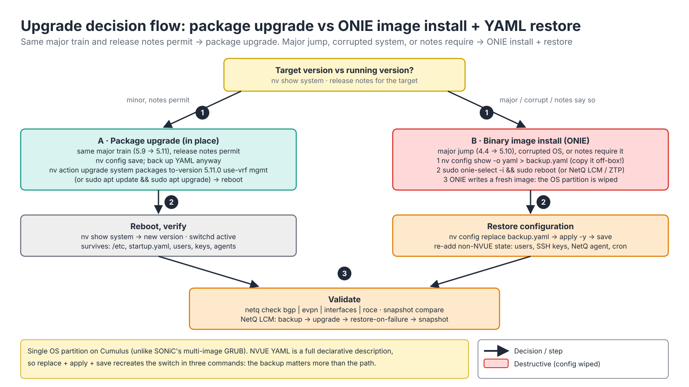
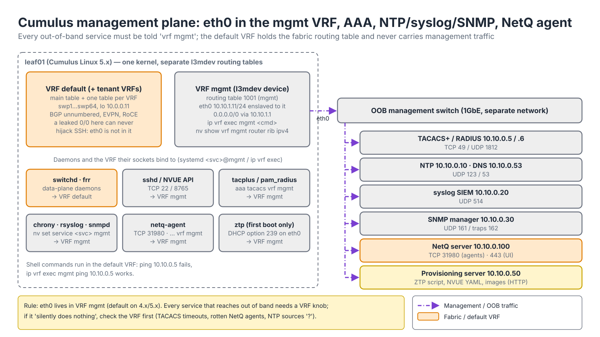
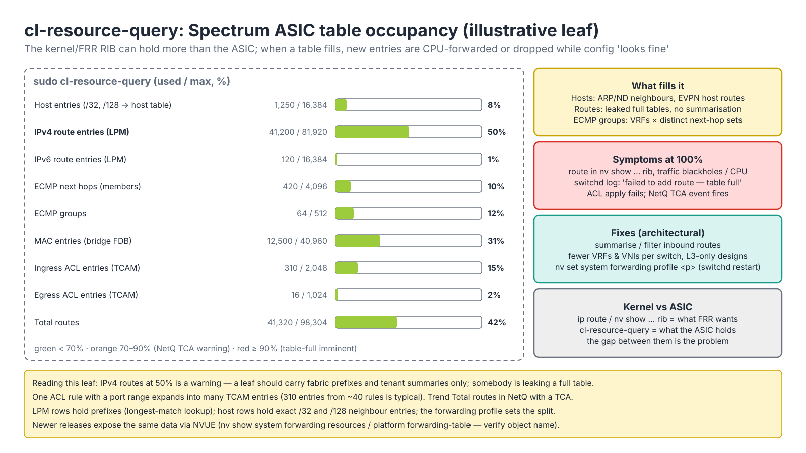
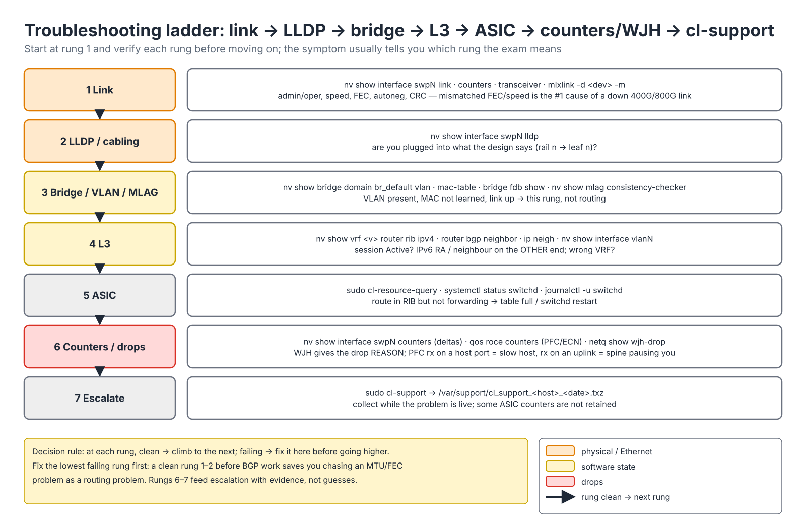

# Module 4.3 — Cumulus Linux Administration

> **Exam domain:** NVIDIA Spectrum Networking (30%)  
> **Source course(s):** Cumulus Linux Administration (NVIDIA Academy)  
> **Source docs:** Cumulus Linux User Guide — Installation Management, Upgrading, Authentication/AAA, Management VRF, Monitoring and Troubleshooting, Zero Touch Provisioning, Netfilter/ACLs, Quality of Service; NVUE Command Reference  
> **Estimated study time:** 5–6 hours

> **How to study this module:** read §1–§2, work through the §3 walkthrough on real gear or NVIDIA Air, then attempt the §5 hands-on assignment using only the Hint section. Open the Solution guide (last section) only after you have a working attempt. Finish with the Appendix C knowledge check closed-book.

## 1. Learning objectives

By the end of this module you will be able to…

- **Describe** the two Cumulus upgrade paths (full image install vs package upgrade) and **perform** a config backup/restore around them. *(Spectrum Networking — lifecycle)*
- **Configure** local users, roles and TACACS+/RADIUS authentication with `nv set system aaa`. *(Spectrum Networking — AAA)*
- **Configure** the management VRF and core services (NTP, DNS, syslog, SNMP) using NVUE. *(Spectrum Networking — management)*
- **Monitor** hardware health and system resources with `nv show platform`, `smonctl`, `nv show system cpu/memory`. *(Troubleshooting Tools)*
- **Read** **cl-resource-query** output and **explain** why ASIC table utilization matters for scale. *(Troubleshooting Tools — ASIC resources)*
- **Configure** basic ACLs and non-RoCE QoS with `nv set acl` / `nv set qos`. *(Spectrum Networking — policy)*
- **Apply** a structured troubleshooting workflow from link to ASIC, and **collect** `cl-support` for escalation. *(Troubleshooting Tools)*
- **Describe** ZTP in depth, including DHCP options and script responsibilities. *(Automation and Configuration)*

## 2. Key technical concepts

### 2.1 Upgrades and image management

*Analogy:* a package upgrade is renovating a house while you live in it — furniture stays. A binary image install is demolishing and rebuilding — you must have moved the furniture (configuration) out first.


*Figure 4.3-1 — Choosing the upgrade path (1): A = in-place package upgrade, B = ONIE binary install that wipes the OS partition; then verify or restore (2) and validate fabric-wide (3).*

**What it is.** Cumulus Linux has exactly two ways to change its version, and they differ in what they touch on disk:

| Method | Command | What it does | When |
|---|---|---|---|
| **Binary image install** | `sudo onie-select -i` then reboot into ONIE, or `nv action upgrade system packages`/`nv action upgrade image` (5.x; verify exact path), or NetQ LCM | Wipes the OS partition and installs a fresh image. All config is lost unless restored. | Major version jumps (4.x → 5.x), hardware re-use, corrupted systems, or when the release notes require it |
| **Package upgrade** | `sudo apt update && sudo apt upgrade` (or `nv action upgrade system packages`) | Upgrades installed Debian packages in place; config preserved | Minor/maintenance releases within the same major train (5.9 → 5.10) when release notes permit |

**ONIE** (Open Network Install Environment) is a small Linux that lives in its own partition on every Spectrum switch, below the NOS. It is the installer and the rescue shell: it can fetch a `.bin` image over HTTP/TFTP (from a URL you give it, or one it discovers through DHCP — option 114 is ONIE's installer URL) and write it to the NOS partition. Spectrum switches have a single OS partition by default (unlike some vendors' dual-image boot, and unlike SONiC's multi-image GRUB in Module 4.4), so there is no "previous image" to fall back to.

**Why it exists.** The two paths trade convenience against certainty. A package upgrade keeps everything — `/etc`, `/etc/nvue.d/startup.yaml`, local users in `/etc/passwd`/`/etc/shadow`, SSH host keys, the NetQ agent's configuration, cron jobs, your ZTP leftovers — but it is only supported within a major release and only when the release notes do not say otherwise, because a jump across kernels, SDK versions or Debian base releases can leave a half-migrated system. A binary install is always safe from a software-consistency point of view (you get exactly the image NVIDIA tested) but it is destructive: after it, the switch is at factory defaults and only what *you* restore comes back. Always read the release notes for the target version first — some minor versions have had "image install required" notes because of kernel or SDK changes.

**How it works** (Figure 4.3-1).

*Path A — package upgrade.* (1) You confirm the target is in the same train and the notes allow it. `nv config save` makes `startup.yaml` current and you copy a YAML backup off-box anyway. `nv action upgrade system packages to-version 5.11.0 use-vrf mgmt` (or `apt update && apt upgrade`, which must also reach the repository through the mgmt VRF) downloads and installs the new packages, including a new kernel and `switchd`/SDK. (2) The reboot loads the new kernel, `switchd` reprograms the ASIC from scratch (seconds of forwarding loss — drain the switch first), and NVUE loads the same `startup.yaml`. What survives: everything on the OS partition.

*Path B — binary install.* (1) Back up first: `nv config show -o yaml > backup.yaml` **and copy it off the switch** — the partition you would have saved it on is about to be erased. `sudo onie-select -i` sets the next boot to ONIE install mode (or ZTP/NetQ LCM drive the same steps, and `onie-install -a -i <url>` stages a specific image). On reboot ONIE fetches the image, writes it to the NOS partition and reboots into a factory-default Cumulus. (2) Restore: `nv config replace backup.yaml`, `nv config apply -y`, `nv config save`. Because NVUE YAML is a full declarative description, those three commands recreate every NVUE-managed object. What NVUE does **not** describe you must re-add yourself: local user passwords and SSH keys, the NetQ agent configuration, cron jobs, custom scripts, and anything you edited directly under `/etc`. (3) Validate with `netq check bgp|evpn|interfaces|roce` and compare snapshots. NetQ LCM automates backup → upgrade → restore-on-failure → snapshot compare (Module 4.5), and Ansible drives the same restore at scale (Module 6.1).

Failure modes and how you see them: `apt upgrade` across a major release leaves mismatched packages and `switchd` failing to start (`systemctl status switchd`, `journalctl -u switchd -b`); an image install without an off-box backup leaves you rebuilding by hand; restoring a YAML from an older release can fail validation on renamed objects — `nv config apply` names the offending path, fix it and re-apply. Observe the result with `nv show system` (version, uptime) and `nv show system image` where supported.

**Why the exam cares:** "4.4 → 5.10" is a trap. The answer is image install plus YAML restore, never `apt upgrade`.

### 2.2 Users, roles and AAA

*Analogy:* roles are badge colours. A green badge (`nvue-monitor`) opens the viewing gallery; a blue badge (`nvue-admin`) opens the control room; a red badge (`system-admin`) also opens the basement where the root shell lives. TACACS+ is the security desk that checks your ID, decides which badge you get, and writes your name in the visitor log.

**What it is.** **AAA** is three separate questions: *authentication* (who are you?), *authorization* (what may you do?) and *accounting* (what did you do?). Cumulus answers them with local accounts plus optional **TACACS+** (TCP 49) or **RADIUS** (UDP 1812/1813) servers, configured under `nv set system aaa`.

Built-in roles (verify names for your release): `system-admin` (full, includes sudo), `nvue-admin` (all NVUE objects, no shell sudo), `nvue-monitor` (show only). Custom roles can be built from NVUE object paths with `nv set system aaa role <name> class <class>` granting `read`/`write`/`all` to sets of object trees — useful for giving a QoS team access to `qos` without `router`. `nv set system aaa authentication-order tacacs local` defines the fallback order.

**Why it exists.** A fabric of hundreds of leaves cannot have hundreds of local password files: central AAA gives one place to revoke an engineer, one audit trail of who ran which command, and privilege tied to a directory group rather than to a shared `cumulus` password. The trade-off is a new dependency: if the switch cannot reach the AAA server, logins slow down (every server times out before fallback) or fail outright. That is why you always keep a local fallback account and why the VRF the AAA client uses matters as much as the server address.

**How it works.** TACACS+ (TCP 49, body encrypted with the shared secret) separates the three A's into different exchanges:

1. **Authentication.** `sshd` hands the login to PAM; the `pam_tacplus` module sends an authentication START (username, and a password via PAP/CHAP/ASCII login depending on `authentication mode`) and receives PASS/FAIL. A secret mismatch shows up as a decrypt failure, not a "wrong password".
2. **Authorization and privilege mapping.** The client sends an authorization request for the `shell` service; the server returns attribute–value pairs, most importantly **`priv-lvl`** (0–15). Cumulus has no per-user local account for TACACS users; instead it maps the privilege level to placeholder local accounts (`tacacs0` … `tacacs15`) through an NSS module, so `priv-lvl 15` lands on the account that carries admin rights (sudo / `system-admin`) and lower levels land on restricted accounts. Optional per-command authorization sends each command to the server before it runs (verify the exact mechanism and account names for your release). RADIUS does the same job with a role carried in the `shell:roles` or vendor attribute.
3. **Accounting.** START/STOP records (and per-command records where enabled with `accounting enable on`) go to the server, so you can answer "who changed the MTU at 09:14?" without trusting local logs.

Everything above is sent from a socket, and the socket's VRF decides the routing table (§2.3): TACACS+ and RADIUS servers are almost always reached through the **management VRF**, so the `vrf mgmt` attribute matters; a working TACACS config that times out is usually missing it. The login still succeeds through `authentication-order tacacs local` — after every configured server has timed out, which is the ~15-second hang described in Gotcha 1.

Observe and debug: `nv show system aaa`, `nv show system aaa tacacs` (is `vrf` set?), `ip vrf exec mgmt nc -zv 10.10.0.5 49` (can the AAA client reach port 49 from the right table?), `sudo journalctl -b | grep -i tacplus` (auth/authorization replies), `getent passwd <user>` (did the NSS mapping resolve the TACACS user to a local UID?). Failure modes: wrong VRF → timeouts then fallback; wrong secret → every request rejected; `priv-lvl` not returned by the server → the user lands on the lowest privilege and `nv config apply` is refused.

### 2.3 Management VRF

*Analogy:* a **VRF** is a separate building with its own address book. The `mgmt` VRF is the security office — `eth0` lives there, so a leaked default route in the fabric can never hijack SSH.


*Figure 4.3-2 — One kernel, two routing tables: the fabric runs in the default VRF; `eth0` and every out-of-band daemon (sshd, AAA, chrony/rsyslog/snmpd, netq-agent, ztp) live in VRF `mgmt` and reach the OOB services through the management switch.*

**What it is.** The **mgmt VRF** isolates out-of-band management (`eth0`) from the data plane so that management traffic has its own routing table. It is enabled by default on Cumulus 4.x/5.x. Mechanically it is a Linux **l3mdev** (layer-3 master device): a `vrf`-type netdev called `mgmt` bound to its own routing table (table 1001 for mgmt on Cumulus; tenant VRFs get their own table IDs), with `eth0` enslaved to it — exactly as a bridge port is enslaved to a bridge, but at layer 3.

**Why it exists.** Without it, `eth0`'s default route and the fabric's routes share one table. A BGP-learned `0.0.0.0/0`, a leaked tenant summary or a misconfigured static route could then steer SSH replies, TACACS requests or NetQ telemetry into the fabric — and in the worst case lock you out of the switch you need to fix. With a separate table, the fabric can lose all its routes and the management plane is untouched, and the fabric can never accidentally route traffic out of `eth0`. The cost: every process that originates management traffic must be told to use the VRF, or it will look up the default table and fail silently.

**How it works.**

1. **Lookup selection.** The kernel installs an `l3mdev` policy rule (`ip rule` shows `l3mdev-table`). A packet that *arrives* on `eth0` is looked up in table 1001 because its ingress device is enslaved to `mgmt`. A packet that a process *sends* uses table 1001 only if its socket is bound to the `mgmt` device (`SO_BINDTODEVICE`); an unbound socket uses the main (default VRF) table.
2. **Binding processes.** `ip vrf exec mgmt <cmd>` runs a command with its sockets bound to the VRF. System services are bound the same way through VRF-aware systemd instances (`<service>@mgmt`), which is what `nv set service ntp mgmt …`, `nv set service syslog mgmt …` and `nv set service snmp-server listening-address … vrf mgmt` configure. NetQ (`netq config add server … vrf mgmt`) and AAA (`nv set system aaa tacacs vrf mgmt`) have their own `vrf` knobs.
3. **Inbound SSH.** SSH *into* the switch arrives on eth0 in mgmt VRF automatically: `sshd` accepts connections arriving in any VRF (the kernel's l3mdev-accept behaviour), so you do not need a separate sshd per VRF.

Consequences you must know:
- Services that must talk out-of-band need to be told which VRF: `nv set service ntp mgmt ...`, `nv set service syslog mgmt ...`, `netq config add server ... vrf mgmt`, AAA `vrf mgmt`.
- From the shell, `ping 8.8.8.8` runs in the default VRF; use `ip vrf exec mgmt ping 8.8.8.8` (or `ping -I mgmt`). SSH *into* the switch arrives on eth0 in mgmt VRF automatically.
- `nv show vrf mgmt router rib ipv4` to verify the mgmt route table.

Observe at the Linux level: `ip vrf show` (mgmt → table 1001), `ip route show vrf mgmt` (the table's contents), `ip rule` (the l3mdev rule), `ip vrf identify $$` (which VRF your shell is in), `systemctl list-units '*@mgmt*'` (which services run VRF-bound). Failure modes all look like "it silently does nothing": NTP sources stuck at `?`, TACACS timeouts, Rotten NetQ agents, SNMP walks timing out, `apt update` hanging — each is a process that sends from the default table.

### 2.4 System services and streaming telemetry

**What it is.** NTP, DNS, syslog and SNMP are configured per VRF under `nv set service` and run as VRF-bound daemons (chrony, the resolver, rsyslog, snmpd). Cumulus 5.x also exposes **gNMI** (gRPC Network Management Interface) and OpenTelemetry streaming (`nv set system gnmi-server state enabled`, `nv set system telemetry export otlp ...` — verify object names). This complements NetQ (push vs pull) and is how third-party collectors (Prometheus via gNMIc, Grafana) consume interface counters, buffer histograms and WJH events without polling SNMP.

**Why it exists.** Time sync matters beyond logs: NetQ correlates events across devices, certificates for the NVUE API/gNMI expire by date, and PTP (`nv set service ptp`) for time-sensitive workloads depends on a sane system clock. Remote syslog survives a switch that reboots or loses its disk; SNMP is still what many NOCs poll; streaming telemetry exists because polling hundreds of 800G ports every few seconds over SNMP does not scale and misses microbursts, while a push model sends samples at the rate the collector subscribes to.

**How it works.** Each service follows the same pattern: (1) NVUE renders the daemon's config with the VRF and listener addresses; (2) systemd starts the VRF-bound instance; (3) the daemon's sockets use the mgmt table (Figure 4.3-2). chrony polls its sources (`iburst` sends a quick burst at start-up to converge in seconds) and disciplines the clock; rsyslog forwards matching severities over UDP/TCP 514; snmpd answers on UDP 161 only on the listening address you bind and sends traps to UDP 162; gNMI subscriptions stream on a gRPC port. `chronyc sources` and `ntpq -p` (depending on the release's NTP daemon) confirm sync at the Linux level — `^*` marks the selected source, `?` means unreachable (almost always the VRF). Failure modes: wrong VRF (nothing works, no error), SNMP bound to the default VRF's address (walks time out from the NOC), clock unsynchronised (NetQ timestamps and certificate validity drift).

### 2.5 cl-resource-query — ASIC table utilization

*Analogy:* the ASIC's tables are a car park with a fixed number of bays. When it is full, new cars (routes, MACs, ACL rules) are turned away at the gate — but the receptionist's visitor log (the kernel) still shows them as "arrived". Everyone looks present; some are circling the block on the CPU.


*Figure 4.3-3 — What `cl-resource-query` measures: each row is a separate hardware table (or region) with its own limit. The kernel can hold more than any of them; the gap is the problem.*

**What it is.** The Spectrum ASIC has finite hardware tables, and **cl-resource-query** is the tool that shows their occupancy. Also: `nv show system forwarding resources` or `nv show platform forwarding-table` in newer releases exposes the same data through NVUE (verify object name). The rows map to distinct structures:

| Row | Lookup type | What fills it |
|---|---|---|
| **Host entries** | Exact match on a full /32 or /128 | Resolved neighbours (ARP/ND) and EVPN host routes; ARP suppression and large L2 domains fill it |
| **IPv4 / IPv6 route entries** | **LPM** (longest-prefix match) | Every prefix that is not a host entry: fabric loopbacks, tenant subnets, summaries, a leaked full table |
| **ECMP groups** | One entry per *unique set* of next hops | Each distinct next-hop combination; many VRFs × different next-hop sets |
| **ECMP next hops** | Members of those groups | Group size × number of groups (a 64-way group costs 64 members) |
| **MAC entries** | Exact match (bridge FDB) | Learned and EVPN-installed MACs across all VLANs/VNIs |
| **Ingress / egress ACL entries** | **TCAM** regions per direction and key type | NVUE ACL rules after expansion, control-plane ACLs, some internal system rules |

**Why it exists.** When a table fills, new entries are *not* installed in hardware; the kernel still knows about them, so the config looks fine, but traffic for those entries is either dropped or punted to the CPU. Exact-match and LPM tables live in memory shared through the **forwarding profile**, which decides how that memory is split between routes, hosts and MACs; TCAM is a separate, small, expensive resource. The profile exists because no single split fits a pure-L3 GPU leaf (many routes, few MACs) and an L2-heavy EVPN leaf (many MACs and hosts) equally well.

**How it works.** (1) FRR or the kernel installs an entry; (2) `switchd` sees it over netlink and asks the SDK for a slot in the matching table; (3) if a slot exists the entry is programmed and the route is marked offloaded; (4) if not, `switchd` logs the failure and the entry stays kernel-only. What happens next depends on the table: a route that did not fit is software-forwarded (punted to the CPU through the control-plane policer, so most packets are dropped and CPU rises); a host entry that did not fit sends traffic for that neighbour to the CPU; an exhausted ECMP group/member table means new multipath routes cannot get their own group (verify the platform behaviour — expect reduced or failed multipath); a full ACL region makes `nv config apply` (or `cl-acltool -i`) fail with an install error rather than silently dropping the rule. One ACL rule can cost several TCAM entries — a port range is expanded into a set of masked values, and IPv6 keys are wider than IPv4.

Why the exam cares: when utilization approaches 100% you get silent software forwarding or drops, high CPU, and `switchd` log messages like "failed to add route — table full". The fix is architectural: route summarisation, fewer VRFs/VNIs per switch, moving to L3-only designs, or enabling a different forwarding **profile** that trades table sizes (`nv set system forwarding profile`, e.g. optimising for more routes vs more hosts — check current docs for available profiles). The profile reallocates shared ASIC memory between route, host and ACL tables and requires a `switchd` restart.

Observe: `sudo cl-resource-query` (used, max, %), `sudo journalctl -u switchd | grep -i -E 'full|fail'`, `nv show vrf <v> router rib ipv4` for the kernel side, and a NetQ TCA on the utilization percentage (Module 4.5) so you hear about 90% before you live through 100%.

### 2.6 ACLs and general QoS

**What it is.** NVUE ACLs are stateless filters programmed into the ASIC TCAM. Types: `ipv4`, `ipv6`, `mac`. Direction: `inbound` or `outbound`. Control-plane protection ACLs (applied to `control-plane`) protect the CPU. ACL entries consume TCAM — visible in `cl-resource-query`; a rule with a port range expands into many entries.

RoCE has its own one-line profile (Module 4.1). General QoS objects it builds on:

| Object | Purpose | Example |
|---|---|---|
| Trust | Which marking to honour at ingress | `nv set qos mapping default-global trust l3` (DSCP) or `l2` (PCP) or `port` |
| Mapping | DSCP/PCP → switch-priority (0–7) | `nv set qos mapping default-global dscp 46 switch-priority 5` |
| Egress queue mapping | switch-priority → traffic class (queue) | `nv set qos egress-queue-mapping default-global switch-priority 5 traffic-class 5` |
| ETS / scheduler | Bandwidth per traffic class (DWRR or strict) | `nv set qos egress-scheduler default-global traffic-class 5 mode strict` / `nv set qos egress-scheduler default-global traffic-class 3 bw-percent 50` |
| Remark | Rewrite DSCP/PCP on egress | `nv set qos remark default-global ...` |
| Shaper / policer | Rate limit per port/TC | `nv set qos egress-shaper default-global traffic-class 2 max-rate 100000` |
| Congestion control (ECN/WRED) | Marking per TC | `nv set qos congestion-control default-global traffic-class 3 ecn enable` |
| PFC | Lossless per priority | `nv set qos pfc default-global switch-priority 3` |
| Buffer | Ingress/egress pools, headroom | `nv set qos traffic-pool ...` |

**Why it exists.** ACLs in hardware filter at line rate with no CPU cost, which is the only way to protect a 51.2 Tb/s switch — but being stateless they have no idea about connections, so return traffic needs its own permit. QoS exists because a converged fabric carries traffic with different loss and latency needs (RoCE, storage, management, CNPs) on the same links; mapping, scheduling and marking give each class its share and its drop behaviour.

**How it works.** Under the hood NVUE renders `iptables`/`ebtables` rules into `/etc/cumulus/acl/policy.d/` and `cl-acltool` installs them into hardware; `sudo cl-acltool -L ipv4` lists what is programmed. Rules are evaluated in order, first match wins, and traffic that matches no rule in an NVUE ACL is not dropped by default (verify for your release) unless you add an explicit deny — so order your rules from most to least specific (Step 6 of §3). For QoS, profiles (`default-global`, or a named profile) are bound to interfaces: `nv set interface swp1 qos egress-scheduler profile my-sched`. For the exam, remember the pipeline order: ingress trust → switch-priority → (PFC applies per SP) → traffic class → scheduler/shaper → remark. Failure modes: an ACL install fails when the TCAM region is full (apply error, Figure 4.3-3); a rule permits forward traffic but not the replies (stateless); trust set to `port` ignores the DSCP the hosts carefully set. Observe with `nv show acl <name> statistics` (per-rule hits), `sudo cl-acltool -L all`, `nv show interface swpN qos`.

### 2.7 The troubleshooting workflow


*Figure 4.3-4 — Verify each rung before climbing; fix the lowest failing rung first.*

**What it is.** A fixed, layered order for diagnosing a Cumulus switch, from the physical link up to escalation (Figure 4.3-4):

1. **Link** — `nv show interface swp1 link` (admin/oper state, speed, FEC, autoneg), `nv show interface swp1 counters` (CRC, errors), `nv show interface swp1 transceiver` / `mlxlink -d ... -m` for optics. Mismatched FEC or speed is the #1 cause of a down 400G/800G link.
2. **LLDP / cabling** — `nv show interface swp1 lldp` confirms you are plugged into what the design says.
3. **Bridge / VLAN** — `nv show bridge domain br_default vlan`, `nv show bridge domain br_default mac-table`, `bridge fdb show`. For MLAG: `nv show mlag consistency-checker`.
4. **L3** — `nv show vrf <v> router rib ipv4`, `nv show vrf <v> router bgp neighbor`, `ip neigh show`, `nv show interface vlan10`.
5. **ASIC** — `sudo cl-resource-query`, `systemctl status switchd` and `journalctl -u switchd`.
6. **Counters and drops** — `nv show interface swp1 counters` deltas, `nv show interface swp1 qos roce counters` for PFC/ECN, **WJH** via NetQ (`netq show wjh-drop`) for *why* a packet dropped.
7. **Escalate** — `cl-support`, attach to NVIDIA Enterprise Support case.

**Why it exists.** Every layer depends on the ones below it, and the same symptom ("hosts can't reach each other") can come from any of them. Working top-down wastes time on BGP when the real problem is an FEC mismatch that leaves a link flapping; working bottom-up guarantees that when you reach a layer, everything beneath it is known-good.

**How it works.** At each rung you run its commands, decide *clean* or *failing*, and only climb on clean. The symptom usually tells you which rung the question means: link up + LLDP correct + VLAN present + MAC not learned is a rung-3 bridge problem; route in the RIB but not forwarding is rung 5 (table full or `switchd` restarted); everything correct but RoCE slow is rung 6 (PFC/ECN counters and WJH). Rungs 6–7 are about evidence: take counter deltas over a known interval, and collect `cl-support` while the fault is live because some ASIC state is not retained.

A disciplined candidate uses this order on exam scenarios: a question describing "VLAN present, MAC not learned, link up" is a step-3 bridge issue, not a routing issue.

### 2.8 ZTP in depth

*Analogy:* ZTP is a new employee's first-day packet. The building (DHCP) tells them which desk (URL) to go to, the packet (script) must carry the company letterhead (`# CUMULUS-AUTOPROVISIONING`) or security refuses it, and it walks them through setup in order.


*Figure 4.3-5 — The ten ZTP steps from factory default to a provisioned, monitored leaf. Steps 2–5 are the discovery contract; steps 6–10 are whatever your script does.*

**What it is.** **ZTP** (Zero Touch Provisioning) is a Cumulus service that runs automatically on first boot (or when `ztp -e` is set and the switch has no saved config), finds a provisioning script, and executes it as root. Discovery order:
1. USB drive containing `cumulus-ztp` or `cumulus-ztp.sh`.
2. DHCP on `eth0` (mgmt VRF): option **239** (`cumulus-provision-url`) with the script URL; option 114 is for ONIE installer URL, not ZTP. Also supports `user-class`/`vendor-class` identifiers for DHCP server matching (`vendor-class-identifier "cumulus-linux"`).
3. If the switch gets a hostname/DNS, default URL patterns on the provisioning server.

**Why it exists.** An AI pod can bring hundreds of leaves online in a day; console-configuring each is slow and error-prone. ZTP turns cabling plus a DHCP reservation into a fully configured, monitored switch, and because the script pulls a per-serial YAML from a repository (git), every leaf comes up identical and auditable. The marker requirement exists so that a DHCP server answering with the wrong URL cannot make a switch execute an arbitrary web page as root.

**How it works** (Figure 4.3-5).

1. The `ztp` service starts at boot and checks local/USB locations first; finding nothing, it moves on to DHCP.
2. The DHCP client on `eth0` (in the mgmt VRF) sends DHCPDISCOVER with `vendor-class-identifier "cumulus-linux"` and asks for option 239 in its parameter request list. On an ISC-style server you declare the option once (`option cumulus-provision-url code 239 = text;`) and hand it to clients that match the vendor class.
3. The DHCPOFFER/ACK carries the address, router, DNS and option 239 — `http://10.10.0.50/ztp.sh` in Figure 4.3-5.
4. ZTP fetches the URL over HTTP from the mgmt VRF.
5. The response must contain the marker comment `# CUMULUS-AUTOPROVISIONING` (by convention right after the shebang, on line 2) or ZTP refuses to execute it — the most common "ZTP downloads but does nothing" cause (Gotcha 3).
6. The script runs. It must start with `#!/bin/bash` (or Python); typical first actions set credentials and read the serial number with `decode-syseeprom -e`.
7. It fetches `/nvue/<serial>.yaml`. If it needs a different release first, it can `onie-install -a -i <image>` and reboot — ZTP runs again on the new image.
8. `nv config replace` → `nv config apply -y` → `nv config save` makes the YAML the switch's configuration.
9. `netq config add server 10.10.0.100 port 31980 vrf mgmt` and `netq config restart agent` make the switch appear Fresh in NetQ (Module 4.5).
10. Exit status decides the outcome: `exit 0` marks ZTP successful and it stops; a non-zero exit is logged as a failure in `/var/log/ztp.log`. ZTP exits on the first non-zero return code — use `set -e` deliberately.

Commands: `ztp -s http://...` (run now), `ztp -e` enable, `ztp -d` disable, `ztp -R` reset state, `ztp -i` status (`nv show system ztp` in newer releases) — check `ztp -h` on your release, as flag letters have shifted between versions. Logs in `/var/log/ztp.log` and syslog. Failure modes: URL in option 114 instead of 239 (ONIE, not ZTP, sees it); marker missing (fetched, not run); script fails half-way under `set -e` (partial config — make scripts idempotent so a re-run is safe); DHCP server not matching the vendor class (no option 239 offered). In AI data centers, ZTP combined with a serial-number-keyed YAML repository (git) means hundreds of leaves come up identical and auditable; Module 6.1 covers the pipeline side.

**Why the exam cares:** option 239 vs 114, the `CUMULUS-AUTOPROVISIONING` marker, and "ZTP runs only on an unconfigured switch" are the three facts ZTP questions turn on.

## 3. Live-style walkthrough — day-2 hardening of leaf01

The switch from Module 4.2 forwards traffic. Now we make it operable: management VRF, users and TACACS, NTP/syslog/SNMP, a health sweep, a full read of `cl-resource-query`, and a support bundle.

### Step 1 — Management VRF and eth0

This builds the left half of Figure 4.3-2: `eth0` enslaved to VRF `mgmt`, with a default route that exists only in table 1001.

```bash
# eth0 gets a static address in the mgmt VRF (DHCP alternative: nv set interface eth0 ip address dhcp).
nv set interface eth0 ip address 10.10.1.11/24
nv set interface eth0 ip vrf mgmt                       # usually already the case on 5.x
# Default route for the *mgmt* table only — the fabric default route is unaffected.
nv set vrf mgmt router static 0.0.0.0/0 via 10.10.1.1
nv config diff
nv config apply -y

# Verify the mgmt table, not the default one.
nv show vrf mgmt router rib ipv4
# -> 0.0.0.0/0 via 10.10.1.1 dev eth0
# Shell tools default to the default VRF, so wrap them:
ip vrf exec mgmt ping -c2 10.10.0.5                     # TACACS server — must succeed before Step 2
```

### Step 2 — Local users, roles, TACACS+

Every TACACS+ exchange from §2.2 (authentication, authorization with `priv-lvl`, accounting) leaves from a socket; the `vrf mgmt` line below is what puts that socket in the mgmt table of Figure 4.3-2.

```bash
# A named admin with full rights (sudo included).
nv set system aaa user netops full-name "Network Ops"
nv set system aaa user netops password 'S3cureP@ss'
nv set system aaa user netops role system-admin
# A read-only auditor: nv show only, cannot apply.
nv set system aaa user auditor role nvue-monitor

# TACACS+: server, key, AND the VRF it is reached through.
nv set system aaa tacacs enable on
nv set system aaa tacacs server 1 host 10.10.0.5
nv set system aaa tacacs server 1 secret 'tacacskey'
nv set system aaa tacacs vrf mgmt                          # <- the line everyone forgets
nv set system aaa tacacs authentication mode pap           # or chap/login — check doc
nv set system aaa tacacs accounting enable on
# Try TACACS first, fall back to local so you are never locked out.
nv set system aaa authentication-order tacacs local

# RADIUS alternative (same VRF rule)
# nv set system aaa radius enable on
# nv set system aaa radius server 1 host 10.10.0.6
# nv set system aaa radius server 1 secret 'radiuskey'
# nv set system aaa radius vrf mgmt

nv config apply -y
nv show system aaa user
```

```text
User     Full Name     Role
-------  ------------  -------------
auditor                nvue-monitor
cumulus                system-admin
netops   Network Ops   system-admin
```

Test from another terminal: `ssh netops@10.10.1.11` authenticates against TACACS; stop the TACACS server and the same login still works via the local fallback after the timeout. Login banner: `nv set system message pre-login "Authorized use only"`.

### Step 3 — NTP, DNS, syslog, SNMP

```bash
# NTP, per VRF: the "mgmt" token tells chrony to source from eth0.
nv set service ntp mgmt server 0.pool.ntp.org iburst on
nv set service ntp mgmt server 10.10.0.10 iburst on
nv set service ntp mgmt listen eth0

# DNS
nv set service dns mgmt server 10.10.0.53
nv set service dns mgmt search lab.example.com
nv set system hostname leaf01

# Remote syslog to the SIEM, again through mgmt.
nv set service syslog mgmt server 10.10.0.20 port 514 protocol udp
nv set service syslog mgmt server 10.10.0.20 severity info     # where supported

# SNMP: listen only on eth0's address in mgmt, v2c read-only + v3 user + trap destination.
nv set service snmp-server enable on
nv set service snmp-server listening-address 10.10.1.11 vrf mgmt
nv set service snmp-server readonly-community public access any
nv set service snmp-server username snmpv3user auth-sha 'authpass' encrypt-aes 'privpass'
nv set service snmp-server trap-destination 10.10.0.30 community-password public version 2c

nv config apply -y
nv config save

nv show service ntp mgmt
nv show service syslog
nv show service snmp-server
chronyc sources            # at least one source with '*' = synchronised
```

Good: `chronyc sources` shows `^* 10.10.0.10` with a small offset. If every source shows `?`, the VRF is wrong — `ip vrf exec mgmt ntpdate -q 10.10.0.10` will tell you.

### Step 4 — Health sweep

This is rung 5 of Figure 4.3-4 plus the platform health that sits underneath every rung.

```bash
systemctl status switchd            # ASIC programming daemon — "active (running)", no recent restarts
systemctl status frr nvued netq-agent
sudo journalctl -u switchd -b | tail -20     # any "restart" lines lining up with an outage?
nv show system                      # hostname, platform, version, uptime
nv show system cpu
nv show system memory
nv show platform                    # model, serial, part number, firmware
nv show platform environment fan
nv show platform environment psu
nv show platform environment sensor      # temperatures, voltages
smonctl                             # legacy sensor monitor: temps, fans, PSUs with OK/alarm
sudo decode-syseeprom               # ONIE EEPROM: serial, MAC base, platform name
```

`switchd` crashing or restarting is the single most disruptive event on a Cumulus switch; every restart reprograms the ASIC (seconds of outage). `nv show system` plus `journalctl -u switchd` are where you confirm whether a "mystery blip" lined up with a switchd restart (after a breakout, AR change on older releases, or a forwarding-profile change).

### Step 5 — Read every row of cl-resource-query

Keep Figure 4.3-3 open: each row below is one of its tables, with its own limit and its own failure mode.

```bash
sudo cl-resource-query
```

Representative output (values illustrative; your platform and profile differ):

```text
Host entries:            1250,   16384   7.6%
IPv4 route entries:     41200,   81920  50.3%
IPv6 route entries:       120,   16384   0.7%
ECMP nexthops:            420,    4096  10.3%
ECMP groups:               64,     512  12.5%
MAC entries:            12500,   40960  30.5%
Ingress ACL entries:      310,    2048  15.1%
Egress ACL entries:        16,    1024   1.6%
Total routes:           41320,   98304  42.0%
```

Row by row, as the instructor reads it:
- **Host entries** (7.6%) — directly connected neighbours (ARP/ND). In a large L2 domain or a VXLAN fabric with ARP suppression, this fills first. Healthy here.
- **IPv4 route entries** (50.3%) — LPM routes. Half full on a *leaf* is a warning: a leaf should only carry fabric prefixes and tenant summaries. Someone is leaking a full table or not summarising.
- **IPv6 route entries** — negligible, as expected on an IPv4 overlay.
- **ECMP nexthops / groups** — each unique set of next hops consumes a group. Many VRFs × many prefixes with different next-hop sets exhausts groups long before routes. 12.5% is fine.
- **MAC entries** (30.5%) — bridge FDB. VXLAN EVPN fabrics with large L2 tenants hit this.
- **Ingress ACL entries** — TCAM slices; each NVUE ACL rule may consume several entries, and a port range expands into many. 310 entries from perhaps 40 rules is typical.
- **Total routes** — the combined LPM view; the number to trend in NetQ with a TCA (Module 4.5).

Check `cl-resource-query` whenever: a new prefix exists in `ip route` but is unreachable; `nv show vrf default router rib` shows the route but traffic is CPU-forwarded; adding an ACL fails; or NetQ reports a resource-utilization threshold event.

### Step 6 — An ACL and its TCAM cost

```bash
nv set acl mgmt-filter type ipv4
nv set acl mgmt-filter rule 10 match ip source-ip 10.10.0.0/24    # NOC subnet
nv set acl mgmt-filter rule 10 match ip protocol tcp
nv set acl mgmt-filter rule 10 match ip dest-port 22
nv set acl mgmt-filter rule 10 action permit
nv set acl mgmt-filter rule 20 match ip protocol tcp
nv set acl mgmt-filter rule 20 match ip dest-port 22
nv set acl mgmt-filter rule 20 action deny                        # everyone else: no SSH
nv set acl mgmt-filter rule 20 action log                         # where supported
nv set interface swp1 acl mgmt-filter inbound
nv config apply -y
nv show acl mgmt-filter
nv show acl mgmt-filter statistics          # hit counters per rule
sudo cl-acltool -L ipv4                     # what is actually in hardware
sudo cl-resource-query | grep ACL           # Ingress ACL entries went up by a handful
```

### Step 7 — Support bundle

```bash
sudo cl-support                       # creates /var/support/cl_support_<host>_<date>.txz
sudo cl-support -h                    # options; -e to include extra
ls -lh /var/support/
```

**cl-support** gathers logs, configs, `cl-resource-query`, `switchd` state, FRR dumps, hardware info and core files. Collect it *while the problem is occurring* when possible; some ASIC counters are not retained.

### Step 8 — Backup before an upgrade

Figure 4.3-1 in commands: the backup is the precondition for both paths, the `nv action upgrade` block is path A, and the restore block is path B step 2.

```bash
nv config save                                    # make startup.yaml current
nv config show -o commands > /tmp/leaf01-cmds.txt  # human-readable backup
nv config show -o yaml     > /tmp/leaf01.yaml      # restorable backup
scp /tmp/leaf01.yaml /etc/nvue.d/startup.yaml admin@backup-host:/backups/
# Non-NVUE items worth saving: /etc/ssh keys, /etc/passwd+/etc/shadow (local users), NetQ agent config, ZTP scripts

# Minor upgrade within the major train (path varies by release — verify):
nv action upgrade system packages to-version 5.11.0 use-vrf mgmt
nv show system image                              # installed/active image slots (where supported)
nv action reboot system

# Restore after a fresh image install (major jump):
scp admin@backup-host:/backups/leaf01.yaml /tmp/
nv config replace /tmp/leaf01.yaml
nv config apply -y
nv config save
```

### Step 9 — A ZTP script that does it all

The numbered comments are steps 6–9 of Figure 4.3-5; the final `exit 0` is step 10. The marker on line 2 is what step 5 checks for.

```bash
#!/bin/bash
# CUMULUS-AUTOPROVISIONING
set -e
# 1. Optionally upgrade the image first (ZTP re-runs after reboot)
# onie-install -a -f -i http://10.10.0.50/images/cumulus-linux-5.11-mlx-amd64.bin && reboot
# 2. Set credentials
echo 'cumulus:NewP@ssw0rd' | chpasswd
# 3. Fetch NVUE config by serial and apply
SERIAL=$(decode-syseeprom -e)
curl -fsSL http://10.10.0.50/nvue/${SERIAL}.yaml -o /tmp/startup.yaml
nv config replace /tmp/startup.yaml
nv config apply -y
nv config save
# 4. Install NetQ agent and point it at the server
netq config add server 10.10.0.100 port 31980 vrf mgmt
netq config restart agent
exit 0
```

## 4. Troubleshooting / common gotchas

### Gotcha 1 — TACACS configured, logins time out

**Symptom:** TACACS server and key are correct; SSH logins hang ~15 s then fall back to local.

**Why it happens:** `eth0` is in the mgmt VRF but `nv set system aaa tacacs vrf mgmt` was omitted; the daemon sends from the default VRF, which has no route to 10.10.0.5.

**How to debug:**
```bash
nv show system aaa tacacs                     # vrf field blank?
ping 10.10.0.5                                # fails (default VRF)
ip vrf exec mgmt ping 10.10.0.5               # works
```

**Fix:** `nv set system aaa tacacs vrf mgmt && nv config apply -y`. Same rule for NTP, syslog, SNMP, NetQ.

### Gotcha 2 — Route in the RIB, hosts unreachable

**Symptom:** `nv show vrf blue router rib ipv4` lists the prefix; traffic blackholes; CPU is high.

**Why it happens:** the ASIC route table is full; the kernel has the route, hardware does not.

**How to debug:**
```bash
sudo cl-resource-query                        # IPv4 route entries ~100%
sudo journalctl -u switchd | grep -i 'table full'
```

**Fix:** summarise/filter inbound routes, reduce VRF/VNI count, or change the forwarding profile (`nv set system forwarding profile <p>` — restarts `switchd`, plan a window).

### Gotcha 3 — ZTP downloads the script but refuses to run it

**Symptom:** `/var/log/ztp.log` says the script was fetched then rejected; switch sits at defaults.

**Why it happens:** the script lacks `# CUMULUS-AUTOPROVISIONING`, or DHCP handed the URL in option 114 (ONIE) instead of 239.

**How to debug:**
```bash
ztp -i                                        # state and last URL
sudo tail -50 /var/log/ztp.log
curl -s http://10.10.0.50/ztp.sh | head -3    # marker present?
```

**Fix:** add the marker on line 2; put the URL in DHCP option 239; `ztp -R && ztp -s http://10.10.0.50/ztp.sh`.

## 5. Hands-on assignment — harden and monitor a leaf

**Scenario.** Security has audited the GPU pod. Every leaf must authenticate operators centrally, export logs and SNMP to the SOC, be monitored by NetQ, and keep a daily record of ASIC table occupancy so capacity problems are caught before they bite.

**Requirements**
1. `eth0` 10.10.1.11/24 in the mgmt VRF with default route via 10.10.1.1.
2. TACACS+ against 10.10.0.5 (secret `tacacskey`) with local fallback; local user `noc-ro` with role `nvue-monitor`; `cumulus` password changed.
3. Remote syslog to 10.10.0.20:514 UDP; NTP to 10.10.0.10; SNMPv3 user `soc` (SHA/AES) listening only on eth0 in mgmt; traps to 10.10.0.30.
4. A root cron job that runs `cl-resource-query` daily at 02:00 and appends timestamped output to `/var/log/cl-resource-query.log`.
5. NetQ agent configured for server 10.10.0.100 port 31980 in mgmt and running.
6. An inbound ACL on all host-facing ports permitting SSH only from 10.10.0.0/24.
7. Configuration saved; a `cl-support` bundle collected as the final artefact.

**Deliverables**
- `nv config show -o yaml` for the leaf.
- The cron line and the first log entry.
- Output of `nv show system aaa`, `nv show service snmp-server`, `netq show agents` (from the NetQ server) and `nv show acl`.
- Path and size of the `cl-support` archive.

**Acceptance criteria**
- `ssh noc-ro@10.10.1.11` succeeds and `nv config apply` is refused for that user.
- Stopping TACACS still allows `cumulus` to log in locally.
- `chronyc sources` shows synchronisation; a test message (`logger -p local0.info test`) arrives at 10.10.0.20.
- `snmpwalk -v3 -u soc ... 10.10.1.11 sysDescr` works from 10.10.0.0/24 and times out from elsewhere.
- `/var/log/cl-resource-query.log` has at least one dated entry.
- `netq show agents` lists the leaf as Fresh.
- `nv show acl <name> statistics` increments the deny rule when SSH is attempted from a disallowed subnet.

### Hint
- Every out-of-band service in this assignment has a VRF knob. If one of them "silently does nothing", that is where to look first.
- `nvue-monitor` can run `nv show`; test the refusal with `nv set` + `nv config apply`.
- Cron needs the full path (`/usr/cumulus/bin/cl-resource-query`) and runs as root; verify with `sudo crontab -l`.
- The NetQ agent takes the same `vrf mgmt` argument as everything else.
- `cl-resource-query` output before and after adding the ACL shows you exactly how many TCAM entries your rules cost.

## Appendix A — Quick command / config reference

```bash
# Upgrade / backup
nv config save; nv config show -o yaml > backup.yaml; nv config show -o commands
nv config replace backup.yaml && nv config apply -y && nv config save
sudo onie-select -i && sudo reboot            # image reinstall via ONIE
nv action upgrade system packages ...         # verify exact path in current docs

# AAA
nv set system aaa user <u> password '<p>'; nv set system aaa user <u> role system-admin|nvue-admin|nvue-monitor
nv set system aaa tacacs enable on; ... server 1 host <ip>; ... secret '<s>'; ... vrf mgmt
nv set system aaa radius enable on; ... server 1 host <ip>; ... secret '<s>'
nv set system aaa authentication-order tacacs local

# Mgmt VRF
nv set interface eth0 ip address <ip/len>; nv set interface eth0 ip vrf mgmt
nv set vrf mgmt router static 0.0.0.0/0 via <gw>
ip vrf exec mgmt <command>

# Services
nv set service ntp mgmt server <ip> iburst on
nv set service dns mgmt server <ip>
nv set service syslog mgmt server <ip> port 514 protocol udp
nv set service snmp-server enable on; ... listening-address <ip> vrf mgmt; ... readonly-community <c> access any
nv set system gnmi-server state enabled   # verify object name

# Health
nv show system | cpu | memory
nv show platform | environment fan | psu | sensor
smonctl; sudo decode-syseeprom
systemctl status switchd frr nvued netq-agent

# ASIC resources
sudo cl-resource-query
nv set system forwarding profile <profile>       # table allocation; restarts switchd

# ACL
nv set acl <n> type ipv4; nv set acl <n> rule 10 match ip ...; nv set acl <n> rule 10 action permit|deny
nv set interface swpN acl <n> inbound
sudo cl-acltool -L ipv4

# Support / ZTP / NetQ agent
sudo cl-support
ztp -s <url> | ztp -e | ztp -d | ztp -i | ztp -R
sudo netq config add server <ip> port 31980 vrf mgmt; sudo netq config restart agent
```

## Appendix B — Exam traps & key takeaways

- Package upgrade across major versions is unsupported; a binary image install is required (and wipes config — back up with `nv config show -o yaml`, restore with `nv config replace`).
- Forgetting `vrf mgmt` on NTP/syslog/TACACS/SNMP/NetQ when eth0 is in the management VRF — the service silently fails. `ping` from the shell runs in the default VRF; use `ip vrf exec mgmt`.
- `cl-resource-query` shows *ASIC* occupancy; `ip route` and `nv show ... rib` show kernel/FRR state. A route can be in the RIB and absent from hardware.
- Changing the forwarding profile reallocates tables and restarts `switchd`.
- ZTP scripts must contain `# CUMULUS-AUTOPROVISIONING`; DHCP option 239 (not 114) carries the ZTP URL; 114 is ONIE.
- `nvue-monitor` cannot apply; `nvue-admin` can apply but has no shell sudo; `system-admin` has both.
- ACL rules with port ranges expand into many TCAM entries — count them against `cl-resource-query`.
- `cl-support` is the support bundle; `smonctl` is sensors; `decode-syseeprom` is serial/platform — three different tools the exam mixes up.
- `nv show system` reports the *running* version; after a package upgrade you may need a reboot for the new kernel/switchd.
- Troubleshoot bottom-up: link → LLDP → bridge → L3 → ASIC → counters/WJH → `cl-support`.
- QoS pipeline order: trust → switch-priority → PFC → traffic class → scheduler/shaper → remark.

## Appendix C — Knowledge check

1. A switch running Cumulus Linux 4.4 must move to 5.10. Which approach is correct?
   A. `sudo apt upgrade`
   B. Binary image install via ONIE, then restore configuration from a saved NVUE YAML
   C. `nv config apply --upgrade`
   D. ZTP will upgrade it automatically on the next reboot

2. TACACS+ is configured with the correct server and key, but logins time out and fall back to local. `eth0` is in the mgmt VRF. What is missing?
   A. `nv set system aaa tacacs vrf mgmt`
   B. `nv set system aaa tacacs enable on`
   C. A RADIUS fallback
   D. The `system-admin` role

3. A new tenant prefix appears in `nv show vrf blue router rib ipv4` but hosts behind it are unreachable, and `switchd` logs show table-full errors. Which tool confirms the diagnosis?
   A. `cl-support`
   B. `smonctl`
   C. `cl-resource-query`
   D. `decode-syseeprom`

4. Which DHCP option carries the ZTP script URL for Cumulus Linux?
   A. 66
   B. 114
   C. 150
   D. 239

5. A ZTP script downloads and runs but does nothing; `/var/log/ztp.log` says the script was rejected. Most likely cause?
   A. Missing `# CUMULUS-AUTOPROVISIONING` marker
   B. Script is in bash rather than Python
   C. The URL used HTTPS
   D. eth0 is in the mgmt VRF

6. Which role lets a user run `nv set` and `nv config apply` but not obtain a root shell with `sudo`?
   A. `nvue-monitor`
   B. `nvue-admin`
   C. `system-admin`
   D. `cumulus`

7. Which command produces the archive NVIDIA Support asks for?
   A. `nv show system`
   B. `cl-support`
   C. `smonctl -v`
   D. `nv config show -o commands`

8. You change the ASIC forwarding profile to allow more IPv4 routes. What side effect should you expect?
   A. BGP ASN changes
   B. `switchd` restarts and forwarding is interrupted briefly
   C. The mgmt VRF is disabled
   D. All ACLs are removed permanently

### Answer key
1. B — Major-version jumps require an image install; restore config via `nv config replace`.
2. A — AAA servers reached through eth0 need the `vrf mgmt` attribute.
3. C — `cl-resource-query` shows hardware table utilization.
4. D — Option 239 (`cumulus-provision-url`); 114 is ONIE's installer URL.
5. A — ZTP refuses scripts lacking the autoprovisioning marker.
6. B — `nvue-admin` has full NVUE rights without shell sudo.
7. B — `cl-support` builds the support bundle.
8. B — Changing table allocation reprograms the ASIC and restarts `switchd`.

## References
- Cumulus Linux User Guide: Upgrading Cumulus Linux — https://docs.nvidia.com/networking-ethernet-software/cumulus-linux/Installation-Management/Upgrading-Cumulus-Linux/
- Cumulus Linux: Authentication, Authorization and Accounting (TACACS, RADIUS, User Accounts) — https://docs.nvidia.com/networking-ethernet-software/cumulus-linux/System-Configuration/Authentication-Authorization-and-Accounting/
- Cumulus Linux: Management VRF — https://docs.nvidia.com/networking-ethernet-software/cumulus-linux/Layer-3/VRFs/Management-VRF/
- Cumulus Linux: Monitoring and Troubleshooting; Resource Diagnostics (cl-resource-query) — https://docs.nvidia.com/networking-ethernet-software/cumulus-linux/Monitoring-and-Troubleshooting/
- Cumulus Linux: Zero Touch Provisioning — https://docs.nvidia.com/networking-ethernet-software/cumulus-linux/Installation-Management/Zero-Touch-Provisioning-ZTP/
- Cumulus Linux: Access Control List Configuration; Quality of Service
- NVIDIA Academy course: Cumulus Linux Administration
- Related: [`02-cumulus-linux-essentials.md`](02-cumulus-linux-essentials.md), [`05-netq-deployment-and-installation.md`](05-netq-deployment-and-installation.md), [`../08-troubleshooting/`](../08-troubleshooting/)

---
## Solution guide — Hands-on assignment

### Requirement 1 — mgmt VRF

```bash
nv set interface eth0 ip address 10.10.1.11/24
nv set interface eth0 ip vrf mgmt
nv set vrf mgmt router static 0.0.0.0/0 via 10.10.1.1
nv config apply -y
ip vrf exec mgmt ping -c2 10.10.0.5          # reachability to TACACS before relying on it
```

### Requirement 2 — AAA

```bash
nv set system aaa user cumulus password 'N3w-Cumulus-P@ss'     # change default
nv set system aaa user noc-ro full-name "NOC read-only"
nv set system aaa user noc-ro password 'R3ad0nly!'
nv set system aaa user noc-ro role nvue-monitor
nv set system aaa tacacs enable on
nv set system aaa tacacs server 1 host 10.10.0.5
nv set system aaa tacacs server 1 secret 'tacacskey'
nv set system aaa tacacs vrf mgmt
nv set system aaa tacacs authentication mode pap
nv set system aaa tacacs accounting enable on
nv set system aaa authentication-order tacacs local
nv config apply -y
nv show system aaa
```

Verification: from the NOC host `ssh noc-ro@10.10.1.11`, then `nv set system hostname test; nv config apply` → permission denied (the role is show-only); `nv config detach`. Stop the TACACS service (or block it) and `ssh cumulus@10.10.1.11` still works after the TACACS timeout — that is the `local` fallback in action.

### Requirement 3 — services

```bash
nv set service ntp mgmt server 10.10.0.10 iburst on
nv set service ntp mgmt listen eth0
nv set service syslog mgmt server 10.10.0.20 port 514 protocol udp
nv set service snmp-server enable on
nv set service snmp-server listening-address 10.10.1.11 vrf mgmt
nv set service snmp-server username soc auth-sha 'S0cAuthPass' encrypt-aes 'S0cPrivPass'
nv set service snmp-server trap-destination 10.10.0.30 community-password public version 2c
nv config apply -y
```

Verification:
```bash
chronyc sources                                  # '^*' on 10.10.0.10
logger -p local0.info "leaf01 syslog test"       # then grep on 10.10.0.20: tcpdump -ni any udp port 514
# from 10.10.0.0/24:
snmpwalk -v3 -l authPriv -u soc -a SHA -A S0cAuthPass -x AES -X S0cPrivPass 10.10.1.11 sysDescr
# from another subnet the walk times out because the listener is bound to eth0 in mgmt only
```

### Requirement 4 — scheduled cl-resource-query

```bash
sudo crontab -e
# add:
0 2 * * * /bin/sh -c 'echo "=== $(date -Is) ===" >> /var/log/cl-resource-query.log; /usr/cumulus/bin/cl-resource-query >> /var/log/cl-resource-query.log 2>&1'
# produce the first entry now rather than waiting for 02:00:
sudo sh -c 'echo "=== $(date -Is) ===" >> /var/log/cl-resource-query.log; /usr/cumulus/bin/cl-resource-query >> /var/log/cl-resource-query.log'
sudo head -15 /var/log/cl-resource-query.log
```

Verification: the file has a dated header followed by the table. Add `/var/log/cl-resource-query.log` to logrotate if you keep it long term.

### Requirement 5 — NetQ agent

```bash
sudo netq config add server 10.10.0.100 port 31980 vrf mgmt
sudo netq config restart agent
sudo netq config show
systemctl status netq-agent
```

Verification on the NetQ server: `netq show agents` → leaf01 `Fresh`. If `Rotten`, the VRF argument is missing (Module 4.5).

### Requirement 6 — SSH ACL

```bash
nv set acl ssh-guard type ipv4
nv set acl ssh-guard rule 10 match ip source-ip 10.10.0.0/24
nv set acl ssh-guard rule 10 match ip protocol tcp
nv set acl ssh-guard rule 10 match ip dest-port 22
nv set acl ssh-guard rule 10 action permit
nv set acl ssh-guard rule 20 match ip protocol tcp
nv set acl ssh-guard rule 20 match ip dest-port 22
nv set acl ssh-guard rule 20 action deny
nv set acl ssh-guard rule 30 action permit                 # everything else passes
nv set interface swp1-32 acl ssh-guard inbound             # host-facing range
nv config apply -y
sudo cl-resource-query | grep ACL                          # note the TCAM delta
```

Verification: attempt `ssh` to 10.10.1.11 from a host behind swp5 in 10.100.1.0/24; it fails; `nv show acl ssh-guard statistics` shows rule 20 counting.

### Requirement 7 — save and bundle

```bash
nv config save
nv config diff startup applied                    # empty
nv config show -o yaml > /home/cumulus/leaf01-hardened.yaml
sudo cl-support
ls -lh /var/support/                              # cl_support_leaf01_<date>.txz, typically 20-80 MB
```

### Deliverable checklist

| Deliverable | Where it came from |
|---|---|
| YAML | `/home/cumulus/leaf01-hardened.yaml` |
| Cron line + first log entry | `sudo crontab -l`; `head /var/log/cl-resource-query.log` |
| `nv show system aaa`, `nv show service snmp-server`, `nv show acl` | run on leaf01 |
| `netq show agents` | run on the NetQ server |
| Bundle path/size | `ls -lh /var/support/` |
