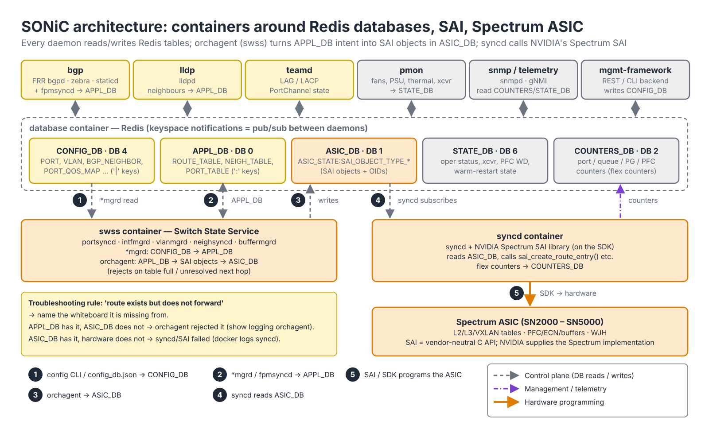
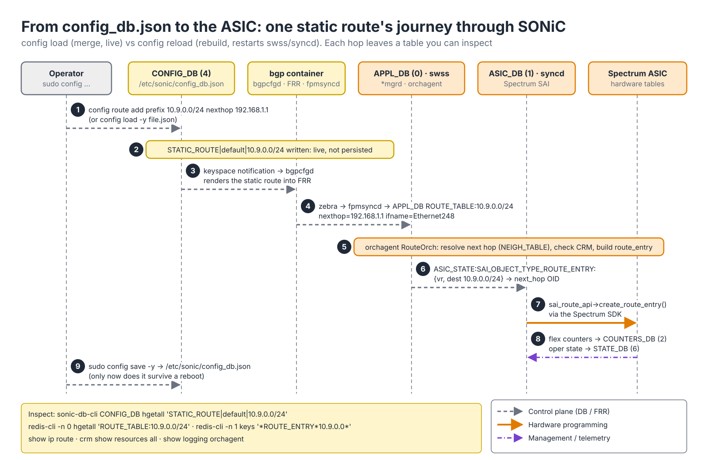
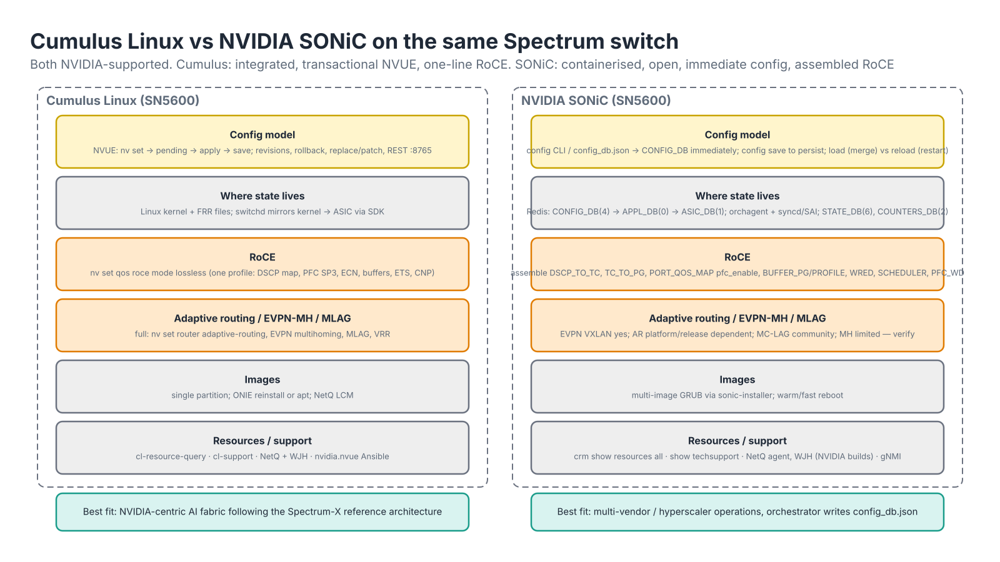

# Module 4.4 — SONiC Essentials (NVIDIA)

> **Exam domain:** NVIDIA Spectrum Networking (30%)  
> **Source course(s):** SONiC Essentials by NVIDIA (NVIDIA Academy)  
> **Source docs:** SONiC community documentation (Architecture, Command Reference, Configuration); NVIDIA Networking SONiC release notes and user manual; NVIDIA Spectrum SAI documentation  
> **Estimated study time:** 4–5 hours

> **How to study this module:** read §1–§2, work through the §3 walkthrough on real gear or NVIDIA Air, then attempt the §5 hands-on assignment using only the Hint section. Open the Solution guide (last section) only after you have a working attempt. Finish with the Appendix C knowledge check closed-book.

## 1. Learning objectives

By the end of this module you will be able to…

- **Describe** the SONiC architecture: containerized services, SAI, the Redis-based CONFIG_DB / APPL_DB / ASIC_DB, `orchagent`, `syncd` and FRR. *(Spectrum Networking — NOS architecture)*
- **Explain** NVIDIA's role in SONiC (Spectrum SAI, NVIDIA-supported "pure SONiC" distribution) and when to choose SONiC over Cumulus Linux. *(Spectrum Networking — NOS selection)*
- **Configure** interfaces, VLANs and BGP with the SONiC CLI and `config_db.json`, and **manage** configuration with `config save/load/reload`. *(Spectrum Networking — configuration)*
- **Configure** RoCE on SONiC: buffer profiles, PFC, PFC watchdog and ECN/WRED, and **verify** with `show pfc counters`/`show queue counters`. *(Spectrum Networking — RoCE)*
- **Install** and **upgrade** SONiC images with `sonic-installer` and **manage** service containers. *(Spectrum Networking — lifecycle)*
- **Troubleshoot** SONiC with `show techsupport`, `show logging`, `redis-cli` and container inspection. *(Troubleshooting Tools)*
- **Compare** Cumulus Linux and SONiC for an AI fabric. *(AI Data Center Design)*

## 2. Key technical concepts

### 2.1 What SONiC is

*Analogy:* Cumulus is a single company where everyone sits in one office and talks directly. SONiC is a campus of separate buildings (containers) that communicate only by writing on shared whiteboards (Redis databases). Any one building can be rebuilt without evacuating the others.


*Figure 4.4-1 — SONiC on a Spectrum switch: every container talks only to Redis. CONFIG_DB is read by the `*mgrd` daemons (1), APPL_DB carries intent to orchagent (2), orchagent writes SAI objects to ASIC_DB (3), syncd consumes them (4) and programs the ASIC through the Spectrum SAI and SDK (5).*

**What it is.** **SONiC** (Software for Open Networking in the Cloud) is an open-source network OS started by Microsoft for Azure and now governed by the Linux Foundation. Two ideas define it:

1. **Everything is a container.** A Debian host runs Docker; each functional block (BGP, LLDP, SNMP, telemetry, the switch state service, the ASIC sync daemon) is a separate container with its own lifecycle. A crashed BGP container is restarted without touching the data plane.
2. **State lives in Redis.** Instead of config files and inter-process RPCs, every daemon reads and writes tables in a Redis database. Configuration, derived application state and the ASIC's programmed state are three separate databases, and the differences between them are how you troubleshoot.

**Why it exists.** A hyperscaler running tens of thousands of switches from several silicon vendors wants one NOS, one automation model and the ability to patch or replace a single feature without a full image upgrade. Containers give independent lifecycles; Redis gives a single, inspectable state store that any new daemon can subscribe to; and **SAI** (§2.3) hides the ASIC behind a standard C API so the same upper layers run on any vendor's silicon. The price is more moving parts: a feature that Cumulus configures with one NVUE command may touch three containers and a dozen tables on SONiC.

**How it works.** On boot the host starts the `database` container first (Redis), loads `/etc/sonic/config_db.json` into CONFIG_DB, then starts the feature containers as systemd units (`systemctl status swss`, `bgp`, `syncd` …). From then on no daemon calls another directly: each one writes the tables it owns and *subscribes* to the tables it consumes (§2.2). Figure 4.4-1 is the whole system in one picture — trace any feature by asking "which table does it write, and who is listening?". Observe with `docker ps`, `show services`, `show feature status`.

### 2.2 The database stack — whiteboards each daemon reads


*Figure 4.4-2 — One static route, nine steps, five tables you can inspect. Steps 3–6 are keyspace notifications; step 9 is the only one that touches the disk.*

**What it is.** One Redis server inside the `database` container holds several logical databases, numbered:

| Database | Redis DB # | Who writes it | What it holds |
|---|---|---|---|
| **CONFIG_DB** | 4 | You (`config` CLI, `config_db.json` load) | Intended configuration: PORT, VLAN, VLAN_MEMBER, INTERFACE, BGP_NEIGHBOR, BUFFER_PROFILE, WRED_PROFILE, PORT_QOS_MAP… |
| **APPL_DB** | 0 | Protocol daemons (FRR via `fpmsyncd`, `portsyncd`, `intfmgrd`, `vlanmgrd`) | Application-level state: routes to install, neighbors, ports as the control plane sees them |
| **ASIC_DB** | 1 | `orchagent` | SAI objects the ASIC *should* contain, in SAI terms (SAI_OBJECT_TYPE_ROUTE_ENTRY…) |
| **STATE_DB** | 6 | Various | Operational state (port oper status, transceiver info, PFC WD status) |
| COUNTERS_DB | 2 | `syncd` via flex counters | Interface/queue/PFC counters |

Two smaller ones you will meet: DB 3 (log levels) and DB 5 (flex-counter and PFC-watchdog polling configuration). Key syntax differs by database and is a common stumbling block: CONFIG_DB and STATE_DB use `|` (`PORT_QOS_MAP|Ethernet0`, `BUFFER_PG|Ethernet0|3`), APPL_DB, ASIC_DB and COUNTERS_DB use `:` (`ROUTE_TABLE:10.9.0.0/24`, `ASIC_STATE:SAI_OBJECT_TYPE_ROUTE_ENTRY:{…}`). `sonic-db-cli <DB_NAME> …` takes the name and hides the number; `redis-cli -n <number>` needs the number.

**Why it exists.** Splitting *intent* (CONFIG_DB), *derived application state* (APPL_DB) and *hardware state* (ASIC_DB) gives each translation step one owner and leaves a durable record of what every step decided. That is what makes SONiC debuggable without a vendor shell: if a route is in APPL_DB but not ASIC_DB, orchagent rejected it; if it is in ASIC_DB but not in hardware, syncd/SAI failed. It also makes restarts survivable — a restarted daemon re-reads its input tables and reconciles instead of losing state.

**How it works.** Redis **keyspace notifications** turn the databases into a message bus. A producer writes a table entry and publishes a notification on a channel; every consumer subscribed to that table wakes up, pops the changed keys and processes them (SONiC's `swss-common` library wraps this as producer/consumer *state tables*). Follow the static route in Figure 4.4-2:

1. `config route add prefix 10.9.0.0/24 nexthop 192.168.1.1` (or `config load`) writes CONFIG_DB.
2. `STATIC_ROUTE|default|10.9.0.0/24` is live immediately — and not yet on disk.
3. The keyspace notification wakes `bgpcfgd` in the `bgp` container, which renders the static route into FRR.
4. `zebra` selects it and `fpmsyncd` writes `ROUTE_TABLE:10.9.0.0/24` with `nexthop` and `ifname` into APPL_DB. (Interfaces, VLANs and buffers take the shorter path through the `*mgrd` daemons in `swss`, which read CONFIG_DB and write APPL_DB directly.)
5. `orchagent`'s RouteOrch consumes it, resolves the next hop against NEIGH_TABLE, checks resources (CRM) and builds a SAI route entry. An unresolved next hop or a full table stops the route here.
6. orchagent's SAI calls go through the `sairedis` library, which serialises them into ASIC_DB as `ASIC_STATE:SAI_OBJECT_TYPE_ROUTE_ENTRY:{vr, dest}` with object IDs (OIDs) for the next hop.
7. `syncd` consumes ASIC_DB and calls the real vendor function — `sai_route_api->create_route_entry()` in NVIDIA's Spectrum SAI, which drives the SDK. syncd keeps a map between the *virtual* OIDs orchagent used and the *real* IDs the SAI returned, stored in ASIC_DB so it can reconcile after a restart.
8. syncd polls hardware counters (flex counters) into COUNTERS_DB and operational state lands in STATE_DB.
9. `sudo config save -y` writes CONFIG_DB to `/etc/sonic/config_db.json` — the only step that survives a reboot.

**Why the exam cares:** "route exists but doesn't forward" on SONiC is answered by naming which whiteboard it is missing from and therefore which daemon dropped it. Observe each hop: `sonic-db-cli CONFIG_DB hgetall 'STATIC_ROUTE|default|10.9.0.0/24'`, `redis-cli -n 0 hgetall 'ROUTE_TABLE:10.9.0.0/24'`, `redis-cli -n 1 keys '*ROUTE_ENTRY*10.9.0.0*'`, `show logging orchagent`, `docker logs syncd`, `crm show resources all`.

### 2.3 Key containers and daemons

**What it is.**

| Container | Contents |
|---|---|
| `swss` | Switch State Service: `orchagent`, `portsyncd`, `intfmgrd`, `vlanmgrd`, `neighsyncd`, `buffermgrd` |
| `syncd` | `syncd` + the vendor **SAI** library (for Spectrum: NVIDIA's SAI implementation on top of the SDK) |
| `bgp` | **FRR** (`bgpd`, `zebra`, `staticd`) + `fpmsyncd` pushing routes to APPL_DB |
| `lldp` | `lldpd` |
| `teamd` | LAG/LACP |
| `pmon` | Platform monitor: fans, PSUs, thermals, transceivers |
| `database` | Redis itself |
| `snmp`, `telemetry` (gNMI), `dhcp_relay`, `radv`, `mgmt-framework` | Optional services |

**SAI** (Switch Abstraction Interface) is the C API between orchagent and the ASIC vendor's code. Because every ASIC vendor ships a SAI, SONiC's upper layers are hardware-agnostic. NVIDIA's contribution is the Spectrum SAI, which exposes Spectrum features (shared buffers, WJH, RoCE, adaptive routing on newer releases) through standard and extended SAI attributes.

**Why it exists.** Each container is a fault and upgrade boundary. The split that matters operationally is *which restarts touch the data plane*: `swss` and `syncd` own the ASIC's programmed state, so restarting either one rebuilds the ASIC (like a `switchd` restart on Cumulus, Module 4.3); `bgp`, `lldp`, `snmp`, `telemetry` only produce or consume tables, so restarting them leaves forwarding untouched (BGP sessions flap, but routes already in the ASIC stay programmed until withdrawn).

**How it works.** Inside `swss`, **orchagent** is a set of "Orch" modules — PortsOrch, IntfsOrch, NeighOrch, RouteOrch, BufferOrch, QosOrch, PfcWdOrch and others — each consuming its APPL_DB (or CONFIG_DB) tables and emitting SAI objects in dependency order (a route needs its next hop, which needs its neighbour, which needs its router interface). If a dependency is missing, the task is retried rather than failed, which is why a route can sit in APPL_DB "pending" until ARP resolves. `syncd` is deliberately thin: it translates ASIC_DB operations into SAI calls and SAI notifications (port up/down, FDB learn events) back into the databases. Observe with `docker exec swss supervisorctl status`, `show logging orchagent`, `docker logs syncd --tail 100`, `show interfaces status` (fed by STATE_DB/APPL_DB).

### 2.4 NVIDIA and SONiC

**What it is.** NVIDIA (Mellanox before acquisition) has been a top SONiC contributor since 2016 and ships:
- **NVIDIA Networking SONiC** (sometimes "NVIDIA pure SONiC"): an NVIDIA-built, tested and supported distribution based on upstream community SONiC with Spectrum SAI, platform drivers and NVIDIA-validated fixes, delivered as `.bin` images for Spectrum switches (SN2000–SN5000). Support comes with the NVIDIA switch support contract.
- Spectrum SAI and platform modules upstreamed to the community tree, so community SONiC also runs on Spectrum.
- Tooling integrations: NetQ agents for SONiC, WJH on SONiC, NVIDIA Air images for SONiC.

**Why it exists.** Customers who standardise on SONiC across vendors still want a supported image with validated buffer templates and drivers for their Spectrum hardware; NVIDIA's distribution provides that without forking the architecture.

**How it works** — choosing between the two NVIDIA-supported NOSes:

| Choose Cumulus Linux when… | Choose SONiC when… |
|---|---|
| You want a vendor-integrated OS with NVUE, full feature set (EVPN MH, MLAG, RoCE one-liner, AR, telemetry) on day one | Your organisation already standardises on SONiC (hyperscaler/cloud model) and runs it on other vendors' silicon |
| Operational tooling is NVIDIA-centric (NetQ LCM, Air, Ansible `nvidia.nvue`) | You need a fully open-source, auditable stack and the freedom to build your own image |
| The Spectrum-X reference architecture is being followed as published (Cumulus is the primary NOS in Spectrum-X RA documents) | You have in-house development to extend containers/features and manage the faster-moving release cadence |
| Smaller team, wants supported defaults | Large team, config generated by an orchestrator writing `config_db.json` directly |

The exam expects you to know that *both* are NVIDIA-supported on Spectrum and that Cumulus offers the richer, more opinionated feature set, while SONiC offers openness and multi-vendor uniformity.

### 2.5 Configuration model: `config_db.json`

**What it is.** The CONFIG_DB is persisted as `/etc/sonic/config_db.json`. Everything you configure through `config` commands ends up here. Structure is a JSON object keyed by table, then by object key (pipe-separated for compound keys). Points to remember:
- Interface names are `EthernetN` where N is the *first lane index*, not a port number. `etp1a` style aliases map to front-panel labels; `show interfaces alias` translates. A 4-lane breakout of port 1 yields Ethernet0/4/8/12 on an 8-lane 800G platform — the HWSKU defines this.
- The **HWSKU** (`Mellanox-SN5600-C256S1`, etc.) encodes platform, port configuration and default buffer profile. Changing breakout configuration on SONiC is done via `config interface breakout` (Dynamic Port Breakout) or by selecting a different HWSKU — much more rigid than NVUE's `link breakout`.
- MTU default is 9100 on most SONiC platforms.

**Why it exists.** A single JSON document that *is* the database makes SONiC friendly to orchestrators: generate the file from a source of truth, push it, load it. The cost is the absence of a transaction: unlike Cumulus, SONiC's `config` commands take effect *immediately* (no pending/apply model). There is no built-in diff; the discipline is: change → verify → `config save`.

**How it works.**

| Command | Effect |
|---|---|
| `sudo config save -y` | running CONFIG_DB → `/etc/sonic/config_db.json` |
| `sudo config load -y [file]` | merge file into CONFIG_DB (additive, no restart) |
| `sudo config reload -y [file]` | restart swss/syncd and rebuild CONFIG_DB from file — **disruptive** |
| `sudo config load_minigraph` | Azure-style XML topology (rare outside hyperscalers) |
| `show runningconfiguration all` | dump CONFIG_DB as JSON |

`load` writes each table entry into CONFIG_DB and the normal keyspace notifications propagate it (Figure 4.4-2); nothing restarts. `reload` stops the services, flushes the databases, loads the file and restarts `swss`/`syncd`, so the ASIC is reprogrammed from zero — correct for a rebuild, an outage if you only meant to add one VLAN (Gotcha 4). Because writes are live but not persistent, the two failure modes are mirror images: forget `config save` and a reboot loses your work (Gotcha 1); `load` a file with a mistake and it is live immediately with nothing to roll back to except a previous file. Observe the gap with `diff <(show runningconfiguration all) /etc/sonic/config_db.json`.

### 2.6 BGP on SONiC

**What it is.** FRR runs inside the `bgp` container; CONFIG_DB BGP_NEIGHBOR entries are rendered to FRR config by `bgpcfgd` using templates.

**Why it exists.** Templated rendering keeps BGP in the same "everything is CONFIG_DB" model, which suits simple, uniform fabrics generated by an orchestrator — but templates cover only basic neighbours.

**How it works.** For anything beyond basic neighbours (route-maps, EVPN, unnumbered), operators either enable the FRR "unified" config mode (`frr_mgmt_framework_config`/`docker_routing_config_mode: split|unified` in DEVICE_METADATA — check current docs) and edit FRR directly with `vtysh`, or use SONiC's newer `config bgp` extensions. BGP unnumbered and EVPN VXLAN are supported in recent SONiC releases but are configured partly in CONFIG_DB (VXLAN_TUNNEL, VXLAN_TUNNEL_MAP, VRF) and partly in FRR. Whichever way you configure it, learned routes leave FRR through `zebra` → `fpmsyncd` → APPL_DB and follow steps 4–7 of Figure 4.4-2. Observe with `show ip bgp summary`, `docker exec -it bgp vtysh -c 'show bgp summary'`, and the APPL_DB/ASIC_DB checks in §2.2.

### 2.7 RoCE on SONiC — assembling what Cumulus does in one line

*Analogy:* Cumulus's `nv set qos roce` is a pre-built kit. SONiC hands you the parts list and a screwdriver.


*Figure 4.4-3 — The RoCE table graph: PORT_QOS_MAP binds four maps to a port and enables PFC on priority 3; BUFFER_PG gives PG 3 lossless headroom; QUEUE attaches WRED/ECN and the scheduler. The pipeline below shows where each table acts on a packet.*

**What it is.** SONiC has no single "roce lossless" command. You assemble the pieces that Cumulus's `nv set qos roce` sets for you. This is a favourite exam contrast.

| Table | Purpose |
|---|---|
| `DSCP_TO_TC_MAP` | DSCP → traffic class (e.g. DSCP 26 → TC 3 for RoCE, DSCP 48 → TC 6 for CNP) |
| `TC_TO_QUEUE_MAP` | TC → egress queue |
| `TC_TO_PRIORITY_GROUP_MAP` | TC → ingress priority group (PG) — PGs are where PFC and lossless buffers live |
| `PFC_PRIORITY_TO_QUEUE_MAP` | Which PFC priority pauses which queue |
| `PORT_QOS_MAP` | Binds the maps to ports and sets `pfc_enable: "3"` |
| `BUFFER_POOL` / `BUFFER_PROFILE` | Shared pools and per-PG/queue profiles; lossless profiles have `xon`/`xoff` headroom |
| `BUFFER_PG` / `BUFFER_QUEUE` | Attach profiles to port PGs and queues |
| `WRED_PROFILE` | ECN marking thresholds |
| `QUEUE` | Attach WRED profile and scheduler to queues |
| `SCHEDULER` | DWRR weights / strict priority |
| `PFC_WD` | PFC watchdog per port |

**Why it exists.** Lossless Ethernet needs four things to line up on every hop: classification (which packets are RoCE), a lossless ingress buffer with enough **headroom** to absorb what is still in flight after a PAUSE is sent, PFC on exactly that priority, and ECN marking early enough that congestion control slows senders before PFC is needed. SONiC keeps each of those as a separate, vendor-neutral table so an orchestrator can generate them per port and per platform; the platform supplies the numbers that depend on silicon (buffer sizes, headroom). Get one reference wrong and you have PFC enabled on a priority with no lossless buffer — counters never move and the host still drops (Gotcha 3).

**How it works** — follow a RoCE packet through Figure 4.4-3:

1. **Classify.** The port trusts DSCP; `PORT_QOS_MAP|Ethernet0` names the `DSCP_TO_TC_MAP` (`AZURE`): DSCP 26 → TC 3 (RoCE), DSCP 48 → TC 6 (CNP).
2. **Ingress PG.** `TC_TO_PRIORITY_GROUP_MAP` puts TC 3 in **PG 3**. `BUFFER_PG|Ethernet0|3` attaches the lossless profile `pg_lossless_400000_100m_profile`, which draws from `ingress_lossless_pool`. The profile's `xoff` is the headroom reserved for in-flight bytes; when PG 3's occupancy crosses the pause threshold the port transmits PFC for priority 3, and when it drains below `xon` it resumes. `dynamic_th` sets how much of the pool's free space a PG may take (a larger value lets one PG grow at the expense of others). The name encodes speed and cable length because headroom ≈ 2 × cable delay × line rate + sender reaction time + MTUs — at 400G over 100 m that is ~50 KB of wire alone (5 ns/m × 100 m × 2 × 400 Gb/s), ~70–100 KB per PG all-in. `buffermgrd` derives these values from port speed and cable length using platform tables, which is why the walkthrough shows them as `"..."`.
3. **PFC mapping.** `pfc_enable: "3"` turns PFC on for priority 3 only; `PFC_PRIORITY_TO_QUEUE_MAP` tells the egress side that a PAUSE received for priority 3 stops queue 3.
4. **Egress queue.** `TC_TO_QUEUE_MAP` sends TC 3 to queue 3. `QUEUE|Ethernet0|3` attaches `WRED_PROFILE AZURE_LOSSLESS` with `ecn: ecn_all`: between `green_min_threshold` (1 MB) and `green_max_threshold` (2 MB) packets are CE-marked with rising probability up to `green_drop_probability` 5% — for ECN-capable traffic that means *marked*, not dropped. This is Cumulus's `congestion-control`.
5. **Schedule.** `QUEUE|Ethernet0|3 → scheduler.1` (DWRR weight 50) shares bandwidth; `QUEUE|Ethernet0|6 → scheduler.0` (STRICT) sends CNPs first so rate reductions are never queued behind the data they are slowing.
6. **Protect.** **`pfcwd`** watches each lossless queue. A **PFC storm** (a NIC stuck sending pause frames) can freeze a lossless queue fabric-wide. `pfcwd` detects a queue paused continuously longer than `detection_time` ms (with no packets leaving) and takes an `action` (`drop` the queue's traffic, `forward` ignoring pause, or `alert` only), restoring after `restoration_time` ms without pause. `POLL_INTERVAL` (100 ms in the walkthrough) is how often the watchdog samples, so detection resolution is never finer than the poll interval. Cumulus has the same concept (`nv set qos pfc-watchdog` / `nv set interface swpN qos pfc-watchdog` — verify object name).

Observe: `show pfc counters` (only the PFC3 column should move), `show queue counters Ethernet0` (UC3 drops must be 0), `show priority-group watermark headroom`, `show buffer configuration`, `show pfcwd config` / `show pfcwd stats` (storms should be 0), and the tables themselves with `sonic-db-cli CONFIG_DB hgetall 'PORT_QOS_MAP|Ethernet0'`.

### 2.8 Images and containers

**What it is.** SONiC keeps multiple images on disk and selects via GRUB — a true dual-image capability (unlike Cumulus's single partition). Initial installation uses ONIE exactly as Cumulus does (`onie-nos-install http://.../sonic.bin`). After install, `config_db.json` is carried over from the previous image when upgrading in place; still back it up. Restarting `swss` or `syncd` resets the data plane (like `switchd` restart on Cumulus). Restarting `bgp` or `lldp` does not.

SONiC ZTP (`ztp` service) uses DHCP option 67 / 239 / provisioning URL to fetch a JSON ZTP spec describing ordered plugins (`firmware`, `config-db-json`, `graphservice`, `connectivity-check`, custom scripts). `show ztp status`, `sudo config ztp enable|disable|run`. Concept is the same as Cumulus; the input is a JSON document rather than a bash script.

**Why it exists.** Multiple images make upgrade and rollback a boot-menu choice: `set-next-boot` tries a new image once and falls back to the default if it fails. SONiC "warm reboot" (`sudo warm-reboot`) and "fast reboot" exist to upgrade with minimal data-plane impact when the platform supports it — a normal reboot resets the ASIC and drops traffic for the whole boot time.

**How it works.** `sonic-installer install` writes the new image alongside the current one and makes it the next boot. The reboot flavours differ in what keeps forwarding:

- **Cold reboot** (`reboot`): everything restarts; the ASIC is reset and reprogrammed from CONFIG_DB. Longest outage.
- **Fast reboot** (`fast-reboot`): the control plane restarts quickly while the ASIC is re-initialised; the data-plane outage is short (platform-dependent, typically tens of seconds — verify for your platform).
- **Warm reboot** (`warm-reboot`): the ASIC is *not* reset and keeps forwarding with its existing tables while the host reboots (kexec) into the new image. Before going down, the switch saves the databases (APPL_DB, ASIC_DB including syncd's virtual-to-real OID map, STATE_DB) and BGP announces graceful restart so peers keep its routes. On the way up, syncd restores its OID map and reconciles ASIC_DB against the hardware instead of re-creating everything, orchagent re-reads APPL_DB, and only the differences are programmed. `show warm_restart state` shows each daemon's reconciliation; STATE_DB holds the warm-restart table. Warm reboot works only between supported versions and platforms — check the release notes.

Observe containers with `docker ps`, `show services`, `show feature status`, and images with `sudo sonic-installer list` (Current, Next, Available).

### 2.9 Cumulus Linux vs SONiC


*Figure 4.4-4 — Same silicon, same ONIE install path; the difference is where state lives and how you change it.*

**What it is.**

| Aspect | Cumulus Linux | NVIDIA SONiC |
|---|---|---|
| Heritage | NVIDIA (Cumulus Networks), proprietary distribution on open components | Open source (LF), Microsoft origin; NVIDIA builds/supports a distribution |
| Architecture | Debian, `switchd` + SDK, FRR on host, `ifupdown2` | Debian + Docker containers, SAI, Redis DBs, FRR in container |
| CLI | **NVUE** `nv set/show/config apply` with pending/apply/save, revisions, REST API | `config`/`show` immediate; `config save`; `config_db.json`; gNMI/REST via mgmt-framework |
| Config model | Declarative YAML, `nv config replace` | JSON CONFIG_DB |
| RoCE | `nv set qos roce mode lossless` one-liner | Buffer/PG/WRED/PFC tables assembled manually or via templates; `config qos reload` |
| Adaptive routing | Yes (Spectrum-2+), NVUE | Platform-dependent, newer NVIDIA releases — verify |
| EVPN / MLAG / MH | Full | EVPN VXLAN yes; MC-LAG community support varies; MH limited |
| Images | Single partition, ONIE reinstall or apt | Multi-image via `sonic-installer`, warm/fast reboot |
| Support bundle | `cl-support` | `show techsupport` |
| ASIC resources | `cl-resource-query` | `crm show resources all` (Critical Resource Monitoring) |
| Telemetry | NetQ, WJH, gNMI, OTLP | NetQ, WJH (NVIDIA builds), gNMI telemetry container |
| Automation | `nvidia.nvue` Ansible collection, REST | `sonic-net` community Ansible roles, generic `copy` of config_db.json, gNMI |
| Best fit | NVIDIA-centric AI fabrics following Spectrum-X RA | Multi-vendor, hyperscaler-style operations |

**Why it exists.** The exam frames this as a design decision, not a feature race: both run on the same Spectrum ASIC through the same SDK, so data-plane capability is bounded by the silicon; what differs is the operational model around it.

**How it works.** Map each operational task across: a change is `nv set` + `nv config apply` + `save` on Cumulus and `config …` + `config save` on SONiC; "is it in hardware?" is `cl-resource-query` vs `crm show resources all`; a RoCE profile is one NVUE line vs the table graph of Figure 4.4-3. `crm` (Critical Resource Monitoring) is SONiC's analogue of **cl-resource-query**: `crm show resources all` shows used/available for routes, nexthops, FDB, ACL, with configurable thresholds that raise syslog alerts (`crm config thresholds …`), and orchagent consults the same counters before it programs a route (step 5 of Figure 4.4-2).

## 3. Live-style walkthrough — from `config_db.json` to a verified RoCE leaf

We take an SN5600 running NVIDIA SONiC from a bare `config_db.json` to a PFC/ECN-enabled RoCE leaf and prove it with counters.

### Step 1 — Inspect the starting point

```bash
show version                                 # SONiC version, HWSKU, platform, ASIC
show platform summary                        # Platform: x86_64-nvidia_sn5600-r0, HwSKU: Mellanox-SN5600-C256S1
show interfaces status | head               # EthernetN names, lanes, speed, oper state
show interfaces alias | head                 # Ethernet0 <-> etp1a: the panel label you will cable to
show runningconfiguration all | head -40    # the live CONFIG_DB as JSON
```

### Step 2 — Base identity and interfaces

The minimum `config_db.json` for a leaf. Notice every key is a *table*, and compound keys use `|`:

```json
{
  "DEVICE_METADATA": {
    "localhost": {
      "hostname": "leaf01",
      "hwsku": "Mellanox-SN5600-C256S1",
      "platform": "x86_64-nvidia_sn5600-r0",
      "type": "LeafRouter",
      "bgp_asn": "65011"
    }
  },
  "PORT": {
    "Ethernet0":  { "alias": "etp1a", "lanes": "0,1,2,3", "speed": "400000", "mtu": "9100", "admin_status": "up", "fec": "rs" },
    "Ethernet4":  { "alias": "etp1b", "lanes": "4,5,6,7", "speed": "400000", "mtu": "9100", "admin_status": "up", "fec": "rs" }
  },
  "VLAN": {
    "Vlan100": { "vlanid": "100" }
  },
  "VLAN_MEMBER": {
    "Vlan100|Ethernet0": { "tagging_mode": "untagged" }
  },
  "VLAN_INTERFACE": {
    "Vlan100": {},
    "Vlan100|10.100.1.1/24": {}
  },
  "LOOPBACK_INTERFACE": {
    "Loopback0": {},
    "Loopback0|10.0.0.11/32": {}
  },
  "BGP_NEIGHBOR": {
    "Ethernet248": { "asn": "65000", "name": "spine01", "admin_status": "up", "local_addr": "" }
  }
}
```

Load it. `load` merges without a data-plane reset; `reload` rebuilds everything (disruptive) — on a greenfield switch either is fine:

```bash
sudo config load -y /home/admin/leaf01-base.json      # merge into CONFIG_DB; takes effect immediately
sudo config save -y                                   # persist to /etc/sonic/config_db.json NOW — SONiC has no "apply" safety net
```

Or build the same thing interactively — every command writes CONFIG_DB immediately:

```bash
sudo config interface startup Ethernet0               # admin up
sudo config interface speed Ethernet0 400000          # 400G (in Mb/s)
sudo config interface mtu Ethernet0 9100
sudo config interface fec Ethernet0 rs                # RS-FEC: mandatory at 400G
sudo config vlan add 100
sudo config vlan member add -u 100 Ethernet0          # -u untagged (access); omit for tagged
sudo config interface ip add Vlan100 10.100.1.1/24
sudo config interface ip add Loopback0 10.0.0.11/32
sudo config interface ip add Ethernet248 192.168.1.0/31   # numbered uplink to spine01
sudo config bgp startup neighbor 192.168.1.1
sudo config save -y
```

Checkpoints:

```bash
show interfaces status Ethernet0
```
```text
  Interface  Lanes    Speed  MTU   FEC  Alias  Vlan   Oper  Admin  Type         Asym PFC
-----------  -------  -----  ----  ---  -----  -----  ----  -----  -----------  --------
  Ethernet0  0,1,2,3  400G   9100  rs   etp1a  trunk  up    up     OSFP 8X      N/A
```
```bash
show vlan brief                 # Vlan100, 10.100.1.1/24, Ethernet0 untagged
show ip bgp summary             # 192.168.1.1 AS 65000 state Established (once the spine is up)
show ip route                   # Loopback0 and Vlan100 connected, spine routes via BGP
```

### Step 3 — RoCE: DSCP→TC→PG maps, PFC, buffers, ECN, watchdog

Start from the platform templates, then confirm/override. `config qos reload` regenerates QoS/buffer tables from `/usr/share/sonic/device/<platform>/<hwsku>/buffers_defaults_t0.j2` and the QoS template:

```bash
sudo config qos reload              # regenerate QoS/buffer tables from the platform templates
show buffer configuration           # effective pools and profiles after reload
show qos                            # maps and bindings (newer releases)
```

Now the RoCE-specific merge file. Every table maps to a Cumulus concept you already know, and every reference below is an arrow in Figure 4.4-3:

```json
{
  "DSCP_TO_TC_MAP": {
    "AZURE": { "0": "0", "26": "3", "48": "6" }
  },
  "TC_TO_QUEUE_MAP": {
    "AZURE": { "0": "0", "3": "3", "6": "6" }
  },
  "TC_TO_PRIORITY_GROUP_MAP": {
    "AZURE": { "0": "0", "3": "3", "6": "6" }
  },
  "PFC_PRIORITY_TO_QUEUE_MAP": {
    "AZURE": { "3": "3" }
  },
  "PORT_QOS_MAP": {
    "Ethernet0": {
      "dscp_to_tc_map": "AZURE",
      "tc_to_queue_map": "AZURE",
      "tc_to_pg_map": "AZURE",
      "pfc_to_queue_map": "AZURE",
      "pfc_enable": "3"
    }
  },
  "BUFFER_POOL": {
    "ingress_lossless_pool": { "type": "ingress", "mode": "dynamic", "size": "..." },
    "egress_lossless_pool":  { "type": "egress",  "mode": "dynamic", "size": "..." },
    "egress_lossy_pool":     { "type": "egress",  "mode": "dynamic", "size": "..." }
  },
  "BUFFER_PROFILE": {
    "pg_lossless_400000_100m_profile": {
      "pool": "ingress_lossless_pool", "size": "...", "xon": "...", "xoff": "...", "dynamic_th": "0"
    },
    "egress_lossy_profile": { "pool": "egress_lossy_pool", "size": "...", "dynamic_th": "3" }
  },
  "BUFFER_PG": {
    "Ethernet0|3": { "profile": "pg_lossless_400000_100m_profile" },
    "Ethernet0|0": { "profile": "ingress_lossy_profile" }
  },
  "WRED_PROFILE": {
    "AZURE_LOSSLESS": {
      "ecn": "ecn_all",
      "green_min_threshold": "1000000",
      "green_max_threshold": "2000000",
      "green_drop_probability": "5",
      "wred_green_enable": "true"
    }
  },
  "QUEUE": {
    "Ethernet0|3": { "scheduler": "scheduler.1", "wred_profile": "AZURE_LOSSLESS" },
    "Ethernet0|6": { "scheduler": "scheduler.0" }
  },
  "SCHEDULER": {
    "scheduler.0": { "type": "STRICT" },
    "scheduler.1": { "type": "DWRR", "weight": "50" }
  },
  "PFC_WD": {
    "Ethernet0": { "action": "drop", "detection_time": "200", "restoration_time": "200" },
    "GLOBAL": { "POLL_INTERVAL": "100" }
  }
}
```

Reading it as an instructor:
- `DSCP_TO_TC_MAP` — DSCP 26 → TC 3 (RoCE), DSCP 48 → TC 6 (CNP). Identical to the Cumulus profile's DSCP→switch-priority table.
- `TC_TO_PRIORITY_GROUP_MAP` — TC 3 lands in **PG 3**. PFC and lossless headroom live on the *ingress* PG, so this mapping is what makes PFC meaningful.
- `PORT_QOS_MAP ... "pfc_enable": "3"` — the single most-tested field: PFC on priority 3 for this port.
- `BUFFER_PROFILE pg_lossless_400000_100m_profile` — the name encodes 400G and a 100 m cable; `xon`/`xoff` are the pause-resume thresholds, platform-computed (that is why the values are `"..."` here — NVIDIA ships them per HWSKU).
- `WRED_PROFILE AZURE_LOSSLESS` with `ecn: ecn_all` — this is the ECN marking that Cumulus calls `congestion-control`.
- `QUEUE Ethernet0|6 → scheduler.0 STRICT` — CNPs leave first, exactly as on Cumulus where CNP is strict-priority TC 6.
- `PFC_WD` — detection 200 ms, restoration 200 ms, action drop.

```bash
sudo config load -y /home/admin/roce_qos.json       # merge the RoCE tables
sudo config save -y
# Or drive pfcwd from the CLI:
sudo config pfcwd start --action drop --restoration-time 200 Ethernet0 200
sudo config pfcwd start_default                       # all ports, platform defaults
```

### Step 4 — Verify lossless behaviour

```bash
show pfc counters
```
```text
     Port Rx    PFC0    PFC1    PFC2    PFC3    PFC4    PFC5    PFC6    PFC7
----------  ------  ------  ------  ------  ------  ------  ------  ------
 Ethernet0       0       0       0    1842       0       0       0       0

     Port Tx    PFC0    PFC1    PFC2    PFC3    PFC4    PFC5    PFC6    PFC7
----------  ------  ------  ------  ------  ------  ------  ------  ------
 Ethernet0       0       0       0     311       0       0       0       0
```

Only the PFC3 column moves — exactly what a correct priority-3 lossless profile looks like. Interpretation is identical to Cumulus, read from the switch port's point of view: Rx pause on a host-facing port → the host NIC is pausing the switch (a slow receiver); Tx pause on a host-facing port → the switch is pausing the host because its own buffers toward the destination are filling; Rx pause on an uplink → the spine is pausing you; rising ECN-marked counts with no PFC → congestion control working as intended.

```bash
show pfc asymmetric
show queue counters Ethernet0        # per-queue packets/bytes, drops — look at UC3 (RoCE) and UC6 (CNP); UC3 drops must be 0
show queue watermark unicast         # peak occupancy per queue since last clear
show priority-group watermark headroom
show buffer configuration            # effective pools/profiles
show pfcwd config                    # Ethernet0 action drop 200/200
show pfcwd stats                     # storm count per queue — should be 0 in a healthy fabric
sonic-clear pfccounters; sonic-clear queuecounters   # zero before a benchmark
```

### Step 5 — Peek at the whiteboards

Each command below reads one database of Figure 4.4-1; together they replay steps 1, 4 and 6 of Figure 4.4-2.

```bash
redis-cli -n 4 keys 'PORT_QOS_MAP|*'                            # CONFIG_DB: intent
sonic-db-cli CONFIG_DB hgetall 'PORT_QOS_MAP|Ethernet0'          # pfc_enable 3
redis-cli -n 0 hgetall 'ROUTE_TABLE:10.100.1.0/24'               # APPL_DB: the control plane asked for it
redis-cli -n 1 keys 'ASIC_STATE:SAI_OBJECT_TYPE_ROUTE_ENTRY*' | wc -l   # ASIC_DB: what orchagent programmed
```

If a route is in DB 0 but not DB 1, read `show logging orchagent` — usually a SAI error such as table-full or an unresolved next hop.

### Step 6 — Image lifecycle and containers

The image commands are §2.8 in practice; `set-next-boot` is the safe way to try a new image, and `warm-reboot` (where supported) replaces the final `reboot` when traffic must keep flowing.

```bash
sudo sonic-installer list                        # Current, Next, Available images
sudo sonic-installer install /tmp/sonic-mellanox-202405.bin
sudo sonic-installer set-default <image>
sudo sonic-installer set-next-boot <image>       # try once, fall back automatically if it fails to boot
sudo sonic-installer remove <image>
show runningconfiguration all > backup.json      # always, even though config carries over
sudo reboot

docker ps                                   # swss, syncd, bgp, lldp, pmon, database, ...
show services                               # processes inside each container
sudo systemctl restart bgp                  # each container is also a systemd unit; bgp restart is NOT disruptive
docker exec -it bgp vtysh                   # into FRR
docker logs syncd --tail 100
sudo config feature state telemetry enabled # enable optional containers
show feature status
```

## 4. Troubleshooting / common gotchas

### Gotcha 1 — VLANs vanished after reboot

**Symptom:** `config vlan add` worked, `show vlan brief` was correct, then a reboot lost everything.

**Why it happens:** SONiC `config` is immediate but *not* persistent; `config save` was skipped.

**How to debug:** `diff <(show runningconfiguration all) /etc/sonic/config_db.json` before the reboot would have shown the gap.

**Fix:** re-apply and `sudo config save -y`. Make it muscle memory: change → verify → save.

### Gotcha 2 — Route in `show ip route`, traffic blackholes

**Symptom:** FRR has the route, APPL_DB has it, hosts are unreachable.

**Why it happens:** `orchagent` rejected it (not in ASIC_DB) — table full, bad next hop, or SAI error.

**How to debug:**
```bash
redis-cli -n 0 hgetall 'ROUTE_TABLE:<prefix>'          # present
redis-cli -n 1 keys '*ROUTE_ENTRY*<prefix>*'            # absent
show logging orchagent | grep -i -E 'fail|err'
crm show resources all                                  # route/nexthop at capacity?
```

**Fix:** summarise routes or raise `crm` thresholds for early warning; if SAI logged an error, `docker logs syncd` and escalate with `show techsupport`.

### Gotcha 3 — PFC configured, counters never move / host still drops

**Symptom:** `show pfc counters` all zeros under load, or RoCE retransmits on the host.

**Why it happens:** `pfc_enable` is set but the TC→PG map does not place TC 3 in PG 3, or the lossless `BUFFER_PG` for `Ethernet0|3` is missing — so there is no lossless headroom and no pause generation.

**How to debug:**
```bash
sonic-db-cli CONFIG_DB hgetall 'PORT_QOS_MAP|Ethernet0'
sonic-db-cli CONFIG_DB hgetall 'TC_TO_PRIORITY_GROUP_MAP|AZURE'
sonic-db-cli CONFIG_DB hgetall 'BUFFER_PG|Ethernet0|3'
show buffer configuration
```

**Fix:** add the missing `BUFFER_PG` with the lossless profile, or `sudo config qos reload` to regenerate from templates and re-merge your overrides.

### Gotcha 4 — `config reload` caused an outage

**Symptom:** you meant to merge one table and the whole data plane reset.

**Why it happens:** `config reload` restarts `swss`/`syncd`; `config load` merges live.

**How to debug:** `show logging | grep -i 'swss\|syncd'` shows the restart.

**Fix:** use `config load -y <file>` for additive changes; reserve `reload` for rebuilds and maintenance windows.

## 5. Hands-on assignment — a `config_db.json` for a RoCE leaf

**Scenario.** You are standardising on NVIDIA SONiC for a storage/GPU leaf. Produce a complete, loadable `config_db.json` for an SN5600 leaf with two 400G host ports and one uplink, lossless RoCE on priority 3 with ECN and PFC watchdog, and prove it loads cleanly.

**Requirements**
1. `DEVICE_METADATA`: hostname `leaf01`, HWSKU `Mellanox-SN5600-C256S1`, type `LeafRouter`, ASN 65011.
2. `PORT`: Ethernet0 and Ethernet4 at 400G, MTU 9100, RS-FEC, admin up; Ethernet248 as the uplink.
3. L3: Loopback0 10.0.0.11/32; Ethernet248 192.168.1.0/31; BGP neighbour 192.168.1.1 AS 65000; Vlan100 with Ethernet0 and Ethernet4 untagged, SVI 10.100.1.1/24.
4. RoCE: DSCP 26→TC 3→PG 3→queue 3; DSCP 48→TC 6 strict; `pfc_enable "3"` on both host ports; lossless `BUFFER_PG` for PG 3 on both; WRED/ECN on queue 3; `PFC_WD` on both host ports (drop, 200/200).
5. The file must be valid JSON and load with `config load` without errors; `config save`.
6. Verification commands captured.

**Deliverables**
- `leaf01-roce.json`.
- Output of `show interfaces status`, `show vlan brief`, `show ip bgp summary`, `show qos` (or the `sonic-db-cli` dumps of `PORT_QOS_MAP|Ethernet0` and `BUFFER_PG|Ethernet0|3`), `show pfcwd config`, `show pfc counters`.
- `python3 -m json.tool leaf01-roce.json > /dev/null && echo OK` output.

**Acceptance criteria**
- JSON parses; `sudo config load -y leaf01-roce.json` returns without errors.
- Both host ports show `pfc_enable 3` and a lossless profile on PG 3.
- `show pfcwd config` lists Ethernet0 and Ethernet4 with action drop.
- `show queue counters Ethernet0` shows queue UC3 and UC6 present.
- After `sudo reboot`, `show runningconfiguration all` still contains the `PFC_WD` and `PORT_QOS_MAP` tables.

### Hint
- Start by dumping the platform's generated QoS after `config qos reload` — copy the real `BUFFER_POOL`/`BUFFER_PROFILE` values rather than inventing `xon`/`xoff`.
- `PORT_QOS_MAP` binds maps *per port*; both Ethernet0 and Ethernet4 need their own entry.
- The compound key format is `Table|Key|Subkey` — a typo like `Ethernet0:3` loads silently and does nothing.
- `show interfaces alias` tells you which panel port Ethernet248 actually is before you cable it.
- `config save` is the only thing between you and acceptance criterion 5.

## Appendix A — Quick command / config reference

```bash
# Config lifecycle
sudo config save -y | sudo config load -y <file> | sudo config reload -y <file>
show runningconfiguration all

# Interfaces / VLAN / LAG
sudo config interface startup|shutdown EthernetN
sudo config interface speed EthernetN 400000; ... mtu EthernetN 9100; ... fec EthernetN rs
sudo config vlan add 100; sudo config vlan member add [-u] 100 EthernetN
sudo config interface ip add Vlan100 10.100.1.1/24
sudo config portchannel add PortChannel1; sudo config portchannel member add PortChannel1 EthernetN
show interfaces status | counters | transceiver eeprom EthernetN; show interfaces alias; show vlan brief

# BGP
sudo config bgp startup neighbor <ip>; show ip bgp summary; show ip route; show bgp neighbors; vtysh

# RoCE
sudo config qos reload; sudo config qos clear; show buffer configuration; show qos
sudo config pfcwd start --action drop --restoration-time 200 EthernetN 200; sudo config pfcwd start_default; sudo config pfcwd stop EthernetN
show pfc counters; show pfc asymmetric; show pfcwd config|stats; show queue counters EthernetN; show queue watermark unicast
sonic-clear pfccounters; sonic-clear queuecounters

# Images / containers
sudo sonic-installer list | install <bin> | set-default  | set-next-boot  | remove 
docker ps; show services; show feature status; sudo systemctl restart <container>; sudo warm-reboot

# Troubleshooting
show techsupport; show logging [-f] [orchagent]; docker logs <container>
redis-cli -n <db> ...; sonic-db-cli <DB> hgetall '<key>'
crm show resources all; show mac; show arp; show lldp table; show interfaces counters errors
```

## Appendix B — Exam traps & key takeaways

- SONiC `config` commands are immediate; there is no pending/apply step. `config save` is still required to persist. NVUE is transactional (pending/apply/save with revisions).
- `config reload` resets the data plane; `config load` merges without restart.
- `EthernetN` is the lane index, not the panel port. Use `show interfaces alias`.
- There is no one-command RoCE on SONiC; lossless RoCE is DSCP→TC→PG maps + `pfc_enable` in PORT_QOS_MAP + lossless buffer profiles with xon/xoff + WRED profile + pfcwd.
- PFC watchdog actions: `drop` (default in most templates), `forward`, `alert`. Know what each does to a stuck queue.
- `orchagent` lives in `swss`; `syncd` plus the SAI library live in `syncd`. Restarting either disrupts forwarding; restarting `bgp` or `lldp` does not.
- CONFIG_DB = DB 4, APPL_DB = DB 0, ASIC_DB = DB 1, STATE_DB = DB 6 — compare the first three when a route "exists but doesn't forward".
- `show techsupport` ≈ `cl-support`; `crm show resources all` ≈ `cl-resource-query`.
- SONiC has multi-image boot (`sonic-installer`); Cumulus does not.
- SAI is the vendor-neutral ASIC API; NVIDIA supplies the Spectrum implementation.
- NVIDIA supports *both* Cumulus and SONiC on Spectrum; Spectrum-X RAs are written around Cumulus. Don't assume SONiC lacks Spectrum support or that Cumulus is "closed".
- `/etc/sonic/config_db.json` persists CONFIG_DB; MTU default 9100; HWSKU defines lanes and default buffers.

## Appendix C — Knowledge check

1. On a SONiC switch a static route appears in `show ip route` and in APPL_DB but is not in ASIC_DB. Which component most likely rejected it?
   A. `fpmsyncd`
   B. `orchagent`
   C. `syncd`
   D. `lldpd`

2. After configuring VLANs with `config vlan add`, an engineer reboots and the VLANs are gone. What was skipped?
   A. `config reload`
   B. `config save`
   C. `sonic-installer set-default`
   D. `systemctl restart swss`

3. Which CONFIG_DB table enables PFC on priority 3 for a port?
   A. `WRED_PROFILE`
   B. `PORT_QOS_MAP` with `pfc_enable: "3"`
   C. `BUFFER_POOL`
   D. `SCHEDULER`

4. A NIC sends continuous PFC pause frames, freezing queue 3 across the fabric. Which SONiC feature limits the damage?
   A. ECN
   B. PFC watchdog (`pfcwd`) with action `drop`
   C. `config qos reload`
   D. `crm`

5. Which SONiC command is the closest equivalent to Cumulus `cl-support`?
   A. `show logging`
   B. `show techsupport`
   C. `docker logs syncd`
   D. `show platform summary`

6. What is the role of SAI?
   A. The REST API for SONiC
   B. The abstraction layer between orchagent and the ASIC vendor's SDK
   C. The Redis database engine
   D. The LACP daemon

7. Which statement correctly contrasts configuration handling?
   A. SONiC has pending/apply; Cumulus applies immediately.
   B. Cumulus NVUE has pending/apply/save with revisions; SONiC `config` applies immediately and requires `config save` to persist.
   C. Both require a reboot to apply changes.
   D. Neither persists configuration across reboots.

8. Which Redis database number holds CONFIG_DB?
   A. 0
   B. 1
   C. 4
   D. 6

### Answer key
1. B — orchagent translates APPL_DB to ASIC_DB; a route missing there was rejected by orchagent.
2. B — `config save` writes CONFIG_DB to `/etc/sonic/config_db.json`.
3. B — `pfc_enable` in PORT_QOS_MAP turns PFC on for the listed priorities.
4. B — pfcwd detects a persistently paused queue and drops/forwards to break the storm.
5. B — `show techsupport` builds the support archive.
6. B — SAI is the vendor-neutral ASIC API; NVIDIA supplies the Spectrum implementation.
7. B — NVUE is transactional; SONiC CLI is immediate.
8. C — CONFIG_DB is DB 4 (APPL_DB 0, ASIC_DB 1, STATE_DB 6).

## References
- SONiC Architecture — https://github.com/sonic-net/SONiC/wiki/Architecture
- SONiC Command Reference — https://github.com/sonic-net/sonic-utilities/blob/master/doc/Command-Reference.md
- SONiC QoS / Buffer configuration and PFC watchdog design docs — https://github.com/sonic-net/SONiC/tree/master/doc
- NVIDIA Networking SONiC documentation and release notes — https://docs.nvidia.com/networking/ (SONiC section)
- NVIDIA Spectrum SAI — https://github.com/Mellanox/SAI-Implementation
- NVIDIA Academy course: SONiC Essentials by NVIDIA
- Related: [`02-cumulus-linux-essentials.md`](02-cumulus-linux-essentials.md), [`03-cumulus-linux-administration.md`](03-cumulus-linux-administration.md), [`../03-rdma/03-roce-a-to-z.md`](../03-rdma/03-roce-a-to-z.md)

---
## Solution guide — Hands-on assignment

### Step 0 — harvest real buffer values

```bash
sudo config qos reload
show runningconfiguration all | python3 -c 'import json,sys; d=json.load(sys.stdin); print(json.dumps({k:d[k] for k in ("BUFFER_POOL","BUFFER_PROFILE") if k in d}, indent=2))'
```

Copy the `ingress_lossless_pool`, `egress_lossless_pool`, `egress_lossy_pool` sizes and the `pg_lossless_400000_100m_profile` (or the profile matching your cable length) `size`/`xon`/`xoff` into the file below in place of the `"..."` placeholders. Do not invent them: they are platform-calculated.

### `leaf01-roce.json`

```json
{
  "DEVICE_METADATA": {
    "localhost": {
      "hostname": "leaf01",
      "hwsku": "Mellanox-SN5600-C256S1",
      "platform": "x86_64-nvidia_sn5600-r0",
      "type": "LeafRouter",
      "bgp_asn": "65011"
    }
  },
  "PORT": {
    "Ethernet0":   { "alias": "etp1a",  "lanes": "0,1,2,3",         "speed": "400000", "mtu": "9100", "admin_status": "up", "fec": "rs" },
    "Ethernet4":   { "alias": "etp1b",  "lanes": "4,5,6,7",         "speed": "400000", "mtu": "9100", "admin_status": "up", "fec": "rs" },
    "Ethernet248": { "alias": "etp32a", "lanes": "248,249,250,251", "speed": "400000", "mtu": "9100", "admin_status": "up", "fec": "rs" }
  },
  "LOOPBACK_INTERFACE": {
    "Loopback0": {},
    "Loopback0|10.0.0.11/32": {}
  },
  "INTERFACE": {
    "Ethernet248": {},
    "Ethernet248|192.168.1.0/31": {}
  },
  "BGP_NEIGHBOR": {
    "192.168.1.1": { "asn": "65000", "name": "spine01", "admin_status": "up", "local_addr": "192.168.1.0", "holdtime": "180", "keepalive": "60" }
  },
  "VLAN": {
    "Vlan100": { "vlanid": "100" }
  },
  "VLAN_MEMBER": {
    "Vlan100|Ethernet0": { "tagging_mode": "untagged" },
    "Vlan100|Ethernet4": { "tagging_mode": "untagged" }
  },
  "VLAN_INTERFACE": {
    "Vlan100": {},
    "Vlan100|10.100.1.1/24": {}
  },
  "DSCP_TO_TC_MAP": {
    "AZURE": { "0": "0", "26": "3", "48": "6" }
  },
  "TC_TO_QUEUE_MAP": {
    "AZURE": { "0": "0", "3": "3", "6": "6" }
  },
  "TC_TO_PRIORITY_GROUP_MAP": {
    "AZURE": { "0": "0", "3": "3", "6": "6" }
  },
  "PFC_PRIORITY_TO_QUEUE_MAP": {
    "AZURE": { "3": "3" }
  },
  "PORT_QOS_MAP": {
    "Ethernet0": { "dscp_to_tc_map": "AZURE", "tc_to_queue_map": "AZURE", "tc_to_pg_map": "AZURE", "pfc_to_queue_map": "AZURE", "pfc_enable": "3" },
    "Ethernet4": { "dscp_to_tc_map": "AZURE", "tc_to_queue_map": "AZURE", "tc_to_pg_map": "AZURE", "pfc_to_queue_map": "AZURE", "pfc_enable": "3" },
    "Ethernet248": { "dscp_to_tc_map": "AZURE", "tc_to_queue_map": "AZURE", "tc_to_pg_map": "AZURE", "pfc_to_queue_map": "AZURE", "pfc_enable": "3" }
  },
  "BUFFER_POOL": {
    "ingress_lossless_pool": { "type": "ingress", "mode": "dynamic", "size": "..." },
    "egress_lossless_pool":  { "type": "egress",  "mode": "dynamic", "size": "..." },
    "egress_lossy_pool":     { "type": "egress",  "mode": "dynamic", "size": "..." }
  },
  "BUFFER_PROFILE": {
    "pg_lossless_400000_100m_profile": { "pool": "ingress_lossless_pool", "size": "...", "xon": "...", "xoff": "...", "dynamic_th": "0" },
    "ingress_lossy_profile":           { "pool": "ingress_lossless_pool", "size": "0", "dynamic_th": "3" },
    "egress_lossy_profile":            { "pool": "egress_lossy_pool",     "size": "...", "dynamic_th": "3" },
    "egress_lossless_profile":         { "pool": "egress_lossless_pool",  "size": "0", "dynamic_th": "7" }
  },
  "BUFFER_PG": {
    "Ethernet0|0":   { "profile": "ingress_lossy_profile" },
    "Ethernet0|3":   { "profile": "pg_lossless_400000_100m_profile" },
    "Ethernet4|0":   { "profile": "ingress_lossy_profile" },
    "Ethernet4|3":   { "profile": "pg_lossless_400000_100m_profile" },
    "Ethernet248|0": { "profile": "ingress_lossy_profile" },
    "Ethernet248|3": { "profile": "pg_lossless_400000_100m_profile" }
  },
  "BUFFER_QUEUE": {
    "Ethernet0|3":   { "profile": "egress_lossless_profile" },
    "Ethernet4|3":   { "profile": "egress_lossless_profile" },
    "Ethernet248|3": { "profile": "egress_lossless_profile" }
  },
  "WRED_PROFILE": {
    "AZURE_LOSSLESS": { "ecn": "ecn_all", "green_min_threshold": "1000000", "green_max_threshold": "2000000", "green_drop_probability": "5", "wred_green_enable": "true" }
  },
  "SCHEDULER": {
    "scheduler.0": { "type": "STRICT" },
    "scheduler.1": { "type": "DWRR", "weight": "50" }
  },
  "QUEUE": {
    "Ethernet0|3":   { "scheduler": "scheduler.1", "wred_profile": "AZURE_LOSSLESS" },
    "Ethernet0|6":   { "scheduler": "scheduler.0" },
    "Ethernet4|3":   { "scheduler": "scheduler.1", "wred_profile": "AZURE_LOSSLESS" },
    "Ethernet4|6":   { "scheduler": "scheduler.0" },
    "Ethernet248|3": { "scheduler": "scheduler.1", "wred_profile": "AZURE_LOSSLESS" },
    "Ethernet248|6": { "scheduler": "scheduler.0" }
  },
  "PFC_WD": {
    "Ethernet0":   { "action": "drop", "detection_time": "200", "restoration_time": "200" },
    "Ethernet4":   { "action": "drop", "detection_time": "200", "restoration_time": "200" },
    "Ethernet248": { "action": "drop", "detection_time": "200", "restoration_time": "200" },
    "GLOBAL": { "POLL_INTERVAL": "100" }
  }
}
```

Design notes: the uplink Ethernet248 also gets the lossless profile — PFC must be end-to-end or the spine's pause frames are ignored. `BUFFER_QUEUE` on queue 3 with an egress lossless profile is what the platform templates generate; if your `config qos reload` output names them differently, use its names.

### Load and verify

```bash
python3 -m json.tool leaf01-roce.json > /dev/null && echo OK          # criterion: parses
sudo config load -y /home/admin/leaf01-roce.json                      # criterion: no errors
sudo config save -y

show interfaces status                      # Ethernet0/4/248 400G rs up
show vlan brief                             # Vlan100 10.100.1.1/24, Ethernet0 + Ethernet4 untagged
show ip bgp summary                         # 192.168.1.1 65000 Established (once spine is up)
sonic-db-cli CONFIG_DB hgetall 'PORT_QOS_MAP|Ethernet0'      # pfc_enable 3 ...
sonic-db-cli CONFIG_DB hgetall 'PORT_QOS_MAP|Ethernet4'
sonic-db-cli CONFIG_DB hgetall 'BUFFER_PG|Ethernet0|3'       # profile pg_lossless_400000_100m_profile
sonic-db-cli CONFIG_DB hgetall 'BUFFER_PG|Ethernet4|3'
show pfcwd config                           # Ethernet0, Ethernet4, Ethernet248: drop 200 200
show queue counters Ethernet0               # UC0..UC7 rows incl. UC3 and UC6
show pfc counters                           # all zero until traffic — PFC3 column is the one to watch
show buffer configuration
```

### Persistence

```bash
sudo reboot
# after boot
show runningconfiguration all | python3 -c 'import json,sys; d=json.load(sys.stdin); print("PFC_WD" in d, "PORT_QOS_MAP" in d)'
# -> True True
```

### Proving it under load (hardware only)

From a host with a ConnectX/BlueField NIC set to DSCP 26 (`NCCL_IB_TC=106`, `mlnx_qos -i <if> --trust dscp --pfc 0,0,0,1,0,0,0,0`), run `ib_write_bw` toward a peer behind Ethernet4 while a second sender hammers the same destination. `show pfc counters` increments **only** PFC3 — Tx on the two senders' ingress ports, because the switch is pausing them while the Ethernet4 egress queue is congested; `show queue counters Ethernet4` shows UC3 bytes rising with zero drops; `show pfcwd stats` stays at zero storms. That is a healthy lossless RoCE leaf.
