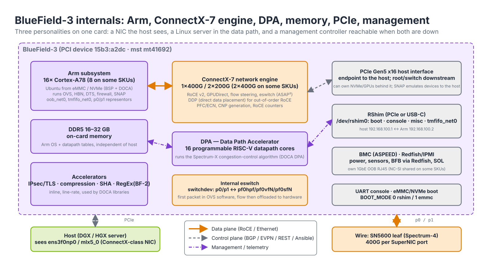
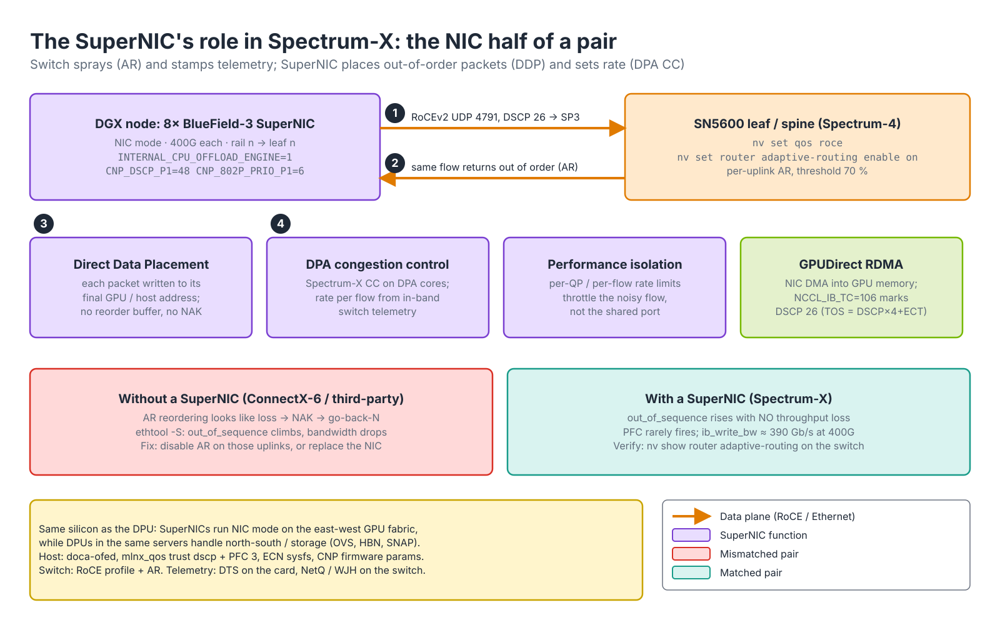
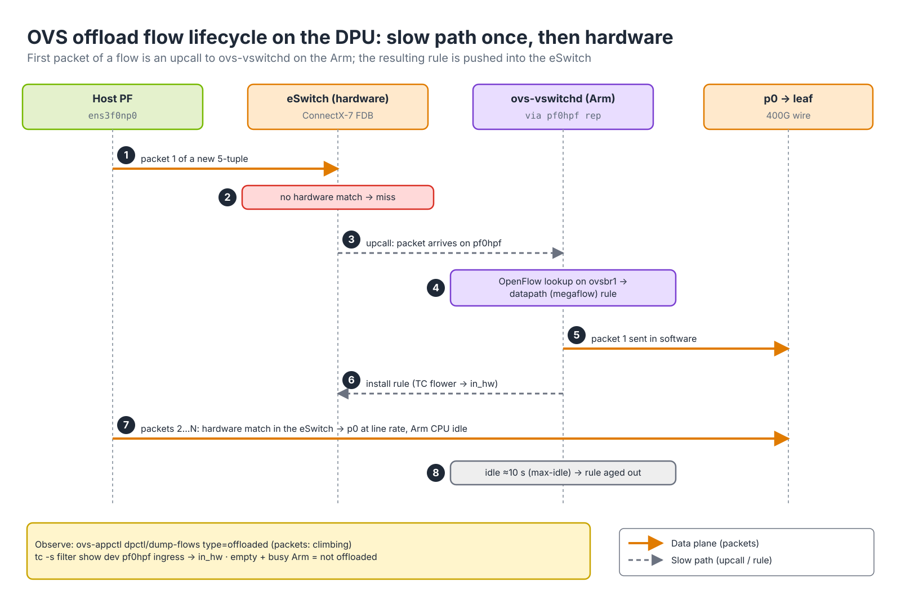

# Module 5.1 — BlueField DPU Administration

> **Exam domain:** NVIDIA Spectrum Networking (30%) — SuperNIC/DPU items; also touches AI Data Center Design (5%)  
> **Source course(s):** BlueField DPU Administration (NVIDIA Academy)  
> **Source docs:** NVIDIA BlueField-3 DPU/SuperNIC Product Documentation; BlueField DPU BSP (BlueField Software) Documentation; DOCA Installation Guide; MFT (Mellanox Firmware Tools) User Manual; BlueField Modes of Operation  
> **Estimated study time:** 5 hours

> **How to study this module:** read §1–§2, work through the §3 walkthrough on real gear or NVIDIA Air, then attempt the §5 hands-on assignment using only the Hint section. Open the Solution guide (last section) only after you have a working attempt. Finish with the Appendix C knowledge check closed-book.

## 1. Learning objectives

By the end of this module you will be able to…

- **Describe** the BlueField-3 architecture (Arm subsystem, ConnectX-7 network engine, DPA, memory, PCIe) and **distinguish** a DPU from a **SuperNIC**. *(Spectrum Networking — SuperNIC/DPU)*
- **Explain** the BlueField modes of operation (DPU mode, NIC mode, zero-trust/restricted host) and **switch** between them with **mlxconfig**. *(Spectrum Networking — SuperNIC configuration)*
- **Install** a BlueField software image (BFB) over RShim with `bfb-install` and **access** the Arm console and network over `/dev/rshim0`. *(Spectrum Networking — DPU administration)*
- **Update** NIC/DPU firmware with `mlxfwmanager` and **set** key `mlxconfig` parameters (SR-IOV, VF count, link type). *(Spectrum Networking — firmware)*
- **Describe** the host/DPU interface relationships (p0/p1, pf0hpf, pf0vfN representors) and **enable** OVS hardware offload on the DPU. *(Spectrum Networking — DPU networking)*
- **Describe** BlueField management paths (RShim, BMC, OOB port), bf.cfg/cloud-init provisioning, and the DPU Provisioning Framework. *(AI Data Center Design — provisioning at scale)*
- **Troubleshoot** with `mst status`, `ibdev2netdev`, `mlxconfig -q` and `mlxlink`. *(Troubleshooting Tools)*

## 2. Key technical concepts

### 2.1 BlueField-3 architecture — a mini-server inside the NIC

*Analogy:* a DPU is a mini-server bolted onto the back of a NIC. The host sees a network card; what it does not see is a 16-core Linux machine sitting between its PCIe slot and the wire, able to inspect, route, encrypt or block everything that passes.


*Figure 5.1-1 — BlueField-3 internals. The data path runs left to right (host → PCIe → ConnectX-7 engine/eSwitch → p0/p1 → leaf); the Arm complex hangs off the eSwitch through representors, the DPA hangs off the engine for per-packet work, and the management plane (RShim, BMC, boot media) is independent of both.*

**What it is.** BlueField-3 is one chip (PCI vendor:device `15b3:a2dc`, MST device `mt41692`) with four functional blocks that matter to an administrator:

| Block | Detail | Why it matters |
|---|---|---|
| Arm subsystem | 16 Arm Cortex-A78 cores (8 on some SKUs), running Ubuntu/other Linux from an eMMC/NVMe | Runs infrastructure software (OVS, firewall, storage target, HBN routing, telemetry) *off* the host CPU and *outside* the host's trust domain |
| Network engine | Integrated **ConnectX-7** class NIC: 1×400G or 2×200G (also 2×400G on some SKUs), RoCE, GPUDirect, hardware packet processing (flow steering, encryption, ASAP² switching) | Same RDMA/RoCE data path as a ConnectX-7 card; wire-speed OVS/flow offload |
| **DPA** (Data Path Accelerator) | 16 programmable RISC-V style cores for packet-paced datapath code, programmed via DOCA DPA | Hosts RoCE congestion-control algorithms and custom datapath logic — the engine behind Spectrum-X congestion control |
| Memory | 16–32 GB DDR5 on-card (SKU dependent) | Local memory for the Arm OS and for datapath tables independent of the host |
| PCIe | Gen5 x16 host interface; also acts as a PCIe switch/root for downstream devices (NVMe, GPUs in some designs) | Can present itself to the host as a NIC while owning devices behind it |
| Accelerators | Crypto (IPsec/TLS inline), compression, regex, SHA | Zero-trust and storage offloads at line rate |
| Management | **RShim** (over PCIe or USB), BMC with its own 1GbE OOB port, UART console | Out-of-band control even when the host or Arm OS is down |

The DPA is commonly described as 16 hyper-threaded RISC-V cores exposing 256 hardware threads (verify against the datasheet for your SKU); each thread can be woken by a packet or completion event, which is why per-flow congestion-control code fits there and not on the Arm.

**Why it exists.** At 400 Gb/s a minimum-size packet arrives every few nanoseconds. A general-purpose CPU — the host's or the Arm's — cannot make a forwarding decision per packet at that rate, so the card is split by time budget: the **ConnectX-7 engine and its embedded eSwitch** do everything that must happen per packet in fixed-function hardware; the **DPA** runs small programmable handlers per packet or per event (microseconds); the **Arm** makes slow, rich decisions per *flow* (OVS lookups, BGP, firewall policy) and programs the result into the hardware. The bandwidth arithmetic also works: PCIe Gen5 is 32 GT/s per lane, so x16 ≈ 512 Gb/s raw, about 63 GB/s per direction after encoding — enough headroom for one 400G port, which is why a 400G SuperNIC needs Gen5 and a 400G card in a Gen4 slot cannot reach line rate. Remove the Arm and you have a ConnectX-7; remove the eSwitch offload and the Arm becomes a 400G bottleneck it cannot possibly serve.

**How it works.** Follow a host packet through Figure 5.1-1:

1. The host driver (`mlx5_core`) posts a descriptor; the engine DMAs the frame across PCIe Gen5 from host memory.
2. The frame enters the **eSwitch**, a hardware match/action table (the FDB) keyed on L2–L4 headers, VLAN/VXLAN and the source vport. In NIC mode the eSwitch is owned by the host and simply forwards PF/VF traffic to the uplink. In DPU mode it is owned by the Arm, and a miss sends the packet to the Arm through a *representor* (§2.4).
3. On a hit the action list runs in hardware (rewrite, encap/decap, count, meter, forward to p0) at line rate.
4. RoCE packets are additionally handled by the RDMA engine (transport state, DDP placement into GPU memory); congestion events are handed to DPA threads that compute a new send rate (§2.2).
5. The management plane (RShim, BMC, UART) talks to the Arm and the firmware over separate paths and keeps working when the host is down or the Arm OS is broken.

Observe the blocks from the host with `lspci -nn | grep -i 15b3` (the PF functions and, in DPU mode, the RShim/management function), `mst status -v` (the `mt41692_pciconf0` device node), `mlxfwmanager --query` (firmware) and `lspci -vv -s <bdf> | grep LnkSta` (should read `Speed 32GT/s, Width x16`).

**Why the exam cares:** know which block does what — DPA = congestion control/datapath code, Arm = services, eSwitch = offloaded forwarding, RShim/BMC = management — and the device identifiers `mt41692` / `15b3:a2dc`.

### 2.2 DPU vs SuperNIC

*Analogy:* same car, two trims. The DPU trim is the delivery van — big cargo bay (Arm cores doing services). The SuperNIC trim is the sports model — same chassis, tuned purely for speed on one road (RoCE to GPUs).


*Figure 5.1-2 — The SuperNIC is the NIC half of Spectrum-X: the switch sprays one flow across all uplinks (1) so packets return out of order (2); the SuperNIC places them directly (3) and sets the send rate on the DPA from switch telemetry (4). Without a SuperNIC the same reordering looks like loss.*

**What it is.** Both are BlueField-3 silicon; the difference is firmware personality, form factor and intended role:

| | BlueField-3 **DPU** | BlueField-3 **SuperNIC** |
|---|---|---|
| Purpose | Infrastructure offload: OVS/vSwitch, firewall, storage (NVMe-oF, SNAP), telemetry, tenant isolation, HBN | GPU-to-GPU east-west RoCE networking in AI clusters — the NIC side of **Spectrum-X** |
| Ports | 2×200G or 1×400G, typical | 1×400G (also 2×200G) per GPU, 8 per DGX/HGX node |
| Arm usage | Fully used: runs the infrastructure stack | Minimal; the Arm cores are present but the card is tuned as a high-performance NIC with the DPA running Spectrum-X congestion control |
| Key features | DOCA services, zero-trust host isolation, PCIe switch | **RoCE adaptive routing** support with out-of-order tolerance (Direct Data Placement), programmable congestion control, performance isolation, low-profile/power-optimised |
| Pairs with | Any Ethernet switch; Spectrum for best telemetry | Spectrum-4 (SN5600) switches running Spectrum-X RoCE AR/CC |

**Why it exists.** In Spectrum-X the switch sprays packets of one flow over all paths (Module 4.1). A conventional NIC reassembles RoCE messages in order: a PSN gap triggers a NAK and go-back-N retransmission, so spraying turns into self-inflicted loss. The SuperNIC's DDP engine places each arriving packet directly at its final memory address, so order no longer matters, and its DPA terminates the switch-to-NIC telemetry that drives congestion control. A general DPU optimises for running services on the Arm; a SuperNIC optimises for per-GPU bandwidth, power and the Spectrum-X feature pair. In an AI data center you typically find *both*: SuperNICs on the compute (GPU) fabric and DPUs on the north-south/storage/management side of the same servers.

**How it works** (numbered steps in Figure 5.1-2):

1. NCCL on the DGX posts RDMA writes on QPs whose traffic class is set by `NCCL_IB_TC=106` (TOS 106 = DSCP 26 with ECT); the SuperNIC emits RoCEv2 (UDP 4791) that the leaf maps to switch-priority 3.
2. The leaf's adaptive-routing engine sends each packet to the least-loaded uplink; the far leaf delivers them out of order.
3. The receiving SuperNIC writes each payload to its target address (DDP) and completes the message once all bytes are present — no reorder buffer, no NAK.
4. Switch telemetry stamped in flight is reflected to the sender, whose DPA thread recomputes that flow's rate.

These capabilities are enabled by firmware/DOCA configuration on the card plus matching switch configuration — see [`02-doca-sdk-overview.md`](02-doca-sdk-overview.md) and [`../04-spectrum-ethernet/01-spectrum-x.md`](../04-spectrum-ethernet/01-spectrum-x.md). Observe it with `ethtool -S <if> | grep out_of_sequence` (rising without throughput loss on a SuperNIC) and `nv show router adaptive-routing` on the switch.

**Why the exam cares:** "customer wants BlueField-3 to behave exactly like ConnectX-7" → NIC mode. "Provider must control the card, tenant controls the host" → restricted host. "AR enabled, ConnectX-6 hosts slow" → missing SuperNIC half of the pair.

### 2.3 Modes of operation and the data path

*Analogy:* DPU mode puts the mini-server *in the hallway* between the host and the door — every packet walks past it. NIC mode moves it into a closet — the hallway is clear and the host walks straight to the door. Restricted host mode locks the closet and takes the host's key.


*Figure 5.1-3 — DPU mode (left, steps 1–4) puts the Arm-owned eSwitch and OVS between host and wire; NIC mode (right, steps 1–2) gives the eSwitch back to the host. The mode is one firmware parameter, `INTERNAL_CPU_OFFLOAD_ENGINE`.*

**What it is.** The mode decides *who owns the eSwitch* (the embedded CPU function, ECPF, on the Arm, or the host PF). It is a firmware setting changed with **mlxconfig** (from MFT or DOCA tools) and takes effect after a power cycle.

| Mode | Who owns the network | Host sees | Use |
|---|---|---|---|
| **DPU mode** (default; also "embedded CPU mode", ECPF) | The Arm side. Host traffic passes through the Arm's eswitch (OVS) before reaching the wire | PFs/VFs whose traffic is steered via representors on the Arm | Full offload/isolation, HBN, zero-trust |
| **NIC mode** | The host. The card behaves like a ConnectX-7; Arm cores are not in the data path (and may be inaccessible) | Standard ConnectX NIC | SuperNIC deployments, maximum simplicity, when no DPU services are needed |
| **Zero-trust / Restricted host mode** | The Arm side, and additionally the host is *blocked* from RShim access, from changing firmware/mlxconfig and from reaching the Arm OS | Standard NIC with no management privileges | Bare-metal cloud where the tenant owns the host but the provider owns the DPU |
| Separated host mode (legacy) | Both host and Arm have independent PFs to the wire | Two independent NICs | Older designs; check current support |

**Why it exists.** The same card serves two incompatible goals. A cloud provider wants every host packet to pass a policy point the tenant cannot touch — that requires the Arm to own the eSwitch (DPU mode), and for bare-metal tenants it also requires stripping the host's management rights (restricted host). A GPU cluster wants the shortest, most predictable RoCE path with zero extra hops or Arm dependencies — that requires the host to own the eSwitch (NIC mode). The trade-off is explicit: DPU mode adds an Arm-managed slow path for the first packet of every flow and an operational dependency on the Arm OS (if OVS on the Arm is down, the host has no network); NIC mode removes both but also removes isolation and services.

**How it works** (Figure 5.1-3):

- *DPU mode, steps 1–4.* (1) The host frame enters the eSwitch from the host PF vport. (2) No rule matches: the eSwitch delivers the packet to the Arm on the **representor** for that vport, `pf0hpf`. (3) `ovs-vswitchd` looks it up in its OpenFlow tables (default bridge `ovsbr1` = `p0` + `pf0hpf`), forwards it out of the `p0` representor, and installs a matching rule into the eSwitch. (4) Every later packet of the flow hits in hardware and goes to `p0` without touching the Arm (§2.5).
- *NIC mode, steps 1–2.* The host PF owns the eSwitch; the frame goes straight from PCIe to `p0`. There are no representors on the Arm, OVS on the Arm is not in the path, and the Arm may not even be reachable. SuperNIC functions (DDP, DPA CC) still work — they live in the engine and DPA, not on the Arm.
- *Restricted host.* Set from the Arm with `mlxprivhost -d <dev> r ...`; the host keeps its PF/VFs but loses RShim, firmware flashing, `mlxconfig` and counter access. Only the Arm (or the BMC) can undo it.

Changing mode: `mlxconfig -d /dev/mst/mt41692_pciconf0 s INTERNAL_CPU_OFFLOAD_ENGINE=1` (NIC) or `=0` (DPU), then a cold power cycle; verify the *Current* column of `mlxconfig -q`. Exam framing: NIC mode = "make it a ConnectX"; DPU mode = "Arm in the path"; restricted host = "host loses management rights". SuperNICs ship/operate in NIC mode.

**Why the exam cares:** the parameter name, its values (0 = DPU, 1 = NIC), the power-cycle requirement, and that restricted mode is set *from the Arm*.

### 2.4 The eSwitch, representors, and switchdev vs legacy

*Analogy:* representors are intercoms. Every host-side port (PF or VF) has a matching intercom on the Arm side; what the host says into its port comes out of the intercom, and OVS decides where it goes next.

**What it is.** The eSwitch is the embedded hardware switch inside the ConnectX engine. Every function attached to it is a *vport*: the uplink (wire), each host PF, each host VF, and each Arm scalable function (SF). In **switchdev** mode the eSwitch manager (the Arm in DPU mode) gets one Linux netdev — a **representor** — per vport. Interface naming on the **Arm**:

| Arm interface | Represents |
|---|---|
| `p0`, `p1` | The physical uplink ports (wire side) |
| `pf0hpf`, `pf1hpf` | "Host PF" representors: the host's physical function on port 0/1 — traffic the host sends arrives here |
| `pf0vf0`…`pf0vfN` | Representors for each host VF (when SR-IOV is enabled) |
| `pf0sf0`… | Scalable function representors (DPU-side SFs for services) |
| `en3f0pf0sf0` style names | SF netdevs usable by Arm applications |
| `oob_net0` | The 1GbE out-of-band management port |
| `tmfifo_net0` | Virtual NIC over RShim to the host |

On the **host**, the interfaces are plain ConnectX netdevs (`ens3f0np0`, `ens3f1np1`, and VFs); the host cannot see representors or OVS. The host's only view into the DPU is RShim (unless restricted).

**Why it exists.** A representor gives Linux tools a handle for traffic that never touches the Linux kernel. Whatever is attached to a representor (an OVS bridge port, a TC rule, a DOCA Flow pipe) controls the corresponding hardware vport: transmit on `pf0hpf` and the packet arrives at the host PF; a packet the eSwitch cannot match from the host PF arrives on `pf0hpf`. **Legacy** mode is the classic SR-IOV model: the eSwitch does simple MAC/VLAN L2 forwarding between VFs and the uplink, there are no representors, and nothing on the Arm can see or steer per-flow — fine for basic VF networking, useless for OVS offload, firewalling or HBN.

**How it works.**

1. Check the mode: `devlink dev eswitch show pci/0000:03:00.0` → `mode switchdev inline-mode none encap-mode basic`. The BSP sets switchdev by default in DPU mode.
2. To change it: `devlink dev eswitch set pci/0000:03:00.0 mode switchdev`. Do this before creating VFs (`sriov_numvfs` must be 0), because representors are created per vport when the mode is entered.
3. List vports and their representors: `devlink port show` (flavour `physical` = p0, `pcipf` = pf0hpf, `pcivf` = pf0vfN, `pcisf` = SFs).
4. The default BSP creates two bridges, `ovsbr1` (p0 + pf0hpf) and `ovsbr2` (p1 + pf1hpf), so host traffic flows transparently from first boot.

Failure modes: eSwitch in `legacy` → no `pf0hpf`, OVS bridge ports missing, host has no connectivity in DPU mode; VFs created before switching modes → missing `pf0vfN` representors until VFs are recreated.

**Why the exam cares:** representors exist only on the Arm, only in switchdev; `pf0hpf` is "what the host PF sent"; `p0` is the wire.

### 2.5 OVS hardware offload (ASAP² / OVS-DOCA) and the flow lifecycle

*Analogy:* the Arm is the traffic court that rules on the first case; the eSwitch is the clerk who applies the precedent to every identical case afterwards without bothering the judge.


*Figure 5.1-4 — Lifecycle of one offloaded flow: miss (1–2), upcall (3), software decision (4–5), rule install (6), hardware fast path (7), aging (8).*

**What it is.** **ASAP²** (Accelerated Switching and Packet Processing) is NVIDIA's name for offloading the Open vSwitch datapath into the eSwitch. OVS keeps its control logic (OpenFlow tables, `ovs-vswitchd`) on the Arm, but instead of forwarding every packet in software it translates each datapath flow into a hardware rule. Two back-ends exist: *OVS-kernel*, which offloads through the Linux TC subsystem (`tc flower` rules marked `in_hw`), and **OVS-DOCA**, which programs the eSwitch through DOCA Flow and is NVIDIA's current direction (enabled with `other_config:doca-init=true` on recent BSPs — verify for your release). Either way the switch is `other_config:hw-offload=true`.

**Why it exists.** Without offload, every packet between host and wire is copied to the Arm, processed by `ovs-vswitchd`/the kernel datapath and copied back — a few tens of Gb/s at best, with the Arm cores at 100 %. With offload, the Arm sees only the first packet(s) of each flow; the remaining packets run at 400G in hardware. The trade-off is flow-setup latency (the first packet takes the slow path) and finite hardware table capacity, so workloads with very high new-flow rates (port scans, short-lived UDP) stress the Arm and the rule-insertion rate rather than bandwidth.

**How it works** (Figure 5.1-4):

1. Packet 1 of a new 5-tuple arrives from the host PF.
2. The eSwitch has no matching rule → miss.
3. The packet is delivered to the Arm on the `pf0hpf` representor (an upcall).
4. `ovs-vswitchd` runs the OpenFlow pipeline for `ovsbr1` and produces a datapath (megaflow) rule: match fields + actions (output `p0`, maybe VLAN push or VXLAN encap).
5. Packet 1 is forwarded in software out of the `p0` representor.
6. The rule is installed into the eSwitch (TC flower → `in_hw`, or DOCA Flow pipe entry).
7. Packets 2…N hit in hardware and go straight to `p0`; Arm CPU stays idle and the hardware counters increment.
8. When the flow is idle longer than `other_config:max-idle` (10 s by default) OVS removes it from hardware; the next packet starts at step 1 again.

Observe it: `ovs-appctl dpctl/dump-flows type=offloaded` (non-empty, `packets:` climbing), `ovs-appctl dpctl/dump-flows type=ovs` (flows still in software), `tc -s filter show dev pf0hpf ingress` (`in_hw` with hit counters on OVS-kernel), and `top` on the Arm (`ovs-vswitchd` low). Failure modes: `hw-offload` not set or eSwitch in `legacy` → everything in software, Arm pegged (Gotcha 2); action not supported in hardware (some match/action combinations) → that flow stays in software while others offload — look for it in `type=ovs`.

**Why the exam cares:** the first-packet slow path, `hw-offload=true` + switchdev as the two prerequisites, and `dump-flows type=offloaded` as the proof.

### 2.6 Software stack: BSP, BFB, DOCA and the boot flow


*Figure 5.1-5 — Installing a BFB over RShim (steps 1–9). The same file can be pushed from a BMC over Redfish or, at scale, by DPF.*

**What it is.**

- **BlueField BSP** (Board Support Package, "BlueField Software") — the Arm-side OS image: Ubuntu (default) with kernel, drivers, firmware, OVS, MFT, DOCA runtime and tools. Versioned (e.g., BSP 4.x) and bundled with a DOCA version.
- **BFB** (BlueField Boot stream) — the single installable file (`*.bfb`) containing boot loader, kernel, root filesystem and (optionally) NIC firmware. Pushed to the card over RShim. Internally it is a concatenation of boot images the card's boot ROM can consume directly: Arm Trusted Firmware stages (BL2, BL31), UEFI, an installer kernel + initramfs, the root filesystem image to write, and optional firmware payloads.
- **DOCA** — the SDK/runtime for developing on and operating BlueField; it also provides the host drivers (DOCA-OFED). Covered in Module 5.2.
- **NIC firmware** — separate from the BSP but usually bundled in the BFB (`bfb-install` will update it if the BFB carries firmware). Managed with `mlxfwmanager`.

**Why it exists.** A DPU is a server you cannot put a USB stick into, often in a host you are not allowed to touch. The BFB format lets one file, pushed over a management channel, replace everything from the bootloaders up, and the bundling guarantees that BSP, DOCA and firmware come from one tested combination. Compatibility: a given DOCA release matches a BSP release and a minimum firmware. Mixing a new DOCA host driver with an old BFB causes subtle problems (missing mlx5 features, DPA image mismatch). Check the DOCA release notes compatibility table.

**How it works** (Figure 5.1-5):

1. Host: `mst status -v` confirms `mt41692`; `cat /dev/rshim0/misc` shows `DEV_NAME` bound to this card.
2. Host: write `bf.cfg` (password hash, optional cloud-init user-data, BMC/OOB settings).
3. Host: `bfb-install --bfb <file>.bfb --config bf.cfg --rshim rshim0` writes the stream into `/dev/rshim0/boot` (with `bf.cfg` appended).
4. The RShim driver issues a soft reset so the boot ROM boots *from RShim* instead of eMMC and streams the ~1 GiB image over PCIe.
5. The console prints the boot chain: `INFO[BL2]`, `INFO[BL31]`, `INFO[UEFI]`.
6. The installer kernel partitions the eMMC/NVMe, writes the root filesystem and applies `bf.cfg`.
7. If the BFB carries firmware, the installer flashes the NIC (`Updating NIC firmware... NIC firmware update done`).
8. `Installation finished` → reboot; `BOOT_MODE` returns to 1 (eMMC).
9. Host logs in over `tmfifo_net0` and records `/etc/mlnx-release`.

New NIC firmware written in step 7 is active only after the next firmware reset; the installer's reboot of the Arm is not always a full NIC reset, so follow the BSP release notes (often a host power cycle) before trusting `mlxfwmanager --query`.

**Why the exam cares:** BFB = whole Arm image + optional firmware, installed with `bfb-install` through `/dev/rshim0/boot`; update DOCA on the Arm by installing a new BFB, not by `apt upgrade`.

### 2.7 RShim

*Analogy:* RShim is the service hatch on the mini-server: a serial console, a slot to feed in a new OS image, and a tiny private network cable between host and Arm — all working even when the Arm's real network is down.

**What it is.** **RShim** is a management channel between host and BlueField exposed by the `rshim` driver as a directory `/dev/rshim0/` containing:
- `boot` — write a BFB here to install it,
- `console` — the Arm's serial console,
- `misc` — control/status (`cat /dev/rshim0/misc` shows boot mode, device name; `echo "SW_RESET 1" > /dev/rshim0/misc` resets the Arm),
- `rshim` — raw register access used by tools,
- a virtual network interface `tmfifo_net0` on the host paired with one on the Arm. Host 192.168.100.1 ↔ Arm 192.168.100.2 is a well-known exam fact.

**Why it exists.** Every other path to the Arm depends on something that may be broken: SSH over `oob_net0` needs a working Arm OS and cabling; in-band needs OVS and the eSwitch. RShim needs only the PCIe link (or USB cable) and the card's hardware, so it is the recovery path for a blank or broken card. Because it is so powerful, restricted host mode disables RShim from the host.

**How it works.** RShim is a hardware block on the BlueField with a small FIFO (the TMFIFO). The host-side `rshim` service maps it over PCIe (the management function shown in `lspci`) or USB and multiplexes it into the files above: bytes written to `boot` go to the boot FIFO, console bytes are a virtio-console, and `tmfifo_net0` is a virtio-net carried over the same FIFO — slow (tens of Mb/s), but enough for SSH and small file copies. Only one host process can own an RShim at a time; if the BMC's RShim (over its internal USB) is active, the host's may be idle. `bf.cfg` is a shell-style file passed with `--config` to `bfb-install` to customise first boot: set `ubuntu_PASSWORD` (hashed), enable/disable the BMC/OOB, choose `grub` options, or embed a cloud-init `user-data`. The BSP image uses **cloud-init**; `/var/lib/cloud/seed/nocloud-net/user-data` on the Arm can set users, SSH keys, packages and run commands. This is how fleets of DPUs are provisioned identically.

Observe/debug: `systemctl status rshim`, `journalctl -u rshim -b`, `cat /dev/rshim0/misc` (BOOT_MODE, DEV_NAME), `ip addr show tmfifo_net0`.

### 2.8 mlxconfig key parameters and when a firmware reset is required

**What it is.** **mlxconfig** reads and writes non-volatile NIC configuration (takes effect after reset/power cycle).

| Parameter | Meaning |
|---|---|
| `SRIOV_EN` | Enable SR-IOV virtual functions |
| `NUM_OF_VFS` | Number of VFs per PF to expose |
| `LINK_TYPE_P1` / `_P2` | Port protocol: 1 = IB, 2 = ETH (BlueField-3 is Ethernet or IB depending on SKU/firmware — check capability) |
| `INTERNAL_CPU_OFFLOAD_ENGINE` | 0 = DPU mode, 1 = NIC mode (BlueField-3) |
| `INTERNAL_CPU_MODEL` | Embedded CPU vs separated host (BlueField-2 era) |
| `NUM_OF_PF` | PFs per port |
| `ROCE_CC_PRIO_MASK_P1`, `CNP_DSCP_P1`, `CNP_802P_PRIO_P1` | RoCE congestion-control settings exposed in firmware — relevant to SuperNIC/Spectrum-X tuning (names verify) |
| `ADVANCED_PCI_SETTINGS`, `MAX_ACC_OUT_READ` | PCIe/RDMA performance tunables used in GPU hosts |

The device path `/dev/mst/mt41692_pciconf0` is BlueField-3 (41692 is its PCI device ID; BlueField-2 is 41686, ConnectX-7 is 4129). You may also address devices by PCI BDF: `mlxconfig -d 0000:03:00.0 q`.

**Why it exists.** These parameters shape what the device *is* at power-on: how many PCI functions it enumerates, what protocol the port speaks, who owns the eSwitch. The OS cannot change them at runtime because the PCI topology the BIOS and kernel see is derived from them. So mlxconfig writes to NVRAM, and the firmware reads NVRAM only when it boots.

**How it works.**

1. `mlxconfig -d <dev> q [PARAM...]` prints three columns: *Default*, *Current* (what the running firmware uses) and *Next Boot* (what is in NVRAM). After `s`, only *Next Boot* changes — your proof that the change is staged.
2. Activation requires a firmware reset. `mlxfwreset -d <dev> reset` resets the NIC firmware and re-enumerates PCI without rebooting the OS, and is enough for most parameters (SR-IOV counts, CNP/RoCE CC values, link type) where the platform supports it — the tool tells you if it does not.
3. Parameters that change the card's personality or PCI topology — above all `INTERNAL_CPU_OFFLOAD_ENGINE`, and often `NUM_OF_PF` — need a full cold power cycle of the host (AC/IPMI `chassis power cycle`); a warm reboot does not reset the DPU.
4. After the reset, re-query: *Current* must equal *Next Boot*.

Failure modes: changed but not reset (most common — Gotcha 1); changed from the host while in restricted mode (refused); `mlxconfig -d` pointed at the wrong card in an eight-NIC DGX (use the BDF from `ibdev2netdev -v`).

**Why the exam cares:** "change made, nothing happened" → reset/power cycle; know which parameter controls mode, link type and VFs.

### 2.9 Management paths

**What it is.**

| Path | Reaches | When |
|---|---|---|
| **RShim** over PCIe (`/dev/rshim0`) | Console, BFB push, tmfifo network, reset | From the host; blocked in restricted mode |
| RShim over USB | Same functions from a laptop/rack controller via the card's USB-C | Field provisioning without host cooperation |
| **BMC** (own Arm Cortex-M/ASPEED, Redfish/IPMI, port 443/623) | Power, sensors, BFB install via Redfish, serial-over-LAN to Arm, firmware for BMC/CEC/golden images | Rack-scale provisioning; the preferred OOB path in DPF deployments |
| **OOB 1GbE port** (`oob_net0`) | SSH to the Arm OS | Normal day-2 management |
| In-band (through p0/p1 to the Arm) | Arm OS via an SF/VLAN | When no OOB cabling |

The BMC and OOB port often share the 1GbE RJ45 via NC-SI depending on card SKU; check the hardware guide.

**Why it exists.** A provider-owned DPU must remain manageable when the tenant owns (and may have wiped) the host. Layering the paths means losing one never strands the card: the BMC needs only standby power and the OOB network; RShim needs the host or a USB cable; SSH needs a running Arm OS.

**How it works.** Day 0: BMC Redfish or RShim installs the BFB (Figure 5.1-5). Day 1: `bf.cfg`/cloud-init set credentials and addresses; `oob_net0` takes DHCP. Day 2: SSH over OOB for operations; RShim/BMC only for recovery. In restricted host mode, only the BMC, USB RShim and OOB SSH remain.

### 2.10 Use cases in AI data centers

**What it is.** Six deployment patterns, each pairing a personality (SuperNIC or DPU, §2.2–2.3) with a software stack:

1. **East-west GPU fabric (SuperNIC)** — RoCE AR/DDP, congestion control, per-tenant isolation with Spectrum-X; 8 SuperNICs per node in rail-optimized design.
2. **Storage** — NVMe-oF initiator/target offload, GPUDirect Storage path, SNAP (emulating NVMe/virtio devices to the host) so the host sees "local" disks served over the network.
3. **In-band / tenant management and isolation** — the DPU is the provider-controlled boundary in bare-metal GPU clouds: firewall, VXLAN/EVPN termination (**HBN**), telemetry, encryption, all invisible to and un-tamperable by the tenant OS (restricted host mode).
4. **Zero-trust security** — DOCA App Shield for host memory introspection, inline IPsec/TLS, distributed firewall.
5. **Kubernetes** — the Network Operator and DOCA Platform Framework deploy and manage DPUs as cluster resources (Module 7.x).
6. **DPF (DPU Provisioning Framework / DOCA Platform Framework)** — a Kubernetes-native system that discovers BlueFields via their BMCs, installs BFBs, applies DPU "flavors" and deploys DOCA services (HBN, OVN-Kubernetes offload) declaratively across hundreds of nodes. For the exam: DPF is how you provision DPUs at scale instead of running `bfb-install` host by host.

**Why it exists.** A GPU server has three networks with different owners and goals: the compute fabric (bandwidth, tail latency — SuperNIC in NIC mode), the storage/north-south network (services and isolation — DPU mode), and the provider's management boundary (zero-trust — restricted host). One silicon family covering all three means one driver stack (DOCA), one firmware toolchain (MFT) and one provisioning system (DPF).

**How it works.** Decide per card: GPU-rail cards → NIC mode + Spectrum-X host baseline (Module 5.2); north-south/storage card → DPU mode + OVS-DOCA or HBN + DTS; tenant-facing bare metal → DPU mode + `mlxprivhost r`. Provision with `bfb-install` for a handful of hosts, DPF for a fleet, and verify each class with the commands in §3.

**Why the exam cares:** match the use case to the personality (SuperNIC vs DPU) and the provisioning tool (`bfb-install` per host vs DPF at scale).

## 3. Live-style walkthrough — rshim → bfb-install → console → OVS offload → mode switch

A fresh BlueField-3 has just been installed in a GPU host. We bring it up end to end. Steps 2–4 are Figure 5.1-5 in practice, Step 7 is Figure 5.1-4, and Step 8 moves the card from the left to the right half of Figure 5.1-3.

### Step 1 — Does the host see it?

```bash
lspci | grep -i -E 'mellanox|nvidia'          # BlueField appears as a ConnectX NIC (and possibly a PCIe bridge)
# 03:00.0 Ethernet controller: Mellanox Technologies MT43244 BlueField-3 integrated ConnectX-7 network controller
mst start && mst status -v                     # MFT device nodes
# /dev/mst/mt41692_pciconf0  - PCI configuration cycles access.  domain:bus:dev.fn=0000:03:00.0
```

`mt41692` is the BlueField-3 ID — you now know the device path for every `mlxconfig`/`flint` command that follows.

### Step 2 — RShim driver

```bash
sudo apt install rshim                         # from the DOCA repo; also comes with doca-all
systemctl status rshim                         # active (running)
ls /dev/rshim0/                                # boot  console  misc  rshim
cat /dev/rshim0/misc
```
```text
DISPLAY_LEVEL   0 (0:basic, 1:advanced, 2:log)
BOOT_MODE       1 (0:rshim, 1:emmc, 2:emmc-boot-swap)
BOOT_TIMEOUT    300 (seconds)
DROP_MODE       0 (0:normal, 1:drop)
SW_RESET        0 (1: reset)
DEV_NAME        pcie-0000:03:00.2
```

`BOOT_MODE 1` = booting from eMMC, i.e. whatever BSP is already there. `DEV_NAME` confirms RShim is bound to this card. No `/dev/rshim0` at all → driver not loaded, or the host is in restricted mode.

### Step 3 — Install the BFB

```bash
# Optional: bf.cfg to set the Arm password and SSH key on first boot
cat > /tmp/bf.cfg <<'EOF'
ubuntu_PASSWORD='$1$abcd...'        # mkpasswd -m sha-512 output
EOF

# Stream the BFB (BSP + DOCA + firmware) to /dev/rshim0/boot. 5-10 minutes; progress on the console.
bfb-install --bfb /path/DOCA_2.x_BSP_4.x_Ubuntu_22.04-<date>.prod.bfb --config /tmp/bf.cfg --rshim rshim0
```
```text
Pushing bfb
1.12GiB 0:01:23 [13.8MiB/s]
Collecting BlueField booting status. Press Ctrl+C to stop…
INFO[BL2]: start
INFO[BL31]: start
INFO[UEFI]: eMMC init
INFO[MISC]: Ubuntu installation started
INFO[MISC]: Installing OS image
INFO[MISC]: Updating NIC firmware...
INFO[MISC]: NIC firmware update done
INFO[MISC]: Installation finished
INFO[MISC]: Rebooting...
```

"Installation finished" plus the firmware lines is what good looks like — these are steps 5–8 of Figure 5.1-5. Over the **BMC** you can also push a BFB via Redfish/`scp` without a host — useful for rack-scale provisioning and when the host is in restricted mode.

### Step 4 — Connect to the Arm

```bash
# Serial console (login ubuntu / ubuntu; forced password change on first login in current BSPs)
minicom -D /dev/rshim0/console            # or: screen /dev/rshim0/console 115200

# Network over the RShim virtual NIC — DOCA packages often configure this automatically
ip addr add 192.168.100.1/30 dev tmfifo_net0      # host side
ssh ubuntu192.168.100.2                          # Arm side default address

# Day-2: the DPU's 1GbE OOB port (oob_net0 on the Arm) takes DHCP; SSH to that from the management network
```

On the Arm:
```bash
cat /etc/mlnx-release                     # BSP/DOCA version string — record it for the compatibility matrix
ip -br link                               # p0 p1 pf0hpf pf1hpf oob_net0 tmfifo_net0 ...
```

### Step 5 — Firmware

```bash
# From the Arm (or host): what is installed vs what the DOCA package carries
mlxfwmanager --query
# Device #1: BlueField-3  PSID MT_0000000884  FW 32.41.1000  Available 32.43.1014  Status: Update required
mlxfwmanager -u -i fw-BlueField-3-rel-32_43_1014.bin      # update from a file
mlxfwmanager --online -u                                  # or fetch from NVIDIA online repo (where allowed)
# Alternative via MFT:
flint -d /dev/mst/mt41692_pciconf0 q
flint -d /dev/mst/mt41692_pciconf0 -i <fw.bin> b
mlxfwreset -d /dev/mst/mt41692_pciconf0 reset             # activate without full power cycle, when supported
```

Firmware updates on a BlueField normally run from the Arm (or via `bfb-install` with bundled firmware). Always match firmware to the DOCA/BSP compatibility matrix.

### Step 6 — Core mlxconfig settings

```bash
mlxconfig -d /dev/mst/mt41692_pciconf0 q                      # query everything
mlxconfig -d /dev/mst/mt41692_pciconf0 q SRIOV_EN NUM_OF_VFS LINK_TYPE_P1 LINK_TYPE_P2 INTERNAL_CPU_OFFLOAD_ENGINE
```
```text
         SRIOV_EN                            False(0)
         NUM_OF_VFS                          0
         LINK_TYPE_P1                        ETH(2)
         LINK_TYPE_P2                        ETH(2)
         INTERNAL_CPU_OFFLOAD_ENGINE         ENABLED(0)      <- 0 = DPU mode
```
```bash
mlxconfig -d /dev/mst/mt41692_pciconf0 s SRIOV_EN=1 NUM_OF_VFS=16    # 16 VFs per PF for VMs/containers
mlxconfig -d /dev/mst/mt41692_pciconf0 s LINK_TYPE_P1=2              # 1 = InfiniBand, 2 = Ethernet
# Factory reset if you ever need a clean slate: mlxconfig -d <dev> reset
# Then power-cycle the host for the settings to take effect.
```

### Step 7 — OVS offload on the Arm (DPU mode)

```bash
# Is the eswitch in switchdev mode? Representors only exist in switchdev.
devlink dev eswitch show pci/0000:03:00.0
# pci/0000:03:00.0: mode switchdev inline-mode none encap-mode basic

ovs-vsctl show                                        # default: ovsbr1 (p0 + pf0hpf), ovsbr2 (p1 + pf1hpf)
# Turn on hardware offload and restart OVS to pick it up.
ovs-vsctl set Open_vSwitch . other_config:hw-offload=true
systemctl restart openvswitch-switch

# If you are building a bridge by hand:
ovs-vsctl add-br ovsbr1
ovs-vsctl add-port ovsbr1 p0            # the wire
ovs-vsctl add-port ovsbr1 pf0hpf        # the host's PF
ovs-vsctl add-port ovsbr1 pf0vf0        # a host VF, once SR-IOV is on

# Generate traffic from the host, then prove the flows are in hardware:
ovs-appctl dpctl/dump-flows type=offloaded
# recirc_id(0),in_port(2),eth(src=..,dst=..),eth_type(0x0800),ipv4(...), packets:81233, bytes:122M, used:0.010s, actions:3
ovs-dpctl dump-flows type=offloaded             # same, older syntax
```

A non-empty `type=offloaded` list with packet counters climbing is the proof — you are watching step 7 of Figure 5.1-4. Run the dump twice a few seconds apart: `packets:` must grow while `top` shows `ovs-vswitchd` near idle. Empty list plus high Arm CPU = not offloaded (see Gotcha 2).

### Step 8 — Switch to NIC mode (SuperNIC personality) and back

```bash
# BlueField-3: set NIC mode. Exact parameter names vary by firmware generation; confirm against "BlueField Modes of Operation".
mlxconfig -d /dev/mst/mt41692_pciconf0 s INTERNAL_CPU_OFFLOAD_ENGINE=1
# Older guidance / BlueField-2 style settings:
#   INTERNAL_CPU_MODEL=1 INTERNAL_CPU_PAGE_SUPPLIER=1 INTERNAL_CPU_ESWITCH_MANAGER=1 \
#   INTERNAL_CPU_IB_VPORT0=1 INTERNAL_CPU_OFFLOAD_ENGINE=1
# POWER CYCLE the host — a warm reboot is not sufficient on most platforms.

# After the cold boot, on the host:
mlxconfig -d /dev/mst/mt41692_pciconf0 q INTERNAL_CPU_OFFLOAD_ENGINE    # DISABLED(1) = NIC mode
ibdev2netdev -v
# 0000:03:00.0 mlx5_0 (MT41692 - ...) fw 32.43.1014 port 1 (ACTIVE) ==> ens3f0np0 (Up)
# The card now behaves like a ConnectX-7. The Arm is out of the data path.

# Back to DPU mode
mlxconfig -d /dev/mst/mt41692_pciconf0 s INTERNAL_CPU_OFFLOAD_ENGINE=0
# Power cycle again.
```

Restricted host mode is set from the *Arm* side (so the host cannot undo it):
```bash
mlxprivhost -d /dev/mst/mt41692_pciconf0 r --disable_rshim --disable_tracer --disable_counter_rd --disable_port_owner   # restrict
mlxprivhost -d /dev/mst/mt41692_pciconf0 p     # privileged (undo) — also from the Arm
```

## 4. Troubleshooting / common gotchas

### Gotcha 1 — Set NIC mode, nothing changed

**Symptom:** `mlxconfig ... s INTERNAL_CPU_OFFLOAD_ENGINE=1` reported success; after `reboot` the Arm is still in the path and `mlxconfig -q` still shows the *next-boot* value differing from current.

**Why it happens:** mode changes need a *power cycle* (cold boot); a warm reboot does not reset the DPU.

**How to debug:**
```bash
mlxconfig -d /dev/mst/mt41692_pciconf0 q INTERNAL_CPU_OFFLOAD_ENGINE    # shows "Next Boot" vs current columns
```

**Fix:** full power off/on of the host (or `mlxfwreset -d <dev> reset` where the platform supports it for this parameter).

### Gotcha 2 — OVS works but the Arm CPU is pegged

**Symptom:** traffic passes, `top` on the Arm shows `ovs-vswitchd` at 100%, `ovs-appctl dpctl/dump-flows type=offloaded` is empty.

**Why it happens:** `other_config:hw-offload=true` not set, or the eswitch is in `legacy` mode.

**How to debug:**
```bash
ovs-vsctl get Open_vSwitch . other_config
devlink dev eswitch show pci/0000:03:00.0
```

**Fix:** `ovs-vsctl set Open_vSwitch . other_config:hw-offload=true && systemctl restart openvswitch-switch`; if mode is legacy, `devlink dev eswitch set pci/0000:03:00.0 mode switchdev` (the BSP normally does this; check `/etc/mellanox/mlnx-ovs.conf`).

### Gotcha 3 — `/dev/rshim0` missing

**Symptom:** `ls /dev/rshim0/` → no such file; `bfb-install` cannot find a device.

**Why it happens:** rshim driver not installed/loaded, or the card is in restricted host mode and RShim from the host is disabled.

**How to debug:**
```bash
systemctl status rshim; dmesg | grep -i rshim
journalctl -u rshim -b
```

**Fix:** install/start `rshim`; if restricted, use the BMC (Redfish) or RShim over USB — only the Arm can run `mlxprivhost ... p` to re-enable host access.

### Gotcha 4 — Host sees the NIC, no RoCE

**Symptom:** `ens3f0np0` is up, `ibstat` shows nothing or `ibv_devinfo` has no devices.

**Why it happens:** `LINK_TYPE` wrong for the fabric, firmware out of the DOCA range, or inbox drivers without DOCA-OFED.

**How to debug:**
```bash
mlxconfig -d <dev> q LINK_TYPE_P1; mlxfwmanager --query; ofed_info -s; ethtool -i ens3f0np0
```

**Fix:** set `LINK_TYPE_P1=2`, update firmware, install `doca-ofed` (Module 5.2), reboot.

## 5. Hands-on assignment — provision a BlueField-3 into NIC mode and back

**Scenario.** A DGX-class host has received a BlueField-3 that will serve as a Spectrum-X SuperNIC. You must bring it to a known software baseline, document its identity, convert it to NIC mode for production, and prove you can revert to DPU mode for a future HBN deployment.

**Requirements**
1. Confirm host visibility: PCI ID, MST device path, firmware version, current mode.
2. Install the current production BFB with a `bf.cfg` that sets the `ubuntu` password; capture the console log.
3. Log in to the Arm over `tmfifo_net0` and record `/etc/mlnx-release`, `ip -br link`, `ovs-vsctl show`, `devlink dev eswitch show`.
4. In DPU mode, verify at least one offloaded flow with `ovs-appctl dpctl/dump-flows type=offloaded` while pinging from the host through the DPU.
5. Convert to NIC mode; power cycle; prove with `mlxconfig -q`, `ibdev2netdev -v`, and that `ovs-vsctl show` is no longer relevant to the data path.
6. Set `LINK_TYPE_P1=2`, `SRIOV_EN=1`, `NUM_OF_VFS=8`; verify.
7. Revert to DPU mode; power cycle; prove representors are back.
8. Every command and its output goes into a runbook document in chronological order.

**Deliverables**
- `runbook.md` with every command and output.
- `bf.cfg` (password hash redacted).
- Before/after `mlxconfig -q` diffs for steps 5–7.

**Acceptance criteria**
- Console log shows `Installation finished` and a firmware update line.
- `ssh ubuntu192.168.100.2` works and `/etc/mlnx-release` matches the BFB version.
- At least one offloaded flow captured in DPU mode.
- After step 5, `INTERNAL_CPU_OFFLOAD_ENGINE` reads NIC mode (1) and `ibdev2netdev -v` shows `mlx5_0 ... (Up)`.
- After step 7, `ip -br link` on the Arm lists `pf0hpf` again and `devlink` shows `switchdev`.

### Hint
- The MFT device path you find in step 1 is reused in every `mlxconfig`/`flint` command — write it down.
- `bfb-install` prints the console to your terminal; `tee` it into the runbook.
- Generate traffic *through* the DPU for the offload check: ping from the host PF to something on the wire, not to 192.168.100.2 (that goes over RShim, not the eswitch).
- Two different kinds of reset exist: `mlxfwreset` activates firmware; mode changes want a real power cycle.
- `mlxconfig -q` shows both current and next-boot values — the diff between them is your proof the change is staged before the cycle.

## Appendix A — Quick command / config reference

```bash
# Discovery
mst start && mst status -v; ibdev2netdev -v; lspci | grep -i mellanox
ibstat; ibv_devinfo; ethtool -i <if>

# Modes
mlxconfig -d /dev/mst/mt41692_pciconf0 s INTERNAL_CPU_OFFLOAD_ENGINE=1     # NIC mode (BF-3; verify)
mlxconfig -d /dev/mst/mt41692_pciconf0 s INTERNAL_CPU_OFFLOAD_ENGINE=0     # DPU mode
mlxprivhost -d <dev> r --disable_rshim --disable_tracer --disable_counter_rd --disable_port_owner   # restricted host (from Arm)
mlxprivhost -d <dev> p                                                      # privileged (undo)

# Image / console / network
bfb-install --bfb <file.bfb> [--config bf.cfg] --rshim rshim0
minicom -D /dev/rshim0/console
ip addr add 192.168.100.1/30 dev tmfifo_net0; ssh ubuntu192.168.100.2
cat /dev/rshim0/misc; echo "SW_RESET 1" > /dev/rshim0/misc

# Firmware
mlxfwmanager --query; mlxfwmanager -u -i <fw.bin>; mlxfwmanager --online -u
flint -d <dev> q; flint -d <dev> -i <fw.bin> b; mlxfwreset -d <dev> reset

# mlxconfig
mlxconfig -d <dev> q; mlxconfig -d <dev> s SRIOV_EN=1 NUM_OF_VFS=16 LINK_TYPE_P1=2; mlxconfig -d <dev> reset

# OVS offload (Arm)
ovs-vsctl set Open_vSwitch . other_config:hw-offload=true; systemctl restart openvswitch-switch
ovs-vsctl add-br ovsbr1; ovs-vsctl add-port ovsbr1 p0; ovs-vsctl add-port ovsbr1 pf0hpf
ovs-appctl dpctl/dump-flows type=offloaded; devlink dev eswitch show pci/<bdf>

# Link
mlxlink -d <dev> -p 1; mlxlink -d <dev> -m; mlxlink -d <dev> -e
```

## Appendix B — Exam traps & key takeaways

- DPU ≠ SuperNIC. Same silicon; SuperNIC = NIC-mode BlueField-3 optimised for Spectrum-X RoCE AR/CC with DDP; DPU = Arm in the data path running services.
- mlxconfig mode changes need a *power cycle* (cold reboot), not just a warm reboot.
- `/dev/rshim0/boot` receives the BFB; `/dev/rshim0/console` is the serial console; `/dev/rshim0/misc` is status/control.
- Host 192.168.100.1 ↔ Arm 192.168.100.2 over `tmfifo_net0`.
- Representors (`pf0hpf`, `pf0vf0`) exist only on the Arm in switchdev mode; the host never sees them.
- OVS offload needs `other_config:hw-offload=true` *and* switchdev eswitch mode; verify with `dump-flows type=offloaded`.
- Restricted host mode is set from the Arm with `mlxprivhost`; once set, the host cannot use RShim or change firmware.
- `LINK_TYPE_P1=1` is IB, `2` is Ethernet.
- `mt41692` = BlueField-3; `mt41686` = BlueField-2; `mt4129` = ConnectX-7.
- Firmware, BSP and DOCA versions are tied; update together from the compatibility matrix.
- DPF is the scalable provisioning path (BMC discovery, BFB install, flavors, services); `bfb-install` is per-host.
- Management paths: RShim (PCIe/USB), BMC (Redfish), OOB 1GbE — know which works when the host is restricted (BMC/USB, not PCIe RShim).
- Troubleshoot with `mst status`, `ibdev2netdev`, `mlxconfig -q`, `/dev/rshim0/misc`, `mlxlink`, `ovs-vsctl show`.

## Appendix C — Knowledge check

1. A customer wants BlueField-3 cards in GPU servers to behave exactly like ConnectX-7 NICs for a Spectrum-X RoCE fabric, with no Arm services. Which mode and command?
   A. DPU mode — `mlxconfig -d <dev> s INTERNAL_CPU_OFFLOAD_ENGINE=0`
   B. NIC mode — `mlxconfig -d <dev> s INTERNAL_CPU_OFFLOAD_ENGINE=1`, then power cycle
   C. Restricted host — `mlxprivhost -d <dev> r`
   D. Separated host — `mlxconfig -d <dev> s LINK_TYPE_P1=1`

2. Which command installs a new BlueField software image on the Arm from the host?
   A. `mlxfwmanager -u -i image.bfb`
   B. `bfb-install --bfb image.bfb --rshim rshim0`
   C. `flint -i image.bfb b`
   D. `scp image.bfb ubuntu192.168.100.2:`

3. From the host, which address reaches the DPU's Arm OS over the RShim virtual network interface by default?
   A. 192.168.100.1
   B. 192.168.100.2
   C. 169.254.0.1
   D. 10.0.0.2

4. On the Arm, which interface carries traffic sent by the host's physical function on port 0?
   A. `p0`
   B. `pf0hpf`
   C. `oob_net0`
   D. `tmfifo_net0`

5. OVS on the DPU is forwarding but CPU load is high and `ovs-appctl dpctl/dump-flows type=offloaded` shows nothing. Most likely cause?
   A. `other_config:hw-offload=true` not set, or eswitch mode is legacy rather than switchdev
   B. Firmware too new
   C. The host is in NIC mode
   D. RShim driver missing

6. A bare-metal GPU cloud provider wants tenants to control the host OS but be unable to access the DPU, its firmware or RShim. Which setting?
   A. NIC mode
   B. `SRIOV_EN=0`
   C. Restricted host mode set via `mlxprivhost` from the Arm
   D. `LINK_TYPE_P1=2`

7. What distinguishes a BlueField-3 SuperNIC from a BlueField-3 DPU?
   A. The SuperNIC has no network ports
   B. The SuperNIC is optimised as a NIC for Spectrum-X RoCE adaptive routing with Direct Data Placement; the DPU runs infrastructure services on its Arm cores
   C. The DPU supports only InfiniBand
   D. They use different ASIC families

8. Which tool shows whether the host kernel sees the BlueField's RDMA device and maps it to a netdev?
   A. `ovs-vsctl show`
   B. `ibdev2netdev`
   C. `cat /dev/rshim0/misc`
   D. `bfb-install --query`

### Answer key
1. B — NIC mode makes the BlueField-3 behave as a ConnectX NIC; mode changes require a power cycle.
2. B — `bfb-install` streams the BFB through `/dev/rshim0/boot`.
3. B — Host is .1, Arm is .2 on `tmfifo_net0`.
4. B — `pf0hpf` is the host-PF representor for port 0.
5. A — Offload requires `hw-offload=true` and switchdev mode.
6. C — Restricted host mode removes host management privileges and is set from the Arm.
7. B — Same silicon, different personality and tuning.
8. B — `ibdev2netdev` maps mlx5 RDMA devices to netdevs with link state.

## References
- NVIDIA BlueField-3 DPU and SuperNIC documentation — https://docs.nvidia.com/networking/display/bluefield3
- NVIDIA BlueField DPU BSP Documentation (Modes of Operation, RShim, bfb-install, bf.cfg) — https://docs.nvidia.com/networking/display/bluefielddpuosv470 (version varies)
- DOCA Installation Guide for Linux — https://docs.nvidia.com/doca/sdk/
- MFT User Manual (mlxconfig, mlxfwmanager, flint, mlxprivhost, mlxlink) — https://docs.nvidia.com/networking/display/mftv4
- DOCA Platform Framework (DPF) — https://docs.nvidia.com/doca/sdk/ (DPF section)
- NVIDIA Academy course: BlueField DPU Administration
- Related: [`02-doca-sdk-overview.md`](02-doca-sdk-overview.md), [`../04-spectrum-ethernet/01-spectrum-x.md`](../04-spectrum-ethernet/01-spectrum-x.md), [`../07-kubernetes/`](../07-kubernetes/), [`../08-troubleshooting/`](../08-troubleshooting/)

---
## Solution guide — Hands-on assignment

The runbook below is the deliverable. Each numbered block maps to a requirement; every output line is what you should paste.

### R1 — Identity

```bash
lspci -nn | grep -i -E 'mellanox|nvidia'
# 03:00.0 Ethernet controller [0200]: Mellanox Technologies MT43244 BlueField-3 integrated ConnectX-7 network controller [15b3:a2dc]
mst start && mst status -v
# /dev/mst/mt41692_pciconf0   0000:03:00.0
DEV=/dev/mst/mt41692_pciconf0
mlxfwmanager --query | grep -E 'Device Type|FW '
# Device Type: BlueField3   FW 32.41.1000
mlxconfig -d $DEV q INTERNAL_CPU_OFFLOAD_ENGINE LINK_TYPE_P1 SRIOV_EN NUM_OF_VFS > /tmp/mlxconfig-before.txt
cat /tmp/mlxconfig-before.txt
#  INTERNAL_CPU_OFFLOAD_ENGINE  ENABLED(0)    <- DPU mode
#  LINK_TYPE_P1                 ETH(2)
#  SRIOV_EN                     False(0)
#  NUM_OF_VFS                   0
```

### R2 — BFB install with bf.cfg

```bash
HASH=$(mkpasswd -m sha-512 'Sup3rN1c!')          # from the whois package
printf "ubuntu_PASSWORD='%s'\n" "$HASH" > /tmp/bf.cfg
systemctl status rshim --no-pager | head -3
bfb-install --bfb /srv/bfb/DOCA_2.9_BSP_4.9_Ubuntu_22.04.prod.bfb --config /tmp/bf.cfg --rshim rshim0 | tee /tmp/bfb-console.log
grep -E 'firmware|Installation finished' /tmp/bfb-console.log
# INFO[MISC]: Updating NIC firmware...
# INFO[MISC]: NIC firmware update done
# INFO[MISC]: Installation finished
```

Criterion 1 satisfied by those three lines. Redact the hash before submitting `bf.cfg`.

### R3 — Arm login and inventory

```bash
ip addr add 192.168.100.1/30 dev tmfifo_net0 2>/dev/null
ssh ubuntu192.168.100.2
```
On the Arm:
```bash
cat /etc/mlnx-release
# DOCA_2.9.x_BSP_4.9.x_Ubuntu_22.04-...           <- matches the BFB filename: criterion 2
ip -br link
# p0           UP
# p1           UP
# pf0hpf       UP
# pf1hpf       UP
# oob_net0     UP
# tmfifo_net0  UP
ovs-vsctl show
#   Bridge ovsbr1: Port p0, Port pf0hpf ...
#   Bridge ovsbr2: Port p1, Port pf1hpf ...
devlink dev eswitch show pci/0000:03:00.0
# pci/0000:03:00.0: mode switchdev ...
ovs-vsctl get Open_vSwitch . other_config:hw-offload
# "true"
```

### R4 — Offloaded flow

Host: give the PF an address on the wire network and ping a peer (e.g., the leaf SVI):
```bash
ip addr add 10.100.1.10/24 dev ens3f0np0; ping -c 50 10.100.1.1 &
```
Arm:
```bash
ovs-appctl dpctl/dump-flows type=offloaded
# recirc_id(0),in_port(3),eth(src=b8:ce:f6:..,dst=00:00:5e:00:01:01),eth_type(0x0800),ipv4(frag=no), packets:48, bytes:4704, used:0.4s, actions:2
```
One line with `packets:` climbing = criterion 3. Save it.

### R5 — NIC mode

```bash
mlxconfig -d $DEV s INTERNAL_CPU_OFFLOAD_ENGINE=1
mlxconfig -d $DEV q INTERNAL_CPU_OFFLOAD_ENGINE
#                       Default   Current      Next Boot
#  INTERNAL_CPU_OFFLOAD_ENGINE  ENABLED(0)  ENABLED(0)  DISABLED(1)
```
Full power cycle (IPMI `chassis power cycle` or physical). Then:
```bash
mlxconfig -d $DEV q INTERNAL_CPU_OFFLOAD_ENGINE
#  INTERNAL_CPU_OFFLOAD_ENGINE  ... DISABLED(1)  DISABLED(1)     <- NIC mode: criterion 4a
ibdev2netdev -v
# 0000:03:00.0 mlx5_0 (MT41692 - ...) fw 32.43.1014 port 1 (ACTIVE) ==> ens3f0np0 (Up)   <- criterion 4b
ssh ubuntu192.168.100.2 ovs-vsctl show      # may still answer, but p0/pf0hpf are not in the host's path now
```

### R6 — Link type, SR-IOV

```bash
mlxconfig -d $DEV s LINK_TYPE_P1=2 SRIOV_EN=1 NUM_OF_VFS=8
# power cycle (or mlxfwreset -d $DEV reset where supported for these parameters)
mlxconfig -d $DEV q LINK_TYPE_P1 SRIOV_EN NUM_OF_VFS > /tmp/mlxconfig-after-nic.txt
diff /tmp/mlxconfig-before.txt /tmp/mlxconfig-after-nic.txt
echo 8 > /sys/class/net/ens3f0np0/device/sriov_numvfs; ip -br link | grep -c 'ens3f0v'   # 8
```

### R7 — Back to DPU mode

```bash
mlxconfig -d $DEV s INTERNAL_CPU_OFFLOAD_ENGINE=0
# power cycle
mlxconfig -d $DEV q INTERNAL_CPU_OFFLOAD_ENGINE      # ENABLED(0)
ssh ubuntu192.168.100.2 'ip -br link | grep -E "pf0hpf|pf0vf"; devlink dev eswitch show pci/0000:03:00.0'
# pf0hpf UP ... pf0vf0..pf0vf7 UP
# pci/0000:03:00.0: mode switchdev          <- criterion 5
mlxconfig -d $DEV q INTERNAL_CPU_OFFLOAD_ENGINE LINK_TYPE_P1 SRIOV_EN NUM_OF_VFS > /tmp/mlxconfig-after-dpu.txt
diff /tmp/mlxconfig-after-nic.txt /tmp/mlxconfig-after-dpu.txt     # only the mode line differs
```

Note the eight VF representors `pf0vf0..7` that appeared on the Arm — SR-IOV configured in R6 persists across the mode change because it is firmware state, not mode state.

### R8 — Assemble

`runbook.md` = R1…R7 in order with outputs, `bf.cfg` redacted, and the three `mlxconfig` text files plus their diffs. A reviewer should be able to reproduce every step from the document without touching this module.
