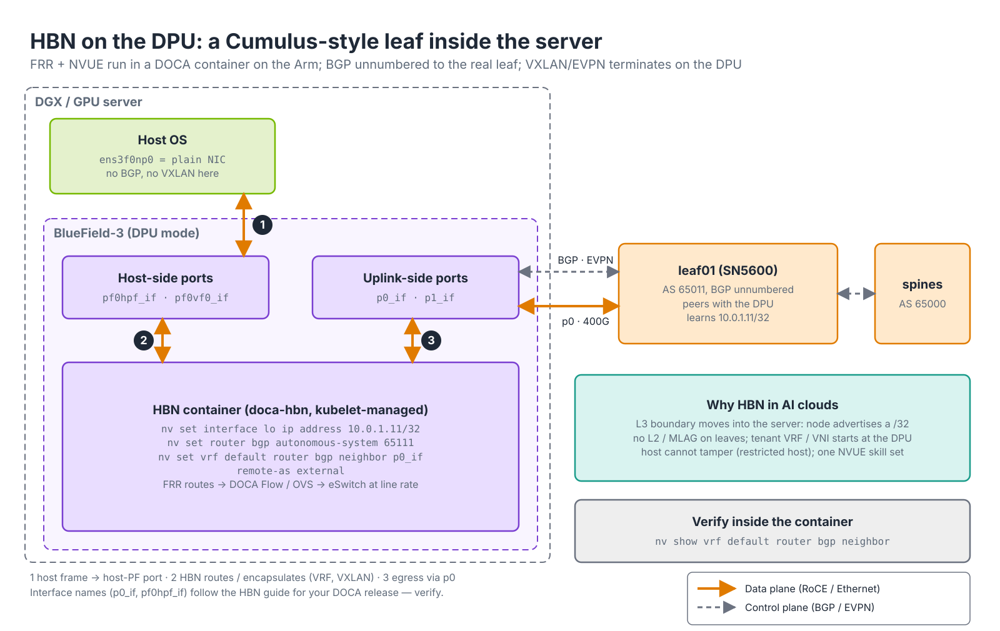

# Module 5.2 — DOCA SDK Overview and SuperNIC Configuration

> **Exam domain:** NVIDIA Spectrum Networking (30%) — "install DOCA and configure SuperNIC functions"; also Automation and Configuration (10%)  
> **Source course(s):** BlueField DPU Administration (NVIDIA Academy, DOCA sections)  
> **Source docs:** NVIDIA DOCA SDK Documentation; DOCA Installation Guide for Linux; DOCA Profiles; DOCA Release Notes (compatibility matrix); DOCA HBN Service Guide; DOCA Telemetry Service Guide; Spectrum-X RoCE configuration guides  
> **Estimated study time:** 4 hours

> **How to study this module:** read §1–§2, work through the §3 walkthrough on real gear or NVIDIA Air, then attempt the §5 hands-on assignment using only the Hint section. Open the Solution guide (last section) only after you have a working attempt. Finish with the Appendix C knowledge check closed-book.

## 1. Learning objectives

By the end of this module you will be able to…

- **Describe** what **DOCA** is and how it replaced MLNX_OFED as the host driver stack (DOCA-OFED). *(Spectrum Networking — install DOCA)*
- **Explain** DOCA installation profiles and **install** the correct profile on a host or a BlueField Arm. *(Spectrum Networking — install DOCA)*
- **Summarise** the main DOCA libraries (Flow, RDMA, DMA, Comm Channel, DPA, Telemetry, App Shield, Firefly) and what each offloads. *(Spectrum Networking — DOCA)*
- **Describe** DOCA services on BlueField — DOCA Telemetry Service and Host-Based Networking (HBN) — and the HBN use case. *(Spectrum Networking; AI Data Center Design)*
- **Explain** DOCA version compatibility with firmware and the BlueField BSP. *(Spectrum Networking — lifecycle)*
- **Configure** and **verify** **SuperNIC** functions for Spectrum-X (RoCE adaptive routing / DDP, congestion control) across `mlxconfig`, DOCA and the switch. *(Spectrum Networking — configure SuperNIC functions)*
- **Verify** a DOCA installation with `ofed_info -s`, `dpkg -l | grep doca` and `mlxfwmanager --query`. *(Troubleshooting Tools)*

## 2. Key technical concepts

### 2.1 What DOCA is — the layered stack

*Analogy:* DOCA is to a BlueField what CUDA is to a GPU — the drivers that make it work, the libraries that let you program its accelerators, and a set of ready-made applications, all shipped under one version number.


*Figure 5.2-1 — The DOCA stack on the host (left) and on the BlueField Arm (right). The layers ship under one version number; Comm Channel and RShim connect the two sides.*

**What it is.** **DOCA** (Data Center Infrastructure-on-a-Chip Architecture) is NVIDIA's software framework for BlueField DPUs/SuperNICs and ConnectX NICs. It is best understood as three layers that ship together, sitting on top of the NIC firmware:

| Layer | Contents | Who uses it |
|---|---|---|
| **Drivers / runtime** | The `mlx5` kernel drivers, RDMA core (`rdma-core`, `libibverbs`), MFT tools (`mlxconfig`, `mlxlink`, `mlxfwmanager`), `rshim`, OVS with offload, firmware | Every host or DPU with an NVIDIA NIC — this is the piece that *replaced MLNX_OFED* |
| **Libraries (SDK)** | C/C++ APIs that expose hardware accelerators: DOCA Flow, DOCA RDMA, DOCA DMA, DOCA DPA, DOCA Comm Channel, DOCA Telemetry, DOCA App Shield, DOCA Firefly, DOCA Compress, DOCA Crypto/IPsec, DOCA RegEx (BF-2) | Developers building offloaded applications |
| **Services** | Ready-to-run containers for the BlueField Arm: HBN, Telemetry Service (DTS), Firefly (PTP), Flow Inspector, BlueMan (UI), UROM, SNAP (storage emulation, separate license) | Operators deploying DPU functions without coding |

**Why it exists.** Before DOCA, the driver stack (MLNX_OFED), the Arm OS image, the SDKs for each accelerator and the reference applications were separate deliverables with separate versions, and nothing guaranteed that a given host driver, Arm image and firmware worked together. DOCA puts them on one release train: one version number, one compatibility matrix, one repository, and the same library APIs on the host (x86) and on the Arm (aarch64). The cost is coupling — you upgrade the layers together or you test the combination yourself.

**How it works** (Figure 5.2-1, bottom to top):

1. **Firmware** on the NIC implements the hardware objects (queues, flow tables, DPA images) and advertises capabilities.
2. **Drivers / runtime** (`mlx5_core`, `mlx5_ib`, `rdma-core`) expose those objects to Linux as netdevs, RDMA devices (`mlx5_0`) and devlink/eSwitch controls; MFT talks to the firmware directly through `/dev/mst`.
3. **Libraries** sit on the runtime. Each DOCA library opens a `doca_dev`, queries capabilities at runtime (`doca_*_cap_*` functions) and creates contexts, tasks and pipes that map onto hardware objects — a DOCA Flow pipe becomes eSwitch steering rules; a DOCA DPA kernel becomes code loaded onto DPA threads.
4. **Services** are containers on the Arm that link the libraries (HBN uses DOCA Flow for its data plane; DTS uses DOCA Telemetry).
5. Host and Arm halves talk over **Comm Channel** (a PCIe-based control channel between a host app and a DPU app) and, for management, **RShim**.

**Why the exam cares:** drivers (DOCA-OFED) vs libraries vs services — know which layer a named component belongs to.

### 2.2 DOCA-OFED replaces MLNX_OFED

**What it is.** Through 2023, NVIDIA host networking drivers were distributed as **MLNX_OFED** (`mlnxofedinstall`). Starting with DOCA 2.x (MLNX_OFED's last release was 23.10), the same drivers are delivered as the **DOCA-OFED** profile inside the DOCA repository.

**Why it exists.** Running two driver distributions (MLNX_OFED for hosts, DOCA for DPUs) for the same `mlx5` code base doubled release and qualification work and let host and DPU drift apart. Folding the drivers into DOCA gives one matrix for host and card. Inbox (distro) drivers remain an option for basic connectivity but lack the newest features and firmware tooling; NVIDIA reference designs assume DOCA-OFED.

**How it works.** For an administrator this means:
- You add the DOCA apt/yum repo and install a *profile* package instead of running `mlnxofedinstall`.
- `ofed_info -s` still works and prints something like `OFED-internal-24.x` / `MLNX_OFED_LINUX-24.xx` even on a DOCA install, because the underlying packages keep their names.
- The DOCA kernel modules are built for the running kernel (DKMS on Ubuntu); a kernel upgrade without matching modules silently falls back to inbox `mlx5_core` — check `modinfo mlx5_core | grep ^version` after every kernel update.
- `/etc/init.d/openibd restart` (or a reboot) swaps the loaded inbox modules for the DOCA ones.

Exam phrasing: "MLNX_OFED is end-of-life; install DOCA (the `doca-ofed` or `doca-all` profile) on hosts."

### 2.3 Profiles and the installation decision

*Analogy:* a profile is a meal deal. `doca-ofed` is the sandwich (drivers and tools); `doca-all` is the sandwich, the drink, the dessert and the cookbook.


*Figure 5.2-2 — Installing DOCA: the host gets a repository plus one profile (steps 1–4 left); the Arm gets a whole BFB plus services (steps 1–4 right); both must pass the same compatibility gate.*

**What it is.** A **profile** is a meta-package that pulls in a curated set of DOCA packages. Names below reflect DOCA 2.x–3.x documentation; the set has shifted between releases, so verify against the "DOCA Profiles" page for your version.

| Profile | Contents | Install on |
|---|---|---|
| `doca-all` | Everything: drivers, SDK libraries, tools, samples, services runtime | Developer hosts; BlueField Arm (already in the BFB) |
| `doca-networking` | Drivers + networking-oriented libraries (Flow, DPA, Comm Channel, RDMA) and tools, without storage/crypto extras | Hosts running DOCA-offloaded networking apps |
| `doca-ofed` | Drivers, RDMA core, MFT, OVS — the MLNX_OFED equivalent, no SDK libraries | Production GPU/compute hosts that just need RoCE/IB + tools |
| `doca-roce` | Lean driver profile aimed at RoCE-only hosts (introduced in later releases — verify existence/name) | Minimal GPU hosts |
| `doca-devel` / `doca-sdk` / `doca-runtime` style sub-profiles | Finer-grained SDK vs runtime splits in newer releases | Verify in current docs |

**Why it exists.** A production GPU node wants the smallest attack surface and the fewest moving parts — drivers and tools only. A developer host wants headers, samples and libraries. Profiles let one repository serve both without hand-picking dozens of packages, and make the install reproducible across a fleet (the profile name *is* the bill of materials).

**How it works** (Figure 5.2-2):

1. Decide where DOCA is going: an x86/Arm *host*, or the BlueField *Arm*.
2. Host: `dpkg -i doca-host_<ver>.deb` (or `rpm -i`) — this installs *only* the repository definition and GPG key. Arm: install the matching BFB (Module 5.1); it already contains DOCA.
3. Host: `apt install <profile>` pulls the real packages. Arm: enable services (HBN, DTS) as containers from NGC (`nvcr.io/nvidia/doca/...`) via their kubelet pod specs.
4. Load and verify: `/etc/init.d/openibd restart`, then `ofed_info -s`, `ibstat`, `mlxfwmanager --query` on the host; `cat /etc/mlnx-release` and `crictl ps` on the Arm. Both sides then pass the compatibility gate (§2.7).

The `doca-host` .deb/.rpm only installs the *repository*; the profile is the real install. On the BlueField Arm the BFB already contains DOCA; updating DOCA on the Arm is normally done by installing a new BFB (Module 5.1) rather than `apt upgrade`, to keep BSP, firmware and DOCA aligned.

**Why the exam cares:** "repo added, nothing works" (no profile) and "which profile for a production GPU host" (`doca-ofed`) are both direct questions.

### 2.4 Libraries overview

**What it is.**

| Library | What it offloads / provides | Typical use |
|---|---|---|
| **DOCA Flow** | Hardware flow steering pipelines (match → action → forward), counters, meters, mirroring | Build a line-rate firewall, load balancer or tenant classifier on the DPU; underlies HBN/OVS offload |
| **DOCA RDMA** | Simplified RDMA verbs (QP management, send/write/read) for host and DPA | Custom RDMA data movers, storage protocols |
| **DOCA DMA** | DMA engine access to copy between host memory and DPU memory without CPU | Zero-copy data staging on the Arm |
| **DOCA Comm Channel** | Secure control channel between a host application and a DPU application over PCIe | Management/control plane for offloaded services |
| **DOCA DPA** | Programming the Data Path Accelerator cores: event-driven kernels in the packet path | Custom congestion control, packet-pacing, collective acceleration — the Spectrum-X CC algorithm runs here |
| **DOCA Telemetry** | API to publish counters/events into the DOCA Telemetry Service | Export application metrics alongside NIC metrics |
| **DOCA App Shield** | Host memory introspection from the DPU (read process lists, detect rootkits) without host agents | Zero-trust host monitoring |
| **DOCA Firefly** | PTP/IEEE-1588 time synchronisation service using the NIC's hardware clock | Precision time for distributed/HFT/5G; packaged as a service too |
| DOCA Crypto / IPsec / TLS | Inline encryption offload | Encrypted east-west without host CPU cost |
| DOCA Compress | Deflate/LZ4 engines | Storage/analytics |
| DOCA UROM / GPUNetIO | Unified Resource and Offload Manager; GPU-initiated networking (GPUDirect Async) | HPC/AI collective and GPU-driven packet processing |

**Why it exists.** Each accelerator on the card has its own low-level programming model (steering rules, DPA ELF images, DMA queues). The libraries hide that behind a common object model so an application written once runs on a host or the Arm and on several hardware generations, using capability queries instead of hard-coding what the firmware supports.

**How it works.** Every library follows the same pattern: open a device (`doca_devinfo` → `doca_dev`), check capabilities, create a context (DMA, RDMA, Flow port), submit *tasks* or install *pipes*, and collect completions through a progress engine. DOCA Flow is the one operators meet indirectly — OVS-DOCA and HBN translate their rules into Flow pipes that become eSwitch entries; DOCA DPA is the one Spectrum-X depends on — the congestion-control algorithm is a DPA program woken per event.

You are not expected to program these for the exam; you are expected to match a library to its purpose and recognise that DOCA Flow + DPA are the pieces that make DPU/SuperNIC datapath features programmable.

### 2.5 DOCA Telemetry Service (DTS)


*Figure 5.2-3 — DTS data flow (steps 1–8): collect on the card, export from the Arm, correlate with the switch view, act on ECN thresholds or the slow host rather than on PFC.*

**What it is.** **DTS** (DOCA Telemetry Service) runs as a container on the Arm and collects NIC/port counters, RoCE/PFC/ECN statistics, DPA metrics, thermal/power, and application metrics via the DOCA Telemetry API, exporting them via Prometheus endpoint, Fluent Bit, OpenTelemetry, or to NetQ. Configuration lives in `/opt/mellanox/doca/services/telemetry/config/dts_config.ini` (path indicative; verify).

**Why it exists.** RoCE problems are two-ended: the switch sees PFC pauses sent and ECN marks applied; only the NIC sees CNPs sent and handled, out-of-sequence packets and its own pause reception. Collecting those on the host needs an agent on a tenant-owned OS; collecting them on the Arm keeps telemetry in the provider's domain and off the GPU host's CPU. In a Spectrum-X deployment DTS on the SuperNIC side plus NetQ/WJH on the switch side give end-to-end congestion visibility.

**How it works** (Figure 5.2-3):

1. DTS reads its config: which *providers* (NIC counters, DPA, system sensors) to poll and which *exporters* to enable.
2. Providers poll hardware counters at the configured interval — `rx_prio3_pause`, `np_cnp_sent`, `rp_cnp_handled`, ECN marks, temperatures.
3. Applications on the Arm (HBN, custom DOCA apps) publish their own records through the DOCA Telemetry library.
4. DTS aggregates into its schema and can buffer on the card if the collector is down.
5. Exporters expose a Prometheus `/metrics` endpoint or push via Fluent Bit / OTLP.
6. NetQ or Grafana ingests per rail, per tenant.
7. The operator correlates: switch PFC transmit on `swp12` against `rx_prio3_pause` on `dgx01` in the same second.
8. Action follows the evidence: fix the slow receiver or tune ECN thresholds — PFC is the symptom, not the knob.

Observe: `crictl ps | grep -i telemetry`; `curl -s http://localhost:9100/metrics | grep -iE 'pfc|ecn|cnp'` (port per config). Failure modes: container running but exporters disabled in the config → empty endpoint; DTS version not matching the Arm's DOCA → container fails to start.

### 2.6 Host-Based Networking (HBN)

*Analogy:* **HBN** turns the DPU into a top-of-rack switch *inside* the server — the leaf moved one hop closer to the GPU.


*Figure 5.2-4 — HBN data path: host frame to the host-PF port (1), routed/encapsulated by the HBN container whose decisions are offloaded to the eSwitch (2), out of p0 to the leaf (3); BGP/EVPN runs between the container and the leaf.*

**What it is.** **HBN** (Host-Based Networking) packages the Cumulus Linux networking stack — FRR routing, NVUE, VXLAN/EVPN, ECMP — into a DOCA container on the BlueField Arm:
- The host sees a normal NIC. The DPU runs BGP (often unnumbered) to the real leaf switches and terminates VXLAN/EVPN; tenant separation (VRF/VNI) happens on the DPU.
- Configuration uses **NVUE** — the same `nv set interface ...`, `nv set router bgp ...`, `nv set evpn ...` syntax as a Spectrum switch (Modules 4.1–4.2) — so one skill set and one automation toolchain (Module 6.1) covers switch and DPU.
- Hardware acceleration: routing/VXLAN decisions made by FRR are offloaded to the ConnectX eswitch via DOCA Flow/OVS, so forwarding runs at line rate.

**Why it exists.** HBN pushes the L3 boundary to the server, enabling per-tenant EVPN overlays that start at the DPU, host-level route advertisement (each GPU node advertises its /32 — simplifies multi-rail routing), and removes MLAG/L2 from the leaf layer. Because the routing stack runs on the provider-controlled Arm, a tenant with root on the host cannot change VRFs, routes or encapsulation. The trade-off: the Arm is now in the control and slow path, so HBN needs DPU mode, switchdev, and a correctly sized Arm/OVS configuration.

**How it works** (Figure 5.2-4):

1. The HBN-specific `bf.cfg` (applied at BFB install) creates scalable functions and OVS bridges so that every relevant port has an interface *inside* the container: uplink-side (`p0_if`, `p1_if`) and host-side (`pf0hpf_if`, `pf0vfN_if`) — names per the HBN guide for your release; verify.
2. The container is started by the Arm's standalone kubelet from a pod spec in `/etc/kubelet.d/` (image pulled from NGC).
3. Inside it, NVUE writes FRR and ifupdown2 configuration exactly as on a switch; FRR peers with the leaf over `p0_if` (BGP unnumbered, IPv6 link-local next hops) and exchanges EVPN routes.
4. Host traffic arrives on the host-side interface (step 1), is routed in the right VRF and VXLAN-encapsulated (step 2), and leaves on the uplink (step 3). The first packets of a flow are handled in software; the resulting forwarding state is programmed into the eSwitch via DOCA Flow/OVS, so steady-state traffic never touches the Arm.

Observe: `crictl ps | grep -i hbn`; inside the container `nv show vrf default router bgp neighbor` (Established to the leaf), `nv show evpn vni`; on the leaf, the DPU appears as a BGP peer and its `/32` as a route. Failure modes: BFB installed without the HBN `bf.cfg` → interfaces missing in the container; DPU in NIC mode → no eSwitch control, HBN cannot forward. Other services: Firefly (PTP), Flow Inspector (export sampled packets to telemetry), BlueMan (web dashboard for a DPU), UROM, and SNAP (NVMe/virtio-blk emulation). DPF (Module 5.1) deploys these as Kubernetes workloads across many DPUs.

### 2.7 Versioning, ABI and compatibility

**What it is.** DOCA releases are numbered `major.minor.patch` (2.5, 2.7, 2.9, 3.0, …) roughly quarterly. Each release has a **compatibility matrix**:

| Item | Constraint |
|---|---|
| BlueField BSP | DOCA x.y ships *with* BSP a.b inside the BFB; the host DOCA version should match the BFB's DOCA version (same major.minor) |
| NIC firmware | Minimum firmware per device (BlueField-3 32.xx, ConnectX-7 28.xx); `mlxfwmanager` in the DOCA package carries the matching firmware |
| Host OS | Supported kernels/distros per release (Ubuntu 22.04/24.04, RHEL 8.x/9.x, etc.) |
| CUDA / GPU driver | For GPUDirect RDMA and GPUNetIO, the DOCA release notes name tested CUDA versions |
| Container services | HBN/DTS container tags are tied to the DOCA version on the Arm |

**Why it exists.** Three independently updatable pieces must agree on the same hardware objects: firmware defines them, the driver/BSP exposes them, and the libraries and DPA images use them. A newer library may request a feature (a Flow action, a DPA capability) the firmware does not implement; a newer driver may expect a firmware command an old card does not answer. DOCA libraries check capabilities at runtime, so mismatch shows up as "not supported" errors or a service that will not start rather than a crash — subtle, which is why the exam emphasises alignment. Applications built against one DOCA release should be treated as compatible only with that release line unless the release notes promise otherwise; rebuild them when you move the runtime.

**How it works.** Rules: upgrade the BFB (which upgrades BSP + DOCA + firmware on the card) and the host DOCA profile together; keep all SuperNICs in a cluster on the same firmware; never run a host DOCA major version ahead of the card's BSP without checking the matrix. `ofed_info -s`, `dpkg -l | grep doca`, `mlxfwmanager --query` and `cat /etc/mlnx-release` (on the Arm) are the four commands to collect when checking alignment. A rolling upgrade is: read the target release's matrix → stage the BFB and host packages in a local mirror → per node, drain the GPU job, install the BFB, install the host profile, power cycle, verify the four commands → return to service.

### 2.8 SuperNIC functions — where each setting lives

*Analogy:* the RoCE class is a relay baton. NCCL hands TOS 106 to the NIC, the NIC marks DSCP 26 on the wire, the switch maps DSCP 26 to switch-priority 3. Drop the baton at any hand-off and GPU traffic lands in the best-effort lane.

**What it is.** The NCP-AIN blueprint lists "install DOCA and configure SuperNIC functions". In practice that decomposes into: install the right DOCA profile on each GPU host; ensure firmware/BSP match; set the SuperNIC's firmware parameters for Ethernet, RoCE and Spectrum-X; configure host RoCE QoS so DSCP/PFC/ECN line up with the switch; configure the matching switch side (Module 4.1); verify end to end. The functions themselves are drawn in Figure 5.1-2 of [`01-bluefield-dpu-administration.md`](01-bluefield-dpu-administration.md).

| Function | Switch side (Cumulus/NVUE) | NIC side |
|---|---|---|
| Lossless/lossy RoCE QoS (DSCP 26 → prio 3, PFC, ECN) | `nv set qos roce mode lossless` | `mlnx_qos -i <if> --trust dscp --pfc 0,0,0,1,0,0,0,0`; ECN enabled per priority in sysfs; DSCP for RoCE traffic class via `cma_roce_tos`/`echo 106 > /sys/class/infiniband/<dev>/tc/1/traffic_class` (106 = DSCP 26 << 2) |
| CNP priority/DSCP | Part of the RoCE profile (prio 6, DSCP 48) | `mlxconfig -s CNP_DSCP_P1=48 CNP_802P_PRIO_P1=6` |
| **Adaptive routing** (packet spraying) | `nv set router adaptive-routing enable on` + per-interface | SuperNIC must tolerate out-of-order RoCE: DDP/out-of-order RDMA support is a SuperNIC firmware capability, enabled through firmware/DOCA settings in the Spectrum-X deployment guide — exact parameter names are release-specific; verify in the current Spectrum-X RoCE configuration guide |
| Congestion control | Switch telemetry marking (part of RoCE profile) | Spectrum-X congestion-control algorithm on the DPA, selected via firmware/DOCA (`ROCE_CC_*` mlxconfig parameters and the Spectrum-X CC package); default DCQCN otherwise |
| Performance isolation | Per-tenant VRF/VNI, TC separation | Per-QP/flow rate limiting by the CC engine |
| Telemetry | NetQ/WJH, histograms | DTS exporting RoCE counters |

**Why it exists.** Spectrum-X is a cooperating pair: every switch-side behaviour has a NIC-side counterpart, and each half configured alone is either useless (telemetry nobody reacts to) or harmful (spraying into a NIC that treats reordering as loss). The settings live in three places with three lifetimes — firmware (NVRAM, survives reinstall, needs a reset), host runtime (sysfs/`mlnx_qos`, lost on reboot unless persisted) and switch (NVUE, saved to `startup.yaml`) — which is why drift between them is the commonest field failure.

**How it works.** Configure in dependency order: (1) firmware — `LINK_TYPE_P1=2`, NIC mode, CNP DSCP/priority and the AR/CC parameters from the Spectrum-X host guide, then `mlxfwreset` or power cycle; (2) host runtime — trust DSCP, PFC on priority 3 (lossless profile only), ECN RP/NP on priority 3, TOS 106 for RDMA-CM, RoCEv2 mode, persisted by a boot-time script or the Network Operator; (3) application — `NCCL_IB_TC=106`, correct `NCCL_IB_GID_INDEX`; (4) switch — `nv set qos roce mode lossless|lossy`, AR global + per uplink. For a *lossy* Spectrum-X deployment, skip `--pfc` on the host and rely on ECN + the Spectrum-X CC algorithm; the switch is set to `nv set qos roce mode lossy`. Host and switch profiles must agree — `netq show roce-config` (switch) plus `mlnx_qos -i` (host) is the comparison the exam expects. Failure modes: TOS/DSCP confusion (`NCCL_IB_TC=26`), PFC on one end only (pause frames ignored or never sent), AR on the switch without SuperNIC out-of-order support (§4 Gotcha 4).

## 3. Live-style walkthrough — install `doca-all`, verify, enable HBN and DTS, align RoCE

### Step 1 — Install DOCA on the GPU host (Ubuntu 22.04)

This is the left branch of Figure 5.2-2, steps 2–4.

```bash
# 1. The doca-host package installs ONLY the repo definition and GPG key. Use the exact URL from the DOCA download page.
wget https://www.mellanox.com/downloads/DOCA/DOCA_v2.x/host/doca-host_2.x.x-xxxxxx-ubuntu2204_amd64.deb
sudo dpkg -i doca-host_2.x.x-*.deb
sudo apt update

# 2. Install a profile. doca-all here because this is a dev/validation host; production GPU nodes take doca-ofed.
sudo apt install -y doca-all
# RHEL/Rocky equivalent: dnf install doca-host-*.rpm && dnf install doca-ofed

# 3. Load the new drivers (or reboot)
sudo /etc/init.d/openibd restart
```

### Step 2 — Verify the install

```bash
ofed_info -s                        # driver stack version string — still works under DOCA
# OFED-internal-24.07-0.6.1
dpkg -l | grep -i doca | awk '{print $2, $3}' | head
# doca-all 2.9.0-...
# doca-ofed 2.9.0-...
# doca-sdk-flow ...
dpkg -l | grep -E 'mlnx|rdma-core|mft' | awk '{print $2, $3}'
modinfo mlx5_core | grep ^version   # DOCA-packaged mlx5, not inbox: version string carries the OFED tag
ibstat                              # CA 'mlx5_0' ... State: Active, Physical state: LinkUp, Link layer: Ethernet
ibv_devinfo -d mlx5_0 | grep -E 'state|link_layer|fw_ver'
mlxfwmanager --query                # firmware present vs available — must be within the DOCA matrix
mst status -v
```

A healthy install: `mlx5_core` from the DOCA package, RDMA devices Active in `ibv_devinfo`, firmware status `Up to date` or within supported range. If `ibstat` shows nothing, a profile was never installed (Gotcha 1).

### Step 3 — On the Arm: HBN and DTS

The BFB already carries DOCA (right branch of Figure 5.2-2). Verify, then enable the two services (exact steps per the DOCA HBN/DTS service guides). The HBN block below configures the container in Figure 5.2-4; the DTS block is steps 1 and 5 of Figure 5.2-3:

```bash
ssh ubuntu192.168.100.2
cat /etc/mlnx-release                           # DOCA_2.9.x_BSP_4.9.x_... — must match the host's major.minor
dpkg -l | grep -i doca | wc -l                   # runtime + services present

# HBN prerequisites: the HBN bf.cfg (applied at bfb-install time) creates the SFs and bridges HBN needs.
# Pull and start the HBN container via the kubelet-managed pod spec:
ls /etc/kubelet.d/                               # doca_hbn.yaml present after following the HBN guide
sudo crictl ps | grep -i hbn                     # hbn container Running
# Enter HBN: it is Cumulus NVUE, verbatim.
sudo docker exec -it $(sudo docker ps -qf name=hbn) bash      # or crictl exec
nv show system
nv set interface lo ip address 10.0.1.11/32      # the DPU's own loopback — this GPU node's /32
nv set router bgp autonomous-system 65111
nv set router bgp router-id 10.0.1.11
nv set vrf default router bgp neighbor p0_if remote-as external     # unnumbered to the leaf over the uplink SF (p0_if; name per HBN guide — verify)
nv set vrf default router bgp address-family ipv4-unicast network 10.0.1.11/32
nv config apply -y && nv config save
nv show vrf default router bgp neighbor          # Established to the leaf — the leaf sees the DPU as a BGP peer

# DTS
ls /opt/mellanox/doca/services/telemetry/config/     # dts_config.ini — enable the RoCE/PFC counters you want exported
sudo crictl ps | grep -i telemetry                   # doca-telemetry Running
curl -s http://localhost:9100/metrics | grep -i -E 'pfc|ecn|cnp' | head   # Prometheus endpoint (port per config)
```

What you just did: the leaf now peers with the DPU, so each GPU node advertises its own /32 — no L2, no MLAG, and tenant VRFs can start at the DPU. DTS is exporting the same PFC/ECN/CNP counters the switch exports via NetQ, so the "slow job" investigation has data on both ends of every link.

### Step 4 — Host RoCE QoS (common to any NIC)

```bash
ibdev2netdev -v                           # mlx5_0 <-> ens3f0np0 etc.

# Trust DSCP and enable PFC on priority 3 (lossless profile — matches nv set qos roce mode lossless)
mlnx_qos -i ens3f0np0 --trust dscp
mlnx_qos -i ens3f0np0 --pfc 0,0,0,1,0,0,0,0
mlnx_qos -i ens3f0np0                     # show current mapping / PFC / ETS
```
```text
DCBX mode: OS controlled
Priority trust state: dscp
...
PFC configuration:
        priority    0   1   2   3   4   5   6   7
        enabled     0   0   0   1   0   0   0   0
```
```bash
# RoCE traffic marking: DSCP 26 (TOS 106) for RDMA CM connections
echo 106 > /sys/class/infiniband/mlx5_0/tc/1/traffic_class
cma_roce_tos -d mlx5_0 -t 106
cma_roce_mode -d mlx5_0 -p 1 -m 2         # RoCEv2

# ECN per priority (DCQCN) — enable on prio 3 for both RP (sender) and NP (receiver)
echo 1 > /sys/class/net/ens3f0np0/ecn/roce_rp/enable/3
echo 1 > /sys/class/net/ens3f0np0/ecn/roce_np/enable/3
# CNP DSCP/priority (persistent via firmware) — matches the switch's CNP class
mlxconfig -d /dev/mst/mt41692_pciconf0 s CNP_DSCP_P1=48 CNP_802P_PRIO_P1=6
```

### Step 5 — SuperNIC-specific firmware settings

```bash
mlxconfig -d /dev/mst/mt41692_pciconf0 q | grep -E 'LINK_TYPE|INTERNAL_CPU|ROCE|CNP|ADVANCED_PCI|MAX_ACC_OUT_READ'
mlxconfig -d /dev/mst/mt41692_pciconf0 s LINK_TYPE_P1=2                        # Ethernet
mlxconfig -d /dev/mst/mt41692_pciconf0 s INTERNAL_CPU_OFFLOAD_ENGINE=1          # NIC mode (SuperNIC personality)
mlxconfig -d /dev/mst/mt41692_pciconf0 s ADVANCED_PCI_SETTINGS=1 MAX_ACC_OUT_READ=44   # PCIe/RDMA tuning per DGX guides (values vary)
# Spectrum-X AR/CC enablement parameters: see the Spectrum-X "RoCE adaptive routing and congestion control" host configuration guide
# for the exact mlxconfig keys (e.g. ROCE_ADAPTIVE_ROUTING_EN / ROCE_CC_... family) — names change between firmware trains; verify.
mlxfwreset -d /dev/mst/mt41692_pciconf0 reset        # or power cycle
```

NVIDIA's Spectrum-X deployment guides (and the DGX SuperPOD with Spectrum-X RA) supply a tested set of these parameters as a script; the exam wants you to know *that* AR/CC on the NIC is enabled through firmware (`mlxconfig`) and DOCA components, that it must match the switch's AR/RoCE profile, and that mismatched settings (AR on the switch, no out-of-order support on the NIC) hurt performance (Module 4.1).

### Step 6 — NCCL alignment

```bash
export NCCL_IB_HCA=mlx5_0,mlx5_1,mlx5_2,mlx5_3,mlx5_4,mlx5_5,mlx5_6,mlx5_7
export NCCL_IB_TC=106              # TOS -> DSCP 26, matches switch RoCE class
export NCCL_IB_GID_INDEX=3         # RoCEv2 GID (verify with show_gids)
export NCCL_SOCKET_IFNAME=mgmt0
export NCCL_IB_QPS_PER_CONNECTION=4   # more QPs per connection to spread load; Spectrum-X guides give the value
show_gids                          # confirm GID index 3 is RoCE v2 with the right IP
```

`NCCL_IB_TC` must match the DSCP the switch trusts for RoCE; a wrong value puts GPU traffic in the lossy best-effort queue and is a classic "RoCE configured but slow" cause.

### Step 7 — Verify end to end

```bash
# Host
ofed_info -s; dpkg -l | grep doca; mlxfwmanager --query
ibstat; ibv_devinfo -d mlx5_0 | grep -E 'state|link_layer|fw_ver'
mlnx_qos -i ens3f0np0
cat /sys/class/net/ens3f0np0/ecn/roce_np/enable/3              # 1
mlxlink -d /dev/mst/mt41692_pciconf0 -p 1                       # link up at 400G, FEC OK
ethtool -S ens3f0np0 | grep -E 'pause|ecn|cnp|out_of_sequence|rx_prio3'
ib_write_bw -d mlx5_0 -F --report_gbits <peer>                  # RDMA bandwidth test (Module 8.x) — expect ~390 Gb/s at 400G

# Switch
nv show qos roce
nv show interface swp1 qos roce counters
nv show router adaptive-routing
netq show roce-config; netq check roce
```

These are the NIC-side counters DTS exports in Figure 5.2-3, step 2. Reading the host counters: `rx_prio3_pause`/`tx_prio3_pause` rising indicates PFC exchange; `np_cnp_sent`/`rp_cnp_handled` indicate ECN-driven congestion control; `out_of_sequence` growing with AR enabled and *no* throughput loss is expected on a SuperNIC with DDP, and a warning sign on a non-SuperNIC.

## 4. Troubleshooting / common gotchas

### Gotcha 1 — Repo added, `ibstat` empty

**Symptom:** `dpkg -i doca-host_*.deb && apt update` done; `ibstat` shows no devices; `ethtool -i` says inbox driver.

**Why it happens:** `doca-host` only installs the repository. No profile was installed.

**How to debug:** `dpkg -l | grep -c doca` → 1 (just doca-host); `modinfo mlx5_core | grep version` shows the kernel's inbox version.

**Fix:** `sudo apt install -y doca-ofed && sudo /etc/init.d/openibd restart` (or reboot).

### Gotcha 2 — RoCE "configured" but NCCL is slow

**Symptom:** switch shows lossless profile, host shows PFC on 3, yet `nv show interface swpN qos roce counters` shows RoCE packets in TC 0 and all-reduce is 40% of line rate.

**Why it happens:** `NCCL_IB_TC=26` was set — that is DSCP, not TOS. TOS must be 106 (DSCP × 4). GPU traffic is unmarked and lands in best-effort.

**How to debug:**
```bash
env | grep NCCL_IB_TC
tcpdump -i ens3f0np0 -nn -c5 udp port 4791 -v | grep -i tos      # tos 0x6a = 106 is correct
```

**Fix:** `export NCCL_IB_TC=106` (and `echo 106 > /sys/class/infiniband/mlx5_0/tc/1/traffic_class` for CM-based apps).

### Gotcha 3 — Host DOCA upgraded, SuperNIC features misbehave

**Symptom:** after `apt upgrade` to a new DOCA on the host, DPA-based CC fails to load or `mlx5` logs feature mismatches.

**Why it happens:** host DOCA major.minor now ahead of the card's BSP/firmware.

**How to debug:**
```bash
ofed_info -s; dpkg -l | grep doca-ofed             # host
ssh ubuntu192.168.100.2 cat /etc/mlnx-release     # card
mlxfwmanager --query                               # firmware vs matrix
```

**Fix:** install the matching BFB (upgrades BSP + DOCA + firmware on the card) or pin the host DOCA to the card's version. Always upgrade together.

### Gotcha 4 — `out_of_sequence` climbing and bandwidth poor

**Symptom:** AR enabled on the SN5600 fabric; some hosts fine, others show `out_of_sequence` in `ethtool -S` and low `ib_write_bw`.

**Why it happens:** the affected hosts have ConnectX-6 (or SuperNICs without out-of-order support enabled in firmware). AR reorders; without DDP that is treated as loss.

**How to debug:** `ibv_devinfo | grep board_id` per host; compare `mlxconfig -q | grep ROCE` between a good and bad host.

**Fix:** enable the AR/out-of-order parameters per the Spectrum-X host guide on SuperNICs; exclude non-SuperNIC hosts from AR-enabled uplinks (Module 4.1).

## 5. Hands-on assignment — DOCA install/verify script for a DGX

**Scenario.** Your fleet team needs a single idempotent shell script that brings a freshly imaged DGX (Ubuntu 22.04, eight BlueField-3 SuperNICs) to the Spectrum-X host baseline and prints a pass/fail report.

**Requirements**
1. Install the DOCA repo and the `doca-ofed` profile only if not already present (idempotent).
2. Verify drivers: `ofed_info -s`, `mlx5_core` from DOCA, eight `mlx5_*` devices Active with `link_layer: Ethernet`.
3. Verify firmware on all eight cards is within the DOCA matrix (`mlxfwmanager --query` shows no "Update required"); print a warning if not.
4. For every RoCE interface: trust DSCP, PFC on priority 3, ECN RP/NP enabled on priority 3, TOS 106 on `tc/1`, RoCEv2 — applied only where the current value differs.
5. Set `CNP_DSCP_P1=48 CNP_802P_PRIO_P1=6 LINK_TYPE_P1=2` via `mlxconfig` only if they differ; print "reset required" if any changed.
6. Write `/etc/nccl.conf` with `NCCL_IB_HCA`, `NCCL_IB_TC=106`, `NCCL_IB_GID_INDEX` (discovered from `show_gids`).
7. Emit a final table: per NIC — device, netdev, fw, link, PFC3, ECN3, TOS — and an overall PASS/FAIL exit code.

**Deliverables**
- `doca-baseline.sh`.
- Output from a first run (changes made) and a second run (no changes, PASS).

**Acceptance criteria**
- Second run makes zero changes and exits 0.
- `mlnx_qos -i <if>` on all eight interfaces shows `trust dscp` and PFC `0,0,0,1,0,0,0,0`.
- `cat /sys/class/net/<if>/ecn/roce_np/enable/3` = 1 everywhere.
- `/etc/nccl.conf` contains `NCCL_IB_TC=106`.
- Script fails (exit 1) if any `ibv_devinfo` state is not Active.

### Hint
- `dpkg -s doca-ofed >/dev/null 2>&1` is your "already installed" test.
- `mlnx_qos -i <if>` output is parseable; read before you write so the second run is a no-op.
- `ibdev2netdev` gives you the device↔netdev mapping to drive the loop.
- `mlxconfig -d <dev> q <PARAM>` prints current values; compare before `s`.
- TOS is DSCP shifted left by two: 26 → 104 + ECN bits → 106 is the value NVIDIA guides use.

## Appendix A — Quick command / config reference

```bash
# Install DOCA on host
dpkg -i doca-host_<ver>_<distro>.deb && apt update
apt install -y doca-ofed        # or doca-all / doca-networking / doca-roce (verify names)
/etc/init.d/openibd restart

# Verify install
ofed_info -s; dpkg -l | grep doca; modinfo mlx5_core | grep version
mlxfwmanager --query; mst status -v; ibstat; ibv_devinfo

# Host RoCE QoS
mlnx_qos -i <if> --trust dscp --pfc 0,0,0,1,0,0,0,0
echo 106 > /sys/class/infiniband/<dev>/tc/1/traffic_class; cma_roce_tos -d <dev> -t 106; cma_roce_mode -d <dev> -p 1 -m 2
echo 1 > /sys/class/net/<if>/ecn/roce_rp/enable/3; echo 1 > /sys/class/net/<if>/ecn/roce_np/enable/3

# SuperNIC firmware
mlxconfig -d <dev> s LINK_TYPE_P1=2 INTERNAL_CPU_OFFLOAD_ENGINE=1 CNP_DSCP_P1=48 CNP_802P_PRIO_P1=6
mlxconfig -d <dev> q | grep -E 'ROCE|CNP'; mlxfwreset -d <dev> reset

# NCCL
NCCL_IB_HCA=... NCCL_IB_TC=106 NCCL_IB_GID_INDEX=3 NCCL_IB_QPS_PER_CONNECTION=4; show_gids

# Arm services
crictl ps | grep -E 'hbn|telemetry'; docker ps | grep -E 'hbn|telemetry'; cat /etc/mlnx-release
ls /etc/kubelet.d/; /opt/mellanox/doca/services/telemetry/config/dts_config.ini

# End-to-end verify
ethtool -S <if> | grep -E 'pause|ecn|cnp|out_of_sequence|rx_prio3'; ib_write_bw -d <dev> -F --report_gbits <peer>
nv show qos roce; nv show router adaptive-routing; netq show roce-config; netq check roce
```

## Appendix B — Exam traps & key takeaways

- MLNX_OFED is retired; the driver stack is now the `doca-ofed` profile of DOCA. `ofed_info -s` still works.
- `doca-all` ≠ `doca-ofed`: the former includes the SDK and samples; production GPU hosts typically need only `doca-ofed` (or the RoCE-lean profile).
- The `doca-host` .deb/.rpm only installs the *repository*; you still need `apt install <profile>`.
- Host DOCA, BFB (BSP + DOCA), and firmware are versioned together — check the matrix before upgrading one; `ofed_info -s`, `dpkg -l | grep doca`, `mlxfwmanager --query`, `cat /etc/mlnx-release` are the alignment checks.
- HBN runs NVUE/FRR on the DPU — the NVUE commands are the same as on a Spectrum switch.
- `NCCL_IB_TC=106` is TOS, which equals DSCP 26 (DSCP × 4). Confusing DSCP with TOS silently drops GPU traffic into the wrong queue. The chain: TOS 106 ↔ DSCP 26 ↔ switch-priority 3.
- Enabling adaptive routing on the switch without SuperNIC out-of-order support degrades RoCE — the NIC side of AR is a firmware/DOCA capability, not a host sysctl.
- `mlxconfig` changes need `mlxfwreset` or a power cycle to take effect.
- Host PFC must match the switch profile: lossless profile = PFC on priority 3 both ends; lossy profile = no PFC either end, ECN on.
- DTS exports NIC telemetry from the Arm; NetQ/WJH export from the switch — both are needed for end-to-end RoCE visibility.
- Libraries: Flow (steering), RDMA, DMA, Comm Channel (host↔DPU), DPA (datapath cores — runs CC), Telemetry, App Shield (host introspection), Firefly (PTP).
- SuperNIC functions are configured on three planes: `mlxconfig` firmware params, DOCA/host QoS (`mlnx_qos`, ECN sysfs, CNP DSCP), and the switch (`nv set qos roce`, `nv set router adaptive-routing`).

## Appendix C — Knowledge check

1. A new GPU host needs NVIDIA RoCE drivers, `mlxconfig`, and `mlnx_qos`, but no development libraries. Which DOCA profile is most appropriate?
   A. `doca-all`
   B. `doca-ofed`
   C. `doca-devel`
   D. `doca-telemetry`

2. After `dpkg -i doca-host_*.deb` and `apt update`, `ibstat` still reports no devices. What was missed?
   A. `mlxfwmanager --online -u`
   B. Installing a DOCA profile (e.g. `apt install doca-ofed`) and restarting the driver stack
   C. Enabling NIC mode
   D. Setting `NCCL_IB_TC`

3. Which DOCA component hosts NVIDIA's Spectrum-X congestion-control algorithm on the SuperNIC?
   A. DOCA Flow on the Arm cores
   B. DOCA App Shield
   C. The DPA (Data Path Accelerator) programmed via DOCA DPA
   D. DOCA Firefly

4. Which DOCA service runs the Cumulus Linux routing stack (FRR + NVUE, EVPN/VXLAN) on a BlueField DPU?
   A. DTS
   B. HBN
   C. SNAP
   D. BlueMan

5. The switch RoCE profile trusts DSCP 26 for lossless traffic. Which NCCL setting places GPU traffic in that class?
   A. `NCCL_IB_TC=26`
   B. `NCCL_IB_TC=106`
   C. `NCCL_IB_GID_INDEX=26`
   D. `NCCL_IB_SL=3`

6. Which three items must be version-aligned when upgrading a Spectrum-X host?
   A. Host DOCA, BlueField BFB/BSP, NIC firmware
   B. Cumulus Linux, NetQ, Ansible
   C. CUDA, Docker, Kubernetes
   D. BIOS, RAID firmware, iDRAC

7. Which command string correctly verifies the installed driver stack version on a DOCA host?
   A. `nv show system`
   B. `ofed_info -s`
   C. `show version`
   D. `cat /dev/rshim0/misc`

8. Adaptive routing is enabled on the SN5600 fabric. Hosts with SuperNICs perform well; hosts with ConnectX-6 NICs show `out_of_sequence` counters climbing and poor bandwidth. Why?
   A. ConnectX-6 cannot run RoCEv2
   B. The SuperNIC tolerates out-of-order delivery via Direct Data Placement; the ConnectX-6 treats reordering as loss
   C. The ConnectX-6 hosts lack `doca-all`
   D. The switch profile is lossy

### Answer key
1. B — `doca-ofed` is the MLNX_OFED-equivalent driver/tools profile.
2. B — `doca-host` only adds the repository; a profile must be installed.
3. C — Congestion-control code runs on the DPA cores.
4. B — HBN containerises Cumulus networking on the DPU.
5. B — TOS 106 = DSCP 26 (×4).
6. A — DOCA release notes tie host DOCA, BSP/BFB and firmware together.
7. B — `ofed_info -s` prints the driver stack version even under DOCA.
8. B — AR requires out-of-order tolerant RoCE, a SuperNIC capability.

## References
- NVIDIA DOCA SDK Documentation — https://docs.nvidia.com/doca/sdk/
- DOCA Installation Guide for Linux — https://docs.nvidia.com/doca/sdk/doca-installation-guide-for-linux/
- DOCA Profiles — https://docs.nvidia.com/doca/sdk/doca-profiles/
- DOCA Release Notes (compatibility matrix) — https://docs.nvidia.com/doca/sdk/doca-release-notes/
- DOCA HBN Service Guide; DOCA Telemetry Service Guide — https://docs.nvidia.com/doca/sdk/ (Services section)
- NVIDIA Spectrum-X RoCE / adaptive routing host configuration guides and DGX SuperPOD with Spectrum-X RA — https://docs.nvidia.com/dgx-superpod/
- NCCL Environment Variables — https://docs.nvidia.com/deeplearning/nccl/user-guide/docs/env.html
- NVIDIA Academy course: BlueField DPU Administration
- Related: [`01-bluefield-dpu-administration.md`](01-bluefield-dpu-administration.md), [`../04-spectrum-ethernet/01-spectrum-x.md`](../04-spectrum-ethernet/01-spectrum-x.md), [`../03-rdma/03-roce-a-to-z.md`](../03-rdma/03-roce-a-to-z.md), [`../01-ai-datacenter-design/`](../01-ai-datacenter-design/)

---
## Solution guide — Hands-on assignment

### `doca-baseline.sh`

```bash
#!/usr/bin/env bash
# doca-baseline.sh — idempotent Spectrum-X host baseline for a DGX with BlueField-3 SuperNICs.
# Exit 0 = PASS (all checks green), 1 = FAIL. Re-running on a compliant host changes nothing.
set -uo pipefail
DOCA_HOST_DEB="${DOCA_HOST_DEB:-/srv/doca/doca-host_2.9.0-ubuntu2204_amd64.deb}"   # from the DOCA download page
PROFILE="doca-ofed"
TOS=106            # DSCP 26 << 2
PFC_MASK="0,0,0,1,0,0,0,0"
changed=0; fail=0; reset_needed=0
log(){ printf '%s %s\n' "$(date +%T)" "$*"; }

# ---- R1: repo + profile, only if missing -------------------------------------------------
if ! dpkg -s "$PROFILE" >/dev/null 2>&1; then
  log "installing DOCA repo + $PROFILE"
  dpkg -s doca-host >/dev/null 2>&1 || { dpkg -i "$DOCA_HOST_DEB" && apt-get update -q; }
  apt-get install -y -q "$PROFILE" && /etc/init.d/openibd restart; changed=1
else
  log "$PROFILE already installed"
fi

# ---- R2: driver checks ------------------------------------------------------------------
log "ofed_info: $(ofed_info -s)"
modinfo mlx5_core | grep -q '^version:.*OFED' || { log "WARN mlx5_core is not the DOCA build"; }
mapfile -t MAP < <(ibdev2netdev | awk '{print $1":"$5}')         # mlx5_0:ens3f0np0 ...
[ "${#MAP[]}" -ge 8 ] || { log "FAIL expected 8 RDMA devices, found ${#MAP[]}"; fail=1; }

# ---- R3: firmware --------------------------------------------------------------------------
if mlxfwmanager --query 2>/dev/null | grep -q 'Update required'; then
  log "WARN firmware update required on one or more cards — align with the DOCA matrix"
fi

# ---- R4 + R5: per-NIC QoS and firmware parameters ----------------------------------------
printf '\n%-8s %-12s %-12s %-6s %-5s %-5s %-4s\n' DEV NETDEV FW LINK PFC3 ECN3 TOS
for entry in "${MAP[]}"; do
  dev=${entry%%:*}; nd=${entry##*:}
  state=$(ibv_devinfo -d "$dev" 2>/dev/null | awk '/state:/{print $2; exit}')
  ll=$(ibv_devinfo -d "$dev" 2>/dev/null | awk '/link_layer:/{print $2; exit}')
  fw=$(ibv_devinfo -d "$dev" 2>/dev/null | awk '/fw_ver:/{print $2; exit}')
  [ "$state" = "PORT_ACTIVE" ] && [ "$ll" = "Ethernet" ] || { log "FAIL $dev state=$state link_layer=$ll"; fail=1; }

  # trust + PFC: read, compare, write only on mismatch
  cur_trust=$(mlnx_qos -i "$nd" 2>/dev/null | awk '/Priority trust state/{print $NF}')
  [ "$cur_trust" = "dscp" ] || { mlnx_qos -i "$nd" --trust dscp >/dev/null; changed=1; }
  cur_pfc=$(mlnx_qos -i "$nd" 2>/dev/null | awk '/enabled/{for(i=2;i<=9;i++) printf "%s%s",$i,(i<9?",":"")}')
  [ "$cur_pfc" = "$PFC_MASK" ] || { mlnx_qos -i "$nd" --pfc "$PFC_MASK" >/dev/null; changed=1; }

  # ECN RP/NP on priority 3
  for side in roce_rp roce_np; do
    f=/sys/class/net/$nd/ecn/$side/enable/3
    [ "$(cat "$f" 2>/dev/null)" = "1" ] || { echo 1 > "$f"; changed=1; }
  done

  # TOS 106 on tc/1, RoCEv2
  tcf=/sys/class/infiniband/$dev/tc/1/traffic_class
  [ "$(cat "$tcf" 2>/dev/null)" = "$TOS" ] || { echo "$TOS" > "$tcf"; changed=1; }
  cma_roce_mode -d "$dev" -p 1 2>/dev/null | grep -q 'RoCE v2' || { cma_roce_mode -d "$dev" -p 1 -m 2 >/dev/null; changed=1; }

  # firmware params
  mst=$(mst status -v 2>/dev/null | awk -v d="$nd" '$0 ~ d {print $1; exit}')
  if [ -n "$mst" ]; then
    for kv in CNP_DSCP_P1=48 CNP_802P_PRIO_P1=6 LINK_TYPE_P1=2; do
      k=${kv%%=*}; v=${kv##*=}
      cur=$(mlxconfig -d "$mst" q "$k" 2>/dev/null | awk -v k="$k" '$1==k{gsub(/[^0-9]/,"",$NF); print $NF}')
      [ "$cur" = "$v" ] || { mlxconfig -y -d "$mst" s "$kv" >/dev/null; changed=1; reset_needed=1; }
    done
  fi

  pfc3=$(mlnx_qos -i "$nd" | awk '/enabled/{print $5}')
  ecn3=$(cat /sys/class/net/$nd/ecn/roce_np/enable/3)
  tos=$(cat "$tcf")
  printf '%-8s %-12s %-12s %-6s %-5s %-5s %-4s\n' "$dev" "$nd" "$fw" "${state#PORT_}" "$pfc3" "$ecn3" "$tos"
done

# ---- R6: /etc/nccl.conf -------------------------------------------------------------------
hcas=$(printf '%s\n' "${MAP[]}" | cut -d: -f1 | paste -sd,)
gid=$(show_gids 2>/dev/null | awk '/v2/ && /mlx5_0/ && $5 ~ /\./ {print $3; exit}'); gid=${gid:-3}
tmp=$(mktemp)
cat > "$tmp" <<EOF
NCCL_IB_HCA=$hcas
NCCL_IB_TC=$TOS
NCCL_IB_GID_INDEX=$gid
NCCL_IB_QPS_PER_CONNECTION=4
EOF
if ! cmp -s "$tmp" /etc/nccl.conf; then install -m 0644 "$tmp" /etc/nccl.conf; changed=1; fi
rm -f "$tmp"

# ---- R7: verdict --------------------------------------------------------------------------
echo
[ $reset_needed -eq 1 ] && log "NOTE mlxconfig changed — mlxfwreset or power cycle required before values take effect"
log "changes_made=$changed"
if [ $fail -eq 0 ]; then log "RESULT: PASS"; exit 0; else log "RESULT: FAIL"; exit 1; fi
```

### First run (illustrative)

```text
10:02:11 installing DOCA repo + doca-ofed
10:04:58 ofed_info: OFED-internal-24.07-0.6.1

DEV      NETDEV       FW           LINK   PFC3  ECN3  TOS
mlx5_0   ens3f0np0    32.43.1014   ACTIVE 1     1     106
mlx5_1   ens3f1np1    32.43.1014   ACTIVE 1     1     106
...
mlx5_7   ens10f1np1   32.43.1014   ACTIVE 1     1     106

10:05:03 NOTE mlxconfig changed — mlxfwreset or power cycle required before values take effect
10:05:03 changes_made=1
10:05:03 RESULT: PASS
```

### Second run

```text
10:09:40 doca-ofed already installed
10:09:40 ofed_info: OFED-internal-24.07-0.6.1

DEV      NETDEV       FW           LINK   PFC3  ECN3  TOS
mlx5_0   ens3f0np0    32.43.1014   ACTIVE 1     1     106
...
10:09:44 changes_made=0
10:09:44 RESULT: PASS
```

### Verifying each acceptance criterion

- **Zero changes on second run, exit 0** — `changes_made=0` and `echo $?` → 0.
- **`mlnx_qos`** — `for i in $(ibdev2netdev | awk '{print $5}'); do mlnx_qos -i $i | grep -E 'trust|enabled'; done` shows `dscp` and `0 0 0 1 0 0 0 0` eight times.
- **ECN** — `grep -H . /sys/class/net/ens*/ecn/roce_np/enable/3` → all `1`.
- **nccl.conf** — `grep NCCL_IB_TC /etc/nccl.conf` → `NCCL_IB_TC=106`.
- **Failure path** — `ip link set ens3f0np0 down`, rerun: the row shows `DOWN`, log prints `FAIL mlx5_0 state=PORT_DOWN`, exit 1. Bring the link back up and rerun to PASS.

Reset note: parameters changed via `mlxconfig` become active only after `mlxfwreset -d <dev> reset` or a power cycle; the script reports it rather than resetting eight NICs under you.
