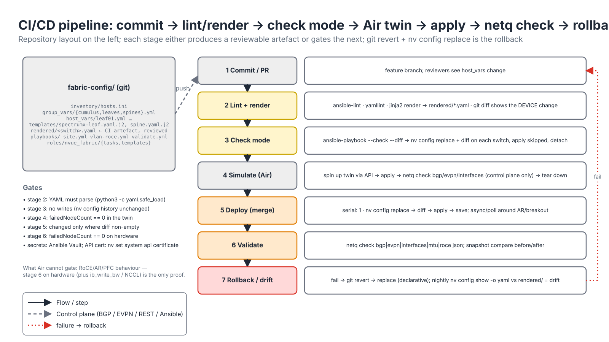

# Module 6.1 — NVUE and Ansible Automation

> **Exam domain:** Automation and Configuration (10%)  
> **Source course(s):** Cumulus Linux Essentials / Administration (automation sections); NetQ Deployment (validation)  
> **Source docs:** NVUE CLI and Command Reference; NVUE Cheat Sheet; NVUE API (REST) documentation; Data Center Network Automation — Ansible Deployment Guide (NVUE Automation with Ansible); `nvidia.nvue` Ansible Collection; Cumulus Linux Upgrade Guide  
> **Estimated study time:** 5 hours

> **How to study this module:** read §1–§2, work through the §3 walkthrough on real gear or NVIDIA Air, then attempt the §5 hands-on assignment using only the Hint section. Open the Solution guide (last section) only after you have a working attempt. Finish with the Appendix C knowledge check closed-book.

## 1. Learning objectives

By the end of this module you will be able to…

- **Describe** NVUE as a REST API and **query/modify** switch configuration with `curl` against `https://<switch>:8765/nvue_v1/`. *(Automation and Configuration — NVUE API)*
- **Explain** the NVUE YAML configuration structure and **build** Jinja2 templates for a Spectrum-X leaf. *(Automation and Configuration — templating)*
- **Apply** full or partial configuration files with `nv config replace`, `nv config patch` and `nv config apply`. *(Automation and Configuration — declarative config)*
- **Build** an Ansible inventory and group_vars for a Cumulus fabric and **use** the `nvidia.nvue` collection or generic modules to push configuration idempotently. *(Automation and Configuration — Ansible)*
- **Write** playbooks for VLAN/SVI/bond rollout and for RoCE lossless + adaptive-routing rollout, including check/diff mode. *(Automation and Configuration — Ansible)*
- **Validate** changes with NetQ (`netq check`) and **automate** upgrades (`nv action upgrade`, NetQ LCM). *(Troubleshooting Tools; Automation)*
- **Describe** git-based configuration management with CI pipelines and **recognise** common NVUE automation errors (apply timeouts, pending conflicts, revision locking). *(Automation and Configuration)*

## 2. Key technical concepts

### 2.1 NVUE as an API — the architecture

*Analogy:* the `nv` CLI is a receptionist typing your request into a web form. Automation skips the receptionist and submits the form directly — same form, same fields, port 8765.


*Figure 6.1-1 — Where each automation component sits (steps 1–7): git holds intent, Ansible transports it over REST or SSH, nvued turns a revision into Linux and ASIC state, and NetQ validates the result.*

**What it is.** Everything the `nv` CLI does is a call to the NVUE REST API served by `nvued` on TCP **8765** (HTTPS, self-signed certificate by default, basic auth with a Linux user). The CLI tree *is* the URL tree:

| CLI | REST |
|---|---|
| `nv show interface` | `GET /nvue_v1/interface` |
| `nv show interface swp1 link` | `GET /nvue_v1/interface/swp1/link` |
| `nv show qos roce` | `GET /nvue_v1/qos/roce` |
| `nv set interface swp1 link mtu 9216` | `PATCH /nvue_v1/interface/swp1/link` with `{"mtu": 9216}` to a revision |
| `nv config apply` | `PATCH /nvue_v1/revision/<rev>` with `{"state":"apply"}` |

`rev=applied`, `rev=pending`, `rev=operational`, `rev=startup` select which view you read — the same three-plus-one states as the CLI (Module 4.2). The REST API is what the `nvidia.nvue` Ansible collection, NetQ LCM configuration profiles and NVIDIA Air use. Enable/verify the API with `nv show system api` and `nv set system api state enabled` (on by default on 5.x; verify object name). Replace the self-signed cert via `nv set system api certificate ...` for production.

**Why it exists.** Screen-scraping CLI output is fragile: the text changes between releases and errors hide in prose. A single API with a schema gives automation typed reads, structured errors and the same transactional model as an operator at the CLI — so there is exactly one way configuration enters the switch, whatever the tool. That is also why NVUE is declarative: the API holds a *desired state document*, and `nvued` computes how to reach it.

**How it works** (Figure 6.1-1):

1. CI renders a per-switch NVUE YAML from templates and variables.
2. Ansible pushes it — either as REST calls into a revision on 8765 (the `nvidia.nvue` collection over httpapi) or over SSH, where `nv config replace` is itself a client of the same `nvued`.
3. `nvued` diffs the revision against the applied configuration; an empty diff means nothing to do.
4. On apply, `nvued` renders the Linux configuration (ifupdown2 `/etc/network/interfaces`, FRR `frr.conf`, and others) and reloads the affected daemons.
5. `switchd` mirrors kernel state (links, bridges, routes, neighbours) into the Spectrum ASIC through the SDK; some features (AR, breakout) need a `switchd` restart on older releases.
6. `netq-agent` streams the resulting operational state to the NetQ server on 31980.
7. `netq check …` decides whether the pipeline continues.

**Why the exam cares:** port 8765 and `/nvue_v1/` versus NetQ's 31980 and the UI's 443 is a standard distractor set; and "a bare PATCH to an object without `rev=` does nothing persistent" is the subtle one.

### 2.2 REST semantics and the revision lifecycle

*Analogy:* a revision is a shopping basket. You put changes in (PATCH), the store checks the basket at the till (apply), and only then does stock move. Abandoned baskets block the till for the next customer.


*Figure 6.1-2 — One REST transaction (steps 1–10): read, open a revision, write into it, apply, poll, save.*

**What it is.** NVUE's REST verbs map onto configuration operations: `GET` reads (safe, any `rev=` view), `PATCH` merges a JSON subtree into a revision (like `nv set`), `DELETE` removes a subtree from a revision (like `nv unset`), and `PATCH` on `/nvue_v1/revision/<id>` changes the *revision's* state (apply). A revision is a named, per-user changeset: `POST /nvue_v1/revision` returns an id such as `changeset/cumulus/2026-10-19_09.40.11_ABCD`. Because the id contains `/`, you must URL-encode it when it appears in a path or query string. States you will see while polling: `pending` → `applying` → `applied`, or a failure state (`apply_fail` and related `*_fail` values — verify the exact names for your release).

**Why it exists.** A switch configuration change is rarely one object: a VLAN needs a bridge entry, an SVI, a VNI mapping and a BGP redistribute. Revisions make that set atomic — validated together, applied together, recorded together in `nv config history` — and let several operators stage work without trampling each other. The price is state you must manage: open revisions hold a lock on apply, so a crashed script leaves a stale changeset (409 Conflict on the next apply).

**How it works** (Figure 6.1-2):

1. `GET /nvue_v1/qos/roce?rev=applied` — read current state first (idempotent automation always reads before writing).
2. `POST /nvue_v1/revision` — create a changeset.
3. `nvued` records it as pending for your user.
4. The response body's key is the revision id.
5. `PATCH /nvue_v1/<path>?rev=<id>` with a JSON body mirroring the YAML subtree — repeat per object; nothing is live yet.
6. `PATCH /nvue_v1/revision/<id>` with `{"state":"apply","auto-prompt":{"ays":"ays_yes"}}`. The `auto-prompt` field answers the interactive "are you sure?" prompts that the CLI would ask (the REST equivalent of `nv config apply -y`); `nvidia.nvue.config` exposes this as `force: true`.
7. `nvued` validates the whole revision (schema and dependencies — an SVI whose VLAN is not on the bridge fails here) and moves it to `applying`.
8. It renders files and reloads ifupdown2/FRR; `switchd` programs the ASIC.
9. Poll `GET /nvue_v1/revision/<id>` until `.state` is `applied` or a failure; the response carries the error text on failure. Apply is asynchronous — a 200 on step 6 means "accepted", not "done".
10. Save to `startup.yaml` (`nv config save`). Apply alone is not persistent unless your release has auto-save enabled (`nv set system config auto-save` — check the default on your version; this course assumes an explicit save).

Authentication is HTTP basic with a local Linux account (`cumulus` or an NVUE user role); use HTTPS with a CA-signed certificate in production. Observe: `nv config history` (revisions applied, by whom), `GET /nvue_v1/revision` (all revisions and their states), `journalctl -u nvued`.

### 2.3 NVUE YAML schema

**What it is.** `nv config show -o yaml` emits the applied configuration as a list containing one `set` mapping (and, when relevant, `unset`). The hierarchy mirrors the CLI and the REST URL tree: `interface → swp1 → link → mtu`. Observations: leaf values that are "present" are empty mappings (`10.0.0.11/32: {}`); ranges like `swp61-64` are valid keys; numbers that are keys (`'100'`) are quoted; enumerations use CLI words (`on`, `external`, `lossless`).

**Why it exists.** One schema serves three front ends — CLI, REST JSON and YAML files — so a template author, an API caller and an operator all describe the same object the same way. Collection-type nodes (IP addresses, VLANs, VNIs) are dictionaries keyed by the value, which makes merges deterministic: adding `10.0.0.12/32: {}` never duplicates an existing entry.

**How it works.** The YAML file is a desired-state document: `- set: {…}` adds/overrides, `- unset: {…}` removes. `nv config replace` treats the file as the whole truth; `nv config patch` merges it (§2.4). Validation happens at apply time against the release's schema, so an attribute renamed between releases (the AR keyword `enable on` vs `state enabled` on 5.15+) fails apply rather than render. The simplest way to learn the exact schema for anything is to configure it once by hand and read `nv config show -o yaml`.

### 2.4 Replace vs patch

*Analogy:* `replace` hands the switch a complete new blueprint — anything not on it gets demolished. `patch` is a sticky note added to the existing blueprint.

**What it is.**

| Command | Semantics | Use |
|---|---|---|
| `nv config replace <file>` | pending := exactly this file (declarative; removes anything not in it) | Full-device configs from git/Ansible |
| `nv config patch <file>` | merge into pending (add/override only; cannot remove unless the file carries `- unset:`) | Targeted features (RoCE, AR, a VLAN) |

**Why it exists.** Two ownership models need two operations. If git owns the whole device, any hand-made change is drift and should disappear on the next run — `replace`. If several teams own different subtrees (fabric team: BGP; storage team: a VLAN), each must change only its part — `patch`. The trade-off: `replace` with an incomplete template deletes things (management VRF, users) you forgot to template; `patch` never cleans up removed items.

**How it works.** Both load into the pending revision; neither touches the running switch. `nv config diff` shows pending vs applied; `nv config apply -y` applies; `nv config save` persists. `replace` is idempotent and complete: running it twice with the same file produces no diff. Always include management essentials (hostname, `mgmt` VRF, users, API settings) in a `replace` template.

### 2.5 Jinja2 rendering

**What it is.** Jinja2 templates (`*.yaml.j2`) plus per-host and per-group variables produce one NVUE YAML per switch. Ansible's `template` module and the standalone `jinja2` CLI use the same engine.

**Why it exists.** Thirty-two leaves share 95 % of their configuration; the differences (hostname, loopback, ASN, tenant VLANs) are data. Templates keep the structure in one reviewed file and the differences in small variable files, so a fabric-wide change is one template edit and a new leaf is one `host_vars` file.

**How it works.** Rendering is pure text: `` loops emit YAML blocks, `{{ loopback }}` substitutes values. Because YAML is whitespace-sensitive, indentation inside loops is the main failure mode — the rendered file must parse (`yaml.safe_load`) *before* it reaches a switch. Render offline in CI, commit the rendered output under `rendered/`, and review the diff of `rendered/`, which shows the actual device change. Quote numeric keys (`'{{ v.id }}'`), keep `{}` for presence-only leaves, and use `| default()` for optional variables so a missing var fails loudly or falls back deliberately.

### 2.6 Ansible connection model — httpapi vs SSH

*Analogy:* a light switch toggles every time you press it. A thermostat looks at the room and only turns the heating on if it is cold. Ansible should be a thermostat: `command: nv set …` is a light switch (reports "changed" every run); `nv config replace` + `nv config diff` with `changed_when` on a non-empty diff is a thermostat.

**What it is.** Two connection styles work with Cumulus:

| Style | Inventory settings | Pros / cons |
|---|---|---|
| **SSH** (`ansible_connection: ssh`, run `nv` commands or copy YAML) | `ansible_user: cumulus`, `ansible_become: false` (nv needs no sudo) | Simple, works everywhere, also lets you run Linux tasks (apt, files). Config pushed via `nv config replace` + `apply` |
| **httpapi** via the `nvidia.nvue` collection | `ansible_connection: ansible.netcommon.httpapi`, `ansible_network_os: nvidia.nvue.httpapi`, `ansible_httpapi_use_ssl: true`, `ansible_httpapi_port: 8765`, `ansible_httpapi_validate_certs`, credentials in `ansible_user`/`ansible_password` (verify variable names against the collection README) | Structured, no shell parsing, revision-aware. Requires port 8765 reachable from the controller |

`ansible_network_os` is not required for Cumulus when using plain SSH (it is a Debian host); with `network_cli` you would set `ansible_network_os: cumulus` only for legacy NCLU modules, which are deprecated. Install the collection: `ansible-galaxy collection install nvidia.nvue`.

**Why it exists.** SSH treats the switch as a Linux server — maximum flexibility, but idempotency and error handling are your problem (parse `nv config diff`, check return codes). httpapi treats it as an API endpoint: the modules run on the controller, open a persistent HTTPS session per host, speak JSON, and return structured results — but only for what the modules model.

**How it works.** With SSH, Ansible copies a small Python payload to the switch and runs `nv` there (no `become`, because `nv` authorises through `nvued`, and root's PATH may not include it). With httpapi, nothing runs on the switch: the controller's httpapi plugin authenticates to 8765 and each task becomes the REST calls of §2.2. Mixed plays are common — httpapi for configuration, SSH for file backups and upgrades.

### 2.7 The `nvidia.nvue` collection — states, revid, apply


*Figure 6.1-3 — A serial rollout (steps 1–10): diff decides change, apply runs only outside check mode, save persists, NetQ gates. The REST path replaces steps 2–6 with `nvidia.nvue.config state: new` → typed module `state: merged` → `config state: apply`.*

**What it is.** Modules (as published in the collection; confirm the current list with `ansible-doc -l nvidia.nvue`):

| Module | Purpose |
|---|---|
| `nvidia.nvue.command` | Run arbitrary `nv` CLI commands over SSH (`nv show ...`, `nv config apply`) |
| `nvidia.nvue.api` | Generic REST call to any `/nvue_v1/<path>` the typed modules don't cover (e.g. `qos`, `nve`, `acl` in some versions) |
| `nvidia.nvue.config` | Revision lifecycle via REST: create a revision, apply, save, show diff |
| `nvidia.nvue.interface` | `/interface` tree |
| `nvidia.nvue.bridge` | `/bridge` |
| `nvidia.nvue.router` | `/router` (BGP global, adaptive routing, policy) |
| `nvidia.nvue.vrf` | `/vrf` (including per-VRF BGP neighbours) |
| `nvidia.nvue.evpn`, `nvidia.nvue.vxlan` | `/evpn`, `/nve/vxlan` |
| `nvidia.nvue.mlag`, `nvidia.nvue.acl`, `nvidia.nvue.service`, `nvidia.nvue.system` | Corresponding trees |

Note: there is no dedicated `nvidia.nvue.qos` or `config_apply` module at the time of writing — QoS/RoCE is driven through `nvidia.nvue.api` (path `qos`) or the CLI, and apply is `nvidia.nvue.config` with `state: apply`. Typed modules take `state` (`merged` to set, `gathered` to read, `deleted` to unset), `revid` (the revision to write into) and `data` (the same structure as the YAML under that tree). The pattern is always: create revision → write into it → apply → (save).

**Why it exists.** Typed modules turn each subtree into an Ansible resource with the standard network-resource states, so a play reads like desired state rather than a script. `revid` exists because several tasks must land in *one* revision to be applied atomically — without it each task would open and apply its own revision, and a half-finished play would leave a half-configured switch.

**How it works.**

1. `nvidia.nvue.config: state: new` → POST `/revision`; the result's `revid` is registered.
2. Typed modules with `state: merged`, `revid: "{{ rev.revid }}"`, `data: …` → PATCH into that revision; `state: deleted` → DELETE the subtree; `state: gathered` → GET (reads, writes nothing, reports `ok`).
3. `nvidia.nvue.config: state: apply`, `revid`, `force: true` (answer prompts / override other pending sets — coordinate), `wait: <seconds>` (poll until the revision leaves `applying`).
4. Save to startup (the collection's save state or `nv config save` — verify which your collection version supports).

Idempotency on this path comes from NVUE itself: a revision identical to the applied state applies as a no-op. Observe with `-vvv` (the REST calls), `nv config history` on the switch, and `GET /nvue_v1/revision`.

### 2.8 Idempotency, check mode and diff

**What it is.** An idempotent play converges: run twice, the second run reports `changed=0`. Ansible's `--check` asks tasks to predict changes without making them; `--diff` asks them to show what would change.

**Why it exists.** A pipeline that reports "changed" every time cannot detect drift or prove a no-op, and an operator cannot review an unpredicted change. NVUE already computes the exact change (`nv config diff`); the play just has to surface it instead of guessing.

**How it works** (Figure 6.1-3, steps 2–6):

1. Load desired state into pending and diff: `nv config replace <file> && nv config diff` with `changed_when: diff.stdout | trim | length > 0` and `check_mode: false` (so it also runs under `--check` — it only touches pending, not the running config).
2. Show the diff when `ansible_diff_mode` is true.
3. Apply only `when: diff.changed and not ansible_check_mode`; wrap in `async`/`poll` because AR or breakout can restart `switchd`.
4. Otherwise `nv config detach` so no stale pending set holds the lock.
5. Save only when apply changed something.

Failure modes: `command: nv set …` (always changed); diff task without `check_mode: false` (skipped under `--check`, so you preview nothing); `become: true` (`nv` not found or wrong user context).

### 2.9 Validation and upgrades

**What it is.** Configuration success ≠ operational success. Close the loop with NetQ (`netq check bgp|evpn|interfaces|mtu|roce`, Module 4.5); snapshots before/after are the audit record. Upgrades: `nv action upgrade` for minor versions (syntax varies by release; verify), ONIE image install + `nv config replace` for major jumps (Module 4.3), or **NetQ LCM** — a valid exam answer when the question stresses "minimal scripting".

**Why it exists.** An apply can succeed while a BGP session stays down (wrong ASN), an MTU mismatches on the far end, or RoCE settings disagree with the hosts. Only a fabric-wide view of *operational* state catches that, and it must run after every change.

**How it works.** A validation play runs `netq check <x> json` on the NetQ server and fails on `summary.failedNodeCount > 0`; allow one agent collection interval (~60 s) after apply before checking. For upgrades: save, back up `startup.yaml` off-box, upgrade one switch at a time (`serial: 1`), reboot, confirm the version, re-run validation before the next switch.

### 2.10 Git, CI/CD gates and rollback


*Figure 6.1-4 — The pipeline: every stage produces a reviewable artefact or a pass/fail gate; a failure at validation becomes a git revert and a redeploy of the previous declarative state.*

**What it is.** Git is the source of truth; CI turns a commit into a validated device change. Recommended repository layout:

| Path | Contents |
|---|---|
| `fabric-config/inventory/hosts.ini` | Switch inventory and groups (`spines`, `leaves`, `cumulus`) |
| `fabric-config/group_vars/{cumulus,leaves,spines}.yml` | Shared values (MTU, `roce_mode`, `ar_threshold`, connection settings) |
| `fabric-config/host_vars/leaf01.yml …` | Per-device data (hostname, loopback, ASN, ports, tenants) |
| `fabric-config/templates/spectrumx-leaf.yaml.j2`, `spine.yaml.j2` | Jinja2 templates per device role |
| `fabric-config/rendered/` | CI artefact: one NVUE YAML per switch, committed for review |
| `fabric-config/playbooks/` | Plays for deploy, feature patches, validation, upgrades |

**Why it exists.** Network changes fail in predictable ways — a typo in a variable, a template indentation bug, a dependency the schema rejects, a correct config with a wrong operational result. Each pipeline stage catches one class earlier and more cheaply than production. NVUE's declarative `replace` is what makes git the source of truth: a revert in git is a rollback in the fabric. Keep secrets in Ansible Vault.

**How it works** (Figure 6.1-4):

1. **Commit/PR** — the change is a diff of variables or templates.
2. **Lint + render** — `ansible-lint`, render, `yamllint`, `yaml.safe_load`; diff `rendered/` so reviewers see the *device* change.
3. **Check mode** — `--check --diff` against the real switches: NVUE computes the true diff; nothing is applied; `nv config history` unchanged.
4. **Simulate** — spin up an NVIDIA Air twin via API, apply, `netq check` in the twin (control plane only; no RoCE/AR/PFC behaviour).
5. **Deploy** — on merge, run with `serial: 1` (or a canary group), async around AR/breakout.
6. **Validate** — `netq check … json`, snapshot compare; on hardware, `ib_write_bw`/NCCL tests prove the data plane.
7. **Rollback / drift** — on failure, `git revert` and redeploy: `replace` restores the previous state exactly. Nightly, compare `nv config show -o yaml` per switch with `rendered/` to catch hand edits. For an emergency on one box, `nv config history` plus re-applying a previous revision is the local equivalent — then fix git so the next run does not undo it.

**Why the exam cares:** declarative replace = git revert is a rollback; check mode needs `check_mode: false` on the diff task; Air validates control plane only.

## 3. Live-style walkthrough — template → render → replace → playbook → check → apply → validate

### Step 1 — Talk to the API by hand first

```bash
# Read (operational + applied) state — the CLI path is the URL path
curl -sk -u cumulus:'P@ss' https://leaf01:8765/nvue_v1/interface/swp1/link | jq .
curl -sk -u cumulus:'P@ss' "https://leaf01:8765/nvue_v1/qos/roce?rev=applied" | jq .
curl -sk -u cumulus:'P@ss' "https://leaf01:8765/nvue_v1/vrf/default/router/bgp/neighbor?rev=operational" | jq .

# Write: 1) create a revision (pending changeset), 2) PATCH into it, 3) apply it   (Figure 6.1-2, steps 2-9)
REV=$(curl -sk -u cumulus:'P@ss' -X POST https://leaf01:8765/nvue_v1/revision | jq -r 'keys[0]')
echo $REV                                                            # e.g. changeset/cumulus/2026-10-19_09.40.11_ABCD
REV_ENC=$(jq -rn --arg r "$REV" '$r|@uri')                           # the id contains '/': URL-encode it for paths and queries
curl -sk -u cumulus:'P@ss' -X PATCH -H 'Content-Type: application/json' \
  "https://leaf01:8765/nvue_v1/interface/swp1/link?rev=${REV_ENC}" -d '{"mtu": 9216}'    # staged, not live
curl -sk -u cumulus:'P@ss' -X PATCH -H 'Content-Type: application/json' \
  "https://leaf01:8765/nvue_v1/revision/${REV_ENC}" -d '{"state":"apply","auto-prompt":{"ays":"ays_yes"}}'   # answers "are you sure?"
# Apply is asynchronous: poll until state leaves "applying"
curl -sk -u cumulus:'P@ss' "https://leaf01:8765/nvue_v1/revision/${REV_ENC}" | jq .state
# "applied"            <- anything ending in _fail carries the error text in the same response
```

Watch the three-step shape: *revision → patch → apply*, then *poll*. Every automation tool below does exactly this under the hood (Figure 6.1-2).

### Step 2 — Variables for one leaf (`host_vars/leaf01.yml`)

```yaml
hostname: leaf01
loopback: 10.0.0.11
asn: 65011
uplinks: [swp61, swp62, swp63, swp64]
breakout_2x: [swp1, swp2, swp3, swp4]          # 800G → 2×400G for SuperNICs
roce_mode: lossless
ar_threshold: 70
tenants:
  - name: tenantA
    l3vni: 100100
    vlans:
      - { id: 100, vni: 10100, gw: 10.100.1.1/24, vrr: 10.100.1.254/24, vrr_mac: "00:00:5e:00:01:01" }
  - name: tenantB
    l3vni: 100200
    vlans:
      - { id: 200, vni: 10200, gw: 10.200.1.1/24, vrr: 10.200.1.254/24, vrr_mac: "00:00:5e:00:01:02" }
access:
  swp1s0: 100
  swp1s1: 200
```

### Step 3 — The Jinja2 template (`templates/spectrumx-leaf.yaml.j2`)

Every block is commented so you can see which `nv set` line it replaces:

```yaml
- set:
    system:
      hostname: {{ hostname }}                      # nv set system hostname
    interface:
      lo:
        type: loopback
        ip:
          address:
            {{ loopback }}/32: {}                     # nv set interface lo ip address

      {{ p }}:
        type: swp
        link:
          breakout:
            2x: {}                                    # nv set interface swpN link breakout 2x


      {{ port }}:
        type: swp
        link:
          mtu: 9216
        bridge:
          domain:
            br_default:
              access: {{ vlan }}                      # nv set interface swp1s0 bridge domain br_default access 100


      {{ u }}:
        type: swp
        link:
          mtu: 9216
        ip:
          ipv4:
            forward: on                               # unnumbered uplink
        router:
          adaptive-routing:
            enable: on                                # per-interface AR (5.15+: state enabled — adjust per release)
            link-utilization-threshold: {{ ar_threshold }}


      vlan{{ v.id }}:
        type: svi
        vlan: {{ v.id }}
        ip:
          vrf: {{ t.name }}                           # SVI in the tenant VRF
          address:
            {{ v.gw }}: {}
          vrr:
            enable: on
            mac-address: {{ v.vrr_mac }}
            address:
              {{ v.vrr }}: {}                         # anycast gateway

    bridge:
      domain:
        br_default:
          vlan:

            '{{ v.id }}':
              vni:
                '{{ v.vni }}': {}                     # L2 VNI mapping

    nve:
      vxlan:
        enable: on
        source:
          address: {{ loopback }}                     # VTEP source
        arp-nd-suppress: on
    evpn:
      enable: on
    qos:
      roce:
        enable: on
        mode: {{ roce_mode }}                         # nv set qos roce mode lossless
    router:
      bgp:
        enable: on
        autonomous-system: {{ asn }}
        router-id: {{ loopback }}
      adaptive-routing:
        enable: on                                    # global AR
    vrf:
      default:
        router:
          bgp:
            enable: on
            peer-group:
              underlay:
                remote-as: external
                address-family:
                  l2vpn-evpn:
                    enable: on
            neighbor:

              {{ u }}:
                type: unnumbered
                peer-group: underlay

            address-family:
              ipv4-unicast:
                enable: on
                network:
                  {{ loopback }}/32: {}
              l2vpn-evpn:
                enable: on

      {{ t.name }}:
        evpn:
          vni:
            '{{ t.l3vni }}': {}                       # L3VNI
        router:
          bgp:
            enable: on
            autonomous-system: {{ asn }}
            router-id: {{ loopback }}
            address-family:
              ipv4-unicast:
                enable: on
                redistribute:
                  connected:
                    enable: on                        # SVI subnet -> Type-5
              l2vpn-evpn:
                enable: on

```

Exact attribute names (e.g. `type: svi`, `vrr.enable`) should be confirmed against `nv config show -o yaml` on your release — NVUE schemas evolve.

### Step 4 — Render offline and inspect

```bash
pip install jinja2-cli pyyaml
jinja2 templates/spectrumx-leaf.yaml.j2 host_vars/leaf01.yml --format=yaml > rendered/leaf01.yaml
python3 -c 'import yaml,sys; yaml.safe_load(open("rendered/leaf01.yaml")); print("YAML OK")'   # must parse
yamllint rendered/leaf01.yaml
git add rendered/leaf01.yaml && git diff --cached --stat        # reviewers see the DEVICE change
```

### Step 5 — Replace, diff, apply by hand (once, to see what Ansible will do)

```bash
scp rendered/leaf01.yaml cumulus@leaf01:/home/cumulus/leaf01.yaml
ssh cumulus@leaf01
nv config replace /home/cumulus/leaf01.yaml    # pending := this file exactly
nv config diff                                 # on a factory switch: the whole file; on a compliant switch: EMPTY
nv config apply -y                             # AR may reload/restart switchd on older releases
nv config save
nv config replace /home/cumulus/leaf01.yaml && nv config diff    # second time: empty — that is idempotency
```

### Step 6 — Inventory and group_vars

```ini
# inventory/hosts.ini
[spines]
spine01 ansible_host=10.10.1.1
spine02 ansible_host=10.10.1.2

[leaves]
leaf01 ansible_host=10.10.1.11
leaf02 ansible_host=10.10.1.12
leaf03 ansible_host=10.10.1.13
leaf04 ansible_host=10.10.1.14

[cumulus:children]
spines
leaves

[cumulus:vars]
ansible_user=cumulus
ansible_password={{ vault_cumulus_password }}
ansible_connection=ssh
ansible_python_interpreter=/usr/bin/python3
```
```yaml
# group_vars/cumulus.yml
nvue_api_user: cumulus
nvue_api_password: "{{ vault_cumulus_password }}"
nvue_api_port: 8765
mtu: 9216
```

### Step 7 — Playbook A′: full config via SSH + `nv config replace` (recommended for full configs)

```yaml
# playbooks/leaf-full.yml
- name: Render and apply complete NVUE configuration
  hosts: leaves
  gather_facts: false
  vars:
    remote_cfg: /home/cumulus/nvue-desired.yaml
  tasks:
    - name: Render desired state from template            # one YAML per switch from host_vars
      ansible.builtin.template:
        src: templates/spectrumx-leaf.yaml.j2
        dest: "{{ remote_cfg }}"
        mode: "0644"
      register: rendered

    - name: Load desired state into pending and compute diff   # the thermostat: compare before acting
      ansible.builtin.shell: |
        nv config replace {{ remote_cfg }} && nv config diff
      register: diff
      changed_when: diff.stdout | trim | length > 0     # "changed" ONLY when the switch would change
      check_mode: false                                  # must run even under --check so we can show the diff

    - name: Show diff
      ansible.builtin.debug:
        var: diff.stdout_lines
      when: ansible_diff_mode

    - name: Apply (skipped in --check)                   # guard: never apply in check mode
      ansible.builtin.command: nv config apply --assume-yes
      when: diff.changed and not ansible_check_mode
      register: apply
      failed_when: "'error' in apply.stdout | lower or apply.rc != 0"

    - name: Discard pending when nothing to apply or in check mode   # leave no stale draft behind
      ansible.builtin.command: nv config detach
      when: not diff.changed or ansible_check_mode
      changed_when: false

    - name: Save to startup                              # apply is not persistent
      ansible.builtin.command: nv config save
      when: apply is changed
```

Idempotency comes from `nv config replace` + `nv config diff`: an identical desired state yields an empty diff, no apply, no change reported. These tasks are steps 1–6 of Figure 6.1-3. An alternative is `ansible.builtin.uri` calling the REST endpoints in Step 1 — same semantics, no SSH.

### Step 8 — Playbook A: VLANs, SVIs and bonds with the `nvidia.nvue` collection (REST)

```yaml
# playbooks/leaf-l2.yml
- name: Rollout tenant VLANs, SVIs and host bonds on leaves
  hosts: leaves
  gather_facts: false
  vars:                                               # httpapi: modules run on the controller and call port 8765
    ansible_connection: ansible.netcommon.httpapi     # (often set in group_vars instead; verify names in the collection README)
    ansible_network_os: nvidia.nvue.httpapi
    ansible_httpapi_use_ssl: true
    ansible_httpapi_port: "{{ nvue_api_port }}"
    ansible_httpapi_validate_certs: false             # lab; install a CA-signed cert in production
    # credentials: ansible_user / ansible_password from group_vars (Vault)
  tasks:
    - name: Open a new NVUE revision                    # == POST /nvue_v1/revision
      nvidia.nvue.config:
        state: new
      register: rev

    - name: Define VLANs on the VLAN-aware bridge       # writes into /bridge in revision rev.revid
      nvidia.nvue.bridge:
        state: merged
        revid: "{{ rev.revid }}"
        data:
          domain:
            - id: br_default
              vlan: "{{ vlans | map(attribute='id') | map('string') | list | map('community.general.dict_kv', 'id') | list }}"

    - name: Host-facing bonds and SVIs                  # writes into /interface
      nvidia.nvue.interface:
        state: merged
        revid: "{{ rev.revid }}"
        data: >-
          {{
            (bonds | map('combine', {'type': 'bond'}) | list) +
            (vlans | map('nvue_svi') | list)
          }}

    - name: Apply the revision (waits for completion)   # == PATCH /nvue_v1/revision/<rev> state apply
      nvidia.nvue.config:
        state: apply
        revid: "{{ rev.revid }}"
        force: true                                     # overwrite other pending sets — coordinate
        wait: 90

    - name: Save to startup                             # verify your collection version supports state: save
      nvidia.nvue.config:
        state: save
```
```yaml
# group_vars/leaves.yml
vlans:
  - { id: 100, gw: 10.100.1.1/24 }
  - { id: 200, gw: 10.200.1.1/24 }
bonds:
  - id: bond1
    bond: { member: { swp1s0: {}, swp2s0: {} }, mode: lacp, lacp-rate: fast }
    bridge: { domain: { br_default: { access: 100 } } }
    link: { mtu: 9216 }
```

The `data` payloads mirror the YAML tree exactly (list of objects with `id` for keyed collections). The Jinja filters shown (`nvue_svi`, `dict_kv`) are illustrative of shaping variables into that structure; in practice most teams find it simpler to render a full YAML with `template` and use the SSH approach in Step 7.

### Step 9 — Playbook B: RoCE lossless + AR patch on leaves and spines

```yaml
# playbooks/roce-ar.yml
- name: Enable Spectrum-X RoCE profile and adaptive routing on leaves and spines
  hosts: cumulus
  gather_facts: false
  serial: 1                                            # one switch at a time: AR apply may reload switchd
  vars:
    roce_patch: /home/cumulus/roce-ar.yaml
  tasks:
    - name: Render RoCE/AR patch                        # a PARTIAL file -> nv config patch, not replace
      ansible.builtin.copy:
        dest: "{{ roce_patch }}"
        content: |
          - set:
              qos:
                roce:
                  enable: on
                  mode: {{ roce_mode | default('lossless') }}
              router:
                adaptive-routing:
                  enable: on
              interface:
          
                {{ u }}:
                  link:
                    mtu: 9216
                  router:
                    adaptive-routing:
                      enable: on
                      link-utilization-threshold: {{ ar_threshold | default(70) }}
          

    - name: Patch pending and diff
      ansible.builtin.shell: nv config patch {{ roce_patch }} && nv config diff
      register: diff
      changed_when: diff.stdout | trim | length > 0
      check_mode: false

    - name: Apply with extended timeout (AR may reload/restart switchd)
      ansible.builtin.command: nv config apply --assume-yes
      when: diff.changed and not ansible_check_mode
      async: 600                                       # survive a dropped SSH session on <=5.12
      poll: 15
      register: apply

    - name: Detach when no change
      ansible.builtin.command: nv config detach
      when: not diff.changed or ansible_check_mode
      changed_when: false

    - name: Save
      ansible.builtin.command: nv config save
      when: apply is changed

    - name: Verify RoCE profile
      ansible.builtin.command: nv show qos roce -o json
      register: roce
      changed_when: false
    - ansible.builtin.assert:
        that:
          - (roce.stdout | from_json).mode is defined
        fail_msg: "RoCE profile not applied on {{ inventory_hostname }}"
```
```yaml
# group_vars/leaves.yml (excerpt)
fabric_ports: [swp61, swp62, swp63, swp64]
roce_mode: lossless
ar_threshold: 70
# group_vars/spines.yml
fabric_ports: "{{ ['swp'] | product(range(1, 65)) | map('join') | list }}"
```

Idempotency notes: the patch is a subset of desired state, so the diff is empty on reruns; `nv set qos roce` on an already-identical profile produces no diff. Because applying AR can restart `switchd` on Cumulus ≤5.12 (Module 4.1), the task uses `async`/`poll` and the play uses `serial: 1` so you never reload every leaf at once.

### Step 10 — Check mode, then apply, then NetQ

```bash
ansible-playbook -i inventory/hosts.ini playbooks/leaf-full.yml --check --diff
```
```text
TASK [Load desired state into pending and compute diff] ****
changed: [leaf01]
TASK [Show diff] ****
ok: [leaf01] => {
    "diff.stdout_lines": [
        "- set:",
        "    interface:",
        "      swp61:",
        "        router:",
        "          adaptive-routing:",
        "            link-utilization-threshold: 70",
        ...
TASK [Apply (skipped in --check)] ****
skipping: [leaf01]
TASK [Discard pending when nothing to apply or in check mode] ****
ok: [leaf01]
```

That printed diff (Figure 6.1-3, steps 2–3) is the *exact* change the switch would make — a safer preview than Ansible's own diff of the YAML file. Now for real:

```bash
ansible-playbook -i inventory/hosts.ini playbooks/leaf-full.yml --limit leaf01
ansible-playbook -i inventory/hosts.ini playbooks/leaf-full.yml          # second run: every host "ok", nothing "changed"
```

Close the loop:

```yaml
- name: Validate fabric with NetQ
  hosts: netq_server
  gather_facts: false
  tasks:
    - ansible.builtin.command: "netq check {{ item }} json"
      loop: [bgp, evpn, interfaces, mtu, roce]
      register: checks
      changed_when: false
      failed_when: (checks.stdout | from_json).summary.failedNodeCount | default(0) > 0
```

A pipeline that applies config and then fails on `netq check bgp` failures catches the mis-typed ASN before users do. This is stage 6 of Figure 6.1-4.

### Step 11 — Upgrade automation

```yaml
- name: Upgrade Cumulus Linux via NVUE action
  hosts: leaves
  serial: 1
  tasks:
    - ansible.builtin.command: nv config save
    - ansible.builtin.fetch:                             # off-box backup of startup.yaml first
        src: /etc/nvue.d/startup.yaml
        dest: backups/{{ inventory_hostname }}/
        flat: true
    - name: Package upgrade within the major release
      ansible.builtin.command: >
        nv action upgrade system packages to-version {{ target_version }} use-vrf mgmt
      async: 1800
      poll: 30
    - ansible.builtin.reboot:
        reboot_timeout: 900
    - ansible.builtin.command: nv show system -o json
      register: sys
      failed_when: target_version not in sys.stdout
```

Exact `nv action upgrade` syntax varies by release (verify); for major-version jumps use ONIE image install (`onie-select`/`onie-nos-install`) followed by `nv config replace` of the backed-up YAML (Module 4.3).

### Step 12 — Host-side automation (brief)

The same inventory can carry GPU hosts: `apt install doca-ofed`, `mlnx_qos -i {{ roce_if }} --trust dscp --pfc 0,0,0,1,0,0,0,0`, ECN sysfs writes, a `/etc/nccl.conf` with `NCCL_IB_TC=106`, and persistent `mlxconfig` parameters. Because `mlnx_qos` is not idempotent by itself, read current state first (`mlnx_qos -i <if>`) and change only on mismatch. See Module 5.2.

## 4. Troubleshooting / common gotchas

### Gotcha 1 — Playbook reports "changed" on every run

**Symptom:** `command: nv set interface swp1 link mtu 9216` → changed, changed, changed.

**Why it happens:** `command` always reports changed; you built a light switch, not a thermostat.

**How to debug:** run the play twice; look for tasks changed on the second run.

**Fix:** `nv config replace`/`patch` + `nv config diff` with `changed_when: diff.stdout | trim | length > 0`; guard apply on `diff.changed`.

### Gotcha 2 — Apply hangs / SSH drops / Ansible times out

**Symptom:** the AR or breakout play fails with a timeout on Cumulus 5.10 and the switch is reachable again a minute later.

**Why it happens:** the apply restarted `switchd` (≤5.12), killing the session mid-task.

**How to debug:** `nv config history` on the switch shows the apply succeeded; `journalctl -u switchd` shows the restart.

**Fix:** `async: 600` / `poll: 15` on the apply, `serial: 1` on the play, longer `wait` in `nvidia.nvue.config`, maintenance windows.

### Gotcha 3 — "Another user has pending changes" / 409 Conflict

**Symptom:** apply prompts to overwrite, or the REST apply returns 409.

**Why it happens:** a detached revision from a previous session or another operator, or two revisions applying at once.

**How to debug:** `nv config diff` as the other user; `GET /nvue_v1/revision` lists revisions and their state.

**Fix:** run `nv config detach` at the start of the play; in REST use `force: true` on apply (coordinate — it overwrites other pending sets); wait for the in-progress revision to reach `applied`/`failed`, then re-create.

### Gotcha 4 — Config applied, gone after reboot / `nv` not found

**Symptom:** the play passed; a reboot reverted everything. Or: `nv: command not found` in a task.

**Why it happens:** no `nv config save` task; or `become: true` ran `nv` as root without the profile PATH.

**How to debug:** `nv config diff startup applied` before reboot; check `become` in the play.

**Fix:** every play ends with save; do not `become` for `nv` (use `/usr/bin/nv` if PATH is the issue).

## 5. Hands-on assignment — an Ansible role for a Spectrum-X fabric

**Scenario.** Build an Ansible role `nvue_fabric` that renders NVUE YAML per device role (leaf or spine) from inventory and applies it idempotently with check/diff support, plus a separate play that layers VLANs and the RoCE/AR profile. Validate with NetQ.

**Requirements**
1. Inventory with groups `leaves` (leaf01, leaf02) and `spines` (spine01, spine02); `host_vars` carrying loopback, ASN, uplinks/downlinks; `group_vars` carrying shared values (MTU 9216, `roce_mode`, `ar_threshold`).
2. Role `nvue_fabric` with `templates/leaf.yaml.j2` and `templates/spine.yaml.j2` selected by `device_role`; tasks render → `nv config replace` → `nv config diff` → conditional apply → detach → save, correct under `--check --diff`.
3. Spines: BGP unnumbered on all leaf-facing ports, loopback advertised, EVPN AF, RoCE + AR; no VRFs.
4. Leaves: everything in the Module 4.1 walkthrough for tenantA and tenantB.
5. A second play `vlan-roce.yml` that uses `nv config patch` to add VLAN 300 / VNI 10300 to tenantA on all leaves and (re)asserts RoCE lossless + AR fabric-wide, idempotently.
6. A third play `validate.yml` running `netq check bgp|evpn|interfaces|roce` and failing on any failed node.
7. The rendered YAML for all four devices committed under `rendered/`.

**Deliverables**
- The role directory, inventory, group/host vars, the three playbooks, `rendered/*.yaml`.
- Transcript of: `--check --diff` on a factory switch (shows a diff, no apply); real run (changed); second real run (nothing changed); `vlan-roce.yml` twice; `validate.yml` passing.

**Acceptance criteria**
- `ansible-playbook site.yml --check --diff` never writes to the switch (verify with `nv config history` unchanged).
- Second real run reports `changed=0` for every host.
- `python3 -c 'import yaml; yaml.safe_load(open(f))'` succeeds for every file in `rendered/`.
- `nv show bridge domain br_default vlan` on leaves lists 100, 200, 300 after `vlan-roce.yml`; `nv show qos roce` is lossless on all four.
- `validate.yml` exits 0.

### Hint
- `device_role` belongs in `group_vars/leaves.yml` and `group_vars/spines.yml`; the role picks `templates/{{ device_role }}.yaml.j2`.
- The diff task must carry `check_mode: false` or `--check` will skip it and you will have nothing to show.
- For the spine template, generate the neighbor list from a `downlinks` variable the same way the leaf template loops over `uplinks`.
- `nv config patch` for the VLAN/RoCE play: the file only needs the `bridge`, `qos`, `router` and `interface` subtrees it changes.
- Rendered YAML must parse: quote numeric keys (`'300'`) and keep `{}` for presence-only leaves.

## Appendix A — Quick command / config reference

```bash
# REST
curl -sk -u cumulus:<pw> https://<sw>:8765/nvue_v1/interface
curl -sk -u cumulus:<pw> -X POST https://<sw>:8765/nvue_v1/revision
curl -sk -u cumulus:<pw> -X PATCH -H 'Content-Type: application/json' "https://<sw>:8765/nvue_v1/<path>?rev=<rev>" -d '<json>'
curl -sk -u cumulus:<pw> -X PATCH -H 'Content-Type: application/json' https://<sw>:8765/nvue_v1/revision/<rev> -d '{"state":"apply","auto-prompt":{"ays":"ays_yes"}}'
nv show system api; nv set system api state enabled

# Files
nv config show -o yaml > desired.yaml
nv config replace desired.yaml | nv config patch partial.yaml
nv config diff; nv config apply -y; nv config save; nv config detach
nv config history; nv config apply <rev>

# Ansible
ansible-galaxy collection install nvidia.nvue
ansible-doc -l nvidia.nvue
ansible-playbook -i inventory/hosts.ini playbooks/leaf-full.yml --check --diff
ansible-playbook ... --limit leaf01 -e target_version=5.11.0

# Validation / upgrade
netq check bgp|evpn|interfaces|mtu|roce
nv action upgrade system packages to-version <ver> use-vrf mgmt    # verify syntax
```

| Symptom | Cause | Fix |
|---|---|---|
| Apply fails with validation error | Attribute invalid for this release or dependent object missing (VLAN not on bridge before SVI) | Fix template; `nv config diff`; test in Air |
| REST certificate errors | Self-signed cert | `validate_certs: false` in lab; `nv set system api certificate` in production |
| Apply hangs / 409 / always changed / lost on reboot / `nv` not found | See §4 Gotchas 1–4 | `async`+`serial`; `detach`/wait; `nv config diff` + `changed_when`; `save`; no `become` |

## Appendix B — Exam traps & key takeaways

- NVUE REST API is port **8765** under `/nvue_v1/`; the CLI path maps 1:1 to the URL path. NetQ agents use 31980 and the NetQ UI 443 — do not mix them up.
- Writes go into a *revision* and are applied by patching the revision state; a bare PATCH to an object without `rev=` does nothing persistent.
- `nv config replace` is declarative (removes what is absent); `nv config patch` merges. Use `replace` for full-device files; both are followed by `diff`, `apply -y`, `save`.
- Idempotency in Ansible comes from `nv config diff`, not from Ansible's `command` module (which always reports changed).
- Applying AR/breakout can restart `switchd` (≤5.12); automate with `async`, `serial` and maintenance windows.
- `nv config apply` without `nv config save` is lost on reboot — every playbook must end with save.
- `nvidia.nvue.config` with `state: new` then `state: apply` is the revision lifecycle; there is no `config_apply` module. QoS/RoCE goes through `nvidia.nvue.api` or the CLI.
- `--check` cannot preview NVUE changes unless the diff tasks are marked `check_mode: false`; the apply must be guarded by `not ansible_check_mode`.
- Do not run `nv` with `become: true`; NVUE does not need root.
- NVIDIA Air validates playbooks for control plane only; RoCE/AR effects need hardware.
- NetQ LCM is a non-Ansible way to do upgrades and config profiles — a legitimate answer to "least scripting".
- Git is the source of truth because declarative `replace` makes the file the switch configuration; a `git revert` is a network rollback.

## Appendix C — Knowledge check

1. Which URL returns the applied RoCE configuration of switch leaf01 via the NVUE API?
   A. `https://leaf01:443/api/qos/roce`
   B. `https://leaf01:8765/nvue_v1/qos/roce?rev=applied`
   C. `https://leaf01:31980/nvue/qos`
   D. `https://leaf01:8765/netq/roce-config`

2. A playbook renders a full NVUE YAML and must remove any configuration not present in the file. Which command should it use before applying?
   A. `nv config patch <file>`
   B. `nv config replace <file>`
   C. `nv config save <file>`
   D. `nv set config <file>`

3. An Ansible task running `nv set interface swp1 link mtu 9216` reports "changed" on every run even though nothing changes. What is the correct fix?
   A. Add `become: true`
   B. Replace with `nv config patch` + `nv config diff` and set `changed_when` on a non-empty diff
   C. Use `ignore_errors`
   D. Run with `--check`

4. Applying adaptive routing on Cumulus 5.10 leaves drops the SSH session and the Ansible task fails with a timeout. Best remediation?
   A. Use `nvidia.nvue.qos` module
   B. Run the apply with `async`/`poll` and `serial`, since the apply restarts `switchd`
   C. Lower the MTU
   D. Disable the NVUE API

5. Which `nvidia.nvue` module creates a revision and applies it?
   A. `nvidia.nvue.config_apply`
   B. `nvidia.nvue.command`
   C. `nvidia.nvue.config` with `state: new` then `state: apply`
   D. `nvidia.nvue.system`

6. After a successful playbook run, the team wants proof that all BGP and EVPN sessions across the fabric are healthy. Which step closes the loop?
   A. `nv config save` on each switch
   B. `netq check bgp` and `netq check evpn`
   C. `ansible-lint`
   D. `nv config history`

7. In a git-based workflow, what makes a `git revert` equivalent to a network rollback?
   A. Ansible's `--diff` flag
   B. NVUE's declarative `nv config replace` applying the file as the complete desired state
   C. The NetQ agent
   D. ONIE

8. A REST apply returns 409 Conflict. Most likely cause?
   A. Wrong password
   B. Another revision is currently applying or a stale pending revision holds the lock
   C. Port 8765 closed
   D. The YAML used tabs

### Answer key
1. B — NVUE API is on 8765 under `/nvue_v1/`, with `rev=applied` selecting the applied view.
2. B — `replace` sets pending to exactly the file's contents; `patch` only merges.
3. B — Idempotency must come from `nv config diff`; `command` always reports changed.
4. B — Applying AR on ≤5.12 restarts `switchd`; async/serial survive the disruption.
5. C — `nvidia.nvue.config` manages the revision lifecycle; no `config_apply` module exists.
6. B — NetQ validation confirms operational state fabric-wide.
7. B — Declarative replace makes the file the full configuration, so reverting the file reverts the switch.
8. B — Revision conflicts occur when another apply is in progress or pending revisions collide.

## References
- NVUE CLI; NVUE API — https://docs.nvidia.com/networking-ethernet-software/cumulus-linux/System-Configuration/NVIDIA-User-Experience-NVUE/
- NVUE Command Reference — https://docs.nvidia.com/networking-ethernet-software/nvue-reference/
- NVUE Cheat Sheet — https://docs.nvidia.com/networking-ethernet-software/cumulus-linux/System-Configuration/NVIDIA-User-Experience-NVUE/NVUE-Cheat-Sheet/
- Data Center Network Automation: Ansible Deployment Guide — NVUE Automation with Ansible — https://docs.nvidia.com/networking-ethernet-software/guides/Data-Center-Network-Automation-Ansible-Deployment-Guide/NVUE-Automation-with-Ansible
- `nvidia.nvue` Ansible Collection — https://galaxy.ansible.com/ui/repo/published/nvidia/nvue/ and https://github.com/nvidia-networking/ansible-collection-nvue (verify current location)
- NVIDIA Developer Blog: Automating Data Center Networks with NVIDIA NVUE and Ansible — https://developer.nvidia.com/blog/automating-data-center-networks-with-nvidia-nvue-and-ansible/
- Cumulus Linux: Upgrading Cumulus Linux — https://docs.nvidia.com/networking-ethernet-software/cumulus-linux/Installation-Management/Upgrading-Cumulus-Linux/
- NVIDIA Air — https://air.nvidia.com/
- Related: [`../04-spectrum-ethernet/02-cumulus-linux-essentials.md`](../04-spectrum-ethernet/02-cumulus-linux-essentials.md), [`../04-spectrum-ethernet/03-cumulus-linux-administration.md`](../04-spectrum-ethernet/03-cumulus-linux-administration.md), [`../04-spectrum-ethernet/01-spectrum-x.md`](../04-spectrum-ethernet/01-spectrum-x.md), [`../04-spectrum-ethernet/05-netq-deployment-and-installation.md`](../04-spectrum-ethernet/05-netq-deployment-and-installation.md), [`../05-bluefield-doca/02-doca-sdk-overview.md`](../05-bluefield-doca/02-doca-sdk-overview.md)

---
## Solution guide — Hands-on assignment

### Layout

| Path | Contents |
|---|---|
| `fabric-config/inventory/hosts.ini` | Groups `spines`, `leaves`, `cumulus`, `netq_server` |
| `fabric-config/group_vars/cumulus.yml`, `leaves.yml`, `spines.yml` | Shared values and `device_role` |
| `fabric-config/host_vars/leaf01.yml`, `leaf02.yml`, `spine01.yml`, `spine02.yml` | Per-device data |
| `fabric-config/roles/nvue_fabric/tasks/main.yml` | Render → replace → diff → apply → detach → save |
| `fabric-config/roles/nvue_fabric/templates/leaf.yaml.j2`, `spine.yaml.j2` | Role templates selected by `device_role` |
| `fabric-config/playbooks/site.yml`, `vlan-roce.yml`, `validate.yml` | The three plays |
| `fabric-config/rendered/` | Committed per-switch NVUE YAML |

### Inventory and vars

```ini
# inventory/hosts.ini
[spines]
spine01 ansible_host=10.10.1.1
spine02 ansible_host=10.10.1.2
[leaves]
leaf01 ansible_host=10.10.1.11
leaf02 ansible_host=10.10.1.12
[cumulus:children]
spines
leaves
[cumulus:vars]
ansible_user=cumulus
ansible_password={{ vault_cumulus_password }}
ansible_connection=ssh
ansible_python_interpreter=/usr/bin/python3
[netq_server]
netq01 ansible_host=10.10.0.100 ansible_user=cumulus
```
```yaml
# group_vars/cumulus.yml
mtu: 9216
roce_mode: lossless
ar_threshold: 70
# group_vars/leaves.yml
device_role: leaf
# group_vars/spines.yml
device_role: spine
spine_asn: 65000
```
```yaml
# host_vars/leaf01.yml  (leaf02: hostname leaf02, loopback 10.0.0.12, asn 65012, gw .2 addresses)
hostname: leaf01
loopback: 10.0.0.11
asn: 65011
uplinks: [swp61, swp62]
breakout_2x: [swp1]
tenants:
  - name: tenantA
    l3vni: 100100
    vlans:
      - { id: 100, vni: 10100, gw: 10.100.1.1/24, vrr: 10.100.1.254/24, vrr_mac: "00:00:5e:00:01:01" }
  - name: tenantB
    l3vni: 100200
    vlans:
      - { id: 200, vni: 10200, gw: 10.200.1.1/24, vrr: 10.200.1.254/24, vrr_mac: "00:00:5e:00:01:02" }
access:
  swp1s0: 100
  swp1s1: 200
# host_vars/spine01.yml  (spine02: hostname spine02, loopback 10.0.0.2)
hostname: spine01
loopback: 10.0.0.1
downlinks: [swp1, swp2]
```

### Role tasks (`roles/nvue_fabric/tasks/main.yml`)

```yaml
- name: Render {{ device_role }} configuration            # template chosen by role
  ansible.builtin.template:
    src: "{{ device_role }}.yaml.j2"
    dest: /home/cumulus/nvue-desired.yaml
    mode: "0644"

- name: Keep a copy for review in rendered/               # deliverable 7
  ansible.builtin.fetch:
    src: /home/cumulus/nvue-desired.yaml
    dest: "{{ playbook_dir }}/../rendered/{{ inventory_hostname }}.yaml"
    flat: true
  changed_when: false

- name: Replace pending with desired state and diff      # runs even in --check
  ansible.builtin.shell: nv config replace /home/cumulus/nvue-desired.yaml && nv config diff
  register: diff
  changed_when: diff.stdout | trim | length > 0
  check_mode: false

- name: Show diff
  ansible.builtin.debug:
    var: diff.stdout_lines
  when: ansible_diff_mode

- name: Apply
  ansible.builtin.command: nv config apply --assume-yes
  when: diff.changed and not ansible_check_mode
  async: 600
  poll: 15
  register: apply

- name: Detach when nothing to apply or in check mode
  ansible.builtin.command: nv config detach
  when: not diff.changed or ansible_check_mode
  changed_when: false

- name: Save
  ansible.builtin.command: nv config save
  when: apply is changed
```

`templates/leaf.yaml.j2` is the Module 6.1 §3 Step 3 template verbatim. `templates/spine.yaml.j2`:

```yaml
- set:
    system:
      hostname: {{ hostname }}
    interface:
      lo:
        type: loopback
        ip:
          address:
            {{ loopback }}/32: {}

      {{ d }}:
        type: swp
        link:
          mtu: {{ mtu }}
        ip:
          ipv4:
            forward: on
        router:
          adaptive-routing:
            enable: on
            link-utilization-threshold: {{ ar_threshold }}

    qos:
      roce:
        enable: on
        mode: {{ roce_mode }}
    router:
      bgp:
        enable: on
        autonomous-system: {{ spine_asn }}
        router-id: {{ loopback }}
      adaptive-routing:
        enable: on
    vrf:
      default:
        router:
          bgp:
            enable: on
            peer-group:
              fabric:
                remote-as: external
                address-family:
                  l2vpn-evpn:
                    enable: on
            neighbor:

              {{ d }}:
                type: unnumbered
                peer-group: fabric

            address-family:
              ipv4-unicast:
                enable: on
                network:
                  {{ loopback }}/32: {}
              l2vpn-evpn:
                enable: on
```

No `vrf.<tenant>`, no `nve`, no `evpn` block — requirement 3.

### Playbooks

```yaml
# playbooks/site.yml
- name: Fabric base configuration
  hosts: cumulus
  gather_facts: false
  serial: 1
  roles:
    - nvue_fabric
```
```yaml
# playbooks/vlan-roce.yml
- name: Add VLAN 300 to tenantA and assert RoCE/AR
  hosts: cumulus
  gather_facts: false
  serial: 1
  vars:
    patch: /home/cumulus/vlan-roce.yaml
  tasks:
    - name: Render patch
      ansible.builtin.copy:
        dest: "{{ patch }}"
        content: |
          - set:
              qos:
                roce:
                  enable: on
                  mode: {{ roce_mode }}
              router:
                adaptive-routing:
                  enable: on
          
              bridge:
                domain:
                  br_default:
                    vlan:
                      '300':
                        vni:
                          '10300': {}
              interface:
                vlan300:
                  type: svi
                  vlan: 300
                  ip:
                    vrf: tenantA
                    address:
                      10.100.3.{{ loopback.split('.')[3] | int - 10 }}/24: {}
                    vrr:
                      enable: on
                      mac-address: 00:00:5e:00:01:03
                      address:
                        10.100.3.254/24: {}
          
                {{ u }}:
                  router:
                    adaptive-routing:
                      enable: on
                      link-utilization-threshold: {{ ar_threshold }}
          
          
              interface:
          
                {{ d }}:
                  router:
                    adaptive-routing:
                      enable: on
                      link-utilization-threshold: {{ ar_threshold }}
          
          
    - name: Patch and diff
      ansible.builtin.shell: nv config patch {{ patch }} && nv config diff
      register: diff
      changed_when: diff.stdout | trim | length > 0
      check_mode: false
    - ansible.builtin.command: nv config apply --assume-yes
      when: diff.changed and not ansible_check_mode
      async: 600
      poll: 15
      register: apply
    - ansible.builtin.command: nv config detach
      when: not diff.changed or ansible_check_mode
      changed_when: false
    - ansible.builtin.command: nv config save
      when: apply is changed
```

(leaf01's loopback ends in 11 → SVI 10.100.3.1; leaf02's in 12 → 10.100.3.2. The VRR address and MAC are identical on both, as they must be.)

```yaml
# playbooks/validate.yml
- name: Validate fabric with NetQ
  hosts: netq_server
  gather_facts: false
  tasks:
    - ansible.builtin.command: "netq check {{ item }} json"
      loop: [bgp, evpn, interfaces, roce]
      register: checks
      changed_when: false
      failed_when: (checks.stdout | from_json).summary.failedNodeCount | default(0) > 0
```

### Transcript and acceptance

```bash
# 1. check mode on factory switches — diff shown, nothing applied
ansible-playbook -i inventory/hosts.ini playbooks/site.yml --check --diff
#   TASK [nvue_fabric : Replace pending ... and diff]  changed: [leaf01]   (diff printed)
#   TASK [nvue_fabric : Apply]                          skipping: [leaf01]
ssh cumulus@leaf01 nv config history | head -3         # unchanged revision list -> criterion 1

# 2. real run
ansible-playbook -i inventory/hosts.ini playbooks/site.yml
#   PLAY RECAP: leaf01 changed=2 (replace+apply/save) ... spine02 changed=2

# 3. second real run
ansible-playbook -i inventory/hosts.ini playbooks/site.yml
#   PLAY RECAP: leaf01 ok=6 changed=0 ... spine02 ok=6 changed=0        -> criterion 2

# 4. rendered YAML parses
for f in rendered/*.yaml; do python3 -c "import yaml,sys; yaml.safe_load(open('$f')); print('$f OK')"; done   -> criterion 3

# 5. VLAN/RoCE play, twice
ansible-playbook -i inventory/hosts.ini playbooks/vlan-roce.yml      # leaves changed=1, spines changed=0 (already compliant)
ansible-playbook -i inventory/hosts.ini playbooks/vlan-roce.yml      # changed=0 everywhere
ssh cumulus@leaf01 nv show bridge domain br_default vlan              # 100, 200, 300            -> criterion 4
for h in leaf01 leaf02 spine01 spine02; do ssh cumulus@$h nv show qos roce | grep -i mode; done   # lossless ×4

# 6. validate
ansible-playbook -i inventory/hosts.ini playbooks/validate.yml; echo $?     # 0   -> criterion 5
```

If `validate.yml` fails on `evpn` right after the VLAN play, re-run after ~60 s: the NetQ agents need one collection interval to see VNI 10300 on both leaves.
