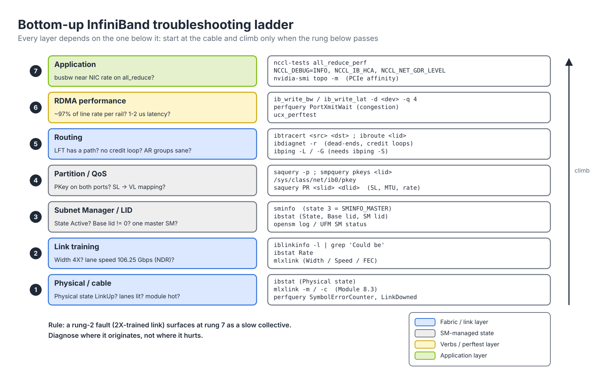
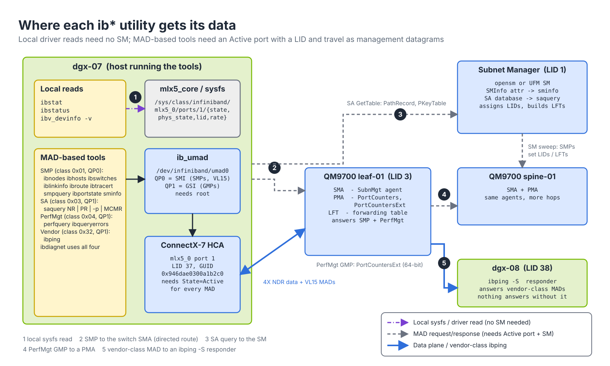
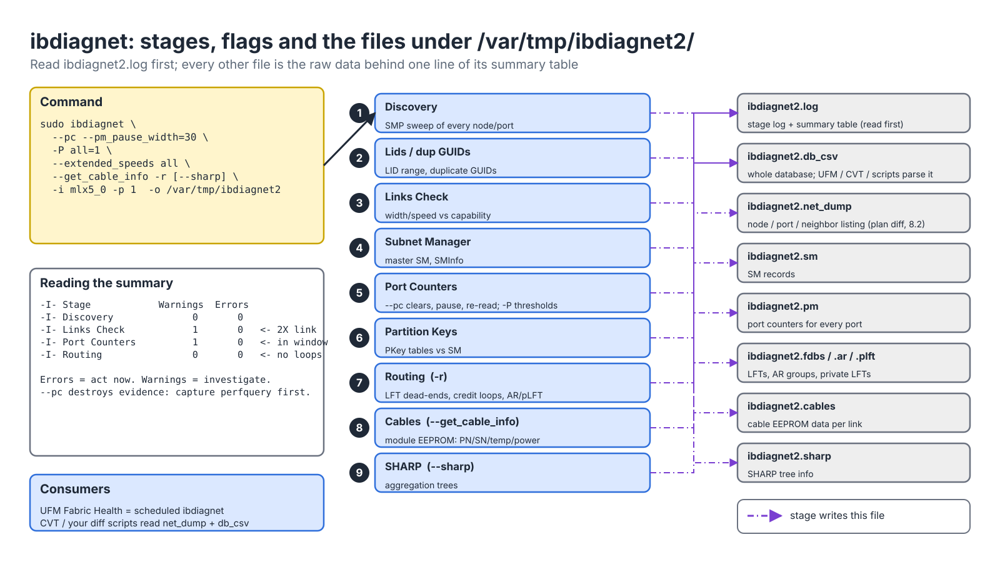
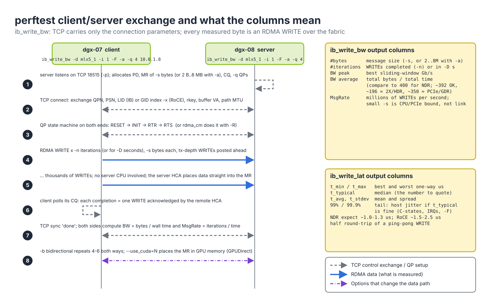
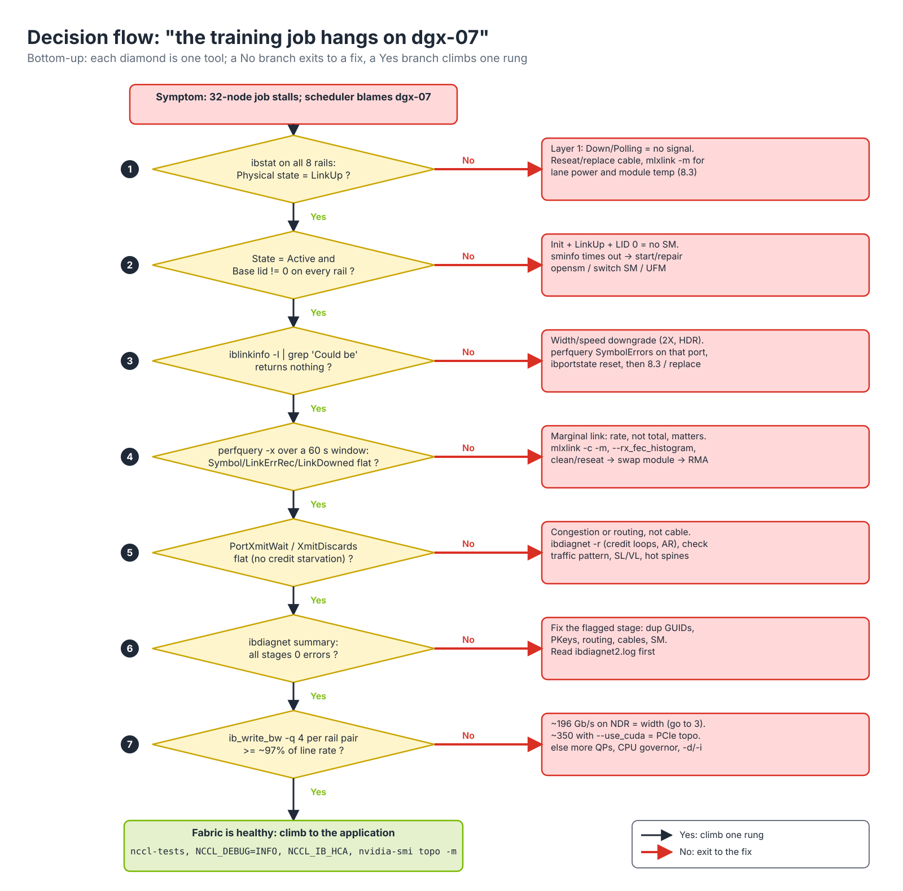

# Module 8.1 — InfiniBand Diagnostics and RDMA Performance Testing

> **Exam domain:** Troubleshooting Tools (20%)  
> **Source course(s):** InfiniBand Essentials; InfiniBand Professional (Troubleshooting units)  
> **Source docs:** NVIDIA InfiniBand Fabric Utilities (infiniband-diags); ibdiagnet User Manual; perftest (github.com/linux-rdma/perftest); "Testing RDMA latency with ib_write_lat"; IPoIB chapter of the MLNX_OFED / DOCA-Host user manual; NCCL Troubleshooting guide  
> **Estimated study time:** 4 hours

> **How to study this module:** read §1–§2, work through the §3 walkthrough on real gear or NVIDIA Air, then attempt the §5 hands-on assignment using only the Hint section. Open the Solution guide (last section) only after you have a working attempt. Finish with the Appendix C knowledge check closed-book.

## 1. Learning objectives

By the end of this module you will be able to:

- **Describe** what each InfiniBand port state and physical state means and infer the most likely cause from the combination (for example `Initializing` + `LinkUp` + no LID = no Subnet Manager). *(Troubleshooting Tools — interpret IB port status)*
- **Verify** fabric inventory and locate degraded links with **ibnodes**, ibswitches, ibhosts and **iblinkinfo**, including spotting the "Could be 4X" width downgrade. *(Troubleshooting Tools — fabric discovery utilities)*
- **Verify** end-to-end IB-layer reachability with **ibping**, ibtracert and ibroute, and explain why ICMP ping does not test the same thing. *(Troubleshooting Tools / InfiniBand Networking — reachability and routing)*
- **Troubleshoot** a link using perfquery port counters, distinguishing "cable/physical" counters from "congestion" counters. *(Troubleshooting Tools — counter interpretation)*
- **Configure and run** **ibdiagnet** with the flags the exam expects, locate its output files under `/var/tmp/ibdiagnet2/`, and interpret the error/warning summary. *(Troubleshooting Tools — ibdiagnet)*
- **Run** **ib_write_bw** / **ib_write_lat** / ib_read_bw / ib_send_bw in client–server mode (including GPUDirect with `--use_cuda`) and judge whether the numbers are healthy for the link rate. *(Troubleshooting Tools — perftest)*
- **Troubleshoot** an IPoIB interface that is up but cannot ping (PKey, SM, connected vs. datagram mode). *(InfiniBand Networking — IPoIB and partitions)*
- **Write** a bottom-up troubleshooting procedure and pick the right tool for a given symptom. *(Troubleshooting Tools — methodology)*

## 2. Key technical concepts

### 2.1 Bottom-up troubleshooting: check the plug before the app

**Analogy.** When the lamp does not come on you check the plug, then the bulb, then the switch, then the wiring, and only then do you call the electrician about the house. You do not start by rewiring the house. InfiniBand troubleshooting works the same way: every layer depends on the one below it, so you start at the cable and climb.

**What it is.** A fixed seven-rung ladder, with one question and one or two tools per rung (Figure 8.1-1). Rung 1 is the physical layer (is there signal on the lanes?), rung 2 link training (did all four lanes train at the expected speed?), rung 3 the **SM** and the **LID** it assigns, rung 4 partition and QoS (do both ends hold the same **PKey**, is the SL mapped to a VL that has credits?), rung 5 routing (does every switch on the path hold a forwarding entry, and is the set of entries loop-free?), rung 6 raw RDMA performance per link, and rung 7 the application (NCCL, MPI). The tool names on each rung are the ones the exam uses: `ibstat` and `mlxlink` at the bottom, `iblinkinfo`, `sminfo`, `saquery`, `ibtracert`, `ibdiagnet`, `perfquery`, `ib_write_bw`, and nccl-tests at the top.


*Figure 8.1-1 — The bottom-up troubleshooting ladder and the tool that answers each rung.*

**Why it exists.** Faults propagate upward and never downward. A link that trained at 2X (rung 2) cannot be seen by NCCL, which only observes that one of its eight rails delivers half the bandwidth; because a collective runs at the pace of its slowest participant, the whole 32-node all_reduce slows to the speed of that one cable. If you start at rung 7 you will spend a day tuning `NCCL_*` environment variables for a bad cable. The ladder also bounds the cost of each step: `ibstat` is a local read that takes milliseconds and needs nothing from the fabric; `ibdiagnet` on a 2,000-port fabric takes minutes and clears counters if you let it; a perftest sweep of 256 rail pairs takes an hour. Cheap, local and non-destructive checks go first.

**How it works.** Each rung has a pass condition you can state in one line, and a failure at a rung exits to a fix instead of climbing:

| Rung | Pass condition | Tool(s) | Exit to fix |
|---|---|---|---|
| 1 Physical | `Physical state: LinkUp`; module Rx power on all lanes | `ibstat`, `mlxlink -m` (8.3) | reseat, clean, replace cable/transceiver |
| 2 Link | Width `4X`, lane speed `106.25 Gbps` (NDR); no `Could be` | `iblinkinfo -l`, `ibstat Rate` | `ibportstate reset`, then 8.3 per-lane work |
| 3 SM / LID | `State: Active`, `Base lid != 0`, one `SMINFO_MASTER` | `sminfo`, `ibstat` | start/repair opensm, switch SM or UFM |
| 4 Partition / QoS | same PKey on both ports; `saquery PR` returns an SL | `saquery -p`, `smpquery pkeys`, `/sys/class/net/ib0/pkey` | provision the partition in `opensm.conf`/UFM |
| 5 Routing | `ibtracert` shows the designed path; `ibdiagnet -r` zero errors | `ibtracert`, `ibroute`, `ibdiagnet -r` | fix cabling (8.2), routing engine, AR |
| 6 RDMA perf | `ib_write_bw -q 4` ≥ ~97 % of line rate; `ib_write_lat` 1–2 µs | perftest, `perfquery PortXmitWait` | width (rung 2), PCIe, QP count, congestion |
| 7 Application | all_reduce busbw near the per-GPU NIC rate | nccl-tests, `NCCL_DEBUG=INFO` | NIC selection, GDR, PCIe affinity |

The §3 walkthrough climbs this ladder literally, and the decision flowchart in Figure 8.1-3 is the same ladder drawn as yes/no branches.

**Why the exam cares.** Nearly every troubleshooting question is "given this symptom, what do you check first?". The answer is always the lowest rung that could produce the symptom.

### 2.2 How the tools talk to the fabric: local reads vs. MADs

**Analogy.** Some tools read the gauge on your own dashboard; others radio the control tower and ask about everyone else's aircraft. The second kind only works if the radio (your port) is live and the tower (the SM) is on duty.

**What it is.** The InfiniBand diagnostics ship as part of MLNX_OFED / DOCA-Host (package `infiniband-diags`, plus `ibutils2` for ibdiagnet) and are also present on managed Quantum switches (MLNX-OS / NVOS) and on the UFM appliance. Under them sit two completely different data paths (Figure 8.1-2): a **local verbs/sysfs read** of the HCA driver (`mlx5_core`, exposed under `/sys/class/infiniband/<dev>/ports/<n>/`), and **Management Datagrams (MADs)**, 256-byte packets sent through the `ib_umad` character device (`/dev/infiniband/umad*`) on the two special queue pairs every port owns: **QP0**, the Subnet Management Interface, which carries Subnet Management Packets (SMPs) on the dedicated management virtual lane VL15, and **QP1**, the General Services Interface, which carries every other management class.


*Figure 8.1-2 — Where each utility gets its data: (1) local sysfs read, (2) SMP to a switch's SMA, (3) SA query to the SM, (4) PerfMgt GMP to a PMA, (5) vendor-class MAD to an `ibping -S` responder.*

| Mechanism | MAD class | Transport | Used by | What it needs |
|---|---|---|---|---|
| **Local verbs query** | none | driver / sysfs | ibstat, ibstatus, ibv_devinfo | Only a working driver; works even with no SM |
| **Subnet Management (SMP)** | 0x01 | QP0, VL15, LID-routed *or* directed-route | ibnodes, ibhosts, ibswitches, iblinkinfo, ibroute, ibtracert, smpquery, ibportstate, sminfo | Port can be `Initializing` for directed-route SMPs; LID-routed needs `Active` |
| **Subnet Administration (SA)** | 0x03 | QP1 to the SM's SA, LID-routed | saquery (NR, PR, PKeyTable, MCMR), ibdiagnet | Running SM with a populated SA database |
| **Performance Management (PerfMgt)** | 0x04 | QP1 to the port's PMA | perfquery, ibqueryerrors, ibdiagnet `-P` | `Active` port with a LID; PMA on the target |
| **Vendor-specific (OpenIB ping)** | 0x32 | QP1 to a userspace responder | ibping | `ibping -S` running on the target |

**Why it exists.** The split is what lets you diagnose a fabric that is *not yet* working. Before the SM has swept, no port has a LID and nothing can be LID-routed, yet the SM itself must discover the topology; it does so with **directed-route SMPs**, which carry a hop-by-hop port list instead of a destination LID. The discovery tools (`ibnodes`, `iblinkinfo`, `ibdiagnet`) use the same trick, which is why they can map a fabric from a port that is still `Initializing`. Everything addressed by LID (`perfquery <lid>`, `saquery`, `ibping -L`) needs the SM to have finished. Separating the Performance Management class from the Subnet Management class keeps the counter traffic off VL15, so a counter poll from UFM cannot starve the SM's own sweep.

**How it works.** A MAD tool opens `/dev/infiniband/umad<N>` for the chosen HCA port (root, or a user in the right group), builds a MAD with the management class, method (`Get`, `Set`, `GetTable` for SA), attribute ID and attribute modifier, and sends it. Each request has a transaction ID; the tool waits `-t <ms>` (default 1,000 ms) and retries three times before printing `MAD timeout`. An SMP sent directed-route starts with the local port, lists the egress port at each hop, and the receiving Subnet Management Agent (SMA) on the switch answers from its own tables: `NodeInfo`, `PortInfo`, `LinearForwardingTable`, `PKeyTable`, `SMInfo`. A PerfMgt request targets the Performance Management Agent (PMA) with attribute `PortCounters` (0x12, 32-bit counters) or `PortCountersExt`/`PortExtendedCounters` (64-bit) and a `PortSelect` field for the switch port number. SA queries are `GetTable` requests against records the SM keeps in memory: `NodeRecord`, `PathRecord`, `PKeyTableRecord`, `MCMemberRecord`.

Common options shared by MAD-based tools: `-C <ca>` selects the HCA (`-C mlx5_0`), `-P <port>` the port number, `-G` interprets an address as a **GUID** instead of a **LID**, `-D` forces directed-route addressing, `-t <ms>` sets the MAD timeout. If a MAD-based tool like `iblinkinfo` hangs or returns "MAD timeout", the problem is usually upstream of the tool — the local port is not Active, the SM is not running, or you are on the wrong `-C` — not that the fabric is broken.

**Why the exam cares.** "iblinkinfo times out on a freshly cabled fabric" is a trick question: the answer is "no SM yet", not "bad cable". And "which tools work without an SM?" is `ibstat`, `ibstatus`, `ibv_devinfo` — the local reads on the left of Figure 8.1-2.

### 2.3 Port state and physical state: two different questions

**Analogy.** *Physical state* is whether the phone line has dial tone. *State* is whether the exchange has given you a phone number. You can have perfect dial tone and still no number.

**What it is.** Every IB port carries two independent state machines in its `PortInfo` attribute. **PortPhysicalState** is negotiated by the two link partners' PHYs: `Sleep` (1), `Polling` (2), `Disabled` (3), `PortConfigurationTraining` (4), `LinkUp` (5), `LinkErrorRecovery` (6), `PhyTest` (7). **PortState** is owned by the SM: `Down` (1), `Initialize` (2), `Armed` (3), `Active` (4). **ibstat** reads both from the local HCA and prints them with the rate, LIDs and GUIDs:

| Field | Meaning | Healthy value |
|---|---|---|
| State | Logical (link-layer) port state managed by the SM | `Active` |
| Physical state | Electrical/optical state negotiated by the two ends | `LinkUp` |
| Rate | Negotiated data rate in Gb/s (4x NDR = 400, 4x HDR = 200, 4x EDR = 100) | Matches the slowest of HCA, cable, switch port |
| Base lid | The **LID** assigned by the SM (16-bit, 1–0xBFFF unicast) | Non-zero |
| LMC | LID mask control: the port answers to 2^LMC consecutive LIDs (multipath) | 0 unless LMC routing is in use |
| SM lid | LID of the master SM | Non-zero; identical on every host in the subnet |
| Port GUID | 64-bit unique port identifier (burned in) | Used by `-G` options and UFM |
| Link layer | `InfiniBand` or `Ethernet` (RoCE) | Depends on `LINK_TYPE_P1` in mlxconfig |

**Why it exists.** Two owners, two state machines. The PHY can bring a link up with no help from anyone — that is what lets a brand-new fabric train every cable before an SM exists, and what lets `ibdiagnet` discover it. But a port must not forward data until the SM has given it a LID, loaded the switch forwarding tables that lead to it and set its PKey table, otherwise traffic would be black-holed or leak between partitions. So the SM walks the port through `Initialize` → `Armed` → `Active` only after the subnet is consistent. The combination of the two states is therefore a diagnosis:

| State | Physical state | Meaning | Most likely cause |
|---|---|---|---|
| `Down` | `Polling` | No signal detected from peer | Cable unplugged, bad cable, remote port disabled, remote host powered off |
| `Down` | `Disabled` | Port administratively disabled | `ibportstate ... disable`, UFM isolation, or `mlxlink -a DN` |
| `Down` | `PortConfigurationTraining` (persistent) | Signal present but training never completes | Speed/FEC mismatch, marginal cable, breakout profile wrong (8.3) |
| `Initializing` (Init) | `LinkUp` | Physical link is good, but no LID assigned | **No Subnet Manager** reachable (not running, wrong subnet, or SM port down). Base lid shows 0. |
| `Armed` | `LinkUp` | SM has configured the port but not yet moved it to Active | Transient during SM sweep; persistent Armed = SM problem |
| `Active` | `LinkUp` | Fully operational | — |
| `Active` | `LinkErrorRecovery` (seen briefly) | PHY is retraining while the SM still considers the port up | Marginal link; `LinkErrorRecoveryCounter` increments |

**How it works.** The PHY state machine runs continuously: in `Polling` the port transmits training sequences and listens; when a partner answers it enters `PortConfigurationTraining`, negotiates width (1X/2X/4X), speed (SDR … NDR) and FEC per lane, then reports `LinkUp`. The SM's sweep then sends `Set(PortInfo)` SMPs: it writes `LID`, `LMC`, `MasterSMLID`, `MTUCap/NeighborMTU`, `OperationalVLs`, `LinkSpeedEnabled` and moves `PortState` to `Armed`; once every switch on the path has its LFT entries, a second `Set` moves it to `Active`. You observe all of this locally without any MAD:

```bash
cat /sys/class/infiniband/mlx5_0/ports/1/state        # "4: ACTIVE"   (2: INIT, 3: ARMED, 1: DOWN)
cat /sys/class/infiniband/mlx5_0/ports/1/phys_state   # "5: LinkUp"   (2: Polling, 3: Disabled)
cat /sys/class/infiniband/mlx5_0/ports/1/lid          # hex, 0x0 with no SM
cat /sys/class/infiniband/mlx5_0/ports/1/rate         # "400 Gb/sec (4X NDR)"
```

**ibstatus** is the terse variant (LIDs in hex: `0x25` = 37, whereas `ibstat` prints decimal 37 — the exam likes that mismatch). `ibv_devinfo` (`-v` for everything) comes from `libibverbs` and shows what an RDMA application sees: `active_mtu` (IB MTU 256–4096; `4096` on a healthy NDR path), `max_qp`, `max_mr_size`, and the GID table you need for RoCE perftest (`ibv_devinfo -d mlx5_0 -v | grep -i gid`).

**Why the exam cares.** `Initializing` + `LinkUp` + LID 0 → SM problem. `Down` + `Polling` → physical. This is the single most-tested distinction in the domain.

### 2.4 Inventory and link health: ibnodes, iblinkinfo

**Analogy.** Roll call, then a walk down every corridor checking each door.

**What it is.** **ibnodes** discovers the whole subnet via directed-route SMPs and lists every node (`NodeInfo`: type, number of ports, node GUID, node description); ibswitches and ibhosts are the filtered views. `sminfo` reads the `SMInfo` attribute of the master SM and prints its LID, GUID, activity counter, priority and state (`SMINFO_MASTER` = 3; `STANDBY` = 2, `DISCOVERING` = 1, `NOTACTIVE` = 0). `saquery` queries the Subnet Administrator database: `saquery NR` for node records, `saquery PR <src-lid> <dst-lid>` for path records (SL, MTU, rate, PKey), `saquery -p` for the PKey table records, `saquery MCMR` for multicast member records. **iblinkinfo** walks every link and prints, per port, the negotiated width, per-lane speed, logical and physical state, and the far-end LID/port/description.

**Why it exists.** State tools only look at one port, and an `Active/LinkUp` port can still be a bad port: a link that trained at **2X instead of 4X** is `Active`, passes traffic and halves bandwidth. The SM knows the capability of every port (`LinkWidthSupported`, `LinkSpeedExtSupported`) and what was actually negotiated (`LinkWidthActive`, `LinkSpeedExtActive`); iblinkinfo prints both and flags the difference as `( Could be 4X )` or `( Could be 100 Gbps )`. The description string (`"MF0;leaf-01:MQM9700/U1"`) comes from the switch hostname, which is why hostnames must be set before validation (Module 8.2).

**How it works.** iblinkinfo starts from the local port, sends `Get(NodeInfo)` and `Get(PortInfo)` for every port of every node it reaches, follows each link to its neighbor (the `PortInfo` of a switch port does not name the neighbor; the tool learns it by walking the link with a directed-route hop), and prints one line per link. NDR per-lane speed shows as **106.25 Gbps**, which is the *signalling* rate; four lanes of 106.25 Gbaud PAM4 carry 400 Gb/s of data after RS-FEC and encoding overhead. HDR shows `53.125 Gbps`, EDR `25.78125 Gbps`. Reading a line:

```text
0xb8cef603002a1a00 "MF0;leaf-01:MQM9700/U1" 3 2[  ] ==( 2X 106.25 Gbps Active/ LinkUp)==> 38 1[  ] "dgx-07 mlx5_1" ( Could be 4X )
# switch GUID  description                  LID port   width lane-speed State/PhysState   peer-LID port peer-description  capability gap
```

| Option | Purpose |
|---|---|
| `--switches-only` | Skip HCA-originated lines; halves the output on a big fabric |
| `-l` | One line per link, machine-friendly (easy to `grep "Could be"`) |
| `--down` / `-d` | Show only down links |
| `-S <guid>` / `-n <hops>` | Start from a given switch GUID / limit discovery depth |
| `--load-cache <file>` / `--diff` | Compare against a saved discovery to spot what changed |

`ibhosts | wc -l` versus the expected count answers "are all 32 nodes present?"; a missing host is either powered off, `Down/Polling`, or on a different subnet (multi-rail SuperPODs run one subnet per rail — run the tools once per `-C mlx5_N`).

**Why the exam cares.** `iblinkinfo -l | grep -i "could be"` is *the* fabric-scale way to find a degraded cable; the exam shows you an iblinkinfo line and asks what it means.

### 2.5 Reachability and path: ibping, ibtracert, ibroute

**Analogy.** ICMP ping asks "does your house answer the doorbell?". **ibping** asks "does the postal system have a route to your address?" — it tests the fabric, not the application stack. And unlike a doorbell, somebody has to be standing behind the door to answer: you must start a responder.

**What it is.** `ibping` sends vendor-class (0x32) MADs on QP1 to a LID or GUID and measures round-trip time; `ibping -S` is the userspace responder that answers them. `ibtracert <src-lid> <dst-lid>` prints the hop-by-hop path by reading each switch's linear forwarding table (LFT, attribute `LinearForwardingTable`) and the `PortInfo` at each hop. `ibroute <switch-lid>` dumps a switch's entire LFT (`-M` the multicast forwarding table), one line per destination LID with the egress port.

**Why it exists.** A port can be `Active` with a LID and still be unreachable: the SM may not have programmed the LFT entries on an intermediate switch yet, a switch may have rebooted and lost its tables, or a routing engine (`min_hop`, `updn`, `ftree`, `dfsssp`, `ar_updn`) may have produced a dead-end for an unusual topology. `ibping` proves the whole chain — both ports Active, LIDs assigned, forwarding entries present on every hop — in one packet. It does **not** prove RDMA data QPs work, PKeys match, or performance is acceptable, because it runs on QP1 with the management PKey. "ibping works but IPoIB ping fails" therefore points at IPoIB configuration (PKey, IP, mode), not the fabric.

**How it works.** Start `ibping -S` on the target; on the source run `ibping -L <lid>` or `ibping -G <guid>` (`-c <count>`, `-f` flood). Each probe is a MAD with the target LID in the LRH; every switch on the path looks the DLID up in its LFT (a flat array indexed by LID, so a lookup is O(1) and the table has one entry per possible LID up to `LinearFDBTop`) and forwards out the listed port. `ibtracert` replays that lookup from your host: it reads the LFT entry for the destination on the first switch, hops to the port it names, reads the next switch's entry, and so on, printing each `[port] -> switch port {guid}[port] lid X-Y "description"` line. Use it to confirm rail-0 to rail-0 traffic stays on the rail-0 leaf (one switch hop) rather than crossing a spine (three hops). With **adaptive routing**, the LFT is only the static fallback; AR groups and the per-destination AR tables are inspected via `ibdiagnet -r` or UFM, so an `ibtracert` path is "a" valid path, not necessarily "the" path a given flow takes.

**Why the exam cares.** Forgetting `ibping -S` and concluding "fabric broken" is a classic distractor; so is treating `ibping` success as proof that an RDMA application will work.

### 2.6 Port counters: typos vs. traffic jams

**Analogy.** Some counters count *typos* on the wire (physical); others count *time stuck in traffic* (congestion). You fix typos by replacing the pen; you fix traffic by changing routes. Replacing a cable for a congestion counter fixes nothing.

**What it is.** Every port's PMA keeps the IBA `PortCounters` attribute: a set of error and data counters with fixed widths. **perfquery** reads them with a PerfMgt `Get` MAD: `perfquery [lid] [port]`; `-x` requests `PortCountersExt` (64-bit data counters); `-X` the extended error counters where supported; `-R` resets after reading (`PerformanceSet` with the counter-select mask); `-a` aggregates all ports of a switch; `-r` resets without printing. The counters, their units and what each one measures:

| Counter | Width | Unit | Category | Interpretation |
|---|---|---|---|---|
| SymbolErrorCounter | 16-bit (saturates at 65535) | uncorrectable symbols after FEC | Physical | Bit errors on the wire that FEC could not fix. Rising steadily = marginal cable/transceiver/connector |
| LinkErrorRecoveryCounter | 8-bit | retrain events | Physical | PHY went through `LinkErrorRecovery` and came back. A few at boot fine; incrementing during operation = flapping |
| LinkDownedCounter | 8-bit | link-down events | Physical | Link went fully down (`Polling`) and retrained |
| PortRcvErrors | 16-bit | packets | Physical/protocol | Received packets with a bad ICRC/VCRC, bad length, or truncated. Remote transmitter or this receiver |
| PortRcvRemotePhysicalErrors | 16-bit | packets | Physical (upstream) | Packets marked bad *by an earlier hop* (EBP flag) — fault is before this link |
| PortRcvSwitchRelayErrors | 16-bit | packets | Forwarding | Switch could not relay: bad DLID, VL mapping, or an LFT hole |
| LocalLinkIntegrityErrors / ExcessiveBufferOverrunErrors | 4-bit each | threshold events | Physical | Serious; counted when symbol errors exceed the `LocalPhyErrors` threshold or a VL buffer overran its credits |
| PortXmitDiscards | 16-bit | packets | Congestion/forwarding | Dropped on transmit: head-of-queue lifetime exceeded, switch lifetime limit, or port down. Congestion or routing, not cables |
| PortXmitWait | 32-bit (64-bit in ext) | ticks | Congestion | Ticks the port had data but no credits (receiver buffer full) or lost arbitration. The key counter for "fabric is up but slow" |
| VL15Dropped | 16-bit | SMPs | Management | SM traffic dropped at the VL15 buffer; usually only during sweep storms |
| PortXmitData / PortRcvData | 32-bit (64-bit with `-x`) | **4-byte words** | Data | Payload moved. 2³² words = 16 GiB, which an NDR port moves in ~0.35 s — always read with `-x` |
| PortXmitPkts / PortRcvPkts | 32/64-bit | packets | Data | With data counters, gives average packet size |

**Why it exists.** Two families of counter, two families of fix. Physical counters are produced by the PHY and link layer and say "the bits arriving here are damaged"; nothing above layer 1 can cause them, so their cure is always mechanical (clean, reseat, replace, or firmware). Congestion counters are produced by the flow-control machinery: IB is lossless by credits, so a receiver with a full buffer stops granting credits and the transmitter's `PortXmitWait` ticks; if a packet sits so long that its head-of-queue lifetime expires it is discarded (`PortXmitDiscards`). Those are symptoms of *where traffic is going*, cured by routing, AR, QoS or placement — a new cable changes nothing. Counter width matters too: 8-bit `LinkDownedCounter` wraps after 255 events and 16-bit `SymbolErrorCounter` saturates, so a cable that has been bad for a week shows `65535` and tells you nothing about the last hour. That is why every serious check measures a **delta over a window**, never a total since boot.

**How it works.** `perfquery -R 3 2` sends `PerformanceSet(PortCounters)` with every counter-select bit set, zeroing LID 3 port 2; wait a fixed interval; `perfquery -x 3 2` reads the 64-bit set. The rate is (after − before) / seconds. A reasonable production rule for NDR: symbol errors > ~100 per 30 s, any `LinkDowned` increment, or `LinkErrorRecovery` > 5 per window is a failing link; `PortXmitWait` is reported as a warning, with its ratio to `PortXmitData` telling you how much of the time the port was blocked. ibqueryerrors sweeps the fabric and prints only ports whose counters exceed the thresholds in `/etc/infiniband-diags/error_thresholds` (`-r` prints rates, `-k` resets after reading, `-s <counter>` suppresses one, `--switch`/`--ca` filter by node type). Clearing with `-R`/`-k`/`ibdiagnet --pc` destroys evidence: capture first, then clear, then measure.

**Why the exam cares.** **SymbolError / LinkErrorRecovery / LinkDowned / PortRcvErrors → physical. PortXmitDiscards / PortXmitWait → congestion/routing.** A single error is not a failure; the *rate* is. And `PortXmitData` is in 4-byte units, which is why `-x` exists.

### 2.7 ibdiagnet: the full physical

**Analogy.** Everything above is a stethoscope; **ibdiagnet** is the annual full physical with blood work — slower, but it looks at everything and writes a report.

**What it is.** ibdiagnet (ibutils2) is a single binary that runs every check in this module in sequence — discovery, LID/GUID consistency, link width/speed against capability, SM status, port counters over a measured window, PKey tables, routing-table validation (dead-ends, credit loops), cable EEPROM, optionally **SHARP** trees — and writes one file per stage into `/var/tmp/ibdiagnet2/` (Figure 8.1-5). Its summary table (stage, warnings, errors) is the first thing you read.


*Figure 8.1-5 — ibdiagnet stages and the file each one writes. `ibdiagnet2.log` summarises all of them; `db_csv` is what UFM and CVT parse.*

| Flag | Purpose |
|---|---|
| `--pc` | Clear (reset) all port counters at the start |
| `--pm_pause_width=<sec>` | Wait after clearing so the second read measures a real interval |
| `-P all=1` | Report any counter that incremented by ≥1 (tune for production, e.g. `-P symbol_error_counter=100`) |
| `--extended_speeds all` | Read extended speed and lane info (NDR per-lane details) |
| `--get_cable_info` | Pull transceiver EEPROM: vendor, PN, SN, length, temperature → `ibdiagnet2.cables` |
| `-r` | Routing validation: LFT correctness, dead-ends, credit loops; reports AR configuration |
| `--sc` / `--skip` | Skip stages (e.g. `--skip dup_guids`) |
| `-o <dir>` | Alternate output directory |
| `--sharp` | Validate **SHARP** aggregation tree configuration |
| `-i <ca> -p <port>` | Which local HCA/port to discover from |
| `--topo_file <file>` / `-t` | Compare discovered topology against a plan (rail-optimized validation; Module 8.2) |

| File | Contents |
|---|---|
| `ibdiagnet2.log` | Stage-by-stage log and the summary table — read this first |
| `ibdiagnet2.db_csv` | Full machine-readable database; what UFM and scripts parse |
| `ibdiagnet2.pm` | Port counters for every port |
| `ibdiagnet2.fdbs` | Linear forwarding tables of every switch |
| `ibdiagnet2.net_dump` | Topology as node/port/neighbor listing (diff against a cabling plan — Module 8.2) |
| `ibdiagnet2.cables` | Cable EEPROM data when `--get_cable_info` is used |
| `ibdiagnet2.sm` | SM information |
| `ibdiagnet2.ar` / `.plft` | Adaptive routing groups and tables when `-r` is used |

**Why it exists.** The individual tools answer one question each and leave correlation to you; on a 2,000-port fabric nobody can correlate by hand. ibdiagnet also checks things no single tool reports: **duplicate GUIDs** (two HCAs with the same port GUID after a bad firmware clone make the SM assign one LID to two ports), **credit loops** (a cyclic dependency between the VL buffers of several switches, created by forwarding tables that violate the routing engine's topology assumptions; under load every switch in the cycle waits for the next one and the fabric deadlocks), and width/speed against capability for every port at once. Because UFM's Fabric Health report is a scheduled ibdiagnet run, learning to read ibdiagnet output is learning to read UFM.

**How it works.** The run is sequential: (1) directed-route discovery of every node and port; (2) LID and duplicate-GUID checks against the discovered set; (3) links check comparing `LinkWidthActive`/`LinkSpeedExtActive` with the supported values on both ends; (4) `SMInfo` from every node that claims to be an SM (exactly one master expected); (5) port counters — with `--pc` it clears everything, sleeps `--pm_pause_width` seconds, then reads `PortCountersExt` on every port and applies the `-P` thresholds; (6) PKey tables on every port versus the SM's partition configuration; (7) with `-r`, every switch's LFT is pulled and a graph search checks that each LID is reachable from every port without a dead-end and that the VL dependency graph is acyclic (the credit-loop test); (8) with `--get_cable_info`, the cable EEPROM (`CableInfo` attribute via the switch/HCA, same data `mlxlink -m` shows) for every port; (9) with `--sharp`, the aggregation-manager tree state. The summary line for each stage counts warnings and errors; `-W-` lines name the offending LID/port. "Routing" errors mentioning **credit loops** indicate a cyclic dependency that can deadlock under load; fix cabling or pick the right engine in `opensm.conf` / UFM. On a multi-rail SuperPOD each rail may be a *separate subnet* and needs its own run with `-i <ca>`.

**Why the exam cares.** It asks for the default output path (`/var/tmp/ibdiagnet2/`), which file holds what, and what `--pc` does.

### 2.8 perftest: measuring the pipe

**Analogy.** A speed test for one pipe between two taps. One tap alone cannot fill an NDR pipe — open several (`-q`).

**What it is.** The perftest suite (`ib_write_bw`, **ib_write_lat**, `ib_read_bw`, `ib_read_lat`, `ib_send_bw`, `ib_send_lat`, `ib_atomic_*`) measures raw verbs performance between two hosts, one RDMA operation type per binary. It is client–server: start the server with no address, then point the client at the server's IP. TCP (default port 18515, `-p`) is only used to exchange connection parameters; the test traffic is RDMA on the fabric (Figure 8.1-4).


*Figure 8.1-4 — The perftest exchange: steps 1–3 and 7 are TCP control, steps 4–6 are the RDMA data that is actually measured, step 8 lists the options that change the data path.*

| Option | Meaning |
|---|---|
| `-d mlx5_0` / `-i 1` | Device and port. Always specify on a multi-NIC node or you test the wrong rail |
| `-x <gid-index>` | GID index — required for **RoCE**; not needed on IB |
| `-R` | Use `rdma_cm` for connection setup (the normal way on RoCE) |
| `-a` | All message sizes 2 B → 8 MB; `-s <bytes>` for one size (default 65536 for bw, 2 for lat) |
| `-q <n>` | QP count; a single QP will not saturate NDR, use `-q 4`–`-q 8` |
| `-n <iters>` / `-D <sec>` | Iteration count (default 5000 bw / 1000 lat) or duration |
| `-t <depth>` | Tx queue depth, WRITEs posted ahead of completions (default 128 bw, 1 lat) |
| `-F` | Do not fail if CPU frequency scaling is on |
| `--report_gbits` | Gb/s instead of MB/s |
| `-S <sl>` | Service level — test the SL your QoS maps RDMA to |
| `-m <mtu>` / `--tclass` | Path MTU / DSCP-bearing traffic class on RoCE |
| `--use_cuda=<gpu>` | Buffers in GPU memory → tests **GPUDirect RDMA**. Needs CUDA-enabled perftest and `nvidia-peermem` or DMA-BUF |
| `-b` | Bidirectional |
| `--run_infinitely` | Keep going until killed — watch for drops while reseating a cable |

**Why it exists.** Rungs 1–5 prove the link is *correct*; only a data-path test proves it is *fast*. Verbs-level numbers also isolate the fabric from the application: if `ib_write_bw` hits 392 Gb/s on a rail and NCCL does not, the problem is above the NIC (PCIe affinity, GDR, NCCL's choice of NIC). The expected numbers follow from the link: an NDR 4x port carries 400 Gb/s of data, of which ~2–3 % goes to IB headers (LRH 8 B + BTH 12 B + RETH 16 B + ICRC/VCRC 6 B per up-to-4096 B MTU) and credit returns, so ~385–395 Gb/s is line rate, ~196 Gb/s is exactly a 2X-trained link or an HDR-negotiated one, and ~350 Gb/s with GPU buffers usually means the PCIe path from GPU to NIC crosses a CPU socket. Latency is bounded by the HCA's processing (~0.6 µs per side) plus the switch hop (~100–150 ns on Quantum-2), giving the 1.0–1.3 µs one-way figure for a small WRITE.

| Link | Signalling rate | Realistic `ib_write_bw` large-message | `ib_write_lat` small message |
|---|---|---|---|
| 4x NDR (400G) | 400 Gb/s | ~385–395 Gb/s | ~1.0–1.3 µs (half round-trip) |
| 4x HDR (200G) | 200 Gb/s | ~195 Gb/s | ~1.0–1.4 µs |
| 400G RoCE (ConnectX-7 / BlueField-3) | 400 Gb/s | ~380–390 Gb/s | ~1.5–2.5 µs |

**How it works.** Following Figure 8.1-4: (1) the server allocates a protection domain, registers a memory region of the test size (or 8 MB for `-a`), creates a completion queue and `-q` queue pairs, and listens on TCP; (2) the client connects and both sides exchange QP numbers, packet sequence numbers, LIDs (IB) or GIDs (RoCE, chosen by `-x`), the MR's remote key and virtual address, and the path MTU; (3) each side transitions its QPs RESET → INIT → RTR → RTS using those values (with `-R`, `rdma_cm` performs the exchange and the transitions for you, which is why it is the normal way on RoCE where picking the GID index by hand is error-prone); (4–5) the client posts `-t` RDMA WRITE work requests ahead and keeps the queue full for `-n` iterations or `-D` seconds — the server CPU is idle, its HCA writes straight into the MR; (6) the client polls its CQ and counts completions; (7) a final TCP sync lets both sides compute the result. Output columns for `_bw`: `#bytes`, `#iterations`, `BW peak` (best window), `BW average` (total bytes / wall time — quote this one), `MsgRate` (million WRITEs per second; the small-message number is CPU/PCIe bound, not link bound). For `_lat`: `t_min`, `t_max`, `t_typical` (median — quote this), `t_avg`, `t_stdev`, `99%`, `99.9%`; a high max with a good median is host jitter (C-states, IRQ affinity), not fabric. `ucx_perftest` tests the UCX layer under HPC-X MPI, the step between raw verbs and MPI.

**Why the exam cares.** Which option is RoCE-only (`-x`/`-R`), what `--use_cuda` tests, and what half-rate means.

### 2.9 nccl-tests and IPoIB

**What it is.** nccl-tests (`all_reduce_perf`, `all_gather_perf`, `reduce_scatter_perf`, `alltoall_perf`) run a real NCCL collective across GPUs and report `algbw` (bytes / time) and `busbw` (algbw scaled by the collective's traffic factor; for all_reduce, 2(n−1)/n). IPoIB (`ib0`) is the kernel driver that carries IP over an IB partition using the partition's broadcast multicast group for ARP/ND and UD or RC QPs for unicast.

**Why it exists.** perftest proves one rail between two hosts; a collective exercises all eight rails of every node at once and in the pattern training uses, so it catches cross-rail problems (a swapped rail from Module 8.2, a wrong `NCCL_IB_HCA` filter, GDR disabled on one node) that per-link tests cannot. IPoIB exists so management traffic (SSH, NFS mounts, Slurm) can ride the compute fabric without RDMA-aware applications; it is CPU-bound by design because every packet traverses the kernel IP stack, so `iperf` at 40 Gb/s on an NDR link is normal and not a fault.

**How it works.** Once every link passes perftest, run `all_reduce_perf` from nccl-tests: `mpirun -np 16 -H dgx-01:8,dgx-02:8 ./all_reduce_perf -b 8 -e 8G -f 2 -g 1`. *busbw* at large sizes should approach the per-GPU NIC rate (50 GB/s for 400 Gb/s; a healthy multi-node all_reduce lands in the mid-40s GB/s — verify against reference numbers for your system). One degraded link drags the whole collective down to that link's speed. Useful environment: `NCCL_DEBUG=INFO` (prints which NIC, GID index and whether `GDRDMA` is used per channel), `NCCL_IB_HCA`, `NCCL_IB_GID_INDEX`, `NCCL_IB_TC` / `NCCL_IB_SL`, `NCCL_NET_GDR_LEVEL`. "NCCL WARN NET/IB : Got completion with error 12" is `IBV_WC_RETRY_EXC_ERR` — the QP's transport retry counter was exhausted because acknowledgements never came back — and is almost always a fabric link problem or PFC/ECN misconfiguration on RoCE.

IPoIB: `cat /sys/class/net/ib0/pkey` reads `0xffff` on the default partition (the full-member form of `0x7fff`: bit 15 set means full membership, cleared means limited, which can talk only to full members). A child interface (`echo 0x8001 > /sys/class/net/ib0/create_child`, appearing as `ib0.8001`) must use a PKey the SM assigned to *both* ports (`saquery -p`, `smpquery pkeys <lid>`), because the port's PKey table is enforced in hardware on every packet. `cat /sys/class/net/ib0/mode` shows `datagram` (UD QPs; MTU up to 4092 = 4096 IB MTU − 4-byte IPoIB header) vs `connected` (one RC QP per peer; MTU up to 65520; both ends must agree or large packets fail while small pings succeed). ARP is resolved through the partition's broadcast multicast group (`saquery MCMR` lists it; `0xC000..` prefix); if the SM has not created that group for the PKey, every host is "up" and nobody can resolve anybody.

**Why the exam cares.** `0xffff` vs `0x7fff`, datagram vs connected MTU limits, and why IPoIB throughput is low by design.

## 3. Live-style walkthrough: "the training job hangs on node 7"

Scenario: a 32-node job stalls; the scheduler points at `dgx-07`. The SRE already restarted the job twice. You are going to work bottom-up and narrate every decision. The decision flowchart in Figure 8.1-3 is the route we follow; each shell step below names the diamond it answers. All output is illustrative.


*Figure 8.1-3 — "The training job hangs on node 7": the ladder of Figure 8.1-1 drawn as decisions. Diamonds 1–7 map to Steps 1–8 below.*

```bash
# ---- Step 1 (Figure 8.1-3, diamonds 1 and 2): local port state on the suspect node. Always first;
#      it needs no SM and no fabric (a local read, Figure 8.1-2 path 1), so if it is bad nothing else is worth running.
dgx-07$ ibstat
CA 'mlx5_0'
    CA type: MT4129
    Firmware version: 28.41.1000
    Node GUID: 0x946dae0300a1b2c0
    Port 1:
        State: Active                 # SM has configured this port: layer 3 of our ladder is fine
        Physical state: LinkUp        # cable, transceiver, port are electrically good: layer 1 fine
        Rate: 400                     # 4x NDR negotiated. Good so far — but Rate is this port only
        Base lid: 37                  # non-zero: SM assigned a LID
        SM lid: 1                     # master SM is LID 1; must match on every other node
        Port GUID: 0x946dae0300a1b2c0
        Link layer: InfiniBand        # not Ethernet: LINK_TYPE_P1=1 in mlxconfig
# Decision: layers 1–3 on mlx5_0 pass. Repeat for mlx5_1..mlx5_7 (8 rails on a DGX).
dgx-07$ for d in /sys/class/infiniband/mlx5_*; do echo -n "$(basename $d) "; cat $d/ports/1/state; done
mlx5_0 4: ACTIVE
mlx5_1 4: ACTIVE
...
mlx5_7 4: ACTIVE
# All eight Active. If one had shown "2: INIT" we would have jumped straight to sminfo.

# ---- Step 2 (diamond 2, the SM half): confirm the SM is alive and is the SAME master everyone else sees.
dgx-07$ sudo sminfo
sminfo: sm lid 1 sm guid 0xb8cef603002a2200, activity count 189231 priority 15 state 3 SMINFO_MASTER
# state 3 = MASTER, LID 1 matches ibstat's "SM lid". If this had timed out, every port
# would sit in Initializing and the fix is "start/repair the SM", not "touch cables".

# ---- Step 3 (diamond 3): fabric-wide link health. We have no evidence yet of WHICH link is bad,
#      so ask the fabric about every link and grep for downgrades.
dgx-07$ sudo iblinkinfo -l --switches-only | grep -i "could be"
0xb8cef603002a1a00 "MF0;leaf-01:MQM9700/U1" 3 2[  ] ==( 2X 106.25 Gbps Active/ LinkUp)==> 38 1[  ] "dgx-07 mlx5_1" ( Could be 4X )
# There it is. LID 3 (leaf-01) port 2 to dgx-07 mlx5_1 trained at 2X: half the lanes.
# Per-lane speed is 106.25 Gbps (NDR), so speed is fine; WIDTH is the problem.
# ibstat on mlx5_1 said Active/LinkUp — state tools cannot see width problems; iblinkinfo can.
# Decision: this is a layer-1 fault presenting as "slow", and NCCL on a bus of 8 rails runs
# at the pace of the slowest rail. That is why the job "hangs" (really: crawls).

# ---- Step 4 (diamonds 4 and 5): counters on that specific switch port. Is the cable marginal (physical
#      counters rising) or did it just train badly once?
dgx-07$ sudo perfquery -x 3 2
# Port extended counters: Lid 3 port 2 (CapMask: 0x5A00)
PortXmitData:....................8812003346122
PortRcvData:.....................9122381910023
SymbolErrorCounter:..............1182      # physical: bit errors on the wire, non-trivial
LinkErrorRecoveryCounter:........3         # physical: retrained 3 times
LinkDownedCounter:...............1         # physical: went fully down once
PortRcvErrors:...................27        # physical: corrupt packets received
PortXmitDiscards:................0         # congestion: none
PortXmitWait:....................4421902   # congestion: some credit waits — expected on a 2X link
#                                            that the SM still routes 4X worth of traffic over
# Decision: SymbolError + LinkErrorRecovery + LinkDowned all non-zero = cable/transceiver/
# connector. XmitWait is a CONSEQUENCE of half width, not a separate congestion problem.
# Measure the rate to be sure it is live, not historical:
dgx-07$ sudo perfquery -R 3 2 >/dev/null; sleep 60; sudo perfquery -x 3 2 | grep -E 'Symbol|LinkError'
SymbolErrorCounter:..............94        # 94 symbol errors in 60 s: still happening now
LinkErrorRecoveryCounter:........0

# ---- Step 5 (diamond 6): one full ibdiagnet pass for the record and to catch anything else (Figure 8.1-5 for the files).
#      NOTE: --pc clears counters. We already captured the evidence above, so that is OK.
dgx-07$ sudo ibdiagnet --pc --pm_pause_width=30 -P all=1 --extended_speeds all --get_cable_info -r
...
-I- Stage                     Warnings   Errors   Comment
-I- Discovery                        0        0
-I- Lids Check                       0        0
-I- Links Check                      1        0    # our 2X link
-I- Subnet Manager                   0        0
-I- Port Counters                    1        0    # symbol errors on LID 3 port 2 in the 30 s window
-I- Speed / Width checks             1        0
-I- Partition Keys                   0        0
-I- Routing                          0        0    # no credit loops: routing is not the problem
-I- Cables                           0        0
-W- link ... : Unexpected actual link width 2x (expected 4x) ...
-W- lid=0x0003 ... port=2 : SymbolErrorCounter=61 exceeds threshold
dgx-07$ grep -A3 "dgx-07 mlx5_1" /var/tmp/ibdiagnet2/ibdiagnet2.cables | head
# -> Vendor PN, SN, length, temperature of the suspect cable: this goes in the RMA ticket.
# Decision: exactly one problem in the fabric. Fix it and prove the fix.

# ---- Step 6 (diamond 7, before the fix): baseline the broken rail BEFORE touching it, so you can show the delta.
#      This is the exchange in Figure 8.1-4: TCP for setup, RDMA WRITEs for the number.
dgx-08$ ib_write_bw -d mlx5_1 -i 1 -F --report_gbits -a            # server on the peer
dgx-07$ ib_write_bw -d mlx5_1 -i 1 -F --report_gbits -a 10.0.1.8   # client, same rail
 #bytes     #iterations    BW peak[Gb/sec]    BW average[Gb/sec]   MsgRate[Mpps]
 1048576    5000           196.40             196.12               0.023
# 196 Gb/s on a 400G link: exactly half. Consistent with 2X. (If you saw this number first,
# with no other context, the right reflex is "go check iblinkinfo for width" — Q6 in the knowledge check.)

# ---- Step 7: remediate. Reseat and clean both ends of the cable (MPO ferrule on optics).
#      Retrain the port from the host rather than walking to the switch:
dgx-07$ sudo ibportstate 3 2 reset         # forces a retrain of LID 3 port 2; link drops briefly
dgx-07$ sleep 15; sudo iblinkinfo -l --switches-only | grep "dgx-07 mlx5_1"
... ==( 4X 106.25 Gbps Active/ LinkUp)==> 38 1[  ] "dgx-07 mlx5_1" ( )
# 4X and no "Could be". If it had come back 2X again, the next step is Module 8.3:
# mlxlink -m for per-lane Rx power, then replace the cable.

# ---- Step 8 (diamond 7 again): prove it with the same test as Step 6.
dgx-07$ ib_write_bw -d mlx5_1 -i 1 -F --report_gbits -a -q 4 10.0.1.8
 1048576    5000           392.11             392.05               0.047
# ~392 Gb/s: healthy NDR. -q 4 because one QP can under-report on NDR; compare like with like.
dgx-07$ sudo perfquery -R 3 2 >/dev/null; sleep 300; sudo perfquery -x 3 2 | grep Symbol
SymbolErrorCounter:..............0         # five minutes clean. Close the ticket; schedule RMA if it recurs.
```

What "good" looks like: all ports `Active/LinkUp`, `sminfo` state 3, zero lines from `grep "could be"`, physical counters flat over a measured interval, ibdiagnet summary all zeros, `ib_write_bw` within ~3% of line rate.

## 4. Troubleshooting / common gotchas

### 4.1 `ibping` times out although the fabric is healthy

- **Symptom:** `ibping -L 52` prints only `ibwarn: ... ibping ... timeout`, yet `iblinkinfo` shows LID 52 Active.
- **Why it happens:** ibping has no default responder. Unlike ICMP, nothing answers vendor-specific MADs unless a server process is listening.
- **How to debug:** on the target run `sudo ibping -S`; retry the client. Confirm with `sudo smpquery nodeinfo 52` that the LID itself is reachable (SMP MADs need no responder).
- **Fix:** always pair `ibping -S` (target) with `ibping -L <lid>` / `-G <guid>` (source). Do not conclude "fabric broken" from a missing responder.

### 4.2 `ibdiagnet` destroyed the evidence, or refused to run

- **Symptom:** after a nightly `ibdiagnet --pc` the counters you wanted to examine are all zero; or ibdiagnet fails with `umad` / "Failed to open device" errors as a normal user.
- **Why it happens:** `--pc` clears every port counter at the start of the run. And MAD-based tools need root for `/dev/infiniband/umad*`.
- **How to debug:** `ls -l /dev/infiniband/umad*`; `id`; check your cron for `--pc`. Look for the previous run's `ibdiagnet2.pm` under `/var/tmp/ibdiagnet2/` (or the `-o` directory) — the pre-clear read is saved there.
- **Fix:** run with `sudo`. Omit `--pc` when you are preserving evidence; use `--pc --pm_pause_width=30` only for measured-interval runs, and archive `db_csv`/`pm` from every run.

### 4.3 Half-rate `ib_write_bw` blamed on the fabric when it is the test

- **Symptom:** `ib_write_bw` reports ~300 Gb/s on an NDR link; iblinkinfo shows 4X, counters clean.
- **Why it happens:** a single QP (`-q 1`) with default TX depth often cannot saturate 400G, CPU frequency scaling adds jitter, or on a multi-NIC node you tested the wrong device, or on RoCE you picked the wrong GID index.
- **How to debug:** rerun with `-q 4 -a --report_gbits`; confirm `-d`/`-i` match the rail under test (`ibdev2netdev`); check `lspci -vv -s <bdf> | grep LnkSta` for PCIe Gen5 x16; on RoCE verify `-x <gid>` against `show_gids` or use `-R`.
- **Fix:** standardize on `-d <dev> -i 1 -F -a -q 4 --report_gbits` and pin the CPU governor to performance for latency tests (`-F` only hides the warning).

### 4.4 IPoIB "up" but silent

- **Symptom:** `ib0` has an IP, `ibping` to the peer works, ICMP ping fails.
- **Why it happens:** PKey mismatch (no multicast group join, so no ARP), or connected/datagram mode mismatch with large MTU.
- **How to debug:** `cat /sys/class/net/ib0/pkey` on both hosts (expect `0xffff` on the default partition); `cat /sys/class/net/ib0/mode`; `ip link show ib0` for MTU; `saquery MCMR` for the broadcast group; `saquery -p` for what the SM actually assigned.
- **Fix:** align PKeys (provision the partition in `opensm.conf`/UFM on *both* ports), align mode and MTU, then re-test.

## 5. Hands-on assignment: a fabric health script with pass/fail thresholds

**Scenario.** Your team runs a 16-node HDR/NDR cluster without UFM. Every Monday an engineer pastes `iblinkinfo` and `perfquery` output into a ticket by hand. You will replace that with a script.

**Requirements.**
1. A bash script `ibhealth.sh` runnable as root on any node with `infiniband-diags` installed, taking `-C <ca>` (default `mlx5_0`) and `-n <expected-host-count>`.
2. Check A — local port: every local `mlx5_*` port must be `Active`/`LinkUp`; print each with PASS/FAIL.
3. Check B — SM: `sminfo` must return a MASTER within a 2-second timeout.
4. Check C — inventory: `ibhosts` count must equal `-n`.
5. Check D — degraded links: zero `Could be` lines from `iblinkinfo -l`; list offenders on FAIL.
6. Check E — physical counters: for every switch port in `ibqueryerrors` output, SymbolErrorCounter, LinkErrorRecoveryCounter, LinkDownedCounter and PortRcvErrors must be below configurable thresholds (defaults 100/5/1/10), *measured over a 30-second window after a reset* — not since boot.
7. Check F — congestion flag (warning, not failure): report any port whose PortXmitWait grew by more than a threshold in the window.
8. Exit 0 if all PASS, 1 if any FAIL; print a one-screen report.

**Deliverables.** `ibhealth.sh`; a sample report from a healthy run and from a run with a deliberately degraded link (you may simulate by editing captured output).

**Acceptance criteria.**
- AC1: all six checks print a PASS/FAIL (or WARN) line with the measured value and the threshold.
- AC2: a 2X link, a missing host, or a stopped SM each produce exit code 1 and name the cause.
- AC3: counters are measured as a *delta over the window*, never since boot.
- AC4: the script never leaves counters reset without saying so in the report.

### Hint
- Section 2.3's state table tells you what strings to expect from `ibstat` and from `/sys/class/infiniband/<dev>/ports/1/{state,phys_state}` — the sysfs files are easier to parse.
- `sminfo` hangs without an SM; wrap it in `timeout 2`.
- Section 2.4's option table: `iblinkinfo -l` is the machine-friendly form; count lines matching `Could be`.
- For a delta, Section 2.6: `perfquery -R` resets; `ibqueryerrors -k` resets after reading. Think about reading, waiting, reading again.
- Keep thresholds in variables at the top; the reviewer will change them.

## Appendix A — Quick command reference

```bash
# Local state
ibstat; ibstatus; ibv_devinfo -v
# Inventory and links
ibnodes; ibswitches; ibhosts; sminfo
iblinkinfo --switches-only; iblinkinfo -l | grep -i "could be"; iblinkinfo --down
# Reachability and routing
ibping -S                      # responder
ibping -L <lid> | ibping -G <guid>
ibtracert <src-lid> <dst-lid>; ibroute <switch-lid>
saquery NR | saquery -p | saquery PR <slid> <dlid> | saquery MCMR
# Counters
perfquery -x <lid> <port>; perfquery -R <lid> <port>; ibqueryerrors -r
# Port control (careful)
ibportstate <lid> <port> query|disable|enable|reset
ibportstate <lid> <port> width 1   # bitmask; 1=1X,2=4X,4=8X,8=12X (verify in current docs)
# Full diagnostic
ibdiagnet --pc --pm_pause_width=30 -P all=1 --extended_speeds all --get_cable_info -r
ls /var/tmp/ibdiagnet2/           # ibdiagnet2.log .db_csv .pm .fdbs .net_dump .cables
# Performance
ib_write_bw -d mlx5_0 -i 1 -F -a --report_gbits [-q 4] [-x <gid>] [-R] [--use_cuda=0] [server-ip]
ib_write_lat -d mlx5_0 -i 1 -F -s 8 -n 10000 [server-ip]
ib_read_bw / ib_send_bw / ib_send_lat   # same option set
ucx_perftest -t ucp_put_bw [server]
mpirun ... all_reduce_perf -b 8 -e 8G -f 2 -g 1
# IPoIB
cat /sys/class/net/ib0/{pkey,mode}; echo 0x8001 > /sys/class/net/ib0/create_child
```

### Symptom → tool decision table

| Symptom | First tool | Then |
|---|---|---|
| Port `Down`/`Polling` | ibstat, physical check | mlxlink -m (transceiver present/power), swap cable |
| Port `Initializing`, LID 0 | sminfo | Start SM (opensm / switch SM / UFM), check SM port |
| Some nodes missing from fabric | ibhosts / ibnodes | ibstat on the missing node, iblinkinfo --down |
| One link slow, others fine | iblinkinfo -l \| grep "Could be" | mlxlink per-lane, perfquery SymbolError, replace cable |
| Random slowness, no link errors | perfquery PortXmitWait/XmitDiscards | ibdiagnet -r (routing/credit loop), check AR, congestion control |
| ibping OK, IP ping fails | PKey / mode / MTU on ib0 | saquery MCMR |
| ib_write_bw half the expected rate | iblinkinfo width | -q more QPs, check PCIe gen/width (`lspci -vv`), CPU frequency |
| ib_write_bw OK, NCCL slow | nccl-tests + NCCL_DEBUG=INFO | NIC selection (NCCL_IB_HCA), GDR, `nvidia-smi topo -m` |
| Counters rising fabric-wide after change | ibdiagnet --pc, diff db_csv | ibqueryerrors -r |
| Need full picture before escalating | ibdiagnet (all flags) + UFM | Collect `/var/tmp/ibdiagnet2`, `ibstat`, `mlxlink` outputs |

## Appendix B — Exam traps & key takeaways

- `Initializing` + `LinkUp` is an **SM** problem, not a cable problem. `Down` + `Polling` is physical.
- `ibstat` first: State (SM-driven) and Physical state (layer 1) answer different questions. `sminfo` confirms a master SM; no SM = every port in Initializing with LID 0.
- `ibping` needs `ibping -S` on the target. It tests IB-layer reachability (LIDs and forwarding), not IP and not RDMA data-path performance.
- LIDs: `ibstat` prints decimal, `ibstatus`/`saquery` print hex. 0x25 and 37 are the same port.
- `iblinkinfo -l | grep "Could be"` finds degraded links; "Could be 4X" text, not a counter, is how you spot a bad cable at fabric scale. NDR per-lane = 106.25 Gbps.
- SymbolError/LinkErrorRecovery/LinkDowned/PortRcvErrors = physical. PortXmitWait/PortXmitDiscards = congestion/routing. Do not replace a cable for XmitWait.
- Use `perfquery -x` for 64-bit counters; 32-bit data counters wrap within seconds at NDR and look like they "reset".
- `ibdiagnet --pc` clears counters — do not use it when preserving evidence. Output lives in `/var/tmp/ibdiagnet2/`; read `ibdiagnet2.log` first; `.pm` counters, `.db_csv` database, `.fdbs` routing, `.net_dump` topology, `.cables` EEPROM.
- `-x <gid>` (or `-R`) is needed for perftest on RoCE; unnecessary on native IB. Wrong GID index = "Couldn't connect" or hang.
- A single QP rarely saturates NDR; add `-q 4` before blaming the fabric. `-F` only suppresses the CPU-frequency warning; pin the governor for latency tests.
- NDR ≈ 390+ Gb/s and ≈ 1–2 µs latency; half the rate means a 2X- or HDR-trained link.
- IPoIB throughput is CPU-bound and far below RDMA line rate by design. `/sys/class/net/ib0/pkey` reads `0xffff` on the default partition.
- On a multi-rail SuperPOD each rail may be a separate subnet; ibdiagnet needs a run per rail with `-i <ca>`.
- Bottom-up: cable → link → SM → partition → routing → RDMA perf → application.

## Appendix C — Knowledge check

1. `ibstat` on a new DGX shows `State: Initializing`, `Physical state: LinkUp`, `Base lid: 0`. What is the most likely cause?  
   A. Faulty cable  
   B. No Subnet Manager is running or reachable  
   C. The HCA is configured for Ethernet link type  
   D. PKey mismatch

2. Which `iblinkinfo` output indicates a degraded link that should be investigated with mlxlink?  
   A. `( 4X 106.25 Gbps Active/ LinkUp)`  
   B. `( Down/ Polling)`  
   C. `( 2X 106.25 Gbps Active/ LinkUp) ... ( Could be 4X )`  
   D. `enhanced port 0 lid 3 lmc 0`

3. An engineer runs `ibping -L 52` and gets only timeouts, but `iblinkinfo` shows LID 52 Active. What did they most likely forget?  
   A. To run `ibping -S` on the target host  
   B. To specify the GID index with `-x`  
   C. To reset counters with `perfquery -R`  
   D. To start OpenSM

4. `perfquery -x` on a leaf uplink shows PortXmitWait growing rapidly, while SymbolErrorCounter and LinkDownedCounter stay at zero. The best interpretation is:  
   A. The cable is marginal and should be replaced  
   B. The port is congested (credit starvation); investigate routing/AR and traffic pattern  
   C. The SM has failed over  
   D. The port's PKey table is empty

5. Where does `ibdiagnet` write its per-port counters and its human-readable summary by default?  
   A. `/var/log/ibdiagnet/` — `counters.txt` and `summary.txt`  
   B. `/var/tmp/ibdiagnet2/` — `ibdiagnet2.pm` and `ibdiagnet2.log`  
   C. `/etc/opensm/` — `opensm.pm` and `opensm.log`  
   D. `~/.ibdiagnet/` — `report.csv`

6. `ib_write_bw -a --report_gbits` between two ConnectX-7 NDR ports peaks at 196 Gb/s. Which check should come first?  
   A. Increase `-q` to 16 QPs  
   B. Check `iblinkinfo` for the negotiated width/speed of the two links  
   C. Enable `--use_cuda`  
   D. Change the SL with `-S`

7. On RoCE, which perftest option is required that is unnecessary on native InfiniBand?  
   A. `-F`  
   B. `--report_gbits`  
   C. `-x <gid-index>` (or `-R` for rdma_cm)  
   D. `-a`

8. `ib0` is UP with an IP, `ibping` to the peer works, but IP ping fails. Which is the most likely cause?  
   A. The SM is down  
   B. The link trained at 2X  
   C. The two hosts are in different PKeys (or one is on a child interface the SM has not provisioned)  
   D. The HCA firmware is outdated

### Answer key
1. B — Physical LinkUp with no LID means layer 1 is fine and the SM has not configured the port.
2. C — "Could be 4X" marks a width downgrade (half the lanes trained).
3. A — ibping has no default responder; the target must run `ibping -S`.
4. B — XmitWait counts credit-starved cycles; with zero physical errors it is congestion, not cable.
5. B — ibdiagnet writes to `/var/tmp/ibdiagnet2/`; `.pm` holds counters, `.log` the summary.
6. B — ~196 Gb/s on NDR is exactly a 2X- or HDR-trained link; verify the negotiated width before tuning the test.
7. C — RoCE needs the GID index (or rdma_cm) to select the RoCEv2 address; IB uses LIDs.
8. C — ibping proves IB reachability; IPoIB additionally requires matching PKey/multicast group membership.

## References
- NVIDIA InfiniBand Fabric Utilities (infiniband-diags) — MLNX_OFED / DOCA-Host User Manual, "InfiniBand Fabric Utilities" chapter: https://docs.nvidia.com/networking/
- ibdiagnet InfiniBand Fabric Diagnostic Tool User Manual: https://docs.nvidia.com/networking/display/ibdiagnetusermanualv221
- perftest (linux-rdma): https://github.com/linux-rdma/perftest
- NVIDIA Networking knowledge base: "Testing RDMA latency with ib_write_lat"; "Understanding mlx5 Linux counters"
- IPoIB chapter, MLNX_OFED User Manual
- NCCL Troubleshooting: https://docs.nvidia.com/deeplearning/nccl/user-guide/docs/troubleshooting.html
- nccl-tests: https://github.com/NVIDIA/nccl-tests
- Related modules: `../02-infiniband/`, `../03-rdma/03-roce-a-to-z.md`, `02-cable-validation-tool-cvt.md`, `03-mlxlink-and-mlxcables-debug-tools.md`

---
## Solution guide — Hands-on assignment

The script below meets every requirement. It uses only `infiniband-diags` binaries and sysfs; every external call is wrapped so a hung MAD does not hang the report.

```bash
#!/usr/bin/env bash
# ibhealth.sh — InfiniBand fabric health report with pass/fail thresholds (Module 8.1 assignment)
# Usage: sudo ./ibhealth.sh [-C <ca>] [-n <expected-hosts>] [-w <window-seconds>]
set -u

# ---------- thresholds (AC1: every check prints value vs threshold; reviewers edit these) ----------
CA="mlx5_0"            # HCA used for MAD discovery (-C)
EXPECTED_HOSTS=0       # -n; 0 = skip inventory check
WINDOW=30              # seconds between counter reads (AC3: delta, never since-boot)
T_SYMBOL=100           # SymbolErrorCounter delta allowed in window
T_LINKREC=5            # LinkErrorRecoveryCounter delta allowed
T_LINKDOWN=1           # LinkDownedCounter delta allowed (>=1 is a FAIL)
T_RCVERR=10            # PortRcvErrors delta allowed
T_XMITWAIT=1000000     # PortXmitWait delta that triggers a WARN (congestion, not failure)

while getopts "C:n:w:" opt; do
  case $opt in
    C) CA=$OPTARG ;; n) EXPECTED_HOSTS=$OPTARG ;; w) WINDOW=$OPTARG ;;
    *) echo "usage: $0 [-C ca] [-n hosts] [-w seconds]"; exit 2 ;;
  esac
done

[[ $EUID -eq 0 ]] || { echo "FAIL: run as root (MAD tools need /dev/infiniband/umad*)"; exit 1; }

FAIL=0
pass() { printf "PASS  %-28s %s\n" "$1" "$2"; }
fail() { printf "FAIL  %-28s %s\n" "$1" "$2"; FAIL=1; }
warn() { printf "WARN  %-28s %s\n" "$1" "$2"; }

echo "== IB fabric health  $(hostname)  $(date -Is)  via $CA  window=${WINDOW}s =="

# ---------- Check A: local ports (sysfs is simpler to parse than ibstat text) ----------
for dev in /sys/class/infiniband/mlx5_*; do
  d=$(basename "$dev")
  for p in "$dev"/ports/*; do
    pn=$(basename "$p")
    state=$(cut -d: -f2 < "$p/state" | tr -d ' ')          # e.g. "ACTIVE", "INIT", "DOWN"
    phys=$(cut -d: -f2 < "$p/phys_state" | tr -d ' ')      # e.g. "LinkUp", "Polling", "Disabled"
    lid=$(cat "$p/lid")                                     # hex, 0x0 when no SM
    rate=$(cat "$p/rate")                                   # e.g. "400 Gb/sec (4X NDR)"
    if [[ $state == ACTIVE && $phys == LinkUp ]]; then
      pass "A local $d/$pn" "Active/LinkUp lid=$lid $rate"
    elif [[ $phys == LinkUp ]]; then
      fail "A local $d/$pn" "state=$state phys=$phys lid=$lid -> SM problem (Initializing with LinkUp)"
    else
      fail "A local $d/$pn" "state=$state phys=$phys -> physical/cable problem"
    fi
  done
done

# ---------- Check B: SM present (sminfo hangs without an SM: bound it) ----------
if sm=$(timeout 2 sminfo -C "$CA" 2>/dev/null) && grep -q SMINFO_MASTER <<<"$sm"; then
  pass "B subnet manager" "$(grep -o 'sm lid [0-9]*' <<<"$sm"), state MASTER"
else
  fail "B subnet manager" "sminfo timed out or no MASTER -> start/repair SM before anything else"
fi

# ---------- Check C: inventory ----------
if (( EXPECTED_HOSTS > 0 )); then
  hosts=$(timeout 30 ibhosts -C "$CA" 2>/dev/null | grep -c '^Ca')
  if (( hosts == EXPECTED_HOSTS )); then pass "C host inventory" "$hosts/$EXPECTED_HOSTS HCAs seen"
  else fail "C host inventory" "$hosts seen, $EXPECTED_HOSTS expected -> ibstat on missing nodes, iblinkinfo --down"; fi
fi

# ---------- Check D: degraded links ----------
links=$(timeout 60 iblinkinfo -C "$CA" -l --switches-only 2>/dev/null)
deg=$(grep -ic "could be" <<<"$links")
if (( deg == 0 )); then pass "D degraded links" "0 'Could be' lines (threshold 0)"
else
  fail "D degraded links" "$deg link(s) trained below capability (threshold 0):"
  grep -i "could be" <<<"$links" | sed 's/^/        /'
fi

# ---------- Check E/F: counter deltas over the window ----------
# Strategy: read all error counters fabric-wide with ibqueryerrors, reset with -k (AC4: say so),
# wait WINDOW seconds, read again. ibqueryerrors only prints ports over its own thresholds, so
# for the per-counter delta we use perfquery -x on every switch port it names plus local port.
echo "NOTE  counters on reported ports were RESET at $(date +%T) for a ${WINDOW}s measurement window"
declare -A before after
read_counters() {   # $1 = assoc array name; fills "lid:port:Counter" -> value
  local -n arr=$1
  while read -r lid port; do
    while IFS=: read -r name val; do
      name=$(tr -d ' .' <<<"$name"); val=$(tr -d ' .' <<<"$val")
      arr["$lid:$port:$name"]=$val
    done < <(timeout 5 perfquery -C "$CA" -x "$lid" "$port" 2>/dev/null | grep -E 'SymbolError|LinkErrorRecovery|LinkDowned|PortRcvErrors:|PortXmitWait')
  done < <(timeout 60 iblinkinfo -C "$CA" -l --switches-only 2>/dev/null | awk '{print $3, $4}' | tr -d '[]' | sort -u)
}
# Reset every switch port we are about to measure (perfquery -R), then take the first read.
while read -r lid port; do timeout 5 perfquery -C "$CA" -R "$lid" "$port" >/dev/null 2>&1; done \
  < <(timeout 60 iblinkinfo -C "$CA" -l --switches-only 2>/dev/null | awk '{print $3, $4}' | tr -d '[]' | sort -u)
read_counters before
sleep "$WINDOW"
read_counters after

ebad=0; fwarn=0
for key in "${!after[@]}"; do
  IFS=: read -r lid port name <<<"$key"
  delta=$(( ${after[$key]:-0} - ${before[$key]:-0} ))
  case $name in
    SymbolErrorCounter)        (( delta > T_SYMBOL ))   && { fail "E lid $lid port $port" "SymbolError +$delta in ${WINDOW}s (>$T_SYMBOL) -> physical"; ebad=1; } ;;
    LinkErrorRecoveryCounter)  (( delta > T_LINKREC ))  && { fail "E lid $lid port $port" "LinkErrorRecovery +$delta (>$T_LINKREC) -> flapping"; ebad=1; } ;;
    LinkDownedCounter)         (( delta >= T_LINKDOWN )) && { fail "E lid $lid port $port" "LinkDowned +$delta (>=$T_LINKDOWN) -> link dropped"; ebad=1; } ;;
    PortRcvErrors)             (( delta > T_RCVERR ))   && { fail "E lid $lid port $port" "PortRcvErrors +$delta (>$T_RCVERR) -> corrupt packets"; ebad=1; } ;;
    PortXmitWait)              (( delta > T_XMITWAIT )) && { warn "F lid $lid port $port" "PortXmitWait +$delta (>$T_XMITWAIT) -> congestion, not cable"; fwarn=1; } ;;
  esac
done
(( ebad )) || pass "E physical counters" "all switch ports within thresholds over ${WINDOW}s"
(( fwarn )) || pass "F congestion (XmitWait)" "no port exceeded +$T_XMITWAIT in ${WINDOW}s"

echo "== RESULT: $([[ $FAIL -eq 0 ]] && echo ALL PASS || echo FAILURES PRESENT) =="
exit $FAIL
```

**Sample healthy report (illustrative):**

```text
== IB fabric health  dgx-01  2026-10-19T09:40:12+00:00  via mlx5_0  window=30s ==
PASS  A local mlx5_0/1             Active/LinkUp lid=0x25 400 Gb/sec (4X NDR)
...
PASS  B subnet manager             sm lid 1, state MASTER
PASS  C host inventory             128/128 HCAs seen
PASS  D degraded links             0 'Could be' lines (threshold 0)
NOTE  counters on reported ports were RESET at 09:40:19 for a 30s measurement window
PASS  E physical counters          all switch ports within thresholds over 30s
PASS  F congestion (XmitWait)      no port exceeded +1000000 in 30s
== RESULT: ALL PASS ==
```

**Sample degraded report (illustrative), exit code 1:**

```text
FAIL  D degraded links             1 link(s) trained below capability (threshold 0):
        0xb8cef603002a1a00 "MF0;leaf-01:MQM9700/U1" 3 2[  ] ==( 2X 106.25 Gbps Active/ LinkUp)==> 38 1[  ] "dgx-07 mlx5_1" ( Could be 4X )
FAIL  E lid 3 port 2               LinkErrorRecovery +7 (>5) -> flapping
FAIL  E lid 3 port 2               SymbolError +212 in 30s (>100) -> physical
== RESULT: FAILURES PRESENT ==
```

(Note that with the default `T_SYMBOL=100`, the 94 symbol errors measured in Section 3 would PASS; lower the threshold or lengthen the window for an NDR production fabric. The point of AC1 is that value and threshold are both visible so the reviewer can make that call.)

**Verifying the acceptance criteria.**

- **AC1** — each `pass`/`fail`/`warn` call prints the measured value and the threshold in the same line (grep the output for `(>` or `threshold`).
- **AC2** — stop the SM (`systemctl stop opensm` on a test host, or disable the SM on the switch): Check B fails and exit is 1. Power off one node: Check C reports `127 seen, 128 expected`. A 2X link produces the Check D FAIL with the offending iblinkinfo line. `echo $?` after each run shows 1.
- **AC3** — counters are `after − before` across `sleep $WINDOW`; a port with 1,182 historical symbol errors but none in the window passes, which is correct.
- **AC4** — the `NOTE ... RESET` line is printed unconditionally before the reset loop runs.

Extension for production: write the report to `/var/log/ibhealth/<date>.txt`, keep the `before`/`after` arrays as CSV for trending, and run `ibdiagnet --pc --pm_pause_width=30 -P all=1 --extended_speeds all --get_cable_info -r -o /var/log/ibhealth/<date>/` once a week for the full record.
