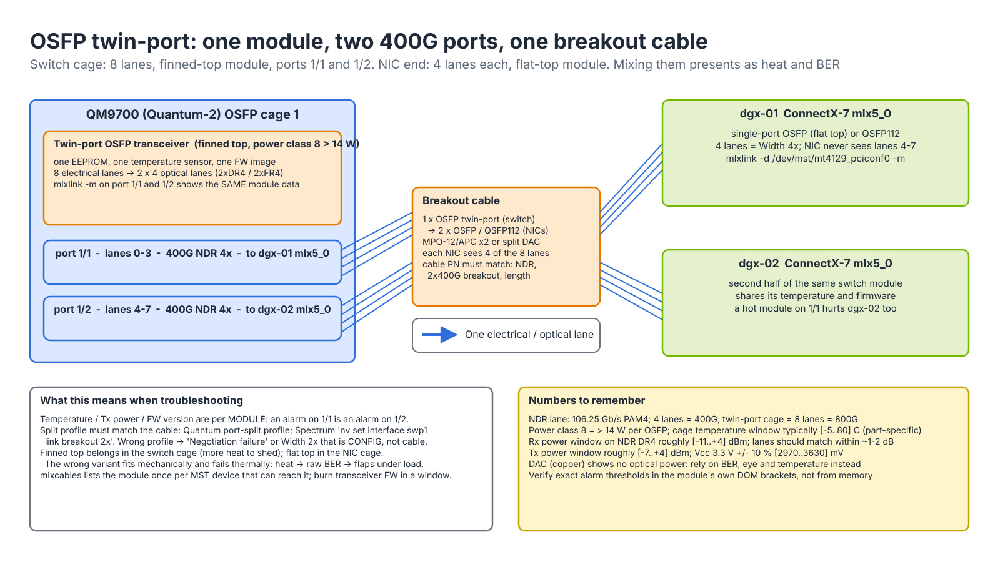

# Module 8.3 — mlxlink, mlxcables and the MFT Debug Tools

> **Exam domain:** Troubleshooting Tools (20%)  
> **Source course(s):** MLXlink and MLX Cable Debug Tools (NVIDIA Academy)  
> **Source docs:** NVIDIA Firmware Tools (MFT) User Manual — mlxlink Utility, mlxcables Utility, mlxconfig, mlxfwmanager, mlxfwreset, mst; Cumulus Linux "Troubleshoot Layer 1" chapter; ConnectX-7 / OSFP transceiver and cable documentation  
> **Estimated study time:** 3.5 hours

> **How to study this module:** read §1–§2, work through the §3 walkthrough on real gear or NVIDIA Air, then attempt the §5 hands-on assignment using only the Hint section. Open the Solution guide (last section) only after you have a working attempt. Finish with the Appendix C knowledge check closed-book.

## 1. Learning objectives

By the end of this module you will be able to:

- **Configure** the **MFT** environment (`mst start`, `mst status -v`) and map a `/dev/mst/...` device path to a NIC or switch port. *(Troubleshooting Tools — MFT basics)*
- **Describe** the four sections of **mlxlink** output (Operational, Supported, Troubleshooting, Tool) and read the Troubleshooting recommendation first. *(Troubleshooting Tools — mlxlink)*
- **Troubleshoot** a physical link with `mlxlink -m`, `-c`, `-e`, `--show_fec`, `--rx_fec_histogram`, judging BER, FEC and optical-power values against normal thresholds. *(Troubleshooting Tools — layer-1 diagnosis)*
- **Verify** and update cable/transceiver EEPROM and firmware with **mlxcables**. *(Troubleshooting Tools — cable tools)*
- **Configure** NIC firmware parameters with **mlxconfig** (link type, SR-IOV, VF count, advanced PCIe) and apply them with `mlxfwreset`. *(InfiniBand / Spectrum Networking — adapter configuration)*
- **Verify** and upgrade firmware with mlxfwmanager / mlxup. *(Troubleshooting Tools — firmware)*
- **Compare** `mlxlink`, `ethtool -m` and `iblinkinfo`, and **write** a structured flapping-link and degraded-width runbook. *(Troubleshooting Tools — tool selection)*

## 2. Key technical concepts

### 2.1 MFT and mst: the handle to the silicon

**Analogy.** The OS network stack is the car's dashboard. MFT is the OBD-II port under the steering column: it talks straight to the engine controller whether or not the dashboard works. `mst` is the adapter cable that gives each tool a socket to plug into.

**What it is.** **MFT** (NVIDIA Firmware Tools, formerly Mellanox Firmware Tools) is a user-space toolkit (**mlxlink**, **mlxcables**, **mlxconfig**, `mlxfwmanager`, `mlxfwreset`, `flint`, `mlxreg`, `mlxdump`) plus a small kernel driver set, **mst** (Mellanox Software Tools). It talks to ConnectX/BlueField NICs and to Spectrum/Quantum switch ASICs through the device's own register interface, not through `mlx5_core`, the netdev or the verbs stack. It ships as the `mft` package (bundled with MLNX_OFED / DOCA-Host) and is preinstalled on Cumulus Linux, MLNX-OS and NVOS switches. Figure 8.3-1 places every MFT tool against the layer of the device it reads or writes.


*Figure 8.3-1 — The MFT stack: every tool goes through a `/dev/mst` handle to the firmware's access registers; `ibstat`/`ethtool` read the driver instead.*

`mst start` loads two kernel modules and creates device nodes under `/dev/mst/`:

| Node | Kernel module | Access path | When it matters |
|---|---|---|---|
| `/dev/mst/mt4129_pciconf0` | `mst_pciconf` | Through a vendor-specific capability in the device's **PCI configuration space**: a small window (address, data, semaphore registers) through which the tool reads and writes the internal configuration-register space ("cr-space") one word at a time | Always available, works even if `mlx5_core` is not loaded or the function is hung. Slower, but it is the default on current MFT and the path the exam shows |
| `/dev/mst/mt4129_pci_cr0` | `mst_pci` | Memory-mapped **cr-space** through a PCI BAR | Faster bulk access (dumps, firmware burn); not created on every device/firmware combination, and secure-firmware devices can restrict it |

The number in the name is the PCI device ID: `mt4129` = ConnectX-7, `mt4125` = ConnectX-6 Dx, `mt41692` = BlueField-3, `mt53104` = Spectrum-3. Read them from `mst status`; do not memorize.

**Why it exists.** Everything the OS shows you is a summary that the driver chose to export: `ibstat` says `LinkUp` and `Rate: 400`, `ethtool` says `Speed: 400000Mb/s`. Neither tells you that lane 2 receives 10 dB less light than lane 0, that the FEC corrected eight symbols per codeword last hour, or that the module is at 77 °C. Those facts live in the PHY and the module, and only the firmware can read them. MFT exists so that you can (1) see below the driver, (2) do it when the driver is broken or not loaded (pciconf needs only PCI enumeration), (3) use one tool syntax on host NICs *and* switch ASICs, and (4) need no SM, no IP address and no fabric — a port that never trained is exactly the port you most need to inspect.

**How it works.** The firmware exposes its state as **access registers** defined in the device's Programmer's Reference Manual (PRM). A tool builds a register request (register ID, method Get/Set, index fields such as `local_port`), pushes it through the mst handle into the firmware's command mailbox, and the firmware fills in the payload. mlxlink is a friendly front-end over a handful of them (names as they appear in `mlxreg --show_regs`; verify against your MFT release):

| Register | Contents | mlxlink section that prints it |
|---|---|---|
| **PDDR** (Port Diagnostics Database) | Operational info (state, speed, width, FEC, AN), troubleshooting info (status opcode + recommendation text), PHY info, module info | default output, `Troubleshooting Info` |
| **PPCNT** (Ports Performance Counters) | Physical-layer counter groups: per-lane raw errors and BER, effective errors, symbol errors, link-down and recovery counts, the RS-FEC histogram | `-c`, `--rx_fec_histogram` |
| **PMAOS** (Port Module Admin/Oper Status) | Module plugged / unplugged / error, error type (e.g. power budget exceeded, unsupported cable) | `Cable is unplugged`, module-error opcodes |
| **PAOS**, **PTYS**, **PPLM**, **PPLR** | Port admin state, enabled/operational speeds, FEC mode, loopback | `-a`, `--speeds`, `--fec`, `-l` |
| **MCIA** | Raw module EEPROM (CMIS / SFF-8636 pages) | `-m`, and `mlxcables` |
| **SLRG** | SerDes lane receive grade (eye margin) | `-e` |

You can read any of them directly: `sudo mlxreg -d /dev/mst/mt4129_pciconf0 --reg_name PPCNT --get --indexes "local_port=1,pnat=0,grp=0x12"` (group number illustrative; `mlxreg --reg_name PPCNT --show_reg` lists fields). Support bundles (`sysinfo-snapshot.py`, `cl-support`) do exactly that.

```bash
$ sudo mst start
Starting MST (Mellanox Software Tools) driver set
Loading MST PCI module - Success
Loading MST PCI configuration module - Success
Create devices
$ sudo mst status -v
PCI devices:
------------
DEVICE_TYPE             MST                           PCI       RDMA            NET                       NUMA
ConnectX7(rev:0)        /dev/mst/mt4129_pciconf0      17:00.0   mlx5_0          net-ibp23s0               0
ConnectX7(rev:0)        /dev/mst/mt4129_pciconf1      3b:00.0   mlx5_1          net-ibp59s0               0
```

`mst status -v` is the Rosetta stone: MST device ↔ PCI address ↔ RDMA device (`mlx5_0`) ↔ netdev ↔ NUMA node. Recent MFT releases also accept the PCI address (`-d 17:00.0`) or the RDMA name (`-d mlx5_0`), so `mst start` is sometimes optional, but the exam expects the `/dev/mst/` path. On a UEFI Secure Boot host the unsigned `mst_*` modules may refuse to load; in that case use the PCI/RDMA-name form, which MFT can route through the driver (verify for your MFT version).

On switches the device is the ASIC and you add a port number:

| Platform | Typical invocation |
|---|---|
| Cumulus Linux (Spectrum) | `sudo mlxlink -d /dev/mst/mt53104_pci_cr0 -p 1` — or, since Cumulus 5.x, `sudo mlxlink -d <pci-bdf> -p <swp#>`; run `sudo mst status` on the switch to find the device. Port numbering uses the ASIC port label, which for split ports differs from `swpN` — check `nv show interface swp1 link` for the mapping |
| MLNX-OS / NVOS (Quantum, Spectrum) | `show interfaces ib 1/1 transceiver` / `show interfaces ib 1/1 counters` read the same registers; `mlxlink` directly via `_shell`/debug mode only with support guidance |
| UFM | Exposes the same cable info and BER per port in the GUI/REST API |

Failure modes you will meet: `-E- Failed to open device` (no `mst start`, or a typo in the node name); healthy output for a port you know is broken (wrong `pciconfN` — the suffix is enumeration order, not `mlx5_N`); `mst status` empty (modules not loaded, Secure Boot, or the device fell off the PCI bus — check `lspci -d 15b3:`).

**Why the exam cares.** "Which command maps `/dev/mst/mt4129_pciconf1` to `mlx5_1`?" → `mst status -v`. Running mlxlink on the wrong `pciconf` is the classic multi-rail mistake, and "MFT works without the driver and without an SM" is a frequent distractor discriminator.

### 2.2 Inside an NDR link: PAM4 lanes, RS-FEC and the three error numbers

**Analogy.** Raw BER is typos per million characters typed. FEC is autocorrect. Effective BER is the typos autocorrect *missed*, the only ones the reader ever sees. A fast typist with autocorrect produces plenty of raw typos and a clean document. You do not fire the typist for raw typos; you worry when autocorrect starts missing.

**What it is.** An NDR 4X port is four independent serial **lanes**, each running **PAM4** (four amplitude levels, 2 bits per symbol) at **106.25 Gb/s** signalling, i.e. 53.125 GBd. Four lanes give 425 Gb/s on the wire; after RS-FEC parity and line-code overhead that carries 400 Gb/s of data. (HDR is 4 × 53.125 Gb/s PAM4; EDR 4 × 25.78125 Gb/s NRZ.) The data is protected by **RS-FEC (544,514)**, the Reed-Solomon code IEEE calls "KP4": each codeword is 544 ten-bit symbols, 514 carrying data and 30 parity, and the decoder can correct up to **t = 15 bad symbols per codeword** (half the parity count). Three numbers then describe the link's health (Figure 8.3-2):

| Number | Where it is measured | What it counts | Normal on a healthy NDR / 100G-per-lane PAM4 link |
|---|---|---|---|
| **Raw (pre-FEC) BER**, per lane | FEC decoder input | bits the decoder had to fix ÷ bits received | Non-zero by design. ~1e-12…1e-8 is comfortable; up to roughly 1e-6 is still within budget; worse than ~1e-6…1e-5 means the margin is gone. Lanes should be within an order of magnitude of each other |
| **Effective (post-FEC) BER** / **Effective Physical Errors** | FEC decoder output | codewords the decoder could *not* correct (16+ bad symbols) | Essentially zero. `15E-255` is mlxlink's way of printing "none observed"; the design target is better than 1e-12 (Ethernet's floor) and a healthy NDR link should behave like 1e-15 or better |
| **Symbol errors** | Link layer | packets the link layer received damaged because an uncorrectable codeword hit them — what `perfquery SymbolErrorCounter` and UFM count | Zero, or not incrementing |


*Figure 8.3-2 — Inside one NDR link: errors are born in the SerDes, module or fiber, counted per lane as raw BER, removed by RS-FEC (544,514), and only what FEC misses reaches the link layer.*

**Why it exists.** PAM4 doubles bits per symbol by squeezing three eyes into the voltage swing an NRZ eye used to own; each eye is a third of the height, a signal-to-noise penalty of roughly 9.5 dB. At 53 GBd over a few metres of copper or a pair of connectors, that guarantees a stream of raw bit errors. The industry answer is to stop pretending the wire is clean and add a strong FEC: 30 parity symbols (≈5.8 % overhead) buy enough correction that a raw BER in the 1e-4 range (the IEEE design point for random errors) still produces an output below 1e-13, at the cost of a fixed decode latency in the tens-of-nanoseconds to ~100 ns range. Operationally you never run near that cliff, because real errors arrive in bursts (one bad symbol often drags neighbours with it) and temperature drifts the margin; hence the conservative ~1e-6…1e-5 alarm band.

The rate arithmetic tells you why "zero effective errors" is the only acceptable target: at 425 Gb/s, a post-FEC BER of 1e-12 is 0.4 errors per second (one every ~2.5 s); 1e-15 is one every ~40 minutes. Every uncorrected codeword corrupts a packet; on InfiniBand the receiver drops it on a bad CRC, the sender's transport retries after a timeout, and an NCCL ring stalls behind the retry. Enough of them and the QP's retry counter runs out: `IBV_WC_RETRY_EXC_ERR`, "NCCL WARN … error 12".

**How it works.**
1. The far-end SerDes encodes data into 514-symbol blocks, the RS encoder appends 30 parity symbols, and the codeword is striped across the four lanes and driven as PAM4.
2. Each lane crosses module, fiber (or copper) and connectors; noise, reflections, crosstalk, dirt and heat flip symbols. Those flips are raw errors and are counted **per lane**, so a single dirty fiber or a dying laser shows up as one lane being 100–1000× worse than its siblings.
3. The local decoder corrects up to 15 symbols per codeword. Each codeword's corrected-symbol count is binned in the **FEC histogram** (Section 2.5). A codeword with 16 or more bad symbols is uncorrectable: it increments **Effective Physical Errors** and the corrupted data is handed up.
4. The link layer sees a bad packet: `SymbolErrorCounter`/`PortRcvErrors` rise; if errors persist the PHY may drop and retrain the link (`LinkErrorRecovery`, `LinkDowned`).

Observe it with `mlxlink -d <dev> -c` (raw/effective per lane), `--rx_fec_histogram --show_histogram`, `--show_fec` (supported and active FEC per speed), and upstream with `perfquery` (Module 8.1). The diagnosis follows from *where* in Figure 8.3-2 the errors are born: one lane bad means connector, fiber lane or far-end Tx lane; all lanes bad means module heat, cable length/type, firmware or the port itself.

**Why the exam cares.** Non-zero raw BER with zero effective BER is **healthy**. Candidates who RMA a cable for raw 1e-9 fail that question; candidates who ignore a single lane 1000× worse than its siblings miss the next one. Remember 106.25 Gb/s per lane, 4 lanes, RS-FEC (544,514), t = 15.

### 2.3 Link training, status opcodes and mlxlink output anatomy

**Analogy.** A doctor's chart has four blocks: vitals now (Operational), what the patient is capable of (Supported), the doctor's note (Troubleshooting), and the lab's equipment versions (Tool). Read the doctor's note first.

**What it is.** `mlxlink -d <dev> [-p <port>]` with no other flags reads PDDR and prints four sections. The Troubleshooting section carries a **Status Opcode** and a plain-text **Recommendation** — firmware's own diagnosis of the last link-training attempt. Illustrative output, healthy ConnectX-7 NDR port:

```text
Operational Info
----------------
State                           : Active
Physical state                  : LinkUp
Speed                           : IB-NDR
Width                           : 4x
FEC                             : Standard_RS-FEC - (544,514)
Loopback Mode                   : No Loopback
Auto Negotiation                : ON

Supported Info
--------------
Enabled Link Speed (Ext.)       : 0x00000e00 (NDR,HDR,EDR)
Supported Cable Speed (Ext.)    : 0x00000e00 (NDR,HDR,EDR)

Troubleshooting Info
--------------------
Status Opcode                   : 0
Group Opcode                    : N/A
Recommendation                  : No issue was observed

Tool Information
----------------
Firmware Version                : 28.41.1000
amBER Version                   : 2.19
MFT Version                     : mft 4.28.0-92
```

| Section | What to look at |
|---|---|
| **Operational Info** | `State`/`Physical state` (same semantics as `ibstat`); `Speed` (IB-NDR, IB-HDR, 400G…); `Width` (4x/2x/1x — the degraded-cable tell); `FEC` (RS-FEC 544,514 is expected at NDR and 100G-per-lane Ethernet; `No FEC` on a 400G link is wrong); `Loopback Mode`; `Auto Negotiation` |
| **Supported Info** | What the port *can* do and what the *cable* says it can do. If `Supported Cable Speed` lacks NDR, the cable is the limit, not the port |
| **Troubleshooting Info** | `Status Opcode` + `Recommendation`. 0 = fine. Non-zero codes carry text such as `Negotiation failure`, `Remote faults detected`, `Cable is unplugged`, `Signal not detected`, `Link partner does not support FEC`, `Speed degradation`, `Bad signal integrity`. `Group Opcode` says which block (PHY firmware, PHY hardware, module/cable) raised it |
| **Tool Information** | Firmware and MFT versions — link-training fixes ship in NIC firmware; the amBER version identifies the diagnostics format |

**Why it exists.** A link that is down or degraded has failed at a specific step of bring-up, and only the PHY firmware saw which step. Without the opcode you are left inferring from symptoms (`Polling` could be an absent module, a dead far end, a speed mismatch or a dirty fiber); with it, firmware tells you which branch you are on before you touch hardware. The Supported section exists because three parties must agree on speed — local port, far port and the cable's EEPROM — and the slowest one wins.

**How it works.** Bring-up of a port is a sequence; every step can fail with its own opcode:
1. **Module detection.** The cage senses a module (PMAOS `plugged`), reads its EEPROM identifier and power class, and powers it up through the CMIS module state machine (low-power → ready). Fails as `Cable is unplugged`, or a module error such as power budget exceeded (a class-8 module in a cage that cannot supply it).
2. **Speed/width negotiation.** The two ends exchange training sequences (InfiniBand) or auto-negotiation pages (Ethernet over copper) and pick the highest speed in the intersection of local enabled speeds, far-end speeds and the cable's advertised speeds, plus the FEC mode. Fails as `Negotiation failure` / `Link partner does not support FEC` — almost always configuration: one side forced (`--speeds … --link_mode_force`), mismatched FEC, or a split/breakout profile that does not match the cable (Section 2.9).
3. **Lane equalization (link training proper).** Each receiver adapts its CTLE and DFE taps and can ask the far transmitter to adjust its pre-emphasis (FIR taps) until the eye opens. Fails as `Signal not detected`, `Bad signal integrity`, or training succeeds on only some lanes, giving `Width 2x`/`1x` and `Speed degradation`.
4. **Alignment and FEC lock.** Lanes are deskewed and the FEC locks on codeword boundaries. Physical state → `LinkUp`.
5. **Logical bring-up.** On InfiniBand the SM then moves the port Init → Armed → Active (Module 8.1); on Ethernet the netdev goes up. From here on, health is the counters of Section 2.5.

Numeric opcodes differ between firmware generations, so read the Recommendation text, not the number. Map the outcome: `Width: 2x` → step 3 on two lanes (cable/fiber/module); `Polling` + `Cable is unplugged` → step 1; `Negotiation failure` → step 2, fix configuration on *both* ends before touching cables.

**Why the exam cares.** It shows a snippet and asks what to do. `Width: 2x` → cable. `Polling` + `Cable is unplugged` → cable/transceiver not detected. `Negotiation failure` → speed/FEC mismatch, often one side forced. Opcode 0 at this instant does not clear a link that flaps — that is what counters are for.

### 2.4 Module information (`-m`): DOM, CMIS pages and what the light is doing

**Analogy.** Four garden hoses in a bundle. Rx power per lane is the water pressure at each nozzle. Three strong, one trickle: one hose is kinked or leaking.

**What it is.** Every active optical module (and the EEPROM of a passive copper cable) carries an identity block and, for optics, **Digital Optical Monitoring (DOM)**: live per-lane readings and the vendor's alarm/warning thresholds. OSFP, QSFP-DD and QSFP112 modules use the **CMIS** memory map; older QSFP28/QSFP56 use SFF-8636. CMIS organises it in pages of 128 bytes:

| CMIS page | Contents | Fields you see in `-m` |
|---|---|---|
| Lower page 00h | Identifier, module state, module-level flags, case temperature, supply voltage | `Identifier`, `Temperature`, `Voltage` |
| Upper page 00h | Vendor name, part number, serial, date code, media type, length, power class | `Vendor Name/Part/Serial Number`, `Transfer Distance`, `Power Class` |
| Page 01h | Advertising: supported applications (e.g. 400GBASE-DR4, twin-port 2×400G), module firmware version | `Compliance`, `FW Version` |
| Page 02h | Alarm/warning thresholds for temperature, voltage, bias, Tx and Rx power | the `[low..high]` brackets |
| Pages 10h/11h | Per-lane control and status: Tx/Rx power, laser bias, LOS/LOL flags, data-path state | `Rx/Tx Power Current`, `Bias Current`, `LOS Alarm` |

`mlxlink -d <dev> -m` (`--show_module`) reads them through MCIA:

```text
Module Info
-----------
Identifier                      : OSFP
Compliance                      : 400GBASE-DR4, 800G-2xDR4 (Twin-port)
Cable Technology                : 1310 nm DFB, Single-mode
Vendor Name                     : NVIDIA
Vendor Part Number              : MMA4Z00-NS
Vendor Serial Number            : MT2342FT01234
Transfer Distance [m]           : 500
FW Version                      : 46.130.1104
Power Class                     : 8 (>14W)
LOS Alarm                       : Rx: ____ Tx: ____
Temperature [C]                 : 54 [-5..80]
Voltage [mV]                    : 3284 [2970..3630]
Bias Current [mA]               : 61.2,60.8,61.5,61.1
Rx Power Current [dBm]          : 0.8,0.6,0.9,-14.2 [-11.1..4.0]
Tx Power Current [dBm]          : 1.9,1.8,2.0,1.9 [-7.0..4.0]
```

**Why it exists.** Most physical faults are optical, and optical faults are invisible to every layer above the module: a dirty ferrule costs 6 dB, the link still trains on three lanes, and the only fingerprint is one low Rx number. DOM turns the module into an instrument, and the thresholds in page 02h make it self-describing, so you judge each part against its own spec rather than against numbers from memory.

**How it works.** Read the fields in this order:
- **Rx power per lane** — the money field. Power is in dBm: 0 dBm = 1 mW, −10 dBm = 0.1 mW, and every 3 dB is a factor of two. Healthy DR4/SR4 lanes typically sit somewhere between about −3 and +3 dBm and **within ~1–2 dB of each other**; judge absolute values against the bracket, which is the module's own alarm window. In the sample, lane 3 at **−14.2 dBm** against ~+0.7 dBm on its siblings is 15 dB (≈30×) down and below the low alarm: a dirty, broken or disconnected fiber on that lane, or a dead far-end transmitter lane. Expect 2x training, raw BER on that lane, or no link.
- **Tx power per lane** — what *this* module launches. Low Tx here means this module's laser is failing; the far end sees it as low Rx. Always read both ends before replacing anything.
- **Bias current per lane** — the laser drive current (mA). Lasers age by needing more current for the same light; one lane's bias drifting up while its Tx power sags is a laser at end of life. DFB/EML single-mode lasers run tens of mA, VCSEL multimode lasers single-digit mA; compare lanes, not datasheets.
- **Temperature** — case temperature against the bracket (commercial modules are specified roughly 0–70 °C case, alarms near 75–80 °C; verify per part). Within ~10 °C of the ceiling under load is a cooling problem (cage airflow, wrong heatsink variant) that drives BER up and flaps the link at the busiest hour.
- **Voltage** — 3.3 V supply; out of range is a cage power-delivery fault, rare.
- **LOS/LOL flags** — per-lane loss-of-signal / loss-of-lock, latched by the module.
- **Vendor PN/SN, FW Version** — confirm the part is NDR-rated and the right length; PN, SN and the DOM snapshot are what you put in an RMA. Active cables and optics have firmware of their own, updated with `mlxcables` (Section 2.7).

DAC (passive copper) cables have no lasers: power, bias and LOS show N/A, and you rely on BER, eye grade and temperature instead. ACC/AEC (active copper) cables have retimers or redrivers but still no optics.

**Why the exam cares.** "One lane at −40 dBm, three at +0.8" → fiber/connector on that lane or far-end Tx; "both ports of a twin-port cage hot" → airflow/heatsink, not cable.

### 2.5 Counters, BER and the FEC histogram (`-c`, `-e`, `--show_fec`, `--rx_fec_histogram`)

**What it is.** `mlxlink -d <dev> -c` (`--show_counters`) prints the PPCNT physical-layer counters accumulated since the last clear:

```text
Physical Counters and BER Info
------------------------------
Time Since Last Clear [Min]              : 1420.3
Effective Physical Errors                : 0
Effective Physical BER                   : 15E-255
Raw Physical Errors Per Lane             : 1201,1189,1340,98811
Raw Physical BER Per Lane                : 2E-10,2E-10,2E-10,1E-8
Link Down Counter                        : 0
Link Error Recovery Counter              : 0
Symbol Errors                            : 0
```

`--rx_fec_histogram --show_histogram` prints how many codewords needed 0, 1, 2 … 15 symbol corrections (layout varies by MFT version; illustrative):

```text
FEC Histogram
-------------
Bin 0  (0 errors)   : 9812003344120
Bin 1  (1 error)    : 4120033
Bin 2               : 102
...
Bin 15              : 0
```

`-e` (`--show_eye`) reports per-lane receiver margin (SLRG: eye height/phase, or a "grade" on newer SerDes), and `--show_fec` the supported and active FEC per speed.

**Why it exists.** The three numbers of Section 2.2 are averages; averages hide the two things you actually need to predict failure: *which lane* and *how close to the cliff*. Per-lane raw counts localise the fault; the histogram shows the distribution of corrections, so you can see a link heading for uncorrectables days before the first one appears. Eye margin answers "is this a marginal lane or a broken one?" without any traffic at all.

**How it works.**
- **Interpreting the counters.** In the sample, lane 3's raw BER is 50× worse than its siblings (1e-8 vs 2e-10) but still corrected (effective = 0): the link works, and lane 3 is the one that will fall over when the module warms up. One lane off = connector/fiber lane problem; all four elevated = cable length/quality, heat, or the host-side SerDes; rising **effective** errors or symbol errors = packets are being corrupted now → replace.
- **Reading the histogram.** Random, independent errors give an exponential decay: each bin is orders of magnitude smaller than the one before, and the counts reach zero within the first few bins. Three shapes matter. (1) *Steep decay, empty beyond bin ~3*: healthy. (2) *A long, flat tail into bins 8–15*: burst errors — a reflection, crosstalk or DFE error propagation that corrupts many symbols in one codeword. The average raw BER may look fine, yet those codewords are a few symbols from uncorrectable; this is the early warning that raw BER alone hides. (3) *Counts in bin 15 and Effective Physical Errors rising*: the code is saturated. The histogram is the best early warning for a cable that *will* fail; `--clear_histogram` resets it.
- **Eye margin.** Compare lanes on the same port, or before/after a cable change; the grade is relative. With `--port_type PCIE` the same option margins the host-to-NIC PCIe link — how you prove a Gen5 x16 slot really runs Gen5 x16 for a GPUDirect path.
- **Rates, not totals.** Counters accumulate since the last clear; `Time Since Last Clear` of days makes the numbers meaningless. Clear (`mlxlink -d <dev> -c --clear_counters`; older releases used `-pc`/`--clear` — verify the flag), wait a fixed window (60–600 s), read again, and judge the delta. Capture before you clear: clearing destroys evidence.

**Why the exam cares.** Non-zero raw BER with zero effective BER = **healthy**. Counts piling up near bin 15 = FEC about to fail. "Since boot" totals are not a diagnosis.

### 2.6 Changing link parameters at runtime (`-a`, `--speeds`, `--fec`, `-l`)

**What it is.** mlxlink can also *write* PAOS/PTYS/PPLM/PPLR: admin state, advertised speeds, FEC mode and loopback.

| Flag | Effect | When |
|---|---|---|
| `-a UP` / `-a DN` / `-a TG` (`--port_state`) | Admin up / down / toggle the port at the PHY | Bounce a flapping link; isolate a bad link. Do **not** `DN` your own path to an unmanaged switch; on Socket-Direct NICs disable both MST devices of the port |
| `-s <speed>` / `--speeds NDR,HDR` | Restrict advertised speeds; with `--link_mode_force` disable auto-negotiation | Pin a link at HDR to stabilize while waiting for a replacement cable |
| `-k <mode>` / `--fec RS|NF|AU…` with `--fec_speed` | Override FEC for a speed (other modes such as low-latency RS exist on some speeds) | Only when the far end cannot negotiate; mismatch gives `Negotiation failure`. Default AU (auto) is almost always right |
| `-l PH|RM|EX|NO` (`--loopback`) | PHY internal (Tx→Rx), remote, external, none | Isolate the host port from the cable: internal loopback clean → the port is fine, blame cable/far end |
| `--port_type PCIE` | Operate on the NIC's PCIe link | Verify PCIe gen/width/margin for a GPUDirect-bound NIC |

**Why it exists.** Diagnosis needs controlled experiments: bounce a link to force a clean retrain, drop to HDR to see whether errors are speed-dependent (they usually are on a marginal channel), or loop the PHY back on itself to remove the cable and the far end from the question.

**How it works.** Each change is a register Set that firmware applies immediately and the port retrains; nothing is written to non-volatile memory, so the change is lost at reboot or firmware reset. A PHY loopback (`-l PH`) routes the transmitter straight back into the local receiver inside the SerDes; the counters then measure only the port's own silicon. Persistent link settings belong in `mlxconfig` (host) or NVUE on the switch (`nv set interface swp1 link speed 400G`, `nv set interface swp1 link fec rs`). Forcing anything on one end only is the commonest self-inflicted outage (Section 4.4).

### 2.7 mlxcables: the cable as a device

**What it is.** **mlxcables** addresses the cable/transceiver itself as an MST device (`mt4129_pciconf0_cable_0`): raw EEPROM page reads and writes, DDM, and **transceiver firmware updates**, which `mlxlink -m` does not do.

```bash
$ sudo mlxcables                              # list detected cables as mst cable devices
Cable #1:
  Device:    mt4129_pciconf0_cable_0
  Identifier: OSFP
  Vendor:    NVIDIA   PN: MMA4Z00-NS   SN: MT2342FT01234   FW: 46.130.1104
$ sudo mlxcables -d mt4129_pciconf0_cable_0        # summary (same fields as mlxlink -m)
$ sudo mlxcables -d mt4129_pciconf0_cable_0 --dump # raw EEPROM pages (CMIS for OSFP/QSFP-DD)
$ sudo mlxcables -d mt4129_pciconf0_cable_0 --read -p 0 -o 128 -l 16   # page/offset/length read
$ sudo mlxcables -d mt4129_pciconf0_cable_0 --DDM  # digital diagnostics (temp, volt, power)
$ sudo mlxcables -d mt4129_pciconf0_cable_0 -q     # query firmware
$ sudo mlxcables -d mt4129_pciconf0_cable_0 -i <fw-image.bin> -b   # burn/update transceiver firmware
```

**Why it exists.** NDR and 800G optics are small computers with DSPs and firmware, and NVIDIA ships link-stability and interop fixes in transceiver firmware. Fleet-wide "all links using PN X flap under heat" problems are fixed by burning modules, not by replacing them; and raw page dumps are what support needs when the summary fields are not enough.

**How it works.** `mst cable add` (on some MFT versions `mst start --with_cables` or `mst cable add --with_ib`; verify in current MFT docs) enumerates the modules reachable from each MST device and creates cable nodes. Reads go through MCIA to the module's two-wire management bus; a firmware burn writes the image into the module's inactive bank and switches banks, during which the link drops — schedule a maintenance window, and do both ends of a link together if the release notes require matched versions.

### 2.8 mlxconfig and the firmware tools

**Analogy.** `mlxlink -a` is adjusting the thermostat; `mlxconfig` is rewiring the furnace — it is permanent, and you must restart the system for it to take.

**What it is.** **mlxconfig** reads and sets the *non-volatile* (NV) firmware configuration of a NIC; changes take effect after `mlxfwreset` or a reboot. The firmware tools manage the firmware image itself.

```bash
$ sudo mlxconfig -d /dev/mst/mt4129_pciconf0 q
Configurations:                              Next Boot
         LINK_TYPE_P1                        IB(1)
         NUM_OF_VFS                          0
         SRIOV_EN                            False(0)
         ADVANCED_PCI_SETTINGS               False(0)
$ sudo mlxconfig -d /dev/mst/mt4129_pciconf0 s LINK_TYPE_P1=2 SRIOV_EN=1 NUM_OF_VFS=8
$ sudo mlxfwreset -d /dev/mst/mt4129_pciconf0 reset     # applies without reboot (link drops)
$ sudo mlxconfig -d /dev/mst/mt4129_pciconf0 r          # reset params to firmware defaults
```

| Parameter | Values | Why |
|---|---|---|
| `LINK_TYPE_P1` (`_P2` for port 2) | `1`=IB, `2`=ETH, `3`=VPI/auto on VPI-capable cards | Switch between InfiniBand and Ethernet/RoCE; `ibstat` `Link layer` reflects it after reset |
| `SRIOV_EN` / `NUM_OF_VFS` | True/False, 0–N | VF-based Kubernetes networking (`../07-kubernetes/`) |
| `ADVANCED_PCI_SETTINGS` | True/False | Unlocks `MAX_ACC_OUT_READ` and other PCIe tuning for GPUDirect/RoCE at 400G on Gen5 |
| `ATS_ENABLED`, `PCI_WR_ORDERING` | — | Platform-specific PCIe/ATS tuning; follow DGX/BlueField guides |
| `INTERNAL_CPU_MODEL` / `INTERNAL_CPU_OFFLOAD_ENGINE` | BlueField only | DPU vs NIC mode (`../05-bluefield-doca/`) |
| `ROCE_CC_PRIO_MASK_P1`, `CNP_DSCP_P1`, `CNP_802P_PRIO_P1` | — | RoCE CC defaults; usually left to OS-level `mlnx_qos` |

**Why it exists.** Some properties must be fixed before the driver even probes the device — how many PCI functions to expose, which protocol each port speaks, PCIe behaviour — so they live in flash and are read by firmware at boot. Separating them from runtime settings (mlxlink, ethtool) makes a NIC's identity reproducible across reboots, and separating the firmware *image* (mlxfwmanager) from its *configuration* (mlxconfig) means an upgrade does not silently reset your settings.

**How it works.** `mlxconfig q` shows Default / Current / Next Boot columns (`-e` for all three); `s` writes the Next Boot value; `mlxfwreset reset` (or a cold reboot) makes firmware reload and Next Boot becomes Current. `mlxconfig -d <dev> i` shows parameter descriptions. Port 1 IB and port 2 Ethernet on one dual-port card is legitimate. Firmware: `mlxfwmanager --query` (firmware + PSID per NIC; the PSID identifies the board variant and must match the image), `-u`/`-i <bin>` to update, `--online` to fetch; `mlxup` is the standalone updater (`mlxup --online -u`); `flint -d <dev> q` is low-level; `mlxfwreset -d <dev> query|reset`. NDR SerDes tuning and transceiver interop fixes arrive as NIC firmware, so "upgrade to the recommended firmware" is a legitimate first step for a fabric-wide BER problem and mandatory before RMA.

### 2.9 Tool selection and OSFP twin-port

**What it is.** Three tools look at a link from three altitudes, and on Quantum-2 the physical object you are diagnosing (an OSFP module) is shared by two logical ports.

| | `mlxlink` | `ethtool -m <netdev>` / `ethtool <netdev>` | `iblinkinfo` |
|---|---|---|---|
| Layer | PHY/SerDes and module registers via MFT | Linux netdev view (SFF/CMIS EEPROM; speed/FEC) | IB link layer via MADs |
| Scope | One port at a time, any NVIDIA port (host or switch) | Ethernet netdevs on the local host only (no IB ports) | Every link in the IB subnet, from one host |
| Depth | Per-lane BER, FEC histogram, eye, opcodes, loopback, admin control | Module vendor/PN/power/temp; speed/duplex/FEC; counters via `ethtool -S` | Width/speed/state and "Could be 4X" |
| Needs | MFT, root; no SM | Nothing beyond the driver | Active port + SM |
| Use it for | *Why* a specific link is bad | Quick RoCE host checks, scripting | *Which* link in the fabric is bad |


*Figure 8.3-4 — OSFP twin-port: one module, eight lanes, two 400G ports, and a breakout cable to two NICs — so one module's heat or firmware affects both ports.*

**Why it exists.** Twin-port doubles front-panel density: a 1U QM9700 exposes 64 NDR ports through 32 OSFP cages, each module carrying 2 × 4 lanes (800G). The price is shared fate.

**How it works.** NDR Quantum-2 switches use **OSFP twin-port** cages; ConnectX-7 NDR NICs use single-port OSFP or QSFP112 (Figure 8.3-4). Consequences: switch ports `1/1` and `1/2` share one module, so a hot transceiver, low Tx or a firmware bug shows on *both*; breakout cables (one twin-port switch end → two 400G NIC ends) put each NIC on 4 of the module's 8 lanes, so the NIC reports a full 4x while the switch module has 8; the split configuration must match on the switch (`nv set interface swp1 link breakout 2x` on Spectrum; port split profiles on Quantum) or you get `Negotiation failure` / `Width 2x` symptoms that are configuration, not cable; power class 8 (>14 W) modules need the finned-top variant in Quantum-2 cages and flat-top in NIC cages (the NIC cage carries its own heatsink) — mixing them presents as temperature alarms and heat-driven BER. Workflow: `iblinkinfo -l | grep -i "could be"` finds *which* link, `mlxlink -m -c` on both ends explains *why*, and for a hot module check the twin-port sibling before blaming the cable.

**Why the exam cares.** `iblinkinfo` finds which link; `mlxlink` explains why; `ethtool -m` is Ethernet-only. Two ports on one module share temperature and firmware.

## 3. Live-style walkthrough: a flapping NDR link

Scenario: UFM raised "Link downed counter exceeded" three times tonight for `dgx-04 mlx5_3`; `perfquery` shows LinkErrorRecoveryCounter climbing. The job on dgx-04 keeps getting `NCCL WARN ... error 12`. You have 20 minutes before the next training epoch. Output is illustrative. Figure 8.3-3 is the run as a decision flow: each diamond is one command, a **No** exits to a fix, a **Yes** goes to the next check. The step comments below name the diamond they answer.


*Figure 8.3-3 — Flapping or degraded NDR link: get the handle, read firmware's diagnosis, then module, counters, eye and loopback; replace only with evidence.*

```bash
# ---- Step 1 (Figure 8.3-3, diamond 1): get a device handle. Without this, every MFT tool fails with "No such device".
dgx-04$ sudo mst start
Create devices
dgx-04$ sudo mst status -v | grep -E 'MST|mlx5_3'
DEVICE_TYPE             MST                           PCI       RDMA     NET            NUMA
ConnectX7(rev:0)        /dev/mst/mt4129_pciconf3      5e:00.0   mlx5_3   net-ibp94s0    0
# mlx5_3 is /dev/mst/mt4129_pciconf3 on this box. On a DGX the suffix usually tracks mlx5_N but NEVER
# assume it: a different node may enumerate differently. Decision: all commands below use pciconf3.

# ---- Step 2 (diamond 2): the overview and MFT's own diagnosis (PDDR, Section 2.3). Read Troubleshooting Info FIRST.
dgx-04$ sudo mlxlink -d /dev/mst/mt4129_pciconf3
Operational Info
State                           : Active
Physical state                  : LinkUp
Speed                           : IB-NDR
Width                           : 4x                         # full width right now (it flaps, so this is a snapshot)
FEC                             : Standard_RS-FEC - (544,514) # correct for NDR
Auto Negotiation                : ON
Supported Info
Enabled Link Speed (Ext.)       : 0x00000e00 (NDR,HDR,EDR)
Supported Cable Speed (Ext.)    : 0x00000e00 (NDR,HDR,EDR)   # cable claims NDR: not a cable-spec limit
Troubleshooting Info
Status Opcode                   : 0
Recommendation                  : No issue was observed      # at this instant. Flaps are intermittent;
                                                             # we need history, i.e. counters and module data.
# Decision: configuration (speed/FEC/AN) is consistent; it is not a Negotiation failure.
# A flapping link with correct config is almost always physical: module, fiber, connector or heat.

# ---- Step 3 (diamond 3): the module DOM (Section 2.4). Is anything marginal that would explain intermittent drops?
dgx-04$ sudo mlxlink -d /dev/mst/mt4129_pciconf3 -m
Identifier                      : OSFP
Vendor Part Number              : MMA4Z00-NS
Vendor Serial Number            : MT2342FT05517                 # write this down: it goes in the RMA
Power Class                     : 8 (>14W)
Temperature [C]                 : 77 [-5..80]                   # 3 degrees from the alarm ceiling!
Voltage [mV]                    : 3281 [2970..3630]
Rx Power Current [dBm]          : 0.7,0.8,-9.8,0.6 [-11.1..4.0] # lane 2 is 10 dB down on its siblings,
                                                                # still inside range... barely
Tx Power Current [dBm]          : 1.9,1.8,1.9,1.8 [-7.0..4.0]   # our transmitter is fine
# Decision: two independent red flags. (a) Module at 77 C — heat raises BER, and the link is cooler at
# 03:00 than under full load, which matches "flaps during training". (b) Lane 2 Rx is weak: dirty ferrule
# or damaged fiber on that lane, or the FAR END's lane-2 transmitter is dying (check its Tx later).

# ---- Step 4 (diamond 4): counters and BER (Sections 2.2 and 2.5). Does the weak lane actually produce errors, and is FEC still coping?
dgx-04$ sudo mlxlink -d /dev/mst/mt4129_pciconf3 -c
Time Since Last Clear [Min]              : 612.4
Effective Physical Errors                : 3814                  # NON-ZERO: FEC is missing errors. Real corruption.
Effective Physical BER                   : 4E-13
Raw Physical Errors Per Lane             : 1304,1288,88120311,1402
Raw Physical BER Per Lane                : 2E-10,2E-10,1E-5,2E-10 # lane 2: 1e-5, at the edge of the FEC budget
Link Down Counter                        : 3                     # matches UFM's three events
Link Error Recovery Counter              : 41
Symbol Errors                            : 3814                  # what perfquery SymbolErrorCounter sees
# Decision: this is NOT "raw BER looks scary but effective is zero" (that would be healthy).
# Effective errors and symbol errors are non-zero and lane 2's raw BER is 50,000x its siblings.
# Classic single-lane fault. Confirm with the histogram: are we living in the high bins?
dgx-04$ sudo mlxlink -d /dev/mst/mt4129_pciconf3 --rx_fec_histogram --show_histogram
Bin 0  (0 errors)   : 7712003344120
Bin 1  (1 error)    : 920331204
Bin 2               : 51230112
...
Bin 13              : 4102
Bin 14              : 1388
Bin 15              : 2117                                       # codewords at the very edge of t=15
# A healthy port has nothing above bin 3 or so. This one has a fat tail all the way to bin 15, and the
# codewords that needed 16+ corrections are the 3814 Effective Physical Errors above: FEC is saturated.

# ---- Step 5 (diamond 5): eye margin, to see if it is one lane or the whole port (host SerDes) before we touch hardware.
dgx-04$ sudo mlxlink -d /dev/mst/mt4129_pciconf3 -e
Eye Opening Info
Physical Grade                  : 72,71,19,73       # (illustrative units) lane 2 has a quarter of the margin
Height Eye Opening [mV]         : 118,121,34,120
Phase  Eye Opening [psec]       : 11,11,4,11
# Decision: three lanes excellent, one terrible. If all four were poor we would suspect the port, the
# PCIe slot's power, or firmware. One bad lane = fiber lane / connector / far-end Tx lane. Hardware swap it is.

# ---- Step 6 (diamond 6): isolate the host port from the cable — is the NIC itself clean? 30 seconds, no RMA risk.
dgx-04$ sudo mlxlink -d /dev/mst/mt4129_pciconf3 -l PH          # internal PHY loopback: Tx -> Rx inside the NIC
dgx-04$ sudo mlxlink -d /dev/mst/mt4129_pciconf3 -c --clear_counters   # (verify flag name in your MFT)
dgx-04$ sleep 60; sudo mlxlink -d /dev/mst/mt4129_pciconf3 -c | grep -E 'Effective|Raw Physical BER'
Effective Physical Errors                : 0
Raw Physical BER Per Lane                : 1E-12,1E-12,1E-12,1E-12   # all four lanes clean in loopback
dgx-04$ sudo mlxlink -d /dev/mst/mt4129_pciconf3 -l NO          # back to normal
# Decision: the NIC port is good. The problem is in the module, the fiber, or the far end.

# ---- Step 7 (diamond 7, the fix half): replace. Order of cheapness: clean+reseat -> swap transceiver -> swap fiber.
#      Tonight we swap the OSFP at the NIC end for a known-good spare (same PN, finned/flat top correct for
#      the cage), clean the MPO ferrule, reseat. Then verify the far end's Tx while we are at it:
leaf-r3-01$ sudo mlxlink -d /dev/mst/mt53104_pci_cr0 -p 4 -m | grep -E 'Tx Power|Temperature'
Temperature [C]                 : 58 [-5..80]
Tx Power Current [dBm]          : 1.8,1.9,1.9,1.8                # far-end transmitter fine on all lanes: it WAS our module/fiber

# ---- Step 8 (diamond 7, the verify half): verify. Retrain, clear, wait, re-read. The acceptance test is the same -m/-c we started with.
dgx-04$ sudo mlxlink -d /dev/mst/mt4129_pciconf3 -a TG          # toggle the port to force a clean retrain
dgx-04$ sleep 20; sudo mlxlink -d /dev/mst/mt4129_pciconf3 | grep -E 'Width|Recommendation'
Width                           : 4x
Recommendation                  : No issue was observed
dgx-04$ sudo mlxlink -d /dev/mst/mt4129_pciconf3 -m | grep -E 'Serial|Temperature|Rx Power'
Vendor Serial Number            : MT2342FT09901                  # new module
Temperature [C]                 : 56 [-5..80]                    # 21 degrees cooler: the old module was cooking
Rx Power Current [dBm]          : 0.8,0.8,0.9,0.7 [-11.1..4.0]   # four matched lanes
dgx-04$ sudo mlxlink -d /dev/mst/mt4129_pciconf3 -c --clear_counters; sleep 600
dgx-04$ sudo mlxlink -d /dev/mst/mt4129_pciconf3 -c | grep -E 'Effective|Raw Physical BER|Link Down'
Effective Physical Errors                : 0
Raw Physical BER Per Lane                : 2E-10,2E-10,2E-10,2E-10
Link Down Counter                        : 0
# And the layer that complained in the first place:
dgx-05$ ib_write_bw -d mlx5_3 -i 1 -F --report_gbits -a            # server
dgx-04$ ib_write_bw -d mlx5_3 -i 1 -F --report_gbits -a -q 4 10.0.3.5
 1048576    5000           391.88             391.80               0.047
# Decision: closed. RMA the old module (SN MT2342FT05517, PN MMA4Z00-NS, 77 C, lane 2 Rx -9.8 dBm,
# raw 1e-5, effective errors 3814, histogram bin 15 populated). That sentence IS the RMA ticket.
```

What "good" looks like: Troubleshooting opcode 0; four Rx-power lanes within ~1–2 dB and well inside range; temperature mid-range; raw BER similar across lanes and below ~1e-6; effective errors 0; histogram empty above the low bins; LinkDown/LinkErrorRecovery flat over an hour.

## 4. Troubleshooting / common gotchas

### 4.1 `mlxlink` says "No such device" or shows the wrong port

- **Symptom:** `-E- Failed to open device /dev/mst/mt4129_pciconf3` — or the output is perfectly healthy for a link you know is broken.
- **Why it happens:** `mst start` was never run (no `/dev/mst/*` nodes), or you assumed `pciconf3` = `mlx5_3` and it does not on this node.
- **How to debug:** `ls /dev/mst/`; `sudo mst status -v` and read the RDMA column; cross-check with `ibdev2netdev`.
- **Fix:** `sudo mst start`, then take the device path from `mst status -v` every time; in scripts, derive it from the RDMA name rather than hard-coding.

### 4.2 Reading raw BER as a failure

- **Symptom:** an engineer opens an RMA because `Raw Physical BER Per Lane` shows `3E-10, 2E-10, 3E-10, 2E-10`.
- **Why it happens:** PAM4 at 100G/lane is *designed* to run with raw errors that RS-FEC corrects; raw BER is never zero on a working NDR link.
- **How to debug:** look at `Effective Physical Errors` / `Effective Physical BER` and `Symbol Errors` instead; check `--rx_fec_histogram` for population above the low bins; compare lanes to each other.
- **Fix:** replace only when effective errors are non-zero or climbing, symbol errors increment, or one lane is orders of magnitude worse than its siblings. Document raw BER as context, not cause.

### 4.3 Measuring counters since boot instead of over a window

- **Symptom:** every port in the fleet "has errors"; the list is useless.
- **Why it happens:** `-c` accumulates since the last clear (`Time Since Last Clear` of days); boot-time training noise and old incidents pollute the numbers.
- **How to debug:** read `Time Since Last Clear [Min]`; if large, clear and re-read after a fixed interval.
- **Fix:** `mlxlink -d <dev> -c --clear_counters` (verify flag name), wait 60–600 s, read again; compare the *rate* against your threshold.

### 4.4 Forcing speed or FEC on one end only

- **Symptom:** after "stabilizing" a link with `--speeds HDR --link_mode_force`, the port shows `Negotiation failure` or comes up at 1x.
- **Why it happens:** auto-negotiation is off on one side and on (or forced differently) on the other; FEC override mismatched (`--fec RS` vs `NF`).
- **How to debug:** `mlxlink` on both ends; compare `Auto Negotiation`, `Speed`, `FEC`; on a Spectrum switch also `nv show interface swpX link`.
- **Fix:** return both sides to AU/auto (`--fec AU`, re-enable AN) or force identically on both ends; make persistent settings in `mlxconfig`/NVUE, not in `mlxlink`.

## 5. Hands-on assignment: link triage runbook and outlier scanner

**Scenario.** Your 8-rail DGX cluster has no UFM telemetry yet. You need a script every on-call engineer can run on a node to pull module and BER data for every rail port and flag outliers, plus a one-page runbook for what to do with a flagged port.

**Requirements.**
1. `linkscan.sh`, run as root, auto-discovers every ConnectX port on the host via `mst status -v` (no hard-coded device names).
2. For each port, pull `mlxlink -m` and `mlxlink -c` and extract: module temperature, per-lane Rx power, raw BER per lane, effective physical errors, link down counter.
3. Flag: temperature within 10 °C of the module's own alarm ceiling (parse the bracket); any lane's Rx power more than 3 dB below the port's best lane; any lane's raw BER more than 100× the port's best lane or worse than 1e-6; effective errors > 0; link down > 0.
4. Print one row per port with values, then a FLAGGED list with the reason, and exit non-zero if anything is flagged.
5. `--json` mode that emits a machine-readable record per port.
6. `triage-runbook.md`: for each flag type, the next command to run and the replace/clean/escalate decision.

**Deliverables.** `linkscan.sh`, `triage-runbook.md`, sample output from a healthy node and from a node with one bad lane (fabricate `mlxlink` text to test the parser if you lack hardware).

**Acceptance criteria.**
- AC1: no device path or port name appears in the script source; everything comes from `mst status -v`.
- AC2: the Section 2.4 (`-m`) and 2.5 (`-c`) sample outputs, fed to the parser, flag lane 3 Rx power and lane 3 raw BER; the Section 2.3 healthy sample produces no flags.
- AC3: exit code 0 on a clean node, 1 when any flag fires.
- AC4: the runbook sends raw-BER-only flags to "monitor", effective-error flags to "replace", temperature flags to "airflow/heatsink before cable".

### Hint
- Section 2.1: `mst status -v` columns give you MST device and RDMA name on one line; `awk` them.
- The `-m` fields you need are `Temperature [C]`, `Rx Power Current [dBm]`; the `-c` fields are `Raw Physical BER Per Lane`, `Effective Physical Errors`, `Link Down Counter`. Comma-separated lanes split cleanly.
- BER values look like `2E-10`; `awk` handles scientific notation natively (`$1+0`).
- The alarm ceiling is the second number inside `[...]` on the temperature line.
- Sections 2.2 and 2.5 are your runbook: raw-only = monitor; effective/symbol = replace; one lane = connector/fiber; all lanes = port/firmware.

## Appendix A — Quick command / config reference

```bash
# MFT basics
sudo mst start; sudo mst status -v
# mlxlink — host NIC
sudo mlxlink -d /dev/mst/mt4129_pciconf0                   # Operational / Supported / Troubleshooting / Tool info
sudo mlxlink -d /dev/mst/mt4129_pciconf0 -m                # module: vendor, PN, SN, temp, volt, Rx/Tx power per lane
sudo mlxlink -d /dev/mst/mt4129_pciconf0 -c                # raw/effective BER, symbol errors, link down/recovery
sudo mlxlink -d /dev/mst/mt4129_pciconf0 -e                # eye opening per lane
sudo mlxlink -d /dev/mst/mt4129_pciconf0 --show_fec
sudo mlxlink -d /dev/mst/mt4129_pciconf0 --rx_fec_histogram --show_histogram
sudo mlxlink -d /dev/mst/mt4129_pciconf0 -a DN|UP|TG       # admin state
sudo mlxlink -d /dev/mst/mt4129_pciconf0 --speeds HDR      # restrict speed (+ --link_mode_force to disable AN)
sudo mlxlink -d /dev/mst/mt4129_pciconf0 --fec RS --fec_speed 400G
sudo mlxlink -d /dev/mst/mt4129_pciconf0 -l PH             # internal PHY loopback
sudo mlxlink -d /dev/mst/mt4129_pciconf0 --port_type PCIE -e   # PCIe link margin
sudo mlxlink -d ... --json                                 # machine-readable
# mlxlink — switch port (Cumulus); find device with 'sudo mst status'
sudo mlxlink -d /dev/mst/mt53104_pci_cr0 -p 1 -m -c
# mlxcables
sudo mlxcables ; sudo mlxcables -d <cable_dev> --dump ; sudo mlxcables -d <cable_dev> --DDM
sudo mlxcables -d <cable_dev> -q ; sudo mlxcables -d <cable_dev> -i <fw.bin> -b
# mlxconfig
sudo mlxconfig -d /dev/mst/mt4129_pciconf0 q
sudo mlxconfig -d /dev/mst/mt4129_pciconf0 s LINK_TYPE_P1=2 SRIOV_EN=1 NUM_OF_VFS=8 ADVANCED_PCI_SETTINGS=1
sudo mlxfwreset -d /dev/mst/mt4129_pciconf0 reset
# firmware
sudo mlxfwmanager --query ; sudo mlxfwmanager -u -i fw.bin ; sudo mlxup --online -u
# Ethernet host equivalents
ethtool ibp23s0 ; ethtool -m ibp23s0 ; ethtool -S ibp23s0 | grep -i -E 'phy|fec|symbol|discard'
```

| Symptom | mlxlink evidence | Action |
|---|---|---|
| Width 2x on planned 4x | `-m` two lanes with no Rx power; `-c` raw errors on those lanes | Clean/reseat → swap transceiver → swap fiber |
| Flapping | `-c` LinkDown/LinkErrorRecovery rising; effective errors > 0; histogram high bins | `-m` temp/power; `-l PH` to clear the port; replace cable/module |
| `Negotiation failure` | AN/speed/FEC differ between ends | Fix config both ends (AU), not cables |
| `Cable is unplugged` / `Polling` | No module detected | Reseat; check cage; `mlxcables` lists nothing |
| All lanes high raw BER | Similar BER on all 4 lanes | Firmware (`mlxfwmanager`), cable length/type, port |
| Hot module | `-m` temp near ceiling, both twin-port ports | Airflow / heatsink variant (finned vs flat) |

## Appendix B — Exam traps & key takeaways

- `mst status -v` maps `/dev/mst/...` ↔ `mlx5_N` ↔ netdev ↔ NUMA. Running `mlxlink` on the wrong `pciconf` is the classic multi-rail mistake; `mt4129` = ConnectX-7.
- `mlxlink -d <dev>` prints Operational, Supported, Troubleshooting and Tool info; read the Troubleshooting recommendation first.
- Raw (pre-FEC) BER is **expected** non-zero on PAM4; *effective* BER and symbol errors must be zero. Do not RMA a cable for raw BER of 1e-9.
- One lane with much worse BER / much lower Rx power than its siblings = connector/fiber lane (or far-end Tx lane). All lanes bad = cable quality/length, firmware or the port itself.
- `--rx_fec_histogram` is the early warning: counts near bin 15 of RS-FEC (544,514) mean FEC is about to fail.
- `-l PH` internal loopback proves the port is good without a cable; `-a DN/UP/TG` is runtime and reversible; `ibportstate disable` is MAD-based and remote; `mlxconfig` is persistent firmware config.
- `mlxconfig` changes need `mlxfwreset` or a reboot. `LINK_TYPE_P1=1` is IB, `=2` is Ethernet.
- `mlxlink -p` is for *switch* ports; on an adapter the device already identifies the port.
- `ethtool -m` works only for Ethernet netdevs; for IB ports use `mlxlink -m`. `mlxcables` reads/dumps cable EEPROM and updates transceiver firmware.
- OSFP twin-port: two Quantum-2 switch ports share one module; module temperature/power affects both. Finned-top in switch cages, flat-top in NIC cages.
- `No FEC` on a 400G/NDR link, or FEC mismatch between ends, produces `Negotiation failure` — fix configuration before touching cables.
- `mlxlink` is a diagnostic, not a monitor; UFM/NetQ telemetry polls properly. `mlxfwmanager --query / -u`, `mlxup`, `flint` for firmware — upgrade before RMA.
- `iblinkinfo` finds *which* link; `mlxlink` explains *why*; `ethtool -m` is the Ethernet-only quick look.

## Appendix C — Knowledge check

1. Which command maps `/dev/mst/mt4129_pciconf1` to its RDMA device name and netdev?  
   A. `ibstat`  
   B. `mst status -v`  
   C. `mlxconfig q`  
   D. `ethtool -i`

2. `mlxlink -c` shows Raw Physical BER per lane of `3E-10, 2E-10, 3E-10, 2E-10` and Effective Physical BER `15E-255`. The correct conclusion is:  
   A. The cable must be replaced immediately  
   B. The link is healthy; raw errors are within FEC's correction capability and nothing uncorrected is reaching the link layer  
   C. FEC is disabled  
   D. The port is in loopback

3. `mlxlink -m` reports Rx Power `0.8, 0.7, -40.0, 0.9` dBm. The most likely cause is:  
   A. SM misconfiguration  
   B. A broken or dirty fiber on one lane (or a failed transmitter lane at the far end)  
   C. Wrong PKey  
   D. Transceiver firmware out of date

4. You need to change a ConnectX-7 port from InfiniBand to Ethernet. Which sequence is correct?  
   A. `mlxlink --speeds 400G` then reboot  
   B. `mlxconfig -d <dev> s LINK_TYPE_P1=2` then `mlxfwreset -d <dev> reset` (or reboot)  
   C. `ethtool -s <dev> link-type eth`  
   D. `mlxcables -d <dev> --update`

5. Which tool updates firmware on an active optical transceiver?  
   A. `mlxfwmanager`  
   B. `mlxconfig`  
   C. `mlxcables`  
   D. `ibportstate`

6. On a Quantum-2 switch, ports 1/1 and 1/2 both report module temperature 78 °C. Why is this expected to affect both ports?  
   A. They are on the same ASIC  
   B. OSFP twin-port cages share one physical transceiver between two logical ports  
   C. They have the same PKey  
   D. iblinkinfo aggregates adjacent ports

7. An engineer wants to prove a host NIC port itself is healthy before blaming a cable. Which `mlxlink` option helps most directly?  
   A. `-l PH` (internal PHY loopback) and check BER  
   B. `--show_fec`  
   C. `-a DN`  
   D. `--json`

8. Which statement correctly contrasts the tools?  
   A. `iblinkinfo` shows per-lane BER; `mlxlink` shows fabric-wide link width  
   B. `ethtool -m` works on IB ports; `mlxlink` only on Ethernet  
   C. `iblinkinfo` finds which link in the subnet is degraded; `mlxlink` explains why on a specific port; `ethtool -m` gives module data for Ethernet netdevs only  
   D. All three require a running SM

### Answer key
1. B — `mst status -v` prints MST device, PCI, RDMA name, netdev and NUMA in one table.
2. B — Non-zero raw BER with zero effective BER is normal PAM4 behavior; the FEC is doing its job.
3. B — One lane with no received power while the others are normal is a per-lane fiber/connector or far-end Tx fault.
4. B — Link type is a non-volatile mlxconfig parameter and needs a firmware reset or reboot.
5. C — mlxcables addresses the cable/transceiver as a device and can burn its firmware.
6. B — Twin-port OSFP: one module, two 400G ports.
7. A — Internal loopback removes the cable and far end from the path; clean BER means the port is good.
8. C — Scope and depth differ: fabric-wide (iblinkinfo), deep single-port (mlxlink), Ethernet-netdev module read (ethtool -m).

## References
- NVIDIA Firmware Tools (MFT) User Manual — mlxlink Utility: https://networking-docs.nvidia.com/mftswum/4350/mlxlink-utility
- MFT User Manual — mlxcables, mlxconfig, mlxfwmanager, mlxfwreset, mst sections: https://docs.nvidia.com/networking/display/MFT
- Cumulus Linux User Guide — "Troubleshoot Layer 1" (mlxlink on Spectrum switches): https://docs.nvidia.com/networking-ethernet-software/cumulus-linux/
- NVIDIA LinkX cables and transceivers documentation (OSFP, twin-port, power classes): https://docs.nvidia.com/networking/display/linkx
- NVIDIA Academy: "MLXlink and MLX Cable Debug Tools"
- Related modules: `01-infiniband-diagnostics-and-perftest.md`, `02-cable-validation-tool-cvt.md`, `04-wjh-netq-and-cumulus-troubleshooting.md`, `../03-rdma/03-roce-a-to-z.md`, `../07-kubernetes/`

---
## Solution guide — Hands-on assignment

### linkscan.sh

```bash
#!/usr/bin/env bash
# linkscan.sh — pull mlxlink -m / -c for every ConnectX port on this host and flag outliers (Module 8.3)
# Usage: sudo ./linkscan.sh [--json]
# AC1: no device names in source; everything is discovered from `mst status -v`.
set -u
JSON=0; [[ ${1:-} == "--json" ]] && JSON=1

# ---- thresholds ----
T_TEMP_MARGIN=10      # flag if temp >= ceiling - 10 C
T_RX_DELTA_DB=3       # flag a lane more than 3 dB below the best lane on the port
T_BER_RATIO=100       # flag a lane whose raw BER is >100x the best lane
T_BER_ABS=1e-6        # flag any lane worse than 1e-6 raw
# effective errors > 0 and link down > 0 are always flagged

[[ $EUID -eq 0 ]] || { echo "run as root"; exit 2; }
mst start >/dev/null 2>&1 || true

FLAGS=()
(( JSON )) || printf "%-8s %-28s %6s %-28s %-32s %8s %5s\n" RDMA MST TEMP "RX dBm (lanes)" "RAW BER (lanes)" EFF_ERR LDOWN

# mst status -v: columns DEVICE_TYPE MST PCI RDMA NET NUMA. Take MST (col 2) and RDMA (col 4) for ConnectX rows.
while read -r mstdev rdma; do
  m=$(mlxlink -d "$mstdev" -m 2>/dev/null)
  c=$(mlxlink -d "$mstdev" -c 2>/dev/null)
  [[ -z $m || -z $c ]] && { FLAGS+=("$rdma: mlxlink returned nothing (port down / module absent?)"); continue; }

  # --- parse module info ---
  temp=$(grep -m1 'Temperature \[C\]' <<<"$m" | sed -E 's/.*: *([-0-9]+).*/\1/')
  ceil=$(grep -m1 'Temperature \[C\]' <<<"$m" | sed -E 's/.*\.\.([-0-9]+)\].*/\1/')
  rx=$(grep -m1 'Rx Power Current' <<<"$m" | sed -E 's/.*: *([^ \[]+).*/\1/')       # "0.8,0.6,0.9,-14.2"
  # --- parse counters ---
  raw=$(grep -m1 'Raw Physical BER Per Lane' <<<"$c" | sed -E 's/.*: *//')          # "2E-10,2E-10,2E-10,1E-8"
  eff=$(grep -m1 'Effective Physical Errors' <<<"$c" | sed -E 's/.*: *//')
  ldown=$(grep -m1 'Link Down Counter' <<<"$c" | sed -E 's/.*: *//')

  (( JSON )) && printf '{"rdma":"%s","mst":"%s","temp_c":%s,"temp_ceiling_c":%s,"rx_dbm":[%s],"raw_ber":[%s],"effective_errors":%s,"link_down":%s}\n' \
      "$rdma" "$mstdev" "${temp:-null}" "${ceil:-null}" "${rx:-}" "$(tr 'E' 'e' <<<"${raw:-}")" "${eff:-null}" "${ldown:-null}" \
    || printf "%-8s %-28s %4s/%-3s %-28s %-32s %8s %5s\n" "$rdma" "$mstdev" "${temp:-?}" "${ceil:-?}" "${rx:-N/A}" "${raw:-?}" "${eff:-?}" "${ldown:-?}"

  # --- flags ---
  if [[ -n $temp && -n $ceil ]] && (( temp >= ceil - T_TEMP_MARGIN )); then
    FLAGS+=("$rdma: TEMP ${temp}C within ${T_TEMP_MARGIN}C of alarm ceiling ${ceil}C -> airflow/heatsink"); fi
  if [[ -n $rx && $rx != *N/A* ]]; then
    while read -r lane val; do FLAGS+=("$rdma: RX lane $lane at ${val} dBm is >${T_RX_DELTA_DB} dB below best lane -> fiber/connector lane"); done \
      < <(awk -v d="$T_RX_DELTA_DB" 'BEGIN{RS=","} {v[NR]=$1+0; if(NR==1||v[NR]>best) best=v[NR]} END{for(i=1;i<=NR;i++) if (best-v[i]>d) print i-1, v[i]}' <<<"$rx")
  fi
  if [[ -n $raw ]]; then
    while read -r lane val why; do FLAGS+=("$rdma: RAW BER lane $lane = $val ($why) -> monitor; replace only if effective errors appear"); done \
      < <(awk -v r="$T_BER_RATIO" -v a="$T_BER_ABS" 'BEGIN{RS=","} {v[NR]=$1+0; if(NR==1||v[NR]<best) best=v[NR]}
           END{for(i=1;i<=NR;i++){ if (v[i]>a) print i-1, v[i], "worse than " a; else if (best>0 && v[i]/best>r) print i-1, v[i], ">" r "x best lane"}}' <<<"$raw")
  fi
  [[ ${eff:-0} =~ ^[0-9]+$ ]] && (( eff > 0 ))   && FLAGS+=("$rdma: EFFECTIVE errors $eff > 0 -> FEC saturated, replace cable/module")
  [[ ${ldown:-0} =~ ^[0-9]+$ ]] && (( ldown > 0 )) && FLAGS+=("$rdma: LINK DOWN count $ldown -> flapping, correlate with -m temp/power")
done < <(mst status -v 2>/dev/null | awk '$1 ~ /^(ConnectX|BlueField)/ && $2 ~ /^\/dev\/mst\// {print $2, $4}')

if (( ${#FLAGS[@]} )); then
  (( JSON )) || { echo; echo "FLAGGED:"; printf '  %s\n' "${FLAGS[@]}"; }
  exit 1
fi
(( JSON )) || echo "All ports within thresholds."
exit 0
```

**AC1** — `grep -E 'mlx5_|pciconf|/dev/mst/mt' linkscan.sh` matches only the `mst status -v` filter regex, no concrete device.

**AC2** — Feed the module's Section 2.4 and 2.5 samples by stubbing `mlxlink`:

```bash
$ mkdir -p stub && cat > stub/mlxlink <<'EOF'
#!/bin/bash
case "$*" in *-m*) cat "$STUB_M";; *-c*) cat "$STUB_C";; esac
EOF
$ chmod +x stub/mlxlink; printf 'ConnectX7(rev:0) /dev/mst/mt4129_pciconf0 17:00.0 mlx5_0 net-ibp23s0 0\n' > stub/mststat
$ cat > stub/mst <<'EOF'
#!/bin/bash
[[ $1 == status ]] && cat "$(dirname "$0")/mststat"; exit 0
EOF
$ chmod +x stub/mst
$ STUB_M=sample-2.4-m.txt STUB_C=sample-2.5-c.txt PATH=$PWD/stub:$PATH sudo -E ./linkscan.sh; echo "exit=$?"
RDMA     MST                            TEMP RX dBm (lanes)               RAW BER (lanes)                   EFF_ERR LDOWN
mlx5_0   /dev/mst/mt4129_pciconf0      54/80  0.8,0.6,0.9,-14.2            2E-10,2E-10,2E-10,1E-8                 0     0

FLAGGED:
  mlx5_0: RX lane 3 at -14.2 dBm is >3 dB below best lane -> fiber/connector lane
  mlx5_0: RAW BER lane 3 = 1e-08 (>100x best lane) -> monitor; replace only if effective errors appear
exit=1
```

Lane 3 is flagged on both Rx power and raw BER, exactly as the assignment requires; effective errors are 0 so no "replace" flag fires. Running the same stub with a healthy `-m` (four lanes ~0.8 dBm) and a healthy `-c` (raw all 2E-10, effective 0, link down 0) prints `All ports within thresholds.` with exit 0 — **AC2** and **AC3**.

### triage-runbook.md (AC4)

```markdown
# Link triage runbook (run `sudo ./linkscan.sh` on the node; act on FLAGGED lines)

| Flag | Next command | Decision |
|---|---|---|
| RAW BER lane N only (effective = 0) | `mlxlink -d <dev> --rx_fec_histogram --show_histogram`; clear counters, re-read in 10 min | MONITOR. Non-zero raw BER is normal on PAM4. Open a ticket only if the histogram populates high bins or effective errors appear. |
| RX lane N low (>3 dB below siblings) | `mlxlink -d <dev> -m` on the FAR END (its Tx lane N); `mlxlink -e` | Clean MPO ferrule + reseat both ends. Still low -> swap transceiver at the low-Rx end. Still low -> fiber. |
| EFFECTIVE errors > 0 or Symbol Errors rising | `mlxlink -l PH` + 60 s + `-c` (port check); `mlxfwmanager --query` | REPLACE cable/module (after loopback proves the port clean). Capture PN/SN/temp/BER for RMA. |
| LINK DOWN > 0 (flapping) | `-m` temperature and power; `-c` histogram; UFM/perfquery LinkErrorRecovery | If temp flag also present -> airflow first. Else treat as EFFECTIVE. Stabilize with `--speeds HDR` or `-a DN` until replaced. |
| TEMP within 10 C of ceiling | `-m` on the twin-port sibling (switch side); check heatsink variant (finned vs flat) and fan status | AIRFLOW/HEATSINK BEFORE CABLE. Heat drives BER; replacing the cable into the same hot cage repeats the fault. |
| mlxlink returned nothing | `mst status -v`; `mlxlink -d <dev>` (Troubleshooting Info: "Cable is unplugged"?) | Reseat module; check cage; escalate if the port never detects a module. |
Escalation bundle: linkscan.sh --json output, `mlxlink` full output for the port, `mlxlink -m -c -e --rx_fec_histogram --show_histogram`, `mlxfwmanager --query`, far-end `-m`.
```

Raw-only flags route to MONITOR, effective-error flags to REPLACE, temperature flags to AIRFLOW/HEATSINK before cable — **AC4** met.
