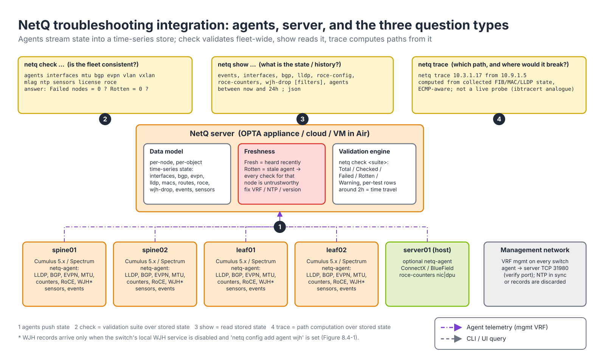
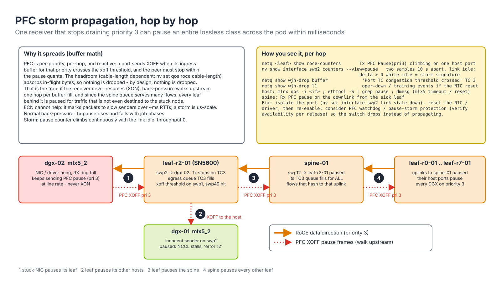

# Module 8.4 — What Just Happened (WJH), NetQ, Cumulus and UFM Troubleshooting

> **Exam domain:** Troubleshooting Tools (20%)  
> **Source course(s):** Cumulus Linux Administration; NetQ Fundamentals; UFM Essentials (troubleshooting units)  
> **Source docs:** Cumulus Linux User Guide — "What Just Happened (WJH)", "Monitoring and Troubleshooting"; NVUE Command Reference (WJH); NetQ User Guide — "Monitor WJH Events", "Monitor the RoCE Service", "Validation Checks"; UFM Enterprise User Manual — "Fabric Health", "System Dump"  
> **Estimated study time:** 4 hours

> **How to study this module:** read §1–§2, work through the §3 walkthrough on real gear or NVIDIA Air, then attempt the §5 hands-on assignment using only the Hint section. Open the Solution guide (last section) only after you have a working attempt. Finish with the Appendix C knowledge check closed-book.

## 1. Learning objectives

By the end of this module you will be able to:

- **Describe** what **WJH** adds over conventional counters: per-packet drop reason, ingress/egress port, and header fields, generated in the Spectrum ASIC. *(Spectrum Networking / Troubleshooting Tools — WJH)*
- **Configure** and scope WJH with NVUE channels and triggers (`nv set system wjh …`) and read drops locally (`nv show system wjh …`, `nv-wjh-cli`). *(Troubleshooting Tools — WJH configuration)*
- **Verify** drops centrally in **NetQ** (`netq show wjh-drop …`) and filter by type, reason, port, flow and time. *(Troubleshooting Tools — NetQ WJH)*
- **Verify** a RoCE fabric end to end with NetQ validation suites (`netq check …`), events, `netq trace`, and RoCE config/counter commands. *(Troubleshooting Tools / Spectrum Networking — RoCE validation)*
- **Troubleshoot** with Cumulus-local tools (`nv show interface … counters/link`, `nv show qos roce`, `vtysh`, `cl-support`, `switchd.log`, **cl-resource-query**) when NetQ is unavailable. *(Spectrum Networking — Cumulus operations)*
- **Describe** **UFM** health reports, events, telemetry, port isolation and system dump for InfiniBand fabrics. *(InfiniBand Networking — UFM operations)*
- **Write** a RoCE fabric validation runbook with go/no-go criteria, choosing the right tool per symptom across Modules 8.1–8.4. *(Troubleshooting Tools — methodology)*

## 2. Key technical concepts

### 2.1 WJH: the switch's own incident report

**Analogy.** A counter is a tally mark on the wall: "4,212 packets dropped". WJH is the switch filling out an incident report for each one: *what* was dropped (headers), *where* (ingress/egress port), *when*, and the **reason** field already filled in. You stop guessing and start reading.

**What it is.** **WJH** (What Just Happened) is a Spectrum ASIC feature, consumed by a service on the switch CPU. Whenever the forwarding pipeline drops a packet, or a packet crosses a configured congestion/latency threshold, the ASIC hands that packet to the CPU on a dedicated drop channel, annotated with metadata: a **drop reason** code, ingress and egress port, traffic class, timestamp, and the packet headers (optionally a truncated copy of the payload). On Cumulus Linux the WJH service (`nv-wjh.service` in 5.18+, `what-just-happened.service` earlier) reads that channel, decodes and aggregates the records and serves them to NVUE and `nv-wjh-cli`; alternatively the **NetQ** agent can own the channel and ship the records to a NetQ server for fabric-wide search (Figure 8.4-1).


*Figure 8.4-1 — The WJH pipeline: (1) the ASIC decides and annotates, (2) the service collects and aggregates, (3) you read locally, or (4) hand the channel to NetQ, or (5) stream it out. Only one consumer owns the channel.*

**Why it exists.** Traditional tools give you either a number without a story or a story without the number. `RX discards: 4212` says something went wrong but not what, to which flow, or why. sFlow samples 1 packet in N, so a rare drop (one tenant's misconfigured VLAN, a single RoCE flow landing in the wrong queue) is statistically invisible. Port mirroring needs you to know in advance where to look. WJH inverts this: the ASIC already *knows* why it discarded a packet — the drop happens at a specific pipeline stage for a specific reason — so it reports that decision directly. The key exam point: WJH is **ASIC-level drop telemetry, not sampling and not a counter**.

**How it works.** Following Figure 8.4-1:
1. **Decide and annotate.** The packet moves through parse → L2 lookup → L3 lookup → ACL → tunnel → QoS/buffer → egress. Any stage may discard it (no route, VLAN not allowed, ACL deny, queue full). Instead of discarding silently, the ASIC raises a trap tagged with the reason ID and attaches ports, TC, timestamp and header copy. Buffer (congestion) events are reported the same way when a TC's occupancy or a packet's latency crosses the configured threshold, even if the packet was not dropped.
2. **Collect and aggregate.** The trap path to the CPU is rate-limited by policers so a drop flood cannot starve the control plane. The service keeps two views: a **raw** (per-packet) ring of individual records with full headers (`packet-buffer`), and an **aggregated** view keyed by flow and reason with a count and first/last timestamp over each `polling-interval` (5–300 s, 5.18+). Under a flood, trust the aggregate counts; individual raw records are what you open in Wireshark.
3. **Consume locally** with `nv show system wjh …` or `nv-wjh-cli`, or export to PCAP.
4. **Or hand the channel to NetQ**: disable the local service, enable the agent's `wjh` module, and records become searchable across the fleet with `netq show wjh-drop`.
5. **Or stream** to external collectors (Section 2.4).

**Why the exam cares.** "RX discards incrementing — which tool gives the reason and headers?" (WJH). "Is WJH sampled?" (No.)

### 2.2 Drop categories and the reason taxonomy

**What it is.** Every WJH record carries a category (also the **trigger** you scope channels with) and a reason string, plus a severity.

| Category (trigger) | What it covers | Example reasons | What the reason implies / next command | Typical severity |
|---|---|---|---|---|
| **L1** | Port/link state and training | `Link training failure`, `Oper down`, `Port admin down`, `Autoneg failure`, `Bad signal integrity` | Physical layer: `mlxlink -p <port> -m -c` (Module 8.3); `Port admin down` is someone's config | Error / Warning |
| **L2** | Bridging / VLAN | `Ingress spanning tree filter`, `Port loopback filter`, `Source MAC equals destination MAC`, `Source MAC is multicast`, `Source MAC is zero`, `Ingress VLAN filter`, `MLAG port isolation` | VLAN not allowed on the port (check bridge VLAN membership), a loop (STP blocking, loopback filter), a broken host NIC sending bad SMACs; `MLAG port isolation` is expected on peer-link traffic | Error / Notice |
| **Router (L3)** | Routing | `Router: IPv4 routing table unicast miss` (no route), `Blackhole route`, `TTL exceeded`, `Non-IP packet to router`, `Multicast MAC mismatch`, `Unresolved neighbor` | No route: `vtysh -c "show ip route <dst>"`, then `cl-resource-query` (route in FRR but not in the ASIC); `Unresolved neighbor`: ARP/ND not answered; `TTL exceeded`: routing loop | Warning |
| **Tunnel** | VXLAN encap/decap | `Overlay switch — source MAC equals destination MAC`, `Decapsulation error`, `Tunnel interface is disabled` | VNI/VTEP mismatch: `netq check evpn`, `nv show evpn vni` | Warning |
| **ACL** | Access lists | `Ingress port ACL`, `Ingress router ACL`, `Egress port ACL` — includes the matching rule ID | Intended policy, or a rule too broad; the rule ID tells you which line | Notice (intentional) / Error |
| **Buffer** | Congestion | `Tail drop` (queue full), `WRED`, `Port TC congestion threshold crossed`, `Packet latency threshold crossed`; with **PFC**, pause-storm / PFC-related buffer events | The RoCE home: see below; check the **TC** column first | Warning |

**Why it exists.** A reason only helps if it points at a fix. The taxonomy maps each category to a layer and therefore to a different owner and toolset: L1 to cabling and Module 8.3, L2/Router/Tunnel to configuration, ACL to policy, Buffer to QoS and traffic engineering. Severity tells you how surprised to be: *Error* = something is broken (loop, bad frame), *Warning* = probably misconfiguration or capacity (no route, tail drop), *Notice* = expected behavior (ACL deny) you may still want to see.

**How it works.** For an AI RoCE fabric the Buffer category is home. `Tail drop` on a lossless class means the queue overflowed — PFC did not stop the sender, either because PFC is not enabled on that port/priority, the host ignored the pause, or (most often) the packets were not in the lossless class at all, which the record's **TC** field reveals. `WRED` means ECN/WRED thresholds were crossed and packets were dropped rather than marked — on a class that should be lossless and ECN-marked that is a misconfiguration. `Port TC congestion threshold crossed` and `Packet latency threshold crossed` are early warnings you configure (Section 2.3): no packet was lost, but the queue is building. Read every Buffer record by asking, in order: which TC, which egress port, which flow (UDP **4791** = RoCEv2), how many.

**Why the exam cares.** "Which category is `IPv4 routing table unicast miss`?" (Router). `Tail drop`/`WRED` are Buffer; `Ingress VLAN filter` is L2.

### 2.3 Enabling, scoping and reading WJH (NVUE)

**What it is.** WJH is configured with **channels**: a named stream of records, each subscribed to one or more trigger categories, with its own polling interval, drop filters and (for buffer channels) thresholds. It is enabled by default on Spectrum switches running Cumulus Linux. Syntax changed across releases — know both forms:

| Release | Enable/disable | Local CLI |
|---|---|---|
| Cumulus ≤ 5.14 | `nv set system wjh enable on|off` | `what-just-happened` |
| Cumulus 5.15 – 5.17 | `nv set system wjh state enabled|disabled` | `what-just-happened` |
| Cumulus 5.18+ | `nv set system wjh state enabled|disabled`; `polling-interval` per channel | `nv-wjh-cli` |

**Why it exists.** Without scoping, a busy leaf reports every ACL deny and every expected MLAG isolation drop, and the records you need are buried. Channels let you separate noisy categories from important ones, give buffer events their own thresholds, and filter out known-benign drops so that "zero records" actually means "nothing wrong".

**How it works.**

```bash
# Cumulus 5.15+ (state)                        # Cumulus ≤5.14 (enable on/off)
nv set system wjh state enabled                # nv set system wjh enable on
# Channels: a named stream of drop records, each with one or more trigger categories
nv set system wjh channel forwarding trigger l2
nv set system wjh channel forwarding trigger l3
nv set system wjh channel forwarding trigger tunnel
nv set system wjh channel layer-1 trigger l1
nv set system wjh channel buffer trigger buffer          # verify category name 'buffer' in your release
nv set system wjh channel forwarding polling-interval 30 # 5–300 s aggregation interval (5.18+)
nv config apply
```

Each trigger category can belong to only one channel; channel names are 4–16 characters. Later releases add drop filters and buffer thresholds (useful for RoCE):

```bash
nv set system wjh channel forwarding drop-filter ACL-NOISE drop-type acl severity notice
nv set system wjh channel forwarding drop-filter STORAGE ip 10.20.0.0/24         # (verify prefix support)
nv set system wjh channel buffer buffer-threshold congestion tc 3 interface all high 4   # alert when TC3 (RoCE) queue occupancy crosses level
nv set system wjh channel buffer buffer-threshold latency tc all interface swp1-32 high 100
nv config apply
```

The congestion threshold on TC 3 is how you see a RoCE queue building *before* PFC fires or anything drops; the latency threshold catches packets that waited too long even when no queue is "full".

Viewing locally:

```bash
nv show system wjh                       # service state
nv show system wjh channel               # channels, triggers, total drops
nv show system wjh channel forwarding    # one channel
nv show system wjh packet-buffer         # individual drop records with recommended action
nv show system wjh aggregate-buffer      # aggregated buffer (congestion) events
nv show system wjh l1-buffer             # layer-1 port state events
nv action export system wjh packet-buffer   # save recent drops as PCAP to /var/run/nv-wjh/
```

The Linux-level tool is `nv-wjh-cli` (5.18+; earlier releases used the `what-just-happened` CLI). `--data drops` is the raw view, `--data aggregates` the aggregated one:

```bash
sudo nv-wjh-cli poll --data drops --output-type table --channels forwarding
sudo nv-wjh-cli poll --data drops --output-type pcap --no-metadata > drops.pcap   # open in Wireshark
sudo nv-wjh-cli poll --data aggregates
sudo nv-wjh-cli poll --data l1
sudo nv-wjh-cli dump      # diagnostics to /var/log/nv-wjh/diags-dump/<timestamp>
```

Older syntax you may still meet: `what-just-happened poll --aggregate`, `what-just-happened poll -o pcap`, `what-just-happened dump`. If a command is rejected, check the Cumulus version (`nv show system version`) before assuming WJH is broken.

**Why the exam cares.** `enable on` vs `state enabled`, `what-just-happened` vs `nv-wjh-cli`, and "triggers are scoped per channel".

### 2.4 Exporting WJH: the one-consumer rule

**What it is.** Three destinations beyond the local buffers:

| Destination | How |
|---|---|
| **NetQ** | On the switch `netq config add agent wjh` then `netq config restart agent`. The local WJH service must be **disabled** first (`nv set system wjh state disabled`), because only one consumer may own the ASIC drop channel. "NetQ shows no WJH drops" → local WJH service still running |
| **PCAP** | `nv action export system wjh packet-buffer` / `nv-wjh-cli ... --output-type pcap` |
| **Kafka / gRPC / OpenTelemetry** | Streaming export exists for external collectors; exact configuration differs by release — verify in current Cumulus docs ("Open Telemetry Export", gNMI streaming). The exam only expects you to know export beyond NetQ is possible |

**Why it exists.** The ASIC drop channel is a single queue: whichever process attaches to it receives the records and removes them. Two readers would split the stream unpredictably, each seeing a fraction, so the software enforces one owner.

**How it works.** In local mode the WJH service is the owner and NVUE/`nv-wjh-cli` read from it. In NetQ mode you stop the service and the NetQ agent's `wjh` module attaches instead; records flow over the management VRF to the NetQ server, where they are stored like any other time-series table (Section 2.5). Interface counters (`nv show interface swpX counters`) are a separate path and work in either mode. The failure mode is always the same: drops visible in one place and absent in the other means the wrong consumer owns the channel.

### 2.5 NetQ: the troubleshooting data model

**Analogy.** `nv show` on a switch is reading one gauge in one cockpit. `netq check` is the fleet maintenance department running the same inspection on every aircraft at once and handing you the list of failures.

**What it is.** **NetQ** (Module 4.5) is a telemetry and validation system: a **netq-agent** on every Cumulus switch (and optionally on Linux hosts with ConnectX/BlueField) streams state changes to a **NetQ server** (on-premises appliance/VM, or cloud with an on-site collector), which stores them as timestamped, per-node records — interfaces, LLDP neighbors, BGP/EVPN sessions, MACs, routes, sensors, RoCE configuration and counters, WJH drops, and an event log. The `netq` CLI and UI never talk to the switches; they query that store (Figure 8.4-2).


*Figure 8.4-2 — NetQ integration: (1) agents push state, (2) `check` runs validation suites over stored state, (3) `show` reads it, (4) `trace` computes paths from it.*

**Why it exists.** Distributed faults are relationships between devices: an MTU mismatch exists only between two ports, a BGP problem between two peers, configuration drift only relative to the other leaves. Checking that by logging in to every box does not scale, and by the time you log in the transient is gone. A central, time-indexed copy of everyone's state makes cross-device comparison a query and lets you look at the fabric "as it was at 09:12" (`around`, `between`).

**How it works.**
1. **Collection.** Each agent reports changes and periodic heartbeats over the management VRF (TCP 31980 by default — verify for your release). The server records "last heard" per agent. An agent that misses heartbeats for longer than the freshness window becomes **Rotten**: its stored data is stale, and every check that touches that node is untrustworthy until it is fixed.
2. **Validation (`netq check <suite>`).** The server runs a suite of tests against the stored records (for example, `interfaces` compares the speed/MTU/state of both ends of every LLDP-discovered link) and prints Total / Checked / Failed / **Rotten** / Warning nodes, then per-test rows with hostname, peer and reason.
3. **Inspection (`netq show …`).** Reads the current or historical records; `between now and 24h`, `around 2h`, `json` work on most commands.
4. **Path computation (`netq trace`).** Walks the stored FIB, MAC and LLDP state hop by hop across every ECMP branch, flagging MTU or state that would break the path. It is the Ethernet counterpart of `ibtracert` and, like it, computation from stored state, not a live probe.

```bash
netq check agents                 # every agent fresh?
netq check interfaces             # link up/down + MTU mismatch between neighbors
netq check mtu
netq check bgp                    # sessions established, address-family mismatches
netq check evpn                   # VNI consistency, VTEP reachability
netq check vlan ; netq check vxlan ; netq check mlag
netq check ntp ; netq check sensors ; netq check license
netq check roce                   # RoCE config consistency (lossless/lossy, PFC/ECN) across switches — verify availability in your release
netq check bgp include 1,3        # only specific tests
netq check interfaces around 2h   # as of two hours ago (time travel)
```

Show and trace:

```bash
netq show events [severity error] [between now and 24h]     # fabric-wide event log
netq show events type link ; netq show events type bgp
netq show interfaces type swp [hostname]
netq leaf03 show interfaces swp51 counters                   # errors/discards history (wording differs by release)
netq show bgp ; netq show evpn ; netq show vxlan ; netq show mlag ; netq show lldp
netq show macs ; netq show ip routes <prefix>
netq show inventory ; netq show sensors temp
netq trace 10.3.1.17 from 10.9.1.5                           # L3 path (ECMP-aware) through the fabric
netq trace 10.9.1.5 from leaf01:swp3 vrf default
```

WJH in NetQ:

```bash
netq show wjh-drop                                    # summary by type/reason, all hosts
netq show wjh-drop details between now and 7d
netq leaf03 show wjh-drop l1
netq show wjh-drop l2 reason "Ingress VLAN filter"
netq show wjh-drop router ingress-port swp3 between now and 1h
netq show wjh-drop acl                                # includes rule-id-acl
netq show wjh-drop buffer severity warning
netq show wjh-drop tunnel
netq show wjh-drop l3 src-ip 10.3.1.17 dst-ip 10.9.1.5 proto udp dst-port 4791     # RoCEv2 flow
```

Filters per type: `ingress-port`, `egress-port`, `severity`, `reason`, `src-ip`/`dst-ip`, `proto`, `src-port`/`dst-port`, `src-mac`/`dst-mac`, `traffic-class`, `rule-id-acl`, `vlan`, `between … and …`, `around …`, `json`. UDP destination port **4791** is RoCEv2 — filter on it to isolate RDMA drops.

When NetQ itself misbehaves: `netq show agents` (Fresh/Rotten, version, last heard); on the switch `netq config show agent`, `netq config show agent wjh`, `netq config add server 10.0.100.10 vrf mgmt port 31980` (verify port), `netq config restart agent`, `sudo systemctl status netq-agent`; `netq show agents opta` for appliance health. Rotten → management VRF reachability (`ping -I mgmt <server>`), time sync (`netq check ntp` — records with skewed timestamps are discarded), agent/server version compatibility.

**Why the exam cares.** Rotten agents, the WJH-to-NetQ handoff, `netq trace` is not a live probe, and which `netq` command answers "is every leaf configured the same?" (`netq show roce-config` / `netq check roce`).

### 2.6 RoCE telemetry: reading PFC, ECN and buffer counters

**What it is.** A lossless RoCE class is held together by three mechanisms, each with its own counter: **PFC** pause frames (per priority, Rx and Tx per port), **ECN** marks (packets whose IP ECN bits the switch set when the queue crossed the ECN threshold, which the receiver NIC turns into CNPs for DCQCN), and buffer/queue occupancy and drops per traffic class. NetQ collects all of them:

```bash
netq show roce-config                      # per switch: mode (lossless/lossy), PFC priority, ECN min/max, DSCP→SP map, buffer pool
netq show roce-config hostname leaf01
netq show roce-counters nic                # (or dpu) — host-side RoCE counters where an agent runs
netq show roce-counters pool               # buffer pool utilization
netq leaf01 show roce-counters             # per-switch RX/TX: PFC pause frames, ECN-marked packets, CNPs
netq check roce                            # consistency across the fabric (verify in your release)
```

**Why it exists.** Each mechanism works on a different timescale, so each counter answers a different question. ECN/DCQCN slows senders over several RTTs (microseconds to milliseconds) and should be the normal brake. PFC stops a link within a pause frame's flight time and is the emergency brake that prevents loss when ECN is too slow. A drop on the lossless class means both brakes failed. Reading which counter moves tells you which brake engaged.

**How it works.** The direction of a pause counter tells you who is congested: a port that **transmits** PFC is telling its neighbor "stop, my ingress buffer for this priority is past XOFF"; a port that **receives** PFC is being told to stop by its neighbor.

| Observation | Meaning |
|---|---|
| `roce-config` differs on one leaf (mode lossy, or different ECN max) | Configuration drift — the usual root cause of "one rack is slow". Fix with NVUE (`nv set qos roce mode lossless`) or Ansible |
| **PFC** pause RX rising on a *spine* port | Downstream leaf is congested and pushing back; check its host ports for oversubscription or a slow NIC |
| PFC pause TX on a *host-facing* port while the host shows RX drops | Host NIC not honoring PFC on that priority (`mlnx_qos -i <if>`) |
| ECN marked counts high but no drops | Working as designed under load (DCQCN engaged) |
| Tail drops on the RoCE traffic class | Lossless not actually configured on that port/class — WJH Buffer `Tail drop` confirms |
| PFC pause continuously at line rate (pause storm) | Stuck receiver or PFC loop; isolate the port, check for a hung NIC/driver; WJH L1/Buffer + `nv show interface swpX counters` (Section 2.7) |

**Why the exam cares.** ECN marks rising with no drops is healthy; tail drops on the lossless TC are not, and ECN tuning does not fix them.

### 2.7 PFC storms: how one stuck receiver pauses a pod, and the watchdog

**Analogy.** PFC is a per-lane red light. A storm is a broken red light stuck on: the lane behind it fills, then the intersection before that turns red too, until traffic that never meant to go near the broken light is stopped across town.

**What it is.** A **PFC storm** is a sustained stream of pause frames from a device that has stopped draining a lossless priority — classically a NIC whose driver hung, a host stuck in a PCIe stall, or firmware that keeps its Rx buffer above XOFF. Because PFC is per-priority and hop-by-hop, the pause propagates upstream (Figure 8.4-5). A **PFC watchdog** is the switch (or NIC) feature that detects a queue paused for too long and breaks the chain.


*Figure 8.4-5 — PFC storm propagation: (1) the stuck NIC pauses its leaf, (2) the leaf pauses its other hosts, (3) the leaf pauses the spine, (4) the spine pauses every other leaf.*

**Why it exists.** PFC is reactive and has no notion of fairness or of "who caused it". The mechanics make the propagation inevitable:
- A pause frame carries a time per priority in **quanta** of 512 bit times. At 400 Gb/s a bit time is 2.5 ps, so one quantum is 1.28 ns and the maximum (65,535 quanta) is ~84 µs; a receiver that keeps re-sending XOFF before the timer expires holds the link paused indefinitely.
- XOFF fires when the ingress buffer for that priority crosses a threshold; the **headroom** above it must absorb everything already in flight: the pause frame's transmission and the peer's reaction (up to a maximum-size frame plus processing) plus two cable propagation delays (~5 ns/m each way). On a 100 m link at 400 Gb/s that is about 1 µs round trip, i.e. ~50 KB per priority per port before frame allowances — which is why `nv set qos roce` takes a `cable-length`.
- When the leaf's egress queue toward the stuck host cannot drain, the leaf's *ingress* buffers for priority 3 on every port feeding that queue fill and cross XOFF. The leaf now pauses priority 3 on its other host ports and its uplinks. The spine's egress queue to that leaf stalls, its ingress buffers fill, and it pauses priority 3 toward every leaf. Every flow on priority 3 that shares any of those queues is stopped — head-of-line blocking — including traffic destined nowhere near the stuck node. In topologies with loops in the buffer-dependency graph the same mechanism can deadlock without any stuck host at all.
- ECN cannot help: it slows senders over RTTs, and a stuck receiver will never drain however slowly the senders send.

**How it works — detect, contain, recover.**
1. **Detect by signature.** Normal back-pressure: Tx pause rises and falls with job phases, the link still carries traffic. Storm: the pause counter climbs continuously *with the link idle* and throughput at zero. Sample `nv show interface swpX counters --view=pause` twice, 10 s apart, with no job running; any delta is suspicious. NetQ: `netq <leaf> show roce-counters` (Tx PFC pause on one host port), `netq show wjh-drop buffer` (`Port TC congestion threshold crossed` on TC 3), `netq show wjh-drop l1` (the NIC resetting). Host: `ethtool -S <if> | grep -i pause`, `dmesg` for mlx5 command timeouts or resets.
2. **Contain with a watchdog.** A PFC watchdog polls each lossless queue; if a queue has been in the paused state with no transmit progress for longer than its detection interval (typically hundreds of milliseconds), it stops honoring pause on that queue — dropping the queued packets instead — so the back-pressure stops propagating, and it restores normal lossless behavior after a restoration interval with no further storm. Cumulus Linux exposes a PFC watchdog through NVUE (`nv set qos pfc-watchdog …` and per-interface enablement; verify exact syntax and defaults in your release). ConnectX NICs have the mirror-image protection, PFC storm prevention, which stops the NIC from sending pause indefinitely if its own receive path is stuck (`ethtool --set-tunable <if> pfc-prevention-tout <ms>` on mlx5; verify).
3. **Recover.** Isolate the port (`nv set interface swp2 link state down; nv config apply`), reset the NIC or driver on the host, re-enable, and confirm the pause counters stay flat while idle.

Containment is a deliberate trade: the watchdog converts a pod-wide stall into packet loss for the flows behind one broken host. That is the correct trade, because RDMA transports recover from loss (with retransmits) but nothing recovers from a fabric that does not move.

**Why the exam cares.** "Tx pause pegged with the link idle" = storm; "pause rising and falling with job phases" = normal. Know why it spreads (per-priority, hop-by-hop, shared queues) and what a watchdog does.

### 2.8 Cumulus-local tools when NetQ is not there

**What it is.** The on-box toolset that answers the same questions as NetQ for one switch.

```bash
# Interface and link
nv show interface swp1
nv show interface swp1 link                   # speed, autoneg, FEC, breakout, lanes, transceiver summary
nv show interface swp1 counters               # RX/TX packets, errors, discards (fields vary)
nv show interface swp1 counters --view=pause  # (view names vary; check 'nv show interface swp1 counters -h')
nv show interface --view=brief ; nv show interface --view=lldp
sudo ethtool -S swp1 | grep -i -E 'fec|symbol|pause|discard|crc'
sudo mlxlink -d <dev> -p <port> -m -c         # Module 8.3
# QoS / RoCE
nv show qos roce                              # mode, PFC priority, ECN thresholds, DSCP map
nv show qos roce counters                     # per-port RoCE counters where available
nv show qos buffer ; nv show qos pfc ; nv show qos congestion-control
nv show interface swp1 qos counters           # per-TC drops/queues (verify path)
# Routing
sudo vtysh -c "show bgp summary" ; sudo vtysh -c "show ip route 10.9.1.5" ; sudo vtysh -c "show evpn vni"
nv show router bgp ; nv show vrf default router bgp neighbor
# Hardware tables and resources
cl-resource-query                             # ASIC table utilization: routes, MACs, ACLs, ECMP next-hops
nv show system forwarding resources           # NVUE view (verify)
# Logs and bundles
sudo tail -f /var/log/switchd.log             # ASIC driver: port events, resource exhaustion, errors
sudo tail -f /var/log/frr/frr.log ; sudo journalctl -u nv-wjh -f
sudo cl-support                               # /var/support/cl_support_<host>_<date>.txz for NVIDIA support
```

**Why it exists.** NetQ may not be deployed (lab, early bring-up), may be the thing that is broken (Rotten agent), or may not hold the detail you need (per-lane FEC, the exact hardware table). The local tools read the device directly.

**How it works.** Each layer has an owner process: the ASIC is programmed by `switchd` (logs in `/var/log/switchd.log`), routing by FRR (`vtysh`), configuration by NVUE (`nv show … operational` vs `applied` columns tell you whether what you configured is what is running). **cl-resource-query** (detailed in `../04-spectrum-ethernet/`) is the tool for "the route/ACL/MAC was configured but traffic is dropped": when a hardware table is at 100 % the ASIC silently fails to install new entries, FRR still shows the route, and WJH reports `routing table unicast miss` for destinations that "should" be routable. `cl-support` collects all of it in one bundle for support.

### 2.9 UFM: the InfiniBand counterpart

**Analogy.** NetQ is the fleet inspector for the Ethernet fleet; UFM is the same office for InfiniBand — and it also employs the air-traffic controller (the SM).

**What it is.** **UFM** (Unified Fabric Manager) is the management platform for Quantum InfiniBand fabrics. It runs (or monitors) the Subnet Manager and wraps the Module 8.1 diagnostics in scheduling, history and an API.

| UFM function | What it gives you |
|---|---|
| **Fabric Health / Health report** | On-demand or scheduled validation (duplicate GUIDs, width/speed vs. capability, high BER, counters over threshold, SM status, cable info, routing). Built on **ibdiagnet**. The IB analogue of `netq check` |
| **Events & alarms** | Link down/up, "Link downed counter exceeded", "Symbol error rate exceeded", "High BER", module temperature, "SM changed / SM lost", "Node disappeared", PKey violations. Critical/Major/Minor/Warning; configurable thresholds and actions |
| **Telemetry (UFM Telemetry / Cyber-AI)** | Time-series per port: bandwidth, congestion (XmitWait), errors, BER, temperature |
| **Topology / Device view** | Cable inventory (vendor, PN, SN, length, FW), negotiated vs. supported speed; compare snapshots |
| **Port isolation** | Disable a port from GUI/REST (equivalent to `ibportstate … disable`) while the SM reroutes; optional automatic isolation on BER thresholds |
| **System dump** | `ufm_log_collect` (or GUI "System Dump" / `/opt/ufm/scripts/collect_logs.sh` depending on version — verify) gathers UFM logs, SM logs (`/opt/ufm/files/log/opensm.log`), ibdiagnet output and configuration |
| **SM status** | Master/standby, sweep errors, routing engine, AR/SHARP state |

**Why it exists.** InfiniBand has no per-switch control plane to log in to: the SM computes all forwarding centrally, so the place to see fabric-wide state is the SM's host. UFM adds what raw `ibdiagnet` and `perfquery` lack — continuous polling, thresholds that raise events, history, and an audited way to act (isolate a port) that the SM is aware of.

**How it works.** UFM's PerfMgr polls `PortCountersExt` on every port via PerfMgt MADs (Module 8.1, Figure 8.1-2), compares rates to thresholds and raises events; Fabric Health runs ibdiagnet on a schedule and stores the report; port isolation sets the port down through the SM so routing is recomputed around it rather than black-holing traffic. The IB methodology mirrors the Ethernet one: events → telemetry (XmitWait for congestion, symbol errors/BER for physical) → SM routing/AR state → Fabric Health after the fix. Typical IB escalation bundle: UFM system dump + `ibdiagnet` directory + `ibstat`/`mlxlink -m -c` from the affected host.

**Why the exam cares.** UFM Fabric Health is the IB analogue of `netq check`; UFM port isolation and `ibportstate disable` do the same thing, but UFM is the audited way in production.

## 3. Live-style walkthrough: "NCCL is slow between two nodes"

Scenario: 2-node nccl-tests busbw is 60% of reference; single-node is fine. Spectrum-X, Cumulus 5.x, RoCEv2 lossless on TC3 / switch-priority 3, DSCP 26. NetQ is deployed with WJH forwarded. Output is illustrative. Figure 8.4-3 is the run as a decision flow: diamonds 1–2 are shared by both fabrics, then the RoCE track (left) and the InfiniBand track (right) diverge at the congestion step. Each step below names the diamond it answers.


*Figure 8.4-3 — "NCCL is slow between two nodes": the same opening move on both fabrics (diamonds 1–2), then the RoCE and InfiniBand tracks (diamonds 3–7).*

```bash
# ---- Step 0 (Figure 8.4-3, diamonds 1 and 2): is it ONE link or the fabric? Same reflex as Module 8.1: perftest per rail pair.
dgx-02$ ib_write_bw -d mlx5_2 -R --report_gbits -a                 # server (RoCE: -R for rdma_cm)
dgx-01$ for r in 0 1 2 3; do ib_write_bw -d mlx5_$r -R --report_gbits -s 1048576 -q 4 10.0.$r.2 | tail -1; done
 1048576  ... 389.9   # rail 0 fine
 1048576  ... 390.2   # rail 1 fine
 1048576  ... 371.4   # rail 2: 5% low, not half-rate -> not a 2x link; smells like loss/congestion
 1048576  ... 390.0
# Decision: rail 2 is impaired but trained correctly. On RoCE, "a bit slow" with retransmits = drops. Go to WJH.

# ---- Step 1 (RoCE diamond 3; Section 2.6): fleet view of RoCE counters on the leaf that serves rail 2. Where are PFC and ECN firing?
netq$ netq leaf-r2-01 show roce-counters
Matching roce records:
Hostname    Interface  Rx PFC Pause(pri3)  Tx PFC Pause(pri3)  ECN Marked  Rx RoCE pkts  Tx RoCE pkts   Last Updated
leaf-r2-01  swp1        0                   0                   112044      9.1e9         9.0e9          ...
leaf-r2-01  swp2        0                   318011              104110      8.8e9         8.9e9          ...   <- host-facing port to dgx-02 mlx5_2
leaf-r2-01  swp49       1204                0                   0           ...                           ...   <- uplink
# Reading it: the switch is SENDING PFC pause toward dgx-02 on swp2 (Tx PFC) — it is asking the host to stop.
# ECN marks exist on both host ports: DCQCN is engaged, which is normal under load. Nothing dropped yet... or is it?
# Decision: PFC Tx from switch to host at this volume means the switch's TC3 queue toward dgx-02 is filling.
# A lossless class should never DROP, though. Check WJH Buffer.

# ---- Step 2 (RoCE diamonds 4 and 5; Sections 2.1-2.2): WJH buffer drops, filtered to RoCEv2 (UDP 4791) in the last hour.
netq$ netq show wjh-drop buffer severity warning between now and 1h
Matching wjh records:
Hostname    Ingress Port  Egress Port  Reason      Severity  Src IP      Dst IP      Proto  Dst Port  TC  Drop Count  Last Timestamp
leaf-r2-01  swp1          swp2         Tail drop   Warning   10.0.2.1    10.0.2.2    udp    4791      0   48812       2026-10-19 09:11:58
# TWO things in that one row. (a) Tail drop on RoCE traffic = lossless is not working for these packets.
# (b) Look at the TC column: 0. The RoCE packets from dgx-01 are landing in traffic class 0 (lossy best effort),
#     not TC3 where PFC protects them. That is why PFC counters on swp1 (ingress from dgx-01) show NOTHING:
#     PFC only guards priority 3, and these packets are not in priority 3.
# Decision: this is a DSCP -> switch-priority mismatch on the dgx-01 side, not a switch QoS bug.
#     Confirm the switch is configured as we think before touching the host.

# ---- Step 3 (RoCE diamond 6; Section 2.7, Figure 8.4-5): PFC storm check while we are here — rule out a stuck receiver as the cause of the pause volume.
leaf-r2-01$ nv show interface swp2 counters --view=pause            # (view name varies; see -h)
   Rx pause (pri3)   0
   Tx pause (pri3)   318011        # climbing, but NOT continuous at line rate; it tracks job phases
leaf-r2-01$ sudo nv-wjh-cli poll --data l1 | tail -3                 # any port flaps / signal integrity on swp1-2? none
# Decision: not a pause storm (that would be Tx pause pegged every second with the link idle). Normal backpressure.

# ---- Step 4 (RoCE diamond 7): the switch's own RoCE config. Is leaf-r2-01 lossless on priority 3 with DSCP 26 mapped?
leaf-r2-01$ nv show qos roce
                    operational   applied
------------------  -----------   -------
enable              on            on
mode                lossless      lossless
cable-length        100           100
congestion-control
  congestion-mode   ECN           ECN
  enabled-tc        3             3
  max-threshold     1.50 MB       1.50 MB
  min-threshold     150.00 KB     150.00 KB
pfc
  pfc-priority      3             3
  rx-enabled        enabled       enabled
  tx-enabled        enabled       enabled
trust
  trust-mode        pcp,dscp      pcp,dscp
RoCE DSCP->SP mapping
  dscp 26 -> switch-priority 3 -> traffic-class 3
# Switch is right: DSCP 26 -> SP3 -> TC3 lossless; ECN on TC3. Is EVERY leaf the same? Drift check, fleet-wide:
netq$ netq check roce
roce check result summary: Total nodes 12  Checked 12  Failed 0  Rotten 0
# No drift. The fabric is consistent; the host is sending with the wrong DSCP.

# ---- Step 5 (exit of diamond 5: TC 0 = host DSCP wrong): the host. What DSCP/TC does dgx-01's rail-2 NIC actually stamp on RoCE?
dgx-01$ cat /sys/class/infiniband/mlx5_2/tc/1/traffic_class
0                                             # default traffic class 0 -> DSCP 0 -> lossy TC0. Found it.
dgx-01$ mlnx_qos -i ens2f0np0 | grep -A1 -i 'PFC\|enabled'
PFC configuration:
        priority    0   1   2   3   4   5   6   7
        enabled     0   0   0   1   0   0   0   0     # PFC on priority 3 is fine on the host...
dgx-01$ echo $NCCL_IB_TC
                                              # ...but NCCL_IB_TC is unset on dgx-01 (it is 106 on dgx-02),
                                              # so NCCL's QPs on this node go out as TC 0 / DSCP 0.
# TC 106 = DSCP 26 (TC value >> 2). Decision: fix the node, not the switch.

# ---- Step 6: fix the mismatch persistently and in the job environment.
dgx-01$ echo 106 | sudo tee /sys/class/infiniband/mlx5_2/tc/1/traffic_class     # default TC for mlx5_2 port 1
#   (repeat for every rail NIC; make it persistent via your tuning scripts / mlnx_tune profile)
dgx-01$ export NCCL_IB_TC=106                                                   # and set it in the job launcher
# Also worth confirming the mapping end-to-end on the host NIC: DSCP 26 -> priority 3 (trust dscp)
dgx-01$ mlnx_qos -i ens2f0np0 --trust dscp
dgx-01$ mlnx_qos -i ens2f0np0 | grep -A2 'dscp2prio' | grep ' 26'    # expect "prio:3 dscp:26"

# ---- Step 7 (the green box at the bottom of the RoCE track): re-test, and prove it with the same two views we started with.
dgx-01$ ib_write_bw -d mlx5_2 -R --report_gbits -s 1048576 -q 4 10.0.2.2 | tail -1
 1048576  ... 389.7                                   # rail 2 now matches its siblings
netq$ netq show wjh-drop buffer ingress-port swp1 between now and 10m
No matching wjh records found                         # zero tail drops since the fix
netq$ netq leaf-r2-01 show roce-counters | grep swp2
leaf-r2-01  swp2   0   318011 (flat)   118900 (rising)   ...   # PFC Tx stopped growing; ECN marks still rise = DCQCN doing its job
dgx-01$ mpirun -np 16 -H dgx-01:8,dgx-02:8 -x NCCL_IB_TC=106 -x NCCL_DEBUG=INFO ./all_reduce_perf -b 8 -e 8G -f 2 -g 1 | tail -3
#   busbw back to reference; NCCL_DEBUG=INFO log shows "NET/IB : Using [2]mlx5_2:1/RoCE ... GDRDMA" on both nodes.
# Decision: closed. Attach: WJH row (TC 0, Tail drop), roce-counters before/after, nv show qos roce, the sysfs/env change.

# ======== PARALLEL TRACK: the same complaint on an INFINIBAND fabric with UFM ========
# Step A (IB diamond 3): UFM Events, filtered to the two nodes and the last hour.
#   "Symbol error rate exceeded" on leaf-r2-01 port 17 (dgx-01 mlx5_2)   <- physical, Module 8.1/8.3 path
#   or "Congestion: XmitWait threshold exceeded" on the same port        <- congestion path
# Step B (IB diamonds 4 and 7): UFM Telemetry, port leaf-r2-01/17: overlay XmitWait and bandwidth. A sawtooth of XmitWait aligned
#   with the job's all_reduce phases = credit starvation on that path. Then:
dgx-01$ sudo perfquery -x 12 17 | grep -E 'XmitWait|XmitDiscards|Symbol'    # LID 12 = leaf-r2-01
PortXmitWait:....................9120033                                      # high, with Symbol = 0 -> congestion, not cable
dgx-01$ sudo ibtracert 73 81                                                 # is rail-2 -> rail-2 really one leaf hop? (Module 8.2)
# Step C (IB diamonds 5 and 6): UFM SM status: routing engine and adaptive routing state. AR off on a fat tree with this traffic = hot spot.
#   Enable AR / check SHARP per ../02-infiniband/. If instead UFM shows High BER on the port -> UFM "isolate port",
#   then Module 8.3 (mlxlink -m -c) and replace.
# Step D (IB green box): UFM Fabric Health report after the change: zero "Speed/Width", zero "High BER", zero routing warnings.
```

What "good" looks like (RoCE): `netq check roce` Failed 0; `netq show roce-config` identical across leaves; WJH buffer query empty for `dst-port 4791`; PFC pause counters flat or slowly rising, never pegged; ECN marks rising under load; every host NIC stamping DSCP 26 (TC 106) and trusting DSCP; perftest within ~3% of line rate on every rail.

## 4. Troubleshooting / common gotchas

### 4.1 NetQ shows no WJH drops although the switch sees hundreds

- **Symptom:** `nv show system wjh channel` on the switch counts drops; `netq show wjh-drop` for that host is empty.
- **Why it happens:** only one consumer may own the ASIC drop channel. The local WJH service is still enabled, so the NetQ agent never receives records — or `wjh` was never added to the agent.
- **How to debug:** `nv show system wjh` (state); `netq config show agent wjh` on the switch; `netq show agents` (is the agent even Fresh?).
- **Fix:** `nv set system wjh state disabled; nv config apply`, then `sudo netq config add agent wjh; sudo netq config restart agent`.

### 4.2 WJH commands "do not exist"

- **Symptom:** `nv set system wjh state enabled` → invalid; or `nv-wjh-cli: command not found`.
- **Why it happens:** syntax churn. `enable on` (≤5.14) vs `state enabled` (5.15+); `what-just-happened` CLI (≤5.17) vs `nv-wjh-cli` (5.18+); `polling-interval` is 5.18+.
- **How to debug:** `nv show system version`; `nv set system wjh -h`; `ls /usr/bin | grep -i -E 'wjh|what-just'`.
- **Fix:** use the form for your release and note the version in the ticket; the exam uses whichever form matches its referenced release, so recognize both.

### 4.3 NetQ agent in the wrong VRF (Rotten node)

- **Symptom:** `netq check bgp` lists leaf05 as Rotten; `netq show agents` says last heard 3 hours ago; the switch is up and passing traffic.
- **Why it happens:** the agent is configured to reach the server through the default VRF while the management interface (and the only route to the server) is in VRF `mgmt`; or NTP drift makes the server discard records.
- **How to debug:** on the switch `netq config show agent` (server, port, **vrf**); `ping -I mgmt <netq-server>` vs `ping <netq-server>`; `sudo systemctl status netq-agent`; `netq check ntp`.
- **Fix:** `netq config add server <ip> vrf mgmt port 31980` (verify port), `netq config restart agent`; fix NTP. Re-run the check — never act on validation output from a Rotten node.

### 4.4 Tuning ECN to fix tail drops

- **Symptom:** WJH shows `Tail drop` on TC3 for RoCE packets; the engineer raises ECN max-threshold; drops continue.
- **Why it happens:** tail drop means the queue overflowed — PFC did not stop the sender. ECN marks packets to slow senders over milliseconds; it cannot prevent a buffer overflow that PFC is supposed to prevent in microseconds. Either PFC is off on that class/port, the host ignores it, or the packets are not in the lossless class at all (DSCP mismatch, as in Section 3).
- **How to debug:** `netq show wjh-drop buffer` (look at the **TC** column); `nv show qos roce`; `mlnx_qos -i <if>` on the host; `netq check roce`.
- **Fix:** put the traffic in the lossless class (DSCP/TC on the host), enable PFC end to end, then leave ECN thresholds to the RoCE profile defaults.

## 5. Hands-on assignment: RoCE fabric validation runbook with go/no-go criteria

**Scenario.** A new 4-leaf, 2-spine Spectrum-X pod is about to be handed to the ML team. You must write and run a validation runbook using NetQ, WJH and `nv show` that produces a documented GO or NO-GO.

**Requirements.**
1. `roce-validate.md`: a numbered runbook with a Go/No-Go table — each row: check, command(s), pass criterion, fail action.
2. `roce-validate.sh`: executes the NetQ-side checks from the NetQ CLI host and the switch-side checks over SSH (or `nv` locally if run on a switch), and prints GO/NO-GO with the failing rows.
3. Checks must cover at minimum: agent freshness; interface/MTU consistency; BGP; RoCE config consistency (mode lossless, PFC priority, ECN TC, DSCP map identical on every leaf); zero WJH Buffer tail drops on UDP 4791 during a load test window; PFC pause counters not pegged (pause storm); ECN marks present under load (proof DCQCN engaged); WJH→NetQ handoff working (local WJH disabled, agent has `wjh`).
4. A load phase: run `ib_write_bw -R` across all rail pairs for 60 s while the WJH/PFC checks sample.
5. Evidence capture: `netq show roce-config json`, `netq show wjh-drop buffer json`, `nv show qos roce` per leaf, saved under a timestamped directory.

**Deliverables.** `roce-validate.md`, `roce-validate.sh`, one example evidence directory, one GO and one NO-GO sample report.

**Acceptance criteria.**
- AC1: the runbook has at least eight Go/No-Go rows and every row names the exact command and the pass threshold.
- AC2: with a leaf deliberately set to `nv set qos roce mode lossy`, the script reports NO-GO and names that leaf and that check.
- AC3: with any WJH Buffer `Tail drop` on dst-port 4791 in the load window, the script reports NO-GO.
- AC4: a Rotten agent causes NO-GO before any other check is interpreted.

### Hint
- Section 2.5: `netq check agents` first — Rotten invalidates everything else (AC4).
- `netq show roce-config json` gives you one record per switch; compare the fields that matter (Section 2.6 table) and count distinct values — more than one = drift.
- Section 2.5's WJH-in-NetQ list: `netq show wjh-drop buffer ... dst-port 4791 between now and <window>`; empty = pass.
- For the pause-storm test, sample `nv show interface swpX counters --view=pause` twice 10 s apart with the link idle; a large delta while idle is the storm signature (Section 2.7).
- Section 2.4's export table tells you exactly what "handoff working" means in two commands.

## Appendix A — Quick command / config reference

```bash
# WJH (Cumulus NVUE, 5.15+; use 'enable on' on older releases)
nv set system wjh state enabled
nv set system wjh channel forwarding trigger l2 ; ... trigger l3 ; ... trigger tunnel
nv set system wjh channel layer-1 trigger l1 ; nv set system wjh channel buffer trigger buffer
nv set system wjh channel forwarding polling-interval 30
nv set system wjh channel forwarding drop-filter <name> drop-type acl severity notice
nv config apply
nv show system wjh ; nv show system wjh channel ; nv show system wjh packet-buffer
nv show system wjh aggregate-buffer ; nv show system wjh l1-buffer
nv action export system wjh packet-buffer
sudo nv-wjh-cli poll --data drops|aggregates|l1 --output-type table|json|pcap [--channels <ch>]
sudo nv-wjh-cli dump
# WJH -> NetQ (disable local service first)
nv set system wjh state disabled ; nv config apply
sudo netq config add agent wjh ; sudo netq config restart agent
# NetQ
netq check agents|interfaces|mtu|bgp|evpn|vlan|vxlan|mlag|ntp|sensors|roce
netq show events [severity error] [between now and 24h] ; netq show events type link
netq show interfaces type swp ; netq show bgp ; netq show evpn ; netq show lldp
netq show roce-config ; netq show roce-counters nic|dpu|pool ; netq <host> show roce-counters
netq show wjh-drop [l1|l2|router|tunnel|acl|buffer] [reason "..."] [ingress-port swpX] [dst-port 4791] [between now and 1h]
netq trace <dst-ip> from <src-ip|host:port> [vrf <vrf>]
netq show agents ; netq config show agent ; netq config restart agent
# Cumulus local
nv show interface swp1 link|counters ; nv show qos roce ; nv show qos buffer
sudo vtysh -c "show bgp summary" ; cl-resource-query ; sudo tail -f /var/log/switchd.log ; sudo cl-support
# UFM
#  GUI: Fabric Health report, Events, Telemetry, Port isolate;  CLI (appliance): ufm_log_collect / system dump (verify path)
```

### Symptom → tool across Modules 8.1–8.4

| Symptom | IB fabric | Ethernet / RoCE fabric | Module |
|---|---|---|---|
| Port down | `ibstat` (Down/Polling), `mlxlink -m` | `nv show interface swpX link`, WJH L1, `mlxlink -m` | 8.1, 8.3, 8.4 |
| Port up, no LID / no neighbor | `sminfo`, SM logs, UFM SM status | `nv show interface --view=lldp`, `netq show lldp` | 8.1, 8.4 |
| Link trained slow / 2x | `iblinkinfo` "Could be 4X", `mlxlink` width | `nv show interface swpX link` lanes, `mlxlink -p` | 8.1, 8.3 |
| Cabled to the wrong place | **CVT**, `ibdiagnet net_dump`, rail check | **CVT**, LLDP vs plan, `netq show lldp` | 8.2 |
| Rising errors on one link | `perfquery` SymbolError, `ibdiagnet -P`, UFM High BER event | `nv show interface counters`, `ethtool -S`, NetQ link events | 8.1, 8.3, 8.4 |
| Why was this cable bad? | `mlxlink -m -c -e`, `--rx_fec_histogram`, `mlxcables` | same | 8.3 |
| Packets dropped, counters only say "discard" | `perfquery` XmitDiscards; UFM | **WJH** (`nv show system wjh packet-buffer`, `netq show wjh-drop`) | 8.4 |
| Slow but no errors (congestion) | `perfquery` XmitWait, UFM congestion telemetry, AR/SHARP status | `netq show roce-counters` (PFC/ECN), WJH Buffer, `nv show qos roce` | 8.1, 8.4 |
| One rack configured differently | UFM topology compare; `saquery -p` for PKeys | `netq check roce`, `netq show roce-config`, `netq check mtu` | 8.4 |
| Route/ACL present but traffic dropped | `ibroute`, `ibdiagnet -r` | `cl-resource-query`, WJH Router/ACL reasons, `vtysh` | 8.4 |
| Which path does traffic take? | `ibtracert` | `netq trace` | 8.1, 8.4 |
| Raw RDMA performance | `ib_write_bw/lat` (+ `--use_cuda`) | `ib_write_bw -R -x <gid>` | 8.1 |
| Collective slow | nccl-tests, `NCCL_DEBUG=INFO`, `NCCL_IB_HCA` | same + `NCCL_IB_TC`/`NCCL_IB_GID_INDEX` | 8.1, 8.4 |
| Need a support bundle | UFM system dump, `ibdiagnet` dir, `sysinfo-snapshot` | `cl-support`, `nv-wjh-cli dump`, NetQ `netq show events json` | 8.1, 8.4 |
| Firmware / NIC parameter | `mlxfwmanager`, `mlxconfig` | same | 8.3 |

## Appendix B — Exam traps & key takeaways

- WJH is per-packet ASIC telemetry with a **drop reason**; it is not sFlow sampling and not a counter.
- Drop categories: L1, L2, Router/L3, Tunnel, ACL, Buffer. `Tail drop`/`WRED` are **Buffer**; `routing table unicast miss`/`Blackhole` are **Router**; `Ingress VLAN filter`/`spanning tree filter` are **L2**. Severities Error/Warning/Notice.
- Scope WJH with `nv set system wjh channel <name> trigger <l1|l2|l3|tunnel|buffer|acl>`; read with `nv show system wjh packet-buffer` / `nv-wjh-cli poll`.
- To send WJH to NetQ you must **disable the local WJH service** and add `wjh` to the NetQ agent. Two consumers cannot both read the channel.
- NVUE syntax changed: `nv set system wjh enable on` (≤5.14) vs `nv set system wjh state enabled` (5.15+); local CLI `what-just-happened` (≤5.17) vs `nv-wjh-cli` (5.18+). Verify in current docs.
- A "Rotten" NetQ agent invalidates every `netq check` for that node — fix the agent (VRF, NTP, version) first.
- `netq check <protocol>` validates fabric-wide; `netq show events`, `netq trace`, `netq show roce-config/roce-counters` for RoCE health. `netq trace` is computation from collected state, not a live probe.
- RoCEv2 is UDP **4791**; filter WJH/pcap on it to see only RDMA drops.
- Tail drop on the lossless TC means PFC is not effective end to end (switch or host side, or the packets are not in that TC) — do not tune ECN to fix tail drops. ECN marks rising with no drops = DCQCN working as designed.
- `cl-resource-query` reveals table exhaustion that FRR/NVUE "show" commands will not — the route is in software but not in the ASIC.
- `cl-support` is the Cumulus support bundle; UFM system dump / `ufm_log_collect` is the IB one; `ibdiagnet` output is a *separate* bundle you add.
- UFM Fabric Health (ibdiagnet-based) is the IB analogue of `netq check`; UFM port isolation and `ibportstate disable` do the same thing — UFM is the audited way in production.
- Methodology is identical on IB and Ethernet: one link? → layer 1 → config consistency → congestion → routing → application.

## Appendix C — Knowledge check

1. A Spectrum leaf shows RX discards incrementing on swp3. Which tool tells you the exact reason and the headers of the dropped packets?  
   A. `cl-resource-query`  
   B. WJH (`nv show system wjh packet-buffer` or `netq show wjh-drop`)  
   C. `netq check interfaces`  
   D. `vtysh -c "show bgp summary"`

2. NetQ shows no WJH drops for a switch although `nv show system wjh channel` on the switch shows hundreds. The most likely fix is:  
   A. Enable sFlow on the switch  
   B. Disable the local WJH service (`nv set system wjh state disabled`), run `netq config add agent wjh` and restart the agent  
   C. Increase the WJH polling interval  
   D. Add the switch to a NetQ check suite

3. WJH reports `Tail drop` on traffic class 3 for RoCEv2 (UDP 4791) packets on a host-facing port. Which conclusion is correct?  
   A. ECN thresholds are too high and should be raised further  
   B. This is expected behavior for a lossless class  
   C. PFC/lossless handling is not effective on that class end-to-end; verify switch `nv show qos roce` and host PFC/DSCP configuration  
   D. The cable is faulty

4. Which WJH category contains the reason "IPv4 routing table unicast miss"?  
   A. L2  
   B. Router (L3)  
   C. Buffer  
   D. ACL

5. `netq check bgp` reports one node as "Rotten". What does that mean?  
   A. The BGP session has hold-timer expired  
   B. The node's NetQ agent has not reported recently, so its data is stale  
   C. The node has a route table exhaustion  
   D. The node runs an unsupported Cumulus version

6. Which NetQ command would you use to confirm that every leaf has the same RoCE lossless mode, PFC priority and ECN thresholds?  
   A. `netq show wjh-drop buffer`  
   B. `netq show roce-config` (and `netq check roce` where available)  
   C. `netq trace`  
   D. `netq show events type link`

7. FRR shows a route for 10.9.1.5/32, but traffic to it is dropped and WJH reports a routing table miss. Which Cumulus tool explains it?  
   A. `cl-support`  
   B. `cl-resource-query` (ASIC route table full)  
   C. `netq show lldp`  
   D. `nv show qos roce`

8. For an InfiniBand fabric, which UFM capability most directly parallels NetQ's `netq check` validation suites?  
   A. Port isolation  
   B. Fabric Health report (ibdiagnet-based scheduled validation)  
   C. System dump  
   D. SM failover

### Answer key
1. B — WJH records drop reason, ports and headers per packet; counters and checks cannot.
2. B — Only one consumer may own the ASIC drop stream; NetQ requires the local WJH service off and `wjh` added to the agent.
3. C — Tail drops on a lossless class mean PFC is not engaging end-to-end; ECN tuning does not prevent tail drops.
4. B — No-route misses are Router/L3 category drops.
5. B — "Rotten" is NetQ's term for a stale agent; results for that node cannot be trusted.
6. B — `roce-config` shows the per-switch RoCE parameters so drift is visible; `check roce` automates the comparison.
7. B — Software has the route but the hardware table is exhausted; `cl-resource-query` shows utilization.
8. B — UFM's Fabric Health runs validation tests across the fabric and produces a report, the IB analogue of `netq check`.

## References
- Cumulus Linux User Guide — What Just Happened (WJH): https://docs.nvidia.com/networking-ethernet-software/cumulus-linux-518/Monitoring-and-Troubleshooting/Network-Troubleshooting/Mellanox-WJH/
- NVUE Command Reference — WJH set/unset and show: https://docs.nvidia.com/networking-ethernet-software/nvue-reference/Set-and-Unset-Commands/WJH/
- NetQ User Guide — Monitor WJH Events: https://docs.nvidia.com/networking-ethernet-software/cumulus-netq-415/Manage-Events-and-Notifications/Monitor-WJH-Events/
- NetQ User Guide — Monitor the RoCE Service: https://docs.nvidia.com/networking-ethernet-software/cumulus-netq-412/Monitor-Operations/Monitor-the-RoCE-Service
- NetQ CLI Reference Manual (netq check / show / trace)
- UFM Enterprise User Manual — Fabric Health, Events, Telemetry, System Dump: https://docs.nvidia.com/networking/display/ufmenterprise
- NVIDIA Academy: Cumulus Linux Administration; NetQ; UFM Essentials
- Related modules: `01-infiniband-diagnostics-and-perftest.md`, `03-mlxlink-and-mlxcables-debug-tools.md`, `../03-rdma/03-roce-a-to-z.md`, `../04-spectrum-ethernet/`, `../02-infiniband/`

---
## Solution guide — Hands-on assignment

### roce-validate.md — Go/No-Go table (AC1: 10 rows, each with command and threshold)


*Figure 8.4-4 — The RoCE go/no-go flow implemented below: rows 1–10 in a fixed order; a Rotten agent in row 1 stops the run before anything else is interpreted.*

```markdown
# RoCE pod validation — Go/No-Go
Run from the NetQ CLI host (netq-ts) with SSH access to the leaves. Window: 60 s of ib_write_bw across all rail pairs.

| # | Check | Command | PASS | FAIL action |
|---|---|---|---|---|
| 1 | Agents fresh | `netq check agents` | Rotten nodes = 0 | Fix agent VRF/NTP/version (Section 4.3). STOP — do not interpret rows 2–10 |
| 2 | Interfaces & MTU | `netq check interfaces` ; `netq check mtu` | Failed nodes = 0 | Fix down links / MTU mismatch; re-run |
| 3 | BGP underlay | `netq check bgp` | Failed sessions = 0 | `vtysh -c "show bgp summary"` on failing node |
| 4 | WJH→NetQ handoff | per leaf: `nv show system wjh` = disabled; `netq config show agent wjh` = enabled | both true on every leaf | `nv set system wjh state disabled; netq config add agent wjh; netq config restart agent` |
| 5 | RoCE config consistency | `netq show roce-config json` (+ `netq check roce`) | exactly 1 distinct value across leaves for: mode (=lossless), pfc-priority, ecn enabled-tc, ecn min/max, dscp→sp map | `nv set qos roce …` on the drifted leaf; Ansible |
| 6 | Load phase | `ib_write_bw -d mlx5_R -R --report_gbits -D 60 -q 4 <peer>` per rail pair | every pair ≥ 97% of link rate | Module 8.1/8.3 on the slow rail |
| 7 | No RoCE tail drops | `netq show wjh-drop buffer dst-port 4791 between now and 2m` | 0 records | Check TC column; host DSCP/TC (Section 3); PFC end to end |
| 8 | No pause storm | per host port: `nv show interface swpX counters --view=pause` twice, 10 s apart, link IDLE | Tx/Rx pause delta while idle = 0 | Isolate the port; check host NIC/driver hang |
| 9 | DCQCN engaged | `netq <leaf> show roce-counters` before/after load | ECN marked delta > 0 on loaded host ports | ECN not active on TC3: `nv show qos roce congestion-control` |
| 10 | No physical errors under load | `netq show events type link between now and 2m`; `nv show interface swpX counters` (fec/symbol) | 0 link events; no symbol/FEC-uncorrectable increase | Module 8.3 (`mlxlink -p <port> -m -c`) |
Verdict: GO only if rows 1–10 all PASS. Evidence saved to ./evidence/<timestamp>/.
```

### roce-validate.sh

```bash
#!/usr/bin/env bash
# roce-validate.sh — RoCE pod Go/No-Go using NetQ + WJH + nv show (Module 8.4 assignment)
# Run on the NetQ CLI host. Requires: netq CLI, ssh to leaves (cumulus@<leaf>), and ssh to two DGX nodes for load.
set -u
LEAVES=(leaf-r0-01 leaf-r1-01 leaf-r2-01 leaf-r3-01)
HOSTA=dgx-01; HOSTB=dgx-02; RAILS=(0 1 2 3)       # rail NICs mlx5_R; peer IP 10.0.R.2 on HOSTB
HOSTPORTS="swp1 swp2"                               # host-facing ports to sample for pause storm
LINK_GBPS=400; MIN_PCT=97
EV=./evidence/$(date +%Y%m%d-%H%M%S); mkdir -p "$EV"
NOGO=(); fail(){ NOGO+=("$1"); printf "NO-GO  %s\n" "$1"; }; ok(){ printf "PASS   %s\n" "$1"; }

# ---- 1. agents first (AC4): a Rotten node stops everything else ----
netq check agents > "$EV/01-agents.txt" 2>&1
rotten=$(awk -F: '/Rotten nodes/{gsub(/ /,"",$2); print $2}' "$EV/01-agents.txt")
if [[ ${rotten:-1} -ne 0 ]]; then fail "1 agents: $rotten Rotten node(s) — fix before interpreting anything"; echo "VERDICT: NO-GO"; exit 1; else ok "1 agents fresh"; fi

# ---- 2/3. interfaces, MTU, BGP ----
for chk in interfaces mtu bgp; do
  netq check $chk > "$EV/02-check-$chk.txt" 2>&1
  f=$(awk -F: '/Failed nodes/{gsub(/ /,"",$2); print $2}' "$EV/02-check-$chk.txt")
  [[ ${f:-1} -eq 0 ]] && ok "2/3 netq check $chk" || fail "2/3 netq check $chk: $f failed node(s)"
done

# ---- 4. WJH -> NetQ handoff on every leaf ----
for l in "${LEAVES[@]}"; do
  st=$(ssh -o BatchMode=yes cumulus@$l "nv show system wjh -o json" 2>/dev/null | python3 -c 'import sys,json; d=json.load(sys.stdin); print(d.get("state", d.get("enable","?")))' 2>/dev/null)
  ag=$(ssh -o BatchMode=yes cumulus@$l "netq config show agent wjh" 2>/dev/null | grep -ci enabled)
  echo "$l wjh_local=$st agent_wjh=$ag" >> "$EV/04-handoff.txt"
  if [[ $st == disabled && $ag -ge 1 ]]; then ok "4 $l WJH handed to NetQ"; else fail "4 $l: local WJH=$st, agent wjh enabled=$ag"; fi
done

# ---- 5. RoCE config consistency (AC2) ----
netq show roce-config json > "$EV/05-roce-config.json" 2>/dev/null
python3 - "$EV/05-roce-config.json" <<'PY' > "$EV/05-drift.txt"
import json,sys,collections
recs=json.load(open(sys.argv[1]))
fields=["roceMode","pfcPriority","ecnEnabledTc","ecnMinThreshold","ecnMaxThreshold","dscpToSwitchPriority"]  # adjust to your NetQ release's key names
by=collections.defaultdict(dict)
for r in recs:
    for f in fields:
        if f in r: by[f][r.get("hostname")]=str(r[f])
bad=False
for f,hosts in by.items():
    vals=collections.Counter(hosts.values())
    if len(vals)>1:
        bad=True; common=vals.most_common(1)[0][0]
        for h,v in hosts.items():
            if v!=common: print(f"DRIFT {h} {f}={v} (others={common})")
    if f=="roceMode":
        for h,v in hosts.items():
            if v.lower()!="lossless": bad=True; print(f"DRIFT {h} roceMode={v} (must be lossless)")
print("CONSISTENT" if not bad else "INCONSISTENT")
PY
if grep -q '^CONSISTENT' "$EV/05-drift.txt"; then ok "5 RoCE config identical and lossless on all leaves"
else while read -r line; do fail "5 $line"; done < <(grep '^DRIFT' "$EV/05-drift.txt"); fi
for l in "${LEAVES[@]}"; do ssh -o BatchMode=yes cumulus@$l "nv show qos roce" > "$EV/05-$l-qos-roce.txt" 2>&1; done

# ---- 8a + 9a. pre-load samples: pause counters (idle) and ECN marks ----
for l in "${LEAVES[@]}"; do
  for p in $HOSTPORTS; do ssh -o BatchMode=yes cumulus@$l "nv show interface $p counters --view=pause" > "$EV/08-$l-$p-pause-idle1.txt" 2>&1; done
  netq $l show roce-counters > "$EV/09-$l-roce-counters-before.txt" 2>&1
done
sleep 10
for l in "${LEAVES[@]}"; do for p in $HOSTPORTS; do
  ssh -o BatchMode=yes cumulus@$l "nv show interface $p counters --view=pause" > "$EV/08-$l-$p-pause-idle2.txt" 2>&1
  d=$(paste <(grep -oE '[0-9]+' "$EV/08-$l-$p-pause-idle1.txt") <(grep -oE '[0-9]+' "$EV/08-$l-$p-pause-idle2.txt") | awk '{s+=$2-$1} END{print s+0}')
  [[ $d -eq 0 ]] && ok "8 $l $p no pause while idle" || fail "8 $l $p: pause counters moved by $d while idle (storm?)"
done; done

# ---- 6. load phase: 60 s ib_write_bw on every rail pair, WJH sampled right after ----
START=$(date +%s)
for r in "${RAILS[@]}"; do
  ssh -o BatchMode=yes $HOSTB "ib_write_bw -d mlx5_$r -i 1 -R -F --report_gbits -D 60 -q 4 >/dev/null 2>&1 &" 
done
sleep 2
for r in "${RAILS[@]}"; do
  ssh -o BatchMode=yes $HOSTA "ib_write_bw -d mlx5_$r -i 1 -R -F --report_gbits -D 60 -q 4 10.0.$r.2" > "$EV/06-rail$r.txt" 2>&1 &
done
wait
for r in "${RAILS[@]}"; do
  bw=$(awk '/^ *[0-9]+ +[0-9]+ /{v=$4} END{print v+0}' "$EV/06-rail$r.txt")
  pct=$(awk -v b="$bw" -v l="$LINK_GBPS" 'BEGIN{printf "%d", b*100/l}')
  [[ $pct -ge $MIN_PCT ]] && ok "6 rail $r: $bw Gb/s (${pct}%)" || fail "6 rail $r: $bw Gb/s (${pct}% < ${MIN_PCT}%)"
done

# ---- 7. WJH tail drops on RoCEv2 during the window (AC3) ----
netq show wjh-drop buffer dst-port 4791 between now and 2m json > "$EV/07-wjh-buffer-4791.json" 2>/dev/null
drops=$(python3 -c 'import sys,json; d=json.load(open(sys.argv[1])); print(sum(int(x.get("dropCount",x.get("drop_count",1))) for x in d) if isinstance(d,list) else 0)' "$EV/07-wjh-buffer-4791.json" 2>/dev/null || echo 0)
[[ ${drops:-0} -eq 0 ]] && ok "7 no WJH buffer drops on UDP 4791 in window" || fail "7 WJH: $drops RoCEv2 buffer drops in window (see $EV/07-wjh-buffer-4791.json, check TC column)"

# ---- 9b. ECN marks increased under load ----
for l in "${LEAVES[@]}"; do
  netq $l show roce-counters > "$EV/09-$l-roce-counters-after.txt" 2>&1
  b=$(grep -E "^$l +(swp1|swp2) " "$EV/09-$l-roce-counters-before.txt" | awk '{s+=$6} END{print s+0}')   # ECN Marked column: adjust index to your release
  a=$(grep -E "^$l +(swp1|swp2) " "$EV/09-$l-roce-counters-after.txt"  | awk '{s+=$6} END{print s+0}')
  (( a > b )) && ok "9 $l ECN marks rose ($b -> $a): DCQCN engaged" || fail "9 $l: ECN marks did not increase under load ($b -> $a)"
done

# ---- 10. link events during window ----
netq show events type link between now and 2m > "$EV/10-link-events.txt" 2>&1
n=$(grep -ci 'swp' "$EV/10-link-events.txt")
[[ $n -eq 0 ]] && ok "10 no link events in window" || fail "10 $n link event(s) in window"

echo; if (( ${#NOGO[@]} )); then echo "VERDICT: NO-GO (${#NOGO[@]} failing checks). Evidence: $EV"; exit 1
else echo "VERDICT: GO. Evidence: $EV"; exit 0; fi
```

Field names in `netq … json` output and the column position of "ECN Marked" differ between NetQ releases; the script marks the two places to adjust. That is deliberate — the runbook's threshold logic is release-independent, the parsing is not.

### Sample reports

GO (illustrative):

```text
PASS   1 agents fresh
PASS   2/3 netq check interfaces
PASS   2/3 netq check mtu
PASS   2/3 netq check bgp
PASS   4 leaf-r0-01 WJH handed to NetQ
... (all leaves)
PASS   5 RoCE config identical and lossless on all leaves
PASS   8 leaf-r2-01 swp2 no pause while idle
PASS   6 rail 2: 389.7 Gb/s (97%)
PASS   7 no WJH buffer drops on UDP 4791 in window
PASS   9 leaf-r2-01 ECN marks rose (104110 -> 118900): DCQCN engaged
PASS   10 no link events in window
VERDICT: GO. Evidence: ./evidence/20261019-101502
```

NO-GO after `nv set qos roce mode lossy; nv config apply` on leaf-r3-01 (AC2), plus the resulting drops (AC3):

```text
PASS   1 agents fresh
...
NO-GO  5 DRIFT leaf-r3-01 roceMode=lossy (others=lossless)
NO-GO  5 DRIFT leaf-r3-01 roceMode=lossy (must be lossless)
PASS   6 rail 3: 377.1 Gb/s (94%)   <- would also have failed at 97%; shown here as the symptom NetQ explains
NO-GO  7 WJH: 51230 RoCEv2 buffer drops in window (see ./evidence/.../07-wjh-buffer-4791.json, check TC column)
VERDICT: NO-GO (3 failing checks). Evidence: ./evidence/20261019-103311
```

### Verifying the acceptance criteria

- **AC1** — the table has 10 rows; every row's "Command" cell is a literal command and every "PASS" cell is a number or exact state.
- **AC2** — the drift detector compares each field's values across hosts and additionally enforces `roceMode == lossless`; the lossy leaf is named on its own NO-GO line (shown above). Restore with `nv set qos roce mode lossless; nv config apply`.
- **AC3** — any non-empty `netq show wjh-drop buffer dst-port 4791` result in the 2-minute window increments `drops` and produces the row-7 NO-GO; `set -u` plus the `|| echo 0` fallback keeps a NetQ parse failure from silently passing.
- **AC4** — the agents check runs first and `exit 1`s on any Rotten node before rows 2–10 execute; the printed message tells the operator to fix the agent (Section 4.3) rather than read stale results.
