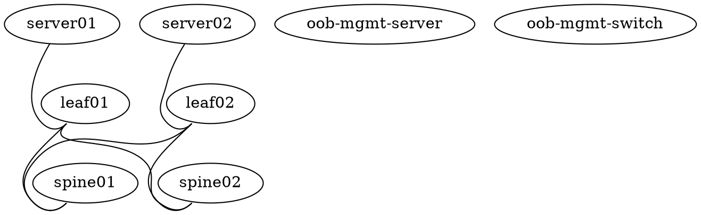

# 09 — Hands-on Labs

The NCP-AIN exam adds lab exercises from 1 November 2026, and even the multiple-choice questions are written by people who type these commands for a living. These six labs cover the command-line skills the blueprint touches most: NVUE on Cumulus, InfiniBand bring-up and partitions, RDMA performance testing, Ansible automation, NetQ/WJH troubleshooting, and the Kubernetes Network Operator.

## What you need

| Lab | Environment | Realistic options |
|---|---|---|
| [Lab 1 — Cumulus RoCE leaf-spine in NVIDIA Air](lab-01-nvidia-air-cumulus-roce-fabric.md) | **NVIDIA Air** (free) | Cumulus VX simulates NVUE, BGP/EVPN, QoS config syntax fully. Spectrum ASIC datapath features (real PFC/ECN behaviour, WJH hardware drops) are not simulated — you configure and verify config state, not line-rate behaviour |
| [Lab 2 — InfiniBand fabric bring-up and PKeys](lab-02-infiniband-fabric-bringup-and-pkeys.md) | Real Quantum switch + 2 hosts with ConnectX, **or** 2 hosts back-to-back with OpenSM | IB cannot be simulated in Air. Back-to-back ConnectX cards with `opensm` on one host give you ibstat/ibping/PKey/perfquest practice; a managed switch adds iblinkinfo/ibdiagnet depth |
| [Lab 3 — RDMA perftest and NCCL](lab-03-rdma-perftest-and-nccl.md) | 2 Linux hosts with ConnectX (IB or RoCE), **or** 2 VMs/hosts with **Soft-RoCE** | Soft-RoCE (`rxe`) runs the full verbs stack over any NIC — numbers are slow but every command and output format is real. GPU steps need an NVIDIA GPU |
| [Lab 4 — Ansible + NVUE leaf-spine](lab-04-ansible-nvue-leaf-spine.md) | NVIDIA Air (reuses Lab 1 topology) | Fully simulated |
| [Lab 5 — NetQ and WJH troubleshooting](lab-05-netq-wjh-troubleshooting.md) | NVIDIA Air (some pre-built demo topologies include a NetQ server), **or** Cumulus switches + NetQ OPTA | NetQ CLI and `netq check` work in Air demos; WJH hardware drop records require Spectrum hardware — the lab shows the commands and expected output and marks what is hardware-only |
| [Lab 6 — Kubernetes Network Operator](lab-06-kubernetes-network-operator.md) | Any Kubernetes cluster (kind/minikube acceptable for Operator/CRD mechanics) + at least one node with ConnectX for the full RDMA path | Helm install, NicClusterPolicy, and CRD inspection work anywhere; SR-IOV / RDMA shared device plugin need real NICs |

Honesty note: NVIDIA Air is excellent for Cumulus/NVUE/NetQ/Ansible. It does not simulate InfiniBand, UFM, ConnectX RDMA data paths, or Spectrum ASIC drop telemetry. Where a lab needs hardware, each lab file says so and gives the closest fallback.

*Figure 9-0 — Course lab environments: which environment each lab runs in, and what Air does and does not simulate.*

## Getting an NVIDIA Air account and a leaf-spine topology

1. Go to https://air.nvidia.com and sign up (an NVIDIA developer account works; business e-mail speeds approval). Verify in the current portal — the signup flow changes.
2. After login, choose **Create Simulation**. You have three starting points:
   - **Demo marketplace** — pre-built topologies, including Cumulus Linux "EVPN/VXLAN" demos and NetQ demos with a NetQ server already deployed. Fastest way to get a working BGP/EVPN leaf-spine for Labs 1, 4 and 5.
   - **Topology builder** — drag-and-drop nodes (Cumulus VX, Ubuntu servers) and links.
   - **Import DOT / topology file** — paste a Graphviz DOT description. The `.dot` below builds the two-leaf, two-spine, two-server fabric the labs assume.
3. Start the simulation, then open a node's console from the topology view, or use the **SSH service** (add a service on the `oob-mgmt-server` port 22, which gives you an SSH endpoint you can reach from your laptop; from there `ssh cumulus@leaf01`).
4. Default credentials on Cumulus VX in Air are typically `cumulus` / `cumulus` (you are forced to change it on first login in recent images) — verify in the simulation details.
5. Simulations auto-sleep after inactivity; **save a snapshot** before leaving if you want to keep state across days.

### Topology used by Labs 1, 4 and 5

Replace the `os` string with an image name offered by your Air tenant (`nv show system` on a running node shows the version). Air also auto-generates the out-of-band management network for every node.

### Addressing plan used in the labs

| Node | Loopback | Fabric links | Server-facing |
|---|---|---|---|
| spine01 | 10.10.10.101/32 | unnumbered (BGP over IPv6 link-local) | — |
| spine02 | 10.10.10.102/32 | unnumbered | — |
| leaf01 | 10.10.10.1/32 | swp51, swp52 unnumbered | swp1 → server01 10.1.1.1/24 (SVI vlan10 / or routed) |
| leaf02 | 10.10.10.2/32 | swp51, swp52 unnumbered | swp1 → server02 10.1.2.1/24 |
| server01 | — | — | eth1 10.1.1.11/24 |
| server02 | — | — | eth1 10.1.2.11/24 |

ASNs: spines 65100 (both), leaf01 65101, leaf02 65102.

## How to work the labs

Each lab has the same layout: **Objective → Environment → Prerequisites → Tasks (with expected output) → Verification checklist → Break/fix challenge → Cleanup**. Type the commands; do not paste whole blocks. When the lab says "expected output", your values (MACs, timestamps, exact counters) will differ; the *shape* and the key fields should match. Where a flag or output may differ by software release, the lab says "verify in current docs" — doing that lookup is itself exam practice.

Suggested order: 1 → 4 → 5 (all Air), then 3 (any two Linux hosts), then 2 and 6 as hardware allows.
