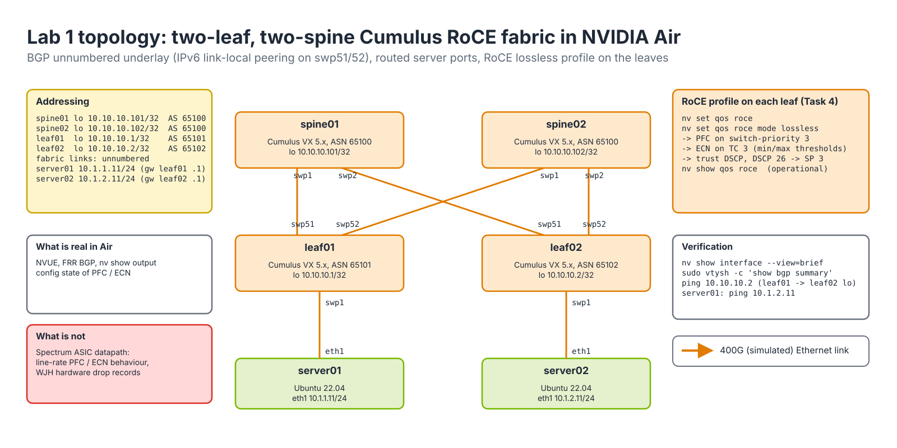

# Lab 1 — Build a Cumulus Leaf-Spine RoCE Fabric in NVIDIA Air

## Objective
Configure a two-leaf, two-spine Cumulus Linux fabric with **NVUE**: hostnames, loopbacks, BGP unnumbered underlay, server-facing interfaces, and the **RoCE** lossless QoS profile (**PFC** on priority 3, **ECN**, **DSCP**-based classification). Verify with `nv show` and FRR, and understand what the simulator does and does not prove.

## Environment
NVIDIA Air with the topology in [README.md](README.md) (Cumulus VX 5.x on all four switches, two Ubuntu servers). Cumulus VX executes the full NVUE/FRR control plane, so every command and `nv show` output here is real. The *datapath* is software: `nv set qos roce` is accepted and shown back, but there is no Spectrum ASIC to honor PFC or mark ECN at line rate. You are practicing configuration and verification syntax, which is what the exam measures.


*Figure 9-1 — Lab 1 topology: two-leaf, two-spine Cumulus fabric with loopbacks, ASNs, port names and server addressing.*

## Prerequisites
- Air simulation running; console or SSH access to all nodes (`cumulus`/`cumulus` on first login, then your new password).
- Modules `../04-spectrum-ethernet/` (Cumulus Essentials/Admin) and `../03-rdma/03-roce-a-to-z.md` read.
- Comfortable with the NVUE pattern: `nv set …` stages, `nv config apply` commits, `nv config save` persists to `/etc/nvue.d/startup.yaml`.

## Tasks

### Task 1 — Hostnames and loopbacks (all four switches)

On `leaf01` (repeat with the right values on the other three):

```bash
nv set system hostname leaf01
nv set interface lo ip address 10.10.10.1/32
nv config apply -y
nv config save
```

Expected: the prompt changes to `cumulus@leaf01:mgmt:~$` after re-login; `nv show interface lo ip address` lists `10.10.10.1/32`.

### Task 2 — Fabric interfaces and BGP unnumbered

Leaves (example leaf01, ASN 65101):

```bash
nv set interface swp51,swp52 link state up
nv set router bgp autonomous-system 65101
nv set router bgp router-id 10.10.10.1
nv set vrf default router bgp peer-group underlay remote-as external
nv set vrf default router bgp neighbor swp51 peer-group underlay
nv set vrf default router bgp neighbor swp52 peer-group underlay
nv set vrf default router bgp address-family ipv4-unicast redistribute connected
nv config apply -y
```

Spines (example spine01, ASN 65100): same pattern with `swp1,swp2` as neighbors and `router-id 10.10.10.101`. Both spines share ASN 65100 — this is the standard design, so that routes learned from one spine are not re-advertised to the other.

Verify:

```bash
nv show vrf default router bgp neighbor
sudo vtysh -c "show bgp summary"
```

Expected (leaf01):

```text
Neighbor        V  AS    MsgRcvd MsgSent TblVer InQ OutQ Up/Down  State/PfxRcd  PfxSnt Desc
spine01(swp51)  4  65100      24      25      0   0    0 00:01:02        3        2 N/A
spine02(swp52)  4  65100      24      25      0   0    0 00:01:01        3        2 N/A
```

`State/PfxRcd` must be a number, not `Active`/`Connect`. Ping leaf02's loopback from leaf01: `ping -c 3 10.10.10.2`.

### Task 3 — Server-facing interfaces

Routed design (simplest for a RoCE compute fabric):

```bash
# leaf01
nv set interface swp1 ip address 10.1.1.1/24
nv set interface swp1 link state up
nv config apply -y
# leaf02
nv set interface swp1 ip address 10.1.2.1/24
nv config apply -y
```

On `server01`: `sudo ip addr add 10.1.1.11/24 dev eth1 && sudo ip link set eth1 up && sudo ip route add 10.1.0.0/16 via 10.1.1.1`. Mirror on server02 with 10.1.2.11 via 10.1.2.1. Then `ping -c 3 10.1.2.11` from server01 must succeed through both leaves and a spine.

### Task 4 — RoCE lossless profile

NVUE provides a single command that applies NVIDIA's recommended RoCE QoS: DSCP 26 → switch priority 3, PFC on priority 3, ECN on the corresponding traffic class, CNP (DSCP 48) in a high-priority class, and buffer reservations.

```bash
nv set qos roce mode lossless
nv config apply -y
nv show qos roce
```

Expected (abridged; values vary by release — verify in current docs):

```text
                   operational  applied
-----------------  -----------  --------
enable             on           on
mode               lossless     lossless
cable-length       100          100
congestion-control
  congestion-mode  ECN
  enabled-tc       0,3
  max-threshold    1.43 MB
  min-threshold    146.48 KB
pfc
  pfc-priority     3
  rx-enabled       enabled
  tx-enabled       enabled
trust
  trust-mode       pcp,dscp
RoCE PCP/DSCP->SP mapping configurations
   pcp  dscp                     switch-prio
   ---  ----------------------   -----------
   3    26                       3
RoCE SP->TC mapping and ETS configurations
   switch-prio  traffic-class  scheduler-weight
   3            3              DWRR-50%
   6            6              strict-priority   (CNP)
```

Key reading: the RoCE traffic class gets PFC and ECN, CNPs ride a strict-priority class, and trust is on DSCP so a host sending `NCCL_IB_TC=106` (DSCP 26) lands in priority 3. Also inspect `nv show qos pfc`, `nv show qos congestion-control`, `nv show qos mapping` and `nv show interface swp1 qos` (paths vary slightly by release).

### Task 5 — Persist and inspect the rendered configuration

```bash
nv config save
nv config show -o commands | grep -E 'qos|bgp' | head -30
nv config diff 1 2            # compare two revisions
nv config history
```

`nv config show -o commands` is the form you will paste into Ansible (Lab 4). Note how `nv set qos roce mode lossless` expands into many underlying parameters.

## Verification checklist
- [ ] `nv show system` shows the right hostname on each node.
- [ ] `sudo vtysh -c "show bgp summary"` on both leaves: both spines Established with prefixes received.
- [ ] `ip route show 10.10.10.2` on leaf01 shows two next-hops (ECMP via swp51 and swp52).
- [ ] `ping 10.1.2.11` from server01 succeeds.
- [ ] `nv show qos roce` reports `mode lossless`, `pfc-priority 3`, ECN enabled on TC3, trust `dscp` (or `pcp,dscp`).
- [ ] `nv config save` done; `cat /etc/nvue.d/startup.yaml | grep -A3 roce` shows the setting.

## Break/fix challenge
Have a partner (or your future self) apply one of these on leaf02 without telling you, then find and fix it using only `nv show`, `vtysh` and `ping`:

1. `nv set qos roce mode lossy ; nv config apply -y` — RoCE profile mismatch between leaves. Expected discovery: `nv show qos roce` on each leaf differs (`mode lossy`, PFC absent). In production this is the "one rack is slow" root cause; Lab 5 finds it with `netq show roce-config`.
2. `nv unset vrf default router bgp neighbor swp52 ; nv config apply -y` — leaf02 loses one spine. Expected discovery: `show bgp summary` shows one neighbor; `ip route show 10.10.10.1` has a single next-hop. Fix by re-adding the neighbor.
3. `nv set interface swp1 ip address 10.1.2.1/25 ; nv config apply -y` — server02 subnet mismatch. Expected: ping fails, `nv show interface swp1 ip address` reveals the mask.

Write down for each: the first command that revealed the fault, and the fix.

## Cleanup
Either revert with `nv config apply <good-revision>` (see `nv config history`) or leave the fabric running — Labs 4 and 5 reuse it. If you stop the simulation, take an Air snapshot first.
